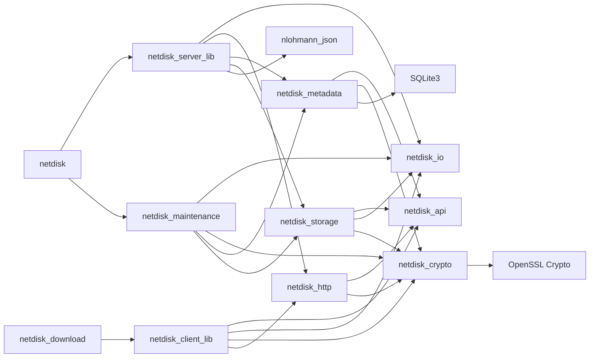

# NetDisk 第33A架构基线

本文件记录生产代码的稳定模块边界 CMake配置阶段由
`cmake/NetdiskArchitecture.cmake`执行相同约束 若本文件与真实源码不一致
以修正真实设计并同时更新守卫为准 不允许只修改文档绕过检查

## 模块职责

| 模块 | 职责 |
| --- | --- |
| api | 服务端与客户端共享的文件标识规则 |
| io | POSIX资源所有权和有限字节发送 |
| crypto | SHA256格式校验和OpenSSL摘要计算 |
| http | HTTP请求 范围和响应协议 |
| metadata | SQLite连接和文件元数据存取 |
| storage | 对象路径 临时上传和发布 |
| maintenance | 启动恢复 存储审计和摘要回填 |
| server | 服务端请求编排 文件目录和内容处理 |
| client | 断点下载决策和下载会话 |

禁止新增`core` `common` `utils` `misc`或`net`等兜底模块
确需新增模块时必须先明确单一职责 稳定接口和依赖方向 经用户确认后同时更新
本文件 CMake目标和架构守卫

## 目标依赖图

图的类型 模块依赖Flowchart

选择这种图是因为需要明确展示每个CMake目标的直接依赖方向
所有箭头都表示左侧目标直接依赖右侧目标 图必须保持无环

## 图的解释

客户端完整链接闭包只允许包含`client api io crypto http`以及OpenSSL Crypto
不得直接或传递到达`server storage metadata maintenance SQLite3 nlohmann_json`

## 公开接口规则

- 公开头只放在`src/<module>/include/netdisk/<module>/`
- 头文件表示稳定的跨编译单元接口 不按学习天数或单个小函数拆分
- 普通函数和类实现优先放`.cpp`
- 模板 简单RAII和必要`constexpr`才保留头文件实现
- 生产文件名不得使用`dayXX`或`lessonXX`命名
- CMake目标对应真实模块 不对应单个头文件
- 只使用`target_include_directories` 不使用目录级或全局`include_directories`

## 变更流程

每个后续教程必须包含架构影响说明 明确本次所属模块 新增直接依赖
客户端闭包变化 公开头变化和保持不变的协议或存储边界

如需改变模块或依赖图 必须先暂停实现 给出职责 边界 无环依赖图
迁移方式和兼容影响 等用户明确确认后再同时修改本文 CMake守卫和源码
