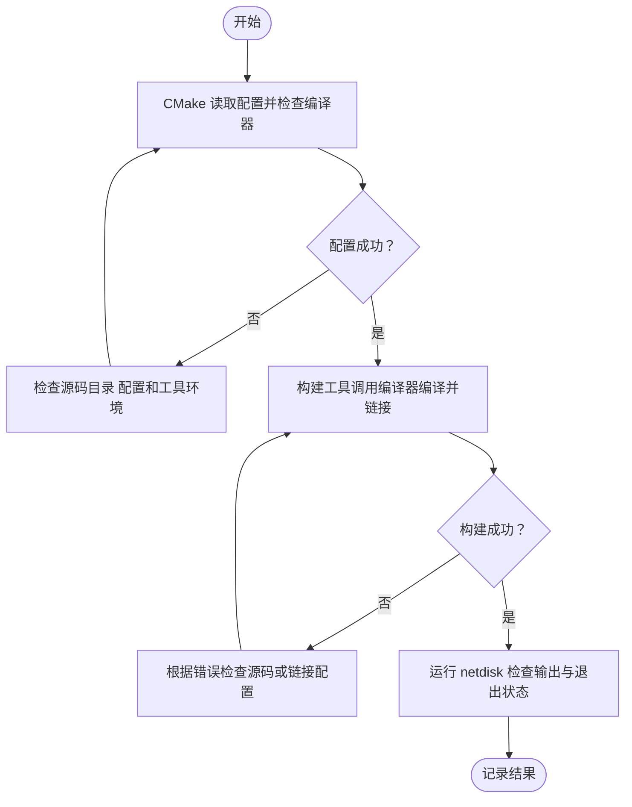

# 第一天：建立独立的 C++17 工程

## 1 今天要完成什么

今天只解决一个问题：在 Linux 虚拟机里建立网盘项目，能够用 CMake 构建并运行一个 C++17 程序，并留下真实环境记录。

这是计划中的第 01 单元，内容按约 40 分钟的学习量组织，不要求在固定时间内结束。遇到环境问题先解决，构建和运行未通过前不进入下一单元。

当前项目此前只有计划，没有可运行版本。今天新增 `main.cpp` 和 `CMakeLists.txt`；没有迁移或修改旧的 lcopy 工程。

今天的完成标准：

- 确认命令在 Linux 虚拟机执行，记录系统、CPU、内存、磁盘、编译器和 CMake 信息。
- 在 `~/projects/netdisk` 建立独立工程。
- 完成配置、构建和运行，程序输出 C++ 标准值 `201703` 并正常退出。
- 能解释源码、CMake 配置、构建目录和可执行文件之间的关系。

最终产品目标清单：上传、列表与详情、下载、重命名、删除、完整性校验、下载续传、上传续传、多客户端、异常恢复、简单网页、工程交付。今天只建立这些功能的工程起点，不实现业务接口。

## 2 确认在哪台机器上操作

本教程中的 `sh` 代码块全部在 **VS Code 连接 Linux 虚拟机后的终端** 执行，不是在 Windows PowerShell 执行。

Windows 参考源码位于 `D:\BasicKnowledge\Project\CPP\NetDisk\projects\netdisk`。Linux 工作目录采用 `~/projects/netdisk`。两者是不同机器上的目录，文件不会自动同步。你可以在远程 VS Code 中新建下文文件并复制内容，也可以自行复制参考文件。

先在 Linux 终端执行，当前目录不限：

```sh
uname -s
pwd
cat /etc/os-release
uname -m
nproc
free -h
df -h "$HOME"
g++ --version
cmake --version
```

逐项理解：

| 命令 | 记录内容 | 用途 |
| --- | --- | --- |
| `uname -s` | 应为 Linux | 确认操作环境 |
| `pwd` | 当前绝对路径 | 避免在错误目录创建或构建 |
| `cat /etc/os-release` | 发行版与版本 | 后续选择适用的依赖安装方法 |
| `uname -m` | CPU 架构 | 区分 x86_64、aarch64 等环境 |
| `nproc` | 当前进程可用 CPU 数 | 作为构建并行度的参考 |
| `free -h` | 总内存及 available | 观察可用内存，不能只看 free 列 |
| `df -h "$HOME"` | 主目录所在文件系统余量 | 判断工程所在磁盘的可用空间 |
| `g++ --version` | GCC C++ 编译器版本 | 确认工具存在，实际标准支持仍以构建为准 |
| `cmake --version` | CMake 版本 | 本工程配置声明最低版本 3.16 |

计划中记录过虚拟机 4GB 内存、CMake 4.2.3，本次仍以实际输出为准。若使用其他 C++ 编译器，记录实际版本及 CMake 选中的编译器即可。

若 `g++` 或 `cmake` 不存在，先记录发行版与完整错误，再按该发行版安装开发工具。本单元不要求安装 SQLite、OpenSSL 或 JSON 库。不要把 Windows 的版本信息填入 Linux 记录。

## 3 建立独立目录

在 Linux 终端执行，起始目录不限：

```sh
mkdir -p "$HOME/projects/netdisk"
cd "$HOME/projects/netdisk"
pwd
ls -la
```

`mkdir -p` 创建缺失的父目录，已有目录会保留；`cd` 改变当前终端工作目录。`pwd` 应显示你的 Linux 主目录下的 `projects/netdisk`，不应是旧的 `projects/lcopy`。

检查目录内容。如果已有同名源码，先查看，避免覆盖已有成果。确认这是预期的独立工程后执行：

```sh
mkdir -p src docs/test-results
```

今天只需要以下源码布局：

```text
netdisk/
  CMakeLists.txt
  src/
    main.cpp
  docs/
    test-results/
      day01-environment.md
```

`day01-environment.md` 用来填写实际输出，模板见第 8 节。`build/` 将由 CMake 生成，不需要手工创建或编辑其中的文件。

## 4 完整源码与构建配置

用远程 VS Code 打开 Linux 的 `~/projects/netdisk`，创建以下两个文件，保存为 UTF-8。

### src/main.cpp

```cpp
#include <iostream>

int main()
{
    std::cout << "netdisk day 01\n";
    std::cout << "C++ standard: " << __cplusplus << '\n';
    std::cout << "Environment check only. Server is not running.\n";
    return 0;
}
```

逐项解释：

- `#include <iostream>` 引入标准输入输出流声明。
- `int main()` 是程序入口，无参数形式表示今天不读取命令行参数；返回类型是 `int`。
- `std::cout` 是标准输出流，`<<` 把字符串或数字写入流；`\n` 是换行字符。输出可能经过缓冲，不等于每次 `<<` 都立即执行一次系统调用。
- `__cplusplus` 是编译器提供的宏，反映当前翻译单元使用的 C++ 标准模式。C++17 对应 `201703L`，输出数字时不显示后缀 `L`。它不是 GCC 的版本号，也不是运行时查询结果。
- `return 0` 表示正常退出。它不会打印数字 `0`，而是向运行程序的环境提供退出状态。

本次没有自定义类，没有 Linux 系统调用，也没有文件描述符、Socket 或手工申请的内存。执行过程是进入 `main`，把固定字符串和编译期宏值写到标准输出，然后正常退出。标准输出流由 C++ 运行时管理，今天不需要调用 `close`。输出失败检测尚未实现，验收因此同时检查可见输出和退出状态。

### CMakeLists.txt

```cmake
cmake_minimum_required(VERSION 3.16)

project(netdisk LANGUAGES CXX)

add_executable(netdisk src/main.cpp)

set_target_properties(netdisk PROPERTIES
    CXX_STANDARD 17
    CXX_STANDARD_REQUIRED YES
    CXX_EXTENSIONS NO
)
```

逐项解释：

| 配置 | 含义 |
| --- | --- |
| `cmake_minimum_required(VERSION 3.16)` | 声明允许的最低 CMake 版本，不是要求安装恰好 3.16 |
| `project(netdisk LANGUAGES CXX)` | 命名工程并启用 C++ 语言，CXX 是 CMake 中的 C++ 标识 |
| `add_executable(netdisk src/main.cpp)` | 定义名为 netdisk 的可执行目标，源码路径相对当前源码目录 |
| `CXX_STANDARD 17` | 为该目标请求 C++17 标准模式 |
| `CXX_STANDARD_REQUIRED YES` | 不允许因不支持请求标准而退回更旧标准 |
| `CXX_EXTENSIONS NO` | 请求关闭编译器特有的语言扩展模式 |

工程名与目标名是两个概念，今天都叫 netdisk 只是为了简单。CMake 负责检查环境和生成构建系统，真正的编译、链接由构建工具调用编译器完成。

## 5 配置、构建、运行

以下命令都在 Linux 工程根目录 `~/projects/netdisk` 执行，每一步成功后再执行下一步：

```sh
cd "$HOME/projects/netdisk"
cmake -S . -B build
cmake --build build --parallel 2
./build/netdisk
echo $?
```

- `-S .` 指定源码目录是当前目录。
- `-B build` 指定生成文件和编译产物存放在 `build` 目录，让源码与产物分离。
- 配置成功通常能看到 `Configuring done`、`Generating done` 以及构建目录路径。首次配置还会识别编译器。
- `cmake --build build` 调用该构建目录对应的构建工具，不需要先假定它是 Make 还是 Ninja。
- `--parallel 2` 限制并行构建任务数。若内存紧张可改为 1。今天只有一个源码文件，并行构建收益很小。
- `./build/netdisk` 是相对当前目录的可执行文件路径。只有完成编译和链接后它才存在。
- `echo $?` 显示上一条命令的退出状态，必须紧跟程序执行，不能先插入其他命令。

默认 Linux 单配置构建下，程序预期输出：

```text
netdisk day 01
C++ standard: 201703
Environment check only. Server is not running.
```

随后 `echo $?` 预期输出 `0`。此时程序已经退出，终端重新出现提示符是正常现象。

如果环境选择的是多配置生成器，可使用 `cmake --build build --config Debug --parallel 2` 并运行 `./build/Debug/netdisk`，以实际生成目录为准；今天默认沿用 Linux 常见的单配置生成器。

## 6 构建流程图

**图的类型**：Flowchart 流程图。

**为什么选择这种图**：今天要理解从配置到构建再到运行的步骤，以及失败后应该返回哪里排查，流程图可以直接表达这些分支。

**Mermaid**：



**图的解释**：配置成功只说明已生成构建系统，不代表 C++ 源码已经编译成功；构建成功说明生成了可执行文件，仍需实际运行才能核对今天的预期行为。如果排错修改了 CMake 配置，可重新执行配置命令。

## 7 小改动与故障实验

只修改本项目的 `src/main.cpp`，每个实验后恢复原始版本。

### 实验 A：确认源码与可执行文件是不同文件

把第一行输出改为：

```cpp
    std::cout << "netdisk day 01 ready\n";
```

保存后先执行 `./build/netdisk`，预期仍然输出旧文字。再执行：

```sh
cmake --build build --parallel 2
./build/netdisk
```

现在才应出现新文字。如果编辑器已配置自动构建，第一次运行也可能已出现新文字，应以构建日志确认。

参考解释：编辑的是源码文件，运行的是之前编译生成的机器码文件。默认流程不会因为保存源码就自动更新可执行文件。

### 实验 B：编译失败不等于旧程序消失

暂时删除 `return 0;` 末尾的分号，保存后执行构建命令，预期出现编译错误，构建命令退出状态非零。紧接着执行 `echo $?` 记录结果，不要求错误数字固定为某一个值。

参考解释：错误通常指向 `return` 或后面的右花括号附近，应从第一条相关错误回看源码。之前成功生成的可执行文件可能仍保留，所以“还能运行旧程序”不能证明刚才构建成功。

补回分号，将第一行输出恢复为 `netdisk day 01`，重新构建、运行，确认恢复到第 5 节的输出。

## 8 环境与验收记录模板

在 Linux 的 `docs/test-results/day01-environment.md` 中填写下面模板。不要把预期结果直接写成实际通过结果。

```text
日期：
Linux 发行版与版本：
架构：
可用 CPU 数：
内存 total / available：
工程所在文件系统可用容量：
C++ 编译器版本：
CMake 版本：
Linux 工程绝对路径：

配置命令及结果：
构建命令及结果：
程序实际输出：
程序退出状态：
修改输出后重新构建的结果：
缺少分号时的第一条相关错误与退出状态：
恢复源码后构建运行结果：
尚不理解的问题：
```

验收清单：

- [ ] 环境信息来自 Linux 虚拟机
- [ ] 工程目录独立于 lcopy
- [ ] 配置和构建成功
- [ ] 标准值为 201703 输出内容一致 退出状态为 0
- [ ] 能说明修改源码后为什么需要重新构建
- [ ] 故障实验后源码已恢复并重新构建成功

## 9 常见错误排查

| 现象 | 优先检查 | 处理入口 |
| --- | --- | --- |
| `command not found` | 是否在 Linux 对应工具是否安装 | 记录系统版本和缺失工具，不套用未知发行版的安装命令 |
| 找不到 CMakeLists.txt | `pwd` 和 `ls` | 切换到包含该文件的工程根目录 |
| 找不到 src/main.cpp | 文件名大小写和相对路径 | 确认实际保存为 main.cpp 而非 main.cpp.txt |
| 编译器检测失败 | 配置日志中的第一处错误 | 核对编译器是否可执行，不反复运行构建掩盖配置失败 |
| 执行文件不存在 | 构建是否成功和输出目录 | 先检查构建日志，核对是否使用多配置生成器 |
| 修改后输出没变化 | 是否保存 是否重新构建 是否运行了正确路径 | 检查当前目录和构建结果 |
| 标准值不是 201703 | 是否使用今天的 CMake 配置 | 查看实际编译命令并检查是否运行旧文件 |
| 缓存引用其他源码路径 | 是否复制了旧 build 目录 | 保留旧目录，改用 `cmake -S . -B build-day01` 建立新构建目录 |

需要查看实际编译命令时，在工程根目录执行 `cmake --build build --verbose`。若目标没有变化，可能不会再次打印编译命令；先保存一次有效源码修改再观察。不要编辑自动生成的 Makefile 来修正项目配置。

## 10 复盘题与参考答案

**1. 为什么要把 build 与 src 分开？**

源码是需要维护的输入，build 中是缓存和编译产物。分开放置方便检查和重新生成，也避免把其他机器的路径缓存误当作源码配置。

**2. CMake 配置成功是否代表程序可以运行？**

不是。配置后还要编译和链接，成功生成可执行文件后才能运行验证。

**3. `__cplusplus` 为 201703 是否表示编译器版本是 2017？**

不是。它表示此文件采用的语言标准模式；编译器版本需要单独查看。

**4. `return 0` 与 `std::cout << 0` 有什么区别？**

前者结束 main 并报告正常退出状态；后者把字符 0 写到标准输出，不决定程序退出状态。

**5. 今天程序为什么运行后立即结束？**

它完成三条输出后就返回，没有监听套接字和处理请求的循环。目前没有运行中的网盘服务。

**6. Windows 已有源码，是否说明 Linux 已完成这一天？**

不是。Linux 文件修改、构建、运行和理解情况需要分别提供证据。

## 11 当前限制与下一步

今天只验证基础构建链路，不覆盖网络、上传下载、磁盘读写错误、并发或 HTTP。没有引入第三方库或自动测试框架；这个最小程序用实际输出与退出状态人工验收即可。

本地参考文件已生成，用户虚拟机是否建立目录、构建运行是否通过，均待实际结果确认。完成后提供环境记录、构建结果、程序输出及尚不理解的问题；先解决这些问题，再进入第 02 单元的文件描述符所有权、RAII 和错误输出。
