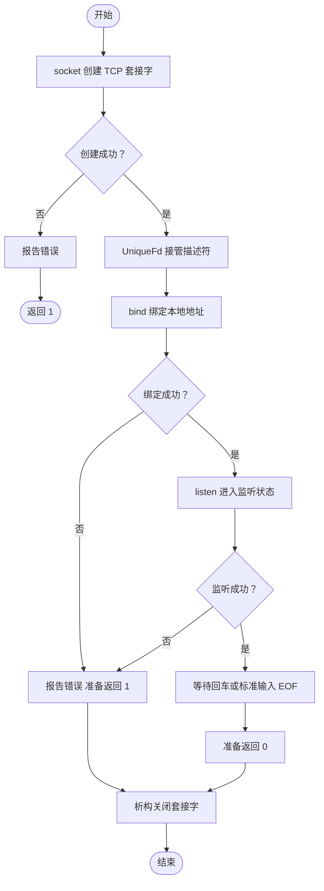

# 第 03 单元 TCP 监听与 GDB 入门

本文件供助手保存上下文 教学必须在对话中完整发送
用户明确要求第 03 单元 并已约定本单元引入 GDB
前两天 Linux 验收仍未确认 不因继续课程自动改为通过

## 目标与版本变化
main 从文件打开实验改为 IPv4 TCP 监听 127.0.0.1:8080
复用 UniqueFd 错误辅助函数 print_system_error 输出保存的 errno
UniqueFd 与 CMakeLists.txt 不变 不增加 accept recv send HTTP
使用 std::cin.get 等待回车 临时保持进程运行 标准输入 EOF 时也会退出
默认只在 Linux 虚拟机自身回环地址监听 不等于监听 Windows 宿主机

## 完整源码
### src/main.cpp
```cpp
#include "unique_fd.h"

#include <arpa/inet.h>
#include <cerrno>
#include <cstdint>
#include <cstring>
#include <iostream>
#include <netinet/in.h>
#include <sys/socket.h>

void print_system_error(const char* operation, int error)
{
    std::cerr << operation << " failed: "
              << std::strerror(error)
              << " (errno=" << error << ")\n";
}

int main()
{
    constexpr std::uint16_t port = 8080;
    constexpr int backlog = 16;

    const int raw_fd = ::socket(AF_INET, SOCK_STREAM | SOCK_CLOEXEC, 0);
    if (raw_fd == -1)
    {
        const int error = errno;
        print_system_error("socket", error);
        return 1;
    }

    UniqueFd listener(raw_fd);

    sockaddr_in address{};
    address.sin_family = AF_INET;
    address.sin_port = htons(port);
    address.sin_addr.s_addr = htonl(INADDR_LOOPBACK);

    const int bind_result = ::bind(
        listener.get(),
        reinterpret_cast<const sockaddr*>(&address),
        sizeof(address));
    if (bind_result == -1)
    {
        const int error = errno;
        print_system_error("bind", error);
        return 1;
    }

    const int listen_result = ::listen(listener.get(), backlog);
    if (listen_result == -1)
    {
        const int error = errno;
        print_system_error("listen", error);
        return 1;
    }

    std::cout << "listening on 127.0.0.1:" << port
              << " fd=" << listener.get() << '\n';
    std::cout << "Press Enter to stop. No requests are handled yet."
              << std::endl;
    std::cin.get();

    std::cout << "leaving main\n";
    return 0;
}
```

### src/unique_fd.h
```cpp
#pragma once

#include <cerrno>
#include <unistd.h>

class UniqueFd
{
public:
    explicit UniqueFd(int fd) noexcept : fd_(fd)
    {
    }

    ~UniqueFd() noexcept
    {
        if (fd_ >= 0)
        {
            const int saved_errno = errno;
            ::close(fd_);
            errno = saved_errno;
        }
    }

    UniqueFd(const UniqueFd&) = delete;
    UniqueFd& operator=(const UniqueFd&) = delete;
    UniqueFd(UniqueFd&&) = delete;
    UniqueFd& operator=(UniqueFd&&) = delete;

    int get() const noexcept
    {
        return fd_;
    }

private:
    int fd_;
};
```

### CMakeLists.txt
```cmake
cmake_minimum_required(VERSION 3.16)

project(netdisk LANGUAGES CXX)

add_executable(netdisk src/main.cpp)

set_target_properties(netdisk PROPERTIES
    CXX_STANDARD 17
    CXX_STANDARD_REQUIRED YES
    CXX_EXTENSIONS NO
)
```

## 接口与类型
socket(domain,type,protocol) 返回非负描述符 失败 -1 并设置 errno
AF_INET 指定 IPv4 SOCK_STREAM 为流套接字 此组合协议 0 选择 TCP SOCK_CLOEXEC 设置 exec 关闭标志
UniqueFd 在成功获取后立即接管 全部后续返回路径关闭
sockaddr_in 为 IPv4 地址结构 {} 零初始化 sin_family 是地址族 sin_port 是端口 sin_addr.s_addr 是 IPv4 地址
uint16_t 为 16 位无符号整数 constexpr 为编译期常量
htons 转换 16 位主机序到网络序 htonl 转换 32 位主机序到网络序 网络字节序为大端
sin_family 不作字节序转换 INADDR_LOOPBACK 转换后表示 127.0.0.1
bind(fd, sockaddr指针, 长度) 绑定本地地址 成功 0 失败 -1
reinterpret_cast 将 IPv4 结构地址适配通用 Socket API 参数 不进行内容复制 字节序转换或 C++ 继承转换
listen(fd,backlog) 进入监听状态 成功 0 失败 -1 不等待客户端 不读取请求
Linux TCP backlog 指已完成连接建立 等待 accept 的队列上限请求 受系统上限约束 不等于同时处理客户端数量
打印系统错误前保存 errno 正常返回 0 初始化失败返回 1
std::endl 换行并刷新输出 便于看到等待提示 std::cin.get 为临时生命周期控制

## Linux 构建运行
命令执行目录 ~/projects/netdisk
```sh
cd "$HOME/projects/netdisk"
gdb --version
cmake -S . -B build-debug -DCMAKE_BUILD_TYPE=Debug
cmake --build build-debug --parallel 2
./build-debug/netdisk
```
默认 Linux 单配置生成器 Debug 构建供源码调试 使用独立 build-debug 防止运行旧 build 文件
多配置生成器构建加 --config Debug 对应可执行文件通常 build-debug/Debug/netdisk
预期 listening on 127.0.0.1:8080 fd=N 和回车提示
保持终端 A 不按回车 在同一 Linux 虚拟机终端 B 执行
```sh
ss -ltnp 'sport = :8080'
```
预期存在对应地址 LISTEN 行 权限可能影响进程名显示
终端 A 回车后 echo $? 预期 0 再查看 ss 对应监听消失
不要使用 curl 作为 HTTP 验收 尚未实现应用层响应
不以 Ctrl+C 验证析构 默认 SIGINT 终止不保证局部析构

## 端口冲突实验
保持 A 的进程运行 B 中执行 ./build-debug/netdisk 并 echo $?
预期 bind failed Address already in use 非零状态 1
若第一个程序已失败 用 ss 查看已有占用 不擅自终止未知服务
正常结束自己启动的 A 进程 然后再次运行 B 预期能监听
今日不加入地址重用选项 不把 TIME_WAIT 处理提前混入

## GDB 正常路径
先结束其他自己启动的监听实例
Linux shell 执行 gdb ./build-debug/netdisk
下面在 (gdb) 提示符输入
```text
break main
run
list
next
```
next 按源码行单步 可重复直到 raw_fd 初始化执行完 再 print raw_fd
显示行通常是尚未执行的语句 不读未初始化的变量 不默认固定 next 次数
以下行号对应本教程完整 main.cpp 未自行增删行
```text
break main.cpp:42
continue
print raw_fd
print bind_result
print address
x/2bx &address.sin_port
break main.cpp:50
continue
print listen_result
break 'UniqueFd::~UniqueFd()'
continue
```
42 是 bind 后判断 50 是 listen 后判断 正常结果均 0
端口 8080 网络内存字节为 0x1f 0x90 小端主机 print sin_port 原始整数可能为 36895 不代表端口绑定错
没有 (gdb) 提示符且程序等待输入时 按回车发送给程序
停在析构后执行
```text
print fd_
bt
next
```
用 next 观察经过 close(fd_) 最后 continue 正常退出 quit 结束调试
析构断点证明进入释放路径 若需查看 close 返回值继续用 strace 辅助 不把源码断点冒充系统调用成功日志
C++ 析构可能有多个断点位置 编号以实际为准
如果位置不同 list main 对照实际源码行号设置断点

## GDB 端口冲突路径
A 正常运行监听程序 B 新开 GDB
```text
break print_system_error
break 'UniqueFd::~UniqueFd()'
run
print operation
print error
bt
continue
print fd_
continue
quit
```
错误函数内 operation 应为 bind error 对应 EADDRINUSE bt 显示由 main 调用
继续后进入析构 确认失败返回仍释放监听描述符
GDB 通常显示退出代码 01 表示本程序返回 1
完成后回 A 按回车关闭自己启动的进程

## 流程图
类型 Flowchart 表达初始化控制流与失败清理

只有创建成功后存在 UniqueFd 所有者 bind 和 listen 失败都经由析构清理

## 小改动与参考答案
把 port 从 8080 改为 8081 重新构建 再用 ss 查看 8081
保存源码不重新构建不会更新可执行文件 先退出 GDB 再重建再启动 避免源码与调试符号不匹配
不增加网络业务即可验证地址配置与可执行文件的关系
复盘 socket 创建端点 bind 绑定地址 listen 开始被动监听
listen 不阻塞等待客户端 accept 才取出已建立连接并返回独立连接 fd 下一单元学习
监听 fd 与客户端连接 fd 职责不同 不在监听 fd 上直接 recv
INADDR_LOOPBACK 仅本机 回环地址不跨 Windows 和 Linux 虚拟机
backlog 不等于应用并发处理能力
GDB 的 next 执行当前行并跨过函数调用 step 进入函数 continue 运行到下一停止点 print 查看表达式 bt 查看调用栈
今日优先用 next 避免进入标准库或 libc 实现

## 排错与限制
缺少 gdb 先提供发行版和错误 再确认安装方法
缺少调试符号 核对 Debug 配置和 build-debug 实际路径
变量 optimized out 核对实际编译参数 必要时 cmake --build build-debug --clean-first --verbose
GDB 报 ptrace Operation not permitted 则提供环境信息 不直接修改系统安全设置
程序立即退出 检查 stdin 是否为 EOF 或已输入换行
地址占用 使用 ss 查看 不杀未知进程
当前无 accept 数据收发 HTTP 多连接 超时 信号退出处理 地址和端口固定
客户端可能由内核完成握手但应用不处理请求 因此连接成功不证明业务可用
Linux 实际构建运行和 GDB 未执行 仅本地文件与行号静态核对

## 资料
https://man7.org/linux/man-pages/man2/socket.2.html
https://man7.org/linux/man-pages/man2/bind.2.html
https://man7.org/linux/man-pages/man2/listen.2.html
https://man7.org/linux/man-pages/man7/ip.7.html
https://sourceware.org/gdb/current/onlinedocs/gdb.html/Set-Breaks.html
https://sourceware.org/gdb/current/onlinedocs/gdb.html/Continuing-and-Stepping.html
