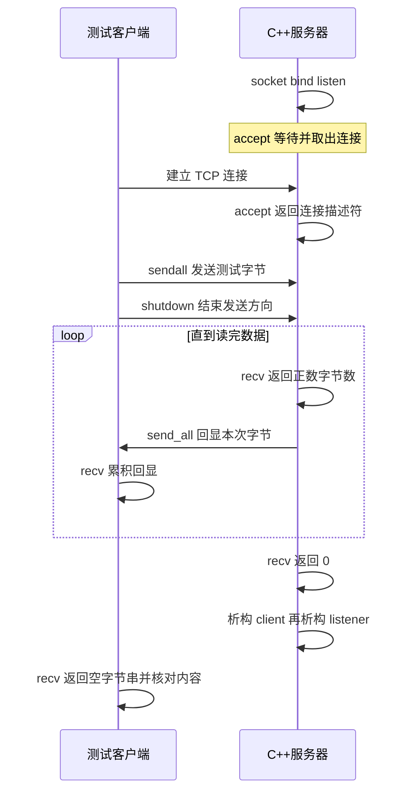

# 第 04 单元 accept recv send 与 GDB 函数调试

日期 2026-10-18
用户已明确反馈前三天基本掌握 不重讲 CMake RAII 与监听基础
本文件仅供助手保存上下文 教学在对话完整发送

## 目标与变化
一次进程处理一个 TCP 连接 读到对端发送方向 EOF 后退出
新增 send_all handle_client 与 Python 测试客户端 删除键盘等待
main 中保留 listener 所有权 新增 client 所有权 退出时 client 先析构 listener 后析构
handle_client 和 send_all 借用描述符 不负责关闭
CMake 与 UniqueFd 不变 完整代码仍在对话提供
提前采用短写循环 EINTR 重试 MSG_NOSIGNAL 保证最小版本正确 第 06 单元深入故障实验

## 完整代码
### src/main.cpp
```cpp
#include "unique_fd.h"

#include <arpa/inet.h>
#include <cerrno>
#include <cstddef>
#include <cstdint>
#include <cstring>
#include <iostream>
#include <netinet/in.h>
#include <sys/socket.h>

void print_system_error(const char* operation, int error)
{
    std::cerr << operation << " failed: "
              << std::strerror(error)
              << " (errno=" << error << ")\n";
}

bool send_all(int fd, const char* data, std::size_t size)
{
    std::size_t sent = 0;
    while (sent < size)
    {
        const ssize_t n = ::send(
            fd, data + sent, size - sent, MSG_NOSIGNAL);
        if (n == -1)
        {
            const int error = errno;
            if (error == EINTR)
            {
                continue;
            }
            print_system_error("send", error);
            return false;
        }
        if (n == 0)
        {
            std::cerr << "send made no progress\n";
            return false;
        }
        sent += static_cast<std::size_t>(n);
    }
    return true;
}

bool handle_client(int client_fd)
{
    char buffer[4096];
    while (true)
    {
        const ssize_t n = ::recv(client_fd, buffer, sizeof(buffer), 0);
        if (n == -1)
        {
            const int error = errno;
            if (error == EINTR)
            {
                continue;
            }
            print_system_error("recv", error);
            return false;
        }
        if (n == 0)
        {
            std::cout << "client finished sending\n";
            return true;
        }

        std::cout << "received bytes=" << n << '\n';
        if (!send_all(client_fd, buffer, static_cast<std::size_t>(n)))
        {
            return false;
        }
    }
}

int main()
{
    constexpr std::uint16_t port = 8080;
    constexpr int backlog = 16;

    const int raw_fd = ::socket(AF_INET, SOCK_STREAM | SOCK_CLOEXEC, 0);
    if (raw_fd == -1)
    {
        const int error = errno;
        print_system_error("socket", error);
        return 1;
    }
    UniqueFd listener(raw_fd);

    const int reuse_address = 1;
    if (::setsockopt(listener.get(), SOL_SOCKET, SO_REUSEADDR,
                     &reuse_address, sizeof(reuse_address)) == -1)
    {
        const int error = errno;
        print_system_error("setsockopt", error);
        return 1;
    }

    sockaddr_in address{};
    address.sin_family = AF_INET;
    address.sin_port = htons(port);
    address.sin_addr.s_addr = htonl(INADDR_LOOPBACK);

    if (::bind(listener.get(),
               reinterpret_cast<const sockaddr*>(&address),
               sizeof(address)) == -1)
    {
        const int error = errno;
        print_system_error("bind", error);
        return 1;
    }
    if (::listen(listener.get(), backlog) == -1)
    {
        const int error = errno;
        print_system_error("listen", error);
        return 1;
    }

    std::cout << "listening on 127.0.0.1:" << port
              << " fd=" << listener.get() << std::endl;

    int accepted_fd;
    while (true)
    {
        accepted_fd = ::accept(listener.get(), nullptr, nullptr);
        if (accepted_fd >= 0)
        {
            break;
        }
        const int error = errno;
        if (error == EINTR)
        {
            continue;
        }
        print_system_error("accept", error);
        return 1;
    }

    UniqueFd client(accepted_fd);
    std::cout << "accepted fd=" << client.get() << std::endl;
    const bool ok = handle_client(client.get());
    return ok ? 0 : 1;
}
```
### src/unique_fd.h
```cpp
#pragma once

#include <cerrno>
#include <unistd.h>

class UniqueFd
{
public:
    explicit UniqueFd(int fd) noexcept : fd_(fd)
    {
    }

    ~UniqueFd() noexcept
    {
        if (fd_ >= 0)
        {
            const int saved_errno = errno;
            ::close(fd_);
            errno = saved_errno;
        }
    }

    UniqueFd(const UniqueFd&) = delete;
    UniqueFd& operator=(const UniqueFd&) = delete;
    UniqueFd(UniqueFd&&) = delete;
    UniqueFd& operator=(UniqueFd&&) = delete;

    int get() const noexcept
    {
        return fd_;
    }

private:
    int fd_;
};
```
### CMakeLists.txt
```cmake
cmake_minimum_required(VERSION 3.16)

project(netdisk LANGUAGES CXX)

add_executable(netdisk src/main.cpp)

set_target_properties(netdisk PROPERTIES
    CXX_STANDARD 17
    CXX_STANDARD_REQUIRED YES
    CXX_EXTENSIONS NO
)
```
### tests/day04_echo.py
```python
import argparse
import socket

parser = argparse.ArgumentParser()
parser.add_argument("--timeout", type=float, default=5.0)
args = parser.parse_args()

payload = b"hello\x00disk\n"

with socket.create_connection(("127.0.0.1", 8080), timeout=args.timeout) as sock:
    sock.sendall(payload)
    sock.shutdown(socket.SHUT_WR)

    received = bytearray()
    while True:
        chunk = sock.recv(4096)
        if not chunk:
            break
        received.extend(chunk)

if received != payload:
    raise RuntimeError(f"echo mismatch: expected {payload!r}, got {bytes(received)!r}")

print(f"PASS: {len(received)} bytes echoed exactly")
```

## 接口与数据流
accept(listener,nullptr,nullptr) 成功返回新的连接 fd 失败 -1 本次不取对端地址
阻塞 accept 无待接收连接时等待 监听 fd 不被替换
accept 得到的描述符本版没有设置 CLOEXEC 不继承监听 fd 的该标志 当前没有 exec 后续若加入需用 accept4 或 fcntl 显式设置
recv(fd,buffer,capacity,flags) 返回 ssize_t 大于 0 是有效字节数 等于 0 是对端有序关闭发送方向且数据已读完 小于 0 是错误
不能把暂时无数据视为 EOF 阻塞 Socket 此时等待
buffer 未清零没有问题 只使用 recv 返回的 n 字节 不 strlen 不按 C 字符串打印
size_t 是无符号长度 ssize_t 可表示 -1 先判断错误后再转换
send(fd,data+sent,size-sent,MSG_NOSIGNAL) 处理部分发送 sent 累加实际字节数 返回 0 无进度则失败避免循环
send 成功代表本地接收了这些待发送字节 不证明对方应用已处理
EINTR 重试仅发生在 -1 分支 正数进度照常累加 不套用于 close
MSG_NOSIGNAL 抑制本次发送触发的 SIGPIPE 错误仍通过返回值暴露
setsockopt 位于 bind 前 SOL_SOCKET 是套接字选项层 SO_REUSEADDR 用于常见重启地址复用 &reuse_address 指向 int sizeof 给值长度 失败 -1
SO_REUSEADDR 不等于 SO_REUSEPORT 不允许强占现有监听端口 仍需检查 bind 错误
Python 只作测试 主服务仍 C++17 无第三方 Python 库
sendall 发送全部测试字节 shutdown(SHUT_WR) 仅结束发送方向 保留接收能力
客户端读到服务端关闭为止 对比完整 bytes 不假定一次 recv 收完整响应
默认 socket 超时 5 秒 GDB 下改为 --timeout 300

## Linux 操作
两个终端均在同一 Linux 虚拟机 ~/projects/netdisk
```sh
cd "$HOME/projects/netdisk"
mkdir -p tests
python3 --version
cmake -S . -B build-debug -DCMAKE_BUILD_TYPE=Debug
cmake --build build-debug --parallel 2
./build-debug/netdisk
```
终端 B
```sh
cd "$HOME/projects/netdisk"
python3 tests/day04_echo.py
echo $?
```
预期 PASS: 11 bytes echoed exactly 状态 0 服务器收到 EOF 后也返回 0
服务器接收日志分块不固定 所有正数字节总和 11 不能要求一次 recv 就得到 11
每次测试先重启服务器 本版只接一个连接
Python 未安装时根据实际发行版处理 不默认已安装
Debug 多配置生成器需 --config Debug 与相应可执行路径

## 时序图
类型 Sequence Diagram 展示连接 传输 半关闭与资源释放

图中的服务器接收与客户端发送可以交错 不声明 TCP 数据块边界等同应用调用边界
内核参与握手 图为应用交互层次 并非 TCP 报文细节

## GDB
先结束旧实例 A 运行 gdb ./build-debug/netdisk
```text
break handle_client
run
```
A 阻塞 accept 时 B 执行 python3 tests/day04_echo.py --timeout 300
命中后
```text
print client_fd
bt
up
print raw_fd
print accepted_fd
down
tbreak main.cpp:52
continue
print n
```
行 52 是 recv 后的 if n == -1 已核对完整源码
n 大于 0 才执行 print *buffer@n 查看本次有效数组 勿 x/s 遇零会截断或越界
```text
tbreak main.cpp:69
continue
step
bt
print fd
print size
finish
```
行69是调用 send_all 的 if step进入 send_all 如停在调用准备处则继续 step 确认函数名
finish 运行到当前函数返回 可观察 bool 返回值
在 handle_client 中再执行 finish 回到 main 若调用尚未完成先确认当前栈帧
```text
break 'UniqueFd::~UniqueFd()'
continue
print fd_
continue
print fd_
continue
quit
```
正常结束先关闭 client 后关闭 listener 如果调试器对析构生成多个位置则结合 bt 区分 不仅凭命中次数推断
客户端和服务端暂停超过 300 秒仍会超时 不误判网络逻辑错误
finish 可能等待客户端数据 客户端必须执行 shutdown 以使服务端最终收到 EOF

## 实验与答案
每个实验修改客户端 payload 并重启服务器
空输入 payload=b"" 预期 PASS 0 字节 服务器直接收到 EOF
较大二进制 payload=bytes(range(256))*40 预期 PASS 10240 字节 服务器至少 3 次正数 recv 每次最多4096 不保证恰好3次
临时注释 shutdown 行 两端收完已发送数据后都等下一条数据或 EOF 默认5秒后客户端超时 最后with关闭连接
原因是程序以发送方向 EOF 标记输入结束 TCP没有业务消息边界 恢复 shutdown 后重测
测试客户端先发完再读只用于上述小载荷 不能任意扩成大文件压力测试 双方发送缓冲可能填满形成互相等待

## 复盘与限制
监听 fd 接连接 连接 fd 收发数据 关闭连接 fd 不等于关闭监听 fd
send_all 使用偏移避免短写后重发已发送前缀
recv 不添加字符串终止符 n才是有效长度 内嵌零合法
单连接阻塞 无服务端超时 无外层持续接客循环 非 HTTP
仅 EINTR 的 accept 错误重试 其他错误终止 不宣称生产就绪
未验证强制短写 信号中断 连接复位 等故障 不因基础回显通过宣称覆盖
下一单元最小 HTTP 响应 第六单元深入断开和系统调用故障
本地代码与教学静态核对 Linux构建测试尚未实际执行 用户第4天理解待反馈

## 资料
https://man7.org/linux/man-pages/man2/accept.2.html
https://man7.org/linux/man-pages/man2/recv.2.html
https://man7.org/linux/man-pages/man2/send.2.html
https://man7.org/linux/man-pages/man7/socket.7.html
https://docs.python.org/3/library/socket.html
