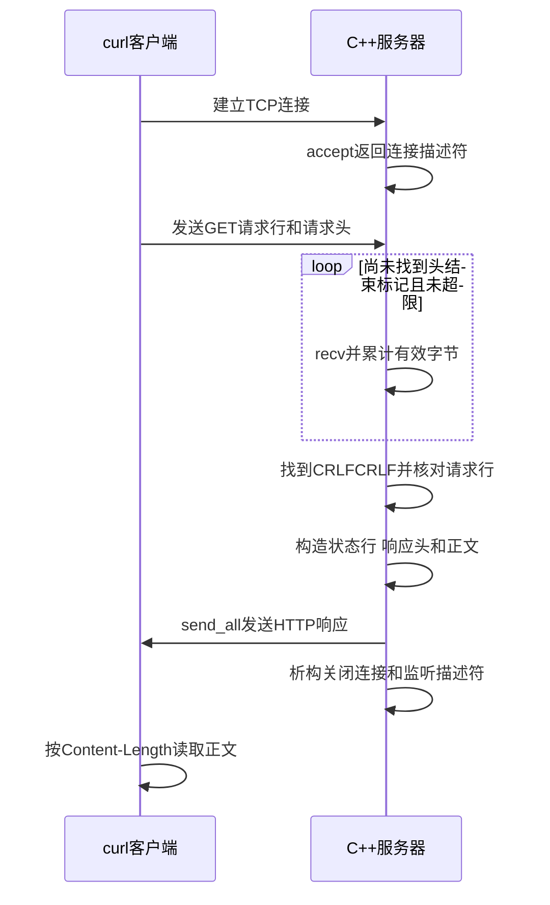

# 第05单元 最小 HTTP 响应

日期 2026-10-19 教学必须在对话完整发送 本文件供助手接续
用户前三天已基本掌握 第四天理解与验收未提供明确结果 不推断通过

## 目标
curl --http1.1 访问 /health 得到 200 正文 OK 加换行 长度3
保持单进程一次连接一次请求 响应后退出
替换回显的handle_client 新增build_health_response 复用send_all UniqueFd
本单元目标是响应格式 第08至10单元再完整解析请求
仅支持受控测试客户端发出的无正文GET请求 不把读取头结束标记视为完整解析
仅精确比较首行为 GET /health HTTP/1.1 其他首行直接关闭 还没有404 405 400响应
其余请求头不做语义验证 不验证Host 重复或冲突Content-Length Transfer-Encoding Expect
带正文 管线化 HEAD HTTP/1.0 均不在当前支持与验收范围 不保证异常输入得到HTTP错误响应
可能读入结束标记后字节 本版不处理它们 关闭连接 不可将此代码当作完整消息边界解析器

## 完整代码
### src/main.cpp
```cpp
#include "unique_fd.h"

#include <algorithm>
#include <arpa/inet.h>
#include <cerrno>
#include <cstddef>
#include <cstdint>
#include <cstring>
#include <iostream>
#include <netinet/in.h>
#include <string>
#include <sys/socket.h>

void print_system_error(const char* operation, int error)
{
    std::cerr << operation << " failed: "
              << std::strerror(error)
              << " (errno=" << error << ")\n";
}

bool send_all(int fd, const char* data, std::size_t size)
{
    std::size_t sent = 0;
    while (sent < size)
    {
        const ssize_t n = ::send(
            fd, data + sent, size - sent, MSG_NOSIGNAL);
        if (n == -1)
        {
            const int error = errno;
            if (error == EINTR)
            {
                continue;
            }
            print_system_error("send", error);
            return false;
        }
        if (n == 0)
        {
            std::cerr << "send made no progress\n";
            return false;
        }
        sent += static_cast<std::size_t>(n);
    }
    return true;
}

std::string build_health_response()
{
    const std::string body = "OK\n";
    std::string response = "HTTP/1.1 200 OK\r\n";
    response += "Content-Type: text/plain; charset=utf-8\r\n";
    response += "Content-Length: " + std::to_string(body.size()) + "\r\n";
    response += "Connection: close\r\n";
    response += "\r\n";
    response += body;
    return response;
}

bool handle_client(int client_fd)
{
    constexpr std::size_t max_head_size = 8192;
    std::string request;
    char buffer[1024];

    while (request.find("\r\n\r\n") == std::string::npos)
    {
        if (request.size() == max_head_size)
        {
            std::cerr << "request head exceeds limit\n";
            return false;
        }

        const std::size_t capacity =
            std::min(sizeof(buffer), max_head_size - request.size());
        const ssize_t n = ::recv(client_fd, buffer, capacity, 0);
        if (n == -1)
        {
            const int error = errno;
            if (error == EINTR)
            {
                continue;
            }
            print_system_error("recv", error);
            return false;
        }
        if (n == 0)
        {
            std::cerr << "peer closed before request head completed\n";
            return false;
        }

        request.append(buffer, static_cast<std::size_t>(n));
    }

    const std::size_t line_end = request.find("\r\n");
    if (request.substr(0, line_end) != "GET /health HTTP/1.1")
    {
        std::cerr << "unsupported request line in day 05\n";
        return false;
    }

    const std::string response = build_health_response();
    return send_all(client_fd, response.data(), response.size());
}

int main()
{
    constexpr std::uint16_t port = 8080;
    constexpr int backlog = 16;

    const int raw_fd = ::socket(AF_INET, SOCK_STREAM | SOCK_CLOEXEC, 0);
    if (raw_fd == -1)
    {
        const int error = errno;
        print_system_error("socket", error);
        return 1;
    }
    UniqueFd listener(raw_fd);

    const int reuse_address = 1;
    if (::setsockopt(listener.get(), SOL_SOCKET, SO_REUSEADDR,
                     &reuse_address, sizeof(reuse_address)) == -1)
    {
        const int error = errno;
        print_system_error("setsockopt", error);
        return 1;
    }

    sockaddr_in address{};
    address.sin_family = AF_INET;
    address.sin_port = htons(port);
    address.sin_addr.s_addr = htonl(INADDR_LOOPBACK);

    if (::bind(listener.get(),
               reinterpret_cast<const sockaddr*>(&address),
               sizeof(address)) == -1)
    {
        const int error = errno;
        print_system_error("bind", error);
        return 1;
    }
    if (::listen(listener.get(), backlog) == -1)
    {
        const int error = errno;
        print_system_error("listen", error);
        return 1;
    }

    std::cout << "listening on 127.0.0.1:" << port
              << " fd=" << listener.get() << std::endl;

    int accepted_fd;
    while (true)
    {
        accepted_fd = ::accept(listener.get(), nullptr, nullptr);
        if (accepted_fd >= 0)
        {
            break;
        }
        const int error = errno;
        if (error == EINTR)
        {
            continue;
        }
        print_system_error("accept", error);
        return 1;
    }

    UniqueFd client(accepted_fd);
    std::cout << "accepted fd=" << client.get() << std::endl;
    const bool ok = handle_client(client.get());
    return ok ? 0 : 1;
}
```
### src/unique_fd.h
```cpp
#pragma once

#include <cerrno>
#include <unistd.h>

class UniqueFd
{
public:
    explicit UniqueFd(int fd) noexcept : fd_(fd)
    {
    }

    ~UniqueFd() noexcept
    {
        if (fd_ >= 0)
        {
            const int saved_errno = errno;
            ::close(fd_);
            errno = saved_errno;
        }
    }

    UniqueFd(const UniqueFd&) = delete;
    UniqueFd& operator=(const UniqueFd&) = delete;
    UniqueFd(UniqueFd&&) = delete;
    UniqueFd& operator=(UniqueFd&&) = delete;

    int get() const noexcept
    {
        return fd_;
    }

private:
    int fd_;
};
```
### CMakeLists.txt
```cmake
cmake_minimum_required(VERSION 3.16)

project(netdisk LANGUAGES CXX)

add_executable(netdisk src/main.cpp)

set_target_properties(netdisk PROPERTIES
    CXX_STANDARD 17
    CXX_STANDARD_REQUIRED YES
    CXX_EXTENSIONS NO
)
```
### tests/day05_http.py
```python
import argparse
import socket

parser = argparse.ArgumentParser()
parser.add_argument("--timeout", type=float, default=5.0)
args = parser.parse_args()

parts = [
    b"GET /health HTTP/1.1\r\n",
    b"Host: 127.0.0.1:8080\r\n",
    b"Connection: close\r\n\r",
    b"\n",
]

with socket.create_connection(("127.0.0.1", 8080), timeout=args.timeout) as sock:
    for part in parts:
        sock.sendall(part)

    response = bytearray()
    while True:
        chunk = sock.recv(4096)
        if not chunk:
            break
        response.extend(chunk)
        if len(response) > 16384:
            raise RuntimeError("response too large for this test")

head, separator, body = bytes(response).partition(b"\r\n\r\n")
if not separator:
    raise RuntimeError("missing response header terminator")

lines = head.split(b"\r\n")
if lines[0] != b"HTTP/1.1 200 OK":
    raise RuntimeError(f"unexpected status: {lines[0]!r}")

headers = {}
for line in lines[1:]:
    name, value = line.split(b":", 1)
    headers[name.lower()] = value.strip()

if headers.get(b"content-length") != str(len(body)).encode("ascii"):
    raise RuntimeError("Content-Length does not match actual body size")
if headers.get(b"connection", b"").lower() != b"close":
    raise RuntimeError("expected Connection: close")
if body != b"OK\n":
    raise RuntimeError(f"unexpected body: {body!r}")

print(f"PASS: HTTP 200, Content-Length={len(body)}, body={body!r}")
```

## 新概念与数据流
HTTP响应由状态行 头部 空行 正文组成 行结束为CRLF 空行构成CRLFCRLF
Content-Length 是正文的字节数 不包含头部 不包含C字符串末尾零字符
std::string body.size() 对当前ASCII正文OK换行为3 未来UTF8也数存储字节而非字符数量
Connection: close 宣告本次响应后关闭 实际关闭仍由RAII完成
响应string在send_all返回之前一直有效 data指针只借用
request.append(buffer,n) 跨recv累计有效字节 不按C字符串处理
find返回匹配位置 找不到为string::npos 结束标记跨两次recv仍可在累计字符串中找到
std::min控制每次读取量 累计逻辑长度最多8192 不宣称string实际容量恰好8192
先找完整标记 再在下一轮读前检查是否已满 因此标记恰好结束于8192时允许继续处理
recv返回0且头未完成时记失败 不把不完整请求当完整
只认CRLF 不认仅LF为头结束
TCP不保证一次recv对应请求 也不保证多次send对应多次recv

## Linux 构建与curl
命令均在Linux虚拟机 ~/projects/netdisk
```sh
cd "$HOME/projects/netdisk"
curl --version
cmake -S . -B build-debug -DCMAKE_BUILD_TYPE=Debug
cmake --build build-debug --parallel 2
./build-debug/netdisk
```
终端B
```sh
curl --noproxy '*' --http1.1 --max-time 5 -i http://127.0.0.1:8080/health
echo $?
```
预期200 Content-Type text/plain charset=utf-8 Content-Length3 Connection close 空行 OK 状态0
--noproxy避免环境代理 --http1.1固定协议 -i显示响应头 --max-time限制整个操作时间
每次请求前重新启动服务器 第四天day04_echo.py属于旧版本不可作为本版回归
需查看请求使用-v 不与-i概念混淆
独立测试先重启服务器 然后python3 tests/day05_http.py 预期PASS HTTP200长度3
测试多次sendall并拆分结束标记 不shutdown发送方向 等服务端先响应并关闭
发送分段不保证内核recv也按相同次数分段 不声明已确定触发所有跨段边界
Python检查完整响应头 正文和Content-Length 未测试重复响应头等所有协议边界

## 时序图
类型Sequence Diagram 说明请求头完成触发响应 不再等待EOF

此图只表示成功路径 超限不完整或不支持首行走日志加关闭的失败路径

## GDB
A gdb ./build-debug/netdisk
```text
break handle_client
break send_all
run
```
B curl --noproxy '*' --http1.1 --max-time 300 -i http://127.0.0.1:8080/health
A
```text
continue
print size
x/s data
bt
up
print request
print response
down
finish
continue
quit
```
第一次命中handle_client continue后第二次send_all
size是整个响应字节数 不是正文长度3
x/s此处安全 因data来自仍存活的std::string 且这个特定响应无内嵌零 不泛化为recv缓冲查看法
up看handle_client的request response 可见CRLF转义
finish等send_all返回 continue完成析构 客户端暂停超时需重新运行全套

## 实验答案
1 正文改为 healthy换行 重新构建 Content-Length应为8 测试客户端仍期望OK 需同步改断言或用curl验证变化
2 临时把Content-Length构造行改成固定100 实际仍发送3字节 curl在连接关闭后通常返回18 并报告正文未收完整
恢复动态body.size()再构建测试
3 用curl访问/not-found 本版日志unsupported request line并关闭 curl可能显示Empty reply 不能称404
此实验用于理解请求行筛选和正式路由的区别 不扩写完整路由

## 限制与验收
无完整头部解析 Host校验 请求体 404 405 HEAD keep-alive 超时 多连接
头部有大小上限但没有服务器读超时 慢连接仍可阻塞
send_all仅处理小响应 若后续下载不能整文件构造字符串
验收 普通curl正常 字节长度一致 Python受控请求通过 GDB能解释请求与响应变量
静态验证不替代Linux运行 构建测试与理解均待用户反馈
第06单元短写中断断开与持续接收后续连接 第08至10单元正式增量请求解析

## 资料
https://www.rfc-editor.org/rfc/rfc9112.html
https://curl.se/docs/manpage.html
