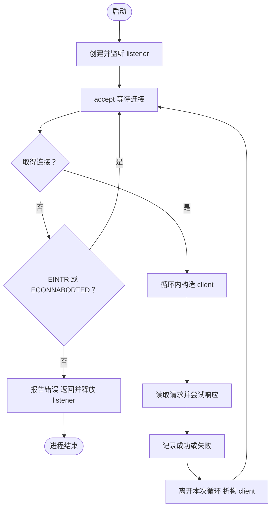

# 第06单元 持续接收与异常连接隔离
日期2026-10-20 本文件供助手接续 教学须在对话完整发送

## 目标与变化
监听对象位于循环外 client在循环体内 每个连接成功或失败后都关闭再接受下一个
当前仍是单线程阻塞串行 不等于并发 同一连接仍只处理一次请求
新增socket_io.h 提取print_system_error send_all 使用函数指针注入发送实现以便确定性测试
新增day06_io.cpp和day06_disconnect.py CMake加入CTest
HTTP能力沿用第五天 其他请求头不解析 不宣称完整HTTP实现
accept EINTR和ECONNABORTED继续 其他错误终止主服务 防止资源耗尽错误无限重试刷屏 尚未完整分类Linux临时网络错误

## 完整代码
### src/main.cpp
```cpp
#include "unique_fd.h"
#include "socket_io.h"

#include <algorithm>
#include <arpa/inet.h>
#include <cerrno>
#include <cstddef>
#include <cstdint>
#include <cstring>
#include <iostream>
#include <netinet/in.h>
#include <string>
#include <sys/socket.h>

std::string build_health_response()
{
    const std::string body = "OK\n";
    std::string response = "HTTP/1.1 200 OK\r\n";
    response += "Content-Type: text/plain; charset=utf-8\r\n";
    response += "Content-Length: " + std::to_string(body.size()) + "\r\n";
    response += "Connection: close\r\n";
    response += "\r\n";
    response += body;
    return response;
}

bool handle_client(int client_fd)
{
    constexpr std::size_t max_head_size = 8192;
    std::string request;
    char buffer[1024];

    while (request.find("\r\n\r\n") == std::string::npos)
    {
        if (request.size() == max_head_size)
        {
            std::cerr << "request head exceeds limit\n";
            return false;
        }

        const std::size_t capacity =
            std::min(sizeof(buffer), max_head_size - request.size());
        const ssize_t n = ::recv(client_fd, buffer, capacity, 0);
        if (n == -1)
        {
            const int error = errno;
            if (error == EINTR)
            {
                continue;
            }
            print_system_error("recv", error);
            return false;
        }
        if (n == 0)
        {
            std::cerr << "peer closed before request head completed\n";
            return false;
        }

        request.append(buffer, static_cast<std::size_t>(n));
    }

    const std::size_t line_end = request.find("\r\n");
    if (request.substr(0, line_end) != "GET /health HTTP/1.1")
    {
        std::cerr << "unsupported request line\n";
        return false;
    }

    const std::string response = build_health_response();
    return send_all(client_fd, response.data(), response.size());
}

int main()
{
    constexpr std::uint16_t port = 8080;
    constexpr int backlog = 16;

    const int raw_fd = ::socket(AF_INET, SOCK_STREAM | SOCK_CLOEXEC, 0);
    if (raw_fd == -1)
    {
        const int error = errno;
        print_system_error("socket", error);
        return 1;
    }
    UniqueFd listener(raw_fd);

    const int reuse_address = 1;
    if (::setsockopt(listener.get(), SOL_SOCKET, SO_REUSEADDR,
                     &reuse_address, sizeof(reuse_address)) == -1)
    {
        const int error = errno;
        print_system_error("setsockopt", error);
        return 1;
    }

    sockaddr_in address{};
    address.sin_family = AF_INET;
    address.sin_port = htons(port);
    address.sin_addr.s_addr = htonl(INADDR_LOOPBACK);

    if (::bind(listener.get(),
               reinterpret_cast<const sockaddr*>(&address),
               sizeof(address)) == -1)
    {
        const int error = errno;
        print_system_error("bind", error);
        return 1;
    }
    if (::listen(listener.get(), backlog) == -1)
    {
        const int error = errno;
        print_system_error("listen", error);
        return 1;
    }

    std::cout << "listening on 127.0.0.1:" << port
              << " fd=" << listener.get() << std::endl;

    while (true)
    {
        const int accepted_fd =
            ::accept(listener.get(), nullptr, nullptr);
        if (accepted_fd == -1)
        {
            const int error = errno;
            if (error == EINTR || error == ECONNABORTED)
            {
                continue;
            }
            print_system_error("accept", error);
            return 1;
        }

        UniqueFd client(accepted_fd);
        std::cout << "accepted fd=" << client.get() << std::endl;
        const bool ok = handle_client(client.get());
        std::cout << (ok ? "request completed" : "request failed")
                  << std::endl;
    }
}
```

### src/socket_io.h
```cpp
#pragma once

#include <cerrno>
#include <cstddef>
#include <cstring>
#include <iostream>
#include <sys/socket.h>

inline void print_system_error(const char* operation, int error)
{
    std::cerr << operation << " failed: "
              << std::strerror(error)
              << " (errno=" << error << ")\n";
}

using SendFunction = ssize_t (*)(int, const void*, std::size_t, int);

inline bool send_all(
    int fd, const char* data, std::size_t size,
    SendFunction send_function = ::send)
{
    std::size_t sent = 0;
    while (sent < size)
    {
        const ssize_t n = send_function(
            fd, data + sent, size - sent, MSG_NOSIGNAL);
        if (n == -1)
        {
            const int error = errno;
            if (error == EINTR)
            {
                continue;
            }
            print_system_error("send", error);
            return false;
        }
        if (n == 0)
        {
            std::cerr << "send made no progress\n";
            return false;
        }
        sent += static_cast<std::size_t>(n);
    }
    return true;
}
```

### src/unique_fd.h
```cpp
#pragma once

#include <cerrno>
#include <unistd.h>

class UniqueFd
{
public:
    explicit UniqueFd(int fd) noexcept : fd_(fd)
    {
    }

    ~UniqueFd() noexcept
    {
        if (fd_ >= 0)
        {
            const int saved_errno = errno;
            ::close(fd_);
            errno = saved_errno;
        }
    }

    UniqueFd(const UniqueFd&) = delete;
    UniqueFd& operator=(const UniqueFd&) = delete;
    UniqueFd(UniqueFd&&) = delete;
    UniqueFd& operator=(UniqueFd&&) = delete;

    int get() const noexcept
    {
        return fd_;
    }

private:
    int fd_;
};
```

### CMakeLists.txt
```cmake
cmake_minimum_required(VERSION 3.16)

project(netdisk LANGUAGES CXX)

add_executable(netdisk src/main.cpp)
set(NETDISK_TARGETS netdisk)

include(CTest)
if(BUILD_TESTING)
    add_executable(io_tests tests/day06_io.cpp)
    target_include_directories(io_tests PRIVATE src)
    list(APPEND NETDISK_TARGETS io_tests)
    add_test(NAME io_tests COMMAND io_tests)
endif()

foreach(target IN LISTS NETDISK_TARGETS)
    set_target_properties(${target} PROPERTIES
        CXX_STANDARD 17
        CXX_STANDARD_REQUIRED YES
        CXX_EXTENSIONS NO
    )
endforeach()
```

### tests/day06_io.cpp
```cpp
#include "socket_io.h"
#include "unique_fd.h"

#include <algorithm>
#include <cstdlib>
#include <csignal>
#include <string>

std::string captured;
int calls = 0;

void require(bool condition, const char* message)
{
    if (!condition)
    {
        std::cerr << "FAIL: " << message << '\n';
        std::exit(1);
    }
}

ssize_t interrupted_then_short(
    int, const void* data, std::size_t size, int flags)
{
    require((flags & MSG_NOSIGNAL) != 0, "MSG_NOSIGNAL missing");
    ++calls;
    if (calls == 1)
    {
        errno = EINTR;
        return -1;
    }
    const std::size_t n = std::min(size, std::size_t{2});
    captured.append(static_cast<const char*>(data), n);
    return static_cast<ssize_t>(n);
}

ssize_t return_zero(int, const void*, std::size_t, int)
{
    return 0;
}

ssize_t return_error(int, const void*, std::size_t, int)
{
    errno = EPIPE;
    return -1;
}

int main()
{
    const std::string payload("A\0BCD", 5);
    require(send_all(-1, payload.data(), payload.size(),
                     interrupted_then_short), "retry should succeed");
    require(captured == payload, "bytes duplicated or lost");
    require(calls == 4, "expected EINTR then 2 + 2 + 1 bytes");

    require(!send_all(-1, "x", 1, return_zero),
            "zero progress must fail");
    require(!send_all(-1, "x", 1, return_error),
            "EPIPE must fail");
    require(send_all(-1, "", 0, return_error),
            "empty send must succeed without calling sender");

    require(std::signal(SIGPIPE, SIG_DFL) != SIG_ERR,
            "cannot restore default SIGPIPE action");
    int pair[2];
    require(::socketpair(AF_UNIX, SOCK_STREAM, 0, pair) == 0,
            "socketpair failed");
    UniqueFd sender(pair[0]);
    {
        UniqueFd peer(pair[1]);
    }

    require(!send_all(sender.get(), "x", 1),
            "sending to a closed peer must fail");
    std::cout << "PASS: retry, short writes, binary bytes, "
                 "zero progress and closed-peer send\n";
    return 0;
}
```

### tests/day06_disconnect.py
```python
import http.client
import socket
import struct

HOST = "127.0.0.1"
PORT = 8080

def health():
    conn = http.client.HTTPConnection(HOST, PORT, timeout=5)
    try:
        conn.request("GET", "/health")
        response = conn.getresponse()
        body = response.read()
        if response.status != 200 or body != b"OK\n":
            raise RuntimeError("health response mismatch")
        if response.getheader("Content-Length") != str(len(body)):
            raise RuntimeError("Content-Length mismatch")
    finally:
        conn.close()

health()

with socket.create_connection((HOST, PORT), timeout=5) as sock:
    sock.sendall(b"GET /health HTTP/1.1\r\nHost:")
health()

with socket.create_connection((HOST, PORT), timeout=5) as sock:
    sock.setsockopt(socket.SOL_SOCKET, socket.SO_LINGER,
                    struct.pack("ii", 1, 0))
    sock.sendall(b"GET /health HTTP/1.1\r\nHost: localhost\r\n\r\n")
health()

for _ in range(10):
    health()

print("PASS: incomplete request, reset attempt and later health requests")
```

## 接口与生命周期
SendFunction为匹配send参数和返回类型的函数指针 默认::send 业务调用方式不变
测试传入模拟函数 只模拟系统调用的返回行为 不冒充真实内核短写和信号中断
inline允许头文件函数定义出现在不同翻译单元中 不保证编译器展开
send_all的data仅借用 在调用完成前有效 正数n推进sent -1/EINTR原地重试 其他错误返回false 0无进度返回false
所有判断先检查有符号ssize_t 再转无符号长度 MSG_NOSIGNAL抑制本次send的SIGPIPE但不隐藏EPIPE
EOF表示对端发送方向结束 不等于异常终止 头未完整时业务判失败
RST可能表现为recv或send的ECONNRESET EPIPE等 也可能在很短响应发送之后才发生 不要求每次RST尝试都命中send失败
对端关闭后send可能先成功 所以不能拿发送成功证明客户端读到
UniqueFd对每连接循环末尾析构 原始整数可能复用 不把同样fd视为泄漏
服务端没有新信号处理 用Ctrl+C结束不会保证listener的C++析构 内核会在进程退出回收 不称优雅退出

## Linux命令
所有操作在虚拟机~/projects/netdisk
```sh
cmake -S . -B build-debug -DCMAKE_BUILD_TYPE=Debug
cmake --build build-debug --parallel 2
ctest --test-dir build-debug --output-on-failure
./build-debug/netdisk
```
另一终端
```sh
curl --noproxy '*' --http1.1 --max-time 5 http://127.0.0.1:8080/health
curl --noproxy '*' --http1.1 --max-time 5 http://127.0.0.1:8080/health
python3 tests/day06_disconnect.py
```
预期两次OK 同一服务进程不退出 Python正常结束且后续请求可用
include(CTest)默认启用BUILD_TESTING 若已有缓存关闭需加-DBUILD_TESTING=ON
多配置生成器build加--config Debug ctest加-C Debug 路径相应变化

## 测试证据边界
C++测试顺序是模拟EINTR 2字节 2字节 1字节 检查含零数据与调用次数
模拟零返回避免死循环 模拟EPIPE传播失败 空发送不调用系统接口
真实socketpair创建本机AF_UNIX流socket 使用作用域关闭一端 再向其发送
测试进程恢复SIGPIPE默认动作 若send忽略MSG_NOSIGNAL可能被信号终止
此实验验证真实关闭对端发送错误和进程存活 不是TCP网络RST时序测试
C++require失败退出1 成功0 测试预期错误会打印到stderr 不是所有日志都意味着测试失败
Python普通连接先验证 接着不完整请求关闭 再验证健康接口 SO_LINGER值(1,0)按Linux int结构触发复位关闭尝试 再验证健康及10次连续请求
不加入sleep依赖 不强制指定内核处理复位的具体时刻 不宣称验证了固定错误码
socketpair和模拟测试不占TCP端口 Python集成测试要求真实服务已启动

## GDB
调试单测
```sh
gdb ./build-debug/io_tests
```
```text
break interrupted_then_short
run
print size
print calls
next
```
直到calls递增后观察第一调用返回EINTR 后续正数2 2 1
建议break send_all后step进入指定函数 finish看返回 再next检查sent
本测试模拟函数fd是-1但不执行真实send 不能据此误判无效fd也能网络发送
观察真实服务器时给UniqueFd析构打断点 使用另一终端curl --max-time 300
每个请求后命中client析构 listener仍存活 继续后可接受下一连接 看到同一fd数字可能是正常复用
可选strace -e trace=accept,recvfrom,sendto,close ./build-debug/netdisk 核对真实关闭 别和已运行服务器争抢端口

## 流程图
类型Flowchart 展示失败隔离与作用域回收

handle_client内部受控错误只返回false 不再让main直接返回

## 实验答案
测试闭合一端后真实发送失败 移除MSG_NOSIGNAL仅在测试分支临时改动后CTest应报告SIGPIPE 在恢复代码前不继续服务测试
不需要真的修改信号保护即可理解 启动测试时不对其他进程发信号
send_all中错误地sent += size会让短写模拟捕获内容只有前2字节 测试失败 恢复sent += n后重建
不要改UniqueFd close为EINTR重试 Linux关闭语义不同
慢客户端保持连接且不发完整头时其他请求会等待 当前无超时和并发 不承诺本单元解决慢连接

## 验收与下一步
本地静态核对 尚无Linux构建CTest集成或GDB实际证据 不写通过
理解前三天用户反馈掌握 后续待反馈
第07单元阶段回顾与网络冒烟 不直接进入新功能
参考 https://man7.org/linux/man-pages/man2/send.2.html
参考 https://man7.org/linux/man-pages/man2/accept.2.html
参考 https://man7.org/linux/man-pages/man1/strace.1.html
