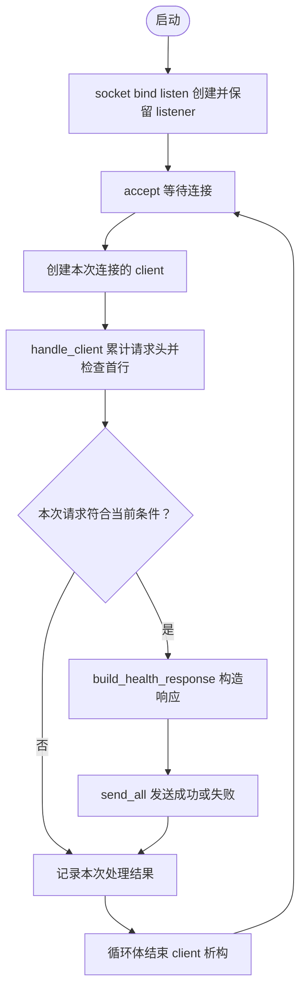

# 第07单元 第一阶段回顾与网络冒烟验收

日期 2026-10-21
本文件供助手接续 教学在对话完整发送 不让用户通过文件链接代替学习
本单元不修改第06单元C++源码 CMake或测试文件 不无意义重复输出未修改源码
前三天用户明确反馈基本掌握 第四至七天理解与Linux实际验收尚未确认

## 目标
独立构建目录构建 运行单测 启动服务 正常HTTP请求 故障后继续服务 停止 重启
解释监听与连接资源生命周期 TCP字节流 HTTP边界和测试证据
此处冒烟指主要链路的快速检查 不替代完整协议或并发验收

## 现有结构
main初始化listener 在循环中accept创建client handle_client读取受限请求 构造health响应 send_all循环发送 循环结束client析构 listener仍在
socket_io.h拥有错误输出和可注入发送函数 UniqueFd独占关闭
io_tests模拟EINTR与短写并执行真实AF_UNIX关闭对端发送测试
day05_http.py核对HTTP字节 day06_disconnect.py核对异常连接后的后续请求
day04_echo.py针对旧回显协议不再适用
当前CTest只注册io_tests 两个Python测试仍需启动服务后单独执行

## Linux步骤
所有命令在Linux虚拟机工程~/projects/netdisk
每一步确认成功再继续 失败保留完整错误
开始前
```sh
cd "$HOME/projects/netdisk"
ss -ltnp 'sport = :8080'
```
若有占用 确认是否自己之前启动的程序 在其终端结束 不强杀未知进程

独立构建目录
```sh
cmake -S . -B build-day07 -DCMAKE_BUILD_TYPE=Debug -DBUILD_TESTING=ON
cmake --build build-day07 --parallel 2
ctest --test-dir build-day07 -N
ctest --test-dir build-day07 --output-on-failure
echo $?
```
第一次使用build-day07为新构建 已存在则选择未使用目录并一致替换
-N预期列出io_tests一个测试 防止No tests were found被误认通过
预期真正运行1项且通过 状态0 这不代表Python测试已运行
默认Linux单配置 多配置build加--config Debug ctest加-C Debug 可执行目录相应变化

A启动
```sh
./build-day07/netdisk
```
预期监听127.0.0.1:8080 等待accept

B
```sh
cd "$HOME/projects/netdisk"
ss -ltnp 'sport = :8080'
curl --noproxy '*' --http1.1 --max-time 5 -i http://127.0.0.1:8080/health
echo $?
python3 tests/day05_http.py
echo $?
python3 tests/day06_disconnect.py
echo $?
curl --noproxy '*' --http1.1 --max-time 5 http://127.0.0.1:8080/health
echo $?
```
HTTP预期200 正文OK换行 长度3 两个Python脚本分别打印PASS 最后curl仍成功
服务器全程无需重启 遇错误日志需对应故障测试阶段 判断后续健康请求与退出状态
多个连接fd数值相同可为正常复用 不单凭数值判断泄漏

可选端口占用
B再次启动./build-day07/netdisk 预期bind失败状态1 原服务仍可访问
SO_REUSEADDR不允许抢占现有监听socket

停止和重启
A按Ctrl+C B用ss确认当前服务监听消失
默认SIGINT终止不是优雅退出 不保证listener的C++析构 内核会回收进程资源
A再次./build-day07/netdisk B再次curl预期OK 完成后A停止

## 范围实验 慢连接阻塞
先完成前面的正常验收 保持A服务运行
在B启动Python交互模式 python3 然后输入以下完整Python代码 块末尾空行结束
```python
import socket
sock = socket.create_connection(("127.0.0.1", 8080), timeout=5)
sock.sendall(b"GET /health HTTP/1.1\r\nHost:")
```
保持B交互窗口 在C执行
```sh
curl --noproxy '*' --http1.1 --max-time 2 http://127.0.0.1:8080/health
echo $?
```
预期超时通常28 因A在等B请求头完整 未处理C请求 TCP握手可能已经完成
回B执行
```python
sock.close()
exit()
```
C重新curl预期恢复 未设置服务端超时 串行阻塞是已知限制 不是并发功能已实现
异常中断实验也要关闭B持有的socket
不能根据socket客户端timeout5推断服务器有5秒超时 B没有继续recv所以不会自行关闭

## 可选GDB复盘
先停普通实例 gdb ./build-day07/netdisk
break handle_client
break 'UniqueFd::~UniqueFd()'
run
另一终端curl使用--max-time 300 命中函数后bt continue 观察client析构print fd_ 再continue
重复请求看到client反复销毁 listener保持 不必把GDB完整重做当作本次强制额外验收

## 图
类型Flowchart 表示每次请求的调用与资源释放顺序

图重点只画已成功accept后的连接处理 accept错误策略仍以第06单元代码为准
handle_client和send_all借用fd不关闭 listener归main拥有

## 验收证据
新构建成功证明可在该环境重新编译 不证明跨平台
io_tests通过证明模拟重试偏移和真实本机断开发送路径 不证明真实TCP短写或真实信号中断
day05通过证明受控输入的响应格式和正文长度 多次send不保证多次recv
day06通过证明指定异常尝试后后续请求可用 不保证RST固定命中send错误
重复curl不是并发测试 Ctrl+C不是优雅退出 ss监听不是HTTP可用性证明

## 复盘与参考答案
1 请求从accept到client 构造handle_client 累计头 build_health_response send_all client析构
2 TCP不保留消息边界 不能一次recv读完整请求
3 CRLFCRLF只表示头结束 有正文时仍需消息长度处理
4 sent只增加n 错加size会在短写后漏数据
5 EINTR仅在失败时重试 close不能照搬
6 client每次循环析构 listener在循环外 不应get后手动close
7 Content-Length是正文字节数 不含响应头 不含字符串终止零
8 每个连接依次处理 所以慢连接能堵住后续连接
9 端口已监听不能证明会响应HTTP TCP连上不能证明应用已accept
10 现有方案无完整HTTP头校验 正文解析 正式路由404405 HEAD 持久连接 读超时 并发 优雅退出

## 反馈格式
独立构建 成功或第一条错误
CTest 实际测试数与失败数
HTTP字节测试 结果
断开测试 结果
停止重启 结果
慢连接实验 可选结果
仍不理解的问题
用户在对话提供即可 助手更新记录 不要求用户维护项目文档

## 下一步
阶段实际问题先定位 未收到结果不标记验收通过
第08单元增量解析请求行 把精确字符串匹配演进为明确字段与状态 后续仍用现有传输和RAII基础
