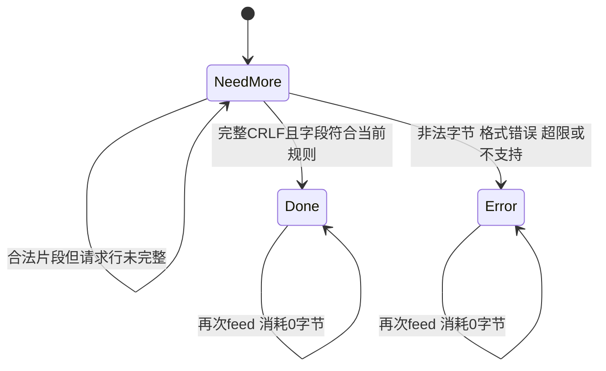

# 第08单元 增量请求行解析
日期2026-10-22 教学在对话完整发送

## 用户最新要求
取消第七天那类固定整日复盘 不再按每七天强制安排回顾
每日仅安排核心功能验证 不强制重复完整测试矩阵 环境检查 GDB或故障清单
完整代码与必要解释继续在对话交付 本地文档只为助手接续

## 当次目标与变化
新增独立RequestLineParser 跨feed保留状态 解析method target version
新增FeedResult返回当前状态与本次消耗字节 防止吞掉后续头部
main每次recv将新字节交解析器 同时保留原始request供现有头结束标记检查
Done后feed不再消耗数据 本版main仍把完整recv内容保存到request 没有丢掉头部
parse成功不等于路由支持 POST可解析 但业务仍只处理GET /health
UniqueFd socket_io不变
阶段切换前已保存snapshots/stage01-reference 只是本地参考 不代表Linux验收通过

## 完整新增修改文件
### src/request_line.h
```cpp
#pragma once

#include <cstddef>
#include <string>
#include <string_view>

enum class ParseState
{
    NeedMore,
    Done,
    Error
};

struct RequestLine
{
    std::string method;
    std::string target;
    std::string version;
};

struct FeedResult
{
    ParseState state;
    std::size_t consumed;
};

class RequestLineParser
{
public:
    FeedResult feed(std::string_view input)
    {
        std::size_t used = 0;
        while (used < input.size() && state_ == ParseState::NeedMore)
        {
            const unsigned char ch =
                static_cast<unsigned char>(input[used++]);

            if (++bytes_ > max_line_bytes)
            {
                state_ = ParseState::Error;
                break;
            }

            if (saw_cr_)
            {
                state_ = ch == '\n' && parse_line()
                    ? ParseState::Done : ParseState::Error;
                break;
            }
            if (ch == '\r')
            {
                saw_cr_ = true;
            }
            else if (ch < 32 || ch > 126)
            {
                state_ = ParseState::Error;
            }
            else
            {
                buffer_.push_back(static_cast<char>(ch));
            }
        }
        return {state_, used};
    }

    const RequestLine& line() const noexcept
    {
        return line_;
    }

private:
    static constexpr std::size_t max_line_bytes = 4096;

    static bool is_token_char(unsigned char ch)
    {
        return (ch >= 'A' && ch <= 'Z') ||
               (ch >= 'a' && ch <= 'z') ||
               (ch >= '0' && ch <= '9') ||
               std::string_view("!#$%&'*+-.^_`|~").find(
                   static_cast<char>(ch)) != std::string_view::npos;
    }

    bool parse_line()
    {
        const std::size_t first = buffer_.find(' ');
        if (first == std::string::npos || first == 0)
        {
            return false;
        }
        const std::size_t second = buffer_.find(' ', first + 1);
        if (second == std::string::npos || second == first + 1 ||
            buffer_.find(' ', second + 1) != std::string::npos)
        {
            return false;
        }

        RequestLine candidate{
            buffer_.substr(0, first),
            buffer_.substr(first + 1, second - first - 1),
            buffer_.substr(second + 1)
        };

        for (unsigned char ch : candidate.method)
        {
            if (!is_token_char(ch))
            {
                return false;
            }
        }
        if (candidate.target.front() != '/' ||
            candidate.target.find('#') != std::string::npos ||
            candidate.target.find('\\') != std::string::npos ||
            candidate.version != "HTTP/1.1")
        {
            return false;
        }

        line_ = candidate;
        return true;
    }

    ParseState state_ = ParseState::NeedMore;
    std::size_t bytes_ = 0;
    bool saw_cr_ = false;
    std::string buffer_;
    RequestLine line_;
};
```

### src/main.cpp
```cpp
#include "unique_fd.h"
#include "socket_io.h"
#include "request_line.h"

#include <algorithm>
#include <arpa/inet.h>
#include <cerrno>
#include <cstddef>
#include <cstdint>
#include <cstring>
#include <iostream>
#include <netinet/in.h>
#include <string>
#include <sys/socket.h>

std::string build_health_response()
{
    const std::string body = "OK\n";
    std::string response = "HTTP/1.1 200 OK\r\n";
    response += "Content-Type: text/plain; charset=utf-8\r\n";
    response += "Content-Length: " + std::to_string(body.size()) + "\r\n";
    response += "Connection: close\r\n";
    response += "\r\n";
    response += body;
    return response;
}

bool handle_client(int client_fd)
{
    constexpr std::size_t max_head_size = 8192;
    std::string request;
    RequestLineParser parser;
    char buffer[1024];

    while (request.find("\r\n\r\n") == std::string::npos)
    {
        if (request.size() == max_head_size)
        {
            std::cerr << "request head exceeds limit\n";
            return false;
        }

        const std::size_t capacity =
            std::min(sizeof(buffer), max_head_size - request.size());
        const ssize_t n = ::recv(client_fd, buffer, capacity, 0);
        if (n == -1)
        {
            const int error = errno;
            if (error == EINTR)
            {
                continue;
            }
            print_system_error("recv", error);
            return false;
        }
        if (n == 0)
        {
            std::cerr << "peer closed before request head completed\n";
            return false;
        }

        const std::size_t count = static_cast<std::size_t>(n);
        const FeedResult result = parser.feed(std::string_view(buffer, count));
        if (result.state == ParseState::Error)
        {
            std::cerr << "invalid or unsupported request line\n";
            return false;
        }
        request.append(buffer, count);
    }

    const RequestLine& line = parser.line();
    std::cout << "method=" << line.method
              << " target=" << line.target
              << " version=" << line.version << '\n';
    if (line.method != "GET" || line.target != "/health")
    {
        std::cerr << "unsupported request line\n";
        return false;
    }

    const std::string response = build_health_response();
    return send_all(client_fd, response.data(), response.size());
}

int main()
{
    constexpr std::uint16_t port = 8080;
    constexpr int backlog = 16;

    const int raw_fd = ::socket(AF_INET, SOCK_STREAM | SOCK_CLOEXEC, 0);
    if (raw_fd == -1)
    {
        const int error = errno;
        print_system_error("socket", error);
        return 1;
    }
    UniqueFd listener(raw_fd);

    const int reuse_address = 1;
    if (::setsockopt(listener.get(), SOL_SOCKET, SO_REUSEADDR,
                     &reuse_address, sizeof(reuse_address)) == -1)
    {
        const int error = errno;
        print_system_error("setsockopt", error);
        return 1;
    }

    sockaddr_in address{};
    address.sin_family = AF_INET;
    address.sin_port = htons(port);
    address.sin_addr.s_addr = htonl(INADDR_LOOPBACK);

    if (::bind(listener.get(),
               reinterpret_cast<const sockaddr*>(&address),
               sizeof(address)) == -1)
    {
        const int error = errno;
        print_system_error("bind", error);
        return 1;
    }
    if (::listen(listener.get(), backlog) == -1)
    {
        const int error = errno;
        print_system_error("listen", error);
        return 1;
    }

    std::cout << "listening on 127.0.0.1:" << port
              << " fd=" << listener.get() << std::endl;

    while (true)
    {
        const int accepted_fd =
            ::accept(listener.get(), nullptr, nullptr);
        if (accepted_fd == -1)
        {
            const int error = errno;
            if (error == EINTR || error == ECONNABORTED)
            {
                continue;
            }
            print_system_error("accept", error);
            return 1;
        }

        UniqueFd client(accepted_fd);
        std::cout << "accepted fd=" << client.get() << std::endl;
        const bool ok = handle_client(client.get());
        std::cout << (ok ? "request completed" : "request failed")
                  << std::endl;
    }
}
```

### tests/day08_request_line.cpp
```cpp
#include "request_line.h"

#include <cstdlib>
#include <iostream>
#include <string>

void require(bool ok, const char* message)
{
    if (!ok)
    {
        std::cerr << "FAIL: " << message << '\n';
        std::exit(1);
    }
}

int main()
{
    const std::string line = "GET /health HTTP/1.1\r\n";
    const std::string headers = "Host: localhost\r\n\r\n";

    for (std::size_t split = 0; split <= line.size(); ++split)
    {
        RequestLineParser parser;
        const auto first = parser.feed(std::string_view(line).substr(0, split));
        require(first.consumed == split, "first chunk consumption");
        require(first.state == (split == line.size()
                    ? ParseState::Done : ParseState::NeedMore),
                "state before complete line");
        const std::string rest = line.substr(split) + headers;
        const auto second = parser.feed(rest);
        require(second.state == ParseState::Done, "split line failed");
        require(second.consumed == line.size() - split, "headers consumed");
        require(parser.line().method == "GET" &&
                parser.line().target == "/health" &&
                parser.line().version == "HTTP/1.1", "wrong fields");
    }

    RequestLineParser byte_parser;
    for (char ch : line)
    {
        require(byte_parser.feed(std::string_view(&ch, 1)).state
                    != ParseState::Error, "byte feed failed");
    }
    require(byte_parser.feed("").state == ParseState::Done, "not done");

    for (const char* bad : {
             "GET  /health HTTP/1.1\r\n",
             "GET /health HTTP/1.1\n",
             "GET /health HTTP/1.1\rX",
             "GET /health HTTP/1.0\r\n"})
    {
        RequestLineParser parser;
        require(parser.feed(bad).state == ParseState::Error, "bad line accepted");
        require(parser.feed(line).consumed == 0, "error state not sticky");
    }

    RequestLineParser limited;
    require(limited.feed(std::string(4097, 'G')).state == ParseState::Error,
            "line size limit missing");

    RequestLineParser method_parser;
    require(method_parser.feed("POST /upload HTTP/1.1\r\n").state
                == ParseState::Done, "parser mixed with routing");

    std::cout << "PASS: split request line, fields, boundaries and errors\n";
}
```

### CMakeLists.txt
```cmake
cmake_minimum_required(VERSION 3.16)

project(netdisk LANGUAGES CXX)

add_executable(netdisk src/main.cpp)
set(NETDISK_TARGETS netdisk)

include(CTest)
if(BUILD_TESTING)
    add_executable(io_tests tests/day06_io.cpp)
    target_include_directories(io_tests PRIVATE src)
    list(APPEND NETDISK_TARGETS io_tests)
    add_test(NAME io_tests COMMAND io_tests)

    add_executable(request_line_tests tests/day08_request_line.cpp)
    target_include_directories(request_line_tests PRIVATE src)
    list(APPEND NETDISK_TARGETS request_line_tests)
    add_test(NAME request_line_tests COMMAND request_line_tests)
endif()

foreach(target IN LISTS NETDISK_TARGETS)
    set_target_properties(${target} PROPERTIES
        CXX_STANDARD 17
        CXX_STANDARD_REQUIRED YES
        CXX_EXTENSIONS NO
    )
endforeach()
```

## 解释
HTTP请求行 method SP request-target SP HTTP-version CRLF 本实现严格使用两个单空格
NeedMore并非错误 表示数据不足 Done表示请求行完成 Error表示非法或不支持输入
终态粘滞 进入Done或Error后再feed消耗0 要解析下一行需新对象
saw_cr记录上一片最后的CR 下一字节必须LF CRLF跨片也可处理
只在CRLF完整时拆字段 字节累计是增量 不重复扫描整个旧请求头
requestline对象用string拥有数据 string_view只在feed内借用调用者字节
bytes_计算整行含CRLF 4096为项目限制不是HTTP标准统一上限
控制字符 TAB 裸LF 非ASCII被拒绝 method检查token字符
目标仅支持以斜杠开头的可见ASCII形式 禁止fragment和反斜杠 不做完整URI字符及百分号编码校验 不解码
只支持HTTP/1.1 其他版本进入Error 是本项目子集限制
line()只能Done后使用 main已等完整CRLFCRLF且feed没有Error 因而此时行必已Done
consumed是本次输入消耗量 不是跨调用累计量
例如feed("GET /health HTTP/1.1\r")返回NeedMore 下一次feed("\nHost: x\r\n")返回Done consumed1 留下Host给后续解析
当前main继续保留全量request 第09天头部解析会进一步利用消耗位置
日志输出结构化字段 业务仍检查GET和/health 未支持路径直接关闭 未加入404405响应

## 状态图
类型State Diagram 说明跨调用状态变化

解析器不操作Socket 错误后是否响应和关闭由调用者决定

## 每日核心验证 仅两项
Linux工程~/projects/netdisk
```sh
cmake -S . -B build-debug -DCMAKE_BUILD_TYPE=Debug -DBUILD_TESTING=ON
cmake --build build-debug --parallel 2
ctest --test-dir build-debug -R '^request_line_tests$' --output-on-failure
./build-debug/netdisk
```
CTest必须实际运行1项request_line_tests 预期通过
另一终端
```sh
curl --noproxy '*' --http1.1 --max-time 5 http://127.0.0.1:8080/health
```
预期OK 服务日志method=GET target=/health version=HTTP/1.1
先停止自己旧实例 多配置生成器加--config Debug ctest加-C Debug
无额外GDB 回归矩阵 环境重查要求

## 核心测试涵义
同一完整行每个分割点feed两次 检查状态字段和剩余头不被消耗
按字节feed验证跨调用状态 非法空格 裸LF CR后错字符 超限 不支持版本都拒绝
POST解析成功说明语法解析与路由分离
上面都在一项测试内部执行 用户只运行一次命令

## 验证证据
助手已使用本机Windows g++ C++17带-Wall -Wextra -pedantic编译运行纯解析测试 输出PASS
不是Linux构建或Socket集成验收 Linux运行与用户理解待反馈
快照保存的是此前本地版本 不含已通过Linux测试的保证

## 当前边界与下一步
只新增请求行解析 头字段校验 请求体 长度冲突仍未实现
target保留原始编码 Query尚未拆解 不把/health?x=1路由成/health
下一单元增量请求头解析 不插入固定复盘日
参考 https://www.rfc-editor.org/rfc/rfc9112.html#section-3
