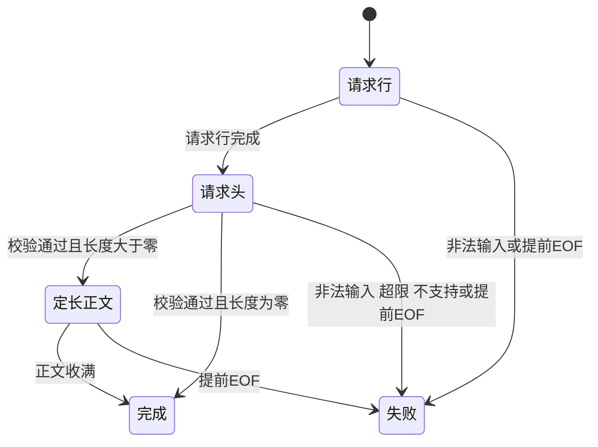

# 第十天 Content-Length与消息边界

第九天到头部空行为止 第十天继续处理同次recv中的正文 并根据Content-Length判断完整请求结束
本次新增src/request_parser.h和tests/day10_request_body.cpp 修改src/main.cpp和CMakeLists.txt 其余源码不变
build_health_response改为build_response handle_client使用组合解析器 新增临时POST /echo回显正文

## 核心规则

Content-Length表示正文字节数 不包括请求行 请求头和结束空行 不按字符数量也不按strlen计数
有效长度接收满即完成 不等客户端断开 若声明5字节只收到3字节则NeedMore 此时EOF则Error
请求无Content-Length且无Transfer-Encoding时正文为零 不根据POST方法猜测正文长度
对应RFC9112第6.3节 https://www.rfc-editor.org/rfc/rfc9112.html#section-6.3
本项目受限子集拒绝所有重复Content-Length 逗号列表 任何Transfer-Encoding和Expect
单个长度只允许非空ASCII数字 正负号 小数 后缀 内部空白均失败 字段两端空格和TAB已由第九天解析器去除 前导零允许
恰好一个非空Host仍必要 尚不完整校验Host语法
正文缓存上限64KiB 声明超过立即拒绝 是临时有界内存回显 不等于已完成大文件上传 第12单元改成流式写盘

## 新接口和生命周期

parse_decimal_length(text, output) 返回bool 成功写uint64输出 失败保留原值 在value乘10加digit前检查 value > (max - digit) / 10
数字可表达不等于业务允许 所以先防溢出再检查64KiB上限 通过后转换size_t
RequestParser::feed(input)借用本次输入 返回ParseState和本次consumed 所需内容复制到内部 不保存输入view
feed空串不是EOF 不会把NeedMore变成Error finish只在真实输入结束时调用 未完成转Error Done和Error保持终态
line与body返回内部const引用 应在Done后使用完整结果 不转移所有权 解析器销毁后不可使用
body按显式长度append 因此零字节 CRLF和类似请求头的内容全部按普通正文接收 不扫描分隔符
头部完成后继续使用input.substr(used)中的剩余内容 当次正文消费min(输入剩余, 声明长度减已收长度)
每连接新建解析器 client_fd借用 外层UniqueFd关闭 recv与send_all接口保持原样 无新增Linux系统调用
build_response借用正文view和调用者提供的固定媒体类型字符串 返回独立拥有的响应string 可复制零字节
传输失败仍由send_all返回false并记录系统错误 失败不导致监听循环直接退出
超出一个请求的输入不消费 main明确丢弃余下字节并关闭 不承诺支持管线化 不把额外字节判为当前正文

## 状态图

图的类型 State Diagram
为什么选择这种图 展示解析器在多次feed之间保存的阶段及完成和失败条件

图的解释 数据不足时保持当前阶段等待下一次feed 同一次feed也可以连续跨过多个阶段 Done与Error保持终态

## 完整源码

### src\request_parser.h

```cpp
// ===== DAY 10 ADDED BEGIN 组合头部解析与定长正文接收 =====
#pragma once

#include "request_headers.h"

#include <algorithm>
#include <cstdint>
#include <limits>

inline bool parse_decimal_length(std::string_view text, std::uint64_t& output)
{
    if (text.empty()) return false;
    std::uint64_t value = 0;
    for (char ch : text)
    {
        if (ch < '0' || ch > '9') return false;
        const auto digit = static_cast<std::uint64_t>(ch - '0');
        if (value > (std::numeric_limits<std::uint64_t>::max() - digit) / 10)
        {
            return false;
        }
        value = value * 10 + digit;
    }
    output = value;
    return true;
}

class RequestParser
{
public:
    static constexpr std::size_t max_body_bytes = 64 * 1024;

    FeedResult feed(std::string_view input)
    {
        if (state_ != ParseState::NeedMore) return {state_, 0};
        std::size_t used = 0;
        if (!line_done_)
        {
            const auto result = line_.feed(input);
            used += result.consumed;
            if (result.state == ParseState::Error)
            {
                state_ = ParseState::Error;
                return {state_, used};
            }
            line_done_ = result.state == ParseState::Done;
        }
        if (line_done_ && !head_done_)
        {
            const auto result = headers_.feed(input.substr(used));
            used += result.consumed;
            if (result.state == ParseState::Error ||
                (result.state == ParseState::Done && !validate_headers()))
            {
                state_ = ParseState::Error;
                return {state_, used};
            }
            head_done_ = result.state == ParseState::Done;
        }
        if (head_done_)
        {
            const auto count = std::min(input.size() - used, length_ - body_.size());
            if (count != 0) body_.append(input.data() + used, count);
            used += count;
            if (body_.size() == length_) state_ = ParseState::Done;
        }
        return {state_, used};
    }

    ParseState finish() noexcept
    {
        if (state_ == ParseState::NeedMore) state_ = ParseState::Error;
        return state_;
    }

    const RequestLine& line() const noexcept
    {
        return line_.line();
    }

    const std::string& body() const noexcept
    {
        return body_;
    }

private:
    bool validate_headers()
    {
        std::size_t hosts = 0;
        bool has_length = false;
        for (const auto& field : headers_.fields())
        {
            if (field.first == "host")
            {
                ++hosts;
                if (field.second.empty()) return false;
            }
            if (field.first == "transfer-encoding" || field.first == "expect")
            {
                return false;
            }
            if (field.first == "content-length")
            {
                std::uint64_t value = 0;
                if (has_length || !parse_decimal_length(field.second, value) ||
                    value > max_body_bytes)
                {
                    return false;
                }
                has_length = true;
                length_ = static_cast<std::size_t>(value);
            }
        }
        return hosts == 1;
    }

    ParseState state_ = ParseState::NeedMore;
    RequestLineParser line_;
    RequestHeadersParser headers_;
    bool line_done_ = false;
    bool head_done_ = false;
    std::size_t length_ = 0;
    std::string body_;
};
// ===== DAY 10 ADDED END =====

```

### src\main.cpp

```cpp
#include "unique_fd.h"
#include "socket_io.h"
// ===== DAY 10 MODIFIED BEGIN 使用完整请求解析器 =====
#include "request_parser.h"
// ===== DAY 10 MODIFIED END =====

#include <algorithm>
#include <arpa/inet.h>
#include <cerrno>
#include <cstddef>
#include <cstdint>
#include <cstring>
#include <iostream>
#include <netinet/in.h>
#include <string>
#include <sys/socket.h>

// ===== DAY 10 MODIFIED BEGIN 响应构造支持指定正文和媒体类型 =====
std::string build_response(std::string_view body, const char* content_type)
{
    std::string response = "HTTP/1.1 200 OK\r\n";
    response += std::string("Content-Type: ") + content_type + "\r\n";
    response += "Content-Length: " + std::to_string(body.size()) + "\r\n";
    response += "Connection: close\r\n";
    response += "\r\n";
    if (!body.empty()) response.append(body.data(), body.size());
    return response;
}
// ===== DAY 10 MODIFIED END =====

bool handle_client(int client_fd)
{
    // ===== DAY 10 DELETED 删除手工串接和头字段检查 统一移入RequestParser =====
    // ===== DAY 10 MODIFIED BEGIN 接收完整请求并识别正文提前结束 =====
    RequestParser parser;
    ParseState state = ParseState::NeedMore;
    char buffer[1024];

    while (state == ParseState::NeedMore)
    {
        const ssize_t n = ::recv(client_fd, buffer, sizeof(buffer), 0);
        if (n == -1)
        {
            const int error = errno;
            if (error == EINTR)
            {
                continue;
            }
            print_system_error("recv", error);
            return false;
        }
        if (n == 0)
        {
            parser.finish();
            std::cerr << "peer closed before request completed\n";
            return false;
        }

        const std::size_t count = static_cast<std::size_t>(n);
        const auto result = parser.feed(std::string_view(buffer, count));
        state = result.state;
        if (state == ParseState::Error)
        {
            std::cerr << "invalid or unsupported request or size limit exceeded\n";
            return false;
        }
        // ===== DAY 10 ADDED BEGIN 每连接仅处理一次请求 不消费后续请求 =====
        if (result.consumed < count)
        {
            std::cout << "trailing bytes ignored before connection close\n";
        }
        // ===== DAY 10 ADDED END =====
    }
    // ===== DAY 10 MODIFIED END =====

    const RequestLine& line = parser.line();
    std::cout << "method=" << line.method
              << " target=" << line.target
              << " version=" << line.version << '\n';
    // ===== DAY 10 MODIFIED BEGIN 保留health并增加有界正文回显入口 =====
    std::string response;
    if (line.method == "GET" && line.target == "/health" && parser.body().empty())
    {
        response = build_response("OK\n", "text/plain; charset=utf-8");
    }
    else if (line.method == "POST" && line.target == "/echo")
    {
        response = build_response(parser.body(), "application/octet-stream");
    }
    else
    {
        std::cerr << "unsupported route or body\n";
        return false;
    }
    return send_all(client_fd, response.data(), response.size());
    // ===== DAY 10 MODIFIED END =====
}

int main()
{
    constexpr std::uint16_t port = 8080;
    constexpr int backlog = 16;

    const int raw_fd = ::socket(AF_INET, SOCK_STREAM | SOCK_CLOEXEC, 0);
    if (raw_fd == -1)
    {
        const int error = errno;
        print_system_error("socket", error);
        return 1;
    }
    UniqueFd listener(raw_fd);

    const int reuse_address = 1;
    if (::setsockopt(listener.get(), SOL_SOCKET, SO_REUSEADDR,
                     &reuse_address, sizeof(reuse_address)) == -1)
    {
        const int error = errno;
        print_system_error("setsockopt", error);
        return 1;
    }

    sockaddr_in address{};
    address.sin_family = AF_INET;
    address.sin_port = htons(port);
    address.sin_addr.s_addr = htonl(INADDR_LOOPBACK);

    if (::bind(listener.get(),
               reinterpret_cast<const sockaddr*>(&address),
               sizeof(address)) == -1)
    {
        const int error = errno;
        print_system_error("bind", error);
        return 1;
    }
    if (::listen(listener.get(), backlog) == -1)
    {
        const int error = errno;
        print_system_error("listen", error);
        return 1;
    }

    std::cout << "listening on 127.0.0.1:" << port
              << " fd=" << listener.get() << std::endl;

    while (true)
    {
        const int accepted_fd =
            ::accept(listener.get(), nullptr, nullptr);
        if (accepted_fd == -1)
        {
            const int error = errno;
            if (error == EINTR || error == ECONNABORTED)
            {
                continue;
            }
            print_system_error("accept", error);
            return 1;
        }

        UniqueFd client(accepted_fd);
        std::cout << "accepted fd=" << client.get() << std::endl;
        const bool ok = handle_client(client.get());
        std::cout << (ok ? "request completed" : "request failed")
                  << std::endl;
    }
}

```

### tests\day10_request_body.cpp

```cpp
// ===== DAY 10 ADDED BEGIN 验证长度解析与完整请求的分片边界 =====
#include "request_parser.h"

#include <cstdlib>
#include <iostream>

void require(bool ok, const char* message)
{
    if (!ok)
    {
        std::cerr << "FAIL: " << message << '\n';
        std::exit(1);
    }
}

int main()
{
    const std::string body("A\0B\r\n", 5);
    const std::string head =
        "POST /echo HTTP/1.1\r\nHost: localhost\r\ncOnTeNt-LeNgTh:\t5 \r\n\r\n";
    const std::string request = head + body;
    const std::string next = "GET /health HTTP/1.1\r\nHost: localhost\r\n\r\n";
    for (std::size_t split = 0; split <= request.size(); ++split)
    {
        RequestParser parser;
        const auto first = parser.feed(std::string_view(request).substr(0, split));
        require(first.consumed == split, "first consumption");
        require(first.state == (split == request.size()
                    ? ParseState::Done : ParseState::NeedMore), "first state");
        const auto second = parser.feed(request.substr(split) + next);
        require(second.state == ParseState::Done, "split request failed");
        require(second.consumed == request.size() - split, "next request consumed");
        require(parser.body() == body && parser.line().target == "/echo",
                "body or target changed");
        require(parser.feed(next).consumed == 0 && parser.finish() == ParseState::Done,
                "done not sticky");
    }
    RequestParser bytes;
    for (char ch : request)
    {
        require(bytes.feed(std::string_view(&ch, 1)).state != ParseState::Error,
                "byte feed failed");
    }
    require(bytes.finish() == ParseState::Done && bytes.body() == body,
            "byte feed body changed");
    for (std::size_t cut = 0; cut < request.size(); ++cut)
    {
        RequestParser truncated;
        require(truncated.feed(std::string_view(request).substr(0, cut)).state
                    == ParseState::NeedMore, "truncated state");
        require(truncated.finish() == ParseState::Error, "premature EOF accepted");
        require(truncated.feed(request).consumed == 0, "EOF error not sticky");
    }
    const std::string base = "POST /echo HTTP/1.1\r\nHost: localhost\r\n";
    for (const std::string& field : {
             std::string("Content-Length:\r\n"), std::string("Content-Length: -1\r\n"),
             std::string("Content-Length: +1\r\n"), std::string("Content-Length: 1x\r\n"),
             std::string("Content-Length: 1 0\r\n"), std::string("Content-Length: 1, 1\r\n"),
             std::string("Content-Length: 18446744073709551616\r\n"),
             std::string("Content-Length: 65537\r\n"),
             std::string("Content-Length: 1\r\nContent-Length: 1\r\n"),
             std::string("Content-Length: 1\r\nContent-Length: 2\r\n"),
             std::string("Transfer-Encoding: chunked\r\n"),
             std::string("Content-Length: 1\r\nTransfer-Encoding: chunked\r\n"),
             std::string("Expect: 100-continue\r\nContent-Length: 1\r\n"),
             std::string("Host: another\r\n"), std::string("Bad Name: x\r\n")})
    {
        RequestParser invalid;
        require(invalid.feed(base + field + "\r\n").state == ParseState::Error,
                "invalid headers accepted");
        require(invalid.feed(request).consumed == 0, "error not sticky");
    }
    RequestParser no_host;
    require(no_host.feed("GET /health HTTP/1.1\r\n\r\n").state == ParseState::Error,
            "missing Host accepted");
    for (const std::string& field : {std::string{}, std::string("Content-Length: 000\r\n")})
    {
        RequestParser empty;
        const std::string zero = base + field + "\r\n";
        const auto result = empty.feed(zero + next);
        require(result.state == ParseState::Done && result.consumed == zero.size() &&
                empty.body().empty(), "zero body boundary");
    }
    std::uint64_t value = 7;
    require(parse_decimal_length("18446744073709551615", value) &&
            value == std::numeric_limits<std::uint64_t>::max(), "uint64 maximum");
    require(!parse_decimal_length("18446744073709551616", value) &&
            value == std::numeric_limits<std::uint64_t>::max(), "overflow changed output");
    RequestParser limit;
    const std::string full = base + "Content-Length: 65536\r\n\r\n" +
        std::string(RequestParser::max_body_bytes, 'x');
    const auto result = limit.feed(full + next);
    require(result.state == ParseState::Done && result.consumed == full.size() &&
            limit.body().size() == RequestParser::max_body_bytes, "body size limit");
    std::cout << "PASS: request splits, binary body, length limits and EOF\n";
}
// ===== DAY 10 ADDED END =====

```

### CMakeLists.txt

```cmake
cmake_minimum_required(VERSION 3.16)

project(netdisk LANGUAGES CXX)

add_executable(netdisk src/main.cpp)
set(NETDISK_TARGETS netdisk)

include(CTest)
if(BUILD_TESTING)
    add_executable(io_tests tests/day06_io.cpp)
    target_include_directories(io_tests PRIVATE src)
    list(APPEND NETDISK_TARGETS io_tests)
    add_test(NAME io_tests COMMAND io_tests)

    add_executable(request_line_tests tests/day08_request_line.cpp)
    target_include_directories(request_line_tests PRIVATE src)
    list(APPEND NETDISK_TARGETS request_line_tests)
    add_test(NAME request_line_tests COMMAND request_line_tests)

    add_executable(request_headers_tests tests/day09_request_headers.cpp)
    target_include_directories(request_headers_tests PRIVATE src)
    list(APPEND NETDISK_TARGETS request_headers_tests)
    add_test(NAME request_headers_tests COMMAND request_headers_tests)

    # ===== DAY 10 ADDED BEGIN 注册正文长度与消息边界测试 =====
    add_executable(request_body_tests tests/day10_request_body.cpp)
    target_include_directories(request_body_tests PRIVATE src)
    list(APPEND NETDISK_TARGETS request_body_tests)
    add_test(NAME request_body_tests COMMAND request_body_tests)
    # ===== DAY 10 ADDED END =====
endif()

foreach(target IN LISTS NETDISK_TARGETS)
    set_target_properties(${target} PROPERTIES
        CXX_STANDARD 17
        CXX_STANDARD_REQUIRED YES
        CXX_EXTENSIONS NO
    )
endforeach()

```

## Linux虚拟机验证

更新以上四个文件 沿用实际工程目录 以下使用建议路径 若现有构建目录为build-debug就统一替换build 不另外创建目录
```sh
cd ~/projects/netdisk
cmake -S . -B build -DCMAKE_BUILD_TYPE=Debug -DBUILD_TESTING=ON
cmake --build build -j2
ctest --test-dir build -R '^request_body_tests$' --output-on-failure
./build/netdisk
```
CTest必须实际运行request_body_tests一项并通过 退出状态0 No tests were found不算通过
服务器保持运行 同一Linux虚拟机另一个终端进行一次真实操作
```sh
curl --noproxy '*' --http1.1 --max-time 5 -i --data-binary 'hello' http://127.0.0.1:8080/echo
```
预期HTTP/1.1 200 OK Content-Type为application/octet-stream Content-Length为5 Connection为close 正文hello不附加换行 curl退出状态0
--data-binary保留数据并使curl使用POST和生成长度头 --max-time限制本次客户端等待 不等于服务器已实现超时
失败排查 No tests先查BUILD_TESTING和CMake 编译找不到头检查src路径 连接拒绝看监听启动日志 空响应看非法长度 Host Expect Transfer-Encoding或路由日志

## 验证证据与限制

助手已在Windows以g++ -std=c++17 -Wall -Wextra -pedantic编译并运行request_body_tests 输出
PASS: request splits, binary body, length limits and EOF
覆盖所有两段切分 逐字节含零正文 所有截断位置EOF 无长度 零长度 uint64极值 64KiB边界 重复长度 编码拒绝和下一请求边界
这些是纯解析测试 不证明Linux服务器构建 TCP真实分片次数或真实断线行为 Linux构建 curl与用户修改理解均待反馈
当前仍串行阻塞 无超时 无文件存储 缓存正文并构造一份响应 请求体上限不等于整个进程内存上限
非法请求与Expect目前记录日志后关闭 避免头阶段继续等正文 尚无规范400或417响应 第11单元处理路由与统一错误响应