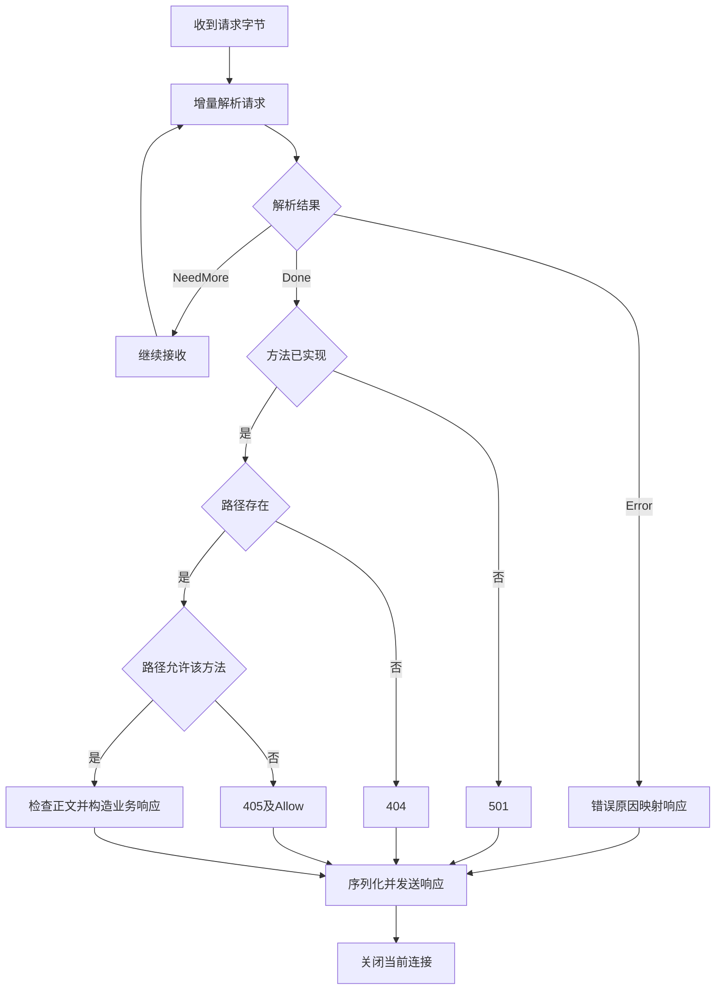

# 第十一天 路由与统一错误响应

今天把格式错误 未知路径 方法不允许 正文超限和不支持的功能分别映射为HTTP状态
新增src/http_response.h tests/day11_http_response.cpp 修改src/request_parser.h src/main.cpp和CMakeLists.txt 其他源码与旧测试不变
第十天用户贴出的数字检查误用MAX减value 已解释应减digit 本地参考原本正确 用户修正与Linux结果未反馈

## 状态与执行顺序

400格式错误或不完整请求 404路径不存在 405已实现方法在该路径不允许并带Allow 413正文超过64KiB 417不支持Expect 501不支持传输编码或未实现方法
服务已实现GET HEAD POST 其他方法先返回501 /health允许GET HEAD /echo允许POST
解析成功后先检查方法是否实现 再按路径定位 再检查路径允许的方法 最后检查业务正文
请求头不合法先返回解析错误 因此不是所有包含未知路径的字节都会返回404
路径只取问号前部分 当前忽略查询 不进行百分号解码与路径归一化
统一JSON固定结构 error.code和error.message 只使用固定字面量 不嵌入客户端输入 后续动态JSON仍使用成熟库
405要求Allow 参考 https://www.rfc-editor.org/rfc/rfc9110.html#section-15.5.6
HEAD响应不发送正文 Content-Length可描述相应GET的正文长度 参考 https://www.rfc-editor.org/rfc/rfc9110.html#section-9.3.2
请求行和请求头低层失败暂归400 未进一步区分414或431 不宣称完整HTTP实现

## 接口 所有权与错误处理

RequestError为原因枚举 ParseState仍表示NeedMore Done Error 只有Error时读取error确定响应分类
validate_headers从bool改为原因枚举 先验证Host和长度 再拒绝TE与CL混用 单独TE返回不支持 Expect在头部结束时失败 不等待正文
finish遇提前EOF记录BadRequest feed finish和error不会改变已经保留的终态原因
HttpResponse按值返回 body为拥有内容的string reason content_type allow为借用的string_view 当前全部来自静态字面量
若以后传入动态view 必须保证被引用内容活到build_response结束 不把临时字符串的view存入响应
error_response接收内部状态码和可选Allow 仅405调用提供Allow 其他未知内部状态兜底500 不等于实现所有异常捕获
parser_error_response只在解析Error后调用 route_request只在Done后调用 这两个前提由handle_client保证
route_request不访问Socket 返回响应值 /echo复制正文 /health返回OK加换行
build_response将状态行 头部和正文组合成独立拥有内存的string head_only只控制是否附加正文 长度仍按原正文计算
send_response借用fd和HttpResponse 打印状态 调用原send_all 返回true仅表示完整响应交给发送接口 不表示业务状态为200或对端已读取
client_fd所有权仍由外层UniqueFd持有 没有新增Linux系统调用 recv EINTR继续 EOF由finish处理
空连接EOF不发响应 不完整请求EOF尝试400 读取系统错误只记录并关闭 对端断开时无法保证错误送达 send失败由send_all处理且MSG_NOSIGNAL抑制SIGPIPE
每连接一次请求后关闭 不处理后续请求 不因为HTTP404或405停止监听循环

## 流程图

图的类型 Flowchart
为什么选择这种图 展示解析错误和正常路由如何汇合到统一响应发送位置

图的解释 图聚焦已收到请求数据后的决策 网络读取失败直接结束当前连接 未完成时EOF按400尝试发送 HEAD在序列化时省略正文

## 完整源码

### src\request_parser.h

```cpp
#pragma once

#include "request_headers.h"

#include <algorithm>
#include <cstdint>
#include <limits>

inline bool parse_decimal_length(std::string_view text, std::uint64_t& output)
{
    if (text.empty()) return false;
    std::uint64_t value = 0;
    for (char ch : text)
    {
        if (ch < '0' || ch > '9') return false;
        const auto digit = static_cast<std::uint64_t>(ch - '0');
        if (value > (std::numeric_limits<std::uint64_t>::max() - digit) / 10)
        {
            return false;
        }
        value = value * 10 + digit;
    }
    output = value;
    return true;
}

// ===== DAY 11 ADDED BEGIN 保存解析失败的具体原因 =====
enum class RequestError
{
    None,
    BadRequest,
    BodyTooLarge,
    UnsupportedExpectation,
    UnsupportedTransferEncoding
};
// ===== DAY 11 ADDED END =====

class RequestParser
{
public:
    static constexpr std::size_t max_body_bytes = 64 * 1024;

    FeedResult feed(std::string_view input)
    {
        if (state_ != ParseState::NeedMore) return {state_, 0};
        std::size_t used = 0;
        if (!line_done_)
        {
            const auto result = line_.feed(input);
            used += result.consumed;
            if (result.state == ParseState::Error)
            {
                // ===== DAY 11 ADDED BEGIN 请求行失败统一记录为格式错误 =====
                error_ = RequestError::BadRequest;
                // ===== DAY 11 ADDED END =====
                state_ = ParseState::Error;
                return {state_, used};
            }
            line_done_ = result.state == ParseState::Done;
        }
        if (line_done_ && !head_done_)
        {
            const auto result = headers_.feed(input.substr(used));
            used += result.consumed;
            // ===== DAY 11 MODIFIED BEGIN 区分头部格式与语义校验错误 =====
            if (result.state == ParseState::Error)
            {
                error_ = RequestError::BadRequest;
            }
            else if (result.state == ParseState::Done)
            {
                error_ = validate_headers();
            }
            if (error_ != RequestError::None)
            {
                state_ = ParseState::Error;
                return {state_, used};
            }
            head_done_ = result.state == ParseState::Done;
            // ===== DAY 11 MODIFIED END =====
        }
        if (head_done_)
        {
            const auto count = std::min(input.size() - used, length_ - body_.size());
            if (count != 0) body_.append(input.data() + used, count);
            used += count;
            if (body_.size() == length_) state_ = ParseState::Done;
        }
        return {state_, used};
    }

    ParseState finish() noexcept
    {
        // ===== DAY 11 MODIFIED BEGIN 提前EOF属于不完整请求 =====
        if (state_ == ParseState::NeedMore)
        {
            state_ = ParseState::Error;
            error_ = RequestError::BadRequest;
        }
        // ===== DAY 11 MODIFIED END =====
        return state_;
    }

    // ===== DAY 11 ADDED BEGIN 只读访问错误原因 =====
    RequestError error() const noexcept
    {
        return error_;
    }
    // ===== DAY 11 ADDED END =====

    const RequestLine& line() const noexcept
    {
        return line_.line();
    }

    const std::string& body() const noexcept
    {
        return body_;
    }

private:
    // ===== DAY 11 MODIFIED BEGIN 返回可映射到HTTP状态的校验结果 =====
    RequestError validate_headers()
    {
        std::size_t hosts = 0;
        bool has_length = false;
        bool has_encoding = false;
        bool has_expectation = false;
        std::uint64_t value = 0;
        for (const auto& field : headers_.fields())
        {
            if (field.first == "host")
            {
                ++hosts;
                if (field.second.empty()) return RequestError::BadRequest;
            }
            if (field.first == "transfer-encoding") has_encoding = true;
            if (field.first == "expect") has_expectation = true;
            if (field.first == "content-length")
            {
                if (has_length || !parse_decimal_length(field.second, value))
                {
                    return RequestError::BadRequest;
                }
                has_length = true;
            }
        }
        if (hosts != 1) return RequestError::BadRequest;
        if (has_encoding)
        {
            return has_length ? RequestError::BadRequest
                              : RequestError::UnsupportedTransferEncoding;
        }
        if (has_expectation) return RequestError::UnsupportedExpectation;
        if (value > max_body_bytes) return RequestError::BodyTooLarge;
        length_ = static_cast<std::size_t>(value);
        return RequestError::None;
    }
    // ===== DAY 11 MODIFIED END =====

    ParseState state_ = ParseState::NeedMore;
    // ===== DAY 11 ADDED BEGIN 错误原因与终态一起保留 =====
    RequestError error_ = RequestError::None;
    // ===== DAY 11 ADDED END =====
    RequestLineParser line_;
    RequestHeadersParser headers_;
    bool line_done_ = false;
    bool head_done_ = false;
    std::size_t length_ = 0;
    std::string body_;
};

```

### src\http_response.h

```cpp
// ===== DAY 11 ADDED BEGIN 路由分派与统一HTTP响应 =====
#pragma once

#include "request_parser.h"

struct HttpResponse
{
    int status;
    std::string_view reason;
    std::string_view content_type;
    std::string body;
    std::string_view allow = {};
};

inline HttpResponse error_response(int status, std::string_view allow = {})
{
    switch (status)
    {
    case 400:
        return {400, "Bad Request", "application/json",
            R"({"error":{"code":"bad_request","message":"Invalid request"}})"};
    case 404:
        return {404, "Not Found", "application/json",
            R"({"error":{"code":"not_found","message":"Route not found"}})"};
    case 405:
        return {405, "Method Not Allowed", "application/json",
            R"({"error":{"code":"method_not_allowed","message":"Method not allowed"}})", allow};
    case 413:
        return {413, "Content Too Large", "application/json",
            R"({"error":{"code":"body_too_large","message":"Body exceeds 65536 bytes"}})"};
    case 417:
        return {417, "Expectation Failed", "application/json",
            R"({"error":{"code":"expectation_failed","message":"Expect is not supported"}})"};
    case 501:
        return {501, "Not Implemented", "application/json",
            R"({"error":{"code":"not_implemented","message":"Requested feature is not implemented"}})"};
    default:
        return {500, "Internal Server Error", "application/json",
            R"({"error":{"code":"internal_error","message":"Internal server error"}})"};
    }
}

inline HttpResponse parser_error_response(RequestError error)
{
    switch (error)
    {
    case RequestError::BodyTooLarge: return error_response(413);
    case RequestError::UnsupportedExpectation: return error_response(417);
    case RequestError::UnsupportedTransferEncoding: return error_response(501);
    default: return error_response(400);
    }
}

inline HttpResponse route_request(const RequestParser& request)
{
    const auto& line = request.line();
    if (line.method != "GET" && line.method != "HEAD" && line.method != "POST")
    {
        return error_response(501);
    }
    const std::string_view target(line.target);
    const auto path = target.substr(0, target.find('?'));
    if (path == "/health")
    {
        if (line.method != "GET" && line.method != "HEAD")
        {
            return error_response(405, "GET, HEAD");
        }
        if (!request.body().empty()) return error_response(400);
        return {200, "OK", "text/plain; charset=utf-8", "OK\n"};
    }
    if (path == "/echo")
    {
        if (line.method != "POST") return error_response(405, "POST");
        return {200, "OK", "application/octet-stream", request.body()};
    }
    return error_response(404);
}

inline std::string build_response(const HttpResponse& response, bool head_only = false)
{
    std::string wire = "HTTP/1.1 " + std::to_string(response.status) + " " +
        std::string(response.reason) + "\r\n";
    wire += "Content-Type: " + std::string(response.content_type) + "\r\n";
    wire += "Content-Length: " + std::to_string(response.body.size()) + "\r\n";
    wire += "Connection: close\r\n";
    if (!response.allow.empty()) wire += "Allow: " + std::string(response.allow) + "\r\n";
    wire += "\r\n";
    if (!head_only) wire.append(response.body);
    return wire;
}
// ===== DAY 11 ADDED END =====

```

### src\main.cpp

```cpp
#include "unique_fd.h"
#include "socket_io.h"
// ===== DAY 11 MODIFIED BEGIN 引入路由与响应模块 =====
#include "http_response.h"
// ===== DAY 11 MODIFIED END =====

#include <algorithm>
#include <arpa/inet.h>
#include <cerrno>
#include <cstddef>
#include <cstdint>
#include <cstring>
#include <iostream>
#include <netinet/in.h>
#include <string>
#include <sys/socket.h>

// ===== DAY 11 DELETED 移除仅支持200的响应构造 改用http_response.h =====
// ===== DAY 11 ADDED BEGIN 发送统一响应并记录状态码 =====
bool send_response(int client_fd, const HttpResponse& response, bool head_only)
{
    const std::string wire = build_response(response, head_only);
    std::cout << "response status=" << response.status << '\n';
    return send_all(client_fd, wire.data(), wire.size());
}
// ===== DAY 11 ADDED END =====

bool handle_client(int client_fd)
{
    RequestParser parser;
    ParseState state = ParseState::NeedMore;
    // ===== DAY 11 ADDED BEGIN 区分空连接与不完整请求 =====
    bool received_any = false;
    // ===== DAY 11 ADDED END =====
    char buffer[1024];

    while (state == ParseState::NeedMore)
    {
        const ssize_t n = ::recv(client_fd, buffer, sizeof(buffer), 0);
        if (n == -1)
        {
            const int error = errno;
            if (error == EINTR)
            {
                continue;
            }
            print_system_error("recv", error);
            return false;
        }
        if (n == 0)
        {
            // ===== DAY 11 MODIFIED BEGIN 不完整请求尽力发送400 =====
            if (!received_any) return false;
            parser.finish();
            std::cerr << "peer closed before request completed\n";
            return send_response(client_fd, parser_error_response(parser.error()),
                                 parser.line().method == "HEAD");
            // ===== DAY 11 MODIFIED END =====
        }

        // ===== DAY 11 ADDED BEGIN 收到数据后才可能构成请求 =====
        received_any = true;
        // ===== DAY 11 ADDED END =====
        const std::size_t count = static_cast<std::size_t>(n);
        const auto result = parser.feed(std::string_view(buffer, count));
        state = result.state;
        if (state == ParseState::Error)
        {
            // ===== DAY 11 MODIFIED BEGIN 解析失败发送对应错误响应 =====
            std::cerr << "invalid or unsupported request or size limit exceeded\n";
            return send_response(client_fd, parser_error_response(parser.error()),
                                 parser.line().method == "HEAD");
            // ===== DAY 11 MODIFIED END =====
        }
        if (result.consumed < count)
        {
            std::cout << "trailing bytes ignored before connection close\n";
        }
    }

    const RequestLine& line = parser.line();
    std::cout << "method=" << line.method
              << " target=" << line.target
              << " version=" << line.version << '\n';
    // ===== DAY 11 DELETED 删除路由失败直接关闭的分支 改为统一分派 =====
    // ===== DAY 11 MODIFIED BEGIN 路由结果统一序列化 HEAD不发送正文 =====
    return send_response(client_fd, route_request(parser), line.method == "HEAD");
    // ===== DAY 11 MODIFIED END =====
}

int main()
{
    constexpr std::uint16_t port = 8080;
    constexpr int backlog = 16;

    const int raw_fd = ::socket(AF_INET, SOCK_STREAM | SOCK_CLOEXEC, 0);
    if (raw_fd == -1)
    {
        const int error = errno;
        print_system_error("socket", error);
        return 1;
    }
    UniqueFd listener(raw_fd);

    const int reuse_address = 1;
    if (::setsockopt(listener.get(), SOL_SOCKET, SO_REUSEADDR,
                     &reuse_address, sizeof(reuse_address)) == -1)
    {
        const int error = errno;
        print_system_error("setsockopt", error);
        return 1;
    }

    sockaddr_in address{};
    address.sin_family = AF_INET;
    address.sin_port = htons(port);
    address.sin_addr.s_addr = htonl(INADDR_LOOPBACK);

    if (::bind(listener.get(),
               reinterpret_cast<const sockaddr*>(&address),
               sizeof(address)) == -1)
    {
        const int error = errno;
        print_system_error("bind", error);
        return 1;
    }
    if (::listen(listener.get(), backlog) == -1)
    {
        const int error = errno;
        print_system_error("listen", error);
        return 1;
    }

    std::cout << "listening on 127.0.0.1:" << port
              << " fd=" << listener.get() << std::endl;

    while (true)
    {
        const int accepted_fd =
            ::accept(listener.get(), nullptr, nullptr);
        if (accepted_fd == -1)
        {
            const int error = errno;
            if (error == EINTR || error == ECONNABORTED)
            {
                continue;
            }
            print_system_error("accept", error);
            return 1;
        }

        UniqueFd client(accepted_fd);
        std::cout << "accepted fd=" << client.get() << std::endl;
        const bool ok = handle_client(client.get());
        // ===== DAY 11 MODIFIED BEGIN 日志区分响应发送与连接失败 =====
        std::cout << (ok ? "response sent" : "connection failed")
                  << std::endl;
        // ===== DAY 11 MODIFIED END =====
    }
}

```

### tests\day11_http_response.cpp

```cpp
// ===== DAY 11 ADDED BEGIN 验证路由 错误分类与响应字节 =====
#include "http_response.h"

#include <cstdlib>
#include <iostream>

void require(bool ok, const char* message)
{
    if (!ok)
    {
        std::cerr << "FAIL: " << message << '\n';
        std::exit(1);
    }
}

std::string reply(const std::string& input, bool eof = false)
{
    RequestParser parser;
    auto state = parser.feed(input).state;
    if (eof && state == ParseState::NeedMore) state = parser.finish();
    require(state != ParseState::NeedMore, "test input is incomplete");
    const auto response = state == ParseState::Done
        ? route_request(parser) : parser_error_response(parser.error());
    return build_response(response, parser.line().method == "HEAD");
}

void check(const std::string& wire, int status, const std::string& body,
           const std::string& allow = {}, bool head_only = false)
{
    require(wire.find("HTTP/1.1 " + std::to_string(status) + " ") == 0,
            "wrong status");
    const auto end = wire.find("\r\n\r\n");
    require(end != std::string::npos, "missing header terminator");
    const auto head = wire.substr(0, end + 4);
    require(head.find("\r\nContent-Length: " + std::to_string(body.size()) + "\r\n")
                != std::string::npos, "wrong byte length");
    require(head.find("\r\nConnection: close\r\n") != std::string::npos,
            "missing connection policy");
    require(wire.substr(end + 4) == (head_only ? std::string{} : body),
            "wrong response body");
    if (allow.empty())
        require(head.find("\r\nAllow:") == std::string::npos, "unexpected Allow");
    else
        require(head.find("\r\nAllow: " + allow + "\r\n") != std::string::npos,
                "missing Allow");
    if (status >= 400)
        require(head.find("\r\nContent-Type: application/json\r\n") != std::string::npos,
                "error is not JSON");
}

int main()
{
    const std::string host = " HTTP/1.1\r\nHost: localhost\r\n";
    check(reply("GET /health" + host + "\r\n"), 200, "OK\n");
    check(reply("GET /health?probe=1" + host + "\r\n"), 200, "OK\n");
    check(reply("HEAD /health" + host + "\r\n"), 200, "OK\n", {}, true);
    const std::string binary("A\0B", 3);
    check(reply("POST /echo" + host + "Content-Length: 3\r\n\r\n" + binary),
          200, binary);
    const std::string not_found =
        R"({"error":{"code":"not_found","message":"Route not found"}})";
    const std::string wrong_method =
        R"({"error":{"code":"method_not_allowed","message":"Method not allowed"}})";
    const std::string bad =
        R"({"error":{"code":"bad_request","message":"Invalid request"}})";
    check(reply("GET /missing" + host + "\r\n"), 404, not_found);
    check(reply("HEAD /missing" + host + "\r\n"), 404, not_found, {}, true);
    check(reply("POST /health" + host + "\r\n"), 405, wrong_method, "GET, HEAD");
    check(reply("GET /echo" + host + "\r\n"), 405, wrong_method, "POST");
    check(reply("HEAD /echo" + host + "\r\n"), 405, wrong_method, "POST", true);
    check(reply("PUT /health" + host + "\r\n"), 501,
          R"({"error":{"code":"not_implemented","message":"Requested feature is not implemented"}})");
    for (const std::string& headers : {
             std::string("Content-Length: x\r\n"),
             std::string("Content-Length: 1\r\nContent-Length: 1\r\n"),
             std::string("Content-Length: 1\r\nTransfer-Encoding: chunked\r\n"),
             std::string("Transfer-Encoding: chunked\r\nContent-Length: 1\r\n"),
             std::string("Host: another\r\n"), std::string("Bad Name: x\r\n")})
    {
        check(reply("POST /echo" + host + headers + "\r\n"), 400, bad);
    }
    check(reply("GET /health HTTP/1.1\r\n\r\n"), 400, bad);
    check(reply("GET /health" + host + "Content-Length: 1\r\n\r\nx"), 400, bad);
    check(reply("POST /echo" + host + "Content-Length: 3\r\n\r\nx", true), 400, bad);
    check(reply("POST /echo" + host + "Content-Length: 65537\r\n\r\n"), 413,
          R"({"error":{"code":"body_too_large","message":"Body exceeds 65536 bytes"}})");
    check(reply("POST /echo" + host + "Expect: 100-continue\r\nContent-Length: 3\r\n\r\n"),
          417, R"({"error":{"code":"expectation_failed","message":"Expect is not supported"}})");
    check(reply("POST /echo" + host + "Transfer-Encoding: chunked\r\n\r\n"), 501,
          R"({"error":{"code":"not_implemented","message":"Requested feature is not implemented"}})");
    std::cout << "PASS: routes, JSON errors, Allow, HEAD and response lengths\n";
}
// ===== DAY 11 ADDED END =====

```

### CMakeLists.txt

```cmake
cmake_minimum_required(VERSION 3.16)

project(netdisk LANGUAGES CXX)

add_executable(netdisk src/main.cpp)
set(NETDISK_TARGETS netdisk)

include(CTest)
if(BUILD_TESTING)
    add_executable(io_tests tests/day06_io.cpp)
    target_include_directories(io_tests PRIVATE src)
    list(APPEND NETDISK_TARGETS io_tests)
    add_test(NAME io_tests COMMAND io_tests)

    add_executable(request_line_tests tests/day08_request_line.cpp)
    target_include_directories(request_line_tests PRIVATE src)
    list(APPEND NETDISK_TARGETS request_line_tests)
    add_test(NAME request_line_tests COMMAND request_line_tests)

    add_executable(request_headers_tests tests/day09_request_headers.cpp)
    target_include_directories(request_headers_tests PRIVATE src)
    list(APPEND NETDISK_TARGETS request_headers_tests)
    add_test(NAME request_headers_tests COMMAND request_headers_tests)

    add_executable(request_body_tests tests/day10_request_body.cpp)
    target_include_directories(request_body_tests PRIVATE src)
    list(APPEND NETDISK_TARGETS request_body_tests)
    add_test(NAME request_body_tests COMMAND request_body_tests)

    # ===== DAY 11 ADDED BEGIN 注册路由与错误响应测试 =====
    add_executable(http_response_tests tests/day11_http_response.cpp)
    target_include_directories(http_response_tests PRIVATE src)
    list(APPEND NETDISK_TARGETS http_response_tests)
    add_test(NAME http_response_tests COMMAND http_response_tests)
    # ===== DAY 11 ADDED END =====
endif()

foreach(target IN LISTS NETDISK_TARGETS)
    set_target_properties(${target} PROPERTIES
        CXX_STANDARD 17
        CXX_STANDARD_REQUIRED YES
        CXX_EXTENSIONS NO
    )
endforeach()

```

## Linux虚拟机执行

更新以上五个文件 在现有工程根目录执行 以下使用建议路径 现有构建目录若为build-debug则统一替换build 不另建目录
```sh
cd ~/projects/netdisk
cmake -S . -B build -DCMAKE_BUILD_TYPE=Debug -DBUILD_TESTING=ON
cmake --build build -j2
ctest --test-dir build -R '^http_response_tests$' --output-on-failure
./build/netdisk
```
CTest应实际运行http_response_tests一项并通过 退出码0 No tests were found不是通过
保持服务器运行 在同一Linux虚拟机另一个终端执行一次真实操作
```sh
curl --noproxy '*' --http1.1 --max-time 5 -i http://127.0.0.1:8080/echo
```
这次发送GET 预期405 Method Not Allowed Allow为POST Content-Type为application/json Content-Length为70
正文不附加换行
{"error":{"code":"method_not_allowed","message":"Method not allowed"}}
未加--fail时curl收到405仍可退出0 这表示HTTP交换完成 不代表业务成功 应看HTTP状态
若仍Empty reply看是否重建并启动了新程序 若仍200可能访问health 若CTest找不到测试检查BUILD_TESTING CMake更新与构建目录

## 实际证据与限制

Windows g++ -std=c++17 -Wall -Wextra -pedantic编译运行http_response_tests通过
PASS: routes, JSON errors, Allow, HEAD and response lengths
由于修改共用RequestParser 另编译运行request_body_tests通过
PASS: request splits, binary body, length limits and EOF
以上是纯C++逻辑验证 没有执行Linux服务器构建 CTest或真实curl 不将用户继续学习视为旧单元验收
当前仍串行阻塞 无超时 无文件上传 正文缓存上限64KiB 早期拒绝或断开时发送响应不保证客户端一定接收
下一单元 第12单元 原始正文流式写临时文件
