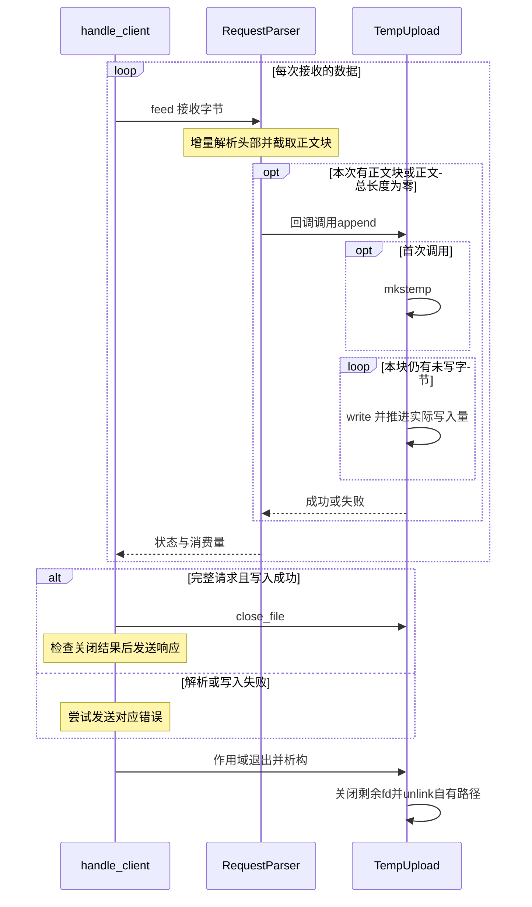

# 第十二天 原始正文流式写入临时文件

目标 让POST /dev/upload的正文每收到一段就同步write到临时文件 不存入parser.body
请求上限仍为64KiB health与echo原行为保留 今天不发布正式文件 不返回文件ID 所有临时文件在处理作用域结束时尝试删除
新增src/temp_upload.h tests/day12_stream_upload.cpp 修改src/request_parser.h src/http_response.h src/main.cpp和CMakeLists.txt 其余源码和旧测试不变

## 数据流与接口

原先body.size同时表示缓存长度和接收进度 流式模式下body为空 因此新增received独立计数 body_size返回已成功接收块的总字节数
BodySink是std::function保存的可调用对象 参数为借用的RequestLine引用和本次正文string_view 返回BodyAction
Buffer要求解析器缓存本块 Written表示外部已同步处理完整块且不缓存 Failed使解析器进入BodyWriteFailed并映射500
回调在feed内部执行 不能保存chunk视图供下次recv使用 不能在回调重入同一解析器 本实现无异步线程
默认不提供回调时维持缓存行为 main只对POST /dev/upload返回Written 其他路径返回Buffer
空正文在头部校验完成时也调用一次空块回调 从而创建真实零长度临时文件
回调失败时该块可能已部分写入文件 此时请求终止 不允许根据consumed重新提交失败块 最终清理文件

TempUpload独占fd和路径 禁止复制 不提供移动 append成功表示整段写完 失败记录errno并返回false
首次append创建文件 包括空块 close_file检查close结果且先把成员fd设为-1 不重试close path借用对象内部字符数组 只用于内部日志或测试 不回传客户端
析构会关闭剩余fd 并仅unlink自己成功创建的路径 清理错误打印日志 保存恢复调用者errno 不删除目录 不扫描或清空uploads
main先构造文件后构造parser lambda通过引用借用文件 所以退出时parser先销毁 文件后销毁
close_file成功不删除文件 析构才删除 因此自动测试可以在对象仍存活时读回核对
上传成功返回固定JSON {"status":"temporary_received"} 只表示本次临时接收完成 文件随后删除

## Linux接口

mkstemp(char* pattern)修改可写模板末尾XXXXXX 创建唯一文件 返回可读写fd 失败为-1并设置errno Linux新文件权限0600
本次模板为data/uploads/day12-XXXXXX 相对进程启动目录 父目录必须预先存在 名称由服务器生成 客户端不提供磁盘路径
write(fd, data, size)返回实际写入字节数 正数可能小于请求数 所以循环推进指针 返回-1且EINTR重试 其他错误停止 非空写入返回0作为EIO处理
unlink(path)成功返回0 失败为-1 文件仍被打开时删除名称不等于立即释放内容 本类在析构先close再unlink
参考 https://man7.org/linux/man-pages/man3/mkstemp.3.html https://man7.org/linux/man-pages/man2/write.2.html https://man7.org/linux/man-pages/man2/unlink.2.html
write与close成功不等于断电持久化 本次不调用fsync 文件写入是同步操作 当前仍可能阻塞串行服务

## 时序图

图的类型 Sequence Diagram
为什么选择这种图 展示同一次feed内正文块如何在返回recv循环前完成写入 以及请求结束后的关闭和清理

图的解释 本图聚焦临时上传路径 非上传路径仍缓存正文 失败会停止接收 不会继续下一轮写入 零长度文件不执行write循环

## 完整源码

### src\request_parser.h

```cpp
#pragma once

#include "request_headers.h"

#include <algorithm>
#include <cstdint>
#include <limits>
// ===== DAY 12 ADDED BEGIN 引入正文回调与移动工具 =====
#include <functional>
#include <utility>
// ===== DAY 12 ADDED END =====

inline bool parse_decimal_length(std::string_view text, std::uint64_t& output)
{
    if (text.empty()) return false;
    std::uint64_t value = 0;
    for (char ch : text)
    {
        if (ch < '0' || ch > '9') return false;
        const auto digit = static_cast<std::uint64_t>(ch - '0');
        if (value > (std::numeric_limits<std::uint64_t>::max() - digit) / 10)
        {
            return false;
        }
        value = value * 10 + digit;
    }
    output = value;
    return true;
}

enum class RequestError
{
    None,
    BadRequest,
    BodyTooLarge,
    UnsupportedExpectation,
    UnsupportedTransferEncoding,
    // ===== DAY 12 ADDED BEGIN 正文接收端写入失败 =====
    BodyWriteFailed
    // ===== DAY 12 ADDED END =====
};

// ===== DAY 12 ADDED BEGIN 正文块选择缓存或外部处理 =====
enum class BodyAction { Buffer, Written, Failed };
using BodySink = std::function<BodyAction(const RequestLine&, std::string_view)>;
// ===== DAY 12 ADDED END =====

class RequestParser
{
public:
    static constexpr std::size_t max_body_bytes = 64 * 1024;

    // ===== DAY 12 ADDED BEGIN 可选正文接收回调 默认保留原缓存行为 =====
    explicit RequestParser(BodySink sink = {}) : sink_(std::move(sink)) {}
    // ===== DAY 12 ADDED END =====

    FeedResult feed(std::string_view input)
    {
        if (state_ != ParseState::NeedMore) return {state_, 0};
        std::size_t used = 0;
        if (!line_done_)
        {
            const auto result = line_.feed(input);
            used += result.consumed;
            if (result.state == ParseState::Error)
            {
                error_ = RequestError::BadRequest;
                state_ = ParseState::Error;
                return {state_, used};
            }
            line_done_ = result.state == ParseState::Done;
        }
        if (line_done_ && !head_done_)
        {
            const auto result = headers_.feed(input.substr(used));
            used += result.consumed;
            if (result.state == ParseState::Error)
            {
                error_ = RequestError::BadRequest;
            }
            else if (result.state == ParseState::Done)
            {
                error_ = validate_headers();
            }
            if (error_ != RequestError::None)
            {
                state_ = ParseState::Error;
                return {state_, used};
            }
            head_done_ = result.state == ParseState::Done;
        }
        if (head_done_)
        {
            // ===== DAY 12 DELETED 不再用缓存字符串长度代表已接收正文长度 =====
            // ===== DAY 12 MODIFIED BEGIN 正文块同步交给接收端 并独立累计进度 =====
            const auto count = std::min(input.size() - used, length_ - received_);
            if (count != 0 || length_ == 0)
            {
                const auto chunk = input.substr(used, count);
                const auto action = sink_ ? sink_(line_.line(), chunk) : BodyAction::Buffer;
                if (action == BodyAction::Failed)
                {
                    error_ = RequestError::BodyWriteFailed;
                    state_ = ParseState::Error;
                    return {state_, used};
                }
                if (action == BodyAction::Buffer && count != 0)
                    body_.append(chunk.data(), chunk.size());
            }
            received_ += count;
            used += count;
            if (received_ == length_) state_ = ParseState::Done;
            // ===== DAY 12 MODIFIED END =====
        }
        return {state_, used};
    }

    ParseState finish() noexcept
    {
        if (state_ == ParseState::NeedMore)
        {
            state_ = ParseState::Error;
            error_ = RequestError::BadRequest;
        }
        return state_;
    }

    RequestError error() const noexcept
    {
        return error_;
    }

    const RequestLine& line() const noexcept
    {
        return line_.line();
    }

    const std::string& body() const noexcept
    {
        return body_;
    }

    // ===== DAY 12 ADDED BEGIN 已接收字节数不依赖是否缓存 =====
    std::size_t body_size() const noexcept { return received_; }
    // ===== DAY 12 ADDED END =====

private:
    RequestError validate_headers()
    {
        std::size_t hosts = 0;
        bool has_length = false;
        bool has_encoding = false;
        bool has_expectation = false;
        std::uint64_t value = 0;
        for (const auto& field : headers_.fields())
        {
            if (field.first == "host")
            {
                ++hosts;
                if (field.second.empty()) return RequestError::BadRequest;
            }
            if (field.first == "transfer-encoding") has_encoding = true;
            if (field.first == "expect") has_expectation = true;
            if (field.first == "content-length")
            {
                if (has_length || !parse_decimal_length(field.second, value))
                {
                    return RequestError::BadRequest;
                }
                has_length = true;
            }
        }
        if (hosts != 1) return RequestError::BadRequest;
        if (has_encoding)
        {
            return has_length ? RequestError::BadRequest
                              : RequestError::UnsupportedTransferEncoding;
        }
        if (has_expectation) return RequestError::UnsupportedExpectation;
        if (value > max_body_bytes) return RequestError::BodyTooLarge;
        length_ = static_cast<std::size_t>(value);
        return RequestError::None;
    }

    ParseState state_ = ParseState::NeedMore;
    RequestError error_ = RequestError::None;
    RequestLineParser line_;
    RequestHeadersParser headers_;
    bool line_done_ = false;
    bool head_done_ = false;
    std::size_t length_ = 0;
    std::string body_;
    // ===== DAY 12 ADDED BEGIN 独立接收进度与回调生命周期 =====
    std::size_t received_ = 0;
    BodySink sink_;
    // ===== DAY 12 ADDED END =====
};

```

### src\temp_upload.h

```cpp
// ===== DAY 12 ADDED BEGIN 临时上传文件的写入 关闭与清理 =====
#pragma once

#include <cerrno>
#include <cstdio>
#include <cstdlib>
#include <string_view>
#include <unistd.h>

class TempUpload
{
public:
    TempUpload() = default;
    TempUpload(const TempUpload&) = delete;
    TempUpload& operator=(const TempUpload&) = delete;

    ~TempUpload() noexcept
    {
        const int saved = errno;
        if (fd_ >= 0 && ::close(fd_) == -1) std::perror("close temporary file");
        if (created_ && ::unlink(path_) == -1 && errno != ENOENT)
            std::perror("unlink temporary file");
        errno = saved;
    }

    bool append(std::string_view data)
    {
        if (error_ != 0) return false;
        if (!created_)
        {
            fd_ = ::mkstemp(path_);
            if (fd_ == -1) return fail(errno);
            created_ = true;
        }
        if (fd_ < 0) return fail(EBADF);
        std::size_t written = 0;
        while (written < data.size())
        {
            const ssize_t n = ::write(fd_, data.data() + written, data.size() - written);
            if (n == -1)
            {
                if (errno == EINTR) continue;
                return fail(errno);
            }
            if (n == 0) return fail(EIO);
            written += static_cast<std::size_t>(n);
        }
        return true;
    }

    bool close_file()
    {
        if (fd_ >= 0)
        {
            const int raw = fd_;
            fd_ = -1;
            if (::close(raw) == -1) return fail(errno);
        }
        return error_ == 0;
    }

    int error() const noexcept { return error_; }
    const char* path() const noexcept { return created_ ? path_ : ""; }

private:
    bool fail(int error) noexcept
    {
        error_ = error;
        return false;
    }

    char path_[sizeof("data/uploads/day12-XXXXXX")] = "data/uploads/day12-XXXXXX";
    int fd_ = -1;
    int error_ = 0;
    bool created_ = false;
};
// ===== DAY 12 ADDED END =====

```

### src\http_response.h

```cpp
#pragma once

#include "request_parser.h"

struct HttpResponse
{
    int status;
    std::string_view reason;
    std::string_view content_type;
    std::string body;
    std::string_view allow = {};
};

inline HttpResponse error_response(int status, std::string_view allow = {})
{
    switch (status)
    {
    case 400:
        return {400, "Bad Request", "application/json",
            R"({"error":{"code":"bad_request","message":"Invalid request"}})"};
    case 404:
        return {404, "Not Found", "application/json",
            R"({"error":{"code":"not_found","message":"Route not found"}})"};
    case 405:
        return {405, "Method Not Allowed", "application/json",
            R"({"error":{"code":"method_not_allowed","message":"Method not allowed"}})", allow};
    case 413:
        return {413, "Content Too Large", "application/json",
            R"({"error":{"code":"body_too_large","message":"Body exceeds 65536 bytes"}})"};
    case 417:
        return {417, "Expectation Failed", "application/json",
            R"({"error":{"code":"expectation_failed","message":"Expect is not supported"}})"};
    case 501:
        return {501, "Not Implemented", "application/json",
            R"({"error":{"code":"not_implemented","message":"Requested feature is not implemented"}})"};
    default:
        return {500, "Internal Server Error", "application/json",
            R"({"error":{"code":"internal_error","message":"Internal server error"}})"};
    }
}

inline HttpResponse parser_error_response(RequestError error)
{
    switch (error)
    {
    case RequestError::BodyTooLarge: return error_response(413);
    case RequestError::UnsupportedExpectation: return error_response(417);
    case RequestError::UnsupportedTransferEncoding: return error_response(501);
    // ===== DAY 12 ADDED BEGIN 临时文件写入失败返回统一500 =====
    case RequestError::BodyWriteFailed: return error_response(500);
    // ===== DAY 12 ADDED END =====
    default: return error_response(400);
    }
}

inline HttpResponse route_request(const RequestParser& request)
{
    const auto& line = request.line();
    if (line.method != "GET" && line.method != "HEAD" && line.method != "POST")
    {
        return error_response(501);
    }
    const std::string_view target(line.target);
    const auto path = target.substr(0, target.find('?'));
    if (path == "/health")
    {
        if (line.method != "GET" && line.method != "HEAD")
        {
            return error_response(405, "GET, HEAD");
        }
        // ===== DAY 12 MODIFIED BEGIN 正文检查使用独立字节计数 =====
        if (request.body_size() != 0) return error_response(400);
        // ===== DAY 12 MODIFIED END =====
        return {200, "OK", "text/plain; charset=utf-8", "OK\n"};
    }
    if (path == "/echo")
    {
        if (line.method != "POST") return error_response(405, "POST");
        return {200, "OK", "application/octet-stream", request.body()};
    }
    // ===== DAY 12 ADDED BEGIN 临时接收入口 尚未发布正式文件 =====
    if (path == "/dev/upload")
    {
        if (line.method != "POST") return error_response(405, "POST");
        return {200, "OK", "application/json", R"({"status":"temporary_received"})"};
    }
    // ===== DAY 12 ADDED END =====
    return error_response(404);
}

inline std::string build_response(const HttpResponse& response, bool head_only = false)
{
    std::string wire = "HTTP/1.1 " + std::to_string(response.status) + " " +
        std::string(response.reason) + "\r\n";
    wire += "Content-Type: " + std::string(response.content_type) + "\r\n";
    wire += "Content-Length: " + std::to_string(response.body.size()) + "\r\n";
    wire += "Connection: close\r\n";
    if (!response.allow.empty()) wire += "Allow: " + std::string(response.allow) + "\r\n";
    wire += "\r\n";
    if (!head_only) wire.append(response.body);
    return wire;
}

```

### src\main.cpp

```cpp
#include "unique_fd.h"
#include "socket_io.h"
#include "http_response.h"
// ===== DAY 12 ADDED BEGIN 引入临时上传文件 =====
#include "temp_upload.h"
// ===== DAY 12 ADDED END =====

#include <algorithm>
#include <arpa/inet.h>
#include <cerrno>
#include <cstddef>
#include <cstdint>
#include <cstring>
#include <iostream>
#include <netinet/in.h>
#include <string>
#include <sys/socket.h>

bool send_response(int client_fd, const HttpResponse& response, bool head_only)
{
    const std::string wire = build_response(response, head_only);
    std::cout << "response status=" << response.status << '\n';
    return send_all(client_fd, wire.data(), wire.size());
}

// ===== DAY 12 ADDED BEGIN 仅临时上传路径采用文件接收 =====
bool is_temp_upload(const RequestLine& line)
{
    const std::string_view target(line.target);
    return line.method == "POST" && target.substr(0, target.find('?')) == "/dev/upload";
}
// ===== DAY 12 ADDED END =====

bool handle_client(int client_fd)
{
    // ===== DAY 12 MODIFIED BEGIN 文件先构造 保证回调借用期间始终存活 =====
    TempUpload upload;
    RequestParser parser([&upload](const RequestLine& line, std::string_view chunk)
    {
        if (!is_temp_upload(line)) return BodyAction::Buffer;
        return upload.append(chunk) ? BodyAction::Written : BodyAction::Failed;
    });
    // ===== DAY 12 MODIFIED END =====
    ParseState state = ParseState::NeedMore;
    bool received_any = false;
    char buffer[1024];

    while (state == ParseState::NeedMore)
    {
        const ssize_t n = ::recv(client_fd, buffer, sizeof(buffer), 0);
        if (n == -1)
        {
            const int error = errno;
            if (error == EINTR)
            {
                continue;
            }
            print_system_error("recv", error);
            return false;
        }
        if (n == 0)
        {
            if (!received_any) return false;
            parser.finish();
            std::cerr << "peer closed before request completed\n";
            return send_response(client_fd, parser_error_response(parser.error()),
                                 parser.line().method == "HEAD");
        }

        received_any = true;
        const std::size_t count = static_cast<std::size_t>(n);
        const auto result = parser.feed(std::string_view(buffer, count));
        state = result.state;
        if (state == ParseState::Error)
        {
            std::cerr << "invalid or unsupported request or size limit exceeded\n";
            // ===== DAY 12 ADDED BEGIN 文件错误细节仅记录在服务器 =====
            if (parser.error() == RequestError::BodyWriteFailed)
                print_system_error("temporary upload", upload.error());
            // ===== DAY 12 ADDED END =====
            return send_response(client_fd, parser_error_response(parser.error()),
                                 parser.line().method == "HEAD");
        }
        if (result.consumed < count)
        {
            std::cout << "trailing bytes ignored before connection close\n";
        }
    }

    const RequestLine& line = parser.line();
    std::cout << "method=" << line.method
              << " target=" << line.target
              << " version=" << line.version << '\n';
    // ===== DAY 12 ADDED BEGIN 完整接收后检查关闭结果 临时文件仍由析构清理 =====
    if (is_temp_upload(line))
    {
        if (!upload.close_file())
        {
            print_system_error("close temporary upload", upload.error());
            return send_response(client_fd, error_response(500), false);
        }
        std::cout << "temporary bytes=" << parser.body_size()
                  << " buffered bytes=" << parser.body().size() << '\n';
    }
    // ===== DAY 12 ADDED END =====
    return send_response(client_fd, route_request(parser), line.method == "HEAD");
}

int main()
{
    constexpr std::uint16_t port = 8080;
    constexpr int backlog = 16;

    const int raw_fd = ::socket(AF_INET, SOCK_STREAM | SOCK_CLOEXEC, 0);
    if (raw_fd == -1)
    {
        const int error = errno;
        print_system_error("socket", error);
        return 1;
    }
    UniqueFd listener(raw_fd);

    const int reuse_address = 1;
    if (::setsockopt(listener.get(), SOL_SOCKET, SO_REUSEADDR,
                     &reuse_address, sizeof(reuse_address)) == -1)
    {
        const int error = errno;
        print_system_error("setsockopt", error);
        return 1;
    }

    sockaddr_in address{};
    address.sin_family = AF_INET;
    address.sin_port = htons(port);
    address.sin_addr.s_addr = htonl(INADDR_LOOPBACK);

    if (::bind(listener.get(),
               reinterpret_cast<const sockaddr*>(&address),
               sizeof(address)) == -1)
    {
        const int error = errno;
        print_system_error("bind", error);
        return 1;
    }
    if (::listen(listener.get(), backlog) == -1)
    {
        const int error = errno;
        print_system_error("listen", error);
        return 1;
    }

    std::cout << "listening on 127.0.0.1:" << port
              << " fd=" << listener.get() << std::endl;

    while (true)
    {
        const int accepted_fd =
            ::accept(listener.get(), nullptr, nullptr);
        if (accepted_fd == -1)
        {
            const int error = errno;
            if (error == EINTR || error == ECONNABORTED)
            {
                continue;
            }
            print_system_error("accept", error);
            return 1;
        }

        UniqueFd client(accepted_fd);
        std::cout << "accepted fd=" << client.get() << std::endl;
        const bool ok = handle_client(client.get());
        std::cout << (ok ? "response sent" : "connection failed")
                  << std::endl;
    }
}

```

### tests\day12_stream_upload.cpp

```cpp
// ===== DAY 12 ADDED BEGIN 验证分片回调 文件内容与自动清理 =====
#include "http_response.h"

#include <cstdlib>
#include <iostream>

#ifdef __linux__
#include "temp_upload.h"
#include <filesystem>
#include <fstream>
#include <iterator>
#endif

void require(bool ok, const char* message)
{
    if (!ok)
    {
        std::cerr << "FAIL: " << message << '\n';
        std::exit(1);
    }
}

int main()
{
    const std::string prefix = "POST /dev/upload HTTP/1.1\r\nHost: localhost\r\n";
    const std::string body("A\0B\r\n", 5);
    const std::string request = prefix + "Content-Length: 5\r\n\r\n" + body;
    for (std::size_t split = 0; split <= request.size(); ++split)
    {
        std::string written;
        RequestParser parser([&](const RequestLine&, std::string_view chunk)
        {
            written.append(chunk.data(), chunk.size());
            return BodyAction::Written;
        });
        const auto first = parser.feed(std::string_view(request).substr(0, split));
        require(first.consumed == split, "first consumption");
        const auto last = parser.feed(request.substr(split) + "NEXT");
        require(last.state == ParseState::Done && last.consumed == request.size() - split,
                "split or trailing boundary");
        require(written == body && parser.body().empty() && parser.body_size() == 5,
                "streamed bytes were lost or cached");
    }
    std::size_t total = 0;
    RequestParser many([&](const RequestLine&, std::string_view chunk)
    {
        require(chunk.size() <= 1024, "oversized sink chunk");
        total += chunk.size();
        return BodyAction::Written;
    });
    require(many.feed(prefix + "Content-Length: 65536\r\n\r\n").state
                == ParseState::NeedMore, "header unexpectedly completed body");
    for (int i = 0; i < 64; ++i)
    {
        const auto result = many.feed(std::string(1024, 'x'));
        require(result.state == (i == 63 ? ParseState::Done : ParseState::NeedMore),
                "chunk progress");
        require(many.body().empty(), "whole body buffered");
    }
    require(total == 65536 && many.body_size() == total, "streamed length");
    int empty_calls = 0;
    RequestParser empty([&](const RequestLine&, std::string_view chunk)
    {
        require(chunk.empty(), "zero body has bytes");
        ++empty_calls;
        return BodyAction::Written;
    });
    require(empty.feed(prefix + "Content-Length: 0\r\n\r\n").state == ParseState::Done &&
            empty_calls == 1, "empty upload was not initialized");
    RequestParser failed([](const RequestLine&, std::string_view)
    {
        return BodyAction::Failed;
    });
    require(failed.feed(request).state == ParseState::Error &&
            failed.error() == RequestError::BodyWriteFailed &&
            parser_error_response(failed.error()).status == 500, "sink failure");
    require(failed.feed(request).consumed == 0, "failed sink retried");
    std::cout << "PASS: stream chunks, binary boundary, empty body and sink failure\n";

#ifdef __linux__
    std::filesystem::create_directories("data/uploads");
    std::string path;
    {
        TempUpload file;
        RequestParser parser([&](const RequestLine&, std::string_view chunk)
        {
            return file.append(chunk) ? BodyAction::Written : BodyAction::Failed;
        });
        require(parser.feed(request).state == ParseState::Done, "real file write");
        path = file.path();
        require(file.close_file(), "close real file");
        std::ifstream input(path, std::ios::binary);
        require(input.is_open(), "open test result");
        const std::string actual{std::istreambuf_iterator<char>(input),
                                 std::istreambuf_iterator<char>()};
        require(actual == body, "real file content changed");
    }
    require(!std::filesystem::exists(path), "completed temporary file leaked");
    {
        TempUpload file;
        RequestParser parser([&](const RequestLine&, std::string_view chunk)
        {
            return file.append(chunk) ? BodyAction::Written : BodyAction::Failed;
        });
        require(parser.feed(prefix + "Content-Length: 5\r\n\r\nAB").state
                    == ParseState::NeedMore, "partial body state");
        path = file.path();
        require(parser.finish() == ParseState::Error, "partial file accepted");
    }
    require(!std::filesystem::exists(path), "partial temporary file leaked");
    {
        TempUpload file;
        require(file.append({}) && std::filesystem::file_size(file.path()) == 0,
                "empty real file");
        path = file.path();
    }
    require(!std::filesystem::exists(path), "empty temporary file leaked");
    std::cout << "PASS: Linux temporary file bytes and scope cleanup\n";
#else
    std::cout << "SKIP: Linux temporary file checks require Linux\n";
#endif
}
// ===== DAY 12 ADDED END =====

```

### CMakeLists.txt

```cmake
cmake_minimum_required(VERSION 3.16)

project(netdisk LANGUAGES CXX)

add_executable(netdisk src/main.cpp)
set(NETDISK_TARGETS netdisk)

include(CTest)
if(BUILD_TESTING)
    add_executable(io_tests tests/day06_io.cpp)
    target_include_directories(io_tests PRIVATE src)
    list(APPEND NETDISK_TARGETS io_tests)
    add_test(NAME io_tests COMMAND io_tests)

    add_executable(request_line_tests tests/day08_request_line.cpp)
    target_include_directories(request_line_tests PRIVATE src)
    list(APPEND NETDISK_TARGETS request_line_tests)
    add_test(NAME request_line_tests COMMAND request_line_tests)

    add_executable(request_headers_tests tests/day09_request_headers.cpp)
    target_include_directories(request_headers_tests PRIVATE src)
    list(APPEND NETDISK_TARGETS request_headers_tests)
    add_test(NAME request_headers_tests COMMAND request_headers_tests)

    add_executable(request_body_tests tests/day10_request_body.cpp)
    target_include_directories(request_body_tests PRIVATE src)
    list(APPEND NETDISK_TARGETS request_body_tests)
    add_test(NAME request_body_tests COMMAND request_body_tests)

    add_executable(http_response_tests tests/day11_http_response.cpp)
    target_include_directories(http_response_tests PRIVATE src)
    list(APPEND NETDISK_TARGETS http_response_tests)
    add_test(NAME http_response_tests COMMAND http_response_tests)

    # ===== DAY 12 ADDED BEGIN 注册流式接收及临时文件测试 =====
    add_executable(stream_upload_tests tests/day12_stream_upload.cpp)
    target_include_directories(stream_upload_tests PRIVATE src)
    list(APPEND NETDISK_TARGETS stream_upload_tests)
    add_test(NAME stream_upload_tests COMMAND stream_upload_tests)
    # ===== DAY 12 ADDED END =====
endif()

foreach(target IN LISTS NETDISK_TARGETS)
    set_target_properties(${target} PROPERTIES
        CXX_STANDARD 17
        CXX_STANDARD_REQUIRED YES
        CXX_EXTENSIONS NO
    )
endforeach()

```

## Linux虚拟机执行

更新上述六个文件 沿用实际工程目录和构建目录 以下使用建议路径 如果已有build-debug将全部build替换成build-debug
```sh
cd ~/projects/netdisk
cmake -S . -B build -DCMAKE_BUILD_TYPE=Debug -DBUILD_TESTING=ON
cmake --build build -j2
ctest --test-dir build -R '^stream_upload_tests$' -V
mkdir -p data/uploads
./build/netdisk
```
CTest应实际运行stream_upload_tests一项并通过 Linux应出现
PASS: stream chunks, binary boundary, empty body and sink failure
PASS: Linux temporary file bytes and scope cleanup
若出现SKIP不代表Linux文件检查通过 测试使用构建目录的data/uploads 服务使用工程目录的data/uploads
另一个同一Linux虚拟机终端只执行一次真实请求
```sh
curl --noproxy '*' --http1.1 --max-time 5 -i --data-binary 'hello' http://127.0.0.1:8080/dev/upload
```
预期HTTP/1.1 200 OK Content-Type为application/json Content-Length为31 Connection为close 正文无额外换行
{"status":"temporary_received"}
服务器日志temporary bytes=5 buffered bytes=0 然后response status=200 response sent
请求结束后文件被删除是本单元预期行为 不把200解释为正式文件已经保存
500查看temporary upload的errno 若No such file or directory检查启动目录与mkdir步骤 若Permission denied检查父目录权限 413仍表示超过65536字节 417表示客户端发送了Expect

## 实际证据

Windows g++ C++17 Wall Wextra pedantic编译执行stream_upload_tests 可移植部分PASS Linux文件部分明确SKIP
由于修改共享解析器与响应模块 另编译运行request_body_tests与http_response_tests均PASS
本机没有完成Linux构建 CTest 真实文件或curl 不将跳过的检查记成通过 用户虚拟机修改测试与理解仍未确认
模拟sink失败仅证明错误传播 不证明磁盘已真实发生ENOSPC EINTR或短写
正常作用域退出尝试清理 强制结束进程可能留下具名临时文件 清理失败只记录 不宣称恢复能力
下一单元 第13单元 完整接收后发布与失败清理