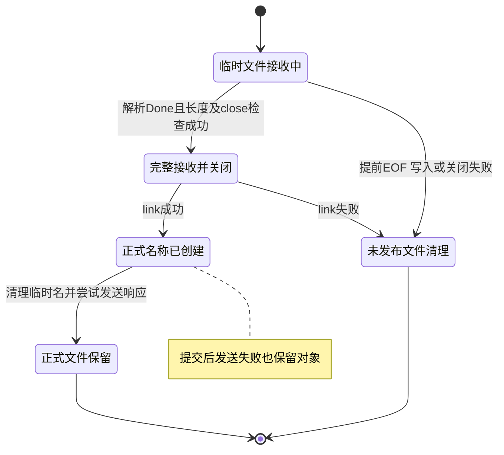

# 第十三天 完整接收后发布与失败清理

目标 POST /api/files接收完整正文并成功关闭文件后 才在data/objects创建正式名称 返回201与X-File-Id
不完整请求 写入错误 关闭错误及发布失败不创建成功响应 保留第十二天POST /dev/upload正常结束也删除临时文件的行为
本次修改src/temp_upload.h src/http_response.h src/main.cpp CMakeLists.txt 新增tests/day13_publish.cpp 解析器和其他源码旧测试保持不变
本地文件不会自动同步Linux 用户第十二天验收结果未提供 不因继续学习回填通过

## 发布语义

临时名称data/uploads/upload-XXXXXX 最后六位由mkstemp生成 ID使用服务器生成的文件名 不采用客户端路径
正式名称data/objects/同一个ID 请求上限仍64KiB 当前不解析name 不实现显示名称 元数据 下载与摘要
publish只在RequestParser返回Done后调用 expected是完整请求的正文字节数 文件类自己累计每次write实际成功量 并核对一致
调用顺序 完整接收 核对写入量 检查close link正式名称 保存ID unlink临时名称 返回201
link成功是发布提交点 它创建同一个文件的新硬链接 不复制文件内容 已存在的目标不会覆盖
临时名和正式名短暂同时存在 删除临时名不影响正式名 这不是两个独立内容副本
父目录须存在 两个目录须在支持硬链接的同一文件系统 EEXIST表示目标存在 EXDEV表示跨文件系统 EACCES表示权限不足 返回0成功 -1失败并设置errno
参考 https://man7.org/linux/man-pages/man2/link.2.html

link失败时保留未发布状态 析构清理临时文件 正式名称不被覆盖
link成功后即使删除临时名称失败也不能把结果说成未发布 本实现记录错误 由析构再尝试清理临时名 正式名保留
析构只删除仍持有的临时名称 从不删除正式对象 发布后append被拒绝
如果发布后send失败或响应丢失 对象仍保留 客户端重传可能新建另一个对象 当前没有幂等请求或去重
当前不调用fsync 不保证断电持久化 强制终止可能留下临时名或两个名字 尚无启动恢复

## 接口与所有权

TempUpload::publish(expected) 返回bool 成功后id为非空 内部保存字符串 拒绝已有错误 重复发布 未创建文件及长度不符
expected由调用方在解析Done后提供 TempUpload不自行判断HTTP状态 不可在NeedMore时发布
id返回内部string的const引用 生命周期随TempUpload path仍仅表示它持有的临时名称 发布并清理成功后path为空
HttpResponse新增拥有内存的file_id route_request新增published_id参数 缺少内部发布结果的POST /api/files返回500而不是201
响应通过X-File-Id头返回ID JSON正文固定为{"status":"created"} 无新增JSON依赖 后续成熟JSON库按计划引入
published_id只能来自内部TempUpload::id 不将客户端输入作为该参数 当前随机名称仅包含安全文件名字符
route_request复制ID进入HttpResponse 所以响应不会借用上传对象的短生命周期字符串
main两个POST上传入口复用回调 只有/api/files调用publish dev入口只close_file并等待析构清理
RequestParser feed consumed BodySink和64KiB上限保持不变

## 状态图

图的类型 State Diagram
为什么选择这种图 本次核心是临时文件何时变成正式对象 以及各失败阶段对应的清理责任

图的解释 正式名称只在完整接收后出现 link提交与清理临时名称不是跨两步事务 清理失败会记录 对象一旦发布不因响应发送失败回滚

## 完整源码

### src\temp_upload.h

```cpp
#pragma once

#include <cerrno>
#include <cstdio>
#include <cstdlib>
#include <string_view>
#include <unistd.h>
// ===== DAY 13 ADDED BEGIN 构造发布路径与保存文件ID =====
#include <cstring>
#include <string>
#include <utility>
// ===== DAY 13 ADDED END =====

class TempUpload
{
public:
    TempUpload() = default;
    TempUpload(const TempUpload&) = delete;
    TempUpload& operator=(const TempUpload&) = delete;

    ~TempUpload() noexcept
    {
        const int saved = errno;
        if (fd_ >= 0 && ::close(fd_) == -1) std::perror("close temporary file");
        if (created_ && ::unlink(path_) == -1 && errno != ENOENT)
            std::perror("unlink temporary file");
        errno = saved;
    }

    bool append(std::string_view data)
    {
        if (error_ != 0) return false;
        // ===== DAY 13 ADDED BEGIN 发布后禁止继续写入 =====
        if (!id_.empty()) return fail(EINVAL);
        // ===== DAY 13 ADDED END =====
        if (!created_)
        {
            fd_ = ::mkstemp(path_);
            if (fd_ == -1) return fail(errno);
            created_ = true;
        }
        if (fd_ < 0) return fail(EBADF);
        std::size_t written = 0;
        while (written < data.size())
        {
            const ssize_t n = ::write(fd_, data.data() + written, data.size() - written);
            if (n == -1)
            {
                if (errno == EINTR) continue;
                return fail(errno);
            }
            if (n == 0) return fail(EIO);
            written += static_cast<std::size_t>(n);
            // ===== DAY 13 ADDED BEGIN 累计真实成功写入的字节数 =====
            written_ += static_cast<std::size_t>(n);
            // ===== DAY 13 ADDED END =====
        }
        return true;
    }

    bool close_file()
    {
        if (fd_ >= 0)
        {
            const int raw = fd_;
            fd_ = -1;
            if (::close(raw) == -1) return fail(errno);
        }
        return error_ == 0;
    }

    int error() const noexcept { return error_; }
    const char* path() const noexcept { return created_ ? path_ : ""; }

    // ===== DAY 13 ADDED BEGIN 完整写入并关闭后创建不可覆盖的正式名称 =====
    bool publish(std::size_t expected)
    {
        if (error_ != 0) return false;
        if (!created_ || !id_.empty() || written_ != expected) return fail(EINVAL);
        if (!close_file()) return false;
        std::string candidate(std::strrchr(path_, '/') + 1);
        const std::string destination = "data/objects/" + candidate;
        if (::link(path_, destination.c_str()) == -1) return fail(errno);
        id_ = std::move(candidate);
        if (::unlink(path_) == 0)
            created_ = false;
        else
            std::perror("unlink published temporary name");
        return true;
    }

    const std::string& id() const noexcept { return id_; }
    // ===== DAY 13 ADDED END =====

private:
    bool fail(int error) noexcept
    {
        error_ = error;
        return false;
    }

    // ===== DAY 13 MODIFIED BEGIN 临时名称同时提供服务器生成的对象ID =====
    char path_[sizeof("data/uploads/upload-XXXXXX")] = "data/uploads/upload-XXXXXX";
    // ===== DAY 13 MODIFIED END =====
    int fd_ = -1;
    int error_ = 0;
    bool created_ = false;
    // ===== DAY 13 ADDED BEGIN 保存写入进度和发布成功后的ID =====
    std::size_t written_ = 0;
    std::string id_;
    // ===== DAY 13 ADDED END =====
};

```

### src\http_response.h

```cpp
#pragma once

#include "request_parser.h"

struct HttpResponse
{
    int status;
    std::string_view reason;
    std::string_view content_type;
    std::string body;
    std::string_view allow = {};
    // ===== DAY 13 ADDED BEGIN 响应拥有文件ID 避免借用上传对象 =====
    std::string file_id = {};
    // ===== DAY 13 ADDED END =====
};

inline HttpResponse error_response(int status, std::string_view allow = {})
{
    switch (status)
    {
    case 400:
        return {400, "Bad Request", "application/json",
            R"({"error":{"code":"bad_request","message":"Invalid request"}})"};
    case 404:
        return {404, "Not Found", "application/json",
            R"({"error":{"code":"not_found","message":"Route not found"}})"};
    case 405:
        return {405, "Method Not Allowed", "application/json",
            R"({"error":{"code":"method_not_allowed","message":"Method not allowed"}})", allow};
    case 413:
        return {413, "Content Too Large", "application/json",
            R"({"error":{"code":"body_too_large","message":"Body exceeds 65536 bytes"}})"};
    case 417:
        return {417, "Expectation Failed", "application/json",
            R"({"error":{"code":"expectation_failed","message":"Expect is not supported"}})"};
    case 501:
        return {501, "Not Implemented", "application/json",
            R"({"error":{"code":"not_implemented","message":"Requested feature is not implemented"}})"};
    default:
        return {500, "Internal Server Error", "application/json",
            R"({"error":{"code":"internal_error","message":"Internal server error"}})"};
    }
}

inline HttpResponse parser_error_response(RequestError error)
{
    switch (error)
    {
    case RequestError::BodyTooLarge: return error_response(413);
    case RequestError::UnsupportedExpectation: return error_response(417);
    case RequestError::UnsupportedTransferEncoding: return error_response(501);
    case RequestError::BodyWriteFailed: return error_response(500);
    default: return error_response(400);
    }
}

// ===== DAY 13 MODIFIED BEGIN 正式上传响应接收已发布的服务器文件ID =====
inline HttpResponse route_request(const RequestParser& request, std::string_view published_id = {})
// ===== DAY 13 MODIFIED END =====
{
    const auto& line = request.line();
    if (line.method != "GET" && line.method != "HEAD" && line.method != "POST")
    {
        return error_response(501);
    }
    const std::string_view target(line.target);
    const auto path = target.substr(0, target.find('?'));
    if (path == "/health")
    {
        if (line.method != "GET" && line.method != "HEAD")
        {
            return error_response(405, "GET, HEAD");
        }
        if (request.body_size() != 0) return error_response(400);
        return {200, "OK", "text/plain; charset=utf-8", "OK\n"};
    }
    if (path == "/echo")
    {
        if (line.method != "POST") return error_response(405, "POST");
        return {200, "OK", "application/octet-stream", request.body()};
    }
    if (path == "/dev/upload")
    {
        if (line.method != "POST") return error_response(405, "POST");
        return {200, "OK", "application/json", R"({"status":"temporary_received"})"};
    }
    // ===== DAY 13 ADDED BEGIN 只有已发布文件才能返回201与文件ID =====
    if (path == "/api/files")
    {
        if (line.method != "POST") return error_response(405, "POST");
        if (published_id.empty()) return error_response(500);
        HttpResponse response{201, "Created", "application/json", R"({"status":"created"})"};
        response.file_id = published_id;
        return response;
    }
    // ===== DAY 13 ADDED END =====
    return error_response(404);
}

inline std::string build_response(const HttpResponse& response, bool head_only = false)
{
    std::string wire = "HTTP/1.1 " + std::to_string(response.status) + " " +
        std::string(response.reason) + "\r\n";
    wire += "Content-Type: " + std::string(response.content_type) + "\r\n";
    wire += "Content-Length: " + std::to_string(response.body.size()) + "\r\n";
    wire += "Connection: close\r\n";
    if (!response.allow.empty()) wire += "Allow: " + std::string(response.allow) + "\r\n";
    // ===== DAY 13 ADDED BEGIN 文件ID来自服务器生成名称 不拼接客户端输入 =====
    if (!response.file_id.empty()) wire += "X-File-Id: " + response.file_id + "\r\n";
    // ===== DAY 13 ADDED END =====
    wire += "\r\n";
    if (!head_only) wire.append(response.body);
    return wire;
}

```

### src\main.cpp

```cpp
#include "unique_fd.h"
#include "socket_io.h"
#include "http_response.h"
#include "temp_upload.h"

#include <algorithm>
#include <arpa/inet.h>
#include <cerrno>
#include <cstddef>
#include <cstdint>
#include <cstring>
#include <iostream>
#include <netinet/in.h>
#include <string>
#include <sys/socket.h>

bool send_response(int client_fd, const HttpResponse& response, bool head_only)
{
    const std::string wire = build_response(response, head_only);
    std::cout << "response status=" << response.status << '\n';
    return send_all(client_fd, wire.data(), wire.size());
}

// ===== DAY 13 MODIFIED BEGIN 临时与正式上传都采用文件接收 =====
bool is_upload(const RequestLine& line)
{
    const std::string_view target(line.target);
    const auto path = target.substr(0, target.find('?'));
    return line.method == "POST" && (path == "/dev/upload" || path == "/api/files");
}
// ===== DAY 13 MODIFIED END =====

bool handle_client(int client_fd)
{
    TempUpload upload;
    RequestParser parser([&upload](const RequestLine& line, std::string_view chunk)
    {
        // ===== DAY 13 MODIFIED BEGIN 两个上传入口共用正文写入 =====
        if (!is_upload(line)) return BodyAction::Buffer;
        // ===== DAY 13 MODIFIED END =====
        return upload.append(chunk) ? BodyAction::Written : BodyAction::Failed;
    });
    ParseState state = ParseState::NeedMore;
    bool received_any = false;
    char buffer[1024];

    while (state == ParseState::NeedMore)
    {
        const ssize_t n = ::recv(client_fd, buffer, sizeof(buffer), 0);
        if (n == -1)
        {
            const int error = errno;
            if (error == EINTR)
            {
                continue;
            }
            print_system_error("recv", error);
            return false;
        }
        if (n == 0)
        {
            if (!received_any) return false;
            parser.finish();
            std::cerr << "peer closed before request completed\n";
            return send_response(client_fd, parser_error_response(parser.error()),
                                 parser.line().method == "HEAD");
        }

        received_any = true;
        const std::size_t count = static_cast<std::size_t>(n);
        const auto result = parser.feed(std::string_view(buffer, count));
        state = result.state;
        if (state == ParseState::Error)
        {
            std::cerr << "invalid or unsupported request or size limit exceeded\n";
            if (parser.error() == RequestError::BodyWriteFailed)
                print_system_error("temporary upload", upload.error());
            return send_response(client_fd, parser_error_response(parser.error()),
                                 parser.line().method == "HEAD");
        }
        if (result.consumed < count)
        {
            std::cout << "trailing bytes ignored before connection close\n";
        }
    }

    const RequestLine& line = parser.line();
    std::cout << "method=" << line.method
              << " target=" << line.target
              << " version=" << line.version << '\n';
    // ===== DAY 13 DELETED 正式上传不再在成功响应后删除唯一文件名称 =====
    // ===== DAY 13 MODIFIED BEGIN 解析Done后才允许发布正式对象 =====
    if (is_upload(line))
    {
        const std::string_view target(line.target);
        const bool permanent = target.substr(0, target.find('?')) == "/api/files";
        const bool stored = permanent ? upload.publish(parser.body_size()) : upload.close_file();
        if (!stored)
        {
            print_system_error("finalize upload", upload.error());
            return send_response(client_fd, error_response(500), false);
        }
        std::cout << "temporary bytes=" << parser.body_size()
                  << " buffered bytes=" << parser.body().size() << '\n';
        if (permanent) std::cout << "published id=" << upload.id() << '\n';
    }
    return send_response(client_fd, route_request(parser, upload.id()), line.method == "HEAD");
    // ===== DAY 13 MODIFIED END =====
}

int main()
{
    constexpr std::uint16_t port = 8080;
    constexpr int backlog = 16;

    const int raw_fd = ::socket(AF_INET, SOCK_STREAM | SOCK_CLOEXEC, 0);
    if (raw_fd == -1)
    {
        const int error = errno;
        print_system_error("socket", error);
        return 1;
    }
    UniqueFd listener(raw_fd);

    const int reuse_address = 1;
    if (::setsockopt(listener.get(), SOL_SOCKET, SO_REUSEADDR,
                     &reuse_address, sizeof(reuse_address)) == -1)
    {
        const int error = errno;
        print_system_error("setsockopt", error);
        return 1;
    }

    sockaddr_in address{};
    address.sin_family = AF_INET;
    address.sin_port = htons(port);
    address.sin_addr.s_addr = htonl(INADDR_LOOPBACK);

    if (::bind(listener.get(),
               reinterpret_cast<const sockaddr*>(&address),
               sizeof(address)) == -1)
    {
        const int error = errno;
        print_system_error("bind", error);
        return 1;
    }
    if (::listen(listener.get(), backlog) == -1)
    {
        const int error = errno;
        print_system_error("listen", error);
        return 1;
    }

    std::cout << "listening on 127.0.0.1:" << port
              << " fd=" << listener.get() << std::endl;

    while (true)
    {
        const int accepted_fd =
            ::accept(listener.get(), nullptr, nullptr);
        if (accepted_fd == -1)
        {
            const int error = errno;
            if (error == EINTR || error == ECONNABORTED)
            {
                continue;
            }
            print_system_error("accept", error);
            return 1;
        }

        UniqueFd client(accepted_fd);
        std::cout << "accepted fd=" << client.get() << std::endl;
        const bool ok = handle_client(client.get());
        std::cout << (ok ? "response sent" : "connection failed")
                  << std::endl;
    }
}

```

### tests\day13_publish.cpp

```cpp
// ===== DAY 13 ADDED BEGIN 验证发布提交点与不完整文件清理 =====
#include "http_response.h"

#include <cstdlib>
#include <iostream>

#ifdef __linux__
#include "temp_upload.h"
#include <filesystem>
#include <fstream>
#include <iterator>
#endif

void require(bool ok, const char* message)
{
    if (!ok)
    {
        std::cerr << "FAIL: " << message << '\n';
        std::exit(1);
    }
}

#ifdef __linux__
std::string read_file(const std::string& path)
{
    std::ifstream input(path, std::ios::binary);
    require(input.is_open(), "open published file");
    return {std::istreambuf_iterator<char>(input), std::istreambuf_iterator<char>()};
}
#endif

int main()
{
    const std::string head = "POST /api/files HTTP/1.1\r\nHost: localhost\r\n";
    RequestParser response_parser;
    require(response_parser.feed(head + "Content-Length: 0\r\n\r\n").state
                == ParseState::Done, "parse empty upload");
    require(route_request(response_parser).status == 500, "201 before publication");
    std::string id = "upload-Abc123";
    const auto response = route_request(response_parser, id);
    id.assign("changed");
    const auto wire = build_response(response);
    require(wire.find("HTTP/1.1 201 Created\r\n") == 0 &&
            wire.find("\r\nX-File-Id: upload-Abc123\r\n") != std::string::npos,
            "missing or borrowed file ID");
    require(wire.find("\r\nContent-Length: 20\r\n") != std::string::npos &&
            response.body == R"({"status":"created"})", "created response");
    RequestParser wrong_method;
    require(wrong_method.feed("GET /api/files HTTP/1.1\r\nHost: localhost\r\n\r\n").state
                == ParseState::Done, "parse method test");
    require(route_request(wrong_method).status == 405 &&
            route_request(wrong_method).allow == "POST", "upload method policy");
    std::cout << "PASS: publication response, owned file ID and method policy\n";

#ifdef __linux__
    namespace fs = std::filesystem;
    const auto previous = fs::current_path();
    char pattern[] = "day13-test-XXXXXX";
    const char* directory = ::mkdtemp(pattern);
    require(directory != nullptr, "create isolated test directory");
    const auto root = previous / directory;
    fs::current_path(root);
    fs::create_directories("data/uploads");
    fs::create_directories("data/objects");
    const std::string body("A\0B\r\n", 5);
    std::string temporary;
    std::string published;
    {
        TempUpload file;
        RequestParser parser([&](const RequestLine&, std::string_view chunk)
        {
            return file.append(chunk) ? BodyAction::Written : BodyAction::Failed;
        });
        require(parser.feed(head + "Content-Length: 5\r\n\r\nA").state
                    == ParseState::NeedMore && fs::is_empty("data/objects"),
                "partial upload became visible");
        const auto result = parser.feed(body.substr(1) + "NEXT");
        require(result.state == ParseState::Done && result.consumed == 4 &&
                parser.body().empty(), "request boundary or buffering");
        temporary = file.path();
        require(file.publish(parser.body_size()), "publish complete upload");
        published = "data/objects/" + file.id();
        require(!fs::exists(temporary) && read_file(published) == body,
                "publication changed bytes or left temporary name");
    }
    require(fs::exists(published) && read_file(published) == body,
            "destructor deleted published object");
    {
        TempUpload file;
        RequestParser parser([&](const RequestLine&, std::string_view chunk)
        {
            return file.append(chunk) ? BodyAction::Written : BodyAction::Failed;
        });
        require(parser.feed(head + "Content-Length: 5\r\n\r\nAB").state
                    == ParseState::NeedMore, "partial state");
        temporary = file.path();
        require(parser.finish() == ParseState::Error && !file.publish(5),
                "incomplete upload published");
    }
    require(!fs::exists(temporary), "partial file leaked");
    {
        TempUpload file;
        require(file.append("NEW"), "prepare collision");
        temporary = file.path();
        const auto destination = fs::path("data/objects") / fs::path(temporary).filename();
        {
            std::ofstream existing(destination, std::ios::binary);
            existing << "OLD";
            require(existing.good(), "prepare existing object");
        }
        require(!file.publish(3) && file.error() == EEXIST &&
                read_file(destination.string()) == "OLD", "existing object overwritten");
    }
    require(!fs::exists(temporary), "failed publication leaked temporary file");
    {
        TempUpload file;
        require(file.append({}) && file.publish(0), "publish empty file");
        published = "data/objects/" + file.id();
    }
    require(fs::exists(published) && fs::file_size(published) == 0,
            "empty object was not preserved");
    fs::current_path(previous);
    fs::remove_all(root);
    std::cout << "PASS: Linux complete publication, binary bytes, cleanup and no overwrite\n";
#else
    std::cout << "SKIP: Linux publication checks require Linux\n";
#endif
}
// ===== DAY 13 ADDED END =====

```

### CMakeLists.txt

```cmake
cmake_minimum_required(VERSION 3.16)

project(netdisk LANGUAGES CXX)

add_executable(netdisk src/main.cpp)
set(NETDISK_TARGETS netdisk)

include(CTest)
if(BUILD_TESTING)
    add_executable(io_tests tests/day06_io.cpp)
    target_include_directories(io_tests PRIVATE src)
    list(APPEND NETDISK_TARGETS io_tests)
    add_test(NAME io_tests COMMAND io_tests)

    add_executable(request_line_tests tests/day08_request_line.cpp)
    target_include_directories(request_line_tests PRIVATE src)
    list(APPEND NETDISK_TARGETS request_line_tests)
    add_test(NAME request_line_tests COMMAND request_line_tests)

    add_executable(request_headers_tests tests/day09_request_headers.cpp)
    target_include_directories(request_headers_tests PRIVATE src)
    list(APPEND NETDISK_TARGETS request_headers_tests)
    add_test(NAME request_headers_tests COMMAND request_headers_tests)

    add_executable(request_body_tests tests/day10_request_body.cpp)
    target_include_directories(request_body_tests PRIVATE src)
    list(APPEND NETDISK_TARGETS request_body_tests)
    add_test(NAME request_body_tests COMMAND request_body_tests)

    add_executable(http_response_tests tests/day11_http_response.cpp)
    target_include_directories(http_response_tests PRIVATE src)
    list(APPEND NETDISK_TARGETS http_response_tests)
    add_test(NAME http_response_tests COMMAND http_response_tests)

    add_executable(stream_upload_tests tests/day12_stream_upload.cpp)
    target_include_directories(stream_upload_tests PRIVATE src)
    list(APPEND NETDISK_TARGETS stream_upload_tests)
    add_test(NAME stream_upload_tests COMMAND stream_upload_tests)

    # ===== DAY 13 ADDED BEGIN 注册完整发布与失败清理测试 =====
    add_executable(publish_tests tests/day13_publish.cpp)
    target_include_directories(publish_tests PRIVATE src)
    list(APPEND NETDISK_TARGETS publish_tests)
    add_test(NAME publish_tests COMMAND publish_tests)
    # ===== DAY 13 ADDED END =====
endif()

foreach(target IN LISTS NETDISK_TARGETS)
    set_target_properties(${target} PROPERTIES
        CXX_STANDARD 17
        CXX_STANDARD_REQUIRED YES
        CXX_EXTENSIONS NO
    )
endforeach()

```

## Linux虚拟机验证

更新五个代码文件 沿用实际工程目录 以下用建议路径 如果已有build-debug则统一替换build 不另建构建目录
```sh
cd ~/projects/netdisk
cmake -S . -B build -DCMAKE_BUILD_TYPE=Debug -DBUILD_TESTING=ON
cmake --build build -j2
ctest --test-dir build -R '^publish_tests$' -V
mkdir -p data/uploads data/objects
./build/netdisk
```
CTest应实际运行publish_tests一项 退出状态0 Linux应出现两条PASS且没有SKIP
PASS: publication response, owned file ID and method policy
PASS: Linux complete publication, binary bytes, cleanup and no overwrite
测试在构建目录生成独立day13-test-XXXXXX工作目录 验证完成仅清理自己的目录 失败时可保留现场供排错
另一个同一Linux终端执行一次实际操作
```sh
curl --noproxy '*' --http1.1 --max-time 5 -i --data-binary 'hello' http://127.0.0.1:8080/api/files
```
预期HTTP/1.1 201 Created Content-Type为application/json Content-Length为20 Connection为close X-File-Id为服务器生成的upload-加六位随机后缀
正文固定无额外换行
{"status":"created"}
本次返回ID对应data/objects下保留的5字节文件hello 服务器输出temporary bytes=5 buffered bytes=0 published id及response status=201
ID示例不可当作真实返回值 使用本次实际X-File-Id定位文件
500查看finalize upload的errno 检查父目录 权限 是否同一文件系统 目标重名不会覆盖 文件ID头缺失或仍200则检查重建并重启新服务以及请求路径

## 实际证据与限制

本机Windows g++ C++17 Wall Wextra pedantic编译执行publish_tests响应部分PASS Linux发布检查明确SKIP
PASS: publication response, owned file ID and method policy
SKIP: Linux publication checks require Linux
另编译运行http_response_tests通过 因为修改响应结构 序列化和路由
Linux真实发布 文件测试 CTest 服务器构建和curl助手均未执行 用户实际修改测试理解待反馈
本单元不把普通write和close成功解释为断电持久化 不宣称所有失败路径均已实测 第14单元聚焦上传端到端集成验证 不安排固定整日复盘
