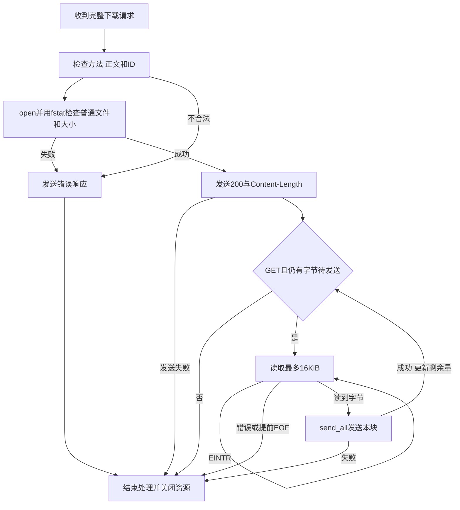

# 第十六天 按ID流式下载

目标 GET /api/files/{id}/content从服务器对象目录读取并返回原始文件内容 复用第15单元ID校验 固定16KiB缓冲区 上传上限仍64KiB
第15单元用户Linux结果未反馈 继续推进 不回填通过

## 执行流程

图的类型 Flowchart
为什么选择这种图 重点是打开文件 发送头和循环传输的控制流 以及发送头前后不同的错误处理



图的解释 HEAD发完头结束 GET按声明大小循环发送 200头发送后失败只关闭连接 不能再追加500响应

## 接口与生命周期

match_file_content(target,id)去除查询部分后匹配/api/files/前缀与/content后缀 成功返回true并让id借用target中的子串 不匹配返回false且输出不变 匹配只识别路由 格式由make_object_path检查 不解码URL 不访问磁盘
send_file_content(client_fd,request,id)借用连接fd和RequestParser 同步执行 返回true表示本次响应发送完成 包括发送完整错误响应 返回false表示发送或传输失败 函数不关闭连接fd 由main的UniqueFd负责 文件fd由内部UniqueFd拥有 所有返回路径自动关闭

open(path,flags)返回非负新fd 失败返回-1并设置errno EINTR重试
O_RDONLY只读 O_CLOEXEC在exec时关闭 O_NOFOLLOW拒绝最后一个路径分量为符号链接 O_NONBLOCK避免FIFO打开阶段等待写端 普通磁盘文件读仍可能阻塞 当前网络仍串行阻塞 父目录仍需受控
fstat(fd,&info)检查已打开对象而非重新按路径查找 返回0成功 -1失败 st_mode检查普通文件 st_size为字节数
read(fd,buffer,count)返回本次读取字节数 0表示EOF -1失败 EINTR重试 正数可能小于count 必须使用实际返回值发送并扣减remaining
send_all借用buffer 等整块发送完成再读下一块 处理短写与EINTR 使用MSG_NOSIGNAL保护服务进程

GET HEAD允许 POST405且Allow为GET HEAD 其他未实现方法501 非空请求体400 非法ID400 文件缺失 最终符号链接或非普通文件404 其他打开与fstat错误500
HEAD只发送与GET对应的长度 这是基础语义 下一单元完善文件名与响应头
成功头只构造很短的字符串 文件正文不放HttpResponse.body 内存中的文件块固定16KiB
remaining来自fstat st_size 每次最多读取min(remaining,buffer大小) 空文件零次循环 文件增长不多发 文件变短提前EOF关闭 外部原地修改同长度文件不保证快照一致性 正式对象按项目规则发布后不原地修改
已有health echo和上传仍走原route_request 下载由main先分派给文件处理函数

## 完整源码

### src\file_download.h

```cpp
// ===== DAY 16 ADDED BEGIN 按合法ID打开普通文件并分段发送 =====
#pragma once

#include "http_response.h"
#include "object_path.h"
#include "socket_io.h"
#include "unique_fd.h"

#include <algorithm>
#include <cstdint>
#include <fcntl.h>
#include <sys/stat.h>

inline bool match_file_content(std::string_view target, std::string_view& id)
{
    const auto path = target.substr(0, target.find('?'));
    constexpr std::string_view prefix = "/api/files/";
    constexpr std::string_view suffix = "/content";
    if (path.size() < prefix.size() + suffix.size() ||
        path.substr(0, prefix.size()) != prefix ||
        path.substr(path.size() - suffix.size()) != suffix) return false;
    id = path.substr(prefix.size(), path.size() - prefix.size() - suffix.size());
    return true;
}

inline bool send_file_content(int client_fd, const RequestParser& request,
                              std::string_view id)
{
    const auto& method = request.line().method;
    const bool head_only = method == "HEAD";
    const auto send_error = [&](int status, std::string_view allow = {})
    {
        const auto response = status == 404
            ? HttpResponse{404, "Not Found", "application/json",
                R"({"error":{"code":"not_found","message":"File not found"}})"}
            : error_response(status, allow);
        const std::string wire = build_response(response, head_only);
        return send_all(client_fd, wire.data(), wire.size());
    };
    if (method != "GET" && method != "HEAD")
        return send_error(method == "POST" ? 405 : 501, "GET, HEAD");
    if (request.body_size() != 0) return send_error(400);

    std::string path;
    if (!make_object_path(id, path)) return send_error(400);
    int raw_fd;
    do
    {
        raw_fd = ::open(path.c_str(), O_RDONLY | O_CLOEXEC | O_NOFOLLOW | O_NONBLOCK);
    } while (raw_fd == -1 && errno == EINTR);
    if (raw_fd == -1)
    {
        const int error = errno;
        if (error == ENOENT || error == ENOTDIR || error == ELOOP)
            return send_error(404);
        print_system_error("open download", error);
        return send_error(500);
    }
    UniqueFd file(raw_fd);
    struct stat info{};
    int result;
    do
    {
        result = ::fstat(file.get(), &info);
    } while (result == -1 && errno == EINTR);
    if (result == -1)
    {
        print_system_error("fstat download", errno);
        return send_error(500);
    }
    if (!S_ISREG(info.st_mode)) return send_error(404);
    if (info.st_size < 0) return send_error(500);

    std::uint64_t remaining = static_cast<std::uint64_t>(info.st_size);
    const std::string header =
        "HTTP/1.1 200 OK\r\n"
        "Content-Type: application/octet-stream\r\n"
        "Content-Length: " + std::to_string(remaining) + "\r\n"
        "Connection: close\r\n\r\n";
    if (!send_all(client_fd, header.data(), header.size())) return false;
    if (head_only) return true;

    char buffer[16 * 1024];
    while (remaining != 0)
    {
        const auto count = static_cast<std::size_t>(
            std::min<std::uint64_t>(remaining, sizeof(buffer)));
        const ssize_t n = ::read(file.get(), buffer, count);
        if (n == -1)
        {
            if (errno == EINTR) continue;
            print_system_error("read download", errno);
            return false;
        }
        if (n == 0)
        {
            std::cerr << "download file ended before Content-Length\n";
            return false;
        }
        const auto bytes = static_cast<std::size_t>(n);
        if (!send_all(client_fd, buffer, bytes)) return false;
        remaining -= bytes;
    }
    return true;
}
// ===== DAY 16 ADDED END =====

```

### src\main.cpp

```cpp
#include "unique_fd.h"
#include "socket_io.h"
#include "http_response.h"
#include "temp_upload.h"
// ===== DAY 16 ADDED BEGIN 接入文件下载处理 =====
#include "file_download.h"
// ===== DAY 16 ADDED END =====

#include <algorithm>
#include <arpa/inet.h>
#include <cerrno>
#include <cstddef>
#include <cstdint>
#include <cstring>
#include <iostream>
#include <netinet/in.h>
#include <string>
#include <sys/socket.h>

bool send_response(int client_fd, const HttpResponse& response, bool head_only)
{
    const std::string wire = build_response(response, head_only);
    std::cout << "response status=" << response.status << '\n';
    return send_all(client_fd, wire.data(), wire.size());
}

bool is_upload(const RequestLine& line)
{
    const std::string_view target(line.target);
    const auto path = target.substr(0, target.find('?'));
    return line.method == "POST" && (path == "/dev/upload" || path == "/api/files");
}

bool handle_client(int client_fd)
{
    TempUpload upload;
    RequestParser parser([&upload](const RequestLine& line, std::string_view chunk)
    {
        if (!is_upload(line)) return BodyAction::Buffer;
        return upload.append(chunk) ? BodyAction::Written : BodyAction::Failed;
    });
    ParseState state = ParseState::NeedMore;
    bool received_any = false;
    char buffer[1024];

    while (state == ParseState::NeedMore)
    {
        const ssize_t n = ::recv(client_fd, buffer, sizeof(buffer), 0);
        if (n == -1)
        {
            const int error = errno;
            if (error == EINTR)
            {
                continue;
            }
            print_system_error("recv", error);
            return false;
        }
        if (n == 0)
        {
            if (!received_any) return false;
            parser.finish();
            std::cerr << "peer closed before request completed\n";
            return send_response(client_fd, parser_error_response(parser.error()),
                                 parser.line().method == "HEAD");
        }

        received_any = true;
        const std::size_t count = static_cast<std::size_t>(n);
        const auto result = parser.feed(std::string_view(buffer, count));
        state = result.state;
        if (state == ParseState::Error)
        {
            std::cerr << "invalid or unsupported request or size limit exceeded\n";
            if (parser.error() == RequestError::BodyWriteFailed)
                print_system_error("temporary upload", upload.error());
            return send_response(client_fd, parser_error_response(parser.error()),
                                 parser.line().method == "HEAD");
        }
        if (result.consumed < count)
        {
            std::cout << "trailing bytes ignored before connection close\n";
        }
    }

    const RequestLine& line = parser.line();
    std::cout << "method=" << line.method
              << " target=" << line.target
              << " version=" << line.version << '\n';
    // ===== DAY 16 ADDED BEGIN 下载响应单独发送头部和文件块 =====
    std::string_view file_id;
    if (match_file_content(line.target, file_id))
        return send_file_content(client_fd, parser, file_id);
    // ===== DAY 16 ADDED END =====
    if (is_upload(line))
    {
        const std::string_view target(line.target);
        const bool permanent = target.substr(0, target.find('?')) == "/api/files";
        const bool stored = permanent ? upload.publish(parser.body_size()) : upload.close_file();
        if (!stored)
        {
            print_system_error("finalize upload", upload.error());
            return send_response(client_fd, error_response(500), false);
        }
        std::cout << "temporary bytes=" << parser.body_size()
                  << " buffered bytes=" << parser.body().size() << '\n';
        if (permanent) std::cout << "published id=" << upload.id() << '\n';
    }
    return send_response(client_fd, route_request(parser, upload.id()), line.method == "HEAD");
}

int main()
{
    constexpr std::uint16_t port = 8080;
    constexpr int backlog = 16;

    const int raw_fd = ::socket(AF_INET, SOCK_STREAM | SOCK_CLOEXEC, 0);
    if (raw_fd == -1)
    {
        const int error = errno;
        print_system_error("socket", error);
        return 1;
    }
    UniqueFd listener(raw_fd);

    const int reuse_address = 1;
    if (::setsockopt(listener.get(), SOL_SOCKET, SO_REUSEADDR,
                     &reuse_address, sizeof(reuse_address)) == -1)
    {
        const int error = errno;
        print_system_error("setsockopt", error);
        return 1;
    }

    sockaddr_in address{};
    address.sin_family = AF_INET;
    address.sin_port = htons(port);
    address.sin_addr.s_addr = htonl(INADDR_LOOPBACK);

    if (::bind(listener.get(),
               reinterpret_cast<const sockaddr*>(&address),
               sizeof(address)) == -1)
    {
        const int error = errno;
        print_system_error("bind", error);
        return 1;
    }
    if (::listen(listener.get(), backlog) == -1)
    {
        const int error = errno;
        print_system_error("listen", error);
        return 1;
    }

    std::cout << "listening on 127.0.0.1:" << port
              << " fd=" << listener.get() << std::endl;

    while (true)
    {
        const int accepted_fd =
            ::accept(listener.get(), nullptr, nullptr);
        if (accepted_fd == -1)
        {
            const int error = errno;
            if (error == EINTR || error == ECONNABORTED)
            {
                continue;
            }
            print_system_error("accept", error);
            return 1;
        }

        UniqueFd client(accepted_fd);
        std::cout << "accepted fd=" << client.get() << std::endl;
        const bool ok = handle_client(client.get());
        std::cout << (ok ? "response sent" : "connection failed")
                  << std::endl;
    }
}

```

### CMakeLists.txt

```cmake
cmake_minimum_required(VERSION 3.16)

project(netdisk LANGUAGES CXX)

add_executable(netdisk src/main.cpp)
set(NETDISK_TARGETS netdisk)

include(CTest)
if(BUILD_TESTING)
    add_executable(io_tests tests/day06_io.cpp)
    target_include_directories(io_tests PRIVATE src)
    list(APPEND NETDISK_TARGETS io_tests)
    add_test(NAME io_tests COMMAND io_tests)

    add_executable(request_line_tests tests/day08_request_line.cpp)
    target_include_directories(request_line_tests PRIVATE src)
    list(APPEND NETDISK_TARGETS request_line_tests)
    add_test(NAME request_line_tests COMMAND request_line_tests)

    add_executable(request_headers_tests tests/day09_request_headers.cpp)
    target_include_directories(request_headers_tests PRIVATE src)
    list(APPEND NETDISK_TARGETS request_headers_tests)
    add_test(NAME request_headers_tests COMMAND request_headers_tests)

    add_executable(request_body_tests tests/day10_request_body.cpp)
    target_include_directories(request_body_tests PRIVATE src)
    list(APPEND NETDISK_TARGETS request_body_tests)
    add_test(NAME request_body_tests COMMAND request_body_tests)

    add_executable(http_response_tests tests/day11_http_response.cpp)
    target_include_directories(http_response_tests PRIVATE src)
    list(APPEND NETDISK_TARGETS http_response_tests)
    add_test(NAME http_response_tests COMMAND http_response_tests)

    add_executable(stream_upload_tests tests/day12_stream_upload.cpp)
    target_include_directories(stream_upload_tests PRIVATE src)
    list(APPEND NETDISK_TARGETS stream_upload_tests)
    add_test(NAME stream_upload_tests COMMAND stream_upload_tests)

    add_executable(publish_tests tests/day13_publish.cpp)
    target_include_directories(publish_tests PRIVATE src)
    list(APPEND NETDISK_TARGETS publish_tests)
    add_test(NAME publish_tests COMMAND publish_tests)

    # ===== DAY 15 ADDED BEGIN 注册ID与存储路径隔离测试 =====
    add_executable(object_path_tests tests/day15_object_path.cpp)
    target_include_directories(object_path_tests PRIVATE src)
    list(APPEND NETDISK_TARGETS object_path_tests)
    add_test(NAME object_path_tests COMMAND object_path_tests)
    # ===== DAY 15 ADDED END =====

    # ===== DAY 14 ADDED BEGIN 注册自动启动服务的上传集成测试 =====
    find_package(Python3 3.8 REQUIRED COMPONENTS Interpreter)
    add_test(NAME upload_integration_tests
        COMMAND "${Python3_EXECUTABLE}"
            "${CMAKE_CURRENT_SOURCE_DIR}/tests/day14_upload_integration.py"
            "$<TARGET_FILE:netdisk>"
    )
    set_tests_properties(upload_integration_tests PROPERTIES
        TIMEOUT 30
        RUN_SERIAL TRUE
        SKIP_RETURN_CODE 77
    )
    # ===== DAY 14 ADDED END =====

    # ===== DAY 16 ADDED BEGIN 注册下载端到端测试 =====
    add_test(NAME download_integration_tests
        COMMAND "${Python3_EXECUTABLE}"
            "${CMAKE_CURRENT_SOURCE_DIR}/tests/day16_download_integration.py"
            "$<TARGET_FILE:netdisk>"
    )
    set_tests_properties(download_integration_tests PROPERTIES
        TIMEOUT 30
        RUN_SERIAL TRUE
        SKIP_RETURN_CODE 77
    )
    # ===== DAY 16 ADDED END =====
endif()

foreach(target IN LISTS NETDISK_TARGETS)
    set_target_properties(${target} PROPERTIES
        CXX_STANDARD 17
        CXX_STANDARD_REQUIRED YES
        CXX_EXTENSIONS NO
    )
endforeach()

```
## 测试脚本

新增tests/day16_download_integration.py完整文件在本地维护 同步到Linux工程tests目录 不要求阅读或抄写Python实现
其他源码 object_path.h temp_upload.h unique_fd.h socket_io.h http_response.h 请求解析器及旧测试均保持不变

## Linux执行

同步main.cpp file_download.h CMakeLists.txt与day16_download_integration.py后 在~/projects/netdisk执行 复用现有build目录 如果原来用build-debug统一替换

```sh
cd ~/projects/netdisk
cmake -S . -B build -DCMAKE_BUILD_TYPE=Debug -DBUILD_TESTING=ON
cmake --build build -j2
ctest --test-dir build -R '^download_integration_tests$' -V
```

先停止旧手动服务让8080空闲 测试自动启动停止自己的服务 使用独立临时目录 不修改工程data
成功条件 实际运行download_integration_tests一项 通过并输出PASS: download integration finished, 8 groups 退出0 Linux无SKIP 没发现测试不算通过
覆盖8组 空UTF8和64KiB二进制上传下载逐字节比较 262149字节磁盘fixture跨缓冲区下载 HEAD成功错误 非法ID 缺失与链接目录FIFO 方法正文 路由查询 失败后health及对象集合
大fixture由测试直接写磁盘 不表示大于64KiB上传已支持 停止测试子进程不代表服务器优雅退出

真实操作 先在工程目录启动新服务

```sh
mkdir -p data/uploads data/objects
./build/netdisk
```

另一Linux终端 使用之前成功上传返回的真实ID替换示例

```sh
cd ~/projects/netdisk
file_id='upload-Abc123'
curl -fS -D - -o day16-downloaded.bin "http://127.0.0.1:8080/api/files/${file_id}/content"
cmp "data/objects/${file_id}" day16-downloaded.bin
echo $?
```

预期200 application/octet-stream Content-Length为实际字节数 cmp无输出且echo显示0
404先核对实际ID和启动目录 400核对ID格式 500查看open download或fstat download日志 curl提示正文不足查看read download与提前EOF日志 不手工修改正式文件

## 实际验证证据

本机Windows脚本ast语法检查通过 socketpair验证二进制响应长度 正文截断检测 HEAD无正文和不应有的正文检测通过 子进程验证Windows退出77
本机WSL查询未提供可用Linux执行入口 未安装环境 未编译Linux服务 未执行真实下载集成测试或curl cmp
用户虚拟机同步 Linux构建 测试与理解待反馈 第15单元仍未确认 第14单元既有通过记录保持
当前无Range 无下载文件名 无并发 无超时 不将缓冲区有界等同于慢客户端不阻塞服务