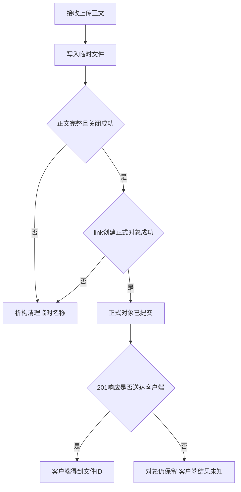

# 第二十天 文件故障与客户端中断回归

## 目标

今天不增加新接口 只验证现有服务在单个文件操作或客户端连接失败后仍能处理下一条请求

- 缺失对象返回404而不是终止进程
- 文件不可读 临时目录缺失和发布目录缺失只影响当前请求
- 上传在link提交前被RST中断时清理临时文件且不发布
- link提交后客户端没有收到响应也不回滚对象
- 大文件下载中客户端RST只关闭当前连接 服务之后仍能响应health

生产C++不修改 因为真实代码已经由TempUpload析构 UniqueFd send_all的MSG_NOSIGNAL和main外层accept循环形成所需行为 今天新增的是可重复故障证据

## 提交边界

图的类型 Flowchart

选择这种图是因为上传故障结果由link提交点决定 流程图能直接区分提交前中断和提交后响应丢失两种不同语义



关键点是link成功而不是201送达才是服务端提交点 提交前中断没有正式对象 提交后响应丢失不能删除已经提交的数据 客户端以后要通过列表或幂等机制协调这种未知结果

## 新增测试覆盖

`tests/day20_failure_recovery.py`由助手维护 不要求阅读实现 测试在独立临时目录启动并停止自己的服务 覆盖七组行为

1. 缺失对象下载404 后续health成功
2. 普通用户下chmod 000对象下载500 恢复权限后内容可下载
3. uploads目录缺失使临时文件创建失败500 不产生正式对象
4. objects目录缺失使link发布失败500 临时文件被清理
5. 部分上传后TCP RST 不发布且临时文件被清理
6. 完整上传已经发布后客户端丢失 对象不回滚
7. 16MiB下载开始后TCP RST 后续health成功且对象大小不变

以root运行时权限位不能可靠产生EACCES 脚本会输出`SKIP DETAIL`并继续其他组 普通开发用户不应出现该提示

## 变化文件

- 修改 `CMakeLists.txt` 注册一项Linux集成测试
- 新增 `tests/day20_failure_recovery.py`
- 更新 README 教程 计划和进度
- `src`目录所有生产C++保持不变
- 第19单元及更早测试保持不变

## 完整CMakeLists.txt

```cmake
cmake_minimum_required(VERSION 3.16)

project(netdisk LANGUAGES CXX)

add_executable(netdisk src/main.cpp)
set(NETDISK_TARGETS netdisk)

# ===== DAY 18 ADDED BEGIN 查找并接入系统JSON依赖 =====
find_package(nlohmann_json 3.2.0 REQUIRED)
target_link_libraries(netdisk PRIVATE nlohmann_json::nlohmann_json)
# ===== DAY 18 ADDED END =====

include(CTest)
if(BUILD_TESTING)
    add_executable(io_tests tests/day06_io.cpp)
    target_include_directories(io_tests PRIVATE src)
    list(APPEND NETDISK_TARGETS io_tests)
    add_test(NAME io_tests COMMAND io_tests)

    add_executable(request_line_tests tests/day08_request_line.cpp)
    target_include_directories(request_line_tests PRIVATE src)
    list(APPEND NETDISK_TARGETS request_line_tests)
    add_test(NAME request_line_tests COMMAND request_line_tests)

    add_executable(request_headers_tests tests/day09_request_headers.cpp)
    target_include_directories(request_headers_tests PRIVATE src)
    list(APPEND NETDISK_TARGETS request_headers_tests)
    add_test(NAME request_headers_tests COMMAND request_headers_tests)

    add_executable(request_body_tests tests/day10_request_body.cpp)
    target_include_directories(request_body_tests PRIVATE src)
    list(APPEND NETDISK_TARGETS request_body_tests)
    add_test(NAME request_body_tests COMMAND request_body_tests)

    add_executable(http_response_tests tests/day11_http_response.cpp)
    target_include_directories(http_response_tests PRIVATE src)
    list(APPEND NETDISK_TARGETS http_response_tests)
    add_test(NAME http_response_tests COMMAND http_response_tests)

    add_executable(stream_upload_tests tests/day12_stream_upload.cpp)
    target_include_directories(stream_upload_tests PRIVATE src)
    list(APPEND NETDISK_TARGETS stream_upload_tests)
    add_test(NAME stream_upload_tests COMMAND stream_upload_tests)

    add_executable(publish_tests tests/day13_publish.cpp)
    target_include_directories(publish_tests PRIVATE src)
    list(APPEND NETDISK_TARGETS publish_tests)
    add_test(NAME publish_tests COMMAND publish_tests)

    # ===== DAY 15 ADDED BEGIN 注册ID与存储路径隔离测试 =====
    add_executable(object_path_tests tests/day15_object_path.cpp)
    target_include_directories(object_path_tests PRIVATE src)
    list(APPEND NETDISK_TARGETS object_path_tests)
    add_test(NAME object_path_tests COMMAND object_path_tests)
    # ===== DAY 15 ADDED END =====

    # ===== DAY 14 ADDED BEGIN 注册自动启动服务的上传集成测试 =====
    find_package(Python3 3.8 REQUIRED COMPONENTS Interpreter)
    add_test(NAME upload_integration_tests
        COMMAND "${Python3_EXECUTABLE}"
            "${CMAKE_CURRENT_SOURCE_DIR}/tests/day14_upload_integration.py"
            "$<TARGET_FILE:netdisk>"
    )
    set_tests_properties(upload_integration_tests PROPERTIES
        TIMEOUT 30
        RUN_SERIAL TRUE
        SKIP_RETURN_CODE 77
    )
    # ===== DAY 14 ADDED END =====

    # ===== DAY 16 ADDED BEGIN 注册下载端到端测试 =====
    add_test(NAME download_integration_tests
        COMMAND "${Python3_EXECUTABLE}"
            "${CMAKE_CURRENT_SOURCE_DIR}/tests/day16_download_integration.py"
            "$<TARGET_FILE:netdisk>"
    )
    set_tests_properties(download_integration_tests PROPERTIES
        TIMEOUT 30
        RUN_SERIAL TRUE
        SKIP_RETURN_CODE 77
    )
    # ===== DAY 16 ADDED END =====

    # ===== DAY 17 ADDED BEGIN 注册响应头单测与真实GET HEAD验证 =====
    add_executable(download_headers_tests tests/day17_download_headers.cpp)
    target_include_directories(download_headers_tests PRIVATE src)
    list(APPEND NETDISK_TARGETS download_headers_tests)
    add_test(NAME download_headers_tests COMMAND download_headers_tests)

    add_test(NAME download_headers_integration_tests
        COMMAND "${Python3_EXECUTABLE}"
            "${CMAKE_CURRENT_SOURCE_DIR}/tests/day17_download_headers.py"
            "$<TARGET_FILE:netdisk>"
    )
    set_tests_properties(download_headers_integration_tests PROPERTIES
        TIMEOUT 30
        RUN_SERIAL TRUE
        SKIP_RETURN_CODE 77
    )
    # ===== DAY 17 ADDED END =====

    # ===== DAY 18 ADDED BEGIN 注册JSON目录单测与集成测试 =====
    add_executable(file_catalog_tests tests/day18_file_catalog.cpp)
    target_include_directories(file_catalog_tests PRIVATE src)
    target_link_libraries(file_catalog_tests PRIVATE nlohmann_json::nlohmann_json)
    list(APPEND NETDISK_TARGETS file_catalog_tests)
    add_test(NAME file_catalog_tests COMMAND file_catalog_tests)

    add_test(NAME file_catalog_integration_tests
        COMMAND "${Python3_EXECUTABLE}"
            "${CMAKE_CURRENT_SOURCE_DIR}/tests/day18_file_catalog.py"
            "$<TARGET_FILE:netdisk>"
    )
    set_tests_properties(file_catalog_integration_tests PROPERTIES
        TIMEOUT 30
        RUN_SERIAL TRUE
        SKIP_RETURN_CODE 77
    )
    # ===== DAY 18 ADDED END =====

    # ===== DAY 19 ADDED BEGIN 注册重命名删除测试 =====
    add_executable(file_mutation_tests tests/day19_file_mutation.cpp)
    target_include_directories(file_mutation_tests PRIVATE src)
    target_link_libraries(file_mutation_tests PRIVATE nlohmann_json::nlohmann_json)
    list(APPEND NETDISK_TARGETS file_mutation_tests)
    add_test(NAME file_mutation_tests COMMAND file_mutation_tests)

    add_test(NAME file_mutation_integration_tests
        COMMAND "${Python3_EXECUTABLE}"
            "${CMAKE_CURRENT_SOURCE_DIR}/tests/day19_file_mutation.py"
            "$<TARGET_FILE:netdisk>"
    )
    set_tests_properties(file_mutation_integration_tests PROPERTIES
        TIMEOUT 30
        RUN_SERIAL TRUE
        SKIP_RETURN_CODE 77
    )
    # ===== DAY 19 ADDED END =====

    # ===== DAY 20 ADDED BEGIN 注册文件故障与客户端中断回归 =====
    add_test(NAME failure_recovery_integration_tests
        COMMAND "${Python3_EXECUTABLE}"
            "${CMAKE_CURRENT_SOURCE_DIR}/tests/day20_failure_recovery.py"
            "$<TARGET_FILE:netdisk>"
    )
    set_tests_properties(failure_recovery_integration_tests PROPERTIES
        TIMEOUT 30
        RUN_SERIAL TRUE
        SKIP_RETURN_CODE 77
    )
    # ===== DAY 20 ADDED END =====
endif()

foreach(target IN LISTS NETDISK_TARGETS)
    set_target_properties(${target} PROPERTIES
        CXX_STANDARD 17
        CXX_STANDARD_REQUIRED YES
        CXX_EXTENSIONS NO
    )
endforeach()
```

Python测试脚本是约定的例外 不在教程复制实现 本地文件保持完整并带DAY20标注

## Linux虚拟机操作

执行环境 Linux虚拟机 工程目录 `~/projects/netdisk`

同步以下两个代码文件

- `CMakeLists.txt`
- `tests/day20_failure_recovery.py`

保留 `tests/day16_download_integration.py` 新脚本复用其中的HTTP响应读取与断言函数

```sh
cd ~/projects/netdisk
cmake -S . -B build -DCMAKE_BUILD_TYPE=Debug -DBUILD_TESTING=ON
cmake --build build -j2
ctest --test-dir build -R '^failure_recovery_integration_tests$' -V
```

如果现有目录是build-debug 将三处build统一替换为build-debug 不创建第二套构建目录

成功条件

- CTest显示实际运行1项且通过 不是`No tests were found`
- 最后输出`PASS: failure recovery integration finished, 7 groups`
- Linux整体测试不显示`SKIP`
- 普通用户不应看到root权限的`SKIP DETAIL`
- 退出状态为0

测试要求8080端口空闲 它会创建独立临时目录和16MiB测试对象 自动启动和停止自己的服务 不使用工程data 不会填满磁盘

## 失败排查

- 服务启动前退出 查看CTest打印的server.log 常见原因是8080被占用
- 临时创建失败后没有恢复 检查TempUpload析构是否仍unlink其自有path
- 发布失败留下临时文件 检查publish的link失败路径和handle_client返回后的析构时机
- RST导致整个进程退出 检查send_all是否仍使用MSG_NOSIGNAL以及main是否在单连接失败后继续accept
- 提交前RST出现正式对象 检查是否在完整正文和close成功之前调用publish
- 提交后对象消失 检查是否错误地把响应发送结果当成存储事务回滚条件

## 本次证据与限制

本机Windows实际完成Python语法检查以及非Linux退出77检查 没有执行Linux Socket 权限和文件系统故障测试 所以上述真实结果等待你在虚拟机反馈

今天没有测试磁盘填满ENOSPC 真实块设备I/O错误 并发删除与下载 慢客户端 超时 优雅退出 断电和fsync保证 RST只覆盖一种明确的异常断开方式 不能代表所有网络故障时序
