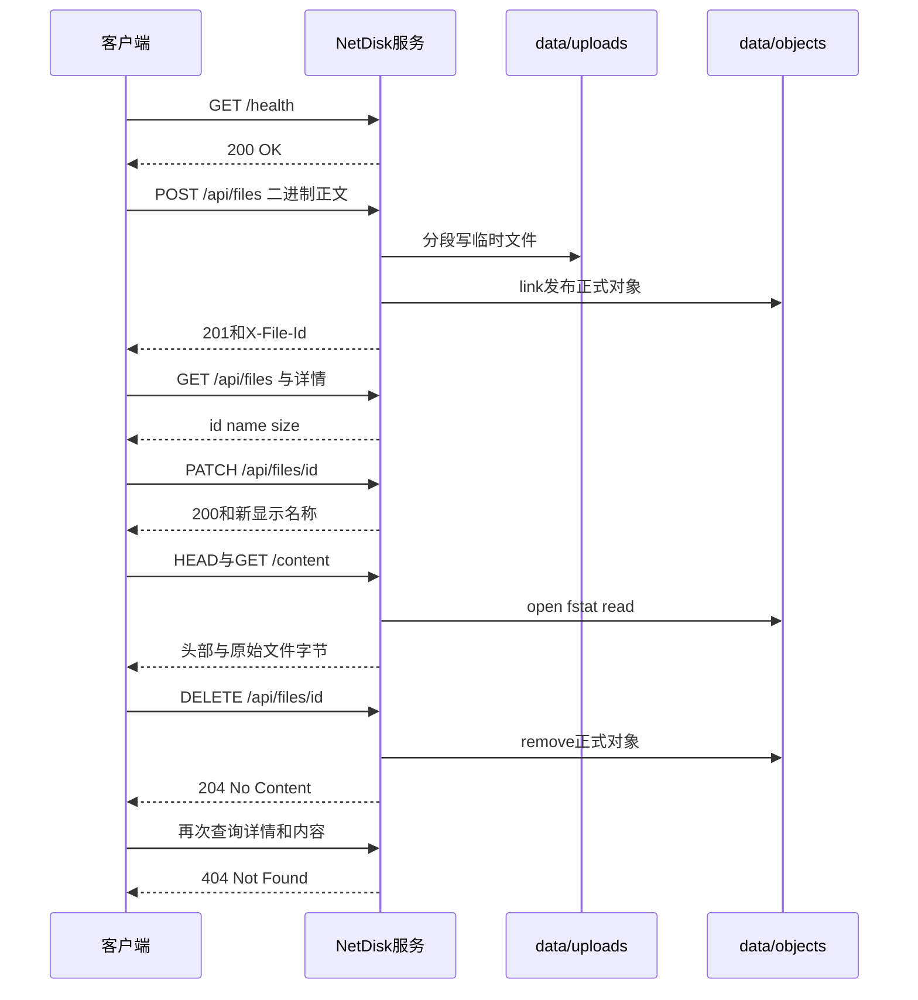

# 第二十一天 第一版完整业务闭环

## 目标

使用一个真实Linux服务进程完成健康检查 上传 列表 详情 改名 HEAD 下载 删除及删除后不可见的完整闭环

本单元不增加业务接口 阅读现有生产代码后没有发现阻碍闭环的缺陷 因此不为了整理形式修改src目录 新增一项端到端测试并固定HTTP API v0.1文档

## 业务顺序

图的类型 Sequence Diagram

选择这种图是因为本单元关注同一客户端按时间顺序完成一条完整文件生命周期 时序图可以直接表达请求 返回与对象状态变化



对象只有在完整正文接收 关闭成功和link成功后才公开 DELETE成功后新的请求立即看不到对象 显示名称仍只存于当前进程内存 第22单元开始解决持久化

## 变化文件

- 修改CMakeLists.txt 注册first_release_integration_tests
- 新增tests/day21_first_release.py Python实现由助手维护
- 新增docs/api-v0.1.md 固化第一版接口与限制
- 更新README 计划 进度和本教程
- src目录所有生产C++保持不变
- 第20单元及更早测试保持不变

## 完整CMakeLists.txt

```cmake
cmake_minimum_required(VERSION 3.16)

project(netdisk LANGUAGES CXX)

add_executable(netdisk src/main.cpp)
set(NETDISK_TARGETS netdisk)

# ===== DAY 18 ADDED BEGIN 查找并接入系统JSON依赖 =====
find_package(nlohmann_json 3.2.0 REQUIRED)
target_link_libraries(netdisk PRIVATE nlohmann_json::nlohmann_json)
# ===== DAY 18 ADDED END =====

include(CTest)
if(BUILD_TESTING)
    add_executable(io_tests tests/day06_io.cpp)
    target_include_directories(io_tests PRIVATE src)
    list(APPEND NETDISK_TARGETS io_tests)
    add_test(NAME io_tests COMMAND io_tests)

    add_executable(request_line_tests tests/day08_request_line.cpp)
    target_include_directories(request_line_tests PRIVATE src)
    list(APPEND NETDISK_TARGETS request_line_tests)
    add_test(NAME request_line_tests COMMAND request_line_tests)

    add_executable(request_headers_tests tests/day09_request_headers.cpp)
    target_include_directories(request_headers_tests PRIVATE src)
    list(APPEND NETDISK_TARGETS request_headers_tests)
    add_test(NAME request_headers_tests COMMAND request_headers_tests)

    add_executable(request_body_tests tests/day10_request_body.cpp)
    target_include_directories(request_body_tests PRIVATE src)
    list(APPEND NETDISK_TARGETS request_body_tests)
    add_test(NAME request_body_tests COMMAND request_body_tests)

    add_executable(http_response_tests tests/day11_http_response.cpp)
    target_include_directories(http_response_tests PRIVATE src)
    list(APPEND NETDISK_TARGETS http_response_tests)
    add_test(NAME http_response_tests COMMAND http_response_tests)

    add_executable(stream_upload_tests tests/day12_stream_upload.cpp)
    target_include_directories(stream_upload_tests PRIVATE src)
    list(APPEND NETDISK_TARGETS stream_upload_tests)
    add_test(NAME stream_upload_tests COMMAND stream_upload_tests)

    add_executable(publish_tests tests/day13_publish.cpp)
    target_include_directories(publish_tests PRIVATE src)
    list(APPEND NETDISK_TARGETS publish_tests)
    add_test(NAME publish_tests COMMAND publish_tests)

    # ===== DAY 15 ADDED BEGIN 注册ID与存储路径隔离测试 =====
    add_executable(object_path_tests tests/day15_object_path.cpp)
    target_include_directories(object_path_tests PRIVATE src)
    list(APPEND NETDISK_TARGETS object_path_tests)
    add_test(NAME object_path_tests COMMAND object_path_tests)
    # ===== DAY 15 ADDED END =====

    # ===== DAY 14 ADDED BEGIN 注册自动启动服务的上传集成测试 =====
    find_package(Python3 3.8 REQUIRED COMPONENTS Interpreter)
    add_test(NAME upload_integration_tests
        COMMAND "${Python3_EXECUTABLE}"
            "${CMAKE_CURRENT_SOURCE_DIR}/tests/day14_upload_integration.py"
            "$<TARGET_FILE:netdisk>"
    )
    set_tests_properties(upload_integration_tests PROPERTIES
        TIMEOUT 30
        RUN_SERIAL TRUE
        SKIP_RETURN_CODE 77
    )
    # ===== DAY 14 ADDED END =====

    # ===== DAY 16 ADDED BEGIN 注册下载端到端测试 =====
    add_test(NAME download_integration_tests
        COMMAND "${Python3_EXECUTABLE}"
            "${CMAKE_CURRENT_SOURCE_DIR}/tests/day16_download_integration.py"
            "$<TARGET_FILE:netdisk>"
    )
    set_tests_properties(download_integration_tests PROPERTIES
        TIMEOUT 30
        RUN_SERIAL TRUE
        SKIP_RETURN_CODE 77
    )
    # ===== DAY 16 ADDED END =====

    # ===== DAY 17 ADDED BEGIN 注册响应头单测与真实GET HEAD验证 =====
    add_executable(download_headers_tests tests/day17_download_headers.cpp)
    target_include_directories(download_headers_tests PRIVATE src)
    list(APPEND NETDISK_TARGETS download_headers_tests)
    add_test(NAME download_headers_tests COMMAND download_headers_tests)

    add_test(NAME download_headers_integration_tests
        COMMAND "${Python3_EXECUTABLE}"
            "${CMAKE_CURRENT_SOURCE_DIR}/tests/day17_download_headers.py"
            "$<TARGET_FILE:netdisk>"
    )
    set_tests_properties(download_headers_integration_tests PROPERTIES
        TIMEOUT 30
        RUN_SERIAL TRUE
        SKIP_RETURN_CODE 77
    )
    # ===== DAY 17 ADDED END =====

    # ===== DAY 18 ADDED BEGIN 注册JSON目录单测与集成测试 =====
    add_executable(file_catalog_tests tests/day18_file_catalog.cpp)
    target_include_directories(file_catalog_tests PRIVATE src)
    target_link_libraries(file_catalog_tests PRIVATE nlohmann_json::nlohmann_json)
    list(APPEND NETDISK_TARGETS file_catalog_tests)
    add_test(NAME file_catalog_tests COMMAND file_catalog_tests)

    add_test(NAME file_catalog_integration_tests
        COMMAND "${Python3_EXECUTABLE}"
            "${CMAKE_CURRENT_SOURCE_DIR}/tests/day18_file_catalog.py"
            "$<TARGET_FILE:netdisk>"
    )
    set_tests_properties(file_catalog_integration_tests PROPERTIES
        TIMEOUT 30
        RUN_SERIAL TRUE
        SKIP_RETURN_CODE 77
    )
    # ===== DAY 18 ADDED END =====

    # ===== DAY 19 ADDED BEGIN 注册重命名删除测试 =====
    add_executable(file_mutation_tests tests/day19_file_mutation.cpp)
    target_include_directories(file_mutation_tests PRIVATE src)
    target_link_libraries(file_mutation_tests PRIVATE nlohmann_json::nlohmann_json)
    list(APPEND NETDISK_TARGETS file_mutation_tests)
    add_test(NAME file_mutation_tests COMMAND file_mutation_tests)

    add_test(NAME file_mutation_integration_tests
        COMMAND "${Python3_EXECUTABLE}"
            "${CMAKE_CURRENT_SOURCE_DIR}/tests/day19_file_mutation.py"
            "$<TARGET_FILE:netdisk>"
    )
    set_tests_properties(file_mutation_integration_tests PROPERTIES
        TIMEOUT 30
        RUN_SERIAL TRUE
        SKIP_RETURN_CODE 77
    )
    # ===== DAY 19 ADDED END =====

    # ===== DAY 20 ADDED BEGIN 注册文件故障与客户端中断回归 =====
    add_test(NAME failure_recovery_integration_tests
        COMMAND "${Python3_EXECUTABLE}"
            "${CMAKE_CURRENT_SOURCE_DIR}/tests/day20_failure_recovery.py"
            "$<TARGET_FILE:netdisk>"
    )
    set_tests_properties(failure_recovery_integration_tests PROPERTIES
        TIMEOUT 30
        RUN_SERIAL TRUE
        SKIP_RETURN_CODE 77
    )
    # ===== DAY 20 ADDED END =====

    # ===== DAY 21 ADDED BEGIN 注册第一版完整业务闭环 =====
    add_test(NAME first_release_integration_tests
        COMMAND "${Python3_EXECUTABLE}"
            "${CMAKE_CURRENT_SOURCE_DIR}/tests/day21_first_release.py"
            "$<TARGET_FILE:netdisk>"
    )
    set_tests_properties(first_release_integration_tests PROPERTIES
        TIMEOUT 30
        RUN_SERIAL TRUE
        SKIP_RETURN_CODE 77
    )
    # ===== DAY 21 ADDED END =====
endif()

foreach(target IN LISTS NETDISK_TARGETS)
    set_target_properties(${target} PROPERTIES
        CXX_STANDARD 17
        CXX_STANDARD_REQUIRED YES
        CXX_EXTENSIONS NO
    )
endforeach()
```

Python测试脚本是约定例外 不在教程复制实现 本地完整脚本带DAY21标注

## Linux虚拟机操作

同步以下两个代码文件

- CMakeLists.txt
- tests/day21_first_release.py

必须保留

- tests/day16_download_integration.py
- tests/day19_file_mutation.py

在Linux工程目录执行

```sh
cd ~/projects/netdisk
cmake -S . -B build -DCMAKE_BUILD_TYPE=Debug -DBUILD_TESTING=ON
cmake --build build -j2
ctest --test-dir build -R '^first_release_integration_tests$' -V
```

若一直使用build-debug 将三处build统一替换为build-debug

成功条件

- CTest实际运行一项且通过
- 最后输出PASS: first release workflow finished, 7 steps
- Linux不显示SKIP
- 退出状态为0

测试需要8080空闲 使用独立临时目录 自动启动停止自己的服务 不使用工程data

## API v0.1摘要

| 方法 | 路径 | 成功 |
| --- | --- | --- |
| GET HEAD | /health | 200 |
| POST | /api/files | 201和X-File-Id |
| GET HEAD | /api/files | 200列表 |
| GET HEAD | /api/files/{id} | 200详情 |
| PATCH | /api/files/{id} | 200新元数据 |
| DELETE | /api/files/{id} | 204空响应 |
| GET HEAD | /api/files/{id}/content | 200下载 |

## 当前限制

第一版仍是串行阻塞服务 上传上限64KiB 显示名称只在进程内存 无数据库 分页 摘要 Range 上传续传 用户权限 文件夹 分享 回收站 版本历史 TLS和分布式存储

本机只完成脚本语法 依赖导入 Windows跳过77和CMake静态检查 Linux真实闭环等待用户反馈
