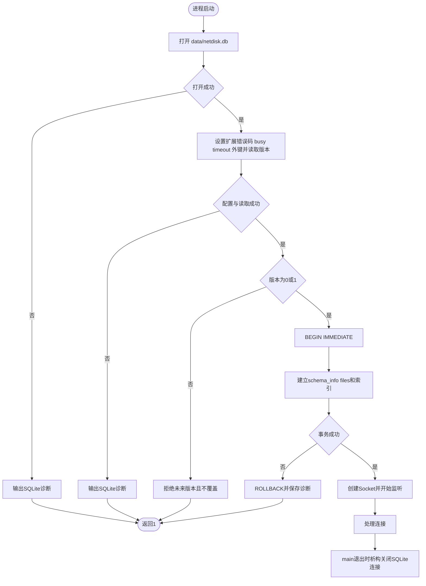

# 第二十二天 SQLite接入 schema与生命周期

## 目标

今天给生产服务加入真实SQLite元数据连接 服务启动时打开`data/netdisk.db` 在事务中建立初始schema并保持连接到进程结束

数据库打开 建表或版本检查失败时 程序在创建监听Socket之前输出诊断并退出 不能进入只有文件存储可用而元数据层不可用的半启动状态

本单元只建立schema和生命周期 第23单元才使用预编译语句把上传 列表与显示名称写入数据库 因此今天重启后显示名称仍会丢失

## 数据库启动流程

图的类型 Flowchart

选择这种图是因为本单元关注启动阶段的判断 事务失败路径和资源生命周期 流程图能直接表达服务何时允许开始监听



关键顺序是数据库先于监听Socket初始化 客户端只要能连接到8080 就能确定本进程的元数据层已经通过启动检查 `MetadataDatabase`拥有`sqlite3*` `get()`只返回借用指针 调用者不能关闭它 指针有效期不超过数据库对象

## 初始schema

| 表 | 字段 | 作用 |
| --- | --- | --- |
| schema_info | singleton version | 保存唯一一行schema版本1 |
| files | id name size state created_at | 为后续持久文件元数据建立结构 |

`files.state`只允许`publishing` `ready` `deleting` 三种状态 今天尚未写入记录 `name`按UTF8编码后的字节数限制1至255 `created_at`约定保存Unix时间秒 `files_state_created_index`为后续按状态 创建时间和ID稳定扫描准备索引

`PRAGMA user_version`为0表示新库 为1表示当前版本 其他值直接拒绝 旧程序不会把未来版本无条件写回1

## 完整src/metadata_database.h

```cpp
#pragma once

// ===== DAY 22 ADDED BEGIN 管理SQLite连接和初始schema =====
#include <sqlite3.h>

#include <cstdlib>
#include <limits>
#include <string>

class MetadataDatabase
{
public:
    MetadataDatabase() = default;
    MetadataDatabase(const MetadataDatabase&) = delete;
    MetadataDatabase& operator=(const MetadataDatabase&) = delete;

    ~MetadataDatabase() noexcept
    {
        close();
    }

    bool open(const char* path)
    {
        if (database_ != nullptr)
        {
            remember_error("open metadata database", SQLITE_MISUSE,
                           "connection is already open");
            return false;
        }

        sqlite3* opened = nullptr;
        const int result = sqlite3_open_v2(
            path, &opened, SQLITE_OPEN_READWRITE | SQLITE_OPEN_CREATE, nullptr);
        database_ = opened;
        if (result != SQLITE_OK)
        {
            remember_error("open metadata database", result,
                           database_ == nullptr ? sqlite3_errstr(result)
                                                : sqlite3_errmsg(database_));
            close();
            return false;
        }

        int configure_result = sqlite3_extended_result_codes(database_, 1);
        if (configure_result == SQLITE_OK)
            configure_result = sqlite3_busy_timeout(database_, 3000);
        if (configure_result != SQLITE_OK)
        {
            remember_error("configure metadata database", configure_result,
                           sqlite3_errmsg(database_));
            close();
            return false;
        }

        clear_error();
        return true;
    }

    bool initialize_schema()
    {
        if (database_ == nullptr)
        {
            remember_error("initialize metadata schema", SQLITE_MISUSE,
                           "connection is not open");
            return false;
        }

        if (!execute("PRAGMA foreign_keys = ON;", "enable foreign keys"))
            return false;

        int version = 0;
        if (!read_integer("PRAGMA user_version;", "read schema version", version))
            return false;
        if (version != 0 && version != 1)
        {
            const std::string detail = "unsupported schema version " +
                std::to_string(version);
            remember_error("initialize metadata schema", SQLITE_ERROR, detail.c_str());
            return false;
        }

        static constexpr const char* schema = R"SQL(
BEGIN IMMEDIATE;
CREATE TABLE IF NOT EXISTS schema_info (
    singleton INTEGER NOT NULL PRIMARY KEY CHECK (singleton = 1),
    version INTEGER NOT NULL CHECK (version = 1)
);
INSERT OR IGNORE INTO schema_info(singleton, version) VALUES(1, 1);
CREATE TABLE IF NOT EXISTS files (
    id TEXT NOT NULL PRIMARY KEY,
    name TEXT NOT NULL CHECK (length(CAST(name AS BLOB)) BETWEEN 1 AND 255),
    size INTEGER NOT NULL CHECK (size >= 0),
    state TEXT NOT NULL CHECK (state IN ('publishing', 'ready', 'deleting')),
    created_at INTEGER NOT NULL CHECK (created_at >= 0)
);
CREATE INDEX IF NOT EXISTS files_state_created_index
    ON files(state, created_at, id);
PRAGMA user_version = 1;
COMMIT;
)SQL";

        if (!execute(schema, "initialize metadata schema"))
        {
            sqlite3_exec(database_, "ROLLBACK;", nullptr, nullptr, nullptr);
            return false;
        }

        int stored_version = 0;
        if (!read_integer(
                "SELECT version FROM schema_info WHERE singleton = 1;",
                "verify schema version", stored_version))
            return false;
        if (stored_version != 1)
        {
            remember_error("verify schema version", SQLITE_ERROR,
                           "schema_info does not contain version 1");
            return false;
        }

        clear_error();
        return true;
    }

    sqlite3* get() const noexcept
    {
        return database_;
    }

    int error_code() const noexcept
    {
        return error_code_;
    }

    const std::string& error_message() const noexcept
    {
        return error_message_;
    }

private:
    bool read_integer(const char* sql, const char* operation, int& output)
    {
        struct IntegerResult
        {
            int value = 0;
            bool received = false;
        } result_value;
        const auto callback = [](void* context, int count, char** values, char**) -> int
        {
            auto& result = *static_cast<IntegerResult*>(context);
            if (count != 1 || values[0] == nullptr || result.received) return 1;
            char* end = nullptr;
            const long value = std::strtol(values[0], &end, 10);
            if (end == values[0] || *end != '\0' || value < 0 ||
                value > std::numeric_limits<int>::max())
                return 1;
            result.value = static_cast<int>(value);
            result.received = true;
            return 0;
        };

        char* detail = nullptr;
        const int result = sqlite3_exec(
            database_, sql, callback, &result_value, &detail);
        if (result != SQLITE_OK || !result_value.received)
        {
            const int code = result == SQLITE_OK ? SQLITE_ERROR : result;
            remember_error(operation, code, detail == nullptr
                ? (result == SQLITE_OK ? "query returned no integer" : sqlite3_errmsg(database_))
                : detail);
            sqlite3_free(detail);
            return false;
        }

        sqlite3_free(detail);
        output = result_value.value;
        return true;
    }

    bool execute(const char* sql, const char* operation)
    {
        char* detail = nullptr;
        const int result = sqlite3_exec(database_, sql, nullptr, nullptr, &detail);
        if (result == SQLITE_OK)
        {
            sqlite3_free(detail);
            return true;
        }

        remember_error(operation, result,
                       detail == nullptr ? sqlite3_errmsg(database_) : detail);
        sqlite3_free(detail);
        return false;
    }

    void remember_error(const char* operation, int code, const char* detail)
    {
        error_code_ = code;
        error_message_ = operation;
        error_message_ += ": ";
        error_message_ += detail == nullptr ? sqlite3_errstr(code) : detail;
    }

    void clear_error()
    {
        error_code_ = SQLITE_OK;
        error_message_.clear();
    }

    void close() noexcept
    {
        if (database_ == nullptr) return;
        sqlite3_close_v2(database_);
        database_ = nullptr;
    }

    sqlite3* database_ = nullptr;
    int error_code_ = SQLITE_OK;
    std::string error_message_;
};
// ===== DAY 22 ADDED END =====
```

## 完整src/main.cpp

```cpp
#include "unique_fd.h"
#include "socket_io.h"
#include "http_response.h"
#include "temp_upload.h"
#include "file_download.h"
// ===== DAY 18 ADDED BEGIN 接入JSON文件列表与详情 =====
#include "file_catalog.h"
// ===== DAY 18 ADDED END =====
// ===== DAY 22 ADDED BEGIN 接入SQLite元数据连接 =====
#include "metadata_database.h"
// ===== DAY 22 ADDED END =====

#include <algorithm>
#include <arpa/inet.h>
#include <cerrno>
#include <cstddef>
#include <cstdint>
#include <cstring>
#include <iostream>
#include <netinet/in.h>
#include <string>
#include <sys/socket.h>

bool send_response(int client_fd, const HttpResponse& response, bool head_only)
{
    const std::string wire = build_response(response, head_only);
    std::cout << "response status=" << response.status << '\n';
    return send_all(client_fd, wire.data(), wire.size());
}

bool is_upload(const RequestLine& line)
{
    const std::string_view target(line.target);
    const auto path = target.substr(0, target.find('?'));
    return line.method == "POST" && (path == "/dev/upload" || path == "/api/files");
}

bool handle_client(int client_fd)
{
    TempUpload upload;
    RequestParser parser([&upload](const RequestLine& line, std::string_view chunk)
    {
        if (!is_upload(line)) return BodyAction::Buffer;
        return upload.append(chunk) ? BodyAction::Written : BodyAction::Failed;
    });
    ParseState state = ParseState::NeedMore;
    bool received_any = false;
    char buffer[1024];

    while (state == ParseState::NeedMore)
    {
        const ssize_t n = ::recv(client_fd, buffer, sizeof(buffer), 0);
        if (n == -1)
        {
            const int error = errno;
            if (error == EINTR)
            {
                continue;
            }
            print_system_error("recv", error);
            return false;
        }
        if (n == 0)
        {
            if (!received_any) return false;
            parser.finish();
            std::cerr << "peer closed before request completed\n";
            return send_response(client_fd, parser_error_response(parser.error()),
                                 parser.line().method == "HEAD");
        }

        received_any = true;
        const std::size_t count = static_cast<std::size_t>(n);
        const auto result = parser.feed(std::string_view(buffer, count));
        state = result.state;
        if (state == ParseState::Error)
        {
            std::cerr << "invalid or unsupported request or size limit exceeded\n";
            if (parser.error() == RequestError::BodyWriteFailed)
                print_system_error("temporary upload", upload.error());
            return send_response(client_fd, parser_error_response(parser.error()),
                                 parser.line().method == "HEAD");
        }
        if (result.consumed < count)
        {
            std::cout << "trailing bytes ignored before connection close\n";
        }
    }

    const RequestLine& line = parser.line();
    std::cout << "method=" << line.method
              << " target=" << line.target
              << " version=" << line.version << '\n';
    std::string_view file_id;
    if (match_file_content(line.target, file_id))
        return send_file_content(client_fd, parser, file_id);
    // ===== DAY 18 ADDED BEGIN POST上传与GET列表分别分派 =====
    if (is_file_catalog_request(line))
        return send_response(client_fd, file_catalog_response(parser), line.method == "HEAD");
    // ===== DAY 18 ADDED END =====
    if (is_upload(line))
    {
        const std::string_view target(line.target);
        const bool permanent = target.substr(0, target.find('?')) == "/api/files";
        const bool stored = permanent ? upload.publish(parser.body_size()) : upload.close_file();
        if (!stored)
        {
            print_system_error("finalize upload", upload.error());
            return send_response(client_fd, error_response(500), false);
        }
        std::cout << "temporary bytes=" << parser.body_size()
                  << " buffered bytes=" << parser.body().size() << '\n';
        if (permanent) std::cout << "published id=" << upload.id() << '\n';
    }
    return send_response(client_fd, route_request(parser, upload.id()), line.method == "HEAD");
}

int main()
{
    constexpr std::uint16_t port = 8080;
    constexpr int backlog = 16;

    // ===== DAY 22 ADDED BEGIN 监听前完成数据库打开和schema初始化 =====
    MetadataDatabase metadata;
    if (!metadata.open("data/netdisk.db") || !metadata.initialize_schema())
    {
        std::cerr << "metadata database failed: " << metadata.error_message() << '\n';
        return 1;
    }
    std::cout << "metadata database ready path=data/netdisk.db schema=1\n";
    // ===== DAY 22 ADDED END =====

    const int raw_fd = ::socket(AF_INET, SOCK_STREAM | SOCK_CLOEXEC, 0);
    if (raw_fd == -1)
    {
        const int error = errno;
        print_system_error("socket", error);
        return 1;
    }
    UniqueFd listener(raw_fd);

    const int reuse_address = 1;
    if (::setsockopt(listener.get(), SOL_SOCKET, SO_REUSEADDR,
                     &reuse_address, sizeof(reuse_address)) == -1)
    {
        const int error = errno;
        print_system_error("setsockopt", error);
        return 1;
    }

    sockaddr_in address{};
    address.sin_family = AF_INET;
    address.sin_port = htons(port);
    address.sin_addr.s_addr = htonl(INADDR_LOOPBACK);

    if (::bind(listener.get(),
               reinterpret_cast<const sockaddr*>(&address),
               sizeof(address)) == -1)
    {
        const int error = errno;
        print_system_error("bind", error);
        return 1;
    }
    if (::listen(listener.get(), backlog) == -1)
    {
        const int error = errno;
        print_system_error("listen", error);
        return 1;
    }

    std::cout << "listening on 127.0.0.1:" << port
              << " fd=" << listener.get() << std::endl;

    while (true)
    {
        const int accepted_fd =
            ::accept(listener.get(), nullptr, nullptr);
        if (accepted_fd == -1)
        {
            const int error = errno;
            if (error == EINTR || error == ECONNABORTED)
            {
                continue;
            }
            print_system_error("accept", error);
            return 1;
        }

        UniqueFd client(accepted_fd);
        std::cout << "accepted fd=" << client.get() << std::endl;
        const bool ok = handle_client(client.get());
        std::cout << (ok ? "response sent" : "connection failed")
                  << std::endl;
    }
}
```

## 完整tests/day22_sqlite_lifecycle.cpp

```cpp
// ===== DAY 22 ADDED BEGIN 验证SQLite连接schema和失败诊断 =====
#include "metadata_database.h"

#include <chrono>
#include <cstdlib>
#include <filesystem>
#include <fstream>
#include <iostream>
#include <stdexcept>
#include <string>

void require(bool ok, const char* message)
{
    if (!ok) throw std::runtime_error(message);
}

struct TestDirectory
{
    std::filesystem::path previous = std::filesystem::current_path();
    std::filesystem::path root = previous / ("day22-test-" + std::to_string(
        std::chrono::steady_clock::now().time_since_epoch().count()));

    TestDirectory()
    {
        require(std::filesystem::create_directory(root), "create isolated directory");
        std::filesystem::current_path(root);
    }

    ~TestDirectory()
    {
        std::error_code error;
        std::filesystem::current_path(previous, error);
        std::filesystem::remove_all(root, error);
    }
};

int scalar_int(sqlite3* database, const char* sql)
{
    int value = -1;
    char* detail = nullptr;
    const auto callback = [](void* context, int count, char** values, char**) -> int
    {
        if (count != 1 || values[0] == nullptr) return 1;
        *static_cast<int*>(context) = std::atoi(values[0]);
        return 0;
    };
    const int result = sqlite3_exec(database, sql, callback, &value, &detail);
    if (result != SQLITE_OK)
    {
        const std::string message = detail == nullptr ? sqlite3_errmsg(database) : detail;
        sqlite3_free(detail);
        throw std::runtime_error(message);
    }
    sqlite3_free(detail);
    return value;
}

int main()
{
    try
    {
        TestDirectory directory;
        std::filesystem::create_directory("data");

        {
            MetadataDatabase database;
            require(database.open("data/netdisk.db"), "open new database");
            require(database.initialize_schema(), "initialize new schema");
            require(database.error_code() == SQLITE_OK, "success retained an error");
            require(scalar_int(database.get(), "PRAGMA foreign_keys;") == 1,
                    "foreign keys are disabled");
            require(scalar_int(database.get(), "PRAGMA user_version;") == 1,
                    "unexpected schema version");
            require(scalar_int(database.get(),
                    "SELECT COUNT(*) FROM sqlite_master WHERE type = 'table' "
                    "AND name IN ('schema_info', 'files');") == 2,
                    "required tables are missing");
            require(scalar_int(database.get(),
                    "SELECT version FROM schema_info WHERE singleton = 1;") == 1,
                    "schema version row is missing");
        }

        {
            MetadataDatabase reopened;
            require(reopened.open("data/netdisk.db"), "reopen database");
            require(reopened.initialize_schema(), "repeat schema initialization");
            require(scalar_int(reopened.get(),
                    "SELECT COUNT(*) FROM schema_info;") == 1,
                    "schema initialization is not idempotent");
            require(sqlite3_exec(reopened.get(), "PRAGMA user_version = 2;",
                                 nullptr, nullptr, nullptr) == SQLITE_OK,
                    "prepare newer schema fixture");
        }

        {
            MetadataDatabase newer;
            require(newer.open("data/netdisk.db"), "open newer schema fixture");
            require(!newer.initialize_schema(), "newer schema version accepted");
            require(newer.error_code() != SQLITE_OK &&
                    !newer.error_message().empty(), "version failure has no diagnostic");
            require(scalar_int(newer.get(), "PRAGMA user_version;") == 2,
                    "newer schema version was overwritten");
        }

        {
            std::ofstream blocked("blocked", std::ios::binary);
            blocked << "ordinary file";
        }
        MetadataDatabase open_failure;
        require(!open_failure.open("blocked/netdisk.db"), "invalid parent opened");
        require(open_failure.error_code() != SQLITE_OK &&
                !open_failure.error_message().empty(), "open failure has no diagnostic");

        {
            std::ofstream corrupt("corrupt.db", std::ios::binary);
            corrupt << "not a sqlite database";
        }
        MetadataDatabase schema_failure;
        require(schema_failure.open("corrupt.db"), "open corrupt fixture");
        require(!schema_failure.initialize_schema(), "corrupt schema initialized");
        require(schema_failure.error_code() != SQLITE_OK &&
                !schema_failure.error_message().empty(), "schema failure has no diagnostic");

        std::cout << "PASS: sqlite lifecycle, schema version and failure diagnostics\n";
    }
    catch (const std::exception& error)
    {
        std::cerr << "FAIL: " << error.what() << '\n';
        return 1;
    }
}
// ===== DAY 22 ADDED END =====
```

## 完整CMakeLists.txt

```cmake
cmake_minimum_required(VERSION 3.16)

project(netdisk LANGUAGES CXX)

add_executable(netdisk src/main.cpp)
set(NETDISK_TARGETS netdisk)

# ===== DAY 18 ADDED BEGIN 查找并接入系统JSON依赖 =====
find_package(nlohmann_json 3.2.0 REQUIRED)
target_link_libraries(netdisk PRIVATE nlohmann_json::nlohmann_json)
# ===== DAY 18 ADDED END =====

# ===== DAY 22 ADDED BEGIN 查找并链接SQLite元数据依赖 =====
find_package(SQLite3 REQUIRED)
target_link_libraries(netdisk PRIVATE SQLite::SQLite3)
# ===== DAY 22 ADDED END =====

include(CTest)
if(BUILD_TESTING)
    add_executable(io_tests tests/day06_io.cpp)
    target_include_directories(io_tests PRIVATE src)
    list(APPEND NETDISK_TARGETS io_tests)
    add_test(NAME io_tests COMMAND io_tests)

    add_executable(request_line_tests tests/day08_request_line.cpp)
    target_include_directories(request_line_tests PRIVATE src)
    list(APPEND NETDISK_TARGETS request_line_tests)
    add_test(NAME request_line_tests COMMAND request_line_tests)

    add_executable(request_headers_tests tests/day09_request_headers.cpp)
    target_include_directories(request_headers_tests PRIVATE src)
    list(APPEND NETDISK_TARGETS request_headers_tests)
    add_test(NAME request_headers_tests COMMAND request_headers_tests)

    add_executable(request_body_tests tests/day10_request_body.cpp)
    target_include_directories(request_body_tests PRIVATE src)
    list(APPEND NETDISK_TARGETS request_body_tests)
    add_test(NAME request_body_tests COMMAND request_body_tests)

    add_executable(http_response_tests tests/day11_http_response.cpp)
    target_include_directories(http_response_tests PRIVATE src)
    list(APPEND NETDISK_TARGETS http_response_tests)
    add_test(NAME http_response_tests COMMAND http_response_tests)

    add_executable(stream_upload_tests tests/day12_stream_upload.cpp)
    target_include_directories(stream_upload_tests PRIVATE src)
    list(APPEND NETDISK_TARGETS stream_upload_tests)
    add_test(NAME stream_upload_tests COMMAND stream_upload_tests)

    add_executable(publish_tests tests/day13_publish.cpp)
    target_include_directories(publish_tests PRIVATE src)
    list(APPEND NETDISK_TARGETS publish_tests)
    add_test(NAME publish_tests COMMAND publish_tests)

    # ===== DAY 15 ADDED BEGIN 注册ID与存储路径隔离测试 =====
    add_executable(object_path_tests tests/day15_object_path.cpp)
    target_include_directories(object_path_tests PRIVATE src)
    list(APPEND NETDISK_TARGETS object_path_tests)
    add_test(NAME object_path_tests COMMAND object_path_tests)
    # ===== DAY 15 ADDED END =====

    # ===== DAY 14 ADDED BEGIN 注册自动启动服务的上传集成测试 =====
    find_package(Python3 3.8 REQUIRED COMPONENTS Interpreter)
    add_test(NAME upload_integration_tests
        COMMAND "${Python3_EXECUTABLE}"
            "${CMAKE_CURRENT_SOURCE_DIR}/tests/day14_upload_integration.py"
            "$<TARGET_FILE:netdisk>"
    )
    set_tests_properties(upload_integration_tests PROPERTIES
        TIMEOUT 30
        RUN_SERIAL TRUE
        SKIP_RETURN_CODE 77
    )
    # ===== DAY 14 ADDED END =====

    # ===== DAY 16 ADDED BEGIN 注册下载端到端测试 =====
    add_test(NAME download_integration_tests
        COMMAND "${Python3_EXECUTABLE}"
            "${CMAKE_CURRENT_SOURCE_DIR}/tests/day16_download_integration.py"
            "$<TARGET_FILE:netdisk>"
    )
    set_tests_properties(download_integration_tests PROPERTIES
        TIMEOUT 30
        RUN_SERIAL TRUE
        SKIP_RETURN_CODE 77
    )
    # ===== DAY 16 ADDED END =====

    # ===== DAY 17 ADDED BEGIN 注册响应头单测与真实GET HEAD验证 =====
    add_executable(download_headers_tests tests/day17_download_headers.cpp)
    target_include_directories(download_headers_tests PRIVATE src)
    list(APPEND NETDISK_TARGETS download_headers_tests)
    add_test(NAME download_headers_tests COMMAND download_headers_tests)

    add_test(NAME download_headers_integration_tests
        COMMAND "${Python3_EXECUTABLE}"
            "${CMAKE_CURRENT_SOURCE_DIR}/tests/day17_download_headers.py"
            "$<TARGET_FILE:netdisk>"
    )
    set_tests_properties(download_headers_integration_tests PROPERTIES
        TIMEOUT 30
        RUN_SERIAL TRUE
        SKIP_RETURN_CODE 77
    )
    # ===== DAY 17 ADDED END =====

    # ===== DAY 18 ADDED BEGIN 注册JSON目录单测与集成测试 =====
    add_executable(file_catalog_tests tests/day18_file_catalog.cpp)
    target_include_directories(file_catalog_tests PRIVATE src)
    target_link_libraries(file_catalog_tests PRIVATE nlohmann_json::nlohmann_json)
    list(APPEND NETDISK_TARGETS file_catalog_tests)
    add_test(NAME file_catalog_tests COMMAND file_catalog_tests)

    add_test(NAME file_catalog_integration_tests
        COMMAND "${Python3_EXECUTABLE}"
            "${CMAKE_CURRENT_SOURCE_DIR}/tests/day18_file_catalog.py"
            "$<TARGET_FILE:netdisk>"
    )
    set_tests_properties(file_catalog_integration_tests PROPERTIES
        TIMEOUT 30
        RUN_SERIAL TRUE
        SKIP_RETURN_CODE 77
    )
    # ===== DAY 18 ADDED END =====

    # ===== DAY 19 ADDED BEGIN 注册重命名删除测试 =====
    add_executable(file_mutation_tests tests/day19_file_mutation.cpp)
    target_include_directories(file_mutation_tests PRIVATE src)
    target_link_libraries(file_mutation_tests PRIVATE nlohmann_json::nlohmann_json)
    list(APPEND NETDISK_TARGETS file_mutation_tests)
    add_test(NAME file_mutation_tests COMMAND file_mutation_tests)

    add_test(NAME file_mutation_integration_tests
        COMMAND "${Python3_EXECUTABLE}"
            "${CMAKE_CURRENT_SOURCE_DIR}/tests/day19_file_mutation.py"
            "$<TARGET_FILE:netdisk>"
    )
    set_tests_properties(file_mutation_integration_tests PROPERTIES
        TIMEOUT 30
        RUN_SERIAL TRUE
        SKIP_RETURN_CODE 77
    )
    # ===== DAY 19 ADDED END =====

    # ===== DAY 20 ADDED BEGIN 注册文件故障与客户端中断回归 =====
    add_test(NAME failure_recovery_integration_tests
        COMMAND "${Python3_EXECUTABLE}"
            "${CMAKE_CURRENT_SOURCE_DIR}/tests/day20_failure_recovery.py"
            "$<TARGET_FILE:netdisk>"
    )
    set_tests_properties(failure_recovery_integration_tests PROPERTIES
        TIMEOUT 30
        RUN_SERIAL TRUE
        SKIP_RETURN_CODE 77
    )
    # ===== DAY 20 ADDED END =====

    # ===== DAY 21 ADDED BEGIN 注册第一版完整业务闭环 =====
    add_test(NAME first_release_integration_tests
        COMMAND "${Python3_EXECUTABLE}"
            "${CMAKE_CURRENT_SOURCE_DIR}/tests/day21_first_release.py"
            "$<TARGET_FILE:netdisk>"
    )
    set_tests_properties(first_release_integration_tests PROPERTIES
        TIMEOUT 30
        RUN_SERIAL TRUE
        SKIP_RETURN_CODE 77
    )
    # ===== DAY 21 ADDED END =====

    # ===== DAY 22 ADDED BEGIN 注册SQLite生命周期与schema测试 =====
    add_executable(sqlite_lifecycle_tests tests/day22_sqlite_lifecycle.cpp)
    target_include_directories(sqlite_lifecycle_tests PRIVATE src)
    target_link_libraries(sqlite_lifecycle_tests PRIVATE SQLite::SQLite3)
    list(APPEND NETDISK_TARGETS sqlite_lifecycle_tests)
    add_test(NAME sqlite_lifecycle_tests COMMAND sqlite_lifecycle_tests)
    # ===== DAY 22 ADDED END =====
endif()

foreach(target IN LISTS NETDISK_TARGETS)
    set_target_properties(${target} PROPERTIES
        CXX_STANDARD 17
        CXX_STANDARD_REQUIRED YES
        CXX_EXTENSIONS NO
    )
endforeach()
```

## 接口与生命周期

### MetadataDatabase::open

- 参数`path`是调用期间有效的以零结尾路径 本类不保存该指针
- 返回`true`表示读写连接已经建立并完成错误码与3000毫秒锁等待配置
- 返回`false`表示重复打开 路径不存在 权限不足 无法创建或SQLite配置失败
- SQLite即使打开失败也可能通过输出参数返回句柄 实现先保存诊断再调用`sqlite3_close_v2`

### MetadataDatabase::initialize_schema

- 必须在`open`成功后调用
- 返回`true`表示外键已为本连接开启 当前版本受支持且schema事务已经提交
- 返回`false`表示连接未打开 数据库损坏 锁等待超时 I/O错误 schema冲突或版本不是0和1
- 建表使用`BEGIN IMMEDIATE` 多条DDL和版本写入一起提交 执行失败后尝试`ROLLBACK`

### MetadataDatabase::get

- 返回借用的`sqlite3*` 不转移所有权
- 不能对它调用`sqlite3_close`或`sqlite3_close_v2`
- 只在所属`MetadataDatabase`仍然存活且未关闭时有效
- 第23单元会用该连接创建预编译语句

### error_code与error_message

- 最近失败保存SQLite错误码与包含操作名的诊断文本
- 成功打开和成功初始化后清空旧错误
- `sqlite3_exec`分配的错误字符串由`sqlite3_free`释放

### 析构

`MetadataDatabase`不可复制 防止两个对象重复关闭同一连接 析构调用`sqlite3_close_v2` main中的对象覆盖后续Socket初始化和accept循环 正常返回路径都会自动关闭连接 强制终止进程依靠操作系统回收资源 不等同于优雅关闭

## Linux虚拟机操作

首次接入SQLite时安装开发头和命令行工具

```sh
sudo apt update
sudo apt install -y libsqlite3-dev sqlite3
```

同步以下文件

- CMakeLists.txt
- src/main.cpp
- src/metadata_database.h
- tests/day22_sqlite_lifecycle.cpp

在Linux工程目录复用原构建目录

```sh
cd ~/projects/netdisk
cmake -S . -B build -DCMAKE_BUILD_TYPE=Debug -DBUILD_TESTING=ON
cmake --build build -j2
ctest --test-dir build -R '^sqlite_lifecycle_tests$' -V
```

若一直使用`build-debug` 将三处`build`统一替换为`build-debug`

成功条件

- CTest实际运行`sqlite_lifecycle_tests`一项
- 输出`PASS: sqlite lifecycle, schema version and failure diagnostics`
- 一项测试通过且退出状态为0

测试在独立临时目录创建数据库 覆盖首次建表 重复启动 外键 版本1 未来版本拒绝且不降级 无效父路径和损坏文件诊断 完成后清理自己的目录 不使用工程`data`

本地参考环境已用Windows g++以C++17 `Wall` `Wextra` `pedantic`链接现有SQLite动态库并实际运行该测试 输出上述PASS 临时声明头和可执行文件随后删除 这证明可移植的连接与schema逻辑通过 不等于Linux CMake构建已经通过

## 一次真实启动

终端一在工程目录执行

```sh
cd ~/projects/netdisk
mkdir -p data/uploads data/objects
./build/netdisk
```

预期先出现

```text
metadata database ready path=data/netdisk.db schema=1
listening on 127.0.0.1:8080 fd=...
```

终端二执行

```sh
cd ~/projects/netdisk
sqlite3 data/netdisk.db 'PRAGMA user_version; SELECT version FROM schema_info WHERE singleton = 1;'
curl -i http://127.0.0.1:8080/health
```

前两行查询结果都应为`1` curl应返回`HTTP/1.1 200 OK`和`OK` 验证后在终端一按`Ctrl+C`停止

若CMake报告找不到SQLite3 先确认`libsqlite3-dev`安装成功后重新运行配置命令 若服务输出`unable to open database file` 先确认工程根目录存在`data`且当前用户可写 如果输出`database is locked` 说明另一个连接持有写锁超过3000毫秒 先定位持锁进程 不删除数据库规避问题

## 当前边界

- SQLite还没有参与上传 列表 改名或删除
- 显示名称仍在进程内存map中 重启仍恢复为ID加`.bin`
- 没有schema迁移框架 第一次只接受版本0和1
- 没有启用WAL 没有并发数据库任务
- 数据库事务提交不代表对象文件已经`fsync`到稳定存储
- 没有备份恢复 断电持久性或数据库与对象文件的跨资源原子提交保证

下一单元使用预编译语句读写`files`表 让文件名称和基础元数据在服务重启后保留
