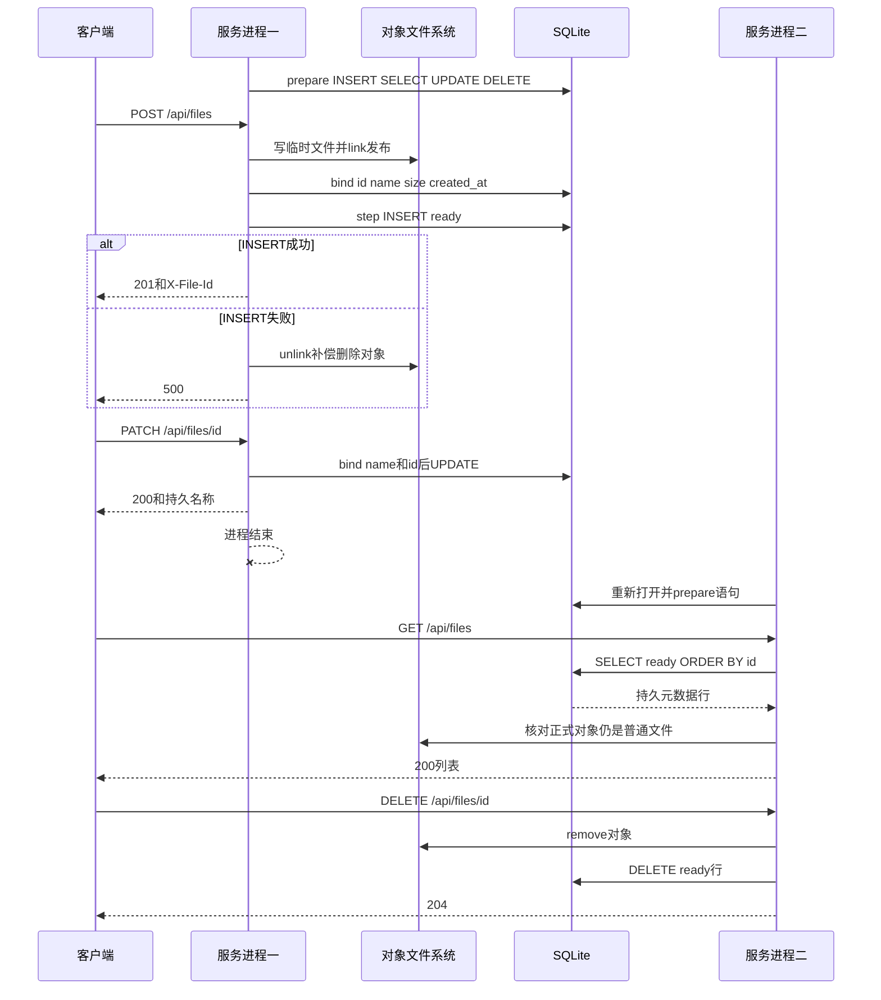

# 第二十三天 预编译语句与files元数据持久化

## 目标

今天把第22单元建立的files表真正接入生产业务 上传发布后写入ready元数据 列表 详情 改名和删除改为读写SQLite 显示名称在服务重启后仍然保留

所有文件ID和显示名称通过sqlite3_bind系列接口绑定 不把用户文本拼接到SQL中 服务启动时只准备一次五条语句 后续请求重复reset bind step

本单元保持HTTP JSON字段为id name size created_at已经持久化但暂不公开 第24单元再加入分页和稳定游标

## 持久元数据交互

图的类型 Sequence Diagram

选择这种图是因为今天的核心是HTTP请求 文件系统操作 SQLite语句和服务重启之间的真实先后顺序 时序图能直接表达提交点和仍存在的跨资源间隙



图中link和INSERT不是一个原子事务 INSERT失败时会补偿unlink 但进程若恰好在两者之间终止仍可能留下孤立对象 DELETE也存在文件已删除而数据库行尚未删除的窗口 第25至27单元继续用状态和恢复解决

## 预编译语句接口

- sqlite3_prepare_v2把SQL文本编译为sqlite3_stmt 返回SQLITE_OK表示语句可用
- sqlite3_bind_text按从1开始的参数编号绑定文本 SQLITE_TRANSIENT要求SQLite立即复制参数 调用者字符串随后可销毁
- sqlite3_bind_int64绑定size和created_at 避免数字转成SQL字符串
- sqlite3_step执行语句 SELECT逐行返回SQLITE_ROW 完成返回SQLITE_DONE
- sqlite3_column_text返回借用指针 只在下一次step reset或finalize前有效 实现立即复制到std::string
- sqlite3_reset让语句回到可执行起点 sqlite3_clear_bindings清除上次参数 两者都需要
- sqlite3_finalize释放语句 FileMetadataStore析构时先释放所有语句 MetadataDatabase随后关闭连接

## 完整src/file_metadata_store.h

```cpp
#pragma once

// ===== DAY 23 ADDED BEGIN 使用预编译语句持久化文件元数据 =====
#include <sqlite3.h>

#include <cstdint>
#include <limits>
#include <string>
#include <string_view>
#include <utility>
#include <vector>

struct FileMetadata
{
    std::string id;
    std::string name;
    std::uint64_t size = 0;
    std::int64_t created_at = 0;
};

enum class MetadataResult
{
    Ok,
    NotFound,
    Conflict,
    Error
};

class FileMetadataStore
{
public:
    explicit FileMetadataStore(sqlite3* database) noexcept
        : database_(database)
    {
    }

    FileMetadataStore(const FileMetadataStore&) = delete;
    FileMetadataStore& operator=(const FileMetadataStore&) = delete;

    ~FileMetadataStore() noexcept
    {
        sqlite3_finalize(create_);
        sqlite3_finalize(list_);
        sqlite3_finalize(find_);
        sqlite3_finalize(rename_);
        sqlite3_finalize(erase_);
    }

    bool prepare()
    {
        if (database_ == nullptr)
        {
            remember_error("prepare file metadata statements", SQLITE_MISUSE,
                           "database connection is null");
            return false;
        }
        if (prepared_)
        {
            remember_error("prepare file metadata statements", SQLITE_MISUSE,
                           "statements are already prepared");
            return false;
        }

        if (!prepare_statement(create_,
                "INSERT INTO files(id, name, size, state, created_at) "
                "VALUES(?1, ?2, ?3, 'ready', ?4);", "prepare create file") ||
            !prepare_statement(list_,
                "SELECT id, name, size, created_at FROM files "
                "WHERE state = 'ready' ORDER BY id;", "prepare list files") ||
            !prepare_statement(find_,
                "SELECT id, name, size, created_at FROM files "
                "WHERE id = ?1 AND state = 'ready';", "prepare find file") ||
            !prepare_statement(rename_,
                "UPDATE files SET name = ?1 WHERE id = ?2 AND state = 'ready';",
                "prepare rename file") ||
            !prepare_statement(erase_,
                "DELETE FROM files WHERE id = ?1 AND state = 'ready';",
                "prepare erase file"))
            return false;

        prepared_ = true;
        clear_error();
        return true;
    }

    MetadataResult create_ready(std::string_view id, std::string_view name,
                                std::uint64_t size, std::int64_t created_at)
    {
        if (!start_statement(create_, "create file metadata"))
            return MetadataResult::Error;
        StatementReset reset(create_);
        if (size > static_cast<std::uint64_t>(std::numeric_limits<sqlite3_int64>::max()) ||
            created_at < 0)
        {
            remember_error("create file metadata", SQLITE_TOOBIG,
                           "size or creation time is outside SQLite INTEGER range");
            return MetadataResult::Error;
        }
        if (!bind_text(create_, 1, id, "bind file id") ||
            !bind_text(create_, 2, name, "bind file name") ||
            !bind_integer(create_, 3, static_cast<sqlite3_int64>(size), "bind file size") ||
            !bind_integer(create_, 4, static_cast<sqlite3_int64>(created_at),
                          "bind file creation time"))
            return MetadataResult::Error;

        const int result = sqlite3_step(create_);
        if (result == SQLITE_DONE)
        {
            clear_error();
            return MetadataResult::Ok;
        }
        remember_error("create file metadata", result, sqlite3_errmsg(database_));
        return primary_code(result) == SQLITE_CONSTRAINT
            ? MetadataResult::Conflict : MetadataResult::Error;
    }

    MetadataResult list_ready(std::vector<FileMetadata>& output)
    {
        output.clear();
        if (!start_statement(list_, "list file metadata"))
            return MetadataResult::Error;
        StatementReset reset(list_);
        while (true)
        {
            const int result = sqlite3_step(list_);
            if (result == SQLITE_DONE)
            {
                clear_error();
                return MetadataResult::Ok;
            }
            if (result != SQLITE_ROW)
            {
                remember_error("list file metadata", result, sqlite3_errmsg(database_));
                output.clear();
                return MetadataResult::Error;
            }
            if (output.size() == 1000)
            {
                remember_error("list file metadata", SQLITE_TOOBIG,
                               "catalog exceeds 1000 ready files");
                output.clear();
                return MetadataResult::Error;
            }
            FileMetadata file;
            if (!read_row(list_, file, "read listed file"))
            {
                output.clear();
                return MetadataResult::Error;
            }
            output.push_back(std::move(file));
        }
    }

    MetadataResult find_ready(std::string_view id, FileMetadata& output)
    {
        if (!start_statement(find_, "find file metadata"))
            return MetadataResult::Error;
        StatementReset reset(find_);
        if (!bind_text(find_, 1, id, "bind searched file id"))
            return MetadataResult::Error;

        const int result = sqlite3_step(find_);
        if (result == SQLITE_DONE)
        {
            clear_error();
            return MetadataResult::NotFound;
        }
        if (result != SQLITE_ROW)
        {
            remember_error("find file metadata", result, sqlite3_errmsg(database_));
            return MetadataResult::Error;
        }
        if (!read_row(find_, output, "read found file"))
            return MetadataResult::Error;
        const int trailing = sqlite3_step(find_);
        if (trailing != SQLITE_DONE)
        {
            remember_error("find file metadata", trailing,
                           trailing == SQLITE_ROW ? "file id returned multiple rows"
                                                  : sqlite3_errmsg(database_));
            return MetadataResult::Error;
        }
        clear_error();
        return MetadataResult::Ok;
    }

    MetadataResult rename_ready(std::string_view id, std::string_view name)
    {
        if (!start_statement(rename_, "rename file metadata"))
            return MetadataResult::Error;
        StatementReset reset(rename_);
        if (!bind_text(rename_, 1, name, "bind new file name") ||
            !bind_text(rename_, 2, id, "bind renamed file id"))
            return MetadataResult::Error;

        const int result = sqlite3_step(rename_);
        if (result != SQLITE_DONE)
        {
            remember_error("rename file metadata", result, sqlite3_errmsg(database_));
            return primary_code(result) == SQLITE_CONSTRAINT
                ? MetadataResult::Conflict : MetadataResult::Error;
        }
        clear_error();
        return sqlite3_changes(database_) == 0
            ? MetadataResult::NotFound : MetadataResult::Ok;
    }

    MetadataResult erase_ready(std::string_view id)
    {
        if (!start_statement(erase_, "erase file metadata"))
            return MetadataResult::Error;
        StatementReset reset(erase_);
        if (!bind_text(erase_, 1, id, "bind erased file id"))
            return MetadataResult::Error;

        const int result = sqlite3_step(erase_);
        if (result != SQLITE_DONE)
        {
            remember_error("erase file metadata", result, sqlite3_errmsg(database_));
            return MetadataResult::Error;
        }
        clear_error();
        return sqlite3_changes(database_) == 0
            ? MetadataResult::NotFound : MetadataResult::Ok;
    }

    int error_code() const noexcept
    {
        return error_code_;
    }

    const std::string& error_message() const noexcept
    {
        return error_message_;
    }

private:
    class StatementReset
    {
    public:
        explicit StatementReset(sqlite3_stmt* statement) noexcept
            : statement_(statement)
        {
        }

        ~StatementReset() noexcept
        {
            sqlite3_reset(statement_);
            sqlite3_clear_bindings(statement_);
        }

    private:
        sqlite3_stmt* statement_;
    };

    static int primary_code(int code) noexcept
    {
        return code & 0xff;
    }

    bool prepare_statement(sqlite3_stmt*& statement, const char* sql,
                           const char* operation)
    {
        const int result = sqlite3_prepare_v2(database_, sql, -1, &statement, nullptr);
        if (result == SQLITE_OK) return true;
        remember_error(operation, result, sqlite3_errmsg(database_));
        return false;
    }

    bool start_statement(sqlite3_stmt* statement, const char* operation)
    {
        if (!prepared_ || statement == nullptr)
        {
            remember_error(operation, SQLITE_MISUSE, "statements are not prepared");
            return false;
        }
        sqlite3_reset(statement);
        const int result = sqlite3_clear_bindings(statement);
        if (result == SQLITE_OK) return true;
        remember_error(operation, result, sqlite3_errmsg(database_));
        return false;
    }

    bool bind_text(sqlite3_stmt* statement, int index, std::string_view value,
                   const char* operation)
    {
        if (value.size() > static_cast<std::size_t>(std::numeric_limits<int>::max()))
        {
            remember_error(operation, SQLITE_TOOBIG, "text value is too large");
            return false;
        }
        const int result = sqlite3_bind_text(
            statement, index, value.data(), static_cast<int>(value.size()), SQLITE_TRANSIENT);
        if (result == SQLITE_OK) return true;
        remember_error(operation, result, sqlite3_errmsg(database_));
        return false;
    }

    bool bind_integer(sqlite3_stmt* statement, int index, sqlite3_int64 value,
                      const char* operation)
    {
        const int result = sqlite3_bind_int64(statement, index, value);
        if (result == SQLITE_OK) return true;
        remember_error(operation, result, sqlite3_errmsg(database_));
        return false;
    }

    bool read_row(sqlite3_stmt* statement, FileMetadata& output,
                  const char* operation)
    {
        if (sqlite3_column_type(statement, 0) != SQLITE_TEXT ||
            sqlite3_column_type(statement, 1) != SQLITE_TEXT ||
            sqlite3_column_type(statement, 2) != SQLITE_INTEGER ||
            sqlite3_column_type(statement, 3) != SQLITE_INTEGER)
        {
            remember_error(operation, SQLITE_MISMATCH, "metadata column type mismatch");
            return false;
        }
        const auto* id = sqlite3_column_text(statement, 0);
        const auto* name = sqlite3_column_text(statement, 1);
        const int id_size = sqlite3_column_bytes(statement, 0);
        const int name_size = sqlite3_column_bytes(statement, 1);
        const sqlite3_int64 size = sqlite3_column_int64(statement, 2);
        const sqlite3_int64 created_at = sqlite3_column_int64(statement, 3);
        if (id == nullptr || name == nullptr || id_size <= 0 || name_size <= 0 ||
            size < 0 || created_at < 0)
        {
            remember_error(operation, SQLITE_CORRUPT, "invalid metadata row");
            return false;
        }
        output.id.assign(reinterpret_cast<const char*>(id), static_cast<std::size_t>(id_size));
        output.name.assign(reinterpret_cast<const char*>(name),
                           static_cast<std::size_t>(name_size));
        output.size = static_cast<std::uint64_t>(size);
        output.created_at = static_cast<std::int64_t>(created_at);
        return true;
    }

    void remember_error(const char* operation, int code, const char* detail)
    {
        error_code_ = code;
        error_message_ = operation;
        error_message_ += ": ";
        error_message_ += detail == nullptr ? sqlite3_errstr(code) : detail;
    }

    void clear_error()
    {
        error_code_ = SQLITE_OK;
        error_message_.clear();
    }

    sqlite3* database_ = nullptr;
    sqlite3_stmt* create_ = nullptr;
    sqlite3_stmt* list_ = nullptr;
    sqlite3_stmt* find_ = nullptr;
    sqlite3_stmt* rename_ = nullptr;
    sqlite3_stmt* erase_ = nullptr;
    bool prepared_ = false;
    int error_code_ = SQLITE_OK;
    std::string error_message_;
};
// ===== DAY 23 ADDED END =====

```

## 完整src/file_catalog.h

```cpp
#pragma once

#include "http_response.h"
#include "file_metadata_store.h"
#include "object_path.h"

#include <nlohmann/json.hpp>
#include <filesystem>
#include <iostream>
#include <stdexcept>
#include <string>
#include <string_view>
#include <utility>
#include <vector>

// ===== DAY 23 DELETED 删除进程内显示名称map 改由SQLite持久化 =====
// ===== DAY 23 MODIFIED BEGIN 保留名称规则供数据库写入前校验 =====
inline bool valid_display_name(std::string_view name)
{
    if (name.empty() || name.size() > 255 || name == "." || name == ".." ||
        name.find_first_not_of(' ') == std::string_view::npos) return false;
    for (unsigned char ch : name)
        if (ch < 32 || ch == 127 || ch == '/' || ch == '\\') return false;
    return true;
}
// ===== DAY 23 MODIFIED END =====

inline nlohmann::json make_file_json(std::string_view id, std::string_view name,
                                     std::uintmax_t size)
{
    return {{"id", std::string(id)}, {"name", std::string(name)}, {"size", size}};
}

// ===== DAY 23 DELETED 删除磁盘扫描和默认名称推导 改读ready元数据 =====
// ===== DAY 23 ADDED BEGIN 将持久元数据转换为JSON并核对对象文件 =====
inline nlohmann::json make_file_json(const FileMetadata& file)
{
    return make_file_json(file.id, file.name, file.size);
}

inline bool stored_object_is_regular(std::string_view id)
{
    namespace fs = std::filesystem;
    std::string path;
    if (!make_object_path(id, path))
        throw std::runtime_error("metadata contains invalid file ID");
    std::error_code error;
    const auto status = fs::symlink_status(path, error);
    if (error == std::errc::no_such_file_or_directory) return false;
    if (error) throw fs::filesystem_error("inspect object", path, error);
    return fs::is_regular_file(status);
}

inline nlohmann::json list_file_objects(FileMetadataStore& store)
{
    namespace fs = std::filesystem;
    std::error_code error;
    const auto status = fs::symlink_status("data/objects", error);
    if (error) throw fs::filesystem_error("inspect object directory", "data/objects", error);
    if (!fs::is_directory(status))
        throw std::runtime_error("object directory is not a directory");

    std::vector<FileMetadata> metadata;
    if (store.list_ready(metadata) != MetadataResult::Ok)
        throw std::runtime_error(store.error_message());
    auto files = nlohmann::json::array();
    for (const auto& file : metadata)
    {
        if (!stored_object_is_regular(file.id))
            throw std::runtime_error("ready metadata object is missing or not regular");
        files.push_back(make_file_json(file));
    }
    return {{"files", std::move(files)}};
}
// ===== DAY 23 ADDED END =====

inline bool is_file_catalog_request(const RequestLine& line)
{
    const std::string_view target(line.target);
    const auto path = target.substr(0, target.find('?'));
    if (path == "/api/files") return line.method != "POST";
    constexpr std::string_view prefix = "/api/files/";
    return path.substr(0, prefix.size()) == prefix &&
           path.find('/', prefix.size()) == std::string_view::npos;
}

// ===== DAY 23 MODIFIED BEGIN 目录接口统一读写SQLite元数据 =====
inline HttpResponse file_catalog_response(const RequestParser& request,
                                          FileMetadataStore& store)
{
    const auto& line = request.line();
    const std::string_view target(line.target);
    const auto path = target.substr(0, target.find('?'));
    // ===== DAY 19 MODIFIED BEGIN 列表只读 详情允许修改和删除 =====
    const bool listing = path == "/api/files";
    const bool changing = line.method == "PATCH" || line.method == "DELETE";
    if (line.method != "GET" && line.method != "HEAD" && !(changing && !listing))
    {
        const bool known = changing || line.method == "POST";
        return error_response(known ? 405 : 501,
            listing ? "GET, HEAD, POST" : "GET, HEAD, PATCH, DELETE");
    }
    if (line.method != "PATCH" && request.body_size() != 0) return error_response(400);
    // ===== DAY 19 MODIFIED END =====
    try
    {
        nlohmann::json document;
        if (listing)
            document = list_file_objects(store);
        else
        {
            const auto id = path.substr(std::string_view("/api/files/").size());
            std::string object_path;
            if (!make_object_path(id, object_path)) return error_response(400);
            FileMetadata file;
            const auto found = store.find_ready(id, file);
            if (found == MetadataResult::NotFound)
                return {404, "Not Found", "application/json",
                    R"({"error":{"code":"not_found","message":"File not found"}})"};
            if (found != MetadataResult::Ok)
                throw std::runtime_error(store.error_message());
            if (!stored_object_is_regular(id))
                throw std::runtime_error("ready metadata object is missing or not regular");
            document = make_file_json(file);
            if (line.method == "PATCH")
            {
                const auto patch = nlohmann::json::parse(request.body(), nullptr, false);
                if (!patch.is_object() || patch.size() != 1 || patch.find("name") == patch.end() ||
                    !patch.at("name").is_string()) return error_response(400);
                const std::string name = patch.at("name").get<std::string>();
                if (!valid_display_name(name)) return error_response(400);
                const auto renamed = store.rename_ready(id, name);
                if (renamed == MetadataResult::NotFound)
                    return {404, "Not Found", "application/json",
                        R"({"error":{"code":"not_found","message":"File not found"}})"};
                if (renamed != MetadataResult::Ok)
                    throw std::runtime_error(store.error_message());
                file.name = name;
                return {200, "OK", "application/json", make_file_json(file).dump()};
            }
            if (line.method == "DELETE")
            {
                if (!std::filesystem::remove(object_path)) return error_response(404);
                const auto erased = store.erase_ready(id);
                if (erased == MetadataResult::NotFound)
                    throw std::runtime_error("ready metadata disappeared during delete");
                if (erased != MetadataResult::Ok)
                    throw std::runtime_error(store.error_message());
                return {204, "No Content", "", ""};
            }
        }
        return {200, "OK", "application/json", document.dump()};
    }
    catch (const std::exception& error)
    {
        std::cerr << "file catalog failed: " << error.what() << '\n';
        return error_response(500);
    }
}
// ===== DAY 23 MODIFIED END =====

```

## 完整src/temp_upload.h

```cpp
#pragma once

// ===== DAY 15 ADDED BEGIN 使用统一对象路径接口 =====
#include "object_path.h"
// ===== DAY 15 ADDED END =====
#include <cerrno>
#include <cstdio>
#include <cstdlib>
#include <string_view>
#include <unistd.h>
#include <cstring>
#include <string>
#include <utility>

class TempUpload
{
public:
    TempUpload() = default;
    TempUpload(const TempUpload&) = delete;
    TempUpload& operator=(const TempUpload&) = delete;

    ~TempUpload() noexcept
    {
        const int saved = errno;
        if (fd_ >= 0 && ::close(fd_) == -1) std::perror("close temporary file");
        if (created_ && ::unlink(path_) == -1 && errno != ENOENT)
            std::perror("unlink temporary file");
        errno = saved;
    }

    bool append(std::string_view data)
    {
        if (error_ != 0) return false;
        if (!id_.empty()) return fail(EINVAL);
        if (!created_)
        {
            fd_ = ::mkstemp(path_);
            if (fd_ == -1) return fail(errno);
            created_ = true;
        }
        if (fd_ < 0) return fail(EBADF);
        std::size_t written = 0;
        while (written < data.size())
        {
            const ssize_t n = ::write(fd_, data.data() + written, data.size() - written);
            if (n == -1)
            {
                if (errno == EINTR) continue;
                return fail(errno);
            }
            if (n == 0) return fail(EIO);
            written += static_cast<std::size_t>(n);
            written_ += static_cast<std::size_t>(n);
        }
        return true;
    }

    bool close_file()
    {
        if (fd_ >= 0)
        {
            const int raw = fd_;
            fd_ = -1;
            if (::close(raw) == -1) return fail(errno);
        }
        return error_ == 0;
    }

    int error() const noexcept { return error_; }
    const char* path() const noexcept { return created_ ? path_ : ""; }

    bool publish(std::size_t expected)
    {
        if (error_ != 0) return false;
        if (!created_ || !id_.empty() || written_ != expected) return fail(EINVAL);
        if (!close_file()) return false;
        std::string candidate(std::strrchr(path_, '/') + 1);
        // ===== DAY 15 DELETED 删除未经校验的对象路径直接拼接 =====
        // ===== DAY 15 MODIFIED BEGIN 校验服务器生成的ID后构造正式路径 =====
        std::string destination;
        if (!make_object_path(candidate, destination)) return fail(EINVAL);
        // ===== DAY 15 MODIFIED END =====
        if (::link(path_, destination.c_str()) == -1) return fail(errno);
        id_ = std::move(candidate);
        if (::unlink(path_) == 0)
            created_ = false;
        else
            std::perror("unlink published temporary name");
        return true;
    }

    // ===== DAY 23 ADDED BEGIN 元数据提交失败时补偿删除已发布对象 =====
    bool discard_published()
    {
        if (id_.empty()) return fail(EINVAL);
        std::string destination;
        if (!make_object_path(id_, destination)) return fail(EINVAL);
        if (::unlink(destination.c_str()) == -1) return fail(errno);
        id_.clear();
        return true;
    }
    // ===== DAY 23 ADDED END =====

    const std::string& id() const noexcept { return id_; }

private:
    bool fail(int error) noexcept
    {
        error_ = error;
        return false;
    }

    char path_[sizeof("data/uploads/upload-XXXXXX")] = "data/uploads/upload-XXXXXX";
    int fd_ = -1;
    int error_ = 0;
    bool created_ = false;
    std::size_t written_ = 0;
    std::string id_;
};

```

## 完整src/main.cpp

```cpp
#include "unique_fd.h"
#include "socket_io.h"
#include "http_response.h"
#include "temp_upload.h"
#include "file_download.h"
// ===== DAY 18 ADDED BEGIN 接入JSON文件列表与详情 =====
#include "file_catalog.h"
// ===== DAY 18 ADDED END =====
// ===== DAY 22 ADDED BEGIN 接入SQLite元数据连接 =====
#include "metadata_database.h"
// ===== DAY 22 ADDED END =====
// ===== DAY 23 ADDED BEGIN 接入持久文件元数据仓库 =====
#include "file_metadata_store.h"
// ===== DAY 23 ADDED END =====

#include <algorithm>
#include <arpa/inet.h>
#include <cerrno>
#include <chrono>
#include <cstddef>
#include <cstdint>
#include <cstring>
#include <iostream>
#include <netinet/in.h>
#include <string>
#include <sys/socket.h>

bool send_response(int client_fd, const HttpResponse& response, bool head_only)
{
    const std::string wire = build_response(response, head_only);
    std::cout << "response status=" << response.status << '\n';
    return send_all(client_fd, wire.data(), wire.size());
}

bool is_upload(const RequestLine& line)
{
    const std::string_view target(line.target);
    const auto path = target.substr(0, target.find('?'));
    return line.method == "POST" && (path == "/dev/upload" || path == "/api/files");
}

// ===== DAY 23 MODIFIED BEGIN 每个请求共享服务生命周期内的预编译语句 =====
bool handle_client(int client_fd, FileMetadataStore& metadata)
{
    TempUpload upload;
    RequestParser parser([&upload](const RequestLine& line, std::string_view chunk)
    {
        if (!is_upload(line)) return BodyAction::Buffer;
        return upload.append(chunk) ? BodyAction::Written : BodyAction::Failed;
    });
    ParseState state = ParseState::NeedMore;
    bool received_any = false;
    char buffer[1024];

    while (state == ParseState::NeedMore)
    {
        const ssize_t n = ::recv(client_fd, buffer, sizeof(buffer), 0);
        if (n == -1)
        {
            const int error = errno;
            if (error == EINTR)
            {
                continue;
            }
            print_system_error("recv", error);
            return false;
        }
        if (n == 0)
        {
            if (!received_any) return false;
            parser.finish();
            std::cerr << "peer closed before request completed\n";
            return send_response(client_fd, parser_error_response(parser.error()),
                                 parser.line().method == "HEAD");
        }

        received_any = true;
        const std::size_t count = static_cast<std::size_t>(n);
        const auto result = parser.feed(std::string_view(buffer, count));
        state = result.state;
        if (state == ParseState::Error)
        {
            std::cerr << "invalid or unsupported request or size limit exceeded\n";
            if (parser.error() == RequestError::BodyWriteFailed)
                print_system_error("temporary upload", upload.error());
            return send_response(client_fd, parser_error_response(parser.error()),
                                 parser.line().method == "HEAD");
        }
        if (result.consumed < count)
        {
            std::cout << "trailing bytes ignored before connection close\n";
        }
    }

    const RequestLine& line = parser.line();
    std::cout << "method=" << line.method
              << " target=" << line.target
              << " version=" << line.version << '\n';
    std::string_view file_id;
    if (match_file_content(line.target, file_id))
        return send_file_content(client_fd, parser, file_id);
    // ===== DAY 18 ADDED BEGIN POST上传与GET列表分别分派 =====
    if (is_file_catalog_request(line))
        return send_response(client_fd, file_catalog_response(parser, metadata),
                             line.method == "HEAD");
    // ===== DAY 18 ADDED END =====
    if (is_upload(line))
    {
        const std::string_view target(line.target);
        const bool permanent = target.substr(0, target.find('?')) == "/api/files";
        const bool stored = permanent
            ? upload.publish(parser.body_size()) : upload.close_file();
        if (!stored)
        {
            print_system_error("finalize upload", upload.error());
            return send_response(client_fd, error_response(500), false);
        }
        std::cout << "temporary bytes=" << parser.body_size()
                  << " buffered bytes=" << parser.body().size() << '\n';
        if (permanent)
        {
            const auto seconds = std::chrono::duration_cast<std::chrono::seconds>(
                std::chrono::system_clock::now().time_since_epoch()).count();
            const std::string default_name = upload.id() + ".bin";
            const auto result = seconds < 0
                ? MetadataResult::Error
                : metadata.create_ready(upload.id(), default_name, parser.body_size(),
                                        static_cast<std::int64_t>(seconds));
            if (result != MetadataResult::Ok)
            {
                std::cerr << "create file metadata failed: "
                          << (seconds < 0 ? "system clock is before Unix epoch"
                                          : metadata.error_message()) << '\n';
                if (!upload.discard_published())
                    print_system_error("discard published object", upload.error());
                return send_response(client_fd, error_response(500), false);
            }
            std::cout << "published id=" << upload.id() << '\n';
        }
    }
    return send_response(client_fd, route_request(parser, upload.id()), line.method == "HEAD");
}
// ===== DAY 23 MODIFIED END =====

int main()
{
    constexpr std::uint16_t port = 8080;
    constexpr int backlog = 16;

    // ===== DAY 22 ADDED BEGIN 监听前完成数据库打开和schema初始化 =====
    MetadataDatabase metadata;
    if (!metadata.open("data/netdisk.db") || !metadata.initialize_schema())
    {
        std::cerr << "metadata database failed: " << metadata.error_message() << '\n';
        return 1;
    }
    std::cout << "metadata database ready path=data/netdisk.db schema=1\n";
    // ===== DAY 22 ADDED END =====

    // ===== DAY 23 ADDED BEGIN 启动时一次准备全部文件元数据语句 =====
    FileMetadataStore file_metadata(metadata.get());
    if (!file_metadata.prepare())
    {
        std::cerr << "file metadata statements failed: "
                  << file_metadata.error_message() << '\n';
        return 1;
    }
    // ===== DAY 23 ADDED END =====

    const int raw_fd = ::socket(AF_INET, SOCK_STREAM | SOCK_CLOEXEC, 0);
    if (raw_fd == -1)
    {
        const int error = errno;
        print_system_error("socket", error);
        return 1;
    }
    UniqueFd listener(raw_fd);

    const int reuse_address = 1;
    if (::setsockopt(listener.get(), SOL_SOCKET, SO_REUSEADDR,
                     &reuse_address, sizeof(reuse_address)) == -1)
    {
        const int error = errno;
        print_system_error("setsockopt", error);
        return 1;
    }

    sockaddr_in address{};
    address.sin_family = AF_INET;
    address.sin_port = htons(port);
    address.sin_addr.s_addr = htonl(INADDR_LOOPBACK);

    if (::bind(listener.get(),
               reinterpret_cast<const sockaddr*>(&address),
               sizeof(address)) == -1)
    {
        const int error = errno;
        print_system_error("bind", error);
        return 1;
    }
    if (::listen(listener.get(), backlog) == -1)
    {
        const int error = errno;
        print_system_error("listen", error);
        return 1;
    }

    std::cout << "listening on 127.0.0.1:" << port
              << " fd=" << listener.get() << std::endl;

    while (true)
    {
        const int accepted_fd =
            ::accept(listener.get(), nullptr, nullptr);
        if (accepted_fd == -1)
        {
            const int error = errno;
            if (error == EINTR || error == ECONNABORTED)
            {
                continue;
            }
            print_system_error("accept", error);
            return 1;
        }

        UniqueFd client(accepted_fd);
        std::cout << "accepted fd=" << client.get() << std::endl;
        // ===== DAY 23 MODIFIED BEGIN 将持久元数据仓库传给请求处理 =====
        const bool ok = handle_client(client.get(), file_metadata);
        // ===== DAY 23 MODIFIED END =====
        std::cout << (ok ? "response sent" : "connection failed")
                  << std::endl;
    }
}

```

## 完整tests/day18_file_catalog.cpp

```cpp
// ===== DAY 18 ADDED BEGIN 验证JSON转义与真实磁盘目录查询 =====
#include "file_catalog.h"
// ===== DAY 23 ADDED BEGIN 为目录测试建立真实SQLite元数据 =====
#include "metadata_database.h"
// ===== DAY 23 ADDED END =====

#include <chrono>
#include <fstream>

void require(bool ok, const char* message)
{
    if (!ok) throw std::runtime_error(message);
}

struct TestDirectory
{
    std::filesystem::path previous = std::filesystem::current_path();
    std::filesystem::path root = previous / ("day18-test-" + std::to_string(
        std::chrono::steady_clock::now().time_since_epoch().count()));

    TestDirectory()
    {
        require(std::filesystem::create_directory(root), "create isolated directory");
        std::filesystem::current_path(root);
    }

    ~TestDirectory()
    {
        std::error_code error;
        std::filesystem::current_path(previous, error);
        std::filesystem::remove_all(root, error);
    }
};

int main()
{
    try
    {
        const std::string special = u8"笔记\"反斜杠\\换行\n.txt";
        const auto original = make_file_json("upload-Abc123", special, 3);
        const std::string text = original.dump();
        const auto parsed = nlohmann::json::parse(text);
        require(parsed.at("name").get<std::string>() == special &&
                parsed.at("size").is_number_unsigned(), "JSON escaping or numeric type");
        require(text.find('\n') == std::string::npos &&
                text.find("\\n") != std::string::npos, "newline was not escaped");
        TestDirectory directory;
        std::filesystem::create_directories("data/objects");
        // ===== DAY 23 ADDED BEGIN 初始化持久元数据仓库 =====
        MetadataDatabase database;
        require(database.open("data/netdisk.db") && database.initialize_schema(),
                "initialize metadata database");
        FileMetadataStore store(database.get());
        require(store.prepare(), "prepare metadata statements");
        require(list_file_objects(store).at("files").empty(), "empty list");
        // ===== DAY 23 ADDED END =====
        {
            std::ofstream file("data/objects/upload-Abc123", std::ios::binary);
            file.write("A\0B", 3);
            require(file.good(), "write fixture");
        }
        // ===== DAY 23 ADDED BEGIN 只有ready数据库记录进入目录 =====
        require(store.create_ready("upload-Abc123", "upload-Abc123.bin", 3, 1) ==
                MetadataResult::Ok, "insert fixture metadata");
        // ===== DAY 23 ADDED END =====
        std::filesystem::create_directory("data/objects/upload-Dir001");
        const auto files = list_file_objects(store).at("files");
        require(files.size() == 1 && files.at(0).at("size") == 3 &&
                files.at(0).at("name") == "upload-Abc123.bin", "list fields or file type");
        RequestParser request;
        require(request.feed("GET /api/files/upload-Abc123 HTTP/1.1\r\nHost: localhost\r\n\r\n")
                    .state == ParseState::Done, "parse detail request");
        // ===== DAY 23 MODIFIED BEGIN 详情通过SQLite元数据查询 =====
        const auto response = file_catalog_response(request, store);
        // ===== DAY 23 MODIFIED END =====
        require(response.status == 200 && nlohmann::json::parse(response.body) == files.at(0),
                "detail differs from list");
        std::cout << "PASS: file catalog JSON escaping, disk list and detail\n";
    }
    catch (const std::exception& error)
    {
        std::cerr << "FAIL: " << error.what() << '\n';
        return 1;
    }
}
// ===== DAY 18 ADDED END =====

```

## 完整tests/day19_file_mutation.cpp

```cpp
// ===== DAY 19 ADDED BEGIN 验证改名内容不变与删除204边界 =====
#include "file_catalog.h"
// ===== DAY 23 ADDED BEGIN 为改名删除测试建立真实SQLite元数据 =====
#include "metadata_database.h"
// ===== DAY 23 ADDED END =====

#include <chrono>
#include <fstream>
#include <iterator>

void require(bool ok, const char* message)
{
    if (!ok) throw std::runtime_error(message);
}

struct TestDirectory
{
    std::filesystem::path previous = std::filesystem::current_path();
    std::filesystem::path root = previous / ("day19-test-" + std::to_string(
        std::chrono::steady_clock::now().time_since_epoch().count()));

    TestDirectory()
    {
        require(std::filesystem::create_directory(root), "create isolated directory");
        std::filesystem::current_path(root);
    }

    ~TestDirectory()
    {
        std::error_code error;
        std::filesystem::current_path(previous, error);
        std::filesystem::remove_all(root, error);
    }
};

// ===== DAY 23 MODIFIED BEGIN 请求使用持久元数据仓库 =====
HttpResponse request(FileMetadataStore& store, std::string_view method,
                     const std::string& body = "")
{
    RequestParser parser;
    const std::string wire = std::string(method) +
        " /api/files/upload-Abc123 HTTP/1.1\r\nHost: localhost\r\nContent-Length: " +
        std::to_string(body.size()) + "\r\n\r\n" + body;
    require(parser.feed(wire).state == ParseState::Done, "parse mutation request");
    return file_catalog_response(parser, store);
}
// ===== DAY 23 MODIFIED END =====

int main()
{
    try
    {
        TestDirectory directory;
        std::filesystem::create_directories("data/objects");
        const std::string path = "data/objects/upload-Abc123";
        {
            std::ofstream file(path, std::ios::binary);
            file.write("A\0B", 3);
            require(file.good(), "write fixture");
        }
        // ===== DAY 23 ADDED BEGIN 插入ready记录并用含SQL文本的名称验证参数绑定 =====
        MetadataDatabase database;
        require(database.open("data/netdisk.db") && database.initialize_schema(),
                "initialize metadata database");
        FileMetadataStore store(database.get());
        require(store.prepare(), "prepare metadata statements");
        require(store.create_ready("upload-Abc123", "upload-Abc123.bin", 3, 1) ==
                MetadataResult::Ok, "insert fixture metadata");
        const std::string name = u8"笔记' SET state='deleting' -- 新版.txt";
        // ===== DAY 23 ADDED END =====
        const auto renamed = request(
            store, "PATCH", nlohmann::json{{"name", name}}.dump());
        require(renamed.status == 200 && nlohmann::json::parse(renamed.body).at("name") == name,
                "rename result");
        require(list_file_objects(store).at("files").at(0).at("name") == name, "list name");
        {
            std::ifstream file(path, std::ios::binary);
            const std::string bytes{std::istreambuf_iterator<char>(file), {}};
            require(bytes == std::string("A\0B", 3), "rename changed bytes");
        }
        const std::string bad[] = {"", "..", "../escape", "bad\\name", "bad\nname",
                                   std::string(256, 'x')};
        for (const auto& value : bad)
            require(request(store, "PATCH", nlohmann::json{{"name", value}}.dump()).status == 400,
                    "invalid name accepted");
        require(request(store, "PATCH", "{").status == 400 &&
                request(store, "PATCH", R"({"name":123})").status == 400,
                "invalid JSON schema");
        require(nlohmann::json::parse(request(store, "GET").body).at("name") == name,
                "failed rename changed name");
        const auto removed = request(store, "DELETE");
        require(removed.status == 204 && build_response(removed) ==
                "HTTP/1.1 204 No Content\r\nConnection: close\r\n\r\n", "204 framing");
        require(!std::filesystem::exists(path) &&
                list_file_objects(store).at("files").empty(), "delete left object or metadata");
        require(request(store, "DELETE").status == 404 &&
                request(store, "GET").status == 404,
                "deleted object remained visible");
        std::cout << "PASS: rename isolation, invalid input and deletion semantics\n";
    }
    catch (const std::exception& error)
    {
        std::cerr << "FAIL: " << error.what() << '\n';
        return 1;
    }
}
// ===== DAY 19 ADDED END =====

```

## 完整CMakeLists.txt

```cmake
cmake_minimum_required(VERSION 3.16)

project(netdisk LANGUAGES CXX)

add_executable(netdisk src/main.cpp)
set(NETDISK_TARGETS netdisk)

# ===== DAY 18 ADDED BEGIN 查找并接入系统JSON依赖 =====
find_package(nlohmann_json 3.2.0 REQUIRED)
target_link_libraries(netdisk PRIVATE nlohmann_json::nlohmann_json)
# ===== DAY 18 ADDED END =====

# ===== DAY 22 ADDED BEGIN 查找并链接SQLite元数据依赖 =====
find_package(SQLite3 REQUIRED)
target_link_libraries(netdisk PRIVATE SQLite::SQLite3)
# ===== DAY 22 ADDED END =====

include(CTest)
if(BUILD_TESTING)
    add_executable(io_tests tests/day06_io.cpp)
    target_include_directories(io_tests PRIVATE src)
    list(APPEND NETDISK_TARGETS io_tests)
    add_test(NAME io_tests COMMAND io_tests)

    add_executable(request_line_tests tests/day08_request_line.cpp)
    target_include_directories(request_line_tests PRIVATE src)
    list(APPEND NETDISK_TARGETS request_line_tests)
    add_test(NAME request_line_tests COMMAND request_line_tests)

    add_executable(request_headers_tests tests/day09_request_headers.cpp)
    target_include_directories(request_headers_tests PRIVATE src)
    list(APPEND NETDISK_TARGETS request_headers_tests)
    add_test(NAME request_headers_tests COMMAND request_headers_tests)

    add_executable(request_body_tests tests/day10_request_body.cpp)
    target_include_directories(request_body_tests PRIVATE src)
    list(APPEND NETDISK_TARGETS request_body_tests)
    add_test(NAME request_body_tests COMMAND request_body_tests)

    add_executable(http_response_tests tests/day11_http_response.cpp)
    target_include_directories(http_response_tests PRIVATE src)
    list(APPEND NETDISK_TARGETS http_response_tests)
    add_test(NAME http_response_tests COMMAND http_response_tests)

    add_executable(stream_upload_tests tests/day12_stream_upload.cpp)
    target_include_directories(stream_upload_tests PRIVATE src)
    list(APPEND NETDISK_TARGETS stream_upload_tests)
    add_test(NAME stream_upload_tests COMMAND stream_upload_tests)

    add_executable(publish_tests tests/day13_publish.cpp)
    target_include_directories(publish_tests PRIVATE src)
    list(APPEND NETDISK_TARGETS publish_tests)
    add_test(NAME publish_tests COMMAND publish_tests)

    # ===== DAY 15 ADDED BEGIN 注册ID与存储路径隔离测试 =====
    add_executable(object_path_tests tests/day15_object_path.cpp)
    target_include_directories(object_path_tests PRIVATE src)
    list(APPEND NETDISK_TARGETS object_path_tests)
    add_test(NAME object_path_tests COMMAND object_path_tests)
    # ===== DAY 15 ADDED END =====

    # ===== DAY 14 ADDED BEGIN 注册自动启动服务的上传集成测试 =====
    find_package(Python3 3.8 REQUIRED COMPONENTS Interpreter)
    add_test(NAME upload_integration_tests
        COMMAND "${Python3_EXECUTABLE}"
            "${CMAKE_CURRENT_SOURCE_DIR}/tests/day14_upload_integration.py"
            "$<TARGET_FILE:netdisk>"
    )
    set_tests_properties(upload_integration_tests PROPERTIES
        TIMEOUT 30
        RUN_SERIAL TRUE
        SKIP_RETURN_CODE 77
    )
    # ===== DAY 14 ADDED END =====

    # ===== DAY 16 ADDED BEGIN 注册下载端到端测试 =====
    add_test(NAME download_integration_tests
        COMMAND "${Python3_EXECUTABLE}"
            "${CMAKE_CURRENT_SOURCE_DIR}/tests/day16_download_integration.py"
            "$<TARGET_FILE:netdisk>"
    )
    set_tests_properties(download_integration_tests PROPERTIES
        TIMEOUT 30
        RUN_SERIAL TRUE
        SKIP_RETURN_CODE 77
    )
    # ===== DAY 16 ADDED END =====

    # ===== DAY 17 ADDED BEGIN 注册响应头单测与真实GET HEAD验证 =====
    add_executable(download_headers_tests tests/day17_download_headers.cpp)
    target_include_directories(download_headers_tests PRIVATE src)
    list(APPEND NETDISK_TARGETS download_headers_tests)
    add_test(NAME download_headers_tests COMMAND download_headers_tests)

    add_test(NAME download_headers_integration_tests
        COMMAND "${Python3_EXECUTABLE}"
            "${CMAKE_CURRENT_SOURCE_DIR}/tests/day17_download_headers.py"
            "$<TARGET_FILE:netdisk>"
    )
    set_tests_properties(download_headers_integration_tests PROPERTIES
        TIMEOUT 30
        RUN_SERIAL TRUE
        SKIP_RETURN_CODE 77
    )
    # ===== DAY 17 ADDED END =====

    # ===== DAY 18 ADDED BEGIN 注册JSON目录单测与集成测试 =====
    add_executable(file_catalog_tests tests/day18_file_catalog.cpp)
    target_include_directories(file_catalog_tests PRIVATE src)
    # ===== DAY 23 MODIFIED BEGIN 目录单测接入SQLite元数据 =====
    target_link_libraries(file_catalog_tests PRIVATE
        nlohmann_json::nlohmann_json SQLite::SQLite3)
    # ===== DAY 23 MODIFIED END =====
    list(APPEND NETDISK_TARGETS file_catalog_tests)
    add_test(NAME file_catalog_tests COMMAND file_catalog_tests)

    add_test(NAME file_catalog_integration_tests
        COMMAND "${Python3_EXECUTABLE}"
            "${CMAKE_CURRENT_SOURCE_DIR}/tests/day18_file_catalog.py"
            "$<TARGET_FILE:netdisk>"
    )
    set_tests_properties(file_catalog_integration_tests PROPERTIES
        TIMEOUT 30
        RUN_SERIAL TRUE
        SKIP_RETURN_CODE 77
    )
    # ===== DAY 18 ADDED END =====

    # ===== DAY 19 ADDED BEGIN 注册重命名删除测试 =====
    add_executable(file_mutation_tests tests/day19_file_mutation.cpp)
    target_include_directories(file_mutation_tests PRIVATE src)
    # ===== DAY 23 MODIFIED BEGIN 改名删除单测接入SQLite元数据 =====
    target_link_libraries(file_mutation_tests PRIVATE
        nlohmann_json::nlohmann_json SQLite::SQLite3)
    # ===== DAY 23 MODIFIED END =====
    list(APPEND NETDISK_TARGETS file_mutation_tests)
    add_test(NAME file_mutation_tests COMMAND file_mutation_tests)

    add_test(NAME file_mutation_integration_tests
        COMMAND "${Python3_EXECUTABLE}"
            "${CMAKE_CURRENT_SOURCE_DIR}/tests/day19_file_mutation.py"
            "$<TARGET_FILE:netdisk>"
    )
    set_tests_properties(file_mutation_integration_tests PROPERTIES
        TIMEOUT 30
        RUN_SERIAL TRUE
        SKIP_RETURN_CODE 77
    )
    # ===== DAY 19 ADDED END =====

    # ===== DAY 20 ADDED BEGIN 注册文件故障与客户端中断回归 =====
    add_test(NAME failure_recovery_integration_tests
        COMMAND "${Python3_EXECUTABLE}"
            "${CMAKE_CURRENT_SOURCE_DIR}/tests/day20_failure_recovery.py"
            "$<TARGET_FILE:netdisk>"
    )
    set_tests_properties(failure_recovery_integration_tests PROPERTIES
        TIMEOUT 30
        RUN_SERIAL TRUE
        SKIP_RETURN_CODE 77
    )
    # ===== DAY 20 ADDED END =====

    # ===== DAY 21 ADDED BEGIN 注册第一版完整业务闭环 =====
    add_test(NAME first_release_integration_tests
        COMMAND "${Python3_EXECUTABLE}"
            "${CMAKE_CURRENT_SOURCE_DIR}/tests/day21_first_release.py"
            "$<TARGET_FILE:netdisk>"
    )
    set_tests_properties(first_release_integration_tests PROPERTIES
        TIMEOUT 30
        RUN_SERIAL TRUE
        SKIP_RETURN_CODE 77
    )
    # ===== DAY 21 ADDED END =====

    # ===== DAY 22 ADDED BEGIN 注册SQLite生命周期与schema测试 =====
    add_executable(sqlite_lifecycle_tests tests/day22_sqlite_lifecycle.cpp)
    target_include_directories(sqlite_lifecycle_tests PRIVATE src)
    target_link_libraries(sqlite_lifecycle_tests PRIVATE SQLite::SQLite3)
    list(APPEND NETDISK_TARGETS sqlite_lifecycle_tests)
    add_test(NAME sqlite_lifecycle_tests COMMAND sqlite_lifecycle_tests)
    # ===== DAY 22 ADDED END =====

    # ===== DAY 23 ADDED BEGIN 注册元数据重启持久化集成测试 =====
    add_test(NAME metadata_persistence_integration_tests
        COMMAND "${Python3_EXECUTABLE}"
            "${CMAKE_CURRENT_SOURCE_DIR}/tests/day23_metadata_persistence.py"
            "$<TARGET_FILE:netdisk>"
    )
    set_tests_properties(metadata_persistence_integration_tests PROPERTIES
        TIMEOUT 30
        RUN_SERIAL TRUE
        SKIP_RETURN_CODE 77
    )
    # ===== DAY 23 ADDED END =====
endif()

foreach(target IN LISTS NETDISK_TARGETS)
    set_target_properties(${target} PROPERTIES
        CXX_STANDARD 17
        CXX_STANDARD_REQUIRED YES
        CXX_EXTENSIONS NO
    )
endforeach()

```

## Python集成测试

新增tests/day23_metadata_persistence.py并更新第19和第21单元脚本 Python实现按用户约定由助手维护 本教程不复制脚本源码

metadata_persistence_integration_tests使用一个独立临时目录分四阶段验证

1. 启动服务 上传二进制文件并把名称改为含单引号 SET和SQL注释文本的字符串
2. 停止服务后直接查询SQLite 确认只有一行ready记录 名称逐字节相同 size和created_at正确
3. 重启服务 确认列表 详情 下载全部恢复 然后DELETE
4. 再次重启 确认数据库行 对象 详情和下载都保持不存在

这项测试证明名称通过绑定参数保存 重启不丢失 删除同步移除元数据 不宣称文件系统和SQLite已经具备跨资源原子性

## Linux虚拟机操作

同步以下文件

- CMakeLists.txt
- src/main.cpp
- src/temp_upload.h
- src/file_catalog.h
- src/file_metadata_store.h
- tests/day18_file_catalog.cpp
- tests/day19_file_mutation.cpp
- tests/day19_file_mutation.py
- tests/day21_first_release.py
- tests/day23_metadata_persistence.py

src/metadata_database.h和其他生产文件保持第22单元版本不变

在Linux工程目录复用原构建目录

```sh
cd ~/projects/netdisk
cmake -S . -B build -DCMAKE_BUILD_TYPE=Debug -DBUILD_TESTING=ON
cmake --build build -j2
ctest --test-dir build -R '^metadata_persistence_integration_tests$' -V
```

若一直使用build-debug 将三处build统一替换为build-debug

成功条件

- CTest实际运行metadata_persistence_integration_tests一项
- 输出`PASS: metadata persistence integration finished, 4 stages`
- Linux不显示SKIP
- 一项测试通过且退出状态为0

## 一次真实操作

终端一启动服务

```sh
cd ~/projects/netdisk
mkdir -p data/uploads data/objects
./build/netdisk
```

终端二上传并改名 先从响应头复制实际ID替换下面的FILE_ID

```sh
cd ~/projects/netdisk
curl -i --data-binary 'day23-data' http://127.0.0.1:8080/api/files
FILE_ID='把这里替换为X-File-Id'
curl -i -X PATCH -H 'Content-Type: application/json' \
  --data '{"name":"第二十三天持久名称.txt"}' \
  "http://127.0.0.1:8080/api/files/$FILE_ID"
```

在终端一按Ctrl+C后重新执行

```sh
./build/netdisk
```

终端二查询同一ID

```sh
curl -i "http://127.0.0.1:8080/api/files/$FILE_ID"
```

JSON中的name仍应为第二十三天持久名称.txt

## 当前边界

- 文件系统和SQLite没有共同事务
- link与INSERT之间终止可能留下未跟踪对象
- 文件删除与元数据删除之间终止可能留下缺失对象的ready行
- 补偿unlink失败只记录错误并返回500
- 下载接口仍按合法ID直接打开磁盘文件 未跟踪旧对象如果ID已知仍可能下载
- 列表暂按ID排序并最多返回1000项 没有分页
- created_at已经保存但尚未进入HTTP JSON
- 没有WAL 备份 fsync或断电持久性保证

下一单元实现limit和cursor分页 明确稳定排序和无重复遗漏边界
