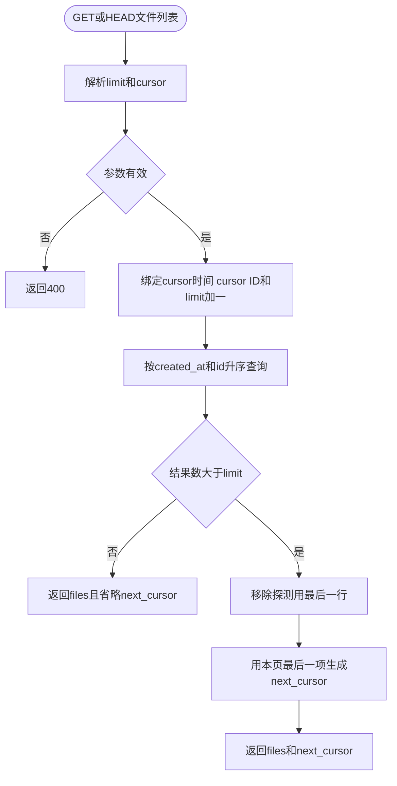

# 第二十四天 limit与cursor键集分页

## 目标

GET和HEAD /api/files支持limit与cursor查询参数 列表按created_at和id稳定升序 使用键集分页而不是OFFSET

用户本次同时要求删除其他天的注释 活动src tests和CMakeLists.txt中的DAY01至DAY23标注已清理 普通说明注释与历史docs lessons快照保留 本单元代码只标注DAY24变化

## 分页流程

图的类型 Flowchart

选择这种图是因为本单元核心是查询参数校验 SQL边界 多取一行和next_cursor生成 流程图能清楚表达每个判断与失败路径



游标条件是created_at大于上一页时间 或时间相等且id大于上一页ID 因而删除已经浏览过的记录不会改变下一页起点

## 接口约定

- limit默认100 允许1至100
- cursor格式为非负十进制Unix秒 点 合法文件ID
- 参数顺序任意 但同名参数只能出现一次
- 未知参数 空字段 非数字 负数 溢出和非法ID返回400
- 有下一页时返回next_cursor 最后一页省略
- 客户端应把cursor视为不透明字符串并原样传回
- 当前不做百分号解码 不支持反向分页 总数或按名称排序

## 完整src/file_metadata_store.h

```cpp
#pragma once

#include <sqlite3.h>

// ===== DAY 24 ADDED BEGIN 支持分页数量类型 =====
#include <cstddef>
// ===== DAY 24 ADDED END =====
#include <cstdint>
#include <limits>
#include <string>
#include <string_view>
#include <utility>
#include <vector>

struct FileMetadata
{
    std::string id;
    std::string name;
    std::uint64_t size = 0;
    std::int64_t created_at = 0;
};

// ===== DAY 24 ADDED BEGIN 定义键集分页输入 =====
struct FilePageRequest
{
    std::size_t limit = 100;
    bool has_cursor = false;
    std::int64_t cursor_created_at = 0;
    std::string cursor_id;
};
// ===== DAY 24 ADDED END =====

enum class MetadataResult
{
    Ok,
    NotFound,
    Conflict,
    Error
};

class FileMetadataStore
{
public:
    explicit FileMetadataStore(sqlite3* database) noexcept
        : database_(database)
    {
    }

    FileMetadataStore(const FileMetadataStore&) = delete;
    FileMetadataStore& operator=(const FileMetadataStore&) = delete;

    ~FileMetadataStore() noexcept
    {
        sqlite3_finalize(create_);
        sqlite3_finalize(list_);
        sqlite3_finalize(find_);
        sqlite3_finalize(rename_);
        sqlite3_finalize(erase_);
    }

    bool prepare()
    {
        if (database_ == nullptr)
        {
            remember_error("prepare file metadata statements", SQLITE_MISUSE,
                           "database connection is null");
            return false;
        }
        if (prepared_)
        {
            remember_error("prepare file metadata statements", SQLITE_MISUSE,
                           "statements are already prepared");
            return false;
        }

        if (!prepare_statement(create_,
                "INSERT INTO files(id, name, size, state, created_at) "
                "VALUES(?1, ?2, ?3, 'ready', ?4);", "prepare create file") ||
            // ===== DAY 24 MODIFIED BEGIN 按创建时间与ID执行键集分页 =====
            !prepare_statement(list_,
                "SELECT id, name, size, created_at FROM files "
                "WHERE state = 'ready' AND "
                "(?1 = 0 OR created_at > ?2 OR (created_at = ?2 AND id > ?3)) "
                "ORDER BY created_at, id LIMIT ?4;", "prepare list files") ||
            // ===== DAY 24 MODIFIED END =====
            !prepare_statement(find_,
                "SELECT id, name, size, created_at FROM files "
                "WHERE id = ?1 AND state = 'ready';", "prepare find file") ||
            !prepare_statement(rename_,
                "UPDATE files SET name = ?1 WHERE id = ?2 AND state = 'ready';",
                "prepare rename file") ||
            !prepare_statement(erase_,
                "DELETE FROM files WHERE id = ?1 AND state = 'ready';",
                "prepare erase file"))
            return false;

        prepared_ = true;
        clear_error();
        return true;
    }

    MetadataResult create_ready(std::string_view id, std::string_view name,
                                std::uint64_t size, std::int64_t created_at)
    {
        if (!start_statement(create_, "create file metadata"))
            return MetadataResult::Error;
        StatementReset reset(create_);
        if (size > static_cast<std::uint64_t>(std::numeric_limits<sqlite3_int64>::max()) ||
            created_at < 0)
        {
            remember_error("create file metadata", SQLITE_TOOBIG,
                           "size or creation time is outside SQLite INTEGER range");
            return MetadataResult::Error;
        }
        if (!bind_text(create_, 1, id, "bind file id") ||
            !bind_text(create_, 2, name, "bind file name") ||
            !bind_integer(create_, 3, static_cast<sqlite3_int64>(size), "bind file size") ||
            !bind_integer(create_, 4, static_cast<sqlite3_int64>(created_at),
                          "bind file creation time"))
            return MetadataResult::Error;

        const int result = sqlite3_step(create_);
        if (result == SQLITE_DONE)
        {
            clear_error();
            return MetadataResult::Ok;
        }
        remember_error("create file metadata", result, sqlite3_errmsg(database_));
        return primary_code(result) == SQLITE_CONSTRAINT
            ? MetadataResult::Conflict : MetadataResult::Error;
    }

    // ===== DAY 24 MODIFIED BEGIN 读取limit加一行判断是否存在下一页 =====
    MetadataResult list_ready(const FilePageRequest& page,
                              std::vector<FileMetadata>& output, bool& has_more)
    {
        output.clear();
        has_more = false;
        if (!start_statement(list_, "list file metadata"))
            return MetadataResult::Error;
        StatementReset reset(list_);
        if (page.limit == 0 || page.limit > 100 ||
            (page.has_cursor && page.cursor_id.empty()))
        {
            remember_error("list file metadata", SQLITE_RANGE,
                           "page limit or cursor is invalid");
            return MetadataResult::Error;
        }
        if (!bind_integer(list_, 1, page.has_cursor ? 1 : 0, "bind cursor presence") ||
            !bind_integer(list_, 2, page.cursor_created_at, "bind cursor creation time") ||
            !bind_text(list_, 3, page.cursor_id, "bind cursor file id") ||
            !bind_integer(list_, 4, static_cast<sqlite3_int64>(page.limit + 1),
                          "bind page row limit"))
            return MetadataResult::Error;
        while (true)
        {
            const int result = sqlite3_step(list_);
            if (result == SQLITE_DONE)
            {
                if (output.size() > page.limit)
                {
                    output.pop_back();
                    has_more = true;
                }
                clear_error();
                return MetadataResult::Ok;
            }
            if (result != SQLITE_ROW)
            {
                remember_error("list file metadata", result, sqlite3_errmsg(database_));
                output.clear();
                return MetadataResult::Error;
            }
            FileMetadata file;
            if (!read_row(list_, file, "read listed file"))
            {
                output.clear();
                return MetadataResult::Error;
            }
            output.push_back(std::move(file));
        }
    }
    // ===== DAY 24 MODIFIED END =====

    MetadataResult find_ready(std::string_view id, FileMetadata& output)
    {
        if (!start_statement(find_, "find file metadata"))
            return MetadataResult::Error;
        StatementReset reset(find_);
        if (!bind_text(find_, 1, id, "bind searched file id"))
            return MetadataResult::Error;

        const int result = sqlite3_step(find_);
        if (result == SQLITE_DONE)
        {
            clear_error();
            return MetadataResult::NotFound;
        }
        if (result != SQLITE_ROW)
        {
            remember_error("find file metadata", result, sqlite3_errmsg(database_));
            return MetadataResult::Error;
        }
        if (!read_row(find_, output, "read found file"))
            return MetadataResult::Error;
        const int trailing = sqlite3_step(find_);
        if (trailing != SQLITE_DONE)
        {
            remember_error("find file metadata", trailing,
                           trailing == SQLITE_ROW ? "file id returned multiple rows"
                                                  : sqlite3_errmsg(database_));
            return MetadataResult::Error;
        }
        clear_error();
        return MetadataResult::Ok;
    }

    MetadataResult rename_ready(std::string_view id, std::string_view name)
    {
        if (!start_statement(rename_, "rename file metadata"))
            return MetadataResult::Error;
        StatementReset reset(rename_);
        if (!bind_text(rename_, 1, name, "bind new file name") ||
            !bind_text(rename_, 2, id, "bind renamed file id"))
            return MetadataResult::Error;

        const int result = sqlite3_step(rename_);
        if (result != SQLITE_DONE)
        {
            remember_error("rename file metadata", result, sqlite3_errmsg(database_));
            return primary_code(result) == SQLITE_CONSTRAINT
                ? MetadataResult::Conflict : MetadataResult::Error;
        }
        clear_error();
        return sqlite3_changes(database_) == 0
            ? MetadataResult::NotFound : MetadataResult::Ok;
    }

    MetadataResult erase_ready(std::string_view id)
    {
        if (!start_statement(erase_, "erase file metadata"))
            return MetadataResult::Error;
        StatementReset reset(erase_);
        if (!bind_text(erase_, 1, id, "bind erased file id"))
            return MetadataResult::Error;

        const int result = sqlite3_step(erase_);
        if (result != SQLITE_DONE)
        {
            remember_error("erase file metadata", result, sqlite3_errmsg(database_));
            return MetadataResult::Error;
        }
        clear_error();
        return sqlite3_changes(database_) == 0
            ? MetadataResult::NotFound : MetadataResult::Ok;
    }

    int error_code() const noexcept
    {
        return error_code_;
    }

    const std::string& error_message() const noexcept
    {
        return error_message_;
    }

private:
    class StatementReset
    {
    public:
        explicit StatementReset(sqlite3_stmt* statement) noexcept
            : statement_(statement)
        {
        }

        ~StatementReset() noexcept
        {
            sqlite3_reset(statement_);
            sqlite3_clear_bindings(statement_);
        }

    private:
        sqlite3_stmt* statement_;
    };

    static int primary_code(int code) noexcept
    {
        return code & 0xff;
    }

    bool prepare_statement(sqlite3_stmt*& statement, const char* sql,
                           const char* operation)
    {
        const int result = sqlite3_prepare_v2(database_, sql, -1, &statement, nullptr);
        if (result == SQLITE_OK) return true;
        remember_error(operation, result, sqlite3_errmsg(database_));
        return false;
    }

    bool start_statement(sqlite3_stmt* statement, const char* operation)
    {
        if (!prepared_ || statement == nullptr)
        {
            remember_error(operation, SQLITE_MISUSE, "statements are not prepared");
            return false;
        }
        sqlite3_reset(statement);
        const int result = sqlite3_clear_bindings(statement);
        if (result == SQLITE_OK) return true;
        remember_error(operation, result, sqlite3_errmsg(database_));
        return false;
    }

    bool bind_text(sqlite3_stmt* statement, int index, std::string_view value,
                   const char* operation)
    {
        if (value.size() > static_cast<std::size_t>(std::numeric_limits<int>::max()))
        {
            remember_error(operation, SQLITE_TOOBIG, "text value is too large");
            return false;
        }
        const int result = sqlite3_bind_text(
            statement, index, value.data(), static_cast<int>(value.size()), SQLITE_TRANSIENT);
        if (result == SQLITE_OK) return true;
        remember_error(operation, result, sqlite3_errmsg(database_));
        return false;
    }

    bool bind_integer(sqlite3_stmt* statement, int index, sqlite3_int64 value,
                      const char* operation)
    {
        const int result = sqlite3_bind_int64(statement, index, value);
        if (result == SQLITE_OK) return true;
        remember_error(operation, result, sqlite3_errmsg(database_));
        return false;
    }

    bool read_row(sqlite3_stmt* statement, FileMetadata& output,
                  const char* operation)
    {
        if (sqlite3_column_type(statement, 0) != SQLITE_TEXT ||
            sqlite3_column_type(statement, 1) != SQLITE_TEXT ||
            sqlite3_column_type(statement, 2) != SQLITE_INTEGER ||
            sqlite3_column_type(statement, 3) != SQLITE_INTEGER)
        {
            remember_error(operation, SQLITE_MISMATCH, "metadata column type mismatch");
            return false;
        }
        const auto* id = sqlite3_column_text(statement, 0);
        const auto* name = sqlite3_column_text(statement, 1);
        const int id_size = sqlite3_column_bytes(statement, 0);
        const int name_size = sqlite3_column_bytes(statement, 1);
        const sqlite3_int64 size = sqlite3_column_int64(statement, 2);
        const sqlite3_int64 created_at = sqlite3_column_int64(statement, 3);
        if (id == nullptr || name == nullptr || id_size <= 0 || name_size <= 0 ||
            size < 0 || created_at < 0)
        {
            remember_error(operation, SQLITE_CORRUPT, "invalid metadata row");
            return false;
        }
        output.id.assign(reinterpret_cast<const char*>(id), static_cast<std::size_t>(id_size));
        output.name.assign(reinterpret_cast<const char*>(name),
                           static_cast<std::size_t>(name_size));
        output.size = static_cast<std::uint64_t>(size);
        output.created_at = static_cast<std::int64_t>(created_at);
        return true;
    }

    void remember_error(const char* operation, int code, const char* detail)
    {
        error_code_ = code;
        error_message_ = operation;
        error_message_ += ": ";
        error_message_ += detail == nullptr ? sqlite3_errstr(code) : detail;
    }

    void clear_error()
    {
        error_code_ = SQLITE_OK;
        error_message_.clear();
    }

    sqlite3* database_ = nullptr;
    sqlite3_stmt* create_ = nullptr;
    sqlite3_stmt* list_ = nullptr;
    sqlite3_stmt* find_ = nullptr;
    sqlite3_stmt* rename_ = nullptr;
    sqlite3_stmt* erase_ = nullptr;
    bool prepared_ = false;
    int error_code_ = SQLITE_OK;
    std::string error_message_;
};

```

## 完整src/file_catalog.h

```cpp
#pragma once

#include "http_response.h"
#include "file_metadata_store.h"
#include "object_path.h"

#include <nlohmann/json.hpp>
#include <filesystem>
#include <iostream>
// ===== DAY 24 ADDED BEGIN 支持分页数字边界 =====
#include <cstdint>
#include <limits>
// ===== DAY 24 ADDED END =====
#include <stdexcept>
#include <string>
#include <string_view>
#include <utility>
#include <vector>

inline bool valid_display_name(std::string_view name)
{
    if (name.empty() || name.size() > 255 || name == "." || name == ".." ||
        name.find_first_not_of(' ') == std::string_view::npos) return false;
    for (unsigned char ch : name)
        if (ch < 32 || ch == 127 || ch == '/' || ch == '\\') return false;
    return true;
}

inline nlohmann::json make_file_json(std::string_view id, std::string_view name,
                                     std::uintmax_t size)
{
    return {{"id", std::string(id)}, {"name", std::string(name)}, {"size", size}};
}

inline nlohmann::json make_file_json(const FileMetadata& file)
{
    return make_file_json(file.id, file.name, file.size);
}

inline bool stored_object_is_regular(std::string_view id)
{
    namespace fs = std::filesystem;
    std::string path;
    if (!make_object_path(id, path))
        throw std::runtime_error("metadata contains invalid file ID");
    std::error_code error;
    const auto status = fs::symlink_status(path, error);
    if (error == std::errc::no_such_file_or_directory) return false;
    if (error) throw fs::filesystem_error("inspect object", path, error);
    return fs::is_regular_file(status);
}

// ===== DAY 24 ADDED BEGIN 解析limit与复合cursor查询参数 =====
inline bool parse_nonnegative_int64(std::string_view text, std::int64_t& output)
{
    if (text.empty()) return false;
    std::uint64_t value = 0;
    for (const char ch : text)
    {
        if (ch < '0' || ch > '9') return false;
        const auto digit = static_cast<std::uint64_t>(ch - '0');
        if (value > (static_cast<std::uint64_t>(
                std::numeric_limits<std::int64_t>::max()) - digit) / 10)
            return false;
        value = value * 10 + digit;
    }
    output = static_cast<std::int64_t>(value);
    return true;
}

inline bool parse_file_page(std::string_view target, FilePageRequest& page)
{
    page = FilePageRequest{};
    const auto question = target.find('?');
    if (question == std::string_view::npos || question + 1 == target.size()) return true;
    std::string_view query = target.substr(question + 1);
    bool seen_limit = false;
    bool seen_cursor = false;
    while (!query.empty())
    {
        const auto ampersand = query.find('&');
        const auto field = query.substr(0, ampersand);
        if (field.empty()) return false;
        const auto equals = field.find('=');
        if (equals == std::string_view::npos ||
            field.find('=', equals + 1) != std::string_view::npos)
            return false;
        const auto name = field.substr(0, equals);
        const auto value = field.substr(equals + 1);
        if (name == "limit")
        {
            if (seen_limit) return false;
            std::int64_t parsed = 0;
            if (!parse_nonnegative_int64(value, parsed) || parsed < 1 || parsed > 100)
                return false;
            page.limit = static_cast<std::size_t>(parsed);
            seen_limit = true;
        }
        else if (name == "cursor")
        {
            if (seen_cursor) return false;
            const auto dot = value.find('.');
            if (dot == std::string_view::npos || dot == 0 || dot + 1 == value.size())
                return false;
            if (!parse_nonnegative_int64(value.substr(0, dot), page.cursor_created_at) ||
                !is_valid_file_id(value.substr(dot + 1)))
                return false;
            page.cursor_id.assign(value.data() + dot + 1, value.size() - dot - 1);
            page.has_cursor = true;
            seen_cursor = true;
        }
        else
        {
            return false;
        }
        if (ampersand == std::string_view::npos) break;
        query.remove_prefix(ampersand + 1);
        if (query.empty()) return false;
    }
    return true;
}

inline std::string make_file_cursor(const FileMetadata& file)
{
    return std::to_string(file.created_at) + "." + file.id;
}
// ===== DAY 24 ADDED END =====

// ===== DAY 24 MODIFIED BEGIN 返回当前页并在需要时附带next_cursor =====
inline nlohmann::json list_file_objects(FileMetadataStore& store,
                                        const FilePageRequest& page)
{
    namespace fs = std::filesystem;
    std::error_code error;
    const auto status = fs::symlink_status("data/objects", error);
    if (error) throw fs::filesystem_error("inspect object directory", "data/objects", error);
    if (!fs::is_directory(status))
        throw std::runtime_error("object directory is not a directory");

    std::vector<FileMetadata> metadata;
    bool has_more = false;
    if (store.list_ready(page, metadata, has_more) != MetadataResult::Ok)
        throw std::runtime_error(store.error_message());
    auto files = nlohmann::json::array();
    for (const auto& file : metadata)
    {
        if (!stored_object_is_regular(file.id))
            throw std::runtime_error("ready metadata object is missing or not regular");
        files.push_back(make_file_json(file));
    }
    nlohmann::json document{{"files", std::move(files)}};
    if (has_more)
        document["next_cursor"] = make_file_cursor(metadata.back());
    return document;
}

inline nlohmann::json list_file_objects(FileMetadataStore& store)
{
    return list_file_objects(store, FilePageRequest{});
}
// ===== DAY 24 MODIFIED END =====

inline bool is_file_catalog_request(const RequestLine& line)
{
    const std::string_view target(line.target);
    const auto path = target.substr(0, target.find('?'));
    if (path == "/api/files") return line.method != "POST";
    constexpr std::string_view prefix = "/api/files/";
    return path.substr(0, prefix.size()) == prefix &&
           path.find('/', prefix.size()) == std::string_view::npos;
}

inline HttpResponse file_catalog_response(const RequestParser& request,
                                          FileMetadataStore& store)
{
    const auto& line = request.line();
    const std::string_view target(line.target);
    const auto path = target.substr(0, target.find('?'));
    const bool listing = path == "/api/files";
    const bool changing = line.method == "PATCH" || line.method == "DELETE";
    if (line.method != "GET" && line.method != "HEAD" && !(changing && !listing))
    {
        const bool known = changing || line.method == "POST";
        return error_response(known ? 405 : 501,
            listing ? "GET, HEAD, POST" : "GET, HEAD, PATCH, DELETE");
    }
    if (line.method != "PATCH" && request.body_size() != 0) return error_response(400);
    try
    {
        nlohmann::json document;
        if (listing)
        {
            // ===== DAY 24 MODIFIED BEGIN 列表请求校验分页参数 =====
            FilePageRequest page;
            if (!parse_file_page(target, page)) return error_response(400);
            document = list_file_objects(store, page);
            // ===== DAY 24 MODIFIED END =====
        }
        else
        {
            const auto id = path.substr(std::string_view("/api/files/").size());
            std::string object_path;
            if (!make_object_path(id, object_path)) return error_response(400);
            FileMetadata file;
            const auto found = store.find_ready(id, file);
            if (found == MetadataResult::NotFound)
                return {404, "Not Found", "application/json",
                    R"({"error":{"code":"not_found","message":"File not found"}})"};
            if (found != MetadataResult::Ok)
                throw std::runtime_error(store.error_message());
            if (!stored_object_is_regular(id))
                throw std::runtime_error("ready metadata object is missing or not regular");
            document = make_file_json(file);
            if (line.method == "PATCH")
            {
                const auto patch = nlohmann::json::parse(request.body(), nullptr, false);
                if (!patch.is_object() || patch.size() != 1 || patch.find("name") == patch.end() ||
                    !patch.at("name").is_string()) return error_response(400);
                const std::string name = patch.at("name").get<std::string>();
                if (!valid_display_name(name)) return error_response(400);
                const auto renamed = store.rename_ready(id, name);
                if (renamed == MetadataResult::NotFound)
                    return {404, "Not Found", "application/json",
                        R"({"error":{"code":"not_found","message":"File not found"}})"};
                if (renamed != MetadataResult::Ok)
                    throw std::runtime_error(store.error_message());
                file.name = name;
                return {200, "OK", "application/json", make_file_json(file).dump()};
            }
            if (line.method == "DELETE")
            {
                if (!std::filesystem::remove(object_path)) return error_response(404);
                const auto erased = store.erase_ready(id);
                if (erased == MetadataResult::NotFound)
                    throw std::runtime_error("ready metadata disappeared during delete");
                if (erased != MetadataResult::Ok)
                    throw std::runtime_error(store.error_message());
                return {204, "No Content", "", ""};
            }
        }
        return {200, "OK", "application/json", document.dump()};
    }
    catch (const std::exception& error)
    {
        std::cerr << "file catalog failed: " << error.what() << '\n';
        return error_response(500);
    }
}

```

## 完整tests/day24_file_pagination.cpp

```cpp
// ===== DAY 24 ADDED BEGIN 验证键集分页稳定顺序与参数边界 =====
#include "file_catalog.h"
#include "metadata_database.h"

#include <chrono>
#include <filesystem>
#include <fstream>
#include <iostream>
#include <stdexcept>
#include <string>
#include <vector>

void require(bool ok, const char* message)
{
    if (!ok) throw std::runtime_error(message);
}

struct TestDirectory
{
    std::filesystem::path previous = std::filesystem::current_path();
    std::filesystem::path root = previous / ("day24-test-" + std::to_string(
        std::chrono::steady_clock::now().time_since_epoch().count()));

    TestDirectory()
    {
        require(std::filesystem::create_directory(root), "create isolated directory");
        std::filesystem::current_path(root);
    }

    ~TestDirectory()
    {
        std::error_code error;
        std::filesystem::current_path(previous, error);
        std::filesystem::remove_all(root, error);
    }
};

HttpResponse request(FileMetadataStore& store, std::string_view target)
{
    RequestParser parser;
    const std::string wire = "GET " + std::string(target) +
        " HTTP/1.1\r\nHost: localhost\r\n\r\n";
    require(parser.feed(wire).state == ParseState::Done, "parse pagination request");
    return file_catalog_response(parser, store);
}

std::vector<std::string> page_ids(const nlohmann::json& document)
{
    std::vector<std::string> ids;
    for (const auto& file : document.at("files"))
        ids.push_back(file.at("id").get<std::string>());
    return ids;
}

void add_file(FileMetadataStore& store, const std::string& id, std::int64_t created_at)
{
    const std::filesystem::path path = std::filesystem::path("data/objects") / id;
    std::ofstream file(path, std::ios::binary);
    file.put(id.back());
    require(file.good(), "write object fixture");
    file.close();
    require(store.create_ready(id, id + ".bin", 1, created_at) == MetadataResult::Ok,
            "insert metadata fixture");
}

int main()
{
    try
    {
        TestDirectory directory;
        std::filesystem::create_directories("data/objects");
        MetadataDatabase database;
        require(database.open("data/netdisk.db") && database.initialize_schema(),
                "initialize metadata database");
        FileMetadataStore store(database.get());
        require(store.prepare(), "prepare metadata statements");

        const std::vector<std::string> expected{
            "upload-A00001", "upload-B00001", "upload-C00001",
            "upload-D00001", "upload-E00001"};
        add_file(store, expected[0], 100);
        add_file(store, expected[1], 100);
        add_file(store, expected[2], 101);
        add_file(store, expected[3], 101);
        add_file(store, expected[4], 102);

        const auto first = nlohmann::json::parse(
            request(store, "/api/files?limit=2").body);
        require(page_ids(first) == std::vector<std::string>{expected[0], expected[1]},
                "first page order");
        require(first.at("next_cursor") == "100.upload-B00001", "first cursor");

        require(std::filesystem::remove(
                    std::filesystem::path("data/objects") / expected[0]) &&
                store.erase_ready(expected[0]) == MetadataResult::Ok,
                "delete item before cursor");

        const auto second = nlohmann::json::parse(request(
            store, "/api/files?cursor=100.upload-B00001&limit=2").body);
        require(page_ids(second) == std::vector<std::string>{expected[2], expected[3]},
                "second page shifted after deletion");
        require(second.at("next_cursor") == "101.upload-D00001", "second cursor");

        const auto third = nlohmann::json::parse(request(
            store, "/api/files?limit=2&cursor=101.upload-D00001").body);
        require(page_ids(third) == std::vector<std::string>{expected[4]} &&
                third.find("next_cursor") == third.end(), "final page boundary");

        const std::string_view invalid[] = {
            "/api/files?limit=0",
            "/api/files?limit=101",
            "/api/files?limit=-1",
            "/api/files?limit=x",
            "/api/files?limit=1&limit=2",
            "/api/files?cursor=",
            "/api/files?cursor=-1.upload-A00001",
            "/api/files?cursor=100.bad-id",
            "/api/files?cursor=9223372036854775808.upload-A00001",
            "/api/files?cursor=100.upload-A00001&cursor=101.upload-B00001",
            "/api/files?offset=2",
            "/api/files?limit=2&"};
        for (const auto target : invalid)
            require(request(store, target).status == 400, "invalid pagination accepted");

        std::cout << "PASS: keyset pagination order, deletion stability and query bounds\n";
    }
    catch (const std::exception& error)
    {
        std::cerr << "FAIL: " << error.what() << '\n';
        return 1;
    }
}
// ===== DAY 24 ADDED END =====

```

## 完整CMakeLists.txt

```cmake
cmake_minimum_required(VERSION 3.16)

project(netdisk LANGUAGES CXX)

add_executable(netdisk src/main.cpp)
set(NETDISK_TARGETS netdisk)

find_package(nlohmann_json 3.2.0 REQUIRED)
target_link_libraries(netdisk PRIVATE nlohmann_json::nlohmann_json)

find_package(SQLite3 REQUIRED)
target_link_libraries(netdisk PRIVATE SQLite::SQLite3)

include(CTest)
if(BUILD_TESTING)
    add_executable(io_tests tests/day06_io.cpp)
    target_include_directories(io_tests PRIVATE src)
    list(APPEND NETDISK_TARGETS io_tests)
    add_test(NAME io_tests COMMAND io_tests)

    add_executable(request_line_tests tests/day08_request_line.cpp)
    target_include_directories(request_line_tests PRIVATE src)
    list(APPEND NETDISK_TARGETS request_line_tests)
    add_test(NAME request_line_tests COMMAND request_line_tests)

    add_executable(request_headers_tests tests/day09_request_headers.cpp)
    target_include_directories(request_headers_tests PRIVATE src)
    list(APPEND NETDISK_TARGETS request_headers_tests)
    add_test(NAME request_headers_tests COMMAND request_headers_tests)

    add_executable(request_body_tests tests/day10_request_body.cpp)
    target_include_directories(request_body_tests PRIVATE src)
    list(APPEND NETDISK_TARGETS request_body_tests)
    add_test(NAME request_body_tests COMMAND request_body_tests)

    add_executable(http_response_tests tests/day11_http_response.cpp)
    target_include_directories(http_response_tests PRIVATE src)
    list(APPEND NETDISK_TARGETS http_response_tests)
    add_test(NAME http_response_tests COMMAND http_response_tests)

    add_executable(stream_upload_tests tests/day12_stream_upload.cpp)
    target_include_directories(stream_upload_tests PRIVATE src)
    list(APPEND NETDISK_TARGETS stream_upload_tests)
    add_test(NAME stream_upload_tests COMMAND stream_upload_tests)

    add_executable(publish_tests tests/day13_publish.cpp)
    target_include_directories(publish_tests PRIVATE src)
    list(APPEND NETDISK_TARGETS publish_tests)
    add_test(NAME publish_tests COMMAND publish_tests)

    add_executable(object_path_tests tests/day15_object_path.cpp)
    target_include_directories(object_path_tests PRIVATE src)
    list(APPEND NETDISK_TARGETS object_path_tests)
    add_test(NAME object_path_tests COMMAND object_path_tests)

    find_package(Python3 3.8 REQUIRED COMPONENTS Interpreter)
    add_test(NAME upload_integration_tests
        COMMAND "${Python3_EXECUTABLE}"
            "${CMAKE_CURRENT_SOURCE_DIR}/tests/day14_upload_integration.py"
            "$<TARGET_FILE:netdisk>"
    )
    set_tests_properties(upload_integration_tests PROPERTIES
        TIMEOUT 30
        RUN_SERIAL TRUE
        SKIP_RETURN_CODE 77
    )

    add_test(NAME download_integration_tests
        COMMAND "${Python3_EXECUTABLE}"
            "${CMAKE_CURRENT_SOURCE_DIR}/tests/day16_download_integration.py"
            "$<TARGET_FILE:netdisk>"
    )
    set_tests_properties(download_integration_tests PROPERTIES
        TIMEOUT 30
        RUN_SERIAL TRUE
        SKIP_RETURN_CODE 77
    )

    add_executable(download_headers_tests tests/day17_download_headers.cpp)
    target_include_directories(download_headers_tests PRIVATE src)
    list(APPEND NETDISK_TARGETS download_headers_tests)
    add_test(NAME download_headers_tests COMMAND download_headers_tests)

    add_test(NAME download_headers_integration_tests
        COMMAND "${Python3_EXECUTABLE}"
            "${CMAKE_CURRENT_SOURCE_DIR}/tests/day17_download_headers.py"
            "$<TARGET_FILE:netdisk>"
    )
    set_tests_properties(download_headers_integration_tests PROPERTIES
        TIMEOUT 30
        RUN_SERIAL TRUE
        SKIP_RETURN_CODE 77
    )

    add_executable(file_catalog_tests tests/day18_file_catalog.cpp)
    target_include_directories(file_catalog_tests PRIVATE src)
    target_link_libraries(file_catalog_tests PRIVATE
        nlohmann_json::nlohmann_json SQLite::SQLite3)
    list(APPEND NETDISK_TARGETS file_catalog_tests)
    add_test(NAME file_catalog_tests COMMAND file_catalog_tests)

    add_test(NAME file_catalog_integration_tests
        COMMAND "${Python3_EXECUTABLE}"
            "${CMAKE_CURRENT_SOURCE_DIR}/tests/day18_file_catalog.py"
            "$<TARGET_FILE:netdisk>"
    )
    set_tests_properties(file_catalog_integration_tests PROPERTIES
        TIMEOUT 30
        RUN_SERIAL TRUE
        SKIP_RETURN_CODE 77
    )

    add_executable(file_mutation_tests tests/day19_file_mutation.cpp)
    target_include_directories(file_mutation_tests PRIVATE src)
    target_link_libraries(file_mutation_tests PRIVATE
        nlohmann_json::nlohmann_json SQLite::SQLite3)
    list(APPEND NETDISK_TARGETS file_mutation_tests)
    add_test(NAME file_mutation_tests COMMAND file_mutation_tests)

    add_test(NAME file_mutation_integration_tests
        COMMAND "${Python3_EXECUTABLE}"
            "${CMAKE_CURRENT_SOURCE_DIR}/tests/day19_file_mutation.py"
            "$<TARGET_FILE:netdisk>"
    )
    set_tests_properties(file_mutation_integration_tests PROPERTIES
        TIMEOUT 30
        RUN_SERIAL TRUE
        SKIP_RETURN_CODE 77
    )

    add_test(NAME failure_recovery_integration_tests
        COMMAND "${Python3_EXECUTABLE}"
            "${CMAKE_CURRENT_SOURCE_DIR}/tests/day20_failure_recovery.py"
            "$<TARGET_FILE:netdisk>"
    )
    set_tests_properties(failure_recovery_integration_tests PROPERTIES
        TIMEOUT 30
        RUN_SERIAL TRUE
        SKIP_RETURN_CODE 77
    )

    add_test(NAME first_release_integration_tests
        COMMAND "${Python3_EXECUTABLE}"
            "${CMAKE_CURRENT_SOURCE_DIR}/tests/day21_first_release.py"
            "$<TARGET_FILE:netdisk>"
    )
    set_tests_properties(first_release_integration_tests PROPERTIES
        TIMEOUT 30
        RUN_SERIAL TRUE
        SKIP_RETURN_CODE 77
    )

    add_executable(sqlite_lifecycle_tests tests/day22_sqlite_lifecycle.cpp)
    target_include_directories(sqlite_lifecycle_tests PRIVATE src)
    target_link_libraries(sqlite_lifecycle_tests PRIVATE SQLite::SQLite3)
    list(APPEND NETDISK_TARGETS sqlite_lifecycle_tests)
    add_test(NAME sqlite_lifecycle_tests COMMAND sqlite_lifecycle_tests)

    add_test(NAME metadata_persistence_integration_tests
        COMMAND "${Python3_EXECUTABLE}"
            "${CMAKE_CURRENT_SOURCE_DIR}/tests/day23_metadata_persistence.py"
            "$<TARGET_FILE:netdisk>"
    )
    set_tests_properties(metadata_persistence_integration_tests PROPERTIES
        TIMEOUT 30
        RUN_SERIAL TRUE
        SKIP_RETURN_CODE 77
    )

    # ===== DAY 24 ADDED BEGIN 注册文件键集分页测试 =====
    add_executable(file_pagination_tests tests/day24_file_pagination.cpp)
    target_include_directories(file_pagination_tests PRIVATE src)
    target_link_libraries(file_pagination_tests PRIVATE
        nlohmann_json::nlohmann_json SQLite::SQLite3)
    list(APPEND NETDISK_TARGETS file_pagination_tests)
    add_test(NAME file_pagination_tests COMMAND file_pagination_tests)
    # ===== DAY 24 ADDED END =====
endif()

foreach(target IN LISTS NETDISK_TARGETS)
    set_target_properties(${target} PROPERTIES
        CXX_STANDARD 17
        CXX_STANDARD_REQUIRED YES
        CXX_EXTENSIONS NO
    )
endforeach()

```

## Python测试变化

tests/day18_file_catalog.py只调整旧断言 旧测试继续核对列表元素集合 第二十四天的新C++测试单独负责验证created_at和id顺序 Python实现按用户约定不在对话和教程中复制

## Linux虚拟机操作

同步以下文件

- src/file_metadata_store.h
- src/file_catalog.h
- tests/day18_file_catalog.py
- tests/day24_file_pagination.cpp
- CMakeLists.txt

如果Linux工程中仍保留旧DAY标注 可用本地最终文件覆盖对应活动源码 不需要修改历史教程

在Linux工程目录执行

```sh
cd ~/projects/netdisk
cmake -S . -B build -DCMAKE_BUILD_TYPE=Debug -DBUILD_TESTING=ON
cmake --build build -j2
ctest --test-dir build -R '^file_pagination_tests$' -V
```

成功条件

- CTest实际运行file_pagination_tests一项
- 输出PASS keyset pagination order deletion stability and query bounds
- 一项测试通过且退出状态为0

## 一次真实分页

至少上传三个文件后请求第一页

```sh
curl -s 'http://127.0.0.1:8080/api/files?limit=1'
```

如果响应包含next_cursor 将其完整复制到下一次请求 CURSOR只替换为实际值

```sh
CURSOR='实际next_cursor'
curl -s "http://127.0.0.1:8080/api/files?limit=1&cursor=$CURSOR"
```

每页最多一项 ID不重复 最后一页没有next_cursor

## 当前边界

- 键集分页不是SQLite一致性快照
- 分页期间新增且键大于游标的记录可能出现在后续页
- 新增且键不大于当前游标的记录不会出现在这次后续页
- cursor未签名 客户端可以构造任意合法边界但不能注入SQL
- 没有cursor过期 反向分页 总数与名称排序
- created_at只有秒精度 同秒使用唯一ID打破平局

下一单元引入publishing状态和事务边界 让半发布对象不会成为公开ready记录
