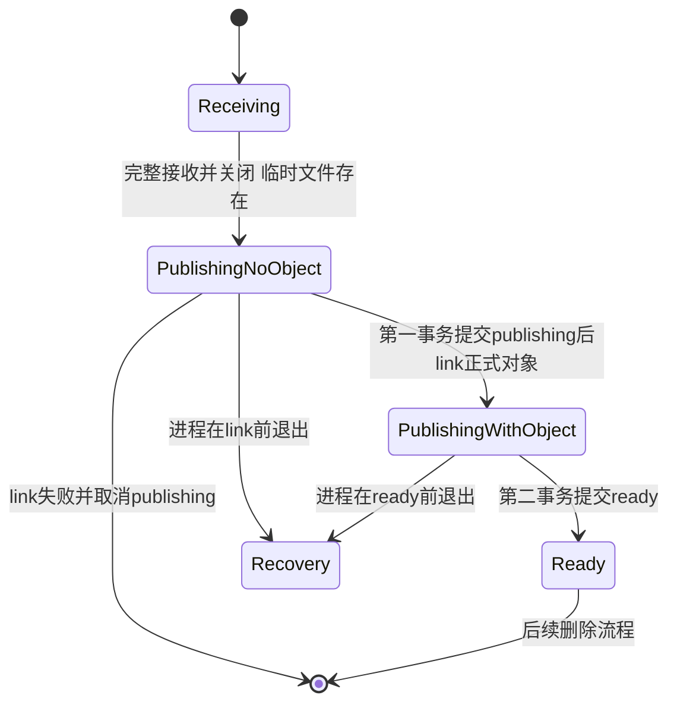

# 第二十五天 publishing发布状态与事务边界

## 目标

上传不再先暴露正式对象再补写ready元数据 而是按publishing记录 正式对象 ready记录三个阶段推进 列表 详情和下载都只公开ready对象

本单元改动位于feature/day25-publishing-state分支 尚未合并或推送到main

## 状态变化

图的类型 State Diagram

选择状态图是因为本单元核心不是普通调用顺序 而是数据库状态与文件存在性组合的生命周期 需要明确哪些中间状态允许恢复以及哪些状态可以公开读取



Receiving只有临时文件 PublishingNoObject已经有持久元数据但没有正式对象 PublishingWithObject已有正式对象但仍不可见 只有Ready能进入列表 详情和下载 Recovery由第26单元处理

## 两个事务边界

第一事务执行BEGIN IMMEDIATE INSERT publishing COMMIT 提交成功后即使进程退出也能知道有一次未完成发布

文件系统随后执行link 临时文件与正式对象仍不可能参加SQLite事务

第二事务执行BEGIN IMMEDIATE UPDATE publishing到ready COMMIT 只有它成功后HTTP才返回201

发布文件失败时删除publishing记录 ready转换失败时保留对象和publishing记录 不删除提交结果可能不确定的对象

## 接口与所有权

FileMetadataStore借用MetadataDatabase中的sqlite3连接 数据库连接必须比仓库存活更久 create_publishing复制所有string_view绑定值并提交publishing记录 mark_ready和cancel_publishing只接受ID并要求恰好改变一行

TempUpload拥有临时文件描述符 路径 ID和准备发布状态 prepare_publish关闭文件并取得ID publish_prepared创建正式硬链接 析构只清理仍存在的临时名称 已发布正式对象不会被析构自动删除

send_file_content借用FileMetadataStore 在打开对象前查询ready元数据 不取得仓库或连接所有权

## 失败边界

| 失败点 | 最终状态 | 是否公开 |
| --- | --- | --- |
| 接收或关闭临时文件失败 | 只有临时文件并由析构清理 | 否 |
| publishing事务失败 | 没有正式对象 | 否 |
| link失败且取消成功 | publishing行被删除 | 否 |
| link失败且取消失败 | publishing行但没有正式对象 | 否 |
| link成功后进程退出 | publishing行和正式对象 | 否 |
| ready事务失败 | publishing行和正式对象 | 否 |
| ready提交后响应丢失 | ready行和正式对象 | 是 |

## 完整源码

### src/file_metadata_store.h

```cpp
#pragma once

#include <sqlite3.h>

#include <cstddef>
#include <cstdint>
#include <limits>
#include <string>
#include <string_view>
#include <utility>
#include <vector>

struct FileMetadata
{
    std::string id;
    std::string name;
    std::uint64_t size = 0;
    std::int64_t created_at = 0;
};

struct FilePageRequest
{
    std::size_t limit = 100;
    bool has_cursor = false;
    std::int64_t cursor_created_at = 0;
    std::string cursor_id;
};

enum class MetadataResult
{
    Ok,
    NotFound,
    Conflict,
    Error
};

class FileMetadataStore
{
public:
    explicit FileMetadataStore(sqlite3* database) noexcept
        : database_(database)
    {
    }

    FileMetadataStore(const FileMetadataStore&) = delete;
    FileMetadataStore& operator=(const FileMetadataStore&) = delete;

    ~FileMetadataStore() noexcept
    {
        sqlite3_finalize(create_);
        // ===== DAY 25 ADDED BEGIN 释放发布状态转换语句 =====
        sqlite3_finalize(ready_);
        sqlite3_finalize(cancel_);
        // ===== DAY 25 ADDED END =====
        sqlite3_finalize(list_);
        sqlite3_finalize(find_);
        sqlite3_finalize(rename_);
        sqlite3_finalize(erase_);
    }

    bool prepare()
    {
        if (database_ == nullptr)
        {
            remember_error("prepare file metadata statements", SQLITE_MISUSE,
                           "database connection is null");
            return false;
        }
        if (prepared_)
        {
            remember_error("prepare file metadata statements", SQLITE_MISUSE,
                           "statements are already prepared");
            return false;
        }

        // ===== DAY 25 MODIFIED BEGIN 先写publishing再以独立事务切换ready =====
        if (!prepare_statement(create_,
                "INSERT INTO files(id, name, size, state, created_at) "
                "VALUES(?1, ?2, ?3, 'publishing', ?4);",
                "prepare create publishing file") ||
            !prepare_statement(ready_,
                "UPDATE files SET state = 'ready' "
                "WHERE id = ?1 AND state = 'publishing';",
                "prepare mark file ready") ||
            !prepare_statement(cancel_,
                "DELETE FROM files WHERE id = ?1 AND state = 'publishing';",
                "prepare cancel publishing file") ||
            // ===== DAY 25 MODIFIED END =====
            !prepare_statement(list_,
                "SELECT id, name, size, created_at FROM files "
                "WHERE state = 'ready' AND "
                "(?1 = 0 OR created_at > ?2 OR (created_at = ?2 AND id > ?3)) "
                "ORDER BY created_at, id LIMIT ?4;", "prepare list files") ||
            !prepare_statement(find_,
                "SELECT id, name, size, created_at FROM files "
                "WHERE id = ?1 AND state = 'ready';", "prepare find file") ||
            !prepare_statement(rename_,
                "UPDATE files SET name = ?1 WHERE id = ?2 AND state = 'ready';",
                "prepare rename file") ||
            !prepare_statement(erase_,
                "DELETE FROM files WHERE id = ?1 AND state = 'ready';",
                "prepare erase file"))
            return false;

        prepared_ = true;
        clear_error();
        return true;
    }

    // ===== DAY 25 MODIFIED BEGIN 使用显式事务持久化publishing记录 =====
    MetadataResult create_publishing(std::string_view id, std::string_view name,
                                     std::uint64_t size, std::int64_t created_at)
    {
        if (!start_statement(create_, "create publishing metadata"))
            return MetadataResult::Error;
        if (size > static_cast<std::uint64_t>(std::numeric_limits<sqlite3_int64>::max()) ||
            created_at < 0)
        {
            remember_error("create publishing metadata", SQLITE_TOOBIG,
                           "size or creation time is outside SQLite INTEGER range");
            return MetadataResult::Error;
        }
        if (!begin_transaction("begin publishing metadata transaction"))
            return MetadataResult::Error;

        bool bound = false;
        int result = SQLITE_ERROR;
        {
            StatementReset reset(create_);
            bound = bind_text(create_, 1, id, "bind publishing file id") &&
                bind_text(create_, 2, name, "bind publishing file name") &&
                bind_integer(create_, 3, static_cast<sqlite3_int64>(size),
                             "bind publishing file size") &&
                bind_integer(create_, 4, static_cast<sqlite3_int64>(created_at),
                             "bind publishing creation time");
            if (bound) result = sqlite3_step(create_);
        }
        if (!bound)
        {
            rollback_transaction();
            return MetadataResult::Error;
        }
        if (result != SQLITE_DONE)
        {
            remember_error("create publishing metadata", result, sqlite3_errmsg(database_));
            rollback_transaction();
            return primary_code(result) == SQLITE_CONSTRAINT
                ? MetadataResult::Conflict : MetadataResult::Error;
        }
        if (!commit_transaction("commit publishing metadata transaction"))
        {
            rollback_transaction();
            return MetadataResult::Error;
        }
        clear_error();
        return MetadataResult::Ok;
    }

    MetadataResult mark_ready(std::string_view id)
    {
        return change_publishing_state(
            ready_, id, "mark file ready", "commit ready metadata transaction");
    }

    MetadataResult cancel_publishing(std::string_view id)
    {
        return change_publishing_state(
            cancel_, id, "cancel publishing file", "commit cancel metadata transaction");
    }
    // ===== DAY 25 MODIFIED END =====

    MetadataResult list_ready(const FilePageRequest& page,
                              std::vector<FileMetadata>& output, bool& has_more)
    {
        output.clear();
        has_more = false;
        if (!start_statement(list_, "list file metadata"))
            return MetadataResult::Error;
        StatementReset reset(list_);
        if (page.limit == 0 || page.limit > 100 ||
            (page.has_cursor && page.cursor_id.empty()))
        {
            remember_error("list file metadata", SQLITE_RANGE,
                           "page limit or cursor is invalid");
            return MetadataResult::Error;
        }
        if (!bind_integer(list_, 1, page.has_cursor ? 1 : 0, "bind cursor presence") ||
            !bind_integer(list_, 2, page.cursor_created_at, "bind cursor creation time") ||
            !bind_text(list_, 3, page.cursor_id, "bind cursor file id") ||
            !bind_integer(list_, 4, static_cast<sqlite3_int64>(page.limit + 1),
                          "bind page row limit"))
            return MetadataResult::Error;
        while (true)
        {
            const int result = sqlite3_step(list_);
            if (result == SQLITE_DONE)
            {
                if (output.size() > page.limit)
                {
                    output.pop_back();
                    has_more = true;
                }
                clear_error();
                return MetadataResult::Ok;
            }
            if (result != SQLITE_ROW)
            {
                remember_error("list file metadata", result, sqlite3_errmsg(database_));
                output.clear();
                return MetadataResult::Error;
            }
            FileMetadata file;
            if (!read_row(list_, file, "read listed file"))
            {
                output.clear();
                return MetadataResult::Error;
            }
            output.push_back(std::move(file));
        }
    }

    MetadataResult find_ready(std::string_view id, FileMetadata& output)
    {
        if (!start_statement(find_, "find file metadata"))
            return MetadataResult::Error;
        StatementReset reset(find_);
        if (!bind_text(find_, 1, id, "bind searched file id"))
            return MetadataResult::Error;

        const int result = sqlite3_step(find_);
        if (result == SQLITE_DONE)
        {
            clear_error();
            return MetadataResult::NotFound;
        }
        if (result != SQLITE_ROW)
        {
            remember_error("find file metadata", result, sqlite3_errmsg(database_));
            return MetadataResult::Error;
        }
        if (!read_row(find_, output, "read found file"))
            return MetadataResult::Error;
        const int trailing = sqlite3_step(find_);
        if (trailing != SQLITE_DONE)
        {
            remember_error("find file metadata", trailing,
                           trailing == SQLITE_ROW ? "file id returned multiple rows"
                                                  : sqlite3_errmsg(database_));
            return MetadataResult::Error;
        }
        clear_error();
        return MetadataResult::Ok;
    }

    MetadataResult rename_ready(std::string_view id, std::string_view name)
    {
        if (!start_statement(rename_, "rename file metadata"))
            return MetadataResult::Error;
        StatementReset reset(rename_);
        if (!bind_text(rename_, 1, name, "bind new file name") ||
            !bind_text(rename_, 2, id, "bind renamed file id"))
            return MetadataResult::Error;

        const int result = sqlite3_step(rename_);
        if (result != SQLITE_DONE)
        {
            remember_error("rename file metadata", result, sqlite3_errmsg(database_));
            return primary_code(result) == SQLITE_CONSTRAINT
                ? MetadataResult::Conflict : MetadataResult::Error;
        }
        clear_error();
        return sqlite3_changes(database_) == 0
            ? MetadataResult::NotFound : MetadataResult::Ok;
    }

    MetadataResult erase_ready(std::string_view id)
    {
        if (!start_statement(erase_, "erase file metadata"))
            return MetadataResult::Error;
        StatementReset reset(erase_);
        if (!bind_text(erase_, 1, id, "bind erased file id"))
            return MetadataResult::Error;

        const int result = sqlite3_step(erase_);
        if (result != SQLITE_DONE)
        {
            remember_error("erase file metadata", result, sqlite3_errmsg(database_));
            return MetadataResult::Error;
        }
        clear_error();
        return sqlite3_changes(database_) == 0
            ? MetadataResult::NotFound : MetadataResult::Ok;
    }

    int error_code() const noexcept
    {
        return error_code_;
    }

    const std::string& error_message() const noexcept
    {
        return error_message_;
    }

private:
    class StatementReset
    {
    public:
        explicit StatementReset(sqlite3_stmt* statement) noexcept
            : statement_(statement)
        {
        }

        ~StatementReset() noexcept
        {
            sqlite3_reset(statement_);
            sqlite3_clear_bindings(statement_);
        }

    private:
        sqlite3_stmt* statement_;
    };

    static int primary_code(int code) noexcept
    {
        return code & 0xff;
    }

    bool prepare_statement(sqlite3_stmt*& statement, const char* sql,
                           const char* operation)
    {
        const int result = sqlite3_prepare_v2(database_, sql, -1, &statement, nullptr);
        if (result == SQLITE_OK) return true;
        remember_error(operation, result, sqlite3_errmsg(database_));
        return false;
    }

    bool start_statement(sqlite3_stmt* statement, const char* operation)
    {
        if (!prepared_ || statement == nullptr)
        {
            remember_error(operation, SQLITE_MISUSE, "statements are not prepared");
            return false;
        }
        sqlite3_reset(statement);
        const int result = sqlite3_clear_bindings(statement);
        if (result == SQLITE_OK) return true;
        remember_error(operation, result, sqlite3_errmsg(database_));
        return false;
    }

    bool bind_text(sqlite3_stmt* statement, int index, std::string_view value,
                   const char* operation)
    {
        if (value.size() > static_cast<std::size_t>(std::numeric_limits<int>::max()))
        {
            remember_error(operation, SQLITE_TOOBIG, "text value is too large");
            return false;
        }
        const int result = sqlite3_bind_text(
            statement, index, value.data(), static_cast<int>(value.size()), SQLITE_TRANSIENT);
        if (result == SQLITE_OK) return true;
        remember_error(operation, result, sqlite3_errmsg(database_));
        return false;
    }

    bool bind_integer(sqlite3_stmt* statement, int index, sqlite3_int64 value,
                      const char* operation)
    {
        const int result = sqlite3_bind_int64(statement, index, value);
        if (result == SQLITE_OK) return true;
        remember_error(operation, result, sqlite3_errmsg(database_));
        return false;
    }

    // ===== DAY 25 ADDED BEGIN 管理单条状态写入的显式事务边界 =====
    bool execute_command(const char* sql, const char* operation)
    {
        char* detail = nullptr;
        const int result = sqlite3_exec(database_, sql, nullptr, nullptr, &detail);
        if (result == SQLITE_OK)
        {
            sqlite3_free(detail);
            return true;
        }
        remember_error(operation, result,
                       detail == nullptr ? sqlite3_errmsg(database_) : detail);
        sqlite3_free(detail);
        return false;
    }

    bool begin_transaction(const char* operation)
    {
        return execute_command("BEGIN IMMEDIATE;", operation);
    }

    bool commit_transaction(const char* operation)
    {
        return execute_command("COMMIT;", operation);
    }

    void rollback_transaction() noexcept
    {
        sqlite3_exec(database_, "ROLLBACK;", nullptr, nullptr, nullptr);
    }

    MetadataResult change_publishing_state(sqlite3_stmt* statement,
                                           std::string_view id,
                                           const char* operation,
                                           const char* commit_operation)
    {
        if (!start_statement(statement, operation)) return MetadataResult::Error;
        if (!begin_transaction("begin publishing state transaction"))
            return MetadataResult::Error;

        bool bound = false;
        int result = SQLITE_ERROR;
        int changed = 0;
        {
            StatementReset reset(statement);
            bound = bind_text(statement, 1, id, "bind publishing state file id");
            if (bound)
            {
                result = sqlite3_step(statement);
                if (result == SQLITE_DONE) changed = sqlite3_changes(database_);
            }
        }
        if (!bound)
        {
            rollback_transaction();
            return MetadataResult::Error;
        }
        if (result != SQLITE_DONE)
        {
            remember_error(operation, result, sqlite3_errmsg(database_));
            rollback_transaction();
            return MetadataResult::Error;
        }
        if (changed != 1)
        {
            rollback_transaction();
            clear_error();
            return MetadataResult::NotFound;
        }
        if (!commit_transaction(commit_operation))
        {
            rollback_transaction();
            return MetadataResult::Error;
        }
        clear_error();
        return MetadataResult::Ok;
    }
    // ===== DAY 25 ADDED END =====

    bool read_row(sqlite3_stmt* statement, FileMetadata& output,
                  const char* operation)
    {
        if (sqlite3_column_type(statement, 0) != SQLITE_TEXT ||
            sqlite3_column_type(statement, 1) != SQLITE_TEXT ||
            sqlite3_column_type(statement, 2) != SQLITE_INTEGER ||
            sqlite3_column_type(statement, 3) != SQLITE_INTEGER)
        {
            remember_error(operation, SQLITE_MISMATCH, "metadata column type mismatch");
            return false;
        }
        const auto* id = sqlite3_column_text(statement, 0);
        const auto* name = sqlite3_column_text(statement, 1);
        const int id_size = sqlite3_column_bytes(statement, 0);
        const int name_size = sqlite3_column_bytes(statement, 1);
        const sqlite3_int64 size = sqlite3_column_int64(statement, 2);
        const sqlite3_int64 created_at = sqlite3_column_int64(statement, 3);
        if (id == nullptr || name == nullptr || id_size <= 0 || name_size <= 0 ||
            size < 0 || created_at < 0)
        {
            remember_error(operation, SQLITE_CORRUPT, "invalid metadata row");
            return false;
        }
        output.id.assign(reinterpret_cast<const char*>(id), static_cast<std::size_t>(id_size));
        output.name.assign(reinterpret_cast<const char*>(name),
                           static_cast<std::size_t>(name_size));
        output.size = static_cast<std::uint64_t>(size);
        output.created_at = static_cast<std::int64_t>(created_at);
        return true;
    }

    void remember_error(const char* operation, int code, const char* detail)
    {
        error_code_ = code;
        error_message_ = operation;
        error_message_ += ": ";
        error_message_ += detail == nullptr ? sqlite3_errstr(code) : detail;
    }

    void clear_error()
    {
        error_code_ = SQLITE_OK;
        error_message_.clear();
    }

    sqlite3* database_ = nullptr;
    sqlite3_stmt* create_ = nullptr;
    // ===== DAY 25 ADDED BEGIN 持有publishing状态转换语句 =====
    sqlite3_stmt* ready_ = nullptr;
    sqlite3_stmt* cancel_ = nullptr;
    // ===== DAY 25 ADDED END =====
    sqlite3_stmt* list_ = nullptr;
    sqlite3_stmt* find_ = nullptr;
    sqlite3_stmt* rename_ = nullptr;
    sqlite3_stmt* erase_ = nullptr;
    bool prepared_ = false;
    int error_code_ = SQLITE_OK;
    std::string error_message_;
};
```

### src/temp_upload.h

```cpp
#pragma once

#include "object_path.h"
#include <cerrno>
#include <cstdio>
#include <cstdlib>
#include <string_view>
#include <unistd.h>
#include <cstring>
#include <string>
#include <utility>

class TempUpload
{
public:
    TempUpload() = default;
    TempUpload(const TempUpload&) = delete;
    TempUpload& operator=(const TempUpload&) = delete;

    ~TempUpload() noexcept
    {
        const int saved = errno;
        if (fd_ >= 0 && ::close(fd_) == -1) std::perror("close temporary file");
        if (created_ && ::unlink(path_) == -1 && errno != ENOENT)
            std::perror("unlink temporary file");
        errno = saved;
    }

    bool append(std::string_view data)
    {
        if (error_ != 0) return false;
        if (!id_.empty()) return fail(EINVAL);
        if (!created_)
        {
            fd_ = ::mkstemp(path_);
            if (fd_ == -1) return fail(errno);
            created_ = true;
        }
        if (fd_ < 0) return fail(EBADF);
        std::size_t written = 0;
        while (written < data.size())
        {
            const ssize_t n = ::write(fd_, data.data() + written, data.size() - written);
            if (n == -1)
            {
                if (errno == EINTR) continue;
                return fail(errno);
            }
            if (n == 0) return fail(EIO);
            written += static_cast<std::size_t>(n);
            written_ += static_cast<std::size_t>(n);
        }
        return true;
    }

    bool close_file()
    {
        if (fd_ >= 0)
        {
            const int raw = fd_;
            fd_ = -1;
            if (::close(raw) == -1) return fail(errno);
        }
        return error_ == 0;
    }

    int error() const noexcept { return error_; }
    const char* path() const noexcept { return created_ ? path_ : ""; }

    // ===== DAY 25 ADDED BEGIN 在文件发布前冻结长度并取得稳定ID =====
    bool prepare_publish(std::size_t expected)
    {
        if (error_ != 0) return false;
        if (!created_ || prepared_ || published_ || !id_.empty() || written_ != expected)
            return fail(EINVAL);
        if (!close_file()) return false;
        const char* separator = std::strrchr(path_, '/');
        if (separator == nullptr || separator[1] == '\0') return fail(EINVAL);
        std::string candidate(separator + 1);
        std::string destination;
        if (!make_object_path(candidate, destination)) return fail(EINVAL);
        id_ = std::move(candidate);
        prepared_ = true;
        return true;
    }

    bool publish_prepared()
    {
        if (error_ != 0) return false;
        if (!created_ || !prepared_ || published_ || id_.empty() || fd_ >= 0)
            return fail(EINVAL);
        std::string destination;
        if (!make_object_path(id_, destination)) return fail(EINVAL);
        if (::link(path_, destination.c_str()) == -1) return fail(errno);
        published_ = true;
        if (::unlink(path_) == 0)
            created_ = false;
        else
            std::perror("unlink published temporary name");
        return true;
    }

    bool publish(std::size_t expected)
    {
        return prepare_publish(expected) && publish_prepared();
    }
    // ===== DAY 25 ADDED END =====

    // ===== DAY 25 MODIFIED BEGIN 只允许删除已经链接的正式对象 =====
    bool discard_published()
    {
        if (id_.empty() || !published_) return fail(EINVAL);
        std::string destination;
        if (!make_object_path(id_, destination)) return fail(EINVAL);
        if (::unlink(destination.c_str()) == -1) return fail(errno);
        published_ = false;
        id_.clear();
        return true;
    }
    // ===== DAY 25 MODIFIED END =====

    const std::string& id() const noexcept { return id_; }

private:
    bool fail(int error) noexcept
    {
        error_ = error;
        return false;
    }

    char path_[sizeof("data/uploads/upload-XXXXXX")] = "data/uploads/upload-XXXXXX";
    int fd_ = -1;
    int error_ = 0;
    bool created_ = false;
    std::size_t written_ = 0;
    std::string id_;
    // ===== DAY 25 ADDED BEGIN 区分已准备与已链接状态 =====
    bool prepared_ = false;
    bool published_ = false;
    // ===== DAY 25 ADDED END =====
};
```

### src/file_download.h

```cpp
#pragma once

#include "http_response.h"
#include "file_metadata_store.h"
#include "object_path.h"
#include "socket_io.h"
#include "unique_fd.h"
#include "download_headers.h"

#include <algorithm>
#include <cstdint>
#include <fcntl.h>
#include <sys/stat.h>

inline bool match_file_content(std::string_view target, std::string_view& id)
{
    const auto path = target.substr(0, target.find('?'));
    constexpr std::string_view prefix = "/api/files/";
    constexpr std::string_view suffix = "/content";
    if (path.size() < prefix.size() + suffix.size() ||
        path.substr(0, prefix.size()) != prefix ||
        path.substr(path.size() - suffix.size()) != suffix) return false;
    id = path.substr(prefix.size(), path.size() - prefix.size() - suffix.size());
    return true;
}

// ===== DAY 25 MODIFIED BEGIN 下载前要求元数据已经提交为ready =====
inline bool send_file_content(int client_fd, const RequestParser& request,
                              std::string_view id, FileMetadataStore& metadata_store)
{
    const auto& method = request.line().method;
    const bool head_only = method == "HEAD";
    const auto send_error = [&](int status, std::string_view allow = {})
    {
        const auto response = status == 404
            ? HttpResponse{404, "Not Found", "application/json",
                R"({"error":{"code":"not_found","message":"File not found"}})"}
            : error_response(status, allow);
        const std::string wire = build_response(response, head_only);
        return send_all(client_fd, wire.data(), wire.size());
    };
    if (method != "GET" && method != "HEAD")
    {
        const bool known = method == "POST" || method == "PATCH" || method == "DELETE";
        return send_error(known ? 405 : 501, "GET, HEAD");
    }
    if (request.body_size() != 0) return send_error(400);

    std::string path;
    if (!make_object_path(id, path)) return send_error(400);
    FileMetadata metadata;
    const auto found = metadata_store.find_ready(id, metadata);
    if (found == MetadataResult::NotFound) return send_error(404);
    if (found != MetadataResult::Ok)
    {
        std::cerr << "download metadata lookup failed: "
                  << metadata_store.error_message() << '\n';
        return send_error(500);
    }
    int raw_fd;
    do
    {
        raw_fd = ::open(path.c_str(), O_RDONLY | O_CLOEXEC | O_NOFOLLOW | O_NONBLOCK);
    } while (raw_fd == -1 && errno == EINTR);
    if (raw_fd == -1)
    {
        const int error = errno;
        if (error == ENOENT || error == ENOTDIR || error == ELOOP)
            return send_error(404);
        print_system_error("open download", error);
        return send_error(500);
    }
    UniqueFd file(raw_fd);
    struct stat info{};
    int result;
    do
    {
        result = ::fstat(file.get(), &info);
    } while (result == -1 && errno == EINTR);
    if (result == -1)
    {
        print_system_error("fstat download", errno);
        return send_error(500);
    }
    if (!S_ISREG(info.st_mode)) return send_error(404);
    if (info.st_size < 0) return send_error(500);

    std::uint64_t remaining = static_cast<std::uint64_t>(info.st_size);
    if (remaining != metadata.size)
    {
        std::cerr << "download object size differs from ready metadata\n";
        return send_error(500);
    }
    std::string header;
    if (!make_download_header(id, remaining, header)) return send_error(500);
    if (!send_all(client_fd, header.data(), header.size())) return false;
    if (head_only) return true;

    char buffer[16 * 1024];
    while (remaining != 0)
    {
        const auto count = static_cast<std::size_t>(
            std::min<std::uint64_t>(remaining, sizeof(buffer)));
        const ssize_t n = ::read(file.get(), buffer, count);
        if (n == -1)
        {
            if (errno == EINTR) continue;
            print_system_error("read download", errno);
            return false;
        }
        if (n == 0)
        {
            std::cerr << "download file ended before Content-Length\n";
            return false;
        }
        const auto bytes = static_cast<std::size_t>(n);
        if (!send_all(client_fd, buffer, bytes)) return false;
        remaining -= bytes;
    }
    return true;
}
// ===== DAY 25 MODIFIED END =====
```

### src/main.cpp

```cpp
#include "unique_fd.h"
#include "socket_io.h"
#include "http_response.h"
#include "temp_upload.h"
#include "file_download.h"
#include "file_catalog.h"
#include "metadata_database.h"
#include "file_metadata_store.h"

#include <algorithm>
#include <arpa/inet.h>
#include <cerrno>
#include <chrono>
#include <cstddef>
#include <cstdint>
#include <cstring>
#include <iostream>
#include <netinet/in.h>
#include <string>
#include <sys/socket.h>

bool send_response(int client_fd, const HttpResponse& response, bool head_only)
{
    const std::string wire = build_response(response, head_only);
    std::cout << "response status=" << response.status << '\n';
    return send_all(client_fd, wire.data(), wire.size());
}

bool is_upload(const RequestLine& line)
{
    const std::string_view target(line.target);
    const auto path = target.substr(0, target.find('?'));
    return line.method == "POST" && (path == "/dev/upload" || path == "/api/files");
}

bool handle_client(int client_fd, FileMetadataStore& metadata)
{
    TempUpload upload;
    RequestParser parser([&upload](const RequestLine& line, std::string_view chunk)
    {
        if (!is_upload(line)) return BodyAction::Buffer;
        return upload.append(chunk) ? BodyAction::Written : BodyAction::Failed;
    });
    ParseState state = ParseState::NeedMore;
    bool received_any = false;
    char buffer[1024];

    while (state == ParseState::NeedMore)
    {
        const ssize_t n = ::recv(client_fd, buffer, sizeof(buffer), 0);
        if (n == -1)
        {
            const int error = errno;
            if (error == EINTR)
            {
                continue;
            }
            print_system_error("recv", error);
            return false;
        }
        if (n == 0)
        {
            if (!received_any) return false;
            parser.finish();
            std::cerr << "peer closed before request completed\n";
            return send_response(client_fd, parser_error_response(parser.error()),
                                 parser.line().method == "HEAD");
        }

        received_any = true;
        const std::size_t count = static_cast<std::size_t>(n);
        const auto result = parser.feed(std::string_view(buffer, count));
        state = result.state;
        if (state == ParseState::Error)
        {
            std::cerr << "invalid or unsupported request or size limit exceeded\n";
            if (parser.error() == RequestError::BodyWriteFailed)
                print_system_error("temporary upload", upload.error());
            return send_response(client_fd, parser_error_response(parser.error()),
                                 parser.line().method == "HEAD");
        }
        if (result.consumed < count)
        {
            std::cout << "trailing bytes ignored before connection close\n";
        }
    }

    const RequestLine& line = parser.line();
    std::cout << "method=" << line.method
              << " target=" << line.target
              << " version=" << line.version << '\n';
    std::string_view file_id;
    if (match_file_content(line.target, file_id))
    {
        // ===== DAY 25 MODIFIED BEGIN 下载只读取ready元数据对应对象 =====
        return send_file_content(client_fd, parser, file_id, metadata);
        // ===== DAY 25 MODIFIED END =====
    }
    if (is_file_catalog_request(line))
        return send_response(client_fd, file_catalog_response(parser, metadata),
                             line.method == "HEAD");
    if (is_upload(line))
    {
        const std::string_view target(line.target);
        const bool permanent = target.substr(0, target.find('?')) == "/api/files";
        // ===== DAY 25 MODIFIED BEGIN 先提交publishing再发布对象最后切换ready =====
        if (!permanent)
        {
            if (!upload.close_file())
            {
                print_system_error("finalize upload", upload.error());
                return send_response(client_fd, error_response(500), false);
            }
        }
        std::cout << "temporary bytes=" << parser.body_size()
                  << " buffered bytes=" << parser.body().size() << '\n';
        if (permanent)
        {
            if (!upload.prepare_publish(parser.body_size()))
            {
                print_system_error("prepare upload publication", upload.error());
                return send_response(client_fd, error_response(500), false);
            }
            const auto seconds = std::chrono::duration_cast<std::chrono::seconds>(
                std::chrono::system_clock::now().time_since_epoch()).count();
            const std::string default_name = upload.id() + ".bin";
            const auto result = seconds < 0
                ? MetadataResult::Error
                : metadata.create_publishing(upload.id(), default_name, parser.body_size(),
                                             static_cast<std::int64_t>(seconds));
            if (result != MetadataResult::Ok)
            {
                std::cerr << "create publishing metadata failed: "
                          << (seconds < 0 ? "system clock is before Unix epoch"
                                          : metadata.error_message()) << '\n';
                return send_response(client_fd, error_response(500), false);
            }
            if (!upload.publish_prepared())
            {
                print_system_error("publish prepared object", upload.error());
                const auto cancelled = metadata.cancel_publishing(upload.id());
                if (cancelled != MetadataResult::Ok)
                    std::cerr << "cancel publishing metadata failed: "
                              << (cancelled == MetadataResult::NotFound
                                      ? "publishing row is missing"
                                      : metadata.error_message()) << '\n';
                return send_response(client_fd, error_response(500), false);
            }
            const auto ready = metadata.mark_ready(upload.id());
            if (ready != MetadataResult::Ok)
            {
                std::cerr << "mark published object ready failed: "
                          << (ready == MetadataResult::NotFound
                                  ? "publishing row is missing"
                                  : metadata.error_message())
                          << " leaving publishing state for recovery\n";
                return send_response(client_fd, error_response(500), false);
            }
            std::cout << "published ready id=" << upload.id() << '\n';
        }
        // ===== DAY 25 MODIFIED END =====
    }
    return send_response(client_fd, route_request(parser, upload.id()), line.method == "HEAD");
}

int main()
{
    constexpr std::uint16_t port = 8080;
    constexpr int backlog = 16;

    MetadataDatabase metadata;
    if (!metadata.open("data/netdisk.db") || !metadata.initialize_schema())
    {
        std::cerr << "metadata database failed: " << metadata.error_message() << '\n';
        return 1;
    }
    std::cout << "metadata database ready path=data/netdisk.db schema=1\n";

    FileMetadataStore file_metadata(metadata.get());
    if (!file_metadata.prepare())
    {
        std::cerr << "file metadata statements failed: "
                  << file_metadata.error_message() << '\n';
        return 1;
    }

    const int raw_fd = ::socket(AF_INET, SOCK_STREAM | SOCK_CLOEXEC, 0);
    if (raw_fd == -1)
    {
        const int error = errno;
        print_system_error("socket", error);
        return 1;
    }
    UniqueFd listener(raw_fd);

    const int reuse_address = 1;
    if (::setsockopt(listener.get(), SOL_SOCKET, SO_REUSEADDR,
                     &reuse_address, sizeof(reuse_address)) == -1)
    {
        const int error = errno;
        print_system_error("setsockopt", error);
        return 1;
    }

    sockaddr_in address{};
    address.sin_family = AF_INET;
    address.sin_port = htons(port);
    address.sin_addr.s_addr = htonl(INADDR_LOOPBACK);

    if (::bind(listener.get(),
               reinterpret_cast<const sockaddr*>(&address),
               sizeof(address)) == -1)
    {
        const int error = errno;
        print_system_error("bind", error);
        return 1;
    }
    if (::listen(listener.get(), backlog) == -1)
    {
        const int error = errno;
        print_system_error("listen", error);
        return 1;
    }

    std::cout << "listening on 127.0.0.1:" << port
              << " fd=" << listener.get() << std::endl;

    while (true)
    {
        const int accepted_fd =
            ::accept(listener.get(), nullptr, nullptr);
        if (accepted_fd == -1)
        {
            const int error = errno;
            if (error == EINTR || error == ECONNABORTED)
            {
                continue;
            }
            print_system_error("accept", error);
            return 1;
        }

        UniqueFd client(accepted_fd);
        std::cout << "accepted fd=" << client.get() << std::endl;
        const bool ok = handle_client(client.get(), file_metadata);
        std::cout << (ok ? "response sent" : "connection failed")
                  << std::endl;
    }
}
```

### src/file_catalog.h

```cpp
#pragma once

#include "http_response.h"
#include "file_metadata_store.h"
#include "object_path.h"

#include <nlohmann/json.hpp>
#include <filesystem>
#include <iostream>
#include <cstdint>
#include <limits>
#include <stdexcept>
#include <string>
#include <string_view>
#include <utility>
#include <vector>

inline bool valid_display_name(std::string_view name)
{
    if (name.empty() || name.size() > 255 || name == "." || name == ".." ||
        name.find_first_not_of(' ') == std::string_view::npos) return false;
    for (unsigned char ch : name)
        if (ch < 32 || ch == 127 || ch == '/' || ch == '\\') return false;
    return true;
}

inline nlohmann::json make_file_json(std::string_view id, std::string_view name,
                                     std::uintmax_t size)
{
    return {{"id", std::string(id)}, {"name", std::string(name)}, {"size", size}};
}

inline nlohmann::json make_file_json(const FileMetadata& file)
{
    return make_file_json(file.id, file.name, file.size);
}

inline bool stored_object_is_regular(std::string_view id)
{
    namespace fs = std::filesystem;
    std::string path;
    if (!make_object_path(id, path))
        throw std::runtime_error("metadata contains invalid file ID");
    std::error_code error;
    const auto status = fs::symlink_status(path, error);
    if (error == std::errc::no_such_file_or_directory) return false;
    if (error) throw fs::filesystem_error("inspect object", path, error);
    return fs::is_regular_file(status);
}

inline bool parse_nonnegative_int64(std::string_view text, std::int64_t& output)
{
    if (text.empty()) return false;
    std::uint64_t value = 0;
    for (const char ch : text)
    {
        if (ch < '0' || ch > '9') return false;
        const auto digit = static_cast<std::uint64_t>(ch - '0');
        if (value > (static_cast<std::uint64_t>(
                std::numeric_limits<std::int64_t>::max()) - digit) / 10)
            return false;
        value = value * 10 + digit;
    }
    output = static_cast<std::int64_t>(value);
    return true;
}

inline bool parse_file_page(std::string_view target, FilePageRequest& page)
{
    page = FilePageRequest{};
    const auto question = target.find('?');
    if (question == std::string_view::npos || question + 1 == target.size()) return true;
    std::string_view query = target.substr(question + 1);
    bool seen_limit = false;
    bool seen_cursor = false;
    while (!query.empty())
    {
        const auto ampersand = query.find('&');
        const auto field = query.substr(0, ampersand);
        if (field.empty()) return false;
        const auto equals = field.find('=');
        if (equals == std::string_view::npos ||
            field.find('=', equals + 1) != std::string_view::npos)
            return false;
        const auto name = field.substr(0, equals);
        const auto value = field.substr(equals + 1);
        if (name == "limit")
        {
            if (seen_limit) return false;
            std::int64_t parsed = 0;
            if (!parse_nonnegative_int64(value, parsed) || parsed < 1 || parsed > 100)
                return false;
            page.limit = static_cast<std::size_t>(parsed);
            seen_limit = true;
        }
        else if (name == "cursor")
        {
            if (seen_cursor) return false;
            const auto dot = value.find('.');
            if (dot == std::string_view::npos || dot == 0 || dot + 1 == value.size())
                return false;
            if (!parse_nonnegative_int64(value.substr(0, dot), page.cursor_created_at) ||
                !is_valid_file_id(value.substr(dot + 1)))
                return false;
            page.cursor_id.assign(value.data() + dot + 1, value.size() - dot - 1);
            page.has_cursor = true;
            seen_cursor = true;
        }
        else
        {
            return false;
        }
        if (ampersand == std::string_view::npos) break;
        query.remove_prefix(ampersand + 1);
        if (query.empty()) return false;
    }
    return true;
}

inline std::string make_file_cursor(const FileMetadata& file)
{
    return std::to_string(file.created_at) + "." + file.id;
}

inline nlohmann::json list_file_objects(FileMetadataStore& store,
                                        const FilePageRequest& page)
{
    namespace fs = std::filesystem;
    std::error_code error;
    const auto status = fs::symlink_status("data/objects", error);
    if (error) throw fs::filesystem_error("inspect object directory", "data/objects", error);
    if (!fs::is_directory(status))
        throw std::runtime_error("object directory is not a directory");

    std::vector<FileMetadata> metadata;
    bool has_more = false;
    if (store.list_ready(page, metadata, has_more) != MetadataResult::Ok)
        throw std::runtime_error(store.error_message());
    auto files = nlohmann::json::array();
    for (const auto& file : metadata)
    {
        if (!stored_object_is_regular(file.id))
            throw std::runtime_error("ready metadata object is missing or not regular");
        files.push_back(make_file_json(file));
    }
    nlohmann::json document{{"files", std::move(files)}};
    if (has_more)
        document["next_cursor"] = make_file_cursor(metadata.back());
    return document;
}

inline nlohmann::json list_file_objects(FileMetadataStore& store)
{
    return list_file_objects(store, FilePageRequest{});
}

inline bool is_file_catalog_request(const RequestLine& line)
{
    const std::string_view target(line.target);
    const auto path = target.substr(0, target.find('?'));
    if (path == "/api/files") return line.method != "POST";
    constexpr std::string_view prefix = "/api/files/";
    return path.substr(0, prefix.size()) == prefix &&
           path.find('/', prefix.size()) == std::string_view::npos;
}

inline HttpResponse file_catalog_response(const RequestParser& request,
                                          FileMetadataStore& store)
{
    const auto& line = request.line();
    const std::string_view target(line.target);
    const auto path = target.substr(0, target.find('?'));
    const bool listing = path == "/api/files";
    const bool changing = line.method == "PATCH" || line.method == "DELETE";
    if (line.method != "GET" && line.method != "HEAD" && !(changing && !listing))
    {
        const bool known = changing || line.method == "POST";
        return error_response(known ? 405 : 501,
            listing ? "GET, HEAD, POST" : "GET, HEAD, PATCH, DELETE");
    }
    if (line.method != "PATCH" && request.body_size() != 0) return error_response(400);
    try
    {
        nlohmann::json document;
        if (listing)
        {
            FilePageRequest page;
            if (!parse_file_page(target, page)) return error_response(400);
            document = list_file_objects(store, page);
        }
        else
        {
            const auto id = path.substr(std::string_view("/api/files/").size());
            std::string object_path;
            if (!make_object_path(id, object_path)) return error_response(400);
            FileMetadata file;
            const auto found = store.find_ready(id, file);
            if (found == MetadataResult::NotFound)
                return {404, "Not Found", "application/json",
                    R"({"error":{"code":"not_found","message":"File not found"}})"};
            if (found != MetadataResult::Ok)
                throw std::runtime_error(store.error_message());
            if (!stored_object_is_regular(id))
                throw std::runtime_error("ready metadata object is missing or not regular");
            document = make_file_json(file);
            if (line.method == "PATCH")
            {
                const auto patch = nlohmann::json::parse(request.body(), nullptr, false);
                if (!patch.is_object() || patch.size() != 1 || patch.find("name") == patch.end() ||
                    !patch.at("name").is_string()) return error_response(400);
                const std::string name = patch.at("name").get<std::string>();
                if (!valid_display_name(name)) return error_response(400);
                const auto renamed = store.rename_ready(id, name);
                if (renamed == MetadataResult::NotFound)
                    return {404, "Not Found", "application/json",
                        R"({"error":{"code":"not_found","message":"File not found"}})"};
                if (renamed != MetadataResult::Ok)
                    throw std::runtime_error(store.error_message());
                file.name = name;
                return {200, "OK", "application/json", make_file_json(file).dump()};
            }
            if (line.method == "DELETE")
            {
                if (!std::filesystem::remove(object_path)) return error_response(404);
                const auto erased = store.erase_ready(id);
                if (erased == MetadataResult::NotFound)
                    throw std::runtime_error("ready metadata disappeared during delete");
                if (erased != MetadataResult::Ok)
                    throw std::runtime_error(store.error_message());
                return {204, "No Content", "", ""};
            }
        }
        return {200, "OK", "application/json", document.dump()};
    }
    catch (const std::exception& error)
    {
        std::cerr << "file catalog failed: " << error.what() << '\n';
        return error_response(500);
    }
}
```

### tests/day18_file_catalog.cpp

```cpp
#include "file_catalog.h"
#include "metadata_database.h"

#include <chrono>
#include <fstream>

void require(bool ok, const char* message)
{
    if (!ok) throw std::runtime_error(message);
}

struct TestDirectory
{
    std::filesystem::path previous = std::filesystem::current_path();
    std::filesystem::path root = previous / ("day18-test-" + std::to_string(
        std::chrono::steady_clock::now().time_since_epoch().count()));

    TestDirectory()
    {
        require(std::filesystem::create_directory(root), "create isolated directory");
        std::filesystem::current_path(root);
    }

    ~TestDirectory()
    {
        std::error_code error;
        std::filesystem::current_path(previous, error);
        std::filesystem::remove_all(root, error);
    }
};

int main()
{
    try
    {
        const std::string special = u8"笔记\"反斜杠\\换行\n.txt";
        const auto original = make_file_json("upload-Abc123", special, 3);
        const std::string text = original.dump();
        const auto parsed = nlohmann::json::parse(text);
        require(parsed.at("name").get<std::string>() == special &&
                parsed.at("size").is_number_unsigned(), "JSON escaping or numeric type");
        require(text.find('\n') == std::string::npos &&
                text.find("\\n") != std::string::npos, "newline was not escaped");
        TestDirectory directory;
        std::filesystem::create_directories("data/objects");
        MetadataDatabase database;
        require(database.open("data/netdisk.db") && database.initialize_schema(),
                "initialize metadata database");
        FileMetadataStore store(database.get());
        require(store.prepare(), "prepare metadata statements");
        require(list_file_objects(store).at("files").empty(), "empty list");
        {
            std::ofstream file("data/objects/upload-Abc123", std::ios::binary);
            file.write("A\0B", 3);
            require(file.good(), "write fixture");
        }
        // ===== DAY 25 MODIFIED BEGIN 测试夹具遵循publishing到ready状态转换 =====
        require(store.create_publishing(
                    "upload-Abc123", "upload-Abc123.bin", 3, 1) == MetadataResult::Ok &&
                store.mark_ready("upload-Abc123") == MetadataResult::Ok,
                "publish fixture metadata");
        // ===== DAY 25 MODIFIED END =====
        std::filesystem::create_directory("data/objects/upload-Dir001");
        const auto files = list_file_objects(store).at("files");
        require(files.size() == 1 && files.at(0).at("size") == 3 &&
                files.at(0).at("name") == "upload-Abc123.bin", "list fields or file type");
        RequestParser request;
        require(request.feed("GET /api/files/upload-Abc123 HTTP/1.1\r\nHost: localhost\r\n\r\n")
                    .state == ParseState::Done, "parse detail request");
        const auto response = file_catalog_response(request, store);
        require(response.status == 200 && nlohmann::json::parse(response.body) == files.at(0),
                "detail differs from list");
        std::cout << "PASS: file catalog JSON escaping, disk list and detail\n";
    }
    catch (const std::exception& error)
    {
        std::cerr << "FAIL: " << error.what() << '\n';
        return 1;
    }
}
```

### tests/day19_file_mutation.cpp

```cpp
#include "file_catalog.h"
#include "metadata_database.h"

#include <chrono>
#include <fstream>
#include <iterator>

void require(bool ok, const char* message)
{
    if (!ok) throw std::runtime_error(message);
}

struct TestDirectory
{
    std::filesystem::path previous = std::filesystem::current_path();
    std::filesystem::path root = previous / ("day19-test-" + std::to_string(
        std::chrono::steady_clock::now().time_since_epoch().count()));

    TestDirectory()
    {
        require(std::filesystem::create_directory(root), "create isolated directory");
        std::filesystem::current_path(root);
    }

    ~TestDirectory()
    {
        std::error_code error;
        std::filesystem::current_path(previous, error);
        std::filesystem::remove_all(root, error);
    }
};

HttpResponse request(FileMetadataStore& store, std::string_view method,
                     const std::string& body = "")
{
    RequestParser parser;
    const std::string wire = std::string(method) +
        " /api/files/upload-Abc123 HTTP/1.1\r\nHost: localhost\r\nContent-Length: " +
        std::to_string(body.size()) + "\r\n\r\n" + body;
    require(parser.feed(wire).state == ParseState::Done, "parse mutation request");
    return file_catalog_response(parser, store);
}

int main()
{
    try
    {
        TestDirectory directory;
        std::filesystem::create_directories("data/objects");
        const std::string path = "data/objects/upload-Abc123";
        {
            std::ofstream file(path, std::ios::binary);
            file.write("A\0B", 3);
            require(file.good(), "write fixture");
        }
        MetadataDatabase database;
        require(database.open("data/netdisk.db") && database.initialize_schema(),
                "initialize metadata database");
        FileMetadataStore store(database.get());
        require(store.prepare(), "prepare metadata statements");
        // ===== DAY 25 MODIFIED BEGIN 测试夹具遵循publishing到ready状态转换 =====
        require(store.create_publishing(
                    "upload-Abc123", "upload-Abc123.bin", 3, 1) == MetadataResult::Ok &&
                store.mark_ready("upload-Abc123") == MetadataResult::Ok,
                "publish fixture metadata");
        // ===== DAY 25 MODIFIED END =====
        const std::string name = u8"笔记' SET state='deleting' -- 新版.txt";
        const auto renamed = request(
            store, "PATCH", nlohmann::json{{"name", name}}.dump());
        require(renamed.status == 200 && nlohmann::json::parse(renamed.body).at("name") == name,
                "rename result");
        require(list_file_objects(store).at("files").at(0).at("name") == name, "list name");
        {
            std::ifstream file(path, std::ios::binary);
            const std::string bytes{std::istreambuf_iterator<char>(file), {}};
            require(bytes == std::string("A\0B", 3), "rename changed bytes");
        }
        const std::string bad[] = {"", "..", "../escape", "bad\\name", "bad\nname",
                                   std::string(256, 'x')};
        for (const auto& value : bad)
            require(request(store, "PATCH", nlohmann::json{{"name", value}}.dump()).status == 400,
                    "invalid name accepted");
        require(request(store, "PATCH", "{").status == 400 &&
                request(store, "PATCH", R"({"name":123})").status == 400,
                "invalid JSON schema");
        require(nlohmann::json::parse(request(store, "GET").body).at("name") == name,
                "failed rename changed name");
        const auto removed = request(store, "DELETE");
        require(removed.status == 204 && build_response(removed) ==
                "HTTP/1.1 204 No Content\r\nConnection: close\r\n\r\n", "204 framing");
        require(!std::filesystem::exists(path) &&
                list_file_objects(store).at("files").empty(), "delete left object or metadata");
        require(request(store, "DELETE").status == 404 &&
                request(store, "GET").status == 404,
                "deleted object remained visible");
        std::cout << "PASS: rename isolation, invalid input and deletion semantics\n";
    }
    catch (const std::exception& error)
    {
        std::cerr << "FAIL: " << error.what() << '\n';
        return 1;
    }
}
```

### tests/day24_file_pagination.cpp

```cpp
#include "file_catalog.h"
#include "metadata_database.h"

#include <chrono>
#include <filesystem>
#include <fstream>
#include <iostream>
#include <stdexcept>
#include <string>
#include <vector>

void require(bool ok, const char* message)
{
    if (!ok) throw std::runtime_error(message);
}

struct TestDirectory
{
    std::filesystem::path previous = std::filesystem::current_path();
    std::filesystem::path root = previous / ("day24-test-" + std::to_string(
        std::chrono::steady_clock::now().time_since_epoch().count()));

    TestDirectory()
    {
        require(std::filesystem::create_directory(root), "create isolated directory");
        std::filesystem::current_path(root);
    }

    ~TestDirectory()
    {
        std::error_code error;
        std::filesystem::current_path(previous, error);
        std::filesystem::remove_all(root, error);
    }
};

HttpResponse request(FileMetadataStore& store, std::string_view target)
{
    RequestParser parser;
    const std::string wire = "GET " + std::string(target) +
        " HTTP/1.1\r\nHost: localhost\r\n\r\n";
    require(parser.feed(wire).state == ParseState::Done, "parse pagination request");
    return file_catalog_response(parser, store);
}

std::vector<std::string> page_ids(const nlohmann::json& document)
{
    std::vector<std::string> ids;
    for (const auto& file : document.at("files"))
        ids.push_back(file.at("id").get<std::string>());
    return ids;
}

void add_file(FileMetadataStore& store, const std::string& id, std::int64_t created_at)
{
    const std::filesystem::path path = std::filesystem::path("data/objects") / id;
    std::ofstream file(path, std::ios::binary);
    file.put(id.back());
    require(file.good(), "write object fixture");
    file.close();
    // ===== DAY 25 MODIFIED BEGIN 分页夹具使用正式发布状态转换 =====
    require(store.create_publishing(id, id + ".bin", 1, created_at) ==
                MetadataResult::Ok &&
            store.mark_ready(id) == MetadataResult::Ok,
            "publish metadata fixture");
    // ===== DAY 25 MODIFIED END =====
}

int main()
{
    try
    {
        TestDirectory directory;
        std::filesystem::create_directories("data/objects");
        MetadataDatabase database;
        require(database.open("data/netdisk.db") && database.initialize_schema(),
                "initialize metadata database");
        FileMetadataStore store(database.get());
        require(store.prepare(), "prepare metadata statements");

        const std::vector<std::string> expected{
            "upload-A00001", "upload-B00001", "upload-C00001",
            "upload-D00001", "upload-E00001"};
        add_file(store, expected[0], 100);
        add_file(store, expected[1], 100);
        add_file(store, expected[2], 101);
        add_file(store, expected[3], 101);
        add_file(store, expected[4], 102);

        const auto first = nlohmann::json::parse(
            request(store, "/api/files?limit=2").body);
        require(page_ids(first) == std::vector<std::string>{expected[0], expected[1]},
                "first page order");
        require(first.at("next_cursor") == "100.upload-B00001", "first cursor");

        require(std::filesystem::remove(
                    std::filesystem::path("data/objects") / expected[0]) &&
                store.erase_ready(expected[0]) == MetadataResult::Ok,
                "delete item before cursor");

        const auto second = nlohmann::json::parse(request(
            store, "/api/files?cursor=100.upload-B00001&limit=2").body);
        require(page_ids(second) == std::vector<std::string>{expected[2], expected[3]},
                "second page shifted after deletion");
        require(second.at("next_cursor") == "101.upload-D00001", "second cursor");

        const auto third = nlohmann::json::parse(request(
            store, "/api/files?limit=2&cursor=101.upload-D00001").body);
        require(page_ids(third) == std::vector<std::string>{expected[4]} &&
                third.find("next_cursor") == third.end(), "final page boundary");

        const std::string_view invalid[] = {
            "/api/files?limit=0",
            "/api/files?limit=101",
            "/api/files?limit=-1",
            "/api/files?limit=x",
            "/api/files?limit=1&limit=2",
            "/api/files?cursor=",
            "/api/files?cursor=-1.upload-A00001",
            "/api/files?cursor=100.bad-id",
            "/api/files?cursor=9223372036854775808.upload-A00001",
            "/api/files?cursor=100.upload-A00001&cursor=101.upload-B00001",
            "/api/files?offset=2",
            "/api/files?limit=2&"};
        for (const auto target : invalid)
            require(request(store, target).status == 400, "invalid pagination accepted");

        std::cout << "PASS: keyset pagination order, deletion stability and query bounds\n";
    }
    catch (const std::exception& error)
    {
        std::cerr << "FAIL: " << error.what() << '\n';
        return 1;
    }
}
```

### tests/day25_publish_state.cpp

```cpp
// ===== DAY 25 ADDED BEGIN 验证publishing事务边界与公开可见性 =====
#include "file_catalog.h"
#include "metadata_database.h"

#ifdef __linux__
#include "file_download.h"
#include <sys/socket.h>
#include <unistd.h>
#endif

#include <chrono>
#include <filesystem>
#include <fstream>
#include <iostream>
#include <limits>
#include <stdexcept>
#include <string>

void require(bool ok, const char* message)
{
    if (!ok) throw std::runtime_error(message);
}

struct TestDirectory
{
    std::filesystem::path previous = std::filesystem::current_path();
    std::filesystem::path root = previous / ("day25-test-" + std::to_string(
        std::chrono::steady_clock::now().time_since_epoch().count()));

    TestDirectory()
    {
        require(std::filesystem::create_directory(root), "create isolated directory");
        std::filesystem::current_path(root);
    }

    ~TestDirectory()
    {
        std::error_code error;
        std::filesystem::current_path(previous, error);
        std::filesystem::remove_all(root, error);
    }
};

std::string file_state(sqlite3* database, std::string_view id)
{
    sqlite3_stmt* statement = nullptr;
    require(sqlite3_prepare_v2(database,
                "SELECT state FROM files WHERE id = ?1;", -1, &statement, nullptr) ==
            SQLITE_OK, "prepare state query");
    const int bound = sqlite3_bind_text(statement, 1, id.data(),
        static_cast<int>(id.size()), SQLITE_TRANSIENT);
    require(bound == SQLITE_OK, "bind state query");
    const int result = sqlite3_step(statement);
    std::string state;
    if (result == SQLITE_ROW)
    {
        const auto* text = sqlite3_column_text(statement, 0);
        require(text != nullptr, "state text is null");
        state.assign(reinterpret_cast<const char*>(text),
                     static_cast<std::size_t>(sqlite3_column_bytes(statement, 0)));
        require(sqlite3_step(statement) == SQLITE_DONE, "duplicate state rows");
    }
    else
    {
        require(result == SQLITE_DONE, "read state query");
    }
    sqlite3_finalize(statement);
    return state;
}

HttpResponse detail_response(FileMetadataStore& store, std::string_view id)
{
    RequestParser parser;
    const std::string wire = "GET /api/files/" + std::string(id) +
        " HTTP/1.1\r\nHost: localhost\r\n\r\n";
    require(parser.feed(wire).state == ParseState::Done, "parse detail request");
    return file_catalog_response(parser, store);
}

#ifdef __linux__
std::string download_response(FileMetadataStore& store, std::string_view id)
{
    int sockets[2] = {-1, -1};
    require(::socketpair(AF_UNIX, SOCK_STREAM, 0, sockets) == 0,
            "create download socket pair");
    RequestParser parser;
    const std::string wire = "GET /api/files/" + std::string(id) +
        "/content HTTP/1.1\r\nHost: localhost\r\n\r\n";
    require(parser.feed(wire).state == ParseState::Done, "parse download request");
    require(send_file_content(sockets[0], parser, id, store), "send download response");
    require(::shutdown(sockets[0], SHUT_WR) == 0, "shutdown download writer");
    ::close(sockets[0]);
    sockets[0] = -1;

    std::string response;
    char buffer[1024];
    while (true)
    {
        const ssize_t received = ::read(sockets[1], buffer, sizeof(buffer));
        if (received == 0) break;
        require(received > 0, "read download response");
        response.append(buffer, static_cast<std::size_t>(received));
    }
    ::close(sockets[1]);
    return response;
}
#endif

int main()
{
    try
    {
        TestDirectory directory;
        std::filesystem::create_directories("data/objects");
        MetadataDatabase database;
        require(database.open("data/netdisk.db") && database.initialize_schema(),
                "initialize metadata database");
        FileMetadataStore store(database.get());
        require(store.prepare(), "prepare metadata statements");

        constexpr std::string_view id = "upload-State1";
        const std::string payload = "publishing-boundary";
        require(store.create_publishing(id, "state-one.bin", payload.size(), 100) ==
                    MetadataResult::Ok,
                "create publishing metadata");
        require(sqlite3_get_autocommit(database.get()) == 1 &&
                file_state(database.get(), id) == "publishing",
                "publishing transaction did not commit");
        require(store.create_publishing(id, "duplicate.bin", 1, 101) ==
                    MetadataResult::Conflict &&
                sqlite3_get_autocommit(database.get()) == 1 &&
                file_state(database.get(), id) == "publishing",
                "conflicting transaction changed state or remained open");

        {
            std::ofstream object(std::filesystem::path("data/objects") / id,
                                 std::ios::binary);
            object.write(payload.data(), static_cast<std::streamsize>(payload.size()));
            require(object.good(), "write prepared object");
        }
        FileMetadata metadata;
        require(store.find_ready(id, metadata) == MetadataResult::NotFound &&
                list_file_objects(store).at("files").empty() &&
                detail_response(store, id).status == 404,
                "publishing metadata became visible in catalog");
#ifdef __linux__
        require(download_response(store, id).rfind("HTTP/1.1 404 Not Found\r\n", 0) == 0,
                "publishing object became downloadable");
#endif

        require(store.mark_ready(id) == MetadataResult::Ok &&
                sqlite3_get_autocommit(database.get()) == 1 &&
                file_state(database.get(), id) == "ready",
                "ready transaction did not commit");
        require(store.find_ready(id, metadata) == MetadataResult::Ok &&
                metadata.size == payload.size() &&
                list_file_objects(store).at("files").size() == 1 &&
                detail_response(store, id).status == 200,
                "ready metadata did not become visible");
#ifdef __linux__
        const std::string downloaded = download_response(store, id);
        const auto separator = downloaded.find("\r\n\r\n");
        require(downloaded.rfind("HTTP/1.1 200 OK\r\n", 0) == 0 &&
                separator != std::string::npos &&
                downloaded.substr(separator + 4) == payload,
                "ready object download differs");
#endif
        require(store.mark_ready(id) == MetadataResult::NotFound &&
                store.cancel_publishing(id) == MetadataResult::NotFound &&
                file_state(database.get(), id) == "ready",
                "invalid transition changed ready metadata");

        constexpr std::string_view cancelled = "upload-State2";
        require(store.create_publishing(cancelled, "state-two.bin", 0, 102) ==
                    MetadataResult::Ok &&
                store.cancel_publishing(cancelled) == MetadataResult::Ok &&
                sqlite3_get_autocommit(database.get()) == 1 &&
                file_state(database.get(), cancelled).empty(),
                "cancel transaction left publishing metadata");
        require(store.create_publishing("upload-State3", "too-large.bin",
                    std::numeric_limits<std::uint64_t>::max(), 103) ==
                    MetadataResult::Error &&
                sqlite3_get_autocommit(database.get()) == 1,
                "invalid size opened a transaction");

        std::cout << "PASS: publishing transactions hide incomplete objects until ready\n";
    }
    catch (const std::exception& error)
    {
        std::cerr << "FAIL: " << error.what() << '\n';
        return 1;
    }
}
// ===== DAY 25 ADDED END =====
```

### CMakeLists.txt

```cmake
cmake_minimum_required(VERSION 3.16)

project(netdisk LANGUAGES CXX)

add_executable(netdisk src/main.cpp)
set(NETDISK_TARGETS netdisk)

find_package(nlohmann_json 3.2.0 REQUIRED)
target_link_libraries(netdisk PRIVATE nlohmann_json::nlohmann_json)

find_package(SQLite3 REQUIRED)
target_link_libraries(netdisk PRIVATE SQLite::SQLite3)

include(CTest)
if(BUILD_TESTING)
    add_executable(io_tests tests/day06_io.cpp)
    target_include_directories(io_tests PRIVATE src)
    list(APPEND NETDISK_TARGETS io_tests)
    add_test(NAME io_tests COMMAND io_tests)

    add_executable(request_line_tests tests/day08_request_line.cpp)
    target_include_directories(request_line_tests PRIVATE src)
    list(APPEND NETDISK_TARGETS request_line_tests)
    add_test(NAME request_line_tests COMMAND request_line_tests)

    add_executable(request_headers_tests tests/day09_request_headers.cpp)
    target_include_directories(request_headers_tests PRIVATE src)
    list(APPEND NETDISK_TARGETS request_headers_tests)
    add_test(NAME request_headers_tests COMMAND request_headers_tests)

    add_executable(request_body_tests tests/day10_request_body.cpp)
    target_include_directories(request_body_tests PRIVATE src)
    list(APPEND NETDISK_TARGETS request_body_tests)
    add_test(NAME request_body_tests COMMAND request_body_tests)

    add_executable(http_response_tests tests/day11_http_response.cpp)
    target_include_directories(http_response_tests PRIVATE src)
    list(APPEND NETDISK_TARGETS http_response_tests)
    add_test(NAME http_response_tests COMMAND http_response_tests)

    add_executable(stream_upload_tests tests/day12_stream_upload.cpp)
    target_include_directories(stream_upload_tests PRIVATE src)
    list(APPEND NETDISK_TARGETS stream_upload_tests)
    add_test(NAME stream_upload_tests COMMAND stream_upload_tests)

    add_executable(publish_tests tests/day13_publish.cpp)
    target_include_directories(publish_tests PRIVATE src)
    list(APPEND NETDISK_TARGETS publish_tests)
    add_test(NAME publish_tests COMMAND publish_tests)

    add_executable(object_path_tests tests/day15_object_path.cpp)
    target_include_directories(object_path_tests PRIVATE src)
    list(APPEND NETDISK_TARGETS object_path_tests)
    add_test(NAME object_path_tests COMMAND object_path_tests)

    find_package(Python3 3.8 REQUIRED COMPONENTS Interpreter)
    add_test(NAME upload_integration_tests
        COMMAND "${Python3_EXECUTABLE}"
            "${CMAKE_CURRENT_SOURCE_DIR}/tests/day14_upload_integration.py"
            "$<TARGET_FILE:netdisk>"
    )
    set_tests_properties(upload_integration_tests PROPERTIES
        TIMEOUT 30
        RUN_SERIAL TRUE
        SKIP_RETURN_CODE 77
    )

    add_test(NAME download_integration_tests
        COMMAND "${Python3_EXECUTABLE}"
            "${CMAKE_CURRENT_SOURCE_DIR}/tests/day16_download_integration.py"
            "$<TARGET_FILE:netdisk>"
    )
    set_tests_properties(download_integration_tests PROPERTIES
        TIMEOUT 30
        RUN_SERIAL TRUE
        SKIP_RETURN_CODE 77
    )

    add_executable(download_headers_tests tests/day17_download_headers.cpp)
    target_include_directories(download_headers_tests PRIVATE src)
    list(APPEND NETDISK_TARGETS download_headers_tests)
    add_test(NAME download_headers_tests COMMAND download_headers_tests)

    add_test(NAME download_headers_integration_tests
        COMMAND "${Python3_EXECUTABLE}"
            "${CMAKE_CURRENT_SOURCE_DIR}/tests/day17_download_headers.py"
            "$<TARGET_FILE:netdisk>"
    )
    set_tests_properties(download_headers_integration_tests PROPERTIES
        TIMEOUT 30
        RUN_SERIAL TRUE
        SKIP_RETURN_CODE 77
    )

    add_executable(file_catalog_tests tests/day18_file_catalog.cpp)
    target_include_directories(file_catalog_tests PRIVATE src)
    target_link_libraries(file_catalog_tests PRIVATE
        nlohmann_json::nlohmann_json SQLite::SQLite3)
    list(APPEND NETDISK_TARGETS file_catalog_tests)
    add_test(NAME file_catalog_tests COMMAND file_catalog_tests)

    add_test(NAME file_catalog_integration_tests
        COMMAND "${Python3_EXECUTABLE}"
            "${CMAKE_CURRENT_SOURCE_DIR}/tests/day18_file_catalog.py"
            "$<TARGET_FILE:netdisk>"
    )
    set_tests_properties(file_catalog_integration_tests PROPERTIES
        TIMEOUT 30
        RUN_SERIAL TRUE
        SKIP_RETURN_CODE 77
    )

    add_executable(file_mutation_tests tests/day19_file_mutation.cpp)
    target_include_directories(file_mutation_tests PRIVATE src)
    target_link_libraries(file_mutation_tests PRIVATE
        nlohmann_json::nlohmann_json SQLite::SQLite3)
    list(APPEND NETDISK_TARGETS file_mutation_tests)
    add_test(NAME file_mutation_tests COMMAND file_mutation_tests)

    add_test(NAME file_mutation_integration_tests
        COMMAND "${Python3_EXECUTABLE}"
            "${CMAKE_CURRENT_SOURCE_DIR}/tests/day19_file_mutation.py"
            "$<TARGET_FILE:netdisk>"
    )
    set_tests_properties(file_mutation_integration_tests PROPERTIES
        TIMEOUT 30
        RUN_SERIAL TRUE
        SKIP_RETURN_CODE 77
    )

    add_test(NAME failure_recovery_integration_tests
        COMMAND "${Python3_EXECUTABLE}"
            "${CMAKE_CURRENT_SOURCE_DIR}/tests/day20_failure_recovery.py"
            "$<TARGET_FILE:netdisk>"
    )
    set_tests_properties(failure_recovery_integration_tests PROPERTIES
        TIMEOUT 30
        RUN_SERIAL TRUE
        SKIP_RETURN_CODE 77
    )

    add_test(NAME first_release_integration_tests
        COMMAND "${Python3_EXECUTABLE}"
            "${CMAKE_CURRENT_SOURCE_DIR}/tests/day21_first_release.py"
            "$<TARGET_FILE:netdisk>"
    )
    set_tests_properties(first_release_integration_tests PROPERTIES
        TIMEOUT 30
        RUN_SERIAL TRUE
        SKIP_RETURN_CODE 77
    )

    add_executable(sqlite_lifecycle_tests tests/day22_sqlite_lifecycle.cpp)
    target_include_directories(sqlite_lifecycle_tests PRIVATE src)
    target_link_libraries(sqlite_lifecycle_tests PRIVATE SQLite::SQLite3)
    list(APPEND NETDISK_TARGETS sqlite_lifecycle_tests)
    add_test(NAME sqlite_lifecycle_tests COMMAND sqlite_lifecycle_tests)

    add_test(NAME metadata_persistence_integration_tests
        COMMAND "${Python3_EXECUTABLE}"
            "${CMAKE_CURRENT_SOURCE_DIR}/tests/day23_metadata_persistence.py"
            "$<TARGET_FILE:netdisk>"
    )
    set_tests_properties(metadata_persistence_integration_tests PROPERTIES
        TIMEOUT 30
        RUN_SERIAL TRUE
        SKIP_RETURN_CODE 77
    )

    add_executable(file_pagination_tests tests/day24_file_pagination.cpp)
    target_include_directories(file_pagination_tests PRIVATE src)
    target_link_libraries(file_pagination_tests PRIVATE
        nlohmann_json::nlohmann_json SQLite::SQLite3)
    list(APPEND NETDISK_TARGETS file_pagination_tests)
    add_test(NAME file_pagination_tests COMMAND file_pagination_tests)

    # ===== DAY 25 ADDED BEGIN 注册发布状态事务与真实可见性测试 =====
    add_executable(publish_state_tests tests/day25_publish_state.cpp)
    target_include_directories(publish_state_tests PRIVATE src)
    target_link_libraries(publish_state_tests PRIVATE
        nlohmann_json::nlohmann_json SQLite::SQLite3)
    list(APPEND NETDISK_TARGETS publish_state_tests)
    add_test(NAME publish_state_tests COMMAND publish_state_tests)

    add_test(NAME publish_state_integration_tests
        COMMAND "${Python3_EXECUTABLE}"
            "${CMAKE_CURRENT_SOURCE_DIR}/tests/day25_publish_state.py"
            "$<TARGET_FILE:netdisk>"
    )
    set_tests_properties(publish_state_integration_tests PROPERTIES
        TIMEOUT 30
        RUN_SERIAL TRUE
        SKIP_RETURN_CODE 77
    )
    # ===== DAY 25 ADDED END =====
endif()

foreach(target IN LISTS NETDISK_TARGETS)
    set_target_properties(${target} PROPERTIES
        CXX_STANDARD 17
        CXX_STANDARD_REQUIRED YES
        CXX_EXTENSIONS NO
    )
endforeach()
```

## Python测试变化

tests/day16_download_integration.py和tests/day20_failure_recovery.py为手工磁盘夹具补写ready元数据 保留原有符号链接 目录 FIFO 权限与中断下载检查

新增tests/day25_publish_state.py 真实启动服务后构造publishing行与正式对象 验证列表 详情和下载全部404 再切换ready验证三类读取同时可见 最后验证普通POST上传最终只留下ready记录

Python实现按用户约定不在对话和教程中复制

## Linux虚拟机操作

同步本单元修改和新增文件后在Linux虚拟机执行

```sh
cd ~/projects/netdisk

cmake -S . -B build \
  -DCMAKE_BUILD_TYPE=Debug \
  -DBUILD_TESTING=ON

cmake --build build -j2

ctest --test-dir build \
  -R '^publish_state_integration_tests$' \
  -V
```

成功时应实际运行一项测试并输出

```text
PASS: publishing state integration finished, 3 groups
100% tests passed, 0 tests failed out of 1
```

## 一次真实操作

先启动服务

```sh
cd ~/projects/netdisk
./build/netdisk
```

另一个Linux终端创建并上传文件

```sh
printf 'day25 transaction boundary\n' > /tmp/netdisk-day25.txt

curl -i \
  --data-binary '@/tmp/netdisk-day25.txt' \
  'http://127.0.0.1:8080/api/files'
```

从X-File-Id复制真实ID后检查数据库和下载

```sh
FILE_ID='替换为真实X-File-Id'

sqlite3 data/netdisk.db \
  "SELECT id, state, size FROM files WHERE id = '$FILE_ID';"

curl -s \
  "http://127.0.0.1:8080/api/files/$FILE_ID/content"
```

SQLite输出应包含ready 下载内容应与/tmp/netdisk-day25.txt一致

## 当前边界

- SQLite事务不能包含link或unlink 本单元不是跨资源原子事务
- publishing中断状态已经隐藏但尚未自动恢复
- 没有fsync 文件夹同步或断电零丢失保证
- mark_ready失败后的publishing对象由第26单元启动恢复处理
- deleting状态与删除恢复仍由第27单元处理

下一单元扫描publishing记录 按临时文件与正式对象存在性分类并执行可重复恢复

