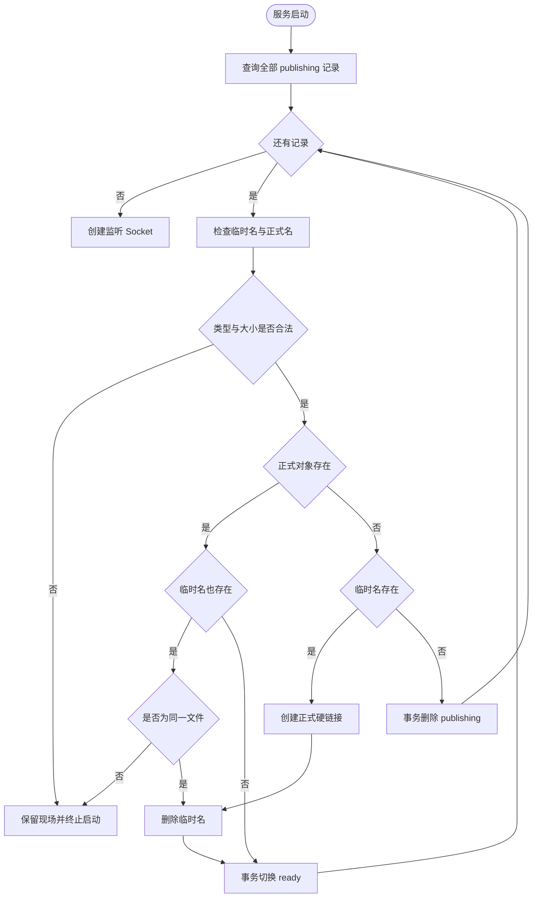

# 第26单元 publishing启动恢复

## 目标

第25单元已经让上传经过`publishing`再进入`ready` 未完成记录不会被列表 详情和下载公开

本单元把中断状态变成可恢复状态 服务在监听端口前读取全部`publishing`记录 同时检查临时名和正式名 然后完成发布或取消确定已经丢失的发布

恢复遇到大小错误 路径类型错误或两个名称指向不同文件时拒绝启动 保留现场供排查 不把不确定对象公开为`ready`

## 恢复判定表

| 临时名 | 正式名 | 判定与动作 |
| --- | --- | --- |
| 匹配的普通文件 | 缺失 | 创建正式硬链接 删除临时名 切换ready |
| 缺失 | 匹配的普通文件 | 切换ready |
| 匹配的普通文件 | 同一文件的硬链接 | 删除临时名 切换ready |
| 缺失 | 缺失 | 删除publishing记录 |
| 非普通文件或大小不符 | 任意 | 保留publishing并拒绝启动 |
| 普通文件 | 普通文件但不是同一文件 | 保留两个文件和publishing并拒绝启动 |

## 图的类型

Flowchart

## 为什么选择这种图

本单元核心是根据两个磁盘名称的组合状态选择恢复动作 Flowchart能直接表达判断顺序 正常完成 取消和拒绝启动三类结果

## Mermaid



## 图的解释

恢复在创建监听Socket之前完成 因此客户端不会观察到恢复进行一半的状态

`ready`和取消操作都是单条SQLite事务 某条记录完成后即使后续记录失败 下一次启动也只处理剩余`publishing`记录

硬链接创建成功后如果进程在删除临时名或切换`ready`之前退出 下一次启动会落入两个名称指向同一文件或正式名独存分支 因而可以继续

## 生产接口

### FileMetadataStore list_publishing

参数`output`由调用方拥有 函数进入时清空 按`created_at id`升序复制全部`publishing`行

返回`MetadataResult::Ok`表示查询完整结束 返回`Error`时`error_message()`包含SQLite诊断并且输出被清空

仓库拥有并复用预编译语句 查询读出的SQLite文本在语句reset前复制到`std::string` 不向外暴露SQLite内部指针

### PublishingRecovery

构造参数`FileMetadataStore&`是借用关系 仓库必须比恢复器存活更久 恢复器不关闭数据库也不拥有文件

`run(PublishingRecoveryReport&)`每次先清零报告 成功返回true 失败返回false 已经提交的前序恢复不会回滚 下一次运行从剩余记录继续

`completed`统计切换为`ready`的数量 `cancelled`统计临时名和正式名都缺失后取消的数量

`error_message()`返回最近一次失败的操作 ID和诊断 字符串由恢复器拥有 在下一次`run`前有效

## 文件系统接口

- `std::filesystem::symlink_status`检查路径本身 不把符号链接跟随成普通文件
- `std::filesystem::file_size`只在已确认普通文件后读取长度
- `std::filesystem::equivalent`确认临时名和正式名是否指向同一文件
- `std::filesystem::create_hard_link`在只有临时文件时补完正式对象名 不覆盖已有路径
- `std::filesystem::remove`只删除已经确认安全的临时名

当前恢复在监听前执行并假设一个数据目录只由一个服务进程管理 这不是多进程锁

## 本次文件变化

- 新增`src/publishing_recovery.h`实现恢复状态机
- 修改`src/file_metadata_store.h`增加publishing查询预编译语句与`list_publishing`
- 修改`src/main.cpp`在创建监听Socket前执行恢复
- 新增`tests/day26_publishing_recovery.cpp`验证分类 冲突保护 重试和幂等
- 新增`tests/day26_publishing_recovery.py`验证真实服务连续启动和恢复后下载
- 修改`CMakeLists.txt`注册两项测试
- 更新README API计划与进度

Python测试实现继续由助手维护 不要求用户阅读

## Linux虚拟机验证

在Linux虚拟机执行

```sh
cd ~/projects/netdisk

cmake -S . -B build \
  -DCMAKE_BUILD_TYPE=Debug \
  -DBUILD_TESTING=ON

cmake --build build -j2

ctest --test-dir build \
  -R '^publishing_recovery_integration_tests$' \
  -V
```

成功条件是实际运行一项测试并输出

```text
PASS: publishing recovery integration finished, 2 groups
100% tests passed, 0 tests failed out of 1
```

该测试创建独立临时目录并连续启动三次服务 第一次建库 第二次恢复四种中断状态 第三次证明恢复为空操作 不使用工程自己的data目录

## 一次真实操作

先确保服务已经停止且`upload-Reco26`未被使用 在Linux工程目录执行

```sh
cd ~/projects/netdisk

FILE_ID='upload-Reco26'
printf 'day26 recovered publication\n' > "data/uploads/$FILE_ID"
FILE_SIZE=$(wc -c < "data/uploads/$FILE_ID")
CREATED_AT=$(date +%s)

sqlite3 data/netdisk.db \
  "INSERT INTO files(id,name,size,state,created_at) VALUES('$FILE_ID','$FILE_ID.bin',$FILE_SIZE,'publishing',$CREATED_AT);"

./build/netdisk
```

启动日志应包含

```text
publishing recovery completed=1 cancelled=0
listening on 127.0.0.1:8080
```

另一个Linux终端执行

```sh
cd ~/projects/netdisk

curl -s 'http://127.0.0.1:8080/api/files/upload-Reco26/content'

sqlite3 data/netdisk.db \
  "SELECT id,state,size FROM files WHERE id='upload-Reco26';"
```

下载应输出`day26 recovered publication` 数据库状态应为`ready` 且`data/uploads/upload-Reco26`已经不存在

## 当前边界

- 恢复只处理有publishing元数据的对象 不扫描没有元数据的孤立正式文件
- 现阶段用文件类型与大小判断内容 没有SHA-256摘要校验
- 不处理deleting状态 第27单元继续删除恢复
- 没有fsync和目录同步 不承诺断电零丢失
- 不支持多个服务进程共享同一数据库和对象目录
