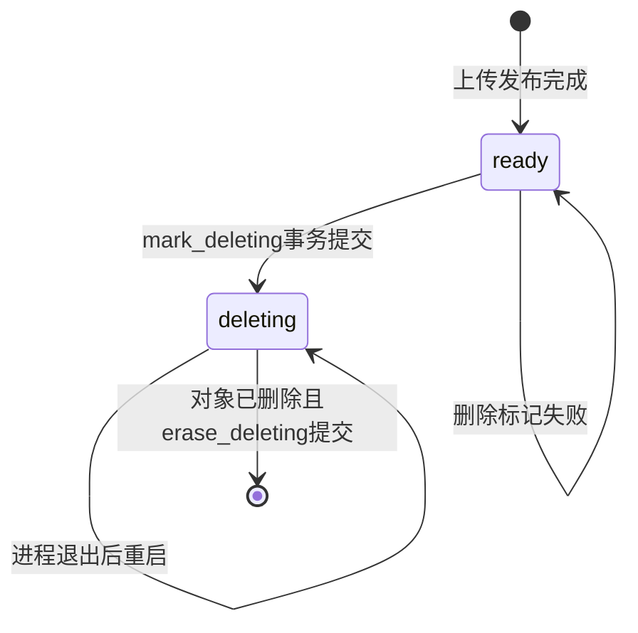

# 第27单元 deleting状态与删除恢复

## 目标

第19单元的DELETE先删除对象再删除`ready`元数据 如果进程在两步之间退出 数据库会留下仍可见的`ready`记录 但正式对象已经不存在 后续列表或下载会遇到内部错误

本单元把删除改为三个提交点

1. SQLite事务把`ready`切换为`deleting`
2. 删除`data/objects/{id}`正式对象
3. SQLite事务删除对应`deleting`记录

第一步提交后 列表 详情 下载和重复DELETE都只查询`ready` 因而新请求立即把它视为不存在 第二步或第三步之间进程退出时 下一次启动会继续完成删除

## 中断位置与恢复动作

| 中断位置 | 磁盘对象 | 元数据 | 下一次启动动作 |
| --- | --- | --- | --- |
| 标记前 | 存在 | ready | 不恢复 文件仍正常公开 |
| 标记后 删除前 | 存在 | deleting | 校验类型和大小后删除对象 再删除记录 |
| 删除后 收尾前 | 缺失 | deleting | 直接删除记录 |
| 全部完成后 | 缺失 | 无记录 | 不执行任何动作 |
| deleting对象类型或大小异常 | 异常 | deleting | 保留对象与记录并拒绝监听 |

## 图的类型

State Diagram

## 为什么选择这种图

本单元核心是一个对象从公开状态进入删除中间态再消失的状态转换 State Diagram能同时表达正常DELETE 中断后的重启恢复和非法转换

## Mermaid



## 图的解释

只有`ready`会被公开查询 `deleting`不是可下载状态 因而删除意图一旦提交 新请求就不会重新打开对象

删除对象和删除元数据不是一个跨文件系统与SQLite的原子事务 `deleting`承担可恢复日志的作用 重启只处理这个状态 不扫描或删除无元数据的普通对象 也不会处理仍为`ready`的对象

第二次恢复查询不到已经完成的记录 所以恢复是幂等的

## 生产接口

### FileMetadataStore mark_deleting

参数`id`是借用的`std::string_view` 调用期间必须有效 函数通过预编译语句绑定复制到SQLite

函数执行`BEGIN IMMEDIATE` 把且仅把对应`ready`行切换为`deleting`并提交 返回`Ok`表示删除意图已经持久化到当前SQLite配置的保证范围 返回`NotFound`表示ID不存在或状态不是`ready` 返回`Error`时`error_message()`保存诊断

### FileMetadataStore erase_deleting

参数和所有权规则与`mark_deleting`相同 函数只删除对应`deleting`行 不允许直接删除`ready`行

返回`Ok`表示事务提交 返回`NotFound`表示行不存在或状态不匹配 返回`Error`表示SQLite操作失败

原来的`erase_ready`已经删除 防止调用方绕过中间状态

### FileMetadataStore list_deleting

参数`output`由调用方拥有 函数进入时清空 按`created_at id`升序复制全部`deleting`记录

返回`Ok`表示完整查询结束 返回`Error`时输出再次清空并通过`error_message()`提供SQLite诊断

### DeletionRecovery

构造参数`FileMetadataStore&`是借用关系 仓库和它借用的SQLite连接必须比恢复器存活更久 恢复器不关闭数据库

`run(DeletionRecoveryReport&)`每次先清零报告 成功返回true 失败返回false 已经提交完成的前序记录不会回滚 下一次运行只处理剩余记录

`completed`统计删除完成并擦除元数据的记录数 `objects_removed`只统计本次实际删除了正式对象的记录数 对象本来已经缺失时前者增加而后者不增加

`error_message()`返回最近一次失败的操作 ID和诊断 字符串由恢复器拥有 到下一次`run`为止有效

## DELETE执行语义

路由在标记前先确认对象是普通文件并且实际大小等于元数据 避免把异常路径直接当作正常对象删除

`mark_deleting`成功后 即使对象删除或最终元数据事务失败 响应是500且记录保持`deleting` 新的列表 详情 下载和DELETE请求得到404 服务重启时继续清理

Linux中已经打开的文件描述符引用inode 删除目录项不会让该描述符立即失效 因此未来加入并发后 已经开始的下载可以继续 新下载则被`deleting`挡住 当前服务仍是串行阻塞模型 本单元没有把这个性质冒充为并发测试通过

## 本次文件变化

- 新增`src/deletion_recovery.h`实现启动删除恢复
- 修改`src/file_metadata_store.h`增加`mark_deleting erase_deleting list_deleting`并移除`erase_ready`
- 修改`src/file_catalog.h`把DELETE改为三阶段状态机并增加对象大小校验
- 修改`src/main.cpp`在监听前执行删除恢复
- 修改`tests/day24_file_pagination.cpp`让旧分页夹具使用新的删除状态机
- 新增`tests/day27_deletion_recovery.cpp`验证中断位置 幂等 异常保留和ready保护
- 新增`tests/day27_deletion_recovery.py`验证真实服务重启 正常DELETE和再次重启
- 修改`CMakeLists.txt`注册两项测试
- 更新README API计划和学习进度

Python测试脚本继续由助手维护 不要求阅读其实现

## Linux虚拟机验证

先把本次新增和修改文件同步到Linux虚拟机 特别确认`tests/day27_deletion_recovery.py`存在 然后执行

```sh
cd ~/projects/netdisk

cmake -S . -B build \
  -DCMAKE_BUILD_TYPE=Debug \
  -DBUILD_TESTING=ON

cmake --build build -j2

ctest --test-dir build \
  -R '^deletion_recovery_integration_tests$' \
  -V
```

成功条件是CTest实际运行一项测试并输出

```text
PASS: deletion recovery integration finished, 3 groups
100% tests passed, 0 tests failed out of 1
```

测试在独立临时目录中启动四次服务 第一次建库 第二次恢复对象存在与对象缺失两种中断状态 第三次证明恢复为空操作并执行正常DELETE 第四次确认删除不会在重启后复活

## 一次真实恢复操作

先停止服务 确保数据库已经由当前程序初始化 且测试ID未使用 然后在Linux工程目录执行

```sh
cd ~/projects/netdisk

FILE_ID='upload-Del027'
printf 'day27 interrupted delete\n' > "data/objects/$FILE_ID"
FILE_SIZE=$(wc -c < "data/objects/$FILE_ID")
CREATED_AT=$(date +%s)

sqlite3 data/netdisk.db \
  "INSERT INTO files(id,name,size,state,created_at) VALUES('$FILE_ID','$FILE_ID.bin',$FILE_SIZE,'deleting',$CREATED_AT);"

./build/netdisk
```

启动日志应包含

```text
deletion recovery completed=1 objects_removed=1
listening on 127.0.0.1:8080
```

另一个Linux终端执行

```sh
cd ~/projects/netdisk

test ! -e 'data/objects/upload-Del027'
sqlite3 data/netdisk.db \
  "SELECT COUNT(*) FROM files WHERE id='upload-Del027';"
curl -i 'http://127.0.0.1:8080/api/files/upload-Del027'
```

成功时`test`退出状态为0 SQLite输出`0` curl返回404

## 当前边界

- 恢复只处理有`deleting`元数据的对象 不扫描或自动删除无元数据孤立对象
- 类型或大小异常时保留证据并拒绝监听 没有SHA-256摘要校验
- 这是进程中断恢复 还没有数据文件与目录的`fsync` 不承诺突然断电零丢失
- 不支持多个服务进程共享同一个数据库和对象目录
- 没有回收站 删除确认或延迟清理
- 本机已通过C++状态机与相关回归 Linux真实服务测试仍待用户反馈
