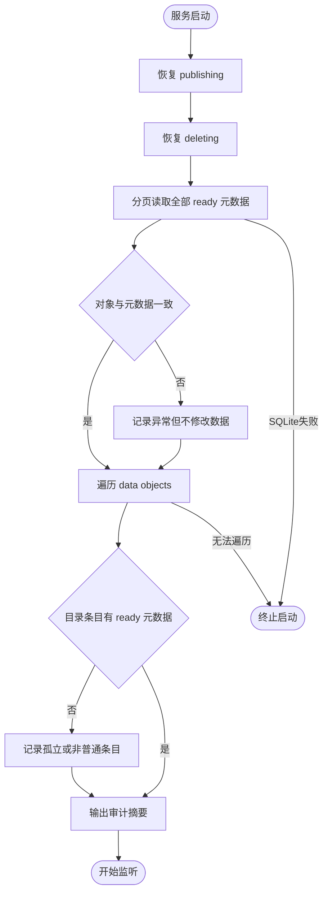

# 第28单元 存储一致性审计与孤立对象报告

## 目标

第26和第27单元分别把`publishing`与`deleting`中间状态恢复到确定结果 但`ready`元数据和`data/objects`仍可能因为人工修改 磁盘故障 旧版本缺陷或离线迁移产生差异

本单元新增启动只读审计 在发布恢复和删除恢复之后 监听端口之前完成以下比对

- `ready`元数据ID不合法
- `ready`记录缺少正式对象
- 正式对象大小与元数据不符
- `ready`路径不是普通文件
- 正式目录中存在没有`ready`元数据的普通文件
- 正式目录中存在没有`ready`元数据的目录 符号链接等非普通条目

发现这些差异时打印摘要和逐项日志 但不删除对象 不修改元数据 服务继续监听 健康文件仍可使用 只有数据库查询或目录遍历本身失败导致审计无法完成时才拒绝启动

## 图的类型

Flowchart

## 为什么选择这种图

本单元核心是启动阶段依次恢复 分页读取 分类报告和决定是否监听的控制流 Flowchart可以清楚区分数据异常与审计执行失败这两类不同结果

## Mermaid



## 图的解释

发布和删除恢复先消除已知中间状态 审计随后只处理`ready`与正式目录 它没有修复权限 因而所有数据异常都保留证据并进入汇总

SQLite查询失败 权限错误或目录遍历失败意味着审计结果不完整 此时不能打印一个误导性的完整报告 所以终止启动

## 生产接口

### StorageAuditor

构造参数`FileMetadataStore&`是借用关系 审计器不拥有也不关闭仓库和SQLite连接 调用方必须保证仓库在审计器之后析构

`run(StorageAuditReport&)`进入时清空旧报告 使用现有`list_ready`接口以每页100条遍历全部`ready`记录 再遍历`data/objects` 返回`true`表示审计完整执行 不等于数据无异常 返回`false`表示审计过程失败并应读取`error_message()`

审计在服务监听前单线程运行 分页期间没有本服务请求修改元数据 因而可以使用第24单元的键集游标稳定遍历 不需要把全部元数据一次装入内存

### StorageAuditReport

报告由调用方拥有 包含元数据条数 目录条目数 健康对象数 六类异常计数和逐项`findings`

`clean()`只判断`findings`是否为空 它不触发新的磁盘检查 逐项记录中的字符串和大小值由报告自身拥有

### StorageAuditFinding

`kind`区分六类异常 `id`保存元数据ID或目录项名称 `expected_size`来自SQLite `actual_size`只对大小不符有意义

未知目录项可能包含空格 换行或其他日志控制字符 输出前由`escape_storage_audit_value`百分号编码 避免一条文件名伪造多行日志

## 分类规则

| 元数据或目录状态 | 分类 | 启动行为 |
| --- | --- | --- |
| ready ID不符合`upload-`加六位字母数字 | `invalid_metadata_id` | 报告并继续 |
| ready路径不存在 | `missing_object` | 报告并继续 |
| 普通文件大小不同 | `size_mismatch` | 报告并继续 |
| ready路径是目录或符号链接等 | `non_regular_object` | 报告并继续 |
| 无ready记录的普通文件 | `orphan_object` | 报告并继续 |
| 无ready记录的非普通条目 | `unexpected_entry` | 报告并继续 |
| SQLite查询或目录遍历失败 | 审计执行失败 | 终止启动 |

孤立对象不能自动删除 因为它可能是元数据提交失败后仍有价值的唯一副本 也可能是管理员尚未完成的离线导入 本单元只提供事实 不猜测数据归属

## 本次文件变化

- 新增`src/storage_audit.h`实现分页只读审计 分类 报告和日志值转义
- 修改`src/main.cpp`在两类恢复之后 监听之前运行审计并输出摘要与逐项告警
- 新增`tests/day28_storage_audit.cpp`覆盖超过100条记录 六类异常 重复审计和数据不变性
- 新增`tests/day28_storage_audit.py`覆盖真实服务带异常启动 健康下载 日志分类和第二次启动不清理证据
- 修改`CMakeLists.txt`注册C++测试与Linux集成测试
- 更新README API计划与学习进度

Python测试脚本继续由助手维护 不要求阅读其实现

## Linux虚拟机验证

同步本次新增和修改文件 特别确认`tests/day28_storage_audit.py`存在 然后执行

```sh
cd ~/projects/netdisk

cmake -S . -B build \
  -DCMAKE_BUILD_TYPE=Debug \
  -DBUILD_TESTING=ON

cmake --build build -j2

ctest --test-dir build \
  -R '^storage_audit_integration_tests$' \
  -V
```

成功条件是CTest实际运行一项测试并输出

```text
PASS: storage audit integration finished, 2 groups
100% tests passed, 0 tests failed out of 1
```

测试在独立临时目录中先初始化数据库 再构造六类异常 连续启动两次服务 验证告警不阻止健康请求且两次启动之间没有对象或元数据被自动修改

## 一次真实孤立对象操作

先在服务所在终端按`Ctrl+C`停止当前服务 然后在Linux工程目录执行

```sh
cd ~/projects/netdisk

test ! -e 'data/objects/upload-Aud028'
printf 'day28 orphan evidence\n' > 'data/objects/upload-Aud028'
./build/netdisk
```

启动输出应包含以下逐项告警 并继续出现监听日志

```text
storage audit finding kind=orphan_object id=upload-Aud028
listening on 127.0.0.1:8080
```

另一个Linux终端验证对象没有被审计删除且服务可用

```sh
cd ~/projects/netdisk

test -f 'data/objects/upload-Aud028'
curl -i 'http://127.0.0.1:8080/health'
```

成功时`test`退出状态为0 curl返回200和`OK` 验证完成后先停止服务 再删除这一个人工测试对象

```sh
cd ~/projects/netdisk
rm -- 'data/objects/upload-Aud028'
```

## 当前边界

- 只比较ID 文件类型和大小 第29单元才加入SHA-256内容摘要
- 审计不是数据库快照与目录快照的跨资源原子视图 当前依赖启动阶段单进程且尚未监听的前提
- 异常只写启动日志 没有管理API 指标系统或自动修复
- 不扫描`data/uploads`中没有`publishing`元数据的临时文件
- 不自动删除孤立对象 不自动重建缺失元数据 不把大小相同当作内容完全一致
- 没有文件与目录`fsync` 仍不承诺突然断电零丢失
