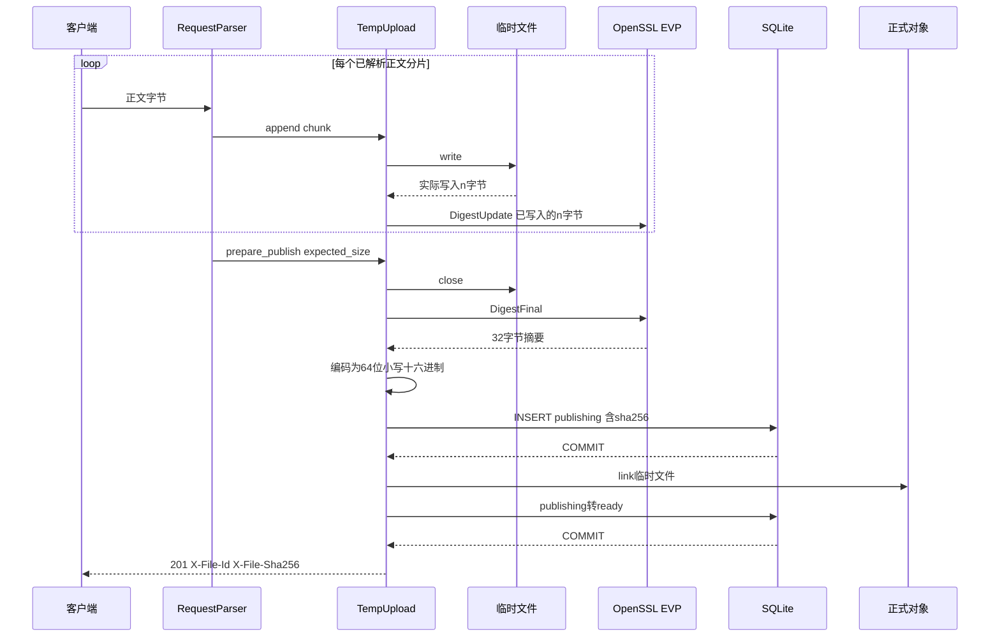

# 第29单元 OpenSSL EVP流式SHA256与schema v2迁移

## 本单元目标

本单元把内容摘要接入真实上传链路

- 每次`write`成功后只摘要实际写入的字节
- 上传完成后得到64位小写十六进制SHA256
- 摘要与`publishing`元数据一起写入SQLite
- 成功响应增加`X-File-Sha256`
- schema从v1事务性迁移到v2
- 旧记录摘要保持`NULL` 不伪造历史数据

SHA256用于判断内容是否一致 不是加密 不是签名 也不承担密码保存和用户鉴权

## OpenSSL EVP接口

`EVP_MD_CTX_new()`返回调用方独占的摘要上下文 失败返回空指针 最终由`EVP_MD_CTX_free()`释放

`EVP_DigestInit_ex(context EVP_sha256() nullptr)`初始化SHA256算法 返回1表示成功

`EVP_DigestUpdate(context data size)`同步读取本次字节 输入内存只需在调用期间有效 可调用多次 分片边界不会改变最终摘要

`EVP_DigestFinal_ex(context output output_size)`完成摘要并写出32个二进制字节 返回1表示成功 完成后本项目不允许再次update或finish

`Sha256Hasher`拥有`EVP_MD_CTX` 禁止复制 析构自动释放 `finish`成功后把十六进制字符串移动给调用方

接口依据为[OpenSSL EVP摘要官方文档](https://docs.openssl.org/1.1.1/man3/EVP_DigestInit/) 构建目标依据为[CMake FindOpenSSL官方文档](https://cmake.org/cmake/help/git-stage/module/FindOpenSSL.html)

## 真实执行顺序

图的类型：Sequence Diagram

为什么选择这种图：本单元的关键是网络分片 写盘 摘要 数据库事务和对象发布的先后关系 时序图能直接表达摘要覆盖哪些字节以及201何时允许返回



图的解释：只有`write`返回的正数字节才进入摘要 写盘失败或摘要失败都会终止上传并由析构清理临时文件 第一个数据库事务已经同时保存ID 大小和摘要 第二个事务成功把对象改为`ready`后才返回201

## schema迁移

v2新增字段如下

```sql
sha256 TEXT CHECK (
    sha256 IS NULL OR
    (length(sha256) = 64 AND sha256 NOT GLOB '*[^0-9a-f]*')
)
```

字段允许`NULL`是为了准确表达v1旧对象尚未计算摘要 空字符串不是有效摘要

v1迁移在一个事务内执行

1. `ALTER TABLE files ADD COLUMN sha256`
2. 重建带`version = 2`约束的`schema_info`
3. 更新`PRAGMA user_version = 2`
4. `COMMIT`

其中任一步失败都会回滚 不会留下用户版本和表结构互相矛盾的半迁移状态

## 本次文件变化

新增

- `src/sha256_hasher.h`
- `tests/day29_sha256.cpp`
- `tests/day29_sha256.py`
- `docs/lessons/day29.md`

修改

- `src/temp_upload.h`
- `src/metadata_database.h`
- `src/file_metadata_store.h`
- `src/http_response.h`
- `src/main.cpp`
- `tests/day13_publish.cpp`
- `tests/day22_sqlite_lifecycle.cpp`
- `tests/day23_metadata_persistence.py`
- `CMakeLists.txt`
- `README.md`
- `docs/api-v0.1.md`

其他生产源码保持不变

## Linux依赖与构建

仅在缺少OpenSSL开发包时执行

```sh
sudo apt update
sudo apt install -y libssl-dev
```

在Linux虚拟机工程目录执行

```sh
cd ~/projects/netdisk
cmake -S . -B build -DCMAKE_BUILD_TYPE=Debug -DBUILD_TESTING=ON
cmake --build build -j2
```

若一直使用`build-debug` 将命令中的`build`统一替换为`build-debug`

## 核心自动测试

```sh
ctest --test-dir build -R '^sha256_integration_tests$' -V
```

该测试只运行一项 但内部覆盖四组证据

1. v1数据库迁移到v2且旧摘要仍为`NULL`
2. 三段正文都已真实写入临时文件后最终摘要仍与客户端一致
3. 空文件摘要正确
4. 重启后对象字节和SQLite摘要保持不变

成功时末尾应出现

```text
PASS: SHA256 integration finished 4 groups
100% tests passed, 0 tests failed out of 1
```

Linux不应出现`SKIP`

## 一次真实操作

终端一启动服务

```sh
cd ~/projects/netdisk
mkdir -p data/uploads data/objects
./build/netdisk
```

终端二创建文件并上传

```sh
cd ~/projects/netdisk
printf 'day29\0sha256\n' > /tmp/netdisk-day29.bin
sha256sum /tmp/netdisk-day29.bin
curl -i --data-binary @/tmp/netdisk-day29.bin http://127.0.0.1:8080/api/files
```

`sha256sum`第一列应与响应头`X-File-Sha256`完全相同 响应还应包含安全格式的`X-File-Id`

## 排错入口

若CMake提示找不到OpenSSL 先确认`libssl-dev`已经安装 再重新运行配置命令 不只执行旧的构建命令

若启动报告schema迁移失败 不要手工修改`PRAGMA user_version` 保留`data/netdisk.db`并反馈完整错误 版本数字和真实表结构必须由同一个迁移事务维护

若摘要不一致 先保留客户端原文件 上传响应头 文件ID和服务日志 不要直接覆盖正式对象 测试会同时比较客户端摘要 响应头 SQLite和正式对象字节 由不一致位置定位问题

## 当前边界

- 只有本单元后的新上传自动生成摘要
- v1旧对象摘要保持`NULL` 第30单元再设计回填
- 启动审计仍只比较ID 类型和大小 尚不逐对象重算内容摘要
- 列表详情和下载尚未返回摘要或ETag
- 没有Range 秒传 上传续传 fsync和断电零丢失保证
- SHA256内容一致不代表对象来源可信
