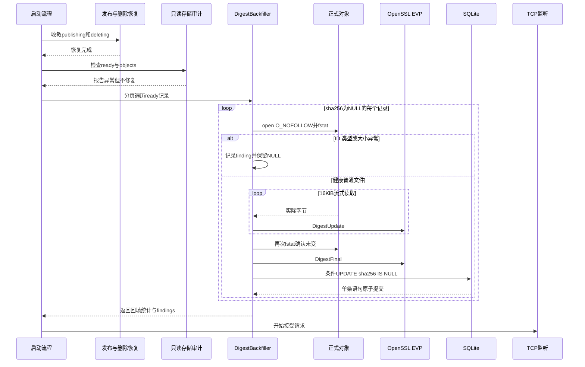

# 第30单元 旧对象SHA256回填与下载强ETag

## 本单元目标

第29单元让新上传在发布前得到SHA256 但v1迁移来的旧记录仍然是`NULL` 本单元完成两个生产行为

- 启动时对健康旧`ready`对象流式计算并持久化SHA256
- GET和HEAD下载用持久化SHA256返回强`ETag`

这不是为了把所有`NULL`强行填满 文件缺失 类型错误 大小不符或读取期间变化时必须保留未知状态

## 为什么ETag使用SHA256

HTTP的ETag是响应表示的不透明版本标识 弱ETag使用`W/`前缀 允许语义相同但字节不完全一致 本项目的对象一旦进入`ready`就不再修改字节 因此可以使用

```text
ETag: "8af29b6187c9a99b7d99fc176b335e31a4266f023110d1545f512be0eccee842"
```

这是强ETag 相同值表示相同字节内容 显示名称修改不改变ETag 本单元只返回ETag 还没有解析`If-None-Match`或`If-Range`

## 真实执行顺序

**图的类型**：Sequence Diagram

**为什么选择这种图**：回填正确性依赖恢复 审计 打开对象 流式摘要和条件更新的先后关系 时序图能直接表达监听为什么必须最后开始



**图的解释**：恢复先把可恢复的对象收教为`ready` 审计先留下不一致证据 回填再只处理健康且摘要未知的对象 整个过程在网络监听前完成 因此当前单进程内没有下载或删除与回填并发

## 新接口与生命周期

### `DigestBackfiller`

`DigestBackfiller(FileMetadataStore& store)`借用服务主函数持有的元数据仓库 不拥有SQLite连接 使用期间`store`必须存活

`run(DigestBackfillReport& report)`每次先清空输出报告 成功返回`true` 即使有可解释的数据异常也会成功并把它们放入`findings` SQLite查询失败 正常文件打开或读取失败 OpenSSL失败和条件更新冲突返回`false` 详情由`error_message()`借用返回

`UniqueFd object`独占已打开的对象fd 离开单个记录处理作用域时自动关闭 `Sha256Hasher`独占EVP上下文 完成或失败时自动释放

### `FileMetadataStore::set_sha256_if_missing`

参数`id`和`sha256`只在调用期间同步借用 `size`是回填时已验证的元数据字节数

SQL条件是

```sql
UPDATE files SET sha256 = ?1
WHERE id = ?2
  AND state = 'ready'
  AND size = ?3
  AND sha256 IS NULL;
```

`Ok`表示恰好更新一行 `NotFound`表示状态 大小或摘要前提已变 `Error`表示绑定 约束或SQLite执行失败 单条SQLite写语句本身是原子事务

### `make_download_header`

新签名是

```cpp
bool make_download_header(std::string_view id,
                          std::uint64_t size,
                          std::string_view sha256,
                          std::string& output);
```

`id`和`sha256`在调用期间借用 `output`由调用方拥有 只有ID合法且SHA256是64位小写十六进制时才替换输出 失败时输出保持不变

## 本次文件变化

新增

- `src/digest_backfill.h`
- `tests/day30_digest_backfill.cpp`
- `tests/day30_digest_backfill.py`
- `docs/lessons/day30.md`

修改

- `src/file_metadata_store.h`
- `src/download_headers.h`
- `src/file_download.h`
- `src/main.cpp`
- `tests/day17_download_headers.cpp`
- `CMakeLists.txt`
- `README.md`
- `docs/api-v0.1.md`

其他生产源码和schema版本保持不变 本单元不需要schema v3 因为回填只是把v2中已经存在的可空字段从`NULL`更新为有效值

## Linux构建与核心测试

在Linux虚拟机工程目录执行

```sh
cd ~/projects/netdisk
cmake -S . -B build -DCMAKE_BUILD_TYPE=Debug -DBUILD_TESTING=ON
cmake --build build -j2
ctest --test-dir build -R '^digest_backfill_integration_tests$' -V
```

若一直使用`build-debug` 将三条命令中的`build`统一替换为`build-debug`

这项CTest内部覆盖两次真实进程启动

1. 首次启动只回填一个健康旧对象 保留已有摘要和缺失对象的`NULL`
2. GET与HEAD返回完全相同的强ETag 显示名改后ETag不变
3. 第二次启动不重算已回填对象 不为缺失对象伪造摘要

成功时末尾应出现

```text
PASS: digest backfill integration finished 2 groups
100% tests passed, 0 tests failed out of 1
```

Linux不应出现`SKIP`

## 一次真实操作

终端一启动服务

```sh
cd ~/projects/netdisk
mkdir -p data/uploads data/objects
./build/netdisk
```

启动日志会出现类似

```text
digest backfill ready=3 already_hashed=2 backfilled=1 skipped=0
```

终端二从列表取一个ID并检查下载头

```sh
cd ~/projects/netdisk
curl -s http://127.0.0.1:8080/api/files
curl -I http://127.0.0.1:8080/api/files/USER_FILE_ID/content
```

将`USER_FILE_ID`替换为列表中的真实ID 成功响应应同时有`Content-Length` `Content-Disposition`和带双引号的`ETag` 若没有任何旧`NULL`记录 `backfilled=0`是正常结果

## 排错入口

若测试中回填数是0 先用SQLite确认目标记录是`ready`且`sha256 IS NULL` 再检查`data/objects/{id}`是普通文件且大小与元数据一致

若日志出现`digest backfill finding` 保留该对象和数据库 不要为了让统计变绿直接写一个假SHA256 finding会给出非法ID 缺失 类型错误 大小不符或读取期间变化

若下载返回500并输出`download metadata has no canonical SHA256` 说明该`ready`记录仍缺少可信摘要 先处理启动回填日志中的对象异常

## 当前边界

- 启动回填串行读取所有旧对象 对大型存量会延长启动时间 后续需要可观测进度和后台任务
- 项目还没有多进程共享数据目录协调 强ETag依赖正式对象发布后不被服务外工具改写
- 未定期重算已有摘要来发现同大小内容损坏 启动审计仍只校验类型和大小
- 未实现`If-None-Match` 304 Range If-Range和下载续传
- 没有文件与目录`fsync` 不承诺断电零丢失
