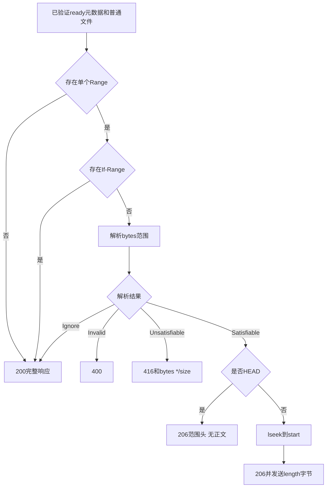

# 第31单元 单Range下载与206 416语义

## 1 今天要做什么

今天给现有文件下载接口增加单字节范围下载能力

客户端可以在请求中说明只需要文件的一部分 例如只下载第2至第7字节 服务端不再总是从文件开头发送到末尾 而是定位到指定位置并只发送所需字节

今天完成后 `GET /api/files/{id}/content` 和对应HEAD接口具有以下可观察行为

- 没有Range时保持原来的完整下载并返回200
- `Range: bytes=2-7`这类可满足单范围返回206
- 响应使用Content-Range准确说明实际发送区间和完整文件大小
- GET正文只包含范围内字节 Content-Length等于实际范围长度
- HEAD返回与GET相同的范围状态和响应头 但不发送正文
- 起点越界 空文件范围或零后缀返回416并报告完整文件大小
- 语法错误或重复Range字段返回400
- 合法多范围暂不实现 服务器忽略Range并返回完整200
- If-Range尚未完成判断时安全回退完整200

本单元的完成标准不是只写出Range字符串解析函数 而是客户端能通过真实HTTP请求得到正确的206 416 响应头和精确字节正文

## 2 前因后果

### 2.1 前面已经具备什么

第16单元已经实现按文件ID流式下载 服务端打开普通文件后使用16KiB缓冲区循环read和send 不把完整文件装进内存

第17单元补充了HEAD Content-Length Content-Type和Content-Disposition

第29单元为新上传内容计算并持久化SHA256 第30单元为旧对象回填SHA256 并把持久摘要作为强ETag返回

因此目前下载已经具备三个关键前提

1. 文件内容发布后不原地修改
2. 服务端知道完整文件大小
3. 服务端能够用强ETag标识具体内容版本

### 2.2 当前缺口是什么

当前下载无论客户端已经保存多少字节 都只能重新请求完整文件

如果一个大文件下载到90%时连接断开 客户端只能从头下载 已传输的90%无法复用 这不是协议解析问题 而是服务端缺少选择部分表示并准确描述响应范围的能力

### 2.3 为什么现在实现Range

Range依赖稳定的文件大小和内容版本 如果对象可能原地变化 客户端第一次保存的前半段可能属于旧版本 续传的后半段属于新版本 最终文件会被错误拼接

前两天完成SHA256和强ETag后 服务端已经有能力标识内容版本 因此现在适合先实现Range 下一单元再用If-Range把客户端已有版本与当前ETag连接起来

### 2.4 今天完成后怎样连接下一步

今天解决 服务端怎样解析一个字节范围 怎样定位文件 怎样返回206或416

下一单元解决 客户端请求续传时怎样证明本地已有部分属于当前版本 即If-Range匹配时返回206 不匹配时返回完整200

## 3 名词与概念定义

### 3.1 表示 Representation

HTTP中的表示是某个资源在一次响应中发送的内容及其元数据

这里资源是文件ID对应的ready文件 完整表示是整个文件 范围响应仍然来自同一个表示 只是只传输其中一段

表示不等于磁盘路径 客户端访问的是HTTP资源 服务端内部才把合法ID映射为对象路径

### 3.2 字节偏移 Byte Offset

字节偏移表示某个字节相对文件开头的位置 第一个字节偏移为0

一个10字节文件的合法偏移是0至9 偏移10已经位于文件末尾之后 不能作为非空范围的起点

### 3.3 Range请求头

Range是客户端发送的HTTP请求头 用于请求表示的一部分

本单元只支持bytes范围单位 bytes表示按字节计数 范围单位按ASCII大小写不敏感处理 因此bytes和BYTES都能识别

三种单范围形式

- `bytes=start-end` 指定起点和终点 两端都包含
- `bytes=start-` 从start一直到文件末尾
- `bytes=-suffix` 请求最后suffix个字节

单范围表示一次只选择一个连续区间 多范围例如`bytes=0-9,20-29`选择两个区间 需要multipart响应格式 本单元不实现

### 3.4 闭区间

HTTP字节范围的start和end都包含在结果中

因此`bytes=2-7`包含2 3 4 5 6 7共6个字节

计算公式是

```text
length = end - start + 1
```

### 3.5 200 206 400和416

- 200 OK 表示返回完整表示
- 206 Partial Content 表示成功返回请求范围
- 400 Bad Request 表示本项目认定请求语法非法 例如数字中含字母或结束位置早于起点
- 416 Range Not Satisfiable 表示Range语法成立 但对当前文件无法满足 例如起点已经不小于文件大小

400和416不能混为一谈 400表示请求本身不成立 416表示请求格式成立但当前表示没有对应区间

### 3.6 Content-Range响应头

Content-Range由服务器发送 说明本次正文对应完整文件的哪一段

206示例

```text
Content-Range: bytes 2-7/256
```

表示正文是完整256字节文件中的第2至第7字节

416示例

```text
Content-Range: bytes */256
```

星号表示没有可返回区间 256仍告诉客户端当前完整文件大小

### 3.7 Content-Length

Content-Length描述本次HTTP响应正文的字节数 不是完整文件大小

完整200时它等于文件大小 范围206时它等于范围长度 416时它等于固定JSON错误正文长度 HEAD不发送正文但仍保留对应GET响应本应具有的长度

### 3.8 Accept-Ranges

```text
Accept-Ranges: bytes
```

这是服务端响应头 表示该资源支持字节范围请求 它不是本次实际返回区间 实际区间由Content-Range说明

### 3.9 ETag与强ETag

ETag是表示的版本标识 本项目使用持久化SHA256并加双引号生成强ETag

强ETag表示字节内容一致 弱ETag带`W/`前缀 只表示语义上可能等价 不适合证明两段字节可以安全拼接

本单元的200 206和416都继续返回当前对象的强ETag

### 3.10 If-Range

If-Range是条件请求头 客户端通常同时发送Range和自己保存的ETag

其含义是 如果当前版本仍匹配就返回范围 如果版本已经变化就忽略Range并返回完整200

本单元尚未实现ETag比较 因此只要出现单个If-Range就先安全回退200 不冒险返回可能属于新版本的部分内容

### 3.11 GET与HEAD

GET返回响应头和正文 HEAD应返回与对应GET相同的状态和响应元数据 但不能发送正文

所以HEAD携带可满足Range时返回206和范围Content-Length Content-Range 但正文长度实际为0

### 3.12 `lseek` `off_t`和文件偏移

`lseek`是POSIX系统调用 用于修改已打开文件描述符的当前偏移

```cpp
off_t lseek(int fd, off_t offset, int whence);
```

- fd是已打开文件描述符 本项目由UniqueFd拥有
- offset是目标偏移
- whence为SEEK_SET时表示从文件开头计算绝对位置
- 成功返回新的偏移
- 失败返回`-1`并设置errno

`off_t`是POSIX表示文件偏移的整数类型 Range解析使用`uint64_t` 因此转换前必须验证目标偏移能够由`off_t`表示

### 3.13 EINTR

EINTR表示系统调用在完成前被信号中断 本实现遇到lseek返回`-1`且errno为EINTR时重试 其他错误记录并返回500

### 3.14 OWS

OWS是HTTP中的可选空白 Optional Whitespace 通常指空格或TAB

请求头解析器已经去除整个字段值两端的空白 Range列表解析还允许逗号分隔项周围出现OWS 但数字内部不能有空格

### 3.15 整数溢出

范围数字来自不可信请求 不能在已经溢出后再检查

解析下一位数字digit前使用

```text
value <= (UINT64_MAX - digit) / 10
```

只有条件成立才执行`value * 10 + digit`

## 4 今天功能的完整端到端逻辑

下面按照真实代码调用顺序说明一次范围下载如何经过系统

### 4.1 网络层接收并完成HTTP解析

`handle_client`继续使用`recv`分段读取TCP字节 `RequestParser`依次完成请求行 请求头和定长正文解析

TCP分片不会改变Range语义 因为Range只在请求头解析完成后读取

### 4.2 RequestParser保留规范化请求头

过去RequestParser内部已经保存请求头 但下载路由无法只读访问

本单元新增`headers()` 返回解析器内部字段数组的const引用 字段名已经转成小写 因此下载代码只比较`range`和`if-range`

### 4.3 下载路由先完成既有安全检查

`send_file_content`首先检查

1. 方法必须是GET或HEAD
2. 请求正文必须为空
3. 文件ID必须能安全映射到对象路径
4. SQLite中必须存在ready元数据
5. 使用O_NOFOLLOW打开对象 防止最终符号链接
6. fstat确认对象是普通文件且大小非负
7. 磁盘大小必须与ready元数据大小一致
8. 元数据必须包含规范的64位小写SHA256

只有这些检查全部通过才处理Range 这样206仍建立在原有下载安全边界上

### 4.4 收集Range和If-Range字段

代码遍历规范化请求头 统计Range与If-Range出现次数

重复Range返回400 因为本项目当前只接受单个Range字段

没有Range时保持完整200

有Range且有单个If-Range时暂时回退完整200 等下一单元实现强ETag比较

### 4.5 解析Range

`parse_byte_range`先识别大小写不敏感的bytes单位 再按逗号拆分范围项

单项由`parse_one_byte_range`处理

- 起点和终点都有值时验证两个uint64数字以及end不小于start
- 只有起点时长度为`full_size - start`
- 只有后缀长度时取`min(suffix_length full_size)`
- 显式end超过末尾时截断为`full_size - 1`
- start不小于full_size时返回Unsatisfiable
- 空文件的任何非空字节范围返回Unsatisfiable

输出使用start和length 而不是start和end 后续发送循环直接把length赋给remaining 不需要再次做容易出错的加一计算

### 4.6 根据解析类别决定协议响应

- Invalid调用现有固定JSON 400响应
- Unsatisfiable构造416 Content-Range为`bytes */size`
- Ignore不设置选择范围 后续自然构造完整200
- Satisfiable保存指向局部`ByteRange`的借用指针 只在当前同步函数作用域内使用

### 4.7 GET在发送成功头之前定位文件

如果是GET 范围起点非0 则先把`uint64_t start`安全转换为`off_t` 再执行

```cpp
lseek(file.get(), offset, SEEK_SET)
```

定位成功后才构造并发送206头

这样如果lseek失败 服务端还能返回完整500错误 而不是先发206再发现无法读取正确位置

### 4.8 构造200或206响应头

`make_download_header`接收可空`ByteRange`指针

- 空指针构造200 Content-Length为完整大小
- 非空指针验证范围不越界 构造206 Content-Length为范围长度并增加Content-Range

两者都包含Content-Type Content-Disposition Accept-Ranges 强ETag和Connection close

### 4.9 GET只发送声明的字节数

完整下载时

```text
remaining = full_size
```

范围下载时

```text
remaining = range.length
```

每次read的count是remaining和16KiB缓冲区大小的较小值 每次成功发送后减少remaining 直到0

所以即使文件后面还有数据 循环也不会发送超出Content-Range的字节

### 4.10 HEAD只发送响应头

HEAD仍完成元数据 文件类型 大小 摘要和Range检查 但不会执行不必要的lseek或read

成功发送200或206头后立即返回

### 4.11 资源生命周期

- `RequestParser`拥有请求行 请求头和可能缓冲的正文
- `FileMetadata`拥有从SQLite复制出的ID 名称 大小 状态和摘要
- `UniqueFd file`独占下载文件描述符 函数任意路径返回都会自动close
- `selected_range`是函数局部对象 `range`只在函数内部借用它
- `header`和416响应字符串由当前函数拥有 send_all同步使用
- 连接文件描述符由外层`handle_client`作用域中的UniqueFd拥有

## 5 为什么这样设计

### 5.1 为什么使用start加length

发送循环真正需要的是还剩多少字节 `length`可以直接初始化remaining

如果一直保存end 每次还要计算`end - start + 1` 更容易出现闭区间少一字节或无符号溢出问题

### 5.2 为什么合法多范围回退200

多范围成功响应不能简单连续发送两段原始字节 它需要`multipart/byteranges` Content-Type 边界字符串和每一段自己的Content-Range

本单元没有实现这种响应格式 因此忽略合法多范围并返回完整200 比错误返回单段206或把未实现误报为416更准确

### 5.3 为什么If-Range暂时回退200

没有比较版本就返回206可能让客户端把当前新版本的一段拼到本地旧版本后面

回退完整200会多传数据 但不会生成错误文件 这是正确性优先于带宽优化

### 5.4 为什么Range解析放在独立头文件

解析只依赖字符串和完整大小 不应该依赖Socket 文件系统 SQLite或响应发送

独立纯函数便于完整测试所有边界 同时避免把协议语法和Linux文件I/O混在一个大函数里

### 5.5 为什么先lseek再发送206头

HTTP成功头一旦发出就不能撤回

把可能立即失败的定位操作放在头部之前 服务端仍能给客户端明确500 把read中途错误保留为发送后只能断开连接的异常边界

### 5.6 为什么不直接把Range放进通用请求头校验

Range是否合法依赖具体表示大小 通用RequestParser只知道HTTP消息边界 不知道目标文件大小

因此通用解析器负责保存字段 下载资源处理器在拿到fstat大小后负责解释Range 这样职责边界更准确

## 6 关键协议语义速查

| 请求 | 256字节文件的结果 |
| --- | --- |
| `bytes=2-7` | 206 发送第2至7字节 共6字节 |
| `bytes=250-` | 206 发送第250至255字节 |
| `bytes=-5` | 206 发送最后5字节 |
| `bytes=253-999` | 206 截断为第253至255字节 |
| `bytes=256-` | 416 `Content-Range: bytes */256` |
| `bytes=-0` | 416 |
| `bytes=8-2` | 400 语法语义非法 |
| 合法多范围 | 暂不生成multipart 回退完整200 |
| 未知范围单位 | 忽略并回退完整200 |
| 携带If-Range | 本单元不比较 回退完整200 |

客户端只有收到206才能把正文追加到已有部分 收到200必须用完整响应覆盖旧文件 这也是If-Range未实现前选择回退200的原因

## 7 执行流程图

图的类型 Flowchart

为什么选择这种图 Range处理同时包含语法 分类 文件边界与响应分支 流程图能准确表达每个终止点



关键点是所有可预先发现的错误都发生在成功响应头发送前 lseek失败仍能返回500 一旦206头已经发送 后续read或send失败只能关闭连接 不能再追加另一份HTTP错误响应

## 8 接口怎么用

### 8.1 `parse_byte_range`

参数`value`和输出对象都由调用者拥有 字符串视图只在同步调用期间借用 `full_size`是完整表示长度 成功时才写入`ByteRange` 失败或忽略时不修改输出

返回值分为四类

- `Satisfiable` 输出`start`和`length`
- `Unsatisfiable` 语法成立但文件边界无法满足
- `Ignore` 未知单位或合法多范围 当前回退200
- `Invalid` 数字 溢出 反向结束或结构错误 返回400

### 8.2 `RequestParser::headers`

返回对解析器内部字段数组的只读引用 字段名已转为ASCII小写 字段值已去除两端空格和TAB 引用生命周期不超过`RequestParser`对象 下游不能保存到请求处理结束之后

### 8.3 `make_download_header`

`id`和`sha256`同步借用 `range`是可空借用指针 空指针生成200 非空生成206 函数验证范围仍位于完整大小内 成功后`output`独立拥有完整头部 失败不修改output

### 8.4 `make_range_not_satisfiable_response`

生成完整416线格式 GET包含固定JSON正文 HEAD保留相同Content-Length但不附正文 响应包含完整大小 强ETag和Accept-Ranges

### 8.5 `lseek`

`lseek(fd, offset, SEEK_SET)`把普通文件的共享文件偏移设置为绝对位置 成功返回新偏移 失败返回`-1`并设置`errno` 本实现先检查`uint64_t`到`off_t`往返转换 再在EINTR时重试 范围起点为0或HEAD时不需要调用

## 9 本次文件变化

新增生产文件`src/byte_range.h` 新增C++测试`tests/day31_range.cpp`和由助手维护的Python集成脚本`tests/day31_range.py`

修改`src/request_parser.h` `src/download_headers.h` `src/file_download.h`以及CMake 注册`range_tests`和`range_integration_tests`

修改既有下载头与摘要回填C++测试适配新的可空范围参数 修正day16和day20直接磁盘夹具没有SHA256导致强ETag下载回归的问题

`src/main.cpp` SQLite schema和其他生产文件保持不变

## 10 完整源码

以下代码是第31单元最终版本 不是差异片段

### 10.1 `src/byte_range.h`

```cpp
#pragma once

#include <algorithm>
#include <cstdint>
#include <limits>
#include <string_view>

// ===== DAY 31 ADDED BEGIN 解析单字节范围并区分忽略 无法满足与语法错误 =====
struct ByteRange
{
    std::uint64_t start = 0;
    std::uint64_t length = 0;
};

enum class ByteRangeResult
{
    Satisfiable,
    Unsatisfiable,
    Ignore,
    Invalid
};

inline std::string_view trim_range_ows(std::string_view text) noexcept
{
    while (!text.empty() && (text.front() == ' ' || text.front() == '\t'))
        text.remove_prefix(1);
    while (!text.empty() && (text.back() == ' ' || text.back() == '\t'))
        text.remove_suffix(1);
    return text;
}

inline bool parse_range_number(std::string_view text, std::uint64_t& output) noexcept
{
    if (text.empty()) return false;
    std::uint64_t value = 0;
    for (const char ch : text)
    {
        if (ch < '0' || ch > '9') return false;
        const auto digit = static_cast<std::uint64_t>(ch - '0');
        if (value > (std::numeric_limits<std::uint64_t>::max() - digit) / 10)
            return false;
        value = value * 10 + digit;
    }
    output = value;
    return true;
}

inline ByteRangeResult parse_one_byte_range(std::string_view text,
                                             std::uint64_t full_size,
                                             ByteRange& output) noexcept
{
    const auto dash = text.find('-');
    if (dash == std::string_view::npos ||
        text.find('-', dash + 1) != std::string_view::npos)
        return ByteRangeResult::Invalid;

    const auto first_text = text.substr(0, dash);
    const auto last_text = text.substr(dash + 1);
    if (first_text.empty())
    {
        std::uint64_t suffix_length = 0;
        if (!parse_range_number(last_text, suffix_length))
            return ByteRangeResult::Invalid;
        if (suffix_length == 0 || full_size == 0)
            return ByteRangeResult::Unsatisfiable;
        ByteRange parsed;
        parsed.length = std::min(suffix_length, full_size);
        parsed.start = full_size - parsed.length;
        output = parsed;
        return ByteRangeResult::Satisfiable;
    }

    std::uint64_t first = 0;
    if (!parse_range_number(first_text, first))
        return ByteRangeResult::Invalid;
    if (last_text.empty())
    {
        if (first >= full_size) return ByteRangeResult::Unsatisfiable;
        output = {first, full_size - first};
        return ByteRangeResult::Satisfiable;
    }

    std::uint64_t last = 0;
    if (!parse_range_number(last_text, last) || last < first)
        return ByteRangeResult::Invalid;
    if (first >= full_size) return ByteRangeResult::Unsatisfiable;
    last = std::min(last, full_size - 1);
    output = {first, last - first + 1};
    return ByteRangeResult::Satisfiable;
}

inline ByteRangeResult parse_byte_range(std::string_view value,
                                         std::uint64_t full_size,
                                         ByteRange& output) noexcept
{
    constexpr std::size_t unit_size = 6;
    if (value.size() < unit_size || value[5] != '=' ||
        !((value[0] == 'b' || value[0] == 'B') &&
          (value[1] == 'y' || value[1] == 'Y') &&
          (value[2] == 't' || value[2] == 'T') &&
          (value[3] == 'e' || value[3] == 'E') &&
          (value[4] == 's' || value[4] == 'S')))
        return ByteRangeResult::Ignore;

    value.remove_prefix(unit_size);
    std::size_t item_count = 0;
    ByteRange parsed;
    ByteRangeResult single_result = ByteRangeResult::Invalid;
    while (true)
    {
        const auto comma = value.find(',');
        const auto item = trim_range_ows(value.substr(0, comma));
        if (item.empty()) return ByteRangeResult::Invalid;
        ByteRange current;
        const auto result = parse_one_byte_range(item, full_size, current);
        if (result == ByteRangeResult::Invalid) return result;
        ++item_count;
        if (item_count == 1)
        {
            parsed = current;
            single_result = result;
        }
        if (comma == std::string_view::npos) break;
        value.remove_prefix(comma + 1);
    }

    if (item_count != 1) return ByteRangeResult::Ignore;
    if (single_result == ByteRangeResult::Satisfiable) output = parsed;
    return single_result;
}
// ===== DAY 31 ADDED END =====
```

### 10.2 `src/request_parser.h`

```cpp
#pragma once

#include "request_headers.h"

#include <algorithm>
#include <cstdint>
#include <limits>
#include <functional>
#include <utility>

inline bool parse_decimal_length(std::string_view text, std::uint64_t& output)
{
    if (text.empty()) return false;
    std::uint64_t value = 0;
    for (char ch : text)
    {
        if (ch < '0' || ch > '9') return false;
        const auto digit = static_cast<std::uint64_t>(ch - '0');
        if (value > (std::numeric_limits<std::uint64_t>::max() - digit) / 10)
        {
            return false;
        }
        value = value * 10 + digit;
    }
    output = value;
    return true;
}

enum class RequestError
{
    None,
    BadRequest,
    BodyTooLarge,
    UnsupportedExpectation,
    UnsupportedTransferEncoding,
    BodyWriteFailed
};

enum class BodyAction { Buffer, Written, Failed };
using BodySink = std::function<BodyAction(const RequestLine&, std::string_view)>;

class RequestParser
{
public:
    static constexpr std::size_t max_body_bytes = 64 * 1024;

    explicit RequestParser(BodySink sink = {}) : sink_(std::move(sink)) {}

    FeedResult feed(std::string_view input)
    {
        if (state_ != ParseState::NeedMore) return {state_, 0};
        std::size_t used = 0;
        if (!line_done_)
        {
            const auto result = line_.feed(input);
            used += result.consumed;
            if (result.state == ParseState::Error)
            {
                error_ = RequestError::BadRequest;
                state_ = ParseState::Error;
                return {state_, used};
            }
            line_done_ = result.state == ParseState::Done;
        }
        if (line_done_ && !head_done_)
        {
            const auto result = headers_.feed(input.substr(used));
            used += result.consumed;
            if (result.state == ParseState::Error)
            {
                error_ = RequestError::BadRequest;
            }
            else if (result.state == ParseState::Done)
            {
                error_ = validate_headers();
            }
            if (error_ != RequestError::None)
            {
                state_ = ParseState::Error;
                return {state_, used};
            }
            head_done_ = result.state == ParseState::Done;
        }
        if (head_done_)
        {
            const auto count = std::min(input.size() - used, length_ - received_);
            if (count != 0 || length_ == 0)
            {
                const auto chunk = input.substr(used, count);
                const auto action = sink_ ? sink_(line_.line(), chunk) : BodyAction::Buffer;
                if (action == BodyAction::Failed)
                {
                    error_ = RequestError::BodyWriteFailed;
                    state_ = ParseState::Error;
                    return {state_, used};
                }
                if (action == BodyAction::Buffer && count != 0)
                    body_.append(chunk.data(), chunk.size());
            }
            received_ += count;
            used += count;
            if (received_ == length_) state_ = ParseState::Done;
        }
        return {state_, used};
    }

    ParseState finish() noexcept
    {
        if (state_ == ParseState::NeedMore)
        {
            state_ = ParseState::Error;
            error_ = RequestError::BadRequest;
        }
        return state_;
    }

    RequestError error() const noexcept
    {
        return error_;
    }

    const RequestLine& line() const noexcept
    {
        return line_.line();
    }

    const std::string& body() const noexcept
    {
        return body_;
    }

    // ===== DAY 31 ADDED BEGIN 下载路由只读访问已规范化请求头 =====
    const std::vector<RequestHeadersParser::Field>& headers() const noexcept
    {
        return headers_.fields();
    }
    // ===== DAY 31 ADDED END =====

    std::size_t body_size() const noexcept { return received_; }

private:
    RequestError validate_headers()
    {
        std::size_t hosts = 0;
        bool has_length = false;
        bool has_encoding = false;
        bool has_expectation = false;
        std::uint64_t value = 0;
        for (const auto& field : headers_.fields())
        {
            if (field.first == "host")
            {
                ++hosts;
                if (field.second.empty()) return RequestError::BadRequest;
            }
            if (field.first == "transfer-encoding") has_encoding = true;
            if (field.first == "expect") has_expectation = true;
            if (field.first == "content-length")
            {
                if (has_length || !parse_decimal_length(field.second, value))
                {
                    return RequestError::BadRequest;
                }
                has_length = true;
            }
        }
        if (hosts != 1) return RequestError::BadRequest;
        if (has_encoding)
        {
            return has_length ? RequestError::BadRequest
                              : RequestError::UnsupportedTransferEncoding;
        }
        if (has_expectation) return RequestError::UnsupportedExpectation;
        if (value > max_body_bytes) return RequestError::BodyTooLarge;
        length_ = static_cast<std::size_t>(value);
        return RequestError::None;
    }

    ParseState state_ = ParseState::NeedMore;
    RequestError error_ = RequestError::None;
    RequestLineParser line_;
    RequestHeadersParser headers_;
    bool line_done_ = false;
    bool head_done_ = false;
    std::size_t length_ = 0;
    std::string body_;
    std::size_t received_ = 0;
    BodySink sink_;
};
```

### 10.3 `src/download_headers.h`

```cpp
#pragma once

#include "byte_range.h"
#include "object_path.h"

#include <cstdint>
#include <string>
#include <string_view>
#include <utility>

inline bool is_canonical_sha256(std::string_view value) noexcept
{
    if (value.size() != 64) return false;
    for (const char ch : value)
        if (!((ch >= '0' && ch <= '9') || (ch >= 'a' && ch <= 'f'))) return false;
    return true;
}

// ===== DAY 31 MODIFIED BEGIN 完整与单范围下载共享强ETag和范围能力响应头 =====
inline bool make_download_header(std::string_view id, std::uint64_t size,
                                  std::string_view sha256, const ByteRange* range,
                                  std::string& output)
{
    if (!is_valid_file_id(id) || !is_canonical_sha256(sha256)) return false;
    if (range != nullptr &&
        (range->length == 0 || range->start >= size ||
         range->length > size - range->start)) return false;

    const bool partial = range != nullptr;
    const std::uint64_t content_length = partial ? range->length : size;
    const std::string filename = std::string(id) + ".bin";
    std::string header =
        partial ? "HTTP/1.1 206 Partial Content\r\n"
                : "HTTP/1.1 200 OK\r\n";
    header +=
        "Content-Type: application/octet-stream\r\n"
        "Content-Length: " + std::to_string(content_length) + "\r\n"
        "Content-Disposition: attachment; filename=\"" + filename + "\"\r\n"
        "Accept-Ranges: bytes\r\n"
        "ETag: \"" + std::string(sha256) + "\"\r\n"
        "Connection: close\r\n";
    if (partial)
    {
        const auto end = range->start + range->length - 1;
        header += "Content-Range: bytes " + std::to_string(range->start) + "-" +
                  std::to_string(end) + "/" + std::to_string(size) + "\r\n";
    }
    header += "\r\n";
    output = std::move(header);
    return true;
}

inline bool make_range_not_satisfiable_response(std::uint64_t size,
                                                 std::string_view sha256,
                                                 bool head_only,
                                                 std::string& output)
{
    if (!is_canonical_sha256(sha256)) return false;
    constexpr std::string_view body =
        R"({"error":{"code":"range_not_satisfiable","message":"Range cannot be satisfied"}})";
    std::string response =
        "HTTP/1.1 416 Range Not Satisfiable\r\n"
        "Content-Type: application/json\r\n"
        "Content-Length: " + std::to_string(body.size()) + "\r\n"
        "Content-Range: bytes */" + std::to_string(size) + "\r\n"
        "Accept-Ranges: bytes\r\n"
        "ETag: \"" + std::string(sha256) + "\"\r\n"
        "Connection: close\r\n\r\n";
    if (!head_only) response.append(body.data(), body.size());
    output = std::move(response);
    return true;
}
// ===== DAY 31 MODIFIED END =====
```

### 10.4 `src/file_download.h`

```cpp
#pragma once

#include "http_response.h"
#include "file_metadata_store.h"
#include "object_path.h"
#include "socket_io.h"
#include "unique_fd.h"
#include "download_headers.h"

#include <algorithm>
#include <cstdint>
#include <fcntl.h>
#include <sys/stat.h>
#include <unistd.h>

inline bool match_file_content(std::string_view target, std::string_view& id)
{
    const auto path = target.substr(0, target.find('?'));
    constexpr std::string_view prefix = "/api/files/";
    constexpr std::string_view suffix = "/content";
    if (path.size() < prefix.size() + suffix.size() ||
        path.substr(0, prefix.size()) != prefix ||
        path.substr(path.size() - suffix.size()) != suffix) return false;
    id = path.substr(prefix.size(), path.size() - prefix.size() - suffix.size());
    return true;
}

inline bool send_file_content(int client_fd, const RequestParser& request,
                              std::string_view id, FileMetadataStore& metadata_store)
{
    const auto& method = request.line().method;
    const bool head_only = method == "HEAD";
    const auto send_error = [&](int status, std::string_view allow = {})
    {
        const auto response = status == 404
            ? HttpResponse{404, "Not Found", "application/json",
                R"({"error":{"code":"not_found","message":"File not found"}})"}
            : error_response(status, allow);
        const std::string wire = build_response(response, head_only);
        return send_all(client_fd, wire.data(), wire.size());
    };
    if (method != "GET" && method != "HEAD")
    {
        const bool known = method == "POST" || method == "PATCH" || method == "DELETE";
        return send_error(known ? 405 : 501, "GET, HEAD");
    }
    if (request.body_size() != 0) return send_error(400);

    std::string path;
    if (!make_object_path(id, path)) return send_error(400);
    FileMetadata metadata;
    const auto found = metadata_store.find_ready(id, metadata);
    if (found == MetadataResult::NotFound) return send_error(404);
    if (found != MetadataResult::Ok)
    {
        std::cerr << "download metadata lookup failed: "
                  << metadata_store.error_message() << '\n';
        return send_error(500);
    }
    int raw_fd;
    do
    {
        raw_fd = ::open(path.c_str(), O_RDONLY | O_CLOEXEC | O_NOFOLLOW | O_NONBLOCK);
    } while (raw_fd == -1 && errno == EINTR);
    if (raw_fd == -1)
    {
        const int error = errno;
        if (error == ENOENT || error == ENOTDIR || error == ELOOP)
            return send_error(404);
        print_system_error("open download", error);
        return send_error(500);
    }
    UniqueFd file(raw_fd);
    struct stat info{};
    int result;
    do
    {
        result = ::fstat(file.get(), &info);
    } while (result == -1 && errno == EINTR);
    if (result == -1)
    {
        print_system_error("fstat download", errno);
        return send_error(500);
    }
    if (!S_ISREG(info.st_mode)) return send_error(404);
    if (info.st_size < 0) return send_error(500);

    // ===== DAY 31 MODIFIED BEGIN 使用完整大小校验元数据并前置验证强ETag摘要 =====
    const std::uint64_t full_size = static_cast<std::uint64_t>(info.st_size);
    if (full_size != metadata.size)
    {
        std::cerr << "download object size differs from ready metadata\n";
        return send_error(500);
    }
    if (!is_canonical_sha256(metadata.sha256))
    {
        std::cerr << "download metadata has no canonical SHA256\n";
        return send_error(500);
    }
    // ===== DAY 31 MODIFIED END =====

    // ===== DAY 31 ADDED BEGIN 解析单Range并对未实现的条件或多范围安全回退完整响应 =====
    std::size_t range_count = 0;
    std::size_t if_range_count = 0;
    std::string_view range_value;
    for (const auto& field : request.headers())
    {
        if (field.first == "range")
        {
            ++range_count;
            range_value = field.second;
        }
        else if (field.first == "if-range")
        {
            ++if_range_count;
        }
    }
    if (range_count > 1 || (range_count == 1 && if_range_count > 1))
        return send_error(400);

    ByteRange selected_range;
    const ByteRange* range = nullptr;
    if (range_count == 1 && if_range_count == 0)
    {
        const auto range_result = parse_byte_range(range_value, full_size, selected_range);
        if (range_result == ByteRangeResult::Invalid) return send_error(400);
        if (range_result == ByteRangeResult::Unsatisfiable)
        {
            std::string response;
            if (!make_range_not_satisfiable_response(
                    full_size, metadata.sha256, head_only, response))
                return send_error(500);
            return send_all(client_fd, response.data(), response.size());
        }
        if (range_result == ByteRangeResult::Satisfiable) range = &selected_range;
    }

    if (!head_only && range != nullptr && range->start != 0)
    {
        const auto offset = static_cast<off_t>(range->start);
        if (offset < 0 || static_cast<std::uint64_t>(offset) != range->start)
            return send_error(500);
        off_t positioned;
        do
        {
            positioned = ::lseek(file.get(), offset, SEEK_SET);
        } while (positioned == static_cast<off_t>(-1) && errno == EINTR);
        if (positioned == static_cast<off_t>(-1))
        {
            print_system_error("lseek download", errno);
            return send_error(500);
        }
    }
    // ===== DAY 31 ADDED END =====

    std::string header;
    // ===== DAY 31 MODIFIED BEGIN 成功响应按选择范围声明状态 长度和Content Range =====
    if (!make_download_header(id, full_size, metadata.sha256, range, header))
    {
        std::cerr << "download header metadata or range is invalid\n";
        return send_error(500);
    }
    // ===== DAY 31 MODIFIED END =====
    if (!send_all(client_fd, header.data(), header.size())) return false;
    if (head_only) return true;

    std::uint64_t remaining = range == nullptr ? full_size : range->length;
    char buffer[16 * 1024];
    while (remaining != 0)
    {
        const auto count = static_cast<std::size_t>(
            std::min<std::uint64_t>(remaining, sizeof(buffer)));
        const ssize_t n = ::read(file.get(), buffer, count);
        if (n == -1)
        {
            if (errno == EINTR) continue;
            print_system_error("read download", errno);
            return false;
        }
        if (n == 0)
        {
            std::cerr << "download file ended before Content-Length\n";
            return false;
        }
        const auto bytes = static_cast<std::size_t>(n);
        if (!send_all(client_fd, buffer, bytes)) return false;
        remaining -= bytes;
    }
    return true;
}
```

### 10.5 C++测试与CMake

以下三个C++测试文件和完整CMake同样属于本单元完整交付 不能只看生产头文件

#### 10.5.1 `tests/day17_download_headers.cpp`

```cpp
#include "download_headers.h"

#include <cstdlib>
#include <iostream>
#include <limits>
#include <string_view>

void require(bool ok, const char* message)
{
    if (!ok)
    {
        std::cerr << "FAIL: " << message << '\n';
        std::exit(1);
    }
}

int main()
{
    constexpr std::string_view digest =
        "ba7816bf8f01cfea414140de5dae2223"
        "b00361a396177a9cb410ff61f20015ad";
    std::string header;
    // ===== DAY 31 MODIFIED BEGIN 完整下载头声明字节范围能力 =====
    require(make_download_header("upload-Abc123", 5, digest, nullptr, header),
            "build header");
    require(header ==
        "HTTP/1.1 200 OK\r\n"
        "Content-Type: application/octet-stream\r\n"
        "Content-Length: 5\r\n"
        "Content-Disposition: attachment; filename=\"upload-Abc123.bin\"\r\n"
        "Accept-Ranges: bytes\r\n"
        "ETag: \"ba7816bf8f01cfea414140de5dae2223"
        "b00361a396177a9cb410ff61f20015ad\"\r\n"
        "Connection: close\r\n\r\n", "exact header framing and filename");
    require(make_download_header("upload-Abc123", 0, digest, nullptr, header) &&
            header.find("Content-Length: 0\r\n") != std::string::npos, "empty file");
    require(make_download_header("upload-Abc123",
                std::numeric_limits<std::uint64_t>::max(), digest, nullptr, header) &&
            header.find("Content-Length: 18446744073709551615\r\n") != std::string::npos,
            "64 bit length formatting");
    const std::string invalid[] = {
        "", "../upload-Abc123", "upload-Abc12\"", "upload-Abc123\r\nX-Test: yes",
        "upload-Abc123?name=x", std::string("upload-Ab\0xyz", 13)
    };
    for (const auto& id : invalid)
    {
        header = "unchanged";
        require(!make_download_header(id, 5, digest, nullptr, header) &&
                header == "unchanged",
                "unsafe ID accepted or output changed");
    }
    for (const std::string invalid_digest :
         {std::string(), std::string(63, 'a'), std::string(64, 'A'),
          std::string(64, 'g'), std::string(63, 'a') + "\r"})
    {
        header = "unchanged";
        require(!make_download_header(
                    "upload-Abc123", 5, invalid_digest, nullptr, header) &&
                header == "unchanged", "unsafe digest accepted or output changed");
    }
    // ===== DAY 31 MODIFIED END =====
    std::cout << "PASS: download headers include a canonical strong ETag\n";
}
```

#### 10.5.2 `tests/day30_digest_backfill.cpp`

```cpp
#include "digest_backfill.h"
#include "download_headers.h"
#include "metadata_database.h"

#include <chrono>
#include <filesystem>
#include <fstream>
#include <iostream>
#include <stdexcept>
#include <string>
#include <string_view>

void require(bool ok, const char* message)
{
    if (!ok) throw std::runtime_error(message);
}

struct TestDirectory
{
    std::filesystem::path previous = std::filesystem::current_path();
    std::filesystem::path root = previous / ("day30-test-" + std::to_string(
        std::chrono::steady_clock::now().time_since_epoch().count()));

    TestDirectory()
    {
        require(std::filesystem::create_directory(root), "create isolated directory");
        std::filesystem::current_path(root);
        std::filesystem::create_directories("data/objects");
    }

    ~TestDirectory()
    {
        std::error_code error;
        std::filesystem::current_path(previous, error);
        std::filesystem::remove_all(root, error);
    }
};

void write_object(std::string_view id, std::string_view bytes)
{
    const std::filesystem::path path =
        std::filesystem::path("data/objects") / std::string(id);
    std::ofstream output(path, std::ios::binary);
    require(output.is_open(), "open object fixture");
    output.write(bytes.data(), static_cast<std::streamsize>(bytes.size()));
    require(output.good(), "write object fixture");
}

void create_ready(FileMetadataStore& store, std::string_view id,
                  std::uint64_t size, std::int64_t created_at,
                  std::string_view digest = {})
{
    require(store.create_publishing(id, std::string(id) + ".bin", size,
                                    created_at, digest) == MetadataResult::Ok,
            "create ready fixture metadata");
    require(store.mark_ready(id) == MetadataResult::Ok,
            "mark fixture metadata ready");
}

int main()
{
    try
    {
        TestDirectory directory;
        MetadataDatabase database;
        require(database.open("data/netdisk.db"), "open metadata database");
        require(database.initialize_schema(), "initialize schema version 2");
        FileMetadataStore store(database.get());
        require(store.prepare(), "prepare metadata store");

        constexpr std::string_view legacy_id = "upload-Old030";
        constexpr std::string_view legacy_bytes("legacy\0day30", 12);
        constexpr std::string_view legacy_digest =
            "8af29b6187c9a99b7d99fc176b335e31"
            "a4266f023110d1545f512be0eccee842";
        constexpr std::string_view existing_digest =
            "ba7816bf8f01cfea414140de5dae2223"
            "b00361a396177a9cb410ff61f20015ad";

        write_object(legacy_id, legacy_bytes);
        create_ready(store, legacy_id, legacy_bytes.size(), 100);
        write_object("upload-New030", "abc");
        create_ready(store, "upload-New030", 3, 101, existing_digest);
        create_ready(store, "upload-Miss30", 4, 102);
        write_object("upload-Size30", "bad");
        create_ready(store, "upload-Size30", 4, 103);
        std::filesystem::create_directory("data/objects/upload-Dir030");
        create_ready(store, "upload-Dir030", 0, 104);
        create_ready(store, "../bad", 0, 105);

        DigestBackfiller backfiller(store);
        DigestBackfillReport first;
        require(backfiller.run(first), "first digest backfill");
        require(first.ready_records == 6 && first.already_hashed == 1 &&
                first.backfilled == 1 && first.skipped == 4 &&
                first.findings.size() == 4,
                "first backfill report differs");

        FileMetadata legacy;
        require(store.find_ready(legacy_id, legacy) == MetadataResult::Ok &&
                legacy.sha256 == legacy_digest,
                "legacy digest was not persisted");
        FileMetadata existing;
        require(store.find_ready("upload-New030", existing) == MetadataResult::Ok &&
                existing.sha256 == existing_digest,
                "existing digest was overwritten");
        require(store.set_sha256_if_missing("upload-New030", 3, legacy_digest) ==
                    MetadataResult::NotFound,
                "conditional backfill overwrote an existing digest");
        FileMetadata missing;
        require(store.find_ready("upload-Miss30", missing) == MetadataResult::Ok &&
                missing.sha256.empty(), "invalid object received a digest");

        DigestBackfillReport second;
        require(backfiller.run(second), "second digest backfill");
        require(second.ready_records == 6 && second.already_hashed == 2 &&
                second.backfilled == 0 && second.skipped == 4,
                "second backfill was not idempotent");
        std::cout << "PASS: valid legacy digest is backfilled once and anomalies stay unknown\n";

        std::string header;
        // ===== DAY 31 MODIFIED BEGIN 完整下载头显式传入空范围 =====
        require(make_download_header(
                    legacy_id, legacy.size, legacy.sha256, nullptr, header),
                "build ETag download header");
        require(header.find("ETag: \"" + legacy.sha256 + "\"\r\n") !=
                    std::string::npos,
                "strong ETag does not match persisted digest");
        header = "unchanged";
        require(!make_download_header(
                    legacy_id, legacy.size, {}, nullptr, header) &&
                header == "unchanged", "missing digest produced a download header");
        // ===== DAY 31 MODIFIED END =====
        require(store.set_sha256_if_missing(legacy_id, legacy.size,
                                            std::string(64, 'A')) ==
                    MetadataResult::Error,
                "noncanonical digest was accepted");
        std::cout << "PASS: download header requires the persisted canonical SHA256 ETag\n";
    }
    catch (const std::exception& error)
    {
        std::cerr << "FAIL: " << error.what() << '\n';
        return 1;
    }
}
```

#### 10.5.3 `tests/day31_range.cpp`

```cpp
// ===== DAY 31 ADDED BEGIN 验证单Range边界和206 416响应头 =====
#include "byte_range.h"
#include "download_headers.h"
#include "request_parser.h"

#include <cstdlib>
#include <iostream>
#include <limits>
#include <string>
#include <string_view>

void require(bool ok, const char* message)
{
    if (!ok)
    {
        std::cerr << "FAIL: " << message << '\n';
        std::exit(1);
    }
}

void require_range(std::string_view value, std::uint64_t size,
                   std::uint64_t start, std::uint64_t length)
{
    ByteRange range{99, 88};
    require(parse_byte_range(value, size, range) == ByteRangeResult::Satisfiable,
            "range should be satisfiable");
    require(range.start == start && range.length == length,
            "range boundaries differ");
}

int main()
{
    require_range("bytes=2-5", 10, 2, 4);
    require_range("bytes=7-", 10, 7, 3);
    require_range("bytes=-4", 10, 6, 4);
    require_range("bytes=8-99", 10, 8, 2);
    require_range("bytes=-99", 10, 0, 10);
    require_range("bytes=0-0", 1, 0, 1);
    require_range("bytes= 1-2", 10, 1, 2);
    require_range("BYTES=3-4", 10, 3, 2);

    ByteRange unchanged{77, 66};
    require(parse_byte_range("bytes=10-", 10, unchanged) ==
                ByteRangeResult::Unsatisfiable,
            "start at size should be unsatisfiable");
    require(parse_byte_range("bytes=-0", 10, unchanged) ==
                ByteRangeResult::Unsatisfiable,
            "zero suffix should be unsatisfiable");
    require(parse_byte_range("bytes=0-", 0, unchanged) ==
                ByteRangeResult::Unsatisfiable,
            "empty representation should be unsatisfiable");
    require(unchanged.start == 77 && unchanged.length == 66,
            "failed parse changed output");

    const std::string invalid[] = {
        "bytes=", "bytes=-", "bytes=5-4", "bytes=a-4", "bytes=1-a",
        "bytes=1-2-3", "bytes=1 -2",
        "bytes=18446744073709551616-"
    };
    for (const auto& value : invalid)
        require(parse_byte_range(value, 10, unchanged) == ByteRangeResult::Invalid,
                "invalid byte range accepted");

    require(parse_byte_range("items=0-1", 10, unchanged) == ByteRangeResult::Ignore,
            "unknown range unit should be ignored");
    require(parse_byte_range("bytes=0-1, 4-5", 10, unchanged) ==
                ByteRangeResult::Ignore,
            "legal multiple ranges should be ignored");
    require(parse_byte_range("bytes=20-30, 40-50", 10, unchanged) ==
                ByteRangeResult::Ignore,
            "legal unsatisfied multiple ranges should be ignored");
    require(parse_byte_range("bytes=0-1, bad", 10, unchanged) ==
                ByteRangeResult::Invalid,
            "malformed multiple range accepted");

    constexpr std::string_view digest =
        "ba7816bf8f01cfea414140de5dae2223"
        "b00361a396177a9cb410ff61f20015ad";
    ByteRange partial{2, 4};
    std::string wire;
    require(make_download_header(
                "upload-Abc123", 10, digest, &partial, wire),
            "partial header failed");
    require(wire ==
        "HTTP/1.1 206 Partial Content\r\n"
        "Content-Type: application/octet-stream\r\n"
        "Content-Length: 4\r\n"
        "Content-Disposition: attachment; filename=\"upload-Abc123.bin\"\r\n"
        "Accept-Ranges: bytes\r\n"
        "ETag: \"ba7816bf8f01cfea414140de5dae2223"
        "b00361a396177a9cb410ff61f20015ad\"\r\n"
        "Connection: close\r\n"
        "Content-Range: bytes 2-5/10\r\n\r\n",
        "partial header framing differs");

    partial = {9, 2};
    wire = "unchanged";
    require(!make_download_header(
                "upload-Abc123", 10, digest, &partial, wire) && wire == "unchanged",
            "out of bounds response range accepted");

    require(make_range_not_satisfiable_response(10, digest, false, wire),
            "416 response failed");
    require(wire.find("HTTP/1.1 416 Range Not Satisfiable\r\n") == 0 &&
            wire.find("Content-Range: bytes */10\r\n") != std::string::npos &&
            wire.find("range_not_satisfiable") != std::string::npos,
            "416 response fields differ");
    require(make_range_not_satisfiable_response(10, digest, true, wire) &&
            wire.substr(wire.find("\r\n\r\n") + 4).empty(),
            "HEAD 416 response included a body");

    RequestParser request;
    const std::string request_wire =
        "GET /api/files/upload-Abc123/content HTTP/1.1\r\n"
        "Host: localhost\r\nRange: bytes=2-5\r\nContent-Length: 0\r\n\r\n";
    const auto parsed = request.feed(request_wire);
    require(parsed.state == ParseState::Done && parsed.consumed == request_wire.size(),
            "request with Range did not parse");
    std::size_t range_headers = 0;
    for (const auto& field : request.headers())
        if (field.first == "range" && field.second == "bytes=2-5") ++range_headers;
    require(range_headers == 1, "normalized Range header was not retained");

    std::cout << "PASS: single byte ranges and 206 416 headers\n";
}
// ===== DAY 31 ADDED END =====
```

#### 10.5.4 Python测试脚本例外

本单元新增`tests/day31_range.py`并修改`tests/day16_download_integration.py`与`tests/day20_failure_recovery.py`

按照既定规则不贴Python实现 但这三个脚本在本地保留完整代码和DAY31标注 集成脚本覆盖三种单范围 206正文 HEAD 416 400 多范围回退 If-Range回退以及后续health

#### 10.5.5 完整`CMakeLists.txt`

```cmake
cmake_minimum_required(VERSION 3.16)

project(netdisk LANGUAGES CXX)

add_executable(netdisk src/main.cpp)
set(NETDISK_TARGETS netdisk)

find_package(nlohmann_json 3.2.0 REQUIRED)
target_link_libraries(netdisk PRIVATE nlohmann_json::nlohmann_json)

find_package(SQLite3 REQUIRED)
target_link_libraries(netdisk PRIVATE SQLite::SQLite3)

find_package(OpenSSL 1.1.1 REQUIRED COMPONENTS Crypto)
target_link_libraries(netdisk PRIVATE OpenSSL::Crypto)

include(CTest)
if(BUILD_TESTING)
    add_executable(io_tests tests/day06_io.cpp)
    target_include_directories(io_tests PRIVATE src)
    list(APPEND NETDISK_TARGETS io_tests)
    add_test(NAME io_tests COMMAND io_tests)

    add_executable(request_line_tests tests/day08_request_line.cpp)
    target_include_directories(request_line_tests PRIVATE src)
    list(APPEND NETDISK_TARGETS request_line_tests)
    add_test(NAME request_line_tests COMMAND request_line_tests)

    add_executable(request_headers_tests tests/day09_request_headers.cpp)
    target_include_directories(request_headers_tests PRIVATE src)
    list(APPEND NETDISK_TARGETS request_headers_tests)
    add_test(NAME request_headers_tests COMMAND request_headers_tests)

    add_executable(request_body_tests tests/day10_request_body.cpp)
    target_include_directories(request_body_tests PRIVATE src)
    list(APPEND NETDISK_TARGETS request_body_tests)
    add_test(NAME request_body_tests COMMAND request_body_tests)

    add_executable(http_response_tests tests/day11_http_response.cpp)
    target_include_directories(http_response_tests PRIVATE src)
    list(APPEND NETDISK_TARGETS http_response_tests)
    add_test(NAME http_response_tests COMMAND http_response_tests)

    add_executable(stream_upload_tests tests/day12_stream_upload.cpp)
    target_include_directories(stream_upload_tests PRIVATE src)
    target_link_libraries(stream_upload_tests PRIVATE OpenSSL::Crypto)
    list(APPEND NETDISK_TARGETS stream_upload_tests)
    add_test(NAME stream_upload_tests COMMAND stream_upload_tests)

    add_executable(publish_tests tests/day13_publish.cpp)
    target_include_directories(publish_tests PRIVATE src)
    target_link_libraries(publish_tests PRIVATE OpenSSL::Crypto)
    list(APPEND NETDISK_TARGETS publish_tests)
    add_test(NAME publish_tests COMMAND publish_tests)

    add_executable(object_path_tests tests/day15_object_path.cpp)
    target_include_directories(object_path_tests PRIVATE src)
    list(APPEND NETDISK_TARGETS object_path_tests)
    add_test(NAME object_path_tests COMMAND object_path_tests)

    find_package(Python3 3.8 REQUIRED COMPONENTS Interpreter)
    add_test(NAME upload_integration_tests
        COMMAND "${Python3_EXECUTABLE}"
            "${CMAKE_CURRENT_SOURCE_DIR}/tests/day14_upload_integration.py"
            "$<TARGET_FILE:netdisk>"
    )
    set_tests_properties(upload_integration_tests PROPERTIES
        TIMEOUT 30
        RUN_SERIAL TRUE
        SKIP_RETURN_CODE 77
    )

    add_test(NAME download_integration_tests
        COMMAND "${Python3_EXECUTABLE}"
            "${CMAKE_CURRENT_SOURCE_DIR}/tests/day16_download_integration.py"
            "$<TARGET_FILE:netdisk>"
    )
    set_tests_properties(download_integration_tests PROPERTIES
        TIMEOUT 30
        RUN_SERIAL TRUE
        SKIP_RETURN_CODE 77
    )

    add_executable(download_headers_tests tests/day17_download_headers.cpp)
    target_include_directories(download_headers_tests PRIVATE src)
    list(APPEND NETDISK_TARGETS download_headers_tests)
    add_test(NAME download_headers_tests COMMAND download_headers_tests)

    add_test(NAME download_headers_integration_tests
        COMMAND "${Python3_EXECUTABLE}"
            "${CMAKE_CURRENT_SOURCE_DIR}/tests/day17_download_headers.py"
            "$<TARGET_FILE:netdisk>"
    )
    set_tests_properties(download_headers_integration_tests PROPERTIES
        TIMEOUT 30
        RUN_SERIAL TRUE
        SKIP_RETURN_CODE 77
    )

    add_executable(file_catalog_tests tests/day18_file_catalog.cpp)
    target_include_directories(file_catalog_tests PRIVATE src)
    target_link_libraries(file_catalog_tests PRIVATE
        nlohmann_json::nlohmann_json SQLite::SQLite3)
    list(APPEND NETDISK_TARGETS file_catalog_tests)
    add_test(NAME file_catalog_tests COMMAND file_catalog_tests)

    add_test(NAME file_catalog_integration_tests
        COMMAND "${Python3_EXECUTABLE}"
            "${CMAKE_CURRENT_SOURCE_DIR}/tests/day18_file_catalog.py"
            "$<TARGET_FILE:netdisk>"
    )
    set_tests_properties(file_catalog_integration_tests PROPERTIES
        TIMEOUT 30
        RUN_SERIAL TRUE
        SKIP_RETURN_CODE 77
    )

    add_executable(file_mutation_tests tests/day19_file_mutation.cpp)
    target_include_directories(file_mutation_tests PRIVATE src)
    target_link_libraries(file_mutation_tests PRIVATE
        nlohmann_json::nlohmann_json SQLite::SQLite3)
    list(APPEND NETDISK_TARGETS file_mutation_tests)
    add_test(NAME file_mutation_tests COMMAND file_mutation_tests)

    add_test(NAME file_mutation_integration_tests
        COMMAND "${Python3_EXECUTABLE}"
            "${CMAKE_CURRENT_SOURCE_DIR}/tests/day19_file_mutation.py"
            "$<TARGET_FILE:netdisk>"
    )
    set_tests_properties(file_mutation_integration_tests PROPERTIES
        TIMEOUT 30
        RUN_SERIAL TRUE
        SKIP_RETURN_CODE 77
    )

    add_test(NAME failure_recovery_integration_tests
        COMMAND "${Python3_EXECUTABLE}"
            "${CMAKE_CURRENT_SOURCE_DIR}/tests/day20_failure_recovery.py"
            "$<TARGET_FILE:netdisk>"
    )
    set_tests_properties(failure_recovery_integration_tests PROPERTIES
        TIMEOUT 30
        RUN_SERIAL TRUE
        SKIP_RETURN_CODE 77
    )

    add_test(NAME first_release_integration_tests
        COMMAND "${Python3_EXECUTABLE}"
            "${CMAKE_CURRENT_SOURCE_DIR}/tests/day21_first_release.py"
            "$<TARGET_FILE:netdisk>"
    )
    set_tests_properties(first_release_integration_tests PROPERTIES
        TIMEOUT 30
        RUN_SERIAL TRUE
        SKIP_RETURN_CODE 77
    )

    add_executable(sqlite_lifecycle_tests tests/day22_sqlite_lifecycle.cpp)
    target_include_directories(sqlite_lifecycle_tests PRIVATE src)
    target_link_libraries(sqlite_lifecycle_tests PRIVATE SQLite::SQLite3)
    list(APPEND NETDISK_TARGETS sqlite_lifecycle_tests)
    add_test(NAME sqlite_lifecycle_tests COMMAND sqlite_lifecycle_tests)

    add_test(NAME metadata_persistence_integration_tests
        COMMAND "${Python3_EXECUTABLE}"
            "${CMAKE_CURRENT_SOURCE_DIR}/tests/day23_metadata_persistence.py"
            "$<TARGET_FILE:netdisk>"
    )
    set_tests_properties(metadata_persistence_integration_tests PROPERTIES
        TIMEOUT 30
        RUN_SERIAL TRUE
        SKIP_RETURN_CODE 77
    )

    add_executable(file_pagination_tests tests/day24_file_pagination.cpp)
    target_include_directories(file_pagination_tests PRIVATE src)
    target_link_libraries(file_pagination_tests PRIVATE
        nlohmann_json::nlohmann_json SQLite::SQLite3)
    list(APPEND NETDISK_TARGETS file_pagination_tests)
    add_test(NAME file_pagination_tests COMMAND file_pagination_tests)

    add_executable(publish_state_tests tests/day25_publish_state.cpp)
    target_include_directories(publish_state_tests PRIVATE src)
    target_link_libraries(publish_state_tests PRIVATE
        nlohmann_json::nlohmann_json SQLite::SQLite3)
    list(APPEND NETDISK_TARGETS publish_state_tests)
    add_test(NAME publish_state_tests COMMAND publish_state_tests)

    add_test(NAME publish_state_integration_tests
        COMMAND "${Python3_EXECUTABLE}"
            "${CMAKE_CURRENT_SOURCE_DIR}/tests/day25_publish_state.py"
            "$<TARGET_FILE:netdisk>"
    )
    set_tests_properties(publish_state_integration_tests PROPERTIES
        TIMEOUT 30
        RUN_SERIAL TRUE
        SKIP_RETURN_CODE 77
    )

    add_executable(publishing_recovery_tests tests/day26_publishing_recovery.cpp)
    target_include_directories(publishing_recovery_tests PRIVATE src)
    target_link_libraries(publishing_recovery_tests PRIVATE SQLite::SQLite3)
    list(APPEND NETDISK_TARGETS publishing_recovery_tests)
    add_test(NAME publishing_recovery_tests COMMAND publishing_recovery_tests)

    add_test(NAME publishing_recovery_integration_tests
        COMMAND "${Python3_EXECUTABLE}"
            "${CMAKE_CURRENT_SOURCE_DIR}/tests/day26_publishing_recovery.py"
            "$<TARGET_FILE:netdisk>"
    )
    set_tests_properties(publishing_recovery_integration_tests PROPERTIES
        TIMEOUT 30
        RUN_SERIAL TRUE
        SKIP_RETURN_CODE 77
    )

    add_executable(deletion_recovery_tests tests/day27_deletion_recovery.cpp)
    target_include_directories(deletion_recovery_tests PRIVATE src)
    target_link_libraries(deletion_recovery_tests PRIVATE SQLite::SQLite3)
    list(APPEND NETDISK_TARGETS deletion_recovery_tests)
    add_test(NAME deletion_recovery_tests COMMAND deletion_recovery_tests)

    add_test(NAME deletion_recovery_integration_tests
        COMMAND "${Python3_EXECUTABLE}"
            "${CMAKE_CURRENT_SOURCE_DIR}/tests/day27_deletion_recovery.py"
            "$<TARGET_FILE:netdisk>"
    )
    set_tests_properties(deletion_recovery_integration_tests PROPERTIES
        TIMEOUT 30
        RUN_SERIAL TRUE
        SKIP_RETURN_CODE 77
    )

    add_executable(storage_audit_tests tests/day28_storage_audit.cpp)
    target_include_directories(storage_audit_tests PRIVATE src)
    target_link_libraries(storage_audit_tests PRIVATE SQLite::SQLite3)
    list(APPEND NETDISK_TARGETS storage_audit_tests)
    add_test(NAME storage_audit_tests COMMAND storage_audit_tests)

    add_test(NAME storage_audit_integration_tests
        COMMAND "${Python3_EXECUTABLE}"
            "${CMAKE_CURRENT_SOURCE_DIR}/tests/day28_storage_audit.py"
            "$<TARGET_FILE:netdisk>"
    )
    set_tests_properties(storage_audit_integration_tests PROPERTIES
        TIMEOUT 30
        RUN_SERIAL TRUE
        SKIP_RETURN_CODE 77
    )

    add_executable(sha256_tests tests/day29_sha256.cpp)
    target_include_directories(sha256_tests PRIVATE src)
    target_link_libraries(sha256_tests PRIVATE OpenSSL::Crypto SQLite::SQLite3)
    list(APPEND NETDISK_TARGETS sha256_tests)
    add_test(NAME sha256_tests COMMAND sha256_tests)

    add_test(NAME sha256_integration_tests
        COMMAND "${Python3_EXECUTABLE}"
            "${CMAKE_CURRENT_SOURCE_DIR}/tests/day29_sha256.py"
            "$<TARGET_FILE:netdisk>"
    )
    set_tests_properties(sha256_integration_tests PROPERTIES
        TIMEOUT 30
        RUN_SERIAL TRUE
        SKIP_RETURN_CODE 77
    )

    add_executable(digest_backfill_tests tests/day30_digest_backfill.cpp)
    target_include_directories(digest_backfill_tests PRIVATE src)
    target_link_libraries(digest_backfill_tests PRIVATE OpenSSL::Crypto SQLite::SQLite3)
    list(APPEND NETDISK_TARGETS digest_backfill_tests)
    add_test(NAME digest_backfill_tests COMMAND digest_backfill_tests)

    add_test(NAME digest_backfill_integration_tests
        COMMAND "${Python3_EXECUTABLE}"
            "${CMAKE_CURRENT_SOURCE_DIR}/tests/day30_digest_backfill.py"
            "$<TARGET_FILE:netdisk>"
    )
    set_tests_properties(digest_backfill_integration_tests PROPERTIES
        TIMEOUT 30
        RUN_SERIAL TRUE
        SKIP_RETURN_CODE 77
    )

    # ===== DAY 31 ADDED BEGIN 注册单Range解析与真实范围下载测试 =====
    add_executable(range_tests tests/day31_range.cpp)
    target_include_directories(range_tests PRIVATE src)
    list(APPEND NETDISK_TARGETS range_tests)
    add_test(NAME range_tests COMMAND range_tests)

    add_test(NAME range_integration_tests
        COMMAND "${Python3_EXECUTABLE}"
            "${CMAKE_CURRENT_SOURCE_DIR}/tests/day31_range.py"
            "$<TARGET_FILE:netdisk>"
    )
    set_tests_properties(range_integration_tests PROPERTIES
        TIMEOUT 30
        RUN_SERIAL TRUE
        SKIP_RETURN_CODE 77
    )
    # ===== DAY 31 ADDED END =====
endif()

foreach(target IN LISTS NETDISK_TARGETS)
    set_target_properties(${target} PROPERTIES
        CXX_STANDARD 17
        CXX_STANDARD_REQUIRED YES
        CXX_EXTENSIONS NO
    )
endforeach()
```

## 11 Linux虚拟机操作

在`~/projects/netdisk`同步本单元全部新增和修改文件 然后复用现有build目录

```sh
cd ~/projects/netdisk
cmake -S . -B build -DCMAKE_BUILD_TYPE=Debug
cmake --build build -j2
ctest --test-dir build -R '^range_integration_tests$' -V
```

成功条件是CTest实际运行一项且通过 最后出现

```text
PASS: range integration finished 4 groups
```

该脚本真实验证上传 200完整下载 三种206范围 HEAD范围 416空文件和越界 非法范围400 合法多范围与If-Range回退200以及错误后的health

## 12 一次真实操作

服务运行且已有文件ID后执行

```sh
curl -i -H 'Range: bytes=2-7' \
  'http://127.0.0.1:8080/api/files/你的文件ID/content'
```

预期状态为`206 Partial Content` 响应包含`Content-Length: 6` `Content-Range: bytes 2-7/完整大小` `Accept-Ranges: bytes`和与完整下载相同的ETag 正文恰好6字节

如果返回500 先检查启动日志中摘要回填结果与SQLite记录SHA256 如果返回400 检查Range是否只有一个连字符且数字没有空格 如果CTest提示端口占用 先停止你手工启动的服务 测试不会结束其他进程

## 13 当前边界与下一步

当前不生成`multipart/byteranges` 不比较If-Range或If-None-Match 不提供下载管理客户端 不改变串行阻塞模型 上传上限仍为64KiB

本机Windows已经严格编译运行纯C++范围和下载头测试 Python脚本语法检查通过 Windows结果不能证明Linux生产服务的lseek Socket发送与真实CTest已经通过

下一单元实现If-Range强ETag比较 匹配时保留206 不匹配时忽略Range并发送完整200 从而让客户端可以安全恢复旧下载
