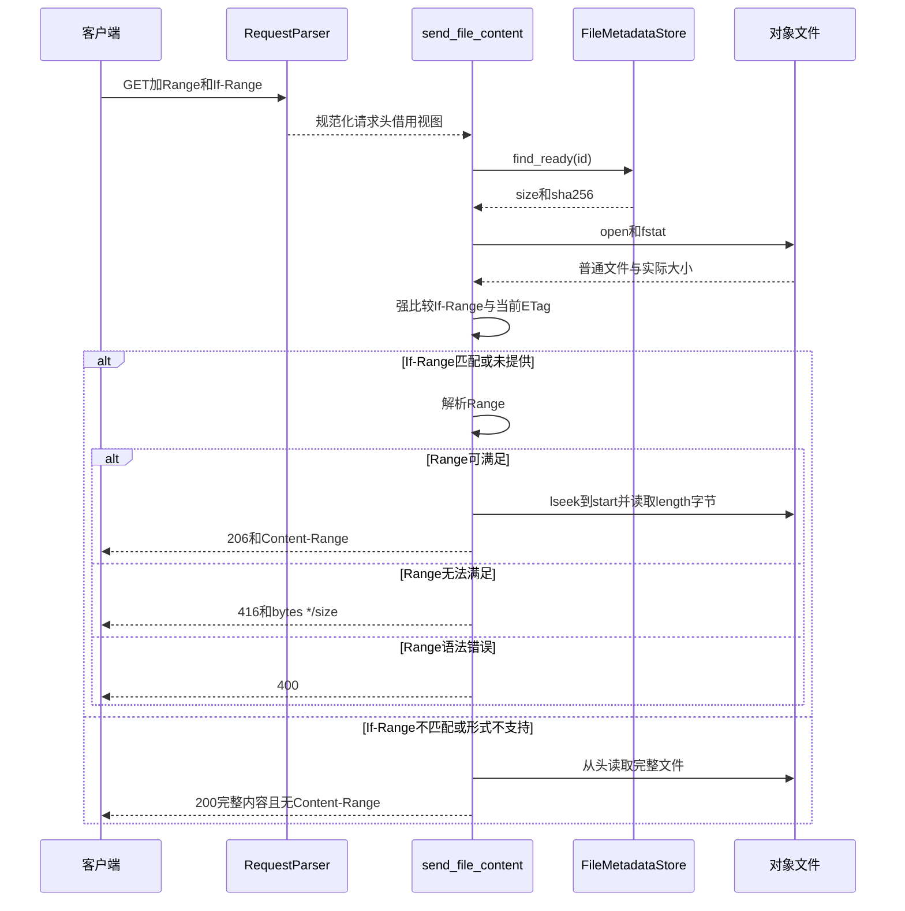

# 第32单元 If-Range强ETag条件下载

## 1 今日目标与完成标准

今天把第31单元的单Range下载与第30单元的强ETag连接起来 实现`If-Range`条件范围请求

完成后`GET`和`HEAD /api/files/{id}/content`具有以下可观察行为

- 只有Range时保持第31单元行为 可满足范围返回206
- Range与当前强ETag匹配的If-Range同时出现时返回206
- 匹配后发现Range无法满足时返回416
- 匹配后发现Range语法错误时返回400
- If-Range与当前版本不匹配时忽略Range并返回完整200
- 弱ETag HTTP日期 裸摘要和其他未支持形式都视为不匹配并返回200
- 一个Range伴随多个If-Range时返回400
- HEAD执行同样判断并返回与GET一致的状态和头部 但没有正文

核心完成标准不是只比较两个字符串 而是客户端持有旧版本局部文件时 服务端绝不会返回可供追加的新版本片段

## 2 前因后果

### 2.1 当前已有能力

第29单元为新上传对象计算并持久化SHA256 第30单元为旧对象回填摘要并把摘要作为强ETag返回 第31单元实现单字节范围解析 lseek定位 206和416响应

因此服务端已经同时知道

1. 当前对象的稳定内容版本
2. 客户端请求的字节范围
3. 怎样只发送范围内的字节

### 2.2 仍然缺少什么

假设客户端下载了旧文件的前100字节 随后同一个资源对应的内容变为新版本 客户端直接请求`Range: bytes=100-`并把206正文追加到旧文件 会把两个版本拼在一起

Range只回答需要哪些字节 不回答客户端已有字节属于哪个版本 If-Range正是把范围请求与版本验证连接起来的条件

### 2.3 为什么现在实现

If-Range必须依赖稳定验证器 如果没有前两天形成的持久SHA256强ETag 服务端无法可靠判断客户端局部文件是否属于当前内容

今天完成后 服务端续传协议边界已经闭合 下一单元可以实现客户端侧恢复逻辑 明确206时追加 200时覆盖 其他状态不写入文件

## 3 术语定义

### 3.1 条件请求

条件请求是请求是否按某种方式执行取决于资源当前状态的HTTP请求

If-Range只控制Range是否生效 它与If-Match不同 If-Match不满足通常让方法失败 If-Range不满足不会让下载失败 而是退回完整200

### 3.2 验证器

验证器是用于识别某个资源表示版本的元数据 ETag和Last-Modified都可以充当验证器

本项目用文件内容SHA256生成ETag 因为显示名称修改不改变对象内容 所以改名不会改变这个验证器

### 3.3 实体标签与ETag

实体标签是HTTP中的带引号版本标识 ETag是响应头名称 响应示例为

```http
ETag: "ba7816bf...0015ad"
```

引号属于实体标签语法 不是显示装饰 因此If-Range也必须携带完整引号值

### 3.4 强ETag与弱ETag

没有`W/`前缀的是强ETag 表示两个表示的字节内容可以按强比较视为相同

带`W/`前缀的是弱ETag 只表示语义上近似等价 不保证逐字节一致 例如

```http
If-Range: W/"ba7816bf...0015ad"
```

范围续传最终会进行字节拼接 所以本项目只接受强ETag精确匹配 弱ETag即使引号内摘要相同也不匹配

### 3.5 If-Range

If-Range是与Range一起发送的请求头 含义是

- 如果验证器仍匹配当前版本 则按Range返回部分内容
- 如果验证器不匹配 则忽略Range并返回完整当前内容

本单元只实现实体标签形式 不实现HTTP日期形式 日期值会安全回退完整200

### 3.6 强比较

本项目的强比较要求If-Range字段值与当前响应ETag逐字节完全相同 包括双引号 字母大小写和全部64位摘要

请求头解析器已经删除字段值两端的空格和TAB 但不会修改引号内内容

### 3.7 200与206对本地文件的含义

- 206表示服务端确认版本匹配 正文可以写入Range所指位置或追加到已有文件
- 200表示Range没有生效 正文是完整当前表示 客户端必须覆盖旧文件 不能追加

状态码在这里不仅描述网络结果 还决定客户端本地文件的写入策略

## 4 完整端到端逻辑

1. `RequestParser`增量解析请求行 请求头和零长度请求正文 请求头名称已转为ASCII小写 字段值两端OWS已删除
2. `handle_client`识别`/api/files/{id}/content`并调用`send_file_content`
3. 下载函数只允许GET和HEAD 并拒绝请求正文
4. 服务查询ready元数据 把合法ID映射到`data/objects/{id}`
5. `open`使用`O_NOFOLLOW`打开对象 `fstat`确认普通文件 实际大小必须等于元数据大小 SHA256必须是64位小写十六进制
6. 函数遍历解析器持有的请求头 分别统计Range与If-Range 保存它们的借用视图
7. 重复Range 或一个Range伴随多个If-Range时返回400
8. 计算`apply_range`
   - 有且只有一个Range并且没有If-Range时为真
   - 有且只有一个Range并且If-Range精确匹配当前强ETag时为真
   - 其他情况为假
9. 只有`apply_range`为真才解析Range
   - 语法错误返回400
   - 无法满足返回416
   - 可满足时保存`ByteRange`
   - 多范围或未知单位仍按第31单元规则忽略并走完整200
10. `apply_range`为假时不解析Range `range`保持空指针 后续自然生成完整200
11. GET范围响应在非零起点调用lseek 然后只读取`range.length`字节 完整200从文件开头读取完整大小
12. HEAD不执行lseek或读取 只发送最终选择对应的响应头
13. `UniqueFd`在函数退出时关闭对象fd 请求头视图只在`RequestParser`存活期间有效 响应头字符串独立拥有其内存

## 5 图表

**图的类型**：Sequence Diagram

**为什么选择这种图**：If-Range的关键是请求头解析 版本比较 Range解析和最终发送之间的时间顺序 时序图能准确表达匹配与不匹配两条互斥路径



**图的解释**：版本比较发生在Range解析之前 因此旧版本验证器不匹配时 即使Range值本身无法满足或语法错误 服务端也忽略整个Range并发送完整200 只有匹配当前版本的Range才进入206 400或416分支

## 6 为什么这样设计

### 6.1 为什么不匹配返回200而不是412

If-Range的目的不是要求服务器在版本变化时拒绝请求 而是允许服务器发送完整新版本 这样客户端能够用200正文替换旧局部文件

412 Precondition Failed适用于其他前置条件语义 不符合If-Range的回退行为

### 6.2 为什么先比较If-Range再解析Range

If-Range不匹配表示Range整体不参与本次响应 如果先解析Range 一个旧版本请求中的越界范围可能错误得到416 而正确结果应是完整200

### 6.3 为什么只支持强ETag

范围正文会与本地已有字节组合 必须确认二者来自逐字节相同的表示 弱ETag不提供这种保证

可选方案是支持HTTP日期 但文件时间只有有限精度 还要生成和解析规范HTTP日期 当前已有SHA256强ETag更直接可靠 因此日期支持延后

### 6.4 为什么精确比较而不把摘要从引号中取出

If-Range传递的是HTTP实体标签 不是裸SHA256 精确比较同时拒绝弱前缀 缺失引号 额外字符和大小写不同 避免把语法不同的值误判成当前验证器

### 6.5 为什么不修改数据库

If-Range只消费第29和第30单元已经持久化的SHA256 不产生新状态 数据库schema v2保持不变

## 7 源码变化

相对第31单元有以下变化

- 新增`src/if_range.h` 封装强ETag精确匹配
- 修改`src/file_download.h` 收集If-Range并只在匹配时应用Range
- 新增`tests/day32_if_range.cpp` 验证强比较和请求头保留
- 新增`tests/day32_if_range.py` 验证真实服务条件范围下载 Python实现按约定不在教程展示
- 修改`CMakeLists.txt` 注册两个新测试
- 更新README API文档 计划与学习进度

`src/main.cpp` 数据库schema 第31单元的`byte_range.h`和旧测试保持不变

## 8 完整源码

### 8.1 `src/if_range.h`

```cpp
#pragma once

// ===== DAY 32 ADDED BEGIN 使用当前强ETag判断是否允许范围响应 =====
#include "download_headers.h"

#include <string_view>

inline bool if_range_matches_strong_etag(std::string_view value,
                                         std::string_view sha256) noexcept
{
    if (!is_canonical_sha256(sha256) || value.size() != sha256.size() + 2)
        return false;
    return value.front() == '"' && value.back() == '"' &&
           value.substr(1, sha256.size()) == sha256;
}
// ===== DAY 32 ADDED END =====
```

接口说明

- `value`是RequestParser拥有的If-Range字段值借用视图 函数不保存它
- `sha256`是当前ready元数据拥有的摘要借用视图 函数不保存它
- 返回true仅表示字段精确等于当前强ETag
- 非规范服务端摘要 弱ETag 日期 裸摘要和不匹配值全部返回false
- 函数不分配内存 不修改参数并标记`noexcept`

### 8.2 `src/file_download.h`

```cpp
#pragma once

#include "http_response.h"
#include "file_metadata_store.h"
#include "object_path.h"
#include "socket_io.h"
#include "unique_fd.h"
#include "download_headers.h"
// ===== DAY 32 ADDED BEGIN 比较If Range与当前对象强ETag =====
#include "if_range.h"
// ===== DAY 32 ADDED END =====

#include <algorithm>
#include <cstdint>
#include <fcntl.h>
#include <sys/stat.h>
#include <unistd.h>

inline bool match_file_content(std::string_view target, std::string_view& id)
{
    const auto path = target.substr(0, target.find('?'));
    constexpr std::string_view prefix = "/api/files/";
    constexpr std::string_view suffix = "/content";
    if (path.size() < prefix.size() + suffix.size() ||
        path.substr(0, prefix.size()) != prefix ||
        path.substr(path.size() - suffix.size()) != suffix) return false;
    id = path.substr(prefix.size(), path.size() - prefix.size() - suffix.size());
    return true;
}

inline bool send_file_content(int client_fd, const RequestParser& request,
                              std::string_view id, FileMetadataStore& metadata_store)
{
    const auto& method = request.line().method;
    const bool head_only = method == "HEAD";
    const auto send_error = [&](int status, std::string_view allow = {})
    {
        const auto response = status == 404
            ? HttpResponse{404, "Not Found", "application/json",
                R"({"error":{"code":"not_found","message":"File not found"}})"}
            : error_response(status, allow);
        const std::string wire = build_response(response, head_only);
        return send_all(client_fd, wire.data(), wire.size());
    };
    if (method != "GET" && method != "HEAD")
    {
        const bool known = method == "POST" || method == "PATCH" || method == "DELETE";
        return send_error(known ? 405 : 501, "GET, HEAD");
    }
    if (request.body_size() != 0) return send_error(400);

    std::string path;
    if (!make_object_path(id, path)) return send_error(400);
    FileMetadata metadata;
    const auto found = metadata_store.find_ready(id, metadata);
    if (found == MetadataResult::NotFound) return send_error(404);
    if (found != MetadataResult::Ok)
    {
        std::cerr << "download metadata lookup failed: "
                  << metadata_store.error_message() << '\n';
        return send_error(500);
    }
    int raw_fd;
    do
    {
        raw_fd = ::open(path.c_str(), O_RDONLY | O_CLOEXEC | O_NOFOLLOW | O_NONBLOCK);
    } while (raw_fd == -1 && errno == EINTR);
    if (raw_fd == -1)
    {
        const int error = errno;
        if (error == ENOENT || error == ENOTDIR || error == ELOOP)
            return send_error(404);
        print_system_error("open download", error);
        return send_error(500);
    }
    UniqueFd file(raw_fd);
    struct stat info{};
    int result;
    do
    {
        result = ::fstat(file.get(), &info);
    } while (result == -1 && errno == EINTR);
    if (result == -1)
    {
        print_system_error("fstat download", errno);
        return send_error(500);
    }
    if (!S_ISREG(info.st_mode)) return send_error(404);
    if (info.st_size < 0) return send_error(500);

    const std::uint64_t full_size = static_cast<std::uint64_t>(info.st_size);
    if (full_size != metadata.size)
    {
        std::cerr << "download object size differs from ready metadata\n";
        return send_error(500);
    }
    if (!is_canonical_sha256(metadata.sha256))
    {
        std::cerr << "download metadata has no canonical SHA256\n";
        return send_error(500);
    }
    // ===== DAY 32 MODIFIED BEGIN 匹配If Range强ETag后才应用Range =====
    std::size_t range_count = 0;
    std::size_t if_range_count = 0;
    std::string_view range_value;
    std::string_view if_range_value;
    for (const auto& field : request.headers())
    {
        if (field.first == "range")
        {
            ++range_count;
            range_value = field.second;
        }
        else if (field.first == "if-range")
        {
            ++if_range_count;
            if_range_value = field.second;
        }
    }
    if (range_count > 1 || (range_count == 1 && if_range_count > 1))
        return send_error(400);

    ByteRange selected_range;
    const ByteRange* range = nullptr;
    const bool apply_range = range_count == 1 &&
        (if_range_count == 0 ||
         if_range_matches_strong_etag(if_range_value, metadata.sha256));
    if (apply_range)
    {
        const auto range_result = parse_byte_range(range_value, full_size, selected_range);
        if (range_result == ByteRangeResult::Invalid) return send_error(400);
        if (range_result == ByteRangeResult::Unsatisfiable)
        {
            std::string response;
            if (!make_range_not_satisfiable_response(
                    full_size, metadata.sha256, head_only, response))
                return send_error(500);
            return send_all(client_fd, response.data(), response.size());
        }
        if (range_result == ByteRangeResult::Satisfiable) range = &selected_range;
    }
    // ===== DAY 32 MODIFIED END =====

    if (!head_only && range != nullptr && range->start != 0)
    {
        const auto offset = static_cast<off_t>(range->start);
        if (offset < 0 || static_cast<std::uint64_t>(offset) != range->start)
            return send_error(500);
        off_t positioned;
        do
        {
            positioned = ::lseek(file.get(), offset, SEEK_SET);
        } while (positioned == static_cast<off_t>(-1) && errno == EINTR);
        if (positioned == static_cast<off_t>(-1))
        {
            print_system_error("lseek download", errno);
            return send_error(500);
        }
    }

    std::string header;
    if (!make_download_header(id, full_size, metadata.sha256, range, header))
    {
        std::cerr << "download header metadata or range is invalid\n";
        return send_error(500);
    }
    if (!send_all(client_fd, header.data(), header.size())) return false;
    if (head_only) return true;

    std::uint64_t remaining = range == nullptr ? full_size : range->length;
    char buffer[16 * 1024];
    while (remaining != 0)
    {
        const auto count = static_cast<std::size_t>(
            std::min<std::uint64_t>(remaining, sizeof(buffer)));
        const ssize_t n = ::read(file.get(), buffer, count);
        if (n == -1)
        {
            if (errno == EINTR) continue;
            print_system_error("read download", errno);
            return false;
        }
        if (n == 0)
        {
            std::cerr << "download file ended before Content-Length\n";
            return false;
        }
        const auto bytes = static_cast<std::size_t>(n);
        if (!send_all(client_fd, buffer, bytes)) return false;
        remaining -= bytes;
    }
    return true;
}
```

### 8.3 `tests/day32_if_range.cpp`

```cpp
// ===== DAY 32 ADDED BEGIN 验证If Range只接受当前强ETag精确匹配 =====
#include "if_range.h"
#include "request_parser.h"

#include <cstdlib>
#include <iostream>
#include <string>
#include <string_view>

void require(bool ok, const char* message)
{
    if (!ok)
    {
        std::cerr << "FAIL: " << message << '\n';
        std::exit(1);
    }
}

int main()
{
    constexpr std::string_view digest =
        "ba7816bf8f01cfea414140de5dae2223"
        "b00361a396177a9cb410ff61f20015ad";
    constexpr std::string_view current =
        "\"ba7816bf8f01cfea414140de5dae2223"
        "b00361a396177a9cb410ff61f20015ad\"";

    require(if_range_matches_strong_etag(current, digest),
            "current strong ETag did not match");
    require(!if_range_matches_strong_etag(
                "\"aa7816bf8f01cfea414140de5dae2223"
                "b00361a396177a9cb410ff61f20015ad\"", digest),
            "different strong ETag matched");
    require(!if_range_matches_strong_etag(
                "W/\"ba7816bf8f01cfea414140de5dae2223"
                "b00361a396177a9cb410ff61f20015ad\"", digest),
            "weak ETag matched a strong validator");
    require(!if_range_matches_strong_etag(digest, digest),
            "unquoted digest matched");
    require(!if_range_matches_strong_etag(
                "Sun, 06 Nov 1994 08:49:37 GMT", digest),
            "HTTP date matched an ETag");
    require(!if_range_matches_strong_etag(current, "ABC"),
            "invalid current digest matched");

    RequestParser request;
    const std::string wire =
        "GET /api/files/upload-Abc123/content HTTP/1.1\r\n"
        "Host: localhost\r\n"
        "Range: bytes=2-5\r\n"
        "If-Range: " + std::string(current) + "\r\n"
        "Content-Length: 0\r\n\r\n";
    const auto parsed = request.feed(wire);
    require(parsed.state == ParseState::Done && parsed.consumed == wire.size(),
            "request with If-Range did not parse");
    std::size_t count = 0;
    for (const auto& field : request.headers())
        if (field.first == "if-range" && field.second == current) ++count;
    require(count == 1, "normalized If-Range header was not retained");

    std::cout << "PASS: If-Range strong ETag matching and fallback inputs\n";
}
// ===== DAY 32 ADDED END =====
```

### 8.4 Python集成测试

新增`tests/day32_if_range.py` 依照约定不展示Python实现

它验证

- GET匹配强ETag返回206和正确字节
- HEAD匹配强ETag返回206但没有正文
- 不同标签 弱标签 HTTP日期和裸摘要返回完整200
- 不匹配时连语法错误的Range也被忽略并返回完整200
- 匹配后保留Range的400和416语义
- 重复If-Range返回400
- 错误请求后health仍可用

### 8.5 `CMakeLists.txt`

本单元使用的完整CMake配置见本教程后续代码块 其中DAY 32标注包围本次新增目标和CTest注册

```cmake
cmake_minimum_required(VERSION 3.16)

project(netdisk LANGUAGES CXX)

add_executable(netdisk src/main.cpp)
set(NETDISK_TARGETS netdisk)

find_package(nlohmann_json 3.2.0 REQUIRED)
target_link_libraries(netdisk PRIVATE nlohmann_json::nlohmann_json)

find_package(SQLite3 REQUIRED)
target_link_libraries(netdisk PRIVATE SQLite::SQLite3)

find_package(OpenSSL 1.1.1 REQUIRED COMPONENTS Crypto)
target_link_libraries(netdisk PRIVATE OpenSSL::Crypto)

include(CTest)
if(BUILD_TESTING)
    add_executable(io_tests tests/day06_io.cpp)
    target_include_directories(io_tests PRIVATE src)
    list(APPEND NETDISK_TARGETS io_tests)
    add_test(NAME io_tests COMMAND io_tests)

    add_executable(request_line_tests tests/day08_request_line.cpp)
    target_include_directories(request_line_tests PRIVATE src)
    list(APPEND NETDISK_TARGETS request_line_tests)
    add_test(NAME request_line_tests COMMAND request_line_tests)

    add_executable(request_headers_tests tests/day09_request_headers.cpp)
    target_include_directories(request_headers_tests PRIVATE src)
    list(APPEND NETDISK_TARGETS request_headers_tests)
    add_test(NAME request_headers_tests COMMAND request_headers_tests)

    add_executable(request_body_tests tests/day10_request_body.cpp)
    target_include_directories(request_body_tests PRIVATE src)
    list(APPEND NETDISK_TARGETS request_body_tests)
    add_test(NAME request_body_tests COMMAND request_body_tests)

    add_executable(http_response_tests tests/day11_http_response.cpp)
    target_include_directories(http_response_tests PRIVATE src)
    list(APPEND NETDISK_TARGETS http_response_tests)
    add_test(NAME http_response_tests COMMAND http_response_tests)

    add_executable(stream_upload_tests tests/day12_stream_upload.cpp)
    target_include_directories(stream_upload_tests PRIVATE src)
    target_link_libraries(stream_upload_tests PRIVATE OpenSSL::Crypto)
    list(APPEND NETDISK_TARGETS stream_upload_tests)
    add_test(NAME stream_upload_tests COMMAND stream_upload_tests)

    add_executable(publish_tests tests/day13_publish.cpp)
    target_include_directories(publish_tests PRIVATE src)
    target_link_libraries(publish_tests PRIVATE OpenSSL::Crypto)
    list(APPEND NETDISK_TARGETS publish_tests)
    add_test(NAME publish_tests COMMAND publish_tests)

    add_executable(object_path_tests tests/day15_object_path.cpp)
    target_include_directories(object_path_tests PRIVATE src)
    list(APPEND NETDISK_TARGETS object_path_tests)
    add_test(NAME object_path_tests COMMAND object_path_tests)

    find_package(Python3 3.8 REQUIRED COMPONENTS Interpreter)
    add_test(NAME upload_integration_tests
        COMMAND "${Python3_EXECUTABLE}"
            "${CMAKE_CURRENT_SOURCE_DIR}/tests/day14_upload_integration.py"
            "$<TARGET_FILE:netdisk>"
    )
    set_tests_properties(upload_integration_tests PROPERTIES
        TIMEOUT 30
        RUN_SERIAL TRUE
        SKIP_RETURN_CODE 77
    )

    add_test(NAME download_integration_tests
        COMMAND "${Python3_EXECUTABLE}"
            "${CMAKE_CURRENT_SOURCE_DIR}/tests/day16_download_integration.py"
            "$<TARGET_FILE:netdisk>"
    )
    set_tests_properties(download_integration_tests PROPERTIES
        TIMEOUT 30
        RUN_SERIAL TRUE
        SKIP_RETURN_CODE 77
    )

    add_executable(download_headers_tests tests/day17_download_headers.cpp)
    target_include_directories(download_headers_tests PRIVATE src)
    list(APPEND NETDISK_TARGETS download_headers_tests)
    add_test(NAME download_headers_tests COMMAND download_headers_tests)

    add_test(NAME download_headers_integration_tests
        COMMAND "${Python3_EXECUTABLE}"
            "${CMAKE_CURRENT_SOURCE_DIR}/tests/day17_download_headers.py"
            "$<TARGET_FILE:netdisk>"
    )
    set_tests_properties(download_headers_integration_tests PROPERTIES
        TIMEOUT 30
        RUN_SERIAL TRUE
        SKIP_RETURN_CODE 77
    )

    add_executable(file_catalog_tests tests/day18_file_catalog.cpp)
    target_include_directories(file_catalog_tests PRIVATE src)
    target_link_libraries(file_catalog_tests PRIVATE
        nlohmann_json::nlohmann_json SQLite::SQLite3)
    list(APPEND NETDISK_TARGETS file_catalog_tests)
    add_test(NAME file_catalog_tests COMMAND file_catalog_tests)

    add_test(NAME file_catalog_integration_tests
        COMMAND "${Python3_EXECUTABLE}"
            "${CMAKE_CURRENT_SOURCE_DIR}/tests/day18_file_catalog.py"
            "$<TARGET_FILE:netdisk>"
    )
    set_tests_properties(file_catalog_integration_tests PROPERTIES
        TIMEOUT 30
        RUN_SERIAL TRUE
        SKIP_RETURN_CODE 77
    )

    add_executable(file_mutation_tests tests/day19_file_mutation.cpp)
    target_include_directories(file_mutation_tests PRIVATE src)
    target_link_libraries(file_mutation_tests PRIVATE
        nlohmann_json::nlohmann_json SQLite::SQLite3)
    list(APPEND NETDISK_TARGETS file_mutation_tests)
    add_test(NAME file_mutation_tests COMMAND file_mutation_tests)

    add_test(NAME file_mutation_integration_tests
        COMMAND "${Python3_EXECUTABLE}"
            "${CMAKE_CURRENT_SOURCE_DIR}/tests/day19_file_mutation.py"
            "$<TARGET_FILE:netdisk>"
    )
    set_tests_properties(file_mutation_integration_tests PROPERTIES
        TIMEOUT 30
        RUN_SERIAL TRUE
        SKIP_RETURN_CODE 77
    )

    add_test(NAME failure_recovery_integration_tests
        COMMAND "${Python3_EXECUTABLE}"
            "${CMAKE_CURRENT_SOURCE_DIR}/tests/day20_failure_recovery.py"
            "$<TARGET_FILE:netdisk>"
    )
    set_tests_properties(failure_recovery_integration_tests PROPERTIES
        TIMEOUT 30
        RUN_SERIAL TRUE
        SKIP_RETURN_CODE 77
    )

    add_test(NAME first_release_integration_tests
        COMMAND "${Python3_EXECUTABLE}"
            "${CMAKE_CURRENT_SOURCE_DIR}/tests/day21_first_release.py"
            "$<TARGET_FILE:netdisk>"
    )
    set_tests_properties(first_release_integration_tests PROPERTIES
        TIMEOUT 30
        RUN_SERIAL TRUE
        SKIP_RETURN_CODE 77
    )

    add_executable(sqlite_lifecycle_tests tests/day22_sqlite_lifecycle.cpp)
    target_include_directories(sqlite_lifecycle_tests PRIVATE src)
    target_link_libraries(sqlite_lifecycle_tests PRIVATE SQLite::SQLite3)
    list(APPEND NETDISK_TARGETS sqlite_lifecycle_tests)
    add_test(NAME sqlite_lifecycle_tests COMMAND sqlite_lifecycle_tests)

    add_test(NAME metadata_persistence_integration_tests
        COMMAND "${Python3_EXECUTABLE}"
            "${CMAKE_CURRENT_SOURCE_DIR}/tests/day23_metadata_persistence.py"
            "$<TARGET_FILE:netdisk>"
    )
    set_tests_properties(metadata_persistence_integration_tests PROPERTIES
        TIMEOUT 30
        RUN_SERIAL TRUE
        SKIP_RETURN_CODE 77
    )

    add_executable(file_pagination_tests tests/day24_file_pagination.cpp)
    target_include_directories(file_pagination_tests PRIVATE src)
    target_link_libraries(file_pagination_tests PRIVATE
        nlohmann_json::nlohmann_json SQLite::SQLite3)
    list(APPEND NETDISK_TARGETS file_pagination_tests)
    add_test(NAME file_pagination_tests COMMAND file_pagination_tests)

    add_executable(publish_state_tests tests/day25_publish_state.cpp)
    target_include_directories(publish_state_tests PRIVATE src)
    target_link_libraries(publish_state_tests PRIVATE
        nlohmann_json::nlohmann_json SQLite::SQLite3)
    list(APPEND NETDISK_TARGETS publish_state_tests)
    add_test(NAME publish_state_tests COMMAND publish_state_tests)

    add_test(NAME publish_state_integration_tests
        COMMAND "${Python3_EXECUTABLE}"
            "${CMAKE_CURRENT_SOURCE_DIR}/tests/day25_publish_state.py"
            "$<TARGET_FILE:netdisk>"
    )
    set_tests_properties(publish_state_integration_tests PROPERTIES
        TIMEOUT 30
        RUN_SERIAL TRUE
        SKIP_RETURN_CODE 77
    )

    add_executable(publishing_recovery_tests tests/day26_publishing_recovery.cpp)
    target_include_directories(publishing_recovery_tests PRIVATE src)
    target_link_libraries(publishing_recovery_tests PRIVATE SQLite::SQLite3)
    list(APPEND NETDISK_TARGETS publishing_recovery_tests)
    add_test(NAME publishing_recovery_tests COMMAND publishing_recovery_tests)

    add_test(NAME publishing_recovery_integration_tests
        COMMAND "${Python3_EXECUTABLE}"
            "${CMAKE_CURRENT_SOURCE_DIR}/tests/day26_publishing_recovery.py"
            "$<TARGET_FILE:netdisk>"
    )
    set_tests_properties(publishing_recovery_integration_tests PROPERTIES
        TIMEOUT 30
        RUN_SERIAL TRUE
        SKIP_RETURN_CODE 77
    )

    add_executable(deletion_recovery_tests tests/day27_deletion_recovery.cpp)
    target_include_directories(deletion_recovery_tests PRIVATE src)
    target_link_libraries(deletion_recovery_tests PRIVATE SQLite::SQLite3)
    list(APPEND NETDISK_TARGETS deletion_recovery_tests)
    add_test(NAME deletion_recovery_tests COMMAND deletion_recovery_tests)

    add_test(NAME deletion_recovery_integration_tests
        COMMAND "${Python3_EXECUTABLE}"
            "${CMAKE_CURRENT_SOURCE_DIR}/tests/day27_deletion_recovery.py"
            "$<TARGET_FILE:netdisk>"
    )
    set_tests_properties(deletion_recovery_integration_tests PROPERTIES
        TIMEOUT 30
        RUN_SERIAL TRUE
        SKIP_RETURN_CODE 77
    )

    add_executable(storage_audit_tests tests/day28_storage_audit.cpp)
    target_include_directories(storage_audit_tests PRIVATE src)
    target_link_libraries(storage_audit_tests PRIVATE SQLite::SQLite3)
    list(APPEND NETDISK_TARGETS storage_audit_tests)
    add_test(NAME storage_audit_tests COMMAND storage_audit_tests)

    add_test(NAME storage_audit_integration_tests
        COMMAND "${Python3_EXECUTABLE}"
            "${CMAKE_CURRENT_SOURCE_DIR}/tests/day28_storage_audit.py"
            "$<TARGET_FILE:netdisk>"
    )
    set_tests_properties(storage_audit_integration_tests PROPERTIES
        TIMEOUT 30
        RUN_SERIAL TRUE
        SKIP_RETURN_CODE 77
    )

    add_executable(sha256_tests tests/day29_sha256.cpp)
    target_include_directories(sha256_tests PRIVATE src)
    target_link_libraries(sha256_tests PRIVATE OpenSSL::Crypto SQLite::SQLite3)
    list(APPEND NETDISK_TARGETS sha256_tests)
    add_test(NAME sha256_tests COMMAND sha256_tests)

    add_test(NAME sha256_integration_tests
        COMMAND "${Python3_EXECUTABLE}"
            "${CMAKE_CURRENT_SOURCE_DIR}/tests/day29_sha256.py"
            "$<TARGET_FILE:netdisk>"
    )
    set_tests_properties(sha256_integration_tests PROPERTIES
        TIMEOUT 30
        RUN_SERIAL TRUE
        SKIP_RETURN_CODE 77
    )

    add_executable(digest_backfill_tests tests/day30_digest_backfill.cpp)
    target_include_directories(digest_backfill_tests PRIVATE src)
    target_link_libraries(digest_backfill_tests PRIVATE OpenSSL::Crypto SQLite::SQLite3)
    list(APPEND NETDISK_TARGETS digest_backfill_tests)
    add_test(NAME digest_backfill_tests COMMAND digest_backfill_tests)

    add_test(NAME digest_backfill_integration_tests
        COMMAND "${Python3_EXECUTABLE}"
            "${CMAKE_CURRENT_SOURCE_DIR}/tests/day30_digest_backfill.py"
            "$<TARGET_FILE:netdisk>"
    )
    set_tests_properties(digest_backfill_integration_tests PROPERTIES
        TIMEOUT 30
        RUN_SERIAL TRUE
        SKIP_RETURN_CODE 77
    )

    add_executable(range_tests tests/day31_range.cpp)
    target_include_directories(range_tests PRIVATE src)
    list(APPEND NETDISK_TARGETS range_tests)
    add_test(NAME range_tests COMMAND range_tests)

    add_test(NAME range_integration_tests
        COMMAND "${Python3_EXECUTABLE}"
            "${CMAKE_CURRENT_SOURCE_DIR}/tests/day31_range.py"
            "$<TARGET_FILE:netdisk>"
    )
    set_tests_properties(range_integration_tests PROPERTIES
        TIMEOUT 30
        RUN_SERIAL TRUE
        SKIP_RETURN_CODE 77
    )
    # ===== DAY 32 ADDED BEGIN 注册If Range强ETag条件下载测试 =====
    add_executable(if_range_tests tests/day32_if_range.cpp)
    target_include_directories(if_range_tests PRIVATE src)
    list(APPEND NETDISK_TARGETS if_range_tests)
    add_test(NAME if_range_tests COMMAND if_range_tests)

    add_test(NAME if_range_integration_tests
        COMMAND "${Python3_EXECUTABLE}"
            "${CMAKE_CURRENT_SOURCE_DIR}/tests/day32_if_range.py"
            "$<TARGET_FILE:netdisk>"
    )
    set_tests_properties(if_range_integration_tests PROPERTIES
        TIMEOUT 30
        RUN_SERIAL TRUE
        SKIP_RETURN_CODE 77
    )
    # ===== DAY 32 ADDED END =====
endif()

foreach(target IN LISTS NETDISK_TARGETS)
    set_target_properties(${target} PROPERTIES
        CXX_STANDARD 17
        CXX_STANDARD_REQUIRED YES
        CXX_EXTENSIONS NO
    )
endforeach()
```

## 9 怎么使用新增接口

请求示例

```http
GET /api/files/upload-Abc123/content HTTP/1.1
Host: localhost
Range: bytes=100-
If-Range: "ba7816bf8f01cfea414140de5dae2223b00361a396177a9cb410ff61f20015ad"
Content-Length: 0
Connection: close
```

匹配时返回206 不匹配时返回200 调用方必须根据状态码决定写入方式

- 206 校验Content-Range后追加或定位写入
- 200 截断旧文件并从头覆盖
- 400 416或其他错误 不把错误正文写进目标文件

If-Range本身没有独立响应状态 它只改变Range是否生效

## 10 Linux构建与验证

执行环境 Linux虚拟机

执行目录 `~/projects/netdisk`

同步本单元全部新增修改文件后复用原有build目录

```bash
cd ~/projects/netdisk
cmake -S . -B build -DCMAKE_BUILD_TYPE=Debug
cmake --build build -j2
ctest --test-dir build -R '^if_range_integration_tests$' -V
```

成功条件

- CTest明确找到并运行1项测试
- `if_range_integration_tests`为Passed
- 输出包含三组PASS
- 最后一条为`PASS: If-Range integration finished 3 groups`
- Linux上不能出现SKIP

本测试会在独立临时目录启动和停止自己的服务 8080端口必须空闲

## 11 一次真实功能操作

先启动服务 再在另一个Linux终端执行 其中FILE_ID替换为已有ready文件ID ETAG替换为之前完整GET或HEAD响应中的含引号ETag

```bash
cd ~/projects/netdisk
curl -sS -D day32-match.headers -o day32-match.body \
  -H 'Range: bytes=2-7' \
  -H 'If-Range: "替换为64位小写SHA256"' \
  "http://127.0.0.1:8080/api/files/FILE_ID/content"

cat day32-match.headers
wc -c day32-match.body
```

匹配时应看到206 `Content-Range: bytes 2-7/完整大小`且正文为6字节

把If-Range改成`"different"`再次请求 应看到200 没有Content-Range 正文长度等于完整文件大小

必要排错入口

- CTest显示SKIP 说明不是在Linux执行
- 无测试被找到 重新运行CMake配置并确认同步了CMakeLists.txt和Python脚本
- 连接失败 检查8080是否已有其他服务占用
- 一直返回200 确认If-Range包含响应ETag原有双引号且没有W前缀
- 返回500 查看服务日志中的元数据摘要或对象大小不一致信息

## 12 结果边界

本地已经实际完成

- Windows g++以C++17 Wall Wextra pedantic编译并运行if_range_tests通过
- 第31单元range_tests回归通过
- 19个Python测试脚本AST语法检查通过
- day32集成脚本在Windows返回预期跳过码77

尚未完成或不能据此宣称

- Linux生产服务构建尚未由本机执行
- 真实Socket条件范围集成测试待用户虚拟机反馈
- 未实现If-Range HTTP日期形式
- 未实现多Range multipart响应
- 未实现If-None-Match
- 尚无正式断点下载客户端
- 串行阻塞 无读写超时和优雅退出等边界保持不变

下一单元将实现客户端恢复边界 只在206时追加 200时覆盖 并在完成后核对完整SHA256
