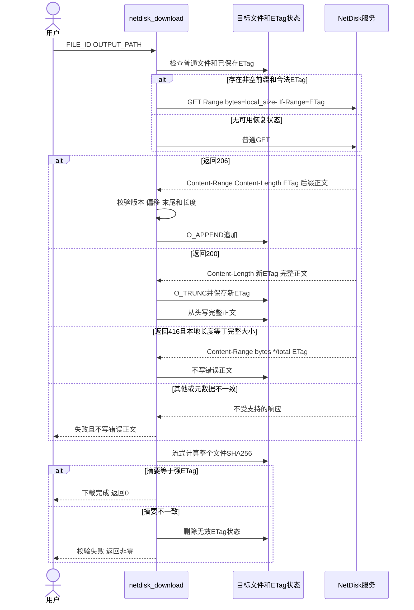

# 第33单元 安全断点下载客户端

## 1 今日目标与完成标准

今天新增一个可以真实运行的C++命令行客户端 `netdisk_download` 它把第31单元的Range和第32单元的If-Range从服务端能力变成客户端可直接使用的安全恢复流程

完成后可以观察到四个行为

1. 目标文件已有正确前缀且旁边保存了当前强ETag时 客户端发送 `Range: bytes=本地长度-` 与 `If-Range` 服务端返回206后客户端追加剩余字节
2. 保存的ETag与服务端当前对象不一致时 服务端回退200 客户端截断旧内容并从头覆盖 绝不把新版本正文追加到旧版本后面
3. 本地文件已经完整时 条件范围会得到416 客户端检查 `Content-Range: bytes */完整大小` 后不写错误正文 直接校验现有文件
4. 每次认为下载完成前 客户端重新流式计算整个本地文件的SHA-256 只有它等于响应强ETag才返回0

本单元完成标准不是仅能发出Range请求 而是写入动作由经过校验的响应状态和响应头共同决定 最终文件摘要与服务端内容版本一致

## 2 前因后果

第29和第30单元已经让每个可下载对象拥有持久SHA-256 并把它作为强ETag返回 第31单元实现单范围206和416 第32单元实现If-Range 强ETag匹配时继续范围下载 不匹配时安全回退完整200

此前的缺口在客户端 服务端即使行为正确 客户端若因为自己发送了Range就无条件追加 仍会在收到200时把完整新文件接到旧前缀后面 本单元因此不修改服务端下载逻辑 而是新增一个明确执行恢复协议的生产C++客户端

它依赖前面已经掌握的TCP字节流 定长HTTP消息 UniqueFd 短写循环 SHA-256 Range Content-Range和If-Range 完成后第34单元可以继续增加可配置服务端和有限读写超时 让停滞连接也有确定恢复边界

## 3 新术语与相近概念

### 3.1 断点下载与Range能力

断点下载是客户端保存已经正确取得的前缀 后续只请求缺少的后缀并恢复成完整文件的全过程

Range能力只是服务端能返回选定字节区间 它不自动保存客户端状态 也不自动保证旧前缀和新响应属于同一版本 本单元的客户端把Range If-Range 本地状态和最终摘要校验组合成完整断点下载语义

### 3.2 本地前缀

本地前缀是从对象第0字节开始连续保存的若干字节 它不是任意分片

客户端以本地文件长度作为下一字节偏移 因此只有连续前缀才能使用 `bytes=长度-` 若中间缺洞 仅凭文件总长度不能正确恢复

### 3.3 旁车状态文件

旁车状态文件是与目标文件放在一起 但不属于文件正文的辅助元数据 本单元使用 `OUTPUT_PATH.netdisk-etag` 保存带双引号的强ETag

它与数据库元数据不同 数据库属于服务端事实来源 旁车文件只记录客户端上次下载的内容版本 成功后仍保留 以便再次运行时识别文件已完整

### 3.4 206 200与416的客户端含义

- 206 Partial Content 表示响应正文只是选中的范围 但客户端仍要核对ETag Content-Range和Content-Length后才能追加
- 200 OK 表示响应正文是完整对象 在条件范围场景通常说明If-Range不匹配 客户端必须覆盖而不是追加
- 416 Range Not Satisfiable 表示请求范围无法满足 对本客户端而言 只有本地长度恰好等于响应声明的完整大小且ETag匹配时 才能把它解释为本地已经完整

416不是通常意义上的下载成功状态 本单元是在严格前提下利用它识别上一次可能已经写完但客户端还没有完成最终确认的情况

### 3.5 O_APPEND与O_TRUNC

`O_APPEND`让每次write定位到文件末尾 适合已确认206的后缀追加

`O_TRUNC`在打开已有普通文件时把长度清零 适合200完整覆盖 两者是文件打开语义 不能由请求意图决定 必须由响应验证结果决定

### 3.6 响应消息边界

`Content-Length`声明响应正文准确字节数 `Transfer-Encoding`则是另一种正文分帧方式

当前客户端只实现Content-Length 所以遇到Transfer-Encoding必须拒绝 不能一边按长度读取一边猜测分块编码 否则正文边界会产生歧义

### 3.7 最终完整性校验

范围响应正确只说明本次后缀的协议位置正确 不能证明此前保存的前缀没有被本地修改

因此客户端在写完后重新读取整个目标文件并计算SHA-256 与响应强ETag中的64位摘要比较 这一步验证最终整体内容 不等同于TLS身份认证或访问权限控制

## 4 完整端到端逻辑

1. 命令行接收文件ID和输出路径 文件ID必须符合服务端 `upload-` 加六位字母数字规则
2. 使用 `lstat` 检查输出 只接受普通文件或不存在路径 非普通文件和符号链接不作为目标
3. 若目标非空且旁车文件包含规范强ETag 则建立恢复请求 否则建立普通完整GET
4. 客户端连接 `127.0.0.1:8080` 用已有 `send_all` 处理短写和EINTR
5. `recv`增量读取到 `CRLF CRLF` 响应头上限8192字节 同次读取多出的字节保存为正文前缀
6. 响应解析器验证HTTP版本 状态码 Content-Length ETag Content-Range 重复字段 数字溢出和不支持的Transfer-Encoding
7. 写入决策分三条
   - 206要求ETag等于旁车值 起点等于本地长度 结束等于完整末尾 范围长度等于Content-Length 然后O_APPEND
   - 200要求没有Content-Range 然后O_TRUNC 保存新ETag并从头写
   - 416要求ETag等于旁车值且完整大小等于本地长度 不写响应中的JSON错误正文
8. 200或206按Content-Length写完 若连接提前关闭 返回非零并保留已经写入的前缀和ETag
9. 完整写入或416确认后 重新打开目标文件 检查大小并以16KiB块计算SHA-256
10. 摘要匹配则输出完成路径和摘要并返回0 不匹配则删除旁车状态 返回非零 使下次运行不再发送Range而强制取得完整200

## 5 图的类型

时序图 Sequence Diagram

## 6 为什么选择这种图

本单元的核心不是静态类关系 而是客户端根据本地状态发起请求 再根据服务端响应状态改变文件写入方式 时序图能准确表达请求 响应 分支 写盘和最终校验的先后关系

## 7 Mermaid



## 8 图的解释

第一次分支由本地状态决定是否发送条件范围请求 第二次分支必须由实际响应决定写入方式 这两次判断不能混为一谈

206只允许在响应版本和偏移都与本地状态一致时追加 200无论客户端原来是否请求Range都表示完整正文 416也只有在版本和长度都一致时才进入完成校验 所有成功路径最终汇合到整个文件SHA-256校验

## 9 设计原因与取舍

### 9.1 为什么不能因为发送了Range就追加

请求只是客户端期望 服务端可以合法地忽略Range或因If-Range不匹配返回200 如果按请求而不是响应决定写入 新版本完整正文会被追加到旧前缀后 形成必然错误的文件

### 9.2 为什么旁车保存ETag而不是保存SHA-256前缀

服务端ETag描述完整对象版本 部分文件本身无法推出完整对象摘要 旁车文件让下一次请求能够证明自己保存的前缀属于哪个完整版本

替代方案是把文件ID ETag 偏移和临时路径放入SQLite 客户端状态库 适合多任务下载器 当前只有单文件命令行流程 使用旁车文件更直接

### 9.3 为什么206还要检查Content-Range

状态码206只能说明这是范围响应 不能说明它从客户端期望的偏移开始 若起点不同仍追加会产生重复或缺失 检查结束位置到达完整文件末尾还能保证本次 `bytes=start-` 请求确实返回剩余全部内容

### 9.4 为什么写完还计算整个文件摘要

仅比较响应ETag无法发现本地旧前缀被手动修改 磁盘已有错误或上次程序错误写入 整体摘要把旧前缀和新后缀一起验证

代价是完成时额外顺序读取一次文件 当前阶段优先保证正确性 后续性能阶段再测量是否需要边下载边维护可恢复的摘要状态

### 9.5 为什么当前200直接覆盖目标

直接覆盖能让网络中断后目标本身就是可继续的正确前缀 下次可以直接从当前长度恢复 实现简单且符合本单元恢复目标

代价是版本变化收到200后旧完整文件会立即被截断 尚未完成的新内容暂时出现在最终路径 第35单元计划改为临时产物完成校验后再原子替换 对当前实现不能宣称最终文件始终只包含完整版本

### 9.6 为什么严格拒绝Transfer-Encoding

客户端没有实现chunked响应解码 接受它会把块大小行和分隔符写进文件 严格拒绝比猜测兼容更安全 当前NetDisk服务固定返回Content-Length 因此这个限制不会影响项目内正常下载

## 10 源码变化

相对第32单元

- 新增 `src/download_client_response.h` 负责响应头解析 请求构造和恢复决策
- 新增 `src/download_client.cpp` 负责连接 收发 文件写入 旁车状态和最终SHA-256
- 新增 `tests/day33_resume_download.cpp` 验证纯C++协议决策
- 新增 `tests/day33_resume_download.py` 由助手维护真实服务与客户端集成测试
- 修改 `CMakeLists.txt` 构建客户端 链接OpenSSL并注册两项测试
- 修改README API说明 计划 进度和本教程
- 服务端 `main.cpp` `file_download.h` SQLite schema和第32单元If-Range实现保持不变

## 11 新接口 参数 返回值 所有权与生命周期

### 11.1 ResponseHead

`ResponseHead`拥有解析后的ETag字符串和全部数值字段 不借用原始响应缓冲区 调用方可以在原始字符串销毁后继续使用

### 11.2 parse_response_head

参数 `wire`是调用期间借用的完整响应头 必须以两个CRLF结束 参数 `output`由调用方拥有

返回true表示语法和本客户端支持的消息边界有效 不代表状态一定可以写文件 返回false时客户端不得使用响应正文修改目标

### 11.3 make_resume_plan

参数包括已解析响应 本地文件长度和保存的ETag 返回值 `ResumePlan`由调用方拥有

`Append` `Replace` `Complete`是可执行动作 `Reject`表示状态或元数据不满足安全条件

### 11.4 make_download_request

参数 `id`和 `saved_etag`只在调用期间借用 `output`成功后独立拥有完整请求

恢复请求要求 `resume=true` 本地长度大于0且ETag是规范强ETag 参数不合法返回false且不发送请求

### 11.5 netdisk_download命令行

`netdisk_download FILE_ID OUTPUT_PATH`

- FILE_ID是服务端文件ID 例如 `upload-Abc123`
- OUTPUT_PATH是客户端本地目标路径 不传给服务端
- 成功返回0 参数错误返回2 网络 协议 文件或摘要错误返回1
- 目标Socket和输出fd由UniqueFd独占并在作用域结束时关闭
- `OUTPUT_PATH.netdisk-etag`由客户端创建并在成功后保留
- 网络提前结束时已写前缀和状态保留 下次调用继续
- 摘要错误时状态被删除 下次调用强制完整下载

## 12 完整源码

### 12.1 src/download_client_response.h

```cpp
#pragma once

// ===== DAY 33 ADDED BEGIN 解析下载响应并决定追加覆盖或完成 =====
#include "download_headers.h"
#include "object_path.h"

#include <cstddef>
#include <cstdint>
#include <limits>
#include <string>
#include <string_view>
#include <utility>

namespace download_client
{

enum class ContentRangeKind
{
    None,
    Selected,
    Unsatisfied
};

struct ResponseHead
{
    int status = 0;
    bool has_content_length = false;
    std::uint64_t content_length = 0;
    std::string etag;
    ContentRangeKind content_range_kind = ContentRangeKind::None;
    std::uint64_t range_start = 0;
    std::uint64_t range_end = 0;
    std::uint64_t total_size = 0;
};

enum class ResumeAction
{
    Reject,
    Replace,
    Append,
    Complete
};

struct ResumePlan
{
    ResumeAction action = ResumeAction::Reject;
    std::uint64_t total_size = 0;
};

inline std::string_view trim_ows(std::string_view value) noexcept
{
    while (!value.empty() && (value.front() == ' ' || value.front() == '\t'))
        value.remove_prefix(1);
    while (!value.empty() && (value.back() == ' ' || value.back() == '\t'))
        value.remove_suffix(1);
    return value;
}

inline bool parse_decimal(std::string_view text, std::uint64_t& output) noexcept
{
    if (text.empty()) return false;
    std::uint64_t value = 0;
    for (const char ch : text)
    {
        if (ch < '0' || ch > '9') return false;
        const auto digit = static_cast<std::uint64_t>(ch - '0');
        if (value > (std::numeric_limits<std::uint64_t>::max() - digit) / 10)
            return false;
        value = value * 10 + digit;
    }
    output = value;
    return true;
}

inline bool ascii_equal_ignore_case(std::string_view left,
                                    std::string_view right) noexcept
{
    if (left.size() != right.size()) return false;
    for (std::size_t index = 0; index < left.size(); ++index)
    {
        char a = left[index];
        char b = right[index];
        if (a >= 'A' && a <= 'Z') a = static_cast<char>(a - 'A' + 'a');
        if (b >= 'A' && b <= 'Z') b = static_cast<char>(b - 'A' + 'a');
        if (a != b) return false;
    }
    return true;
}

inline bool is_header_name_char(char ch) noexcept
{
    return (ch >= 'a' && ch <= 'z') || (ch >= 'A' && ch <= 'Z') ||
           (ch >= '0' && ch <= '9') || ch == '-';
}

inline bool parse_content_range(std::string_view value,
                                ResponseHead& output) noexcept
{
    constexpr std::string_view unit = "bytes ";
    if (value.size() < unit.size() ||
        !ascii_equal_ignore_case(value.substr(0, unit.size()), unit))
        return false;
    value.remove_prefix(unit.size());

    if (value.size() > 2 && value[0] == '*' && value[1] == '/')
    {
        std::uint64_t total = 0;
        if (!parse_decimal(value.substr(2), total)) return false;
        output.content_range_kind = ContentRangeKind::Unsatisfied;
        output.total_size = total;
        return true;
    }

    const auto dash = value.find('-');
    const auto slash = value.find('/');
    if (dash == std::string_view::npos || slash == std::string_view::npos ||
        dash == 0 || slash <= dash + 1 || slash + 1 >= value.size() ||
        value.find('-', dash + 1) != std::string_view::npos ||
        value.find('/', slash + 1) != std::string_view::npos)
        return false;

    std::uint64_t start = 0;
    std::uint64_t end = 0;
    std::uint64_t total = 0;
    if (!parse_decimal(value.substr(0, dash), start) ||
        !parse_decimal(value.substr(dash + 1, slash - dash - 1), end) ||
        !parse_decimal(value.substr(slash + 1), total) ||
        start > end || total == 0 || end >= total)
        return false;

    output.content_range_kind = ContentRangeKind::Selected;
    output.range_start = start;
    output.range_end = end;
    output.total_size = total;
    return true;
}

inline bool parse_response_head(std::string_view wire, ResponseHead& output)
{
    if (wire.size() < 4 || wire.substr(wire.size() - 4) != "\r\n\r\n")
        return false;

    ResponseHead parsed;
    const auto status_end = wire.find("\r\n");
    if (status_end == std::string_view::npos) return false;
    const auto status_line = wire.substr(0, status_end);
    if (status_line.size() < 13 || status_line.substr(0, 9) != "HTTP/1.1 " ||
        status_line[9] < '0' || status_line[9] > '9' ||
        status_line[10] < '0' || status_line[10] > '9' ||
        status_line[11] < '0' || status_line[11] > '9' ||
        status_line[12] != ' ')
        return false;
    parsed.status = (status_line[9] - '0') * 100 +
                    (status_line[10] - '0') * 10 +
                    (status_line[11] - '0');

    bool has_etag = false;
    bool has_content_range = false;
    std::size_t cursor = status_end + 2;
    while (true)
    {
        const auto line_end = wire.find("\r\n", cursor);
        if (line_end == std::string_view::npos) return false;
        if (line_end == cursor)
        {
            if (line_end + 2 != wire.size()) return false;
            break;
        }

        const auto line = wire.substr(cursor, line_end - cursor);
        const auto colon = line.find(':');
        if (colon == std::string_view::npos || colon == 0) return false;
        const auto name = line.substr(0, colon);
        for (const char ch : name)
            if (!is_header_name_char(ch)) return false;
        auto value = trim_ows(line.substr(colon + 1));
        for (const char ch : value)
            if ((static_cast<unsigned char>(ch) < 32 && ch != '\t') || ch == 127)
                return false;

        if (ascii_equal_ignore_case(name, "Content-Length"))
        {
            if (parsed.has_content_length ||
                !parse_decimal(value, parsed.content_length))
                return false;
            parsed.has_content_length = true;
        }
        else if (ascii_equal_ignore_case(name, "ETag"))
        {
            if (has_etag) return false;
            parsed.etag.assign(value.data(), value.size());
            has_etag = true;
        }
        else if (ascii_equal_ignore_case(name, "Content-Range"))
        {
            if (has_content_range || !parse_content_range(value, parsed))
                return false;
            has_content_range = true;
        }
        else if (ascii_equal_ignore_case(name, "Transfer-Encoding"))
        {
            return false;
        }

        cursor = line_end + 2;
    }

    output = std::move(parsed);
    return true;
}

inline bool is_strong_sha256_etag(std::string_view etag) noexcept
{
    return etag.size() == 66 && etag.front() == '"' && etag.back() == '"' &&
           is_canonical_sha256(etag.substr(1, 64));
}

inline ResumePlan make_resume_plan(const ResponseHead& response,
                                   std::uint64_t local_size,
                                   std::string_view saved_etag) noexcept
{
    ResumePlan plan;
    if (!response.has_content_length ||
        !is_strong_sha256_etag(response.etag))
        return plan;

    if (response.status == 200)
    {
        if (response.content_range_kind != ContentRangeKind::None) return plan;
        plan.action = ResumeAction::Replace;
        plan.total_size = response.content_length;
        return plan;
    }

    if (!is_strong_sha256_etag(saved_etag) || response.etag != saved_etag)
        return plan;

    if (response.status == 206)
    {
        if (response.content_range_kind != ContentRangeKind::Selected ||
            response.range_start != local_size ||
            response.total_size == 0 || local_size >= response.total_size ||
            response.range_end != response.total_size - 1 ||
            response.content_length != response.total_size - local_size)
            return plan;
        plan.action = ResumeAction::Append;
        plan.total_size = response.total_size;
        return plan;
    }

    if (response.status == 416 &&
        response.content_range_kind == ContentRangeKind::Unsatisfied &&
        local_size == response.total_size)
    {
        plan.action = ResumeAction::Complete;
        plan.total_size = response.total_size;
    }
    return plan;
}

inline bool make_download_request(std::string_view id, bool resume,
                                  std::uint64_t local_size,
                                  std::string_view saved_etag,
                                  std::string& output)
{
    if (!is_valid_file_id(id)) return false;
    if (resume && (local_size == 0 || !is_strong_sha256_etag(saved_etag)))
        return false;

    std::string request =
        "GET /api/files/" + std::string(id) + "/content HTTP/1.1\r\n"
        "Host: 127.0.0.1:8080\r\n";
    if (resume)
    {
        request += "Range: bytes=" + std::to_string(local_size) + "-\r\n";
        request += "If-Range: " + std::string(saved_etag) + "\r\n";
    }
    request +=
        "Content-Length: 0\r\n"
        "Connection: close\r\n\r\n";
    output = std::move(request);
    return true;
}

}
// ===== DAY 33 ADDED END =====

```

### 12.2 src/download_client.cpp

```cpp
// ===== DAY 33 ADDED BEGIN 实现带ETag状态的安全断点下载客户端 =====
#include "download_client_response.h"
#include "sha256_hasher.h"
#include "socket_io.h"
#include "unique_fd.h"

#include <algorithm>
#include <arpa/inet.h>
#include <cerrno>
#include <cstdint>
#include <fcntl.h>
#include <iostream>
#include <netinet/in.h>
#include <string>
#include <string_view>
#include <sys/socket.h>
#include <sys/stat.h>
#include <unistd.h>

namespace
{

constexpr std::size_t max_response_head_size = 8192;

bool inspect_output_file(const std::string& path, bool& exists,
                         std::uint64_t& size)
{
    struct stat info{};
    if (::lstat(path.c_str(), &info) == -1)
    {
        if (errno == ENOENT)
        {
            exists = false;
            size = 0;
            return true;
        }
        print_system_error("lstat output", errno);
        return false;
    }
    if (!S_ISREG(info.st_mode) || info.st_size < 0)
    {
        std::cerr << "output path must be a regular file\n";
        return false;
    }
    exists = true;
    size = static_cast<std::uint64_t>(info.st_size);
    return true;
}

bool read_etag_state(const std::string& path, std::string& etag)
{
    int raw_fd;
    do
    {
        raw_fd = ::open(path.c_str(),
                        O_RDONLY | O_CLOEXEC | O_NOFOLLOW | O_NONBLOCK);
    } while (raw_fd == -1 && errno == EINTR);
    if (raw_fd == -1) return false;
    UniqueFd file(raw_fd);

    struct stat info{};
    if (::fstat(file.get(), &info) == -1 || !S_ISREG(info.st_mode) ||
        info.st_size < 0 || info.st_size > 128)
        return false;

    std::string content(static_cast<std::size_t>(info.st_size), '\0');
    std::size_t received = 0;
    while (received < content.size())
    {
        const ssize_t n = ::read(file.get(), content.data() + received,
                                 content.size() - received);
        if (n == -1)
        {
            if (errno == EINTR) continue;
            return false;
        }
        if (n == 0) return false;
        received += static_cast<std::size_t>(n);
    }
    if (!content.empty() && content.back() == '\n') content.pop_back();
    if (!content.empty() && content.back() == '\r') content.pop_back();
    if (!download_client::is_strong_sha256_etag(content)) return false;
    etag = std::move(content);
    return true;
}

bool write_all_file(int fd, const char* data, std::size_t size)
{
    std::size_t written = 0;
    while (written < size)
    {
        const ssize_t n = ::write(fd, data + written, size - written);
        if (n == -1)
        {
            if (errno == EINTR) continue;
            print_system_error("write download", errno);
            return false;
        }
        if (n == 0)
        {
            std::cerr << "write download made no progress\n";
            return false;
        }
        written += static_cast<std::size_t>(n);
    }
    return true;
}

bool save_etag_state(const std::string& path, std::string_view etag)
{
    int raw_fd;
    do
    {
        raw_fd = ::open(path.c_str(),
                        O_WRONLY | O_CREAT | O_TRUNC | O_CLOEXEC |
                            O_NOFOLLOW | O_NONBLOCK,
                        0600);
    } while (raw_fd == -1 && errno == EINTR);
    if (raw_fd == -1)
    {
        print_system_error("open ETag state", errno);
        return false;
    }
    UniqueFd file(raw_fd);

    struct stat info{};
    if (::fstat(file.get(), &info) == -1 || !S_ISREG(info.st_mode))
    {
        std::cerr << "ETag state path must be a regular file\n";
        return false;
    }
    const std::string content = std::string(etag) + "\n";
    return write_all_file(file.get(), content.data(), content.size());
}

bool connect_to_server(int& socket_fd)
{
    const int raw_fd = ::socket(AF_INET, SOCK_STREAM | SOCK_CLOEXEC, 0);
    if (raw_fd == -1)
    {
        print_system_error("socket", errno);
        return false;
    }
    sockaddr_in address{};
    address.sin_family = AF_INET;
    address.sin_port = htons(8080);
    if (::inet_pton(AF_INET, "127.0.0.1", &address.sin_addr) != 1)
    {
        std::cerr << "failed to prepare loopback address\n";
        ::close(raw_fd);
        return false;
    }
    if (::connect(raw_fd, reinterpret_cast<sockaddr*>(&address),
                  sizeof(address)) == -1)
    {
        const int error = errno;
        ::close(raw_fd);
        print_system_error("connect", error);
        return false;
    }
    socket_fd = raw_fd;
    return true;
}

bool receive_response_head(int socket_fd, std::string& head,
                           std::string& body_prefix)
{
    std::string received;
    char buffer[4096];
    while (true)
    {
        const auto boundary = received.find("\r\n\r\n");
        if (boundary != std::string::npos)
        {
            const auto head_size = boundary + 4;
            if (head_size > max_response_head_size)
            {
                std::cerr << "response head exceeds limit\n";
                return false;
            }
            head.assign(received.data(), head_size);
            body_prefix.assign(received.data() + head_size,
                               received.size() - head_size);
            return true;
        }
        if (received.size() > max_response_head_size)
        {
            std::cerr << "response head exceeds limit\n";
            return false;
        }

        const ssize_t n = ::recv(socket_fd, buffer, sizeof(buffer), 0);
        if (n == -1)
        {
            if (errno == EINTR) continue;
            print_system_error("recv response head", errno);
            return false;
        }
        if (n == 0)
        {
            std::cerr << "server closed before response head completed\n";
            return false;
        }
        received.append(buffer, static_cast<std::size_t>(n));
    }
}

bool open_output_for_plan(const std::string& path,
                          download_client::ResumeAction action,
                          std::uint64_t expected_size,
                          int& output_fd)
{
    int flags = O_WRONLY | O_CLOEXEC | O_NOFOLLOW | O_NONBLOCK;
    if (action == download_client::ResumeAction::Replace)
        flags |= O_CREAT | O_TRUNC;
    else
        flags |= O_APPEND;

    int raw_fd;
    do
    {
        raw_fd = ::open(path.c_str(), flags, 0600);
    } while (raw_fd == -1 && errno == EINTR);
    if (raw_fd == -1)
    {
        print_system_error("open output", errno);
        return false;
    }
    struct stat info{};
    if (::fstat(raw_fd, &info) == -1 || !S_ISREG(info.st_mode) ||
        info.st_size < 0 ||
        (action == download_client::ResumeAction::Append &&
         static_cast<std::uint64_t>(info.st_size) != expected_size))
    {
        std::cerr << "output file changed before response body write\n";
        ::close(raw_fd);
        return false;
    }
    output_fd = raw_fd;
    return true;
}

bool receive_body(int socket_fd, int output_fd, std::string_view prefix,
                  std::uint64_t content_length)
{
    if (prefix.size() > content_length)
    {
        std::cerr << "response body exceeds Content-Length\n";
        return false;
    }
    if (!write_all_file(output_fd, prefix.data(), prefix.size())) return false;

    std::uint64_t remaining = content_length - prefix.size();
    char buffer[16 * 1024];
    while (remaining != 0)
    {
        const auto count = static_cast<std::size_t>(
            std::min<std::uint64_t>(remaining, sizeof(buffer)));
        const ssize_t n = ::recv(socket_fd, buffer, count, 0);
        if (n == -1)
        {
            if (errno == EINTR) continue;
            print_system_error("recv response body", errno);
            return false;
        }
        if (n == 0)
        {
            std::cerr << "server closed before Content-Length bytes arrived\n";
            return false;
        }
        const auto size = static_cast<std::size_t>(n);
        if (!write_all_file(output_fd, buffer, size)) return false;
        remaining -= size;
    }
    return true;
}

bool hash_complete_file(const std::string& path, std::uint64_t expected_size,
                        std::string& digest)
{
    int raw_fd;
    do
    {
        raw_fd = ::open(path.c_str(),
                        O_RDONLY | O_CLOEXEC | O_NOFOLLOW | O_NONBLOCK);
    } while (raw_fd == -1 && errno == EINTR);
    if (raw_fd == -1)
    {
        print_system_error("open completed download", errno);
        return false;
    }
    UniqueFd file(raw_fd);

    struct stat info{};
    if (::fstat(file.get(), &info) == -1 || !S_ISREG(info.st_mode) ||
        info.st_size < 0 ||
        static_cast<std::uint64_t>(info.st_size) != expected_size)
    {
        std::cerr << "completed download size differs from response metadata\n";
        return false;
    }

    Sha256Hasher hasher;
    char buffer[16 * 1024];
    while (true)
    {
        const ssize_t n = ::read(file.get(), buffer, sizeof(buffer));
        if (n == -1)
        {
            if (errno == EINTR) continue;
            print_system_error("read completed download", errno);
            return false;
        }
        if (n == 0) break;
        if (!hasher.update(std::string_view(buffer, static_cast<std::size_t>(n))))
        {
            std::cerr << "SHA256 update failed\n";
            return false;
        }
    }
    if (!hasher.finish(digest))
    {
        std::cerr << "SHA256 finish failed\n";
        return false;
    }
    return true;
}

void remove_invalid_state(const std::string& path)
{
    if (::unlink(path.c_str()) == -1 && errno != ENOENT)
        print_system_error("remove invalid ETag state", errno);
}

}

int main(int argc, char* argv[])
{
    if (argc != 3)
    {
        std::cerr << "usage: netdisk_download FILE_ID OUTPUT_PATH\n";
        return 2;
    }

    const std::string id = argv[1];
    const std::string output_path = argv[2];
    const std::string state_path = output_path + ".netdisk-etag";
    if (!is_valid_file_id(id) || output_path.empty())
    {
        std::cerr << "invalid file ID or output path\n";
        return 2;
    }

    bool output_exists = false;
    std::uint64_t local_size = 0;
    if (!inspect_output_file(output_path, output_exists, local_size)) return 1;

    std::string saved_etag;
    const bool resume = output_exists && local_size != 0 &&
                        read_etag_state(state_path, saved_etag);
    std::string request;
    if (!download_client::make_download_request(
            id, resume, local_size, saved_etag, request))
    {
        std::cerr << "failed to build download request\n";
        return 1;
    }

    int raw_socket = -1;
    if (!connect_to_server(raw_socket)) return 1;
    UniqueFd socket(raw_socket);
    if (!send_all(socket.get(), request.data(), request.size())) return 1;

    std::string response_wire;
    std::string body_prefix;
    if (!receive_response_head(socket.get(), response_wire, body_prefix))
        return 1;
    download_client::ResponseHead response;
    if (!download_client::parse_response_head(response_wire, response))
    {
        std::cerr << "invalid HTTP response head\n";
        return 1;
    }
    const auto plan = download_client::make_resume_plan(
        response, local_size, saved_etag);
    if (plan.action == download_client::ResumeAction::Reject)
    {
        std::cerr << "server response does not satisfy download contract status="
                  << response.status << '\n';
        return 1;
    }
    if ((plan.action == download_client::ResumeAction::Replace ||
         plan.action == download_client::ResumeAction::Append) &&
        body_prefix.size() > response.content_length)
    {
        std::cerr << "response body exceeds Content-Length\n";
        return 1;
    }

    if (plan.action == download_client::ResumeAction::Replace ||
        plan.action == download_client::ResumeAction::Append)
    {
        int raw_output = -1;
        if (!open_output_for_plan(output_path, plan.action, local_size,
                                  raw_output))
            return 1;
        UniqueFd output(raw_output);
        if (plan.action == download_client::ResumeAction::Replace &&
            !save_etag_state(state_path, response.etag))
            return 1;
        if (!receive_body(socket.get(), output.get(), body_prefix,
                          response.content_length))
            return 1;
    }

    std::string digest;
    if (!hash_complete_file(output_path, plan.total_size, digest) ||
        response.etag.substr(1, 64) != digest)
    {
        std::cerr << "completed download SHA256 differs from ETag\n";
        remove_invalid_state(state_path);
        return 1;
    }

    const char* result = plan.action == download_client::ResumeAction::Append
        ? "resumed with 206"
        : plan.action == download_client::ResumeAction::Replace
            ? "replaced with 200"
            : "already complete after 416";
    std::cout << "download complete: " << result
              << " bytes=" << plan.total_size
              << " sha256=" << digest << '\n';
    return 0;
}
// ===== DAY 33 ADDED END =====

```

### 12.3 tests/day33_resume_download.cpp

```cpp
// ===== DAY 33 ADDED BEGIN 验证断点客户端只按已校验响应状态写文件 =====
#include "download_client_response.h"

#include <cstdlib>
#include <iostream>
#include <string>
#include <string_view>

namespace
{

void require(bool ok, const char* message)
{
    if (!ok)
    {
        std::cerr << "FAIL: " << message << '\n';
        std::exit(1);
    }
}

std::string make_head(int status, std::string_view reason,
                      std::uint64_t length, std::string_view etag,
                      std::string_view content_range = {})
{
    std::string wire = "HTTP/1.1 " + std::to_string(status) + " " +
                       std::string(reason) + "\r\n";
    wire += "Content-Length: " + std::to_string(length) + "\r\n";
    wire += "ETag: " + std::string(etag) + "\r\n";
    if (!content_range.empty())
        wire += "Content-Range: " + std::string(content_range) + "\r\n";
    wire += "Connection: close\r\n\r\n";
    return wire;
}

}

int main()
{
    constexpr std::string_view etag =
        "\"ba7816bf8f01cfea414140de5dae2223"
        "b00361a396177a9cb410ff61f20015ad\"";
    constexpr std::string_view other_etag =
        "\"aa7816bf8f01cfea414140de5dae2223"
        "b00361a396177a9cb410ff61f20015ad\"";

    std::string request;
    require(download_client::make_download_request(
                "upload-Abc123", false, 0, {}, request),
            "fresh request was not built");
    require(request.find("Range:") == std::string::npos &&
            request.find("If-Range:") == std::string::npos,
            "fresh request unexpectedly contains resume fields");
    require(download_client::make_download_request(
                "upload-Abc123", true, 4, etag, request),
            "resume request was not built");
    require(request.find("Range: bytes=4-\r\n") != std::string::npos &&
            request.find("If-Range: " + std::string(etag) + "\r\n") !=
                std::string::npos,
            "resume request fields differ");
    require(!download_client::make_download_request(
                "../object", true, 4, etag, request),
            "unsafe file ID was accepted");

    download_client::ResponseHead response;
    require(download_client::parse_response_head(
                make_head(206, "Partial Content", 6, etag,
                          "bytes 4-9/10"), response),
            "valid 206 response did not parse");
    auto plan = download_client::make_resume_plan(response, 4, etag);
    require(plan.action == download_client::ResumeAction::Append &&
            plan.total_size == 10,
            "matching 206 did not choose append");
    require(download_client::make_resume_plan(response, 4, other_etag).action ==
                download_client::ResumeAction::Reject,
            "206 with a different saved ETag was accepted");
    require(download_client::make_resume_plan(response, 3, etag).action ==
                download_client::ResumeAction::Reject,
            "206 with a different local offset was accepted");

    require(download_client::parse_response_head(
                make_head(200, "OK", 10, other_etag), response),
            "valid 200 response did not parse");
    plan = download_client::make_resume_plan(response, 4, etag);
    require(plan.action == download_client::ResumeAction::Replace &&
            plan.total_size == 10,
            "200 did not choose full replacement");

    require(download_client::parse_response_head(
                make_head(416, "Range Not Satisfiable", 80, etag,
                          "bytes */10"), response),
            "valid 416 response did not parse");
    plan = download_client::make_resume_plan(response, 10, etag);
    require(plan.action == download_client::ResumeAction::Complete &&
            plan.total_size == 10,
            "matching 416 did not recognize a complete local file");
    require(download_client::make_resume_plan(response, 9, etag).action ==
                download_client::ResumeAction::Reject,
            "416 with an incomplete local file was accepted");

    const std::string duplicate_length =
        "HTTP/1.1 200 OK\r\n"
        "Content-Length: 10\r\n"
        "Content-Length: 10\r\n"
        "ETag: " + std::string(etag) + "\r\n\r\n";
    require(!download_client::parse_response_head(duplicate_length, response),
            "duplicate Content-Length was accepted");
    const std::string transfer_encoded =
        "HTTP/1.1 200 OK\r\n"
        "Content-Length: 10\r\n"
        "Transfer-Encoding: chunked\r\n"
        "ETag: " + std::string(etag) + "\r\n\r\n";
    require(!download_client::parse_response_head(transfer_encoded, response),
            "unsupported Transfer-Encoding was accepted");
    require(!download_client::parse_response_head(
                make_head(206, "Partial Content", 6, etag,
                          "bytes 4-10/10"), response),
            "out of bounds Content-Range was accepted");
    require(download_client::parse_response_head(
                make_head(206, "Partial Content", 5, etag,
                          "bytes 4-9/10"), response) &&
            download_client::make_resume_plan(response, 4, etag).action ==
                download_client::ResumeAction::Reject,
            "Content-Length and Content-Range mismatch was accepted");

    std::cout << "PASS: resume client separates 206 append 200 replace and 416 complete\n";
}
// ===== DAY 33 ADDED END =====

```

### 12.4 Python集成测试

新增 `tests/day33_resume_download.py` 按既定规则不展示Python实现

它在独立临时目录启动真实服务并验证

- 正确前缀和匹配ETag得到206 客户端追加后字节与SHA-256完全一致
- 旧ETag请求另一个版本得到200 客户端覆盖而不是追加并保存新ETag
- 完整文件再次运行得到416 客户端不写错误正文并通过完整摘要校验

### 12.5 完整CMakeLists.txt

```cmake
cmake_minimum_required(VERSION 3.16)

project(netdisk LANGUAGES CXX)

add_executable(netdisk src/main.cpp)
set(NETDISK_TARGETS netdisk)

# ===== DAY 33 ADDED BEGIN 构建安全断点下载客户端 =====
add_executable(netdisk_download src/download_client.cpp)
list(APPEND NETDISK_TARGETS netdisk_download)
# ===== DAY 33 ADDED END =====

find_package(nlohmann_json 3.2.0 REQUIRED)
target_link_libraries(netdisk PRIVATE nlohmann_json::nlohmann_json)

find_package(SQLite3 REQUIRED)
target_link_libraries(netdisk PRIVATE SQLite::SQLite3)

find_package(OpenSSL 1.1.1 REQUIRED COMPONENTS Crypto)
target_link_libraries(netdisk PRIVATE OpenSSL::Crypto)
# ===== DAY 33 ADDED BEGIN 客户端使用OpenSSL核对完整文件SHA256 =====
target_link_libraries(netdisk_download PRIVATE OpenSSL::Crypto)
# ===== DAY 33 ADDED END =====

include(CTest)
if(BUILD_TESTING)
    add_executable(io_tests tests/day06_io.cpp)
    target_include_directories(io_tests PRIVATE src)
    list(APPEND NETDISK_TARGETS io_tests)
    add_test(NAME io_tests COMMAND io_tests)

    add_executable(request_line_tests tests/day08_request_line.cpp)
    target_include_directories(request_line_tests PRIVATE src)
    list(APPEND NETDISK_TARGETS request_line_tests)
    add_test(NAME request_line_tests COMMAND request_line_tests)

    add_executable(request_headers_tests tests/day09_request_headers.cpp)
    target_include_directories(request_headers_tests PRIVATE src)
    list(APPEND NETDISK_TARGETS request_headers_tests)
    add_test(NAME request_headers_tests COMMAND request_headers_tests)

    add_executable(request_body_tests tests/day10_request_body.cpp)
    target_include_directories(request_body_tests PRIVATE src)
    list(APPEND NETDISK_TARGETS request_body_tests)
    add_test(NAME request_body_tests COMMAND request_body_tests)

    add_executable(http_response_tests tests/day11_http_response.cpp)
    target_include_directories(http_response_tests PRIVATE src)
    list(APPEND NETDISK_TARGETS http_response_tests)
    add_test(NAME http_response_tests COMMAND http_response_tests)

    add_executable(stream_upload_tests tests/day12_stream_upload.cpp)
    target_include_directories(stream_upload_tests PRIVATE src)
    target_link_libraries(stream_upload_tests PRIVATE OpenSSL::Crypto)
    list(APPEND NETDISK_TARGETS stream_upload_tests)
    add_test(NAME stream_upload_tests COMMAND stream_upload_tests)

    add_executable(publish_tests tests/day13_publish.cpp)
    target_include_directories(publish_tests PRIVATE src)
    target_link_libraries(publish_tests PRIVATE OpenSSL::Crypto)
    list(APPEND NETDISK_TARGETS publish_tests)
    add_test(NAME publish_tests COMMAND publish_tests)

    add_executable(object_path_tests tests/day15_object_path.cpp)
    target_include_directories(object_path_tests PRIVATE src)
    list(APPEND NETDISK_TARGETS object_path_tests)
    add_test(NAME object_path_tests COMMAND object_path_tests)

    find_package(Python3 3.8 REQUIRED COMPONENTS Interpreter)
    add_test(NAME upload_integration_tests
        COMMAND "${Python3_EXECUTABLE}"
            "${CMAKE_CURRENT_SOURCE_DIR}/tests/day14_upload_integration.py"
            "$<TARGET_FILE:netdisk>"
    )
    set_tests_properties(upload_integration_tests PROPERTIES
        TIMEOUT 30
        RUN_SERIAL TRUE
        SKIP_RETURN_CODE 77
    )

    add_test(NAME download_integration_tests
        COMMAND "${Python3_EXECUTABLE}"
            "${CMAKE_CURRENT_SOURCE_DIR}/tests/day16_download_integration.py"
            "$<TARGET_FILE:netdisk>"
    )
    set_tests_properties(download_integration_tests PROPERTIES
        TIMEOUT 30
        RUN_SERIAL TRUE
        SKIP_RETURN_CODE 77
    )

    add_executable(download_headers_tests tests/day17_download_headers.cpp)
    target_include_directories(download_headers_tests PRIVATE src)
    list(APPEND NETDISK_TARGETS download_headers_tests)
    add_test(NAME download_headers_tests COMMAND download_headers_tests)

    add_test(NAME download_headers_integration_tests
        COMMAND "${Python3_EXECUTABLE}"
            "${CMAKE_CURRENT_SOURCE_DIR}/tests/day17_download_headers.py"
            "$<TARGET_FILE:netdisk>"
    )
    set_tests_properties(download_headers_integration_tests PROPERTIES
        TIMEOUT 30
        RUN_SERIAL TRUE
        SKIP_RETURN_CODE 77
    )

    add_executable(file_catalog_tests tests/day18_file_catalog.cpp)
    target_include_directories(file_catalog_tests PRIVATE src)
    target_link_libraries(file_catalog_tests PRIVATE
        nlohmann_json::nlohmann_json SQLite::SQLite3)
    list(APPEND NETDISK_TARGETS file_catalog_tests)
    add_test(NAME file_catalog_tests COMMAND file_catalog_tests)

    add_test(NAME file_catalog_integration_tests
        COMMAND "${Python3_EXECUTABLE}"
            "${CMAKE_CURRENT_SOURCE_DIR}/tests/day18_file_catalog.py"
            "$<TARGET_FILE:netdisk>"
    )
    set_tests_properties(file_catalog_integration_tests PROPERTIES
        TIMEOUT 30
        RUN_SERIAL TRUE
        SKIP_RETURN_CODE 77
    )

    add_executable(file_mutation_tests tests/day19_file_mutation.cpp)
    target_include_directories(file_mutation_tests PRIVATE src)
    target_link_libraries(file_mutation_tests PRIVATE
        nlohmann_json::nlohmann_json SQLite::SQLite3)
    list(APPEND NETDISK_TARGETS file_mutation_tests)
    add_test(NAME file_mutation_tests COMMAND file_mutation_tests)

    add_test(NAME file_mutation_integration_tests
        COMMAND "${Python3_EXECUTABLE}"
            "${CMAKE_CURRENT_SOURCE_DIR}/tests/day19_file_mutation.py"
            "$<TARGET_FILE:netdisk>"
    )
    set_tests_properties(file_mutation_integration_tests PROPERTIES
        TIMEOUT 30
        RUN_SERIAL TRUE
        SKIP_RETURN_CODE 77
    )

    add_test(NAME failure_recovery_integration_tests
        COMMAND "${Python3_EXECUTABLE}"
            "${CMAKE_CURRENT_SOURCE_DIR}/tests/day20_failure_recovery.py"
            "$<TARGET_FILE:netdisk>"
    )
    set_tests_properties(failure_recovery_integration_tests PROPERTIES
        TIMEOUT 30
        RUN_SERIAL TRUE
        SKIP_RETURN_CODE 77
    )

    add_test(NAME first_release_integration_tests
        COMMAND "${Python3_EXECUTABLE}"
            "${CMAKE_CURRENT_SOURCE_DIR}/tests/day21_first_release.py"
            "$<TARGET_FILE:netdisk>"
    )
    set_tests_properties(first_release_integration_tests PROPERTIES
        TIMEOUT 30
        RUN_SERIAL TRUE
        SKIP_RETURN_CODE 77
    )

    add_executable(sqlite_lifecycle_tests tests/day22_sqlite_lifecycle.cpp)
    target_include_directories(sqlite_lifecycle_tests PRIVATE src)
    target_link_libraries(sqlite_lifecycle_tests PRIVATE SQLite::SQLite3)
    list(APPEND NETDISK_TARGETS sqlite_lifecycle_tests)
    add_test(NAME sqlite_lifecycle_tests COMMAND sqlite_lifecycle_tests)

    add_test(NAME metadata_persistence_integration_tests
        COMMAND "${Python3_EXECUTABLE}"
            "${CMAKE_CURRENT_SOURCE_DIR}/tests/day23_metadata_persistence.py"
            "$<TARGET_FILE:netdisk>"
    )
    set_tests_properties(metadata_persistence_integration_tests PROPERTIES
        TIMEOUT 30
        RUN_SERIAL TRUE
        SKIP_RETURN_CODE 77
    )

    add_executable(file_pagination_tests tests/day24_file_pagination.cpp)
    target_include_directories(file_pagination_tests PRIVATE src)
    target_link_libraries(file_pagination_tests PRIVATE
        nlohmann_json::nlohmann_json SQLite::SQLite3)
    list(APPEND NETDISK_TARGETS file_pagination_tests)
    add_test(NAME file_pagination_tests COMMAND file_pagination_tests)

    add_executable(publish_state_tests tests/day25_publish_state.cpp)
    target_include_directories(publish_state_tests PRIVATE src)
    target_link_libraries(publish_state_tests PRIVATE
        nlohmann_json::nlohmann_json SQLite::SQLite3)
    list(APPEND NETDISK_TARGETS publish_state_tests)
    add_test(NAME publish_state_tests COMMAND publish_state_tests)

    add_test(NAME publish_state_integration_tests
        COMMAND "${Python3_EXECUTABLE}"
            "${CMAKE_CURRENT_SOURCE_DIR}/tests/day25_publish_state.py"
            "$<TARGET_FILE:netdisk>"
    )
    set_tests_properties(publish_state_integration_tests PROPERTIES
        TIMEOUT 30
        RUN_SERIAL TRUE
        SKIP_RETURN_CODE 77
    )

    add_executable(publishing_recovery_tests tests/day26_publishing_recovery.cpp)
    target_include_directories(publishing_recovery_tests PRIVATE src)
    target_link_libraries(publishing_recovery_tests PRIVATE SQLite::SQLite3)
    list(APPEND NETDISK_TARGETS publishing_recovery_tests)
    add_test(NAME publishing_recovery_tests COMMAND publishing_recovery_tests)

    add_test(NAME publishing_recovery_integration_tests
        COMMAND "${Python3_EXECUTABLE}"
            "${CMAKE_CURRENT_SOURCE_DIR}/tests/day26_publishing_recovery.py"
            "$<TARGET_FILE:netdisk>"
    )
    set_tests_properties(publishing_recovery_integration_tests PROPERTIES
        TIMEOUT 30
        RUN_SERIAL TRUE
        SKIP_RETURN_CODE 77
    )

    add_executable(deletion_recovery_tests tests/day27_deletion_recovery.cpp)
    target_include_directories(deletion_recovery_tests PRIVATE src)
    target_link_libraries(deletion_recovery_tests PRIVATE SQLite::SQLite3)
    list(APPEND NETDISK_TARGETS deletion_recovery_tests)
    add_test(NAME deletion_recovery_tests COMMAND deletion_recovery_tests)

    add_test(NAME deletion_recovery_integration_tests
        COMMAND "${Python3_EXECUTABLE}"
            "${CMAKE_CURRENT_SOURCE_DIR}/tests/day27_deletion_recovery.py"
            "$<TARGET_FILE:netdisk>"
    )
    set_tests_properties(deletion_recovery_integration_tests PROPERTIES
        TIMEOUT 30
        RUN_SERIAL TRUE
        SKIP_RETURN_CODE 77
    )

    add_executable(storage_audit_tests tests/day28_storage_audit.cpp)
    target_include_directories(storage_audit_tests PRIVATE src)
    target_link_libraries(storage_audit_tests PRIVATE SQLite::SQLite3)
    list(APPEND NETDISK_TARGETS storage_audit_tests)
    add_test(NAME storage_audit_tests COMMAND storage_audit_tests)

    add_test(NAME storage_audit_integration_tests
        COMMAND "${Python3_EXECUTABLE}"
            "${CMAKE_CURRENT_SOURCE_DIR}/tests/day28_storage_audit.py"
            "$<TARGET_FILE:netdisk>"
    )
    set_tests_properties(storage_audit_integration_tests PROPERTIES
        TIMEOUT 30
        RUN_SERIAL TRUE
        SKIP_RETURN_CODE 77
    )

    add_executable(sha256_tests tests/day29_sha256.cpp)
    target_include_directories(sha256_tests PRIVATE src)
    target_link_libraries(sha256_tests PRIVATE OpenSSL::Crypto SQLite::SQLite3)
    list(APPEND NETDISK_TARGETS sha256_tests)
    add_test(NAME sha256_tests COMMAND sha256_tests)

    add_test(NAME sha256_integration_tests
        COMMAND "${Python3_EXECUTABLE}"
            "${CMAKE_CURRENT_SOURCE_DIR}/tests/day29_sha256.py"
            "$<TARGET_FILE:netdisk>"
    )
    set_tests_properties(sha256_integration_tests PROPERTIES
        TIMEOUT 30
        RUN_SERIAL TRUE
        SKIP_RETURN_CODE 77
    )

    add_executable(digest_backfill_tests tests/day30_digest_backfill.cpp)
    target_include_directories(digest_backfill_tests PRIVATE src)
    target_link_libraries(digest_backfill_tests PRIVATE OpenSSL::Crypto SQLite::SQLite3)
    list(APPEND NETDISK_TARGETS digest_backfill_tests)
    add_test(NAME digest_backfill_tests COMMAND digest_backfill_tests)

    add_test(NAME digest_backfill_integration_tests
        COMMAND "${Python3_EXECUTABLE}"
            "${CMAKE_CURRENT_SOURCE_DIR}/tests/day30_digest_backfill.py"
            "$<TARGET_FILE:netdisk>"
    )
    set_tests_properties(digest_backfill_integration_tests PROPERTIES
        TIMEOUT 30
        RUN_SERIAL TRUE
        SKIP_RETURN_CODE 77
    )

    add_executable(range_tests tests/day31_range.cpp)
    target_include_directories(range_tests PRIVATE src)
    list(APPEND NETDISK_TARGETS range_tests)
    add_test(NAME range_tests COMMAND range_tests)

    add_test(NAME range_integration_tests
        COMMAND "${Python3_EXECUTABLE}"
            "${CMAKE_CURRENT_SOURCE_DIR}/tests/day31_range.py"
            "$<TARGET_FILE:netdisk>"
    )
    set_tests_properties(range_integration_tests PROPERTIES
        TIMEOUT 30
        RUN_SERIAL TRUE
        SKIP_RETURN_CODE 77
    )
    add_executable(if_range_tests tests/day32_if_range.cpp)
    target_include_directories(if_range_tests PRIVATE src)
    list(APPEND NETDISK_TARGETS if_range_tests)
    add_test(NAME if_range_tests COMMAND if_range_tests)

    add_test(NAME if_range_integration_tests
        COMMAND "${Python3_EXECUTABLE}"
            "${CMAKE_CURRENT_SOURCE_DIR}/tests/day32_if_range.py"
            "$<TARGET_FILE:netdisk>"
    )
    set_tests_properties(if_range_integration_tests PROPERTIES
        TIMEOUT 30
        RUN_SERIAL TRUE
        SKIP_RETURN_CODE 77
    )
    # ===== DAY 33 ADDED BEGIN 注册断点下载决策与真实客户端测试 =====
    add_executable(resume_download_tests tests/day33_resume_download.cpp)
    target_include_directories(resume_download_tests PRIVATE src)
    list(APPEND NETDISK_TARGETS resume_download_tests)
    add_test(NAME resume_download_tests COMMAND resume_download_tests)

    add_test(NAME resume_download_integration_tests
        COMMAND "${Python3_EXECUTABLE}"
            "${CMAKE_CURRENT_SOURCE_DIR}/tests/day33_resume_download.py"
            "$<TARGET_FILE:netdisk>"
            "$<TARGET_FILE:netdisk_download>"
    )
    set_tests_properties(resume_download_integration_tests PROPERTIES
        TIMEOUT 30
        RUN_SERIAL TRUE
        SKIP_RETURN_CODE 77
    )
    # ===== DAY 33 ADDED END =====
endif()

foreach(target IN LISTS NETDISK_TARGETS)
    set_target_properties(${target} PROPERTIES
        CXX_STANDARD 17
        CXX_STANDARD_REQUIRED YES
        CXX_EXTENSIONS NO
    )
endforeach()

```

## 13 Linux构建与核心自动测试

执行环境 Linux虚拟机

执行目录 `~/projects/netdisk`

同步本单元全部新增修改文件后复用原有build目录

```bash
cd ~/projects/netdisk
cmake -S . -B build -DCMAKE_BUILD_TYPE=Debug -DBUILD_TESTING=ON
cmake --build build -j2
ctest --test-dir build -R '^resume_download_integration_tests$' -V
```

成功条件

- CMake明确构建 `netdisk_download` `resume_download_tests`和服务端
- CTest明确找到并运行1项 `resume_download_integration_tests`
- 输出依次包含206追加 200覆盖和416完成三组PASS
- 最后一条是 `PASS: resume download integration finished 3 groups`
- Linux上不能出现SKIP

该集成测试自动启动和停止自己的服务 使用独立临时目录 8080端口必须空闲

## 14 一次真实功能操作

先在Linux虚拟机第一个终端启动服务

```bash
cd ~/projects/netdisk
./build/netdisk
```

在第二个终端把FILE_ID替换为已有ready文件ID

```bash
cd ~/projects/netdisk
./build/netdisk_download FILE_ID ./day33-download.bin
echo $?
sha256sum ./day33-download.bin
cat ./day33-download.bin.netdisk-etag
```

首次运行预期输出包含 `replaced with 200` 退出状态为0 旁车文件内容是带双引号的64位小写SHA-256

要直接观察206恢复 可以保留旁车文件并把目标截成正确前缀 再运行同一命令

```bash
truncate -s 100 ./day33-download.bin
./build/netdisk_download FILE_ID ./day33-download.bin
sha256sum ./day33-download.bin
```

第二次预期输出包含 `resumed with 206` 最终SHA-256恢复为完整文件摘要 再运行一次预期输出包含 `already complete after 416`

注意 `truncate -s 100`只适合文件至少100字节的演示 它保留前100字节 不要对重要的唯一文件做这个实验

必要排错入口

- 连接失败 检查服务是否在127.0.0.1 8080监听
- 返回status=404 检查FILE_ID是否对应ready文件
- 客户端报告响应契约失败 查看服务响应是否缺少ETag或是否经过改变响应的代理
- CTest显示SKIP 说明没有在Linux执行
- 无测试被找到 重新运行CMake配置并确认同步CMakeLists和day33 Python脚本
- 摘要不一致 客户端会删除旁车文件 再运行一次应走完整200 若仍失败检查服务对象和元数据审计日志

## 15 实际验证结果与边界

本机已经实际完成

- Windows g++以C++17 Wall Wextra pedantic编译并运行 `resume_download_tests`通过
- 输出 `PASS: resume client separates 206 append 200 replace and 416 complete`
- 全部20个Python测试脚本通过AST语法检查

本机没有完成

- Windows环境不能编译本项目的POSIX Socket客户端
- 本机没有可用Linux发行版或Linux交叉编译器
- 尚未执行 `resume_download_integration_tests` 真实Socket收发或Linux OpenSSL链接
- 用户虚拟机同步 构建 测试和理解情况仍待反馈

当前能力边界

- 客户端固定连接127.0.0.1 8080
- 没有连接超时和读写超时 慢或停滞对端可能让客户端长期等待
- 没有TLS 身份鉴权 自定义主机端口 代理或重定向
- 200直接截断目标 未完成内容会暂时出现在最终路径
- 只支持Content-Length响应 不支持chunked和压缩正文
- 不并行下载 不支持多范围
- 状态文件由运行客户端的本地用户保护 当前没有跨进程同目标下载锁

下一单元将增加可配置服务端地址与有限连接读写超时 并用真实传输中断证明再次运行能从已写前缀继续
