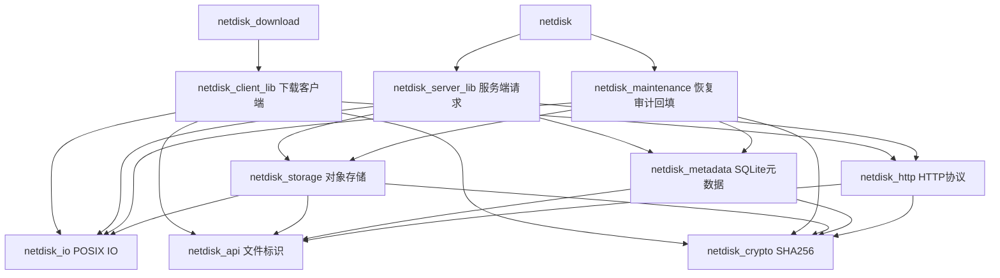

# 第33A单元 稳定接口与静态模块重构

## 1 今日目标与完成标准

今天把第33单元之后已经包含服务端 客户端 HTTP SQLite 存储和维护任务的工程 从按教学天数形成的头文件集合重构为真实模块 本单元不改变HTTP状态码 数据库schema 对象存储格式 发布删除状态机或断点下载语义

完成后应得到以下可观察结果

1. 生产代码只有 `api` `io` `crypto` `http` `metadata` `storage` `maintenance` `server` `client` 九个职责目录 不存在 `core` `common` `utils`或 `misc`
2. 每个稳定公开头位于 `src/<module>/include/netdisk/<module>` 普通函数和类实现位于 `.cpp`
3. 请求行 请求头 正文解析合并为 `request`接口 Range与If Range合并为 `range`接口 发布与删除恢复合并为 `recovery`接口
4. CMake创建九个静态库目标 依赖图无环
5. `netdisk_download`的链接闭包只包含api io crypto http client 不包含server storage metadata maintenance SQLite或JSON
6. 生产目标名 `netdisk` `netdisk_download` 22个C++ CTest名称和17个集成CTest名称不变
7. Python测试实现和业务语义不变
8. CMake配置期自动拒绝模块目录 目标依赖 客户端闭包和公开头路径违规

## 2 前因后果

第33单元加入断点下载客户端后 旧工程同时承担协议 持久化 存储 运维和两个可执行程序 过渡版虽然把文件移入子目录并让CMake能够配置 但仍存在两个架构问题

- `core`把无共同变化原因的头文件堆在一起 没有形成模块
- 许多普通函数和完整类实现仍放在头文件中 文件边界继续按学习单元而不是稳定接口划分

因此本次先核对未完成迁移和Git脏状态 只增量迁移 不reset 不覆盖既有变更 再建立最终编译边界 为第34单元的客户端超时功能提供可维护基础

## 3 术语定义

### 3.1 稳定跨编译单元接口

头文件中的声明允许多个 `.cpp`共享类型和函数契约 只有确实需要被调用方看见的类型 声明 模板 必要constexpr和简单RAII才保留在头文件 普通实现放入 `.cpp`减少传递依赖和重复编译

### 3.2 静态库目标

`add_library(name STATIC ...)`会编译自己的 `.cpp`并生成静态库 它与只传播选项而不编译实现的 `INTERFACE`目标不同 本次模块均有真实实现 因而使用静态库

### 3.3 直接依赖与传递依赖

目标直接写入 `target_link_libraries`的是直接依赖 依赖目标继续公开传播的库构成传递依赖 本次不仅检查client没有直接链接禁用模块 还计算 `netdisk_download`完整闭包

### 3.4 依赖环

如果模块A依赖B而B又通过若干模块回到A 就形成依赖环 环会让职责 所有权和链接顺序难以解释 本次目标图是有向无环图

## 4 完整端到端逻辑

1. 根CMake设置C++17 查找nlohmann_json SQLite OpenSSL并启用CTest
2. `src/CMakeLists.txt`按依赖顺序进入九个模块 根CMake随即执行架构守卫
3. api提供文件ID规则 io提供UniqueFd和POSIX发送循环 crypto提供摘要格式与EVP计算
4. http在api和crypto之上实现请求解析 范围语义 响应构造和客户端下载响应头解析
5. metadata只管理SQLite连接 schema和文件元数据语句 storage只管理对象路径与上传发布
6. maintenance单向组合io crypto metadata storage执行恢复 审计与回填
7. server单向组合io http metadata storage和JSON处理请求 不依赖maintenance
8. `netdisk`入口组合server和maintenance 保持原启动顺序后监听连接
9. client只组合api io crypto http 完成协议决策和有副作用的下载会话
10. `netdisk_download`入口只检查参数并调用client会话
11. C++测试按被测功能目录注册 Python集成测试仍从原脚本注册

## 5 图的类型

架构依赖流程图 Flowchart

## 6 为什么选择这种图

本单元要证明模块依赖方向和客户端隔离 不是表达一次HTTP请求的时间顺序 Flowchart能直接显示九个目标之间的有向边和两个最终可执行程序

## 7 Mermaid



## 8 图的解释

所有边都从目标指向它的直接依赖 没有任何路径回到起点 `netdisk_server_lib`与maintenance是并列组合项 server不反向依赖启动维护任务 client分支只到api io crypto http 因而无法直接或传递获得存储 数据库和服务端实现

## 9 最终目录树

```text
cmake/
└── NetdiskArchitecture.cmake
docs/
└── architecture.md
src/
├── CMakeLists.txt
├── api/
│   ├── CMakeLists.txt
│   ├── file_id.cpp
│   └── include/netdisk/api/file_id.h
├── io/
│   ├── CMakeLists.txt
│   ├── posix_io.cpp
│   └── include/netdisk/io/{posix_io.h,unique_fd.h}
├── crypto/
│   ├── CMakeLists.txt
│   ├── sha256.cpp
│   └── include/netdisk/crypto/sha256.h
├── http/
│   ├── CMakeLists.txt
│   ├── request.cpp range.cpp response.cpp
│   └── include/netdisk/http/{request.h,range.h,response.h}
├── metadata/
│   ├── CMakeLists.txt
│   ├── database.cpp file_metadata_store.cpp
│   └── include/netdisk/metadata/{database.h,file_metadata_store.h}
├── storage/
│   ├── CMakeLists.txt
│   ├── object_path.cpp temp_upload.cpp
│   └── include/netdisk/storage/{object_path.h,temp_upload.h}
├── maintenance/
│   ├── CMakeLists.txt
│   ├── recovery.cpp storage_audit.cpp digest_backfill.cpp
│   └── include/netdisk/maintenance/{recovery.h,storage_audit.h,digest_backfill.h}
├── server/
│   ├── CMakeLists.txt
│   ├── main.cpp request_handler.cpp file_catalog_handler.cpp file_content_handler.cpp
│   └── include/netdisk/server/{request_handler.h,file_catalog_handler.h,file_content_handler.h}
└── client/
    ├── CMakeLists.txt
    ├── main.cpp download_protocol.cpp download_session.cpp
    └── include/netdisk/client/{download_protocol.h,download_session.h}

tests/unit/
├── io/posix_io_tests.cpp
├── crypto/sha256_tests.cpp
├── http/{request_line_tests.cpp,request_headers_tests.cpp,request_parser_tests.cpp,response_tests.cpp,download_response_tests.cpp,range_tests.cpp,if_range_tests.cpp}
├── metadata/sqlite_lifecycle_tests.cpp
├── storage/{temp_upload_tests.cpp,publication_tests.cpp,object_path_tests.cpp}
├── maintenance/{publishing_recovery_tests.cpp,deletion_recovery_tests.cpp,storage_audit_tests.cpp,digest_backfill_tests.cpp}
├── server/{file_catalog_tests.cpp,file_mutation_tests.cpp,file_pagination_tests.cpp,publish_visibility_tests.cpp}
└── client/resume_download_tests.cpp
```

## 10 旧文件到新文件映射

| 旧文件或职责 | 最终文件 | 操作 |
| --- | --- | --- |
| `common/file_id.h` | `api/.../file_id.h` `api/file_id.cpp` | 重命名模块并分离实现 |
| `common/unique_fd.h` | `io/.../unique_fd.h` | 简单RAII保留头文件实现 |
| `net/socket_io.h` | `io/.../posix_io.h` `io/posix_io.cpp` | 分离实现 |
| `common/sha256_digest.h` `crypto/sha256_hasher.h` | `crypto/.../sha256.h` `crypto/sha256.cpp` | 合并格式规则和摘要所有者 |
| `http/request_line.h` `request_headers.h` `request_parser.h` | `http/.../request.h` `http/request.cpp` | 合并学习单元拆分并分离实现 |
| `http/byte_range.h` `if_range.h` | `http/.../range.h` `http/range.cpp` | 合并同一范围协议职责 |
| `server/http_response.h` `download_headers.h`和客户端响应头解析 | `http/.../response.h` `http/response.cpp` | 合并跨端HTTP响应语义 |
| `metadata/metadata_database.h` | `metadata/.../database.h` `metadata/database.cpp` | 分离实现 |
| `metadata/file_metadata_store.h` | `metadata/.../file_metadata_store.h` `metadata/file_metadata_store.cpp` | 分离实现并复用crypto校验 |
| `storage/object_path.h` | `storage/.../object_path.h` `storage/object_path.cpp` | 分离实现 |
| `storage/temp_upload.h` | `storage/.../temp_upload.h` `storage/temp_upload.cpp` | 分离实现 |
| `maintenance/publishing_recovery.h` `deletion_recovery.h` | `maintenance/.../recovery.h` `maintenance/recovery.cpp` | 合并同类启动恢复任务 |
| `maintenance/storage_audit.h` | `maintenance/.../storage_audit.h` `maintenance/storage_audit.cpp` | 分离实现 |
| `maintenance/digest_backfill.h` | `maintenance/.../digest_backfill.h` `maintenance/digest_backfill.cpp` | 分离实现 |
| `server/file_catalog.h` | `server/.../file_catalog_handler.h` `server/file_catalog_handler.cpp` | 明确请求处理职责 |
| `server/file_download.h` | `server/.../file_content_handler.h` `server/file_content_handler.cpp` | 明确文件内容发送职责 |
| 旧 `server/main.cpp`中的路由和连接处理 | `server/.../request_handler.h` `server/request_handler.cpp` | 从入口拆出实现 |
| 旧 `client/download_client_response.h` | HTTP解析进入`http/response` 续传策略进入`client/download_protocol` | 按协议层和客户端策略拆分 |
| 旧 `client/download_client.cpp` | `client/main.cpp` `download_session.cpp` | 入口与有副作用会话分离 |
| 22个 `tests/unit/dayXX_*.cpp` | 八个功能子目录中的同名职责测试 | 只移动和更新公开include 断言语义不变 |

旧文件全部真实删除 删除说明保留在 `src/CMakeLists.txt` 入口和新入口文件的 DAY 33A `DELETED`标注中 Python脚本未改

## 11 设计取舍

- `UniqueFd`只有极小的RAII资源所有权操作 保留头文件实现避免没有价值的间接层
- `Sha256Hasher`头中用不透明上下文指针隐藏OpenSSL头 业务头不再传递EVP定义
- http模块拥有双方都使用的线协议类型 client只拥有恢复决策与下载会话
- maintenance不并入server 这样请求服务和启动维护任务可以分别测试与组合
- 没有为了减少文件数制造一个巨型头 每个最终头仍对应稳定变化原因

### 11.1 架构影响与长期守卫

- 本单元建立api io crypto http metadata storage maintenance server client九个固定职责模块
- 精确直接依赖记录在`docs/architecture.md` CMake目标图保持无环
- 客户端闭包只允许client api io crypto http和OpenSSL Crypto
- 公开头只允许位于`src/<module>/include/netdisk/<module>` 普通实现继续位于cpp
- `cmake/NetdiskArchitecture.cmake`在注册测试前执行 配置违规立即`FATAL_ERROR`
- 后续教程即使没有架构变化也必须明确写无新增模块 无新增目标依赖 客户端闭包不变

## 12 Linux完整同步

Windows PowerShell在宿主机执行 下列归档排除Git 构建产物和运行数据

```powershell
Set-Location -LiteralPath 'D:\BasicKnowledge\Project\CPP\NetDisk\projects'

tar.exe -czf "$env:USERPROFILE\Desktop\netdisk-day33a.tar.gz" `
  --exclude='netdisk/.git' `
  --exclude='netdisk/build' `
  --exclude='netdisk/build-*' `
  --exclude='netdisk/data' `
  --exclude='netdisk/build-day33a-manual' `
  --exclude='netdisk/1.txt' `
  -C 'D:\BasicKnowledge\Project\CPP\NetDisk\projects' netdisk

scp "$env:USERPROFILE\Desktop\netdisk-day33a.tar.gz" `
  shen@<虚拟机IP>:/home/shen/
```

Linux虚拟机执行 使用唯一临时目录验证归档并先备份旧源码 `--delete`只作用于 `src`和 `tests`两棵已明确迁移的树 根目录其他文件 `build` `data` `.git`和用户文件不删除

```bash
set -e
cd /home/shen/projects
netdisk_stage=$(mktemp -d /home/shen/projects/netdisk-day33a-stage.XXXXXX)
tar -xzf /home/shen/netdisk-day33a.tar.gz \
  -C "$netdisk_stage" \
  --strip-components=1

test -f "$netdisk_stage/src/api/CMakeLists.txt"
test -f "$netdisk_stage/cmake/NetdiskArchitecture.cmake"
test -f "$netdisk_stage/src/client/main.cpp"
test ! -e "$netdisk_stage/src/core"
test ! -e "$netdisk_stage/src/common"
test ! -e "$netdisk_stage/src/net"

netdisk_backup="/home/shen/projects/netdisk-day33a-backup-$(date +%Y%m%d-%H%M%S)"
mkdir -p "$netdisk_backup"
cp -a /home/shen/projects/netdisk/CMakeLists.txt \
  /home/shen/projects/netdisk/README.md \
  /home/shen/projects/netdisk/src \
  /home/shen/projects/netdisk/tests \
  /home/shen/projects/netdisk/docs \
  "$netdisk_backup/"
if [ -d /home/shen/projects/netdisk/cmake ]; then
  cp -a /home/shen/projects/netdisk/cmake "$netdisk_backup/"
fi

rsync -a --delete "$netdisk_stage/src/" /home/shen/projects/netdisk/src/
rsync -a --delete "$netdisk_stage/tests/" /home/shen/projects/netdisk/tests/
rsync -a "$netdisk_stage/docs/" /home/shen/projects/netdisk/docs/
mkdir -p /home/shen/projects/netdisk/cmake
rsync -a --delete "$netdisk_stage/cmake/" /home/shen/projects/netdisk/cmake/
cp -a "$netdisk_stage/CMakeLists.txt" \
  "$netdisk_stage/README.md" \
  "$netdisk_stage/.gitignore" \
  "$netdisk_stage/.gitattributes" \
  /home/shen/projects/netdisk/

echo "backup: $netdisk_backup"
```

如果虚拟机没有rsync 先安装 `rsync` 或在VS Code Remote中删除旧工程的 `src`和 `tests/unit`后上传完整新目录 不能只复制新增文件 否则旧头会残留

## 13 Linux配置 构建和两项核心测试

```bash
cd /home/shen/projects/netdisk

cmake -S . -B build \
  -DCMAKE_BUILD_TYPE=Debug \
  -DBUILD_TESTING=ON

cmake --build build -j2
ctest --test-dir build -N
```

配置输出必须包含`NetDisk architecture guard passed: 9 modules, 11 production targets, clean client closure` 注册检查必须包含 `Total Tests: 39` 然后分别运行两项核心测试

```bash
ctest --test-dir build -R '^resume_download_tests$' -V
ctest --test-dir build -R '^resume_download_integration_tests$' -V
```

两项都应显示Passed 集成项应输出 `PASS: resume download integration finished 3 groups` 如果显示SKIP 77说明不是Linux可执行环境或前置条件不满足 不能记为通过

## 14 本地实际验证与边界

- 本机没有 `cmake.exe` 因而没有执行或宣称CMake配置通过
- TDM-GCC真实编译运行 `request_line_tests` `request_headers_tests` `request_body_tests` `object_path_tests` 四项通过
- 八个重构后测试源和六个无外部开发包的生产源通过 `-fsyntax-only`
- OpenSSL头 SQLite头 Linux `sys/socket.h`和nlohmann/json在本机不可用 对应生产链接和测试未执行
- 静态检查确认19个公开头均能解析 39项CTest名称唯一 目标图无环 客户端完整链接闭包没有禁用模块
- 最终九模块版已经在Linux完成构建并通过两项核心CTest 后续新增的配置期守卫仍必须同步并看到architecture guard passed才能单独记为通过

## 15 完整新增与修改C++源码

以下内容由当前最终工作区逐文件生成 不省略生产C++和C++测试

### `src/api/file_id.cpp`

```cpp
// ===== DAY 33A ADDED BEGIN 实现跨端文件标识规则 =====
#include <netdisk/api/file_id.h>

bool is_valid_file_id(std::string_view id) noexcept
{
    constexpr std::string_view prefix = "upload-";
    if (id.size() != prefix.size() + 6 ||
        id.substr(0, prefix.size()) != prefix) return false;
    for (const char ch : id.substr(prefix.size()))
    {
        const bool alnum = (ch >= 'a' && ch <= 'z') ||
                           (ch >= 'A' && ch <= 'Z') ||
                           (ch >= '0' && ch <= '9');
        if (!alnum) return false;
    }
    return true;
}
// ===== DAY 33A ADDED END =====

```


### `src/api/include/netdisk/api/file_id.h`

```cpp
// ===== DAY 33A ADDED BEGIN 声明跨端文件标识规则 =====
#pragma once

#include <string_view>

bool is_valid_file_id(std::string_view id) noexcept;
// ===== DAY 33A ADDED END =====

```


### `src/client/download_protocol.cpp`

```cpp
#include <netdisk/client/download_protocol.h>

#include <netdisk/api/file_id.h>

#include <utility>

// ===== DAY 33A ADDED BEGIN 将断点续传决策与请求构造移出头文件 =====
namespace download_client
{
ResumePlan make_resume_plan(const ResponseHead& response,
                            std::uint64_t local_size,
                            std::string_view saved_etag) noexcept
{
    ResumePlan plan;
    if (!response.has_content_length || !is_strong_sha256_etag(response.etag))
        return plan;
    if (response.status == 200)
    {
        if (response.content_range_kind != ContentRangeKind::None) return plan;
        plan.action = ResumeAction::Replace;
        plan.total_size = response.content_length;
        return plan;
    }
    if (!is_strong_sha256_etag(saved_etag) || response.etag != saved_etag)
        return plan;
    if (response.status == 206)
    {
        if (response.content_range_kind != ContentRangeKind::Selected ||
            response.range_start != local_size || response.total_size == 0 ||
            local_size >= response.total_size ||
            response.range_end != response.total_size - 1 ||
            response.content_length != response.total_size - local_size)
            return plan;
        plan.action = ResumeAction::Append;
        plan.total_size = response.total_size;
        return plan;
    }
    if (response.status == 416 &&
        response.content_range_kind == ContentRangeKind::Unsatisfied &&
        local_size == response.total_size)
    {
        plan.action = ResumeAction::Complete;
        plan.total_size = response.total_size;
    }
    return plan;
}

bool make_download_request(std::string_view id, bool resume,
                           std::uint64_t local_size,
                           std::string_view saved_etag,
                           std::string& output)
{
    if (!is_valid_file_id(id)) return false;
    if (resume && (local_size == 0 || !is_strong_sha256_etag(saved_etag)))
        return false;
    std::string request =
        "GET /api/files/" + std::string(id) + "/content HTTP/1.1\r\n"
        "Host: 127.0.0.1:8080\r\n";
    if (resume)
    {
        request += "Range: bytes=" + std::to_string(local_size) + "-\r\n";
        request += "If-Range: " + std::string(saved_etag) + "\r\n";
    }
    request += "Content-Length: 0\r\nConnection: close\r\n\r\n";
    output = std::move(request);
    return true;
}
}
// ===== DAY 33A ADDED END =====

```


### `src/client/download_session.cpp`

```cpp
#include <netdisk/client/download_session.h>

#include <netdisk/api/file_id.h>
#include <netdisk/client/download_protocol.h>
#include <netdisk/crypto/sha256.h>
#include <netdisk/http/response.h>
#include <netdisk/io/posix_io.h>
#include <netdisk/io/unique_fd.h>

#include <algorithm>
#include <arpa/inet.h>
#include <cerrno>
#include <cstdint>
#include <fcntl.h>
#include <iostream>
#include <netinet/in.h>
#include <string>
#include <sys/socket.h>
#include <sys/stat.h>
#include <unistd.h>

namespace
{
// ===== DAY 33A ADDED BEGIN 将下载会话内部文件与网络实现移出main =====
constexpr std::size_t max_response_head_size = 8192;

bool inspect_output_file(const std::string& path, bool& exists,
                         std::uint64_t& size)
{
    struct stat info{};
    if (::lstat(path.c_str(), &info) == -1)
    {
        if (errno == ENOENT)
        {
            exists = false;
            size = 0;
            return true;
        }
        print_system_error("lstat output", errno);
        return false;
    }
    if (!S_ISREG(info.st_mode) || info.st_size < 0)
    {
        std::cerr << "output path must be a regular file\n";
        return false;
    }
    exists = true;
    size = static_cast<std::uint64_t>(info.st_size);
    return true;
}

bool read_etag_state(const std::string& path, std::string& etag)
{
    int raw_fd;
    do
    {
        raw_fd = ::open(path.c_str(), O_RDONLY | O_CLOEXEC | O_NOFOLLOW | O_NONBLOCK);
    } while (raw_fd == -1 && errno == EINTR);
    if (raw_fd == -1) return false;
    UniqueFd file(raw_fd);

    struct stat info{};
    if (::fstat(file.get(), &info) == -1 || !S_ISREG(info.st_mode) ||
        info.st_size < 0 || info.st_size > 128)
        return false;
    std::string content(static_cast<std::size_t>(info.st_size), '\0');
    std::size_t received = 0;
    while (received < content.size())
    {
        const ssize_t n = ::read(file.get(), content.data() + received,
                                 content.size() - received);
        if (n == -1)
        {
            if (errno == EINTR) continue;
            return false;
        }
        if (n == 0) return false;
        received += static_cast<std::size_t>(n);
    }
    if (!content.empty() && content.back() == '\n') content.pop_back();
    if (!content.empty() && content.back() == '\r') content.pop_back();
    if (!download_client::is_strong_sha256_etag(content)) return false;
    etag = std::move(content);
    return true;
}

bool write_all_file(int fd, const char* data, std::size_t size)
{
    std::size_t written = 0;
    while (written < size)
    {
        const ssize_t n = ::write(fd, data + written, size - written);
        if (n == -1)
        {
            if (errno == EINTR) continue;
            print_system_error("write download", errno);
            return false;
        }
        if (n == 0)
        {
            std::cerr << "write download made no progress\n";
            return false;
        }
        written += static_cast<std::size_t>(n);
    }
    return true;
}

bool save_etag_state(const std::string& path, std::string_view etag)
{
    int raw_fd;
    do
    {
        raw_fd = ::open(path.c_str(),
            O_WRONLY | O_CREAT | O_TRUNC | O_CLOEXEC | O_NOFOLLOW | O_NONBLOCK,
            0600);
    } while (raw_fd == -1 && errno == EINTR);
    if (raw_fd == -1)
    {
        print_system_error("open ETag state", errno);
        return false;
    }
    UniqueFd file(raw_fd);
    struct stat info{};
    if (::fstat(file.get(), &info) == -1 || !S_ISREG(info.st_mode))
    {
        std::cerr << "ETag state path must be a regular file\n";
        return false;
    }
    const std::string content = std::string(etag) + "\n";
    return write_all_file(file.get(), content.data(), content.size());
}

bool connect_to_server(int& socket_fd)
{
    const int raw_fd = ::socket(AF_INET, SOCK_STREAM | SOCK_CLOEXEC, 0);
    if (raw_fd == -1)
    {
        print_system_error("socket", errno);
        return false;
    }
    sockaddr_in address{};
    address.sin_family = AF_INET;
    address.sin_port = htons(8080);
    if (::inet_pton(AF_INET, "127.0.0.1", &address.sin_addr) != 1)
    {
        std::cerr << "failed to prepare loopback address\n";
        ::close(raw_fd);
        return false;
    }
    if (::connect(raw_fd, reinterpret_cast<sockaddr*>(&address),
                  sizeof(address)) == -1)
    {
        const int error = errno;
        ::close(raw_fd);
        print_system_error("connect", error);
        return false;
    }
    socket_fd = raw_fd;
    return true;
}

bool receive_response_head(int socket_fd, std::string& head,
                           std::string& body_prefix)
{
    std::string received;
    char buffer[4096];
    while (true)
    {
        const auto boundary = received.find("\r\n\r\n");
        if (boundary != std::string::npos)
        {
            const auto head_size = boundary + 4;
            if (head_size > max_response_head_size)
            {
                std::cerr << "response head exceeds limit\n";
                return false;
            }
            head.assign(received.data(), head_size);
            body_prefix.assign(received.data() + head_size,
                               received.size() - head_size);
            return true;
        }
        if (received.size() > max_response_head_size)
        {
            std::cerr << "response head exceeds limit\n";
            return false;
        }
        const ssize_t n = ::recv(socket_fd, buffer, sizeof(buffer), 0);
        if (n == -1)
        {
            if (errno == EINTR) continue;
            print_system_error("recv response head", errno);
            return false;
        }
        if (n == 0)
        {
            std::cerr << "server closed before response head completed\n";
            return false;
        }
        received.append(buffer, static_cast<std::size_t>(n));
    }
}

bool open_output_for_plan(const std::string& path,
                          download_client::ResumeAction action,
                          std::uint64_t expected_size,
                          int& output_fd)
{
    int flags = O_WRONLY | O_CLOEXEC | O_NOFOLLOW | O_NONBLOCK;
    if (action == download_client::ResumeAction::Replace)
        flags |= O_CREAT | O_TRUNC;
    else flags |= O_APPEND;
    int raw_fd;
    do
    {
        raw_fd = ::open(path.c_str(), flags, 0600);
    } while (raw_fd == -1 && errno == EINTR);
    if (raw_fd == -1)
    {
        print_system_error("open output", errno);
        return false;
    }
    struct stat info{};
    if (::fstat(raw_fd, &info) == -1 || !S_ISREG(info.st_mode) ||
        info.st_size < 0 ||
        (action == download_client::ResumeAction::Append &&
         static_cast<std::uint64_t>(info.st_size) != expected_size))
    {
        std::cerr << "output file changed before response body write\n";
        ::close(raw_fd);
        return false;
    }
    output_fd = raw_fd;
    return true;
}

bool receive_body(int socket_fd, int output_fd, std::string_view prefix,
                  std::uint64_t content_length)
{
    if (prefix.size() > content_length)
    {
        std::cerr << "response body exceeds Content-Length\n";
        return false;
    }
    if (!write_all_file(output_fd, prefix.data(), prefix.size())) return false;
    std::uint64_t remaining = content_length - prefix.size();
    char buffer[16 * 1024];
    while (remaining != 0)
    {
        const auto count = static_cast<std::size_t>(
            std::min<std::uint64_t>(remaining, sizeof(buffer)));
        const ssize_t n = ::recv(socket_fd, buffer, count, 0);
        if (n == -1)
        {
            if (errno == EINTR) continue;
            print_system_error("recv response body", errno);
            return false;
        }
        if (n == 0)
        {
            std::cerr << "server closed before Content-Length bytes arrived\n";
            return false;
        }
        const auto size = static_cast<std::size_t>(n);
        if (!write_all_file(output_fd, buffer, size)) return false;
        remaining -= size;
    }
    return true;
}

bool hash_complete_file(const std::string& path, std::uint64_t expected_size,
                        std::string& digest)
{
    int raw_fd;
    do
    {
        raw_fd = ::open(path.c_str(), O_RDONLY | O_CLOEXEC | O_NOFOLLOW | O_NONBLOCK);
    } while (raw_fd == -1 && errno == EINTR);
    if (raw_fd == -1)
    {
        print_system_error("open completed download", errno);
        return false;
    }
    UniqueFd file(raw_fd);
    struct stat info{};
    if (::fstat(file.get(), &info) == -1 || !S_ISREG(info.st_mode) ||
        info.st_size < 0 || static_cast<std::uint64_t>(info.st_size) != expected_size)
    {
        std::cerr << "completed download size differs from response metadata\n";
        return false;
    }
    Sha256Hasher hasher;
    char buffer[16 * 1024];
    while (true)
    {
        const ssize_t n = ::read(file.get(), buffer, sizeof(buffer));
        if (n == -1)
        {
            if (errno == EINTR) continue;
            print_system_error("read completed download", errno);
            return false;
        }
        if (n == 0) break;
        if (!hasher.update(std::string_view(buffer, static_cast<std::size_t>(n))))
        {
            std::cerr << "SHA256 update failed\n";
            return false;
        }
    }
    if (!hasher.finish(digest))
    {
        std::cerr << "SHA256 finish failed\n";
        return false;
    }
    return true;
}

void remove_invalid_state(const std::string& path)
{
    if (::unlink(path.c_str()) == -1 && errno != ENOENT)
        print_system_error("remove invalid ETag state", errno);
}
// ===== DAY 33A ADDED END =====
}

// ===== DAY 33A ADDED BEGIN 下载会话保持原有断点与摘要验证语义 =====
int run_download(std::string_view id, const std::string& output_path)
{
    const std::string state_path = output_path + ".netdisk-etag";
    if (!is_valid_file_id(id) || output_path.empty())
    {
        std::cerr << "invalid file ID or output path\n";
        return 2;
    }
    bool output_exists = false;
    std::uint64_t local_size = 0;
    if (!inspect_output_file(output_path, output_exists, local_size)) return 1;

    std::string saved_etag;
    const bool resume = output_exists && local_size != 0 &&
                        read_etag_state(state_path, saved_etag);
    std::string request;
    if (!download_client::make_download_request(
            id, resume, local_size, saved_etag, request))
    {
        std::cerr << "failed to build download request\n";
        return 1;
    }

    int raw_socket = -1;
    if (!connect_to_server(raw_socket)) return 1;
    UniqueFd socket(raw_socket);
    if (!send_all(socket.get(), request.data(), request.size())) return 1;

    std::string response_wire;
    std::string body_prefix;
    if (!receive_response_head(socket.get(), response_wire, body_prefix)) return 1;
    download_client::ResponseHead response;
    if (!download_client::parse_response_head(response_wire, response))
    {
        std::cerr << "invalid HTTP response head\n";
        return 1;
    }
    const auto plan = download_client::make_resume_plan(response, local_size, saved_etag);
    if (plan.action == download_client::ResumeAction::Reject)
    {
        std::cerr << "server response does not satisfy download contract status="
                  << response.status << '\n';
        return 1;
    }
    if ((plan.action == download_client::ResumeAction::Replace ||
         plan.action == download_client::ResumeAction::Append) &&
        body_prefix.size() > response.content_length)
    {
        std::cerr << "response body exceeds Content-Length\n";
        return 1;
    }

    if (plan.action == download_client::ResumeAction::Replace ||
        plan.action == download_client::ResumeAction::Append)
    {
        int raw_output = -1;
        if (!open_output_for_plan(output_path, plan.action, local_size, raw_output))
            return 1;
        UniqueFd output(raw_output);
        if (plan.action == download_client::ResumeAction::Replace &&
            !save_etag_state(state_path, response.etag)) return 1;
        if (!receive_body(socket.get(), output.get(), body_prefix,
                          response.content_length)) return 1;
    }

    std::string digest;
    if (!hash_complete_file(output_path, plan.total_size, digest) ||
        response.etag.substr(1, 64) != digest)
    {
        std::cerr << "completed download SHA256 differs from ETag\n";
        remove_invalid_state(state_path);
        return 1;
    }
    const char* result = plan.action == download_client::ResumeAction::Append
        ? "resumed with 206"
        : plan.action == download_client::ResumeAction::Replace
            ? "replaced with 200" : "already complete after 416";
    std::cout << "download complete: " << result
              << " bytes=" << plan.total_size << " sha256=" << digest << '\n';
    return 0;
}
// ===== DAY 33A ADDED END =====

```


### `src/client/include/netdisk/client/download_protocol.h`

```cpp
#pragma once

#include <netdisk/http/response.h>

#include <cstdint>
#include <string>
#include <string_view>

// ===== DAY 33A ADDED BEGIN 提取断点续传决策稳定接口 =====
namespace download_client
{

enum class ResumeAction
{
    Reject,
    Replace,
    Append,
    Complete
};

struct ResumePlan
{
    ResumeAction action = ResumeAction::Reject;
    std::uint64_t total_size = 0;
};

ResumePlan make_resume_plan(const ResponseHead& response,
                            std::uint64_t local_size,
                            std::string_view saved_etag) noexcept;
bool make_download_request(std::string_view id, bool resume,
                           std::uint64_t local_size,
                           std::string_view saved_etag,
                           std::string& output);

}
// ===== DAY 33A ADDED END =====

```


### `src/client/include/netdisk/client/download_session.h`

```cpp
#pragma once

#include <string>
#include <string_view>

// ===== DAY 33A ADDED BEGIN 提取下载会话入口接口 =====
int run_download(std::string_view id, const std::string& output_path);
// ===== DAY 33A ADDED END =====

```


### `src/client/main.cpp`

```cpp
#include <netdisk/client/download_session.h>

#include <iostream>
#include <string>

// ===== DAY 33A ADDED BEGIN 可执行入口只负责参数检查与启动下载会话 =====
int main(int argc, char* argv[])
{
    if (argc != 3)
    {
        std::cerr << "usage: netdisk_download FILE_ID OUTPUT_PATH\n";
        return 2;
    }
    return run_download(argv[1], std::string(argv[2]));
}
// ===== DAY 33A ADDED END =====
// ===== DAY 33A DELETED 下载协议与文件网络实现移动到client库 =====

```


### `src/crypto/include/netdisk/crypto/sha256.h`

```cpp
// ===== DAY 33A ADDED BEGIN 合并SHA256格式规则与增量摘要接口 =====
#pragma once

#include <string>
#include <string_view>

bool is_canonical_sha256(std::string_view value) noexcept;

class Sha256Hasher
{
public:
    Sha256Hasher() noexcept = default;
    Sha256Hasher(const Sha256Hasher&) = delete;
    Sha256Hasher& operator=(const Sha256Hasher&) = delete;
    ~Sha256Hasher() noexcept;

    bool update(std::string_view data) noexcept;
    bool finish(std::string& output) noexcept;
    bool good() const noexcept;

private:
    bool initialize() noexcept;
    void fail() noexcept;

    void* context_ = nullptr;
    bool finalized_ = false;
    bool failed_ = false;
};
// ===== DAY 33A ADDED END =====

```


### `src/crypto/sha256.cpp`

```cpp
// ===== DAY 33A ADDED BEGIN 隐藏OpenSSL EVP并实现SHA256接口 =====
#include <netdisk/crypto/sha256.h>

#include <openssl/evp.h>

#include <array>
#include <cstddef>
#include <utility>

namespace
{

EVP_MD_CTX* as_context(void* context) noexcept
{
    return static_cast<EVP_MD_CTX*>(context);
}

}

bool is_canonical_sha256(std::string_view value) noexcept
{
    if (value.size() != 64) return false;
    for (const char ch : value)
        if (!((ch >= '0' && ch <= '9') || (ch >= 'a' && ch <= 'f'))) return false;
    return true;
}

Sha256Hasher::~Sha256Hasher() noexcept
{
    EVP_MD_CTX_free(as_context(context_));
}

bool Sha256Hasher::update(std::string_view data) noexcept
{
    if (failed_ || finalized_) return false;
    if (data.empty()) return true;
    if (!initialize()) return false;
    if (EVP_DigestUpdate(as_context(context_), data.data(), data.size()) != 1)
    {
        fail();
        return false;
    }
    return true;
}

bool Sha256Hasher::finish(std::string& output) noexcept
{
    if (failed_ || finalized_ || !initialize()) return false;
    std::array<unsigned char, EVP_MAX_MD_SIZE> bytes{};
    unsigned int size = 0;
    if (EVP_DigestFinal_ex(as_context(context_), bytes.data(), &size) != 1 ||
        size != 32)
    {
        fail();
        return false;
    }

    static constexpr char digits[] = "0123456789abcdef";
    std::string hex;
    try
    {
        hex.resize(size * 2);
    }
    catch (...)
    {
        fail();
        return false;
    }
    for (std::size_t index = 0; index < size; ++index)
    {
        hex[index * 2] = digits[bytes[index] >> 4];
        hex[index * 2 + 1] = digits[bytes[index] & 0x0f];
    }

    EVP_MD_CTX_free(as_context(context_));
    context_ = nullptr;
    finalized_ = true;
    output = std::move(hex);
    return true;
}

bool Sha256Hasher::good() const noexcept
{
    return !failed_;
}

bool Sha256Hasher::initialize() noexcept
{
    if (context_ != nullptr) return true;
    EVP_MD_CTX* created = EVP_MD_CTX_new();
    context_ = created;
    if (created != nullptr && EVP_DigestInit_ex(created, EVP_sha256(), nullptr) == 1)
        return true;
    fail();
    return false;
}

void Sha256Hasher::fail() noexcept
{
    EVP_MD_CTX_free(as_context(context_));
    context_ = nullptr;
    failed_ = true;
}
// ===== DAY 33A ADDED END =====

```


### `src/http/include/netdisk/http/range.h`

```cpp
#pragma once

#include <cstdint>
#include <string_view>

// ===== DAY 33A ADDED BEGIN 合并字节范围与If Range公共接口 =====
struct ByteRange
{
    std::uint64_t start = 0;
    std::uint64_t length = 0;
};

enum class ByteRangeResult
{
    Satisfiable,
    Unsatisfiable,
    Ignore,
    Invalid
};

std::string_view trim_range_ows(std::string_view text) noexcept;
bool parse_range_number(std::string_view text, std::uint64_t& output) noexcept;
ByteRangeResult parse_one_byte_range(std::string_view text,
                                     std::uint64_t full_size,
                                     ByteRange& output) noexcept;
ByteRangeResult parse_byte_range(std::string_view value,
                                 std::uint64_t full_size,
                                 ByteRange& output) noexcept;
bool if_range_matches_strong_etag(std::string_view value,
                                  std::string_view sha256) noexcept;
// ===== DAY 33A ADDED END =====

```


### `src/http/include/netdisk/http/request.h`

```cpp
// ===== DAY 33A ADDED BEGIN 合并HTTP请求行 请求头与正文解析接口 =====
#pragma once

#include <cstddef>
#include <cstdint>
#include <functional>
#include <string>
#include <string_view>
#include <utility>
#include <vector>

enum class ParseState
{
    NeedMore,
    Done,
    Error
};

struct RequestLine
{
    std::string method;
    std::string target;
    std::string version;
};

struct FeedResult
{
    ParseState state;
    std::size_t consumed;
};

class RequestLineParser
{
public:
    FeedResult feed(std::string_view input);
    const RequestLine& line() const noexcept;

private:
    static constexpr std::size_t max_line_bytes = 4096;
    static bool is_token_char(unsigned char ch);
    bool parse_line();

    ParseState state_ = ParseState::NeedMore;
    std::size_t bytes_ = 0;
    bool saw_cr_ = false;
    std::string buffer_;
    RequestLine line_;
};

class RequestHeadersParser
{
public:
    using Field = std::pair<std::string, std::string>;

    FeedResult feed(std::string_view input);
    const std::vector<Field>& fields() const noexcept;

private:
    static bool is_token(unsigned char ch);
    bool parse_field();

    ParseState state_ = ParseState::NeedMore;
    std::size_t bytes_ = 0;
    std::size_t line_bytes_ = 0;
    bool saw_cr_ = false;
    std::string buffer_;
    std::vector<Field> fields_;
};

bool parse_decimal_length(std::string_view text, std::uint64_t& output);

enum class RequestError
{
    None,
    BadRequest,
    BodyTooLarge,
    UnsupportedExpectation,
    UnsupportedTransferEncoding,
    BodyWriteFailed
};

enum class BodyAction
{
    Buffer,
    Written,
    Failed
};

using BodySink = std::function<BodyAction(const RequestLine&, std::string_view)>;

class RequestParser
{
public:
    static constexpr std::size_t max_body_bytes = 64 * 1024;

    explicit RequestParser(BodySink sink = {});

    FeedResult feed(std::string_view input);
    ParseState finish() noexcept;
    RequestError error() const noexcept;
    const RequestLine& line() const noexcept;
    const std::string& body() const noexcept;
    const std::vector<RequestHeadersParser::Field>& headers() const noexcept;
    std::size_t body_size() const noexcept;

private:
    RequestError validate_headers();

    ParseState state_ = ParseState::NeedMore;
    RequestError error_ = RequestError::None;
    RequestLineParser line_;
    RequestHeadersParser headers_;
    bool line_done_ = false;
    bool head_done_ = false;
    std::size_t length_ = 0;
    std::string body_;
    std::size_t received_ = 0;
    BodySink sink_;
};
// ===== DAY 33A ADDED END =====

```


### `src/http/include/netdisk/http/response.h`

```cpp
#pragma once

#include <netdisk/http/range.h>
#include <netdisk/http/request.h>

#include <cstdint>
#include <string>
#include <string_view>

// ===== DAY 33A ADDED BEGIN 汇总HTTP响应与客户端下载响应头稳定接口 =====
struct HttpResponse
{
    int status;
    std::string_view reason;
    std::string_view content_type;
    std::string body;
    std::string_view allow = {};
    std::string file_id = {};
    std::string sha256 = {};
};

HttpResponse error_response(int status, std::string_view allow = {});
HttpResponse parser_error_response(RequestError error);
std::string build_response(const HttpResponse& response, bool head_only = false);

bool make_download_header(std::string_view id, std::uint64_t size,
                          std::string_view sha256, const ByteRange* range,
                          std::string& output);
bool make_range_not_satisfiable_response(std::uint64_t size,
                                         std::string_view sha256,
                                         bool head_only,
                                         std::string& output);

namespace download_client
{

enum class ContentRangeKind
{
    None,
    Selected,
    Unsatisfied
};

struct ResponseHead
{
    int status = 0;
    bool has_content_length = false;
    std::uint64_t content_length = 0;
    std::string etag;
    ContentRangeKind content_range_kind = ContentRangeKind::None;
    std::uint64_t range_start = 0;
    std::uint64_t range_end = 0;
    std::uint64_t total_size = 0;
};

bool parse_response_head(std::string_view wire, ResponseHead& output);
bool is_strong_sha256_etag(std::string_view etag) noexcept;

}
// ===== DAY 33A ADDED END =====

```


### `src/http/range.cpp`

```cpp
#include <netdisk/http/range.h>

#include <netdisk/crypto/sha256.h>

#include <algorithm>
#include <limits>

// ===== DAY 33A ADDED BEGIN 将范围解析与If Range实现移出头文件 =====
std::string_view trim_range_ows(std::string_view text) noexcept
{
    while (!text.empty() && (text.front() == ' ' || text.front() == '\t'))
        text.remove_prefix(1);
    while (!text.empty() && (text.back() == ' ' || text.back() == '\t'))
        text.remove_suffix(1);
    return text;
}

bool parse_range_number(std::string_view text, std::uint64_t& output) noexcept
{
    if (text.empty()) return false;
    std::uint64_t value = 0;
    for (const char ch : text)
    {
        if (ch < '0' || ch > '9') return false;
        const auto digit = static_cast<std::uint64_t>(ch - '0');
        if (value > (std::numeric_limits<std::uint64_t>::max() - digit) / 10)
            return false;
        value = value * 10 + digit;
    }
    output = value;
    return true;
}

ByteRangeResult parse_one_byte_range(std::string_view text,
                                     std::uint64_t full_size,
                                     ByteRange& output) noexcept
{
    const auto dash = text.find('-');
    if (dash == std::string_view::npos ||
        text.find('-', dash + 1) != std::string_view::npos)
        return ByteRangeResult::Invalid;

    const auto first_text = text.substr(0, dash);
    const auto last_text = text.substr(dash + 1);
    if (first_text.empty())
    {
        std::uint64_t suffix_length = 0;
        if (!parse_range_number(last_text, suffix_length))
            return ByteRangeResult::Invalid;
        if (suffix_length == 0 || full_size == 0)
            return ByteRangeResult::Unsatisfiable;
        ByteRange parsed;
        parsed.length = std::min(suffix_length, full_size);
        parsed.start = full_size - parsed.length;
        output = parsed;
        return ByteRangeResult::Satisfiable;
    }

    std::uint64_t first = 0;
    if (!parse_range_number(first_text, first))
        return ByteRangeResult::Invalid;
    if (last_text.empty())
    {
        if (first >= full_size) return ByteRangeResult::Unsatisfiable;
        output = {first, full_size - first};
        return ByteRangeResult::Satisfiable;
    }

    std::uint64_t last = 0;
    if (!parse_range_number(last_text, last) || last < first)
        return ByteRangeResult::Invalid;
    if (first >= full_size) return ByteRangeResult::Unsatisfiable;
    last = std::min(last, full_size - 1);
    output = {first, last - first + 1};
    return ByteRangeResult::Satisfiable;
}

ByteRangeResult parse_byte_range(std::string_view value,
                                 std::uint64_t full_size,
                                 ByteRange& output) noexcept
{
    constexpr std::size_t unit_size = 6;
    if (value.size() < unit_size || value[5] != '=' ||
        !((value[0] == 'b' || value[0] == 'B') &&
          (value[1] == 'y' || value[1] == 'Y') &&
          (value[2] == 't' || value[2] == 'T') &&
          (value[3] == 'e' || value[3] == 'E') &&
          (value[4] == 's' || value[4] == 'S')))
        return ByteRangeResult::Ignore;

    value.remove_prefix(unit_size);
    std::size_t item_count = 0;
    ByteRange parsed;
    ByteRangeResult single_result = ByteRangeResult::Invalid;
    while (true)
    {
        const auto comma = value.find(',');
        const auto item = trim_range_ows(value.substr(0, comma));
        if (item.empty()) return ByteRangeResult::Invalid;
        ByteRange current;
        const auto result = parse_one_byte_range(item, full_size, current);
        if (result == ByteRangeResult::Invalid) return result;
        ++item_count;
        if (item_count == 1)
        {
            parsed = current;
            single_result = result;
        }
        if (comma == std::string_view::npos) break;
        value.remove_prefix(comma + 1);
    }

    if (item_count != 1) return ByteRangeResult::Ignore;
    if (single_result == ByteRangeResult::Satisfiable) output = parsed;
    return single_result;
}

bool if_range_matches_strong_etag(std::string_view value,
                                  std::string_view sha256) noexcept
{
    if (!is_canonical_sha256(sha256) || value.size() != sha256.size() + 2)
        return false;
    return value.front() == '"' && value.back() == '"' &&
           value.substr(1, sha256.size()) == sha256;
}
// ===== DAY 33A ADDED END =====

```


### `src/http/request.cpp`

```cpp
// ===== DAY 33A ADDED BEGIN 实现统一HTTP请求增量解析状态机 =====
#include <netdisk/http/request.h>

#include <algorithm>
#include <limits>

FeedResult RequestLineParser::feed(std::string_view input)
{
    std::size_t used = 0;
    while (used < input.size() && state_ == ParseState::NeedMore)
    {
        const unsigned char ch = static_cast<unsigned char>(input[used++]);
        if (++bytes_ > max_line_bytes)
        {
            state_ = ParseState::Error;
            break;
        }
        if (saw_cr_)
        {
            state_ = ch == '\n' && parse_line()
                ? ParseState::Done : ParseState::Error;
            break;
        }
        if (ch == '\r')
            saw_cr_ = true;
        else if (ch < 32 || ch > 126)
            state_ = ParseState::Error;
        else
            buffer_.push_back(static_cast<char>(ch));
    }
    return {state_, used};
}

const RequestLine& RequestLineParser::line() const noexcept
{
    return line_;
}

bool RequestLineParser::is_token_char(unsigned char ch)
{
    return (ch >= 'A' && ch <= 'Z') ||
           (ch >= 'a' && ch <= 'z') ||
           (ch >= '0' && ch <= '9') ||
           std::string_view("!#$%&'*+-.^_`|~").find(
               static_cast<char>(ch)) != std::string_view::npos;
}

bool RequestLineParser::parse_line()
{
    const std::size_t first = buffer_.find(' ');
    if (first == std::string::npos || first == 0) return false;
    const std::size_t second = buffer_.find(' ', first + 1);
    if (second == std::string::npos || second == first + 1 ||
        buffer_.find(' ', second + 1) != std::string::npos)
        return false;

    RequestLine candidate{
        buffer_.substr(0, first),
        buffer_.substr(first + 1, second - first - 1),
        buffer_.substr(second + 1)
    };
    for (const unsigned char ch : candidate.method)
        if (!is_token_char(ch)) return false;
    if (candidate.target.front() != '/' ||
        candidate.target.find('#') != std::string::npos ||
        candidate.target.find('\\') != std::string::npos ||
        candidate.version != "HTTP/1.1")
        return false;
    line_ = std::move(candidate);
    return true;
}

FeedResult RequestHeadersParser::feed(std::string_view input)
{
    std::size_t used = 0;
    while (used < input.size() && state_ == ParseState::NeedMore)
    {
        const unsigned char ch = static_cast<unsigned char>(input[used++]);
        if (++bytes_ > 8192 || ++line_bytes_ > 4096)
        {
            state_ = ParseState::Error;
            break;
        }
        if (saw_cr_)
        {
            if (ch != '\n')
                state_ = ParseState::Error;
            else if (buffer_.empty())
                state_ = ParseState::Done;
            else if (!parse_field())
                state_ = ParseState::Error;
            buffer_.clear();
            saw_cr_ = false;
            line_bytes_ = 0;
        }
        else if (ch == '\r')
            saw_cr_ = true;
        else if ((ch < 32 && ch != '\t') || ch == 127)
            state_ = ParseState::Error;
        else
            buffer_.push_back(static_cast<char>(ch));
    }
    return {state_, used};
}

const std::vector<RequestHeadersParser::Field>&
RequestHeadersParser::fields() const noexcept
{
    return fields_;
}

bool RequestHeadersParser::is_token(unsigned char ch)
{
    return (ch >= 'A' && ch <= 'Z') ||
           (ch >= 'a' && ch <= 'z') ||
           (ch >= '0' && ch <= '9') ||
           std::string_view("!#$%&'*+-.^_`|~").find(
               static_cast<char>(ch)) != std::string_view::npos;
}

bool RequestHeadersParser::parse_field()
{
    const auto colon = buffer_.find(':');
    if (colon == std::string::npos || colon == 0 || fields_.size() >= 100)
        return false;
    std::string name = buffer_.substr(0, colon);
    for (char& ch : name)
    {
        if (!is_token(static_cast<unsigned char>(ch))) return false;
        if (ch >= 'A' && ch <= 'Z') ch = static_cast<char>(ch - 'A' + 'a');
    }
    const auto begin = buffer_.find_first_not_of(" \t", colon + 1);
    const auto end = buffer_.find_last_not_of(" \t");
    const std::string value = begin == std::string::npos
        ? std::string{} : buffer_.substr(begin, end - begin + 1);
    fields_.emplace_back(std::move(name), value);
    return true;
}

bool parse_decimal_length(std::string_view text, std::uint64_t& output)
{
    if (text.empty()) return false;
    std::uint64_t value = 0;
    for (const char ch : text)
    {
        if (ch < '0' || ch > '9') return false;
        const auto digit = static_cast<std::uint64_t>(ch - '0');
        if (value > (std::numeric_limits<std::uint64_t>::max() - digit) / 10)
            return false;
        value = value * 10 + digit;
    }
    output = value;
    return true;
}

RequestParser::RequestParser(BodySink sink) : sink_(std::move(sink))
{
}

FeedResult RequestParser::feed(std::string_view input)
{
    if (state_ != ParseState::NeedMore) return {state_, 0};
    std::size_t used = 0;
    if (!line_done_)
    {
        const auto result = line_.feed(input);
        used += result.consumed;
        if (result.state == ParseState::Error)
        {
            error_ = RequestError::BadRequest;
            state_ = ParseState::Error;
            return {state_, used};
        }
        line_done_ = result.state == ParseState::Done;
    }
    if (line_done_ && !head_done_)
    {
        const auto result = headers_.feed(input.substr(used));
        used += result.consumed;
        if (result.state == ParseState::Error)
            error_ = RequestError::BadRequest;
        else if (result.state == ParseState::Done)
            error_ = validate_headers();
        if (error_ != RequestError::None)
        {
            state_ = ParseState::Error;
            return {state_, used};
        }
        head_done_ = result.state == ParseState::Done;
    }
    if (head_done_)
    {
        const auto count = std::min(input.size() - used, length_ - received_);
        if (count != 0 || length_ == 0)
        {
            const auto chunk = input.substr(used, count);
            const auto action = sink_ ? sink_(line_.line(), chunk) : BodyAction::Buffer;
            if (action == BodyAction::Failed)
            {
                error_ = RequestError::BodyWriteFailed;
                state_ = ParseState::Error;
                return {state_, used};
            }
            if (action == BodyAction::Buffer && count != 0)
                body_.append(chunk.data(), chunk.size());
        }
        received_ += count;
        used += count;
        if (received_ == length_) state_ = ParseState::Done;
    }
    return {state_, used};
}

ParseState RequestParser::finish() noexcept
{
    if (state_ == ParseState::NeedMore)
    {
        state_ = ParseState::Error;
        error_ = RequestError::BadRequest;
    }
    return state_;
}

RequestError RequestParser::error() const noexcept { return error_; }
const RequestLine& RequestParser::line() const noexcept { return line_.line(); }
const std::string& RequestParser::body() const noexcept { return body_; }

const std::vector<RequestHeadersParser::Field>&
RequestParser::headers() const noexcept
{
    return headers_.fields();
}

std::size_t RequestParser::body_size() const noexcept { return received_; }

RequestError RequestParser::validate_headers()
{
    std::size_t hosts = 0;
    bool has_length = false;
    bool has_encoding = false;
    bool has_expectation = false;
    std::uint64_t value = 0;
    for (const auto& field : headers_.fields())
    {
        if (field.first == "host")
        {
            ++hosts;
            if (field.second.empty()) return RequestError::BadRequest;
        }
        if (field.first == "transfer-encoding") has_encoding = true;
        if (field.first == "expect") has_expectation = true;
        if (field.first == "content-length")
        {
            if (has_length || !parse_decimal_length(field.second, value))
                return RequestError::BadRequest;
            has_length = true;
        }
    }
    if (hosts != 1) return RequestError::BadRequest;
    if (has_encoding)
        return has_length ? RequestError::BadRequest
                          : RequestError::UnsupportedTransferEncoding;
    if (has_expectation) return RequestError::UnsupportedExpectation;
    if (value > max_body_bytes) return RequestError::BodyTooLarge;
    length_ = static_cast<std::size_t>(value);
    return RequestError::None;
}
// ===== DAY 33A ADDED END =====

```


### `src/http/response.cpp`

```cpp
#include <netdisk/http/response.h>

#include <netdisk/api/file_id.h>
#include <netdisk/crypto/sha256.h>

#include <cstddef>
#include <limits>
#include <utility>

// ===== DAY 33A ADDED BEGIN 将HTTP响应构造与解析实现移出头文件 =====
HttpResponse error_response(int status, std::string_view allow)
{
    switch (status)
    {
    case 400:
        return {400, "Bad Request", "application/json",
            R"({"error":{"code":"bad_request","message":"Invalid request"}})"};
    case 404:
        return {404, "Not Found", "application/json",
            R"({"error":{"code":"not_found","message":"Route not found"}})"};
    case 405:
        return {405, "Method Not Allowed", "application/json",
            R"({"error":{"code":"method_not_allowed","message":"Method not allowed"}})", allow};
    case 413:
        return {413, "Content Too Large", "application/json",
            R"({"error":{"code":"body_too_large","message":"Body exceeds 65536 bytes"}})"};
    case 417:
        return {417, "Expectation Failed", "application/json",
            R"({"error":{"code":"expectation_failed","message":"Expect is not supported"}})"};
    case 501:
        return {501, "Not Implemented", "application/json",
            R"({"error":{"code":"not_implemented","message":"Requested feature is not implemented"}})"};
    default:
        return {500, "Internal Server Error", "application/json",
            R"({"error":{"code":"internal_error","message":"Internal server error"}})"};
    }
}

HttpResponse parser_error_response(RequestError error)
{
    switch (error)
    {
    case RequestError::BodyTooLarge: return error_response(413);
    case RequestError::UnsupportedExpectation: return error_response(417);
    case RequestError::UnsupportedTransferEncoding: return error_response(501);
    case RequestError::BodyWriteFailed: return error_response(500);
    default: return error_response(400);
    }
}

std::string build_response(const HttpResponse& response, bool head_only)
{
    if (response.status == 204)
        return "HTTP/1.1 204 No Content\r\nConnection: close\r\n\r\n";
    std::string wire = "HTTP/1.1 " + std::to_string(response.status) + " " +
        std::string(response.reason) + "\r\n";
    wire += "Content-Type: " + std::string(response.content_type) + "\r\n";
    wire += "Content-Length: " + std::to_string(response.body.size()) + "\r\n";
    wire += "Connection: close\r\n";
    if (!response.allow.empty()) wire += "Allow: " + std::string(response.allow) + "\r\n";
    if (!response.file_id.empty()) wire += "X-File-Id: " + response.file_id + "\r\n";
    if (!response.sha256.empty()) wire += "X-File-Sha256: " + response.sha256 + "\r\n";
    wire += "\r\n";
    if (!head_only) wire.append(response.body);
    return wire;
}

bool make_download_header(std::string_view id, std::uint64_t size,
                          std::string_view sha256, const ByteRange* range,
                          std::string& output)
{
    if (!is_valid_file_id(id) || !is_canonical_sha256(sha256)) return false;
    if (range != nullptr &&
        (range->length == 0 || range->start >= size ||
         range->length > size - range->start)) return false;

    const bool partial = range != nullptr;
    const std::uint64_t content_length = partial ? range->length : size;
    const std::string filename = std::string(id) + ".bin";
    std::string header = partial ? "HTTP/1.1 206 Partial Content\r\n"
                                 : "HTTP/1.1 200 OK\r\n";
    header +=
        "Content-Type: application/octet-stream\r\n"
        "Content-Length: " + std::to_string(content_length) + "\r\n"
        "Content-Disposition: attachment; filename=\"" + filename + "\"\r\n"
        "Accept-Ranges: bytes\r\n"
        "ETag: \"" + std::string(sha256) + "\"\r\n"
        "Connection: close\r\n";
    if (partial)
    {
        const auto end = range->start + range->length - 1;
        header += "Content-Range: bytes " + std::to_string(range->start) + "-" +
                  std::to_string(end) + "/" + std::to_string(size) + "\r\n";
    }
    header += "\r\n";
    output = std::move(header);
    return true;
}

bool make_range_not_satisfiable_response(std::uint64_t size,
                                         std::string_view sha256,
                                         bool head_only,
                                         std::string& output)
{
    if (!is_canonical_sha256(sha256)) return false;
    constexpr std::string_view body =
        R"({"error":{"code":"range_not_satisfiable","message":"Range cannot be satisfied"}})";
    std::string response =
        "HTTP/1.1 416 Range Not Satisfiable\r\n"
        "Content-Type: application/json\r\n"
        "Content-Length: " + std::to_string(body.size()) + "\r\n"
        "Content-Range: bytes */" + std::to_string(size) + "\r\n"
        "Accept-Ranges: bytes\r\n"
        "ETag: \"" + std::string(sha256) + "\"\r\n"
        "Connection: close\r\n\r\n";
    if (!head_only) response.append(body.data(), body.size());
    output = std::move(response);
    return true;
}

namespace download_client
{
namespace
{
std::string_view trim_ows(std::string_view value) noexcept
{
    while (!value.empty() && (value.front() == ' ' || value.front() == '\t'))
        value.remove_prefix(1);
    while (!value.empty() && (value.back() == ' ' || value.back() == '\t'))
        value.remove_suffix(1);
    return value;
}

bool parse_decimal(std::string_view text, std::uint64_t& output) noexcept
{
    if (text.empty()) return false;
    std::uint64_t value = 0;
    for (const char ch : text)
    {
        if (ch < '0' || ch > '9') return false;
        const auto digit = static_cast<std::uint64_t>(ch - '0');
        if (value > (std::numeric_limits<std::uint64_t>::max() - digit) / 10)
            return false;
        value = value * 10 + digit;
    }
    output = value;
    return true;
}

bool ascii_equal_ignore_case(std::string_view left,
                             std::string_view right) noexcept
{
    if (left.size() != right.size()) return false;
    for (std::size_t index = 0; index < left.size(); ++index)
    {
        char a = left[index];
        char b = right[index];
        if (a >= 'A' && a <= 'Z') a = static_cast<char>(a - 'A' + 'a');
        if (b >= 'A' && b <= 'Z') b = static_cast<char>(b - 'A' + 'a');
        if (a != b) return false;
    }
    return true;
}

bool is_header_name_char(char ch) noexcept
{
    return (ch >= 'a' && ch <= 'z') || (ch >= 'A' && ch <= 'Z') ||
           (ch >= '0' && ch <= '9') || ch == '-';
}

bool parse_content_range(std::string_view value, ResponseHead& output) noexcept
{
    constexpr std::string_view unit = "bytes ";
    if (value.size() < unit.size() ||
        !ascii_equal_ignore_case(value.substr(0, unit.size()), unit))
        return false;
    value.remove_prefix(unit.size());

    if (value.size() > 2 && value[0] == '*' && value[1] == '/')
    {
        std::uint64_t total = 0;
        if (!parse_decimal(value.substr(2), total)) return false;
        output.content_range_kind = ContentRangeKind::Unsatisfied;
        output.total_size = total;
        return true;
    }

    const auto dash = value.find('-');
    const auto slash = value.find('/');
    if (dash == std::string_view::npos || slash == std::string_view::npos ||
        dash == 0 || slash <= dash + 1 || slash + 1 >= value.size() ||
        value.find('-', dash + 1) != std::string_view::npos ||
        value.find('/', slash + 1) != std::string_view::npos)
        return false;

    std::uint64_t start = 0;
    std::uint64_t end = 0;
    std::uint64_t total = 0;
    if (!parse_decimal(value.substr(0, dash), start) ||
        !parse_decimal(value.substr(dash + 1, slash - dash - 1), end) ||
        !parse_decimal(value.substr(slash + 1), total) ||
        start > end || total == 0 || end >= total)
        return false;

    output.content_range_kind = ContentRangeKind::Selected;
    output.range_start = start;
    output.range_end = end;
    output.total_size = total;
    return true;
}
}

bool parse_response_head(std::string_view wire, ResponseHead& output)
{
    if (wire.size() < 4 || wire.substr(wire.size() - 4) != "\r\n\r\n")
        return false;

    ResponseHead parsed;
    const auto status_end = wire.find("\r\n");
    if (status_end == std::string_view::npos) return false;
    const auto status_line = wire.substr(0, status_end);
    if (status_line.size() < 13 || status_line.substr(0, 9) != "HTTP/1.1 " ||
        status_line[9] < '0' || status_line[9] > '9' ||
        status_line[10] < '0' || status_line[10] > '9' ||
        status_line[11] < '0' || status_line[11] > '9' ||
        status_line[12] != ' ')
        return false;
    parsed.status = (status_line[9] - '0') * 100 +
                    (status_line[10] - '0') * 10 +
                    (status_line[11] - '0');

    bool has_etag = false;
    bool has_content_range = false;
    std::size_t cursor = status_end + 2;
    while (true)
    {
        const auto line_end = wire.find("\r\n", cursor);
        if (line_end == std::string_view::npos) return false;
        if (line_end == cursor)
        {
            if (line_end + 2 != wire.size()) return false;
            break;
        }

        const auto line = wire.substr(cursor, line_end - cursor);
        const auto colon = line.find(':');
        if (colon == std::string_view::npos || colon == 0) return false;
        const auto name = line.substr(0, colon);
        for (const char ch : name)
            if (!is_header_name_char(ch)) return false;
        auto value = trim_ows(line.substr(colon + 1));
        for (const char ch : value)
            if ((static_cast<unsigned char>(ch) < 32 && ch != '\t') || ch == 127)
                return false;

        if (ascii_equal_ignore_case(name, "Content-Length"))
        {
            if (parsed.has_content_length ||
                !parse_decimal(value, parsed.content_length))
                return false;
            parsed.has_content_length = true;
        }
        else if (ascii_equal_ignore_case(name, "ETag"))
        {
            if (has_etag) return false;
            parsed.etag.assign(value.data(), value.size());
            has_etag = true;
        }
        else if (ascii_equal_ignore_case(name, "Content-Range"))
        {
            if (has_content_range || !parse_content_range(value, parsed))
                return false;
            has_content_range = true;
        }
        else if (ascii_equal_ignore_case(name, "Transfer-Encoding"))
        {
            return false;
        }
        cursor = line_end + 2;
    }

    output = std::move(parsed);
    return true;
}

bool is_strong_sha256_etag(std::string_view etag) noexcept
{
    return etag.size() == 66 && etag.front() == '"' && etag.back() == '"' &&
           is_canonical_sha256(etag.substr(1, 64));
}
}
// ===== DAY 33A ADDED END =====

```


### `src/io/include/netdisk/io/posix_io.h`

```cpp
// ===== DAY 33A ADDED BEGIN 声明POSIX错误输出与完整Socket发送 =====
#pragma once

#include <cstddef>
#include <sys/socket.h>

using SendFunction = ssize_t (*)(int, const void*, std::size_t, int);

void print_system_error(const char* operation, int error);

bool send_all(int fd, const char* data, std::size_t size,
              SendFunction send_function = ::send);
// ===== DAY 33A ADDED END =====

```


### `src/io/include/netdisk/io/unique_fd.h`

```cpp
// ===== DAY 33A ADDED BEGIN 保留轻量POSIX文件描述符RAII接口 =====
#pragma once

#include <cerrno>
#include <unistd.h>

class UniqueFd
{
public:
    explicit UniqueFd(int fd) noexcept : fd_(fd)
    {
    }

    ~UniqueFd() noexcept
    {
        if (fd_ >= 0)
        {
            const int saved_errno = errno;
            ::close(fd_);
            errno = saved_errno;
        }
    }

    UniqueFd(const UniqueFd&) = delete;
    UniqueFd& operator=(const UniqueFd&) = delete;
    UniqueFd(UniqueFd&&) = delete;
    UniqueFd& operator=(UniqueFd&&) = delete;

    int get() const noexcept
    {
        return fd_;
    }

private:
    int fd_;
};
// ===== DAY 33A ADDED END =====

```


### `src/io/posix_io.cpp`

```cpp
// ===== DAY 33A ADDED BEGIN 实现POSIX错误输出与短写重试 =====
#include <netdisk/io/posix_io.h>

#include <cerrno>
#include <cstring>
#include <iostream>

void print_system_error(const char* operation, int error)
{
    std::cerr << operation << " failed: "
              << std::strerror(error)
              << " (errno=" << error << ")\n";
}

bool send_all(int fd, const char* data, std::size_t size,
              SendFunction send_function)
{
    std::size_t sent = 0;
    while (sent < size)
    {
        const ssize_t count = send_function(
            fd, data + sent, size - sent, MSG_NOSIGNAL);
        if (count == -1)
        {
            const int error = errno;
            if (error == EINTR) continue;
            print_system_error("send", error);
            return false;
        }
        if (count == 0)
        {
            std::cerr << "send made no progress\n";
            return false;
        }
        sent += static_cast<std::size_t>(count);
    }
    return true;
}
// ===== DAY 33A ADDED END =====

```


### `src/maintenance/digest_backfill.cpp`

```cpp
#include <netdisk/maintenance/digest_backfill.h>

#include <netdisk/crypto/sha256.h>
#include <netdisk/io/unique_fd.h>
#include <netdisk/metadata/file_metadata_store.h>
#include <netdisk/storage/object_path.h>

#include <algorithm>
#include <cerrno>
#include <cstring>
#include <fcntl.h>
#include <sys/stat.h>
#include <unistd.h>
#include <utility>

namespace
{
// ===== DAY 33A ADDED BEGIN 摘要回填内部文件状态助手 =====
bool stat_file(int fd, struct stat& output, int& error) noexcept
{
    int result;
    do
    {
        result = ::fstat(fd, &output);
    } while (result == -1 && errno == EINTR);
    if (result == 0) return true;
    error = errno;
    return false;
}
// ===== DAY 33A ADDED END =====
}

// ===== DAY 33A ADDED BEGIN 将摘要回填实现移出头文件 =====
const char* digest_backfill_kind_name(DigestBackfillFindingKind kind) noexcept
{
    switch (kind)
    {
    case DigestBackfillFindingKind::InvalidMetadataId: return "invalid_metadata_id";
    case DigestBackfillFindingKind::MissingObject: return "missing_object";
    case DigestBackfillFindingKind::NonRegularObject: return "non_regular_object";
    case DigestBackfillFindingKind::SizeMismatch: return "size_mismatch";
    case DigestBackfillFindingKind::ChangedDuringRead: return "changed_during_read";
    }
    return "unknown";
}

DigestBackfiller::DigestBackfiller(FileMetadataStore& store) noexcept
    : store_(store)
{
}

bool DigestBackfiller::run(DigestBackfillReport& report)
{
    report = {};
    error_message_.clear();
    FilePageRequest page;
    page.limit = 100;
    while (true)
    {
        std::vector<FileMetadata> files;
        bool has_more = false;
        if (store_.list_ready(page, files, has_more) != MetadataResult::Ok)
            return fail("list ready metadata", store_.error_message());
        for (const FileMetadata& file : files)
        {
            ++report.ready_records;
            if (!file.sha256.empty())
            {
                ++report.already_hashed;
                continue;
            }
            if (!backfill_one(file, report)) return false;
        }
        if (!has_more) break;
        if (files.empty())
            return fail("list ready metadata", "pagination returned no cursor row");
        page.has_cursor = true;
        page.cursor_created_at = files.back().created_at;
        page.cursor_id = files.back().id;
    }
    return true;
}

const std::string& DigestBackfiller::error_message() const noexcept
{
    return error_message_;
}

void DigestBackfiller::skip(DigestBackfillReport& report,
                            DigestBackfillFindingKind kind,
                            const FileMetadata& file,
                            std::uint64_t actual_size)
{
    ++report.skipped;
    report.findings.push_back(
        DigestBackfillFinding{kind, file.id, file.size, actual_size});
}

bool DigestBackfiller::backfill_one(const FileMetadata& file,
                                    DigestBackfillReport& report)
{
    std::string path;
    if (!make_object_path(file.id, path))
    {
        skip(report, DigestBackfillFindingKind::InvalidMetadataId, file);
        return true;
    }

    int raw_fd;
    do
    {
        raw_fd = ::open(path.c_str(), O_RDONLY | O_CLOEXEC | O_NOFOLLOW | O_NONBLOCK);
    } while (raw_fd == -1 && errno == EINTR);
    if (raw_fd == -1)
    {
        const int error = errno;
        if (error == ENOENT || error == ENOTDIR)
        {
            skip(report, DigestBackfillFindingKind::MissingObject, file);
            return true;
        }
        if (error == ELOOP)
        {
            skip(report, DigestBackfillFindingKind::NonRegularObject, file);
            return true;
        }
        return fail_system("open object id=" + file.id, error);
    }
    UniqueFd object(raw_fd);

    struct stat before{};
    int stat_error = 0;
    if (!stat_file(object.get(), before, stat_error))
        return fail_system("inspect object id=" + file.id, stat_error);
    if (!S_ISREG(before.st_mode))
    {
        skip(report, DigestBackfillFindingKind::NonRegularObject, file);
        return true;
    }
    if (before.st_size < 0 || static_cast<std::uint64_t>(before.st_size) != file.size)
    {
        skip(report, DigestBackfillFindingKind::SizeMismatch, file,
             before.st_size < 0 ? 0 : static_cast<std::uint64_t>(before.st_size));
        return true;
    }

    Sha256Hasher hasher;
    std::uint64_t remaining = file.size;
    char buffer[16 * 1024];
    while (remaining != 0)
    {
        const std::size_t count = static_cast<std::size_t>(
            std::min<std::uint64_t>(remaining, sizeof(buffer)));
        const ssize_t received = ::read(object.get(), buffer, count);
        if (received == -1)
        {
            if (errno == EINTR) continue;
            return fail_system("read object id=" + file.id, errno);
        }
        if (received == 0)
        {
            skip(report, DigestBackfillFindingKind::ChangedDuringRead, file,
                 file.size - remaining);
            return true;
        }
        const auto bytes = static_cast<std::size_t>(received);
        if (!hasher.update(std::string_view(buffer, bytes)))
            return fail("hash object id=" + file.id, "OpenSSL EVP update failed");
        remaining -= bytes;
    }

    char extra = 0;
    ssize_t trailing;
    do
    {
        trailing = ::read(object.get(), &extra, 1);
    } while (trailing == -1 && errno == EINTR);
    if (trailing == -1)
        return fail_system("verify object end id=" + file.id, errno);
    if (trailing != 0)
    {
        skip(report, DigestBackfillFindingKind::ChangedDuringRead, file, file.size + 1);
        return true;
    }

    struct stat after{};
    if (!stat_file(object.get(), after, stat_error))
        return fail_system("reinspect object id=" + file.id, stat_error);
    bool changed = before.st_dev != after.st_dev || before.st_ino != after.st_ino ||
        before.st_size != after.st_size || before.st_mtime != after.st_mtime ||
        before.st_ctime != after.st_ctime;
#if defined(__linux__)
    changed = changed || before.st_mtim.tv_nsec != after.st_mtim.tv_nsec ||
        before.st_ctim.tv_nsec != after.st_ctim.tv_nsec;
#endif
    if (changed)
    {
        skip(report, DigestBackfillFindingKind::ChangedDuringRead, file,
             after.st_size < 0 ? 0 : static_cast<std::uint64_t>(after.st_size));
        return true;
    }

    std::string digest;
    if (!hasher.finish(digest))
        return fail("hash object id=" + file.id, "OpenSSL EVP finalization failed");
    const MetadataResult stored = store_.set_sha256_if_missing(file.id, file.size, digest);
    if (stored == MetadataResult::Error)
        return fail("store digest id=" + file.id, store_.error_message());
    if (stored != MetadataResult::Ok)
        return fail("store digest id=" + file.id,
                    "ready metadata changed during backfill");
    ++report.backfilled;
    return true;
}

bool DigestBackfiller::fail(std::string operation, std::string_view detail)
{
    error_message_ = std::move(operation);
    error_message_ += ": ";
    error_message_.append(detail);
    return false;
}

bool DigestBackfiller::fail_system(std::string operation, int error)
{
    return fail(std::move(operation), std::strerror(error));
}
// ===== DAY 33A ADDED END =====

```


### `src/maintenance/include/netdisk/maintenance/digest_backfill.h`

```cpp
#pragma once

#include <cstddef>
#include <cstdint>
#include <string>
#include <string_view>
#include <vector>

class FileMetadataStore;
struct FileMetadata;

// ===== DAY 33A ADDED BEGIN 提取摘要回填稳定接口 =====
enum class DigestBackfillFindingKind
{
    InvalidMetadataId,
    MissingObject,
    NonRegularObject,
    SizeMismatch,
    ChangedDuringRead
};

struct DigestBackfillFinding
{
    DigestBackfillFindingKind kind = DigestBackfillFindingKind::MissingObject;
    std::string id;
    std::uint64_t expected_size = 0;
    std::uint64_t actual_size = 0;
};

struct DigestBackfillReport
{
    std::size_t ready_records = 0;
    std::size_t already_hashed = 0;
    std::size_t backfilled = 0;
    std::size_t skipped = 0;
    std::vector<DigestBackfillFinding> findings;
};

const char* digest_backfill_kind_name(DigestBackfillFindingKind kind) noexcept;

class DigestBackfiller
{
public:
    explicit DigestBackfiller(FileMetadataStore& store) noexcept;
    bool run(DigestBackfillReport& report);
    const std::string& error_message() const noexcept;

private:
    void skip(DigestBackfillReport& report, DigestBackfillFindingKind kind,
              const FileMetadata& file, std::uint64_t actual_size = 0);
    bool backfill_one(const FileMetadata& file, DigestBackfillReport& report);
    bool fail(std::string operation, std::string_view detail);
    bool fail_system(std::string operation, int error);

    FileMetadataStore& store_;
    std::string error_message_;
};
// ===== DAY 33A ADDED END =====

```


### `src/maintenance/include/netdisk/maintenance/recovery.h`

```cpp
#pragma once

#include <cstddef>
#include <string>
#include <string_view>

class FileMetadataStore;
struct FileMetadata;

// ===== DAY 33A ADDED BEGIN 合并发布与删除恢复稳定接口 =====
struct PublishingRecoveryReport
{
    std::size_t completed = 0;
    std::size_t cancelled = 0;
};

class PublishingRecovery
{
public:
    explicit PublishingRecovery(FileMetadataStore& store) noexcept;
    bool run(PublishingRecoveryReport& report);
    const std::string& error_message() const noexcept;

private:
    bool recover_one(const FileMetadata& file, PublishingRecoveryReport& report);
    bool mark_ready(std::string_view id, PublishingRecoveryReport& report);
    bool fail(std::string_view operation, std::string_view id,
              std::string_view detail);

    FileMetadataStore& store_;
    std::string error_message_;
};

struct DeletionRecoveryReport
{
    std::size_t completed = 0;
    std::size_t objects_removed = 0;
};

class DeletionRecovery
{
public:
    explicit DeletionRecovery(FileMetadataStore& store) noexcept;
    bool run(DeletionRecoveryReport& report);
    const std::string& error_message() const noexcept;

private:
    bool recover_one(const FileMetadata& file, DeletionRecoveryReport& report);
    bool fail(std::string_view operation, std::string_view id,
              std::string_view detail);

    FileMetadataStore& store_;
    std::string error_message_;
};
// ===== DAY 33A ADDED END =====

```


### `src/maintenance/include/netdisk/maintenance/storage_audit.h`

```cpp
#pragma once

#include <cstddef>
#include <cstdint>
#include <string>
#include <string_view>
#include <unordered_set>
#include <vector>

class FileMetadataStore;
struct FileMetadata;

// ===== DAY 33A ADDED BEGIN 提取只读存储审计稳定接口 =====
enum class StorageAuditFindingKind
{
    InvalidMetadataId,
    MissingObject,
    SizeMismatch,
    NonRegularObject,
    OrphanObject,
    UnexpectedEntry
};

struct StorageAuditFinding
{
    StorageAuditFindingKind kind = StorageAuditFindingKind::MissingObject;
    std::string id;
    std::uint64_t expected_size = 0;
    std::uintmax_t actual_size = 0;
};

struct StorageAuditReport
{
    std::size_t ready_records = 0;
    std::size_t disk_entries = 0;
    std::size_t healthy_objects = 0;
    std::size_t invalid_metadata_ids = 0;
    std::size_t missing_objects = 0;
    std::size_t size_mismatches = 0;
    std::size_t non_regular_objects = 0;
    std::size_t orphan_objects = 0;
    std::size_t unexpected_entries = 0;
    std::vector<StorageAuditFinding> findings;

    bool clean() const noexcept;
};

const char* storage_audit_kind_name(StorageAuditFindingKind kind) noexcept;
std::string escape_storage_audit_value(std::string_view value);

class StorageAuditor
{
public:
    explicit StorageAuditor(FileMetadataStore& store) noexcept;
    bool run(StorageAuditReport& report);
    const std::string& error_message() const noexcept;

private:
    void add_finding(StorageAuditReport& report, StorageAuditFindingKind kind,
                     std::string id, std::uint64_t expected_size = 0,
                     std::uintmax_t actual_size = 0);
    bool audit_ready(const FileMetadata& file, StorageAuditReport& report);
    bool audit_directory(const std::unordered_set<std::string>& ready_ids,
                         StorageAuditReport& report);
    bool fail(std::string operation, std::string_view detail);

    FileMetadataStore& store_;
    std::string error_message_;
};
// ===== DAY 33A ADDED END =====

```


### `src/maintenance/recovery.cpp`

```cpp
#include <netdisk/maintenance/recovery.h>

#include <netdisk/metadata/file_metadata_store.h>
#include <netdisk/storage/object_path.h>

#include <filesystem>
#include <system_error>
#include <vector>

namespace
{
// ===== DAY 33A ADDED BEGIN 恢复实现共享磁盘检查助手 =====
enum class EntryKind
{
    Missing,
    Regular,
    Invalid
};

struct DiskEntry
{
    EntryKind kind = EntryKind::Missing;
    std::uintmax_t size = 0;
};

bool inspect_entry(const std::filesystem::path& path, DiskEntry& entry,
                   std::string& detail)
{
    std::error_code error;
    const std::filesystem::file_status status =
        std::filesystem::symlink_status(path, error);
    if (error)
    {
        if (error == std::errc::no_such_file_or_directory)
        {
            entry = {};
            return true;
        }
        detail = error.message();
        return false;
    }
    if (!std::filesystem::exists(status))
    {
        entry = {};
        return true;
    }
    if (!std::filesystem::is_regular_file(status))
    {
        entry.kind = EntryKind::Invalid;
        entry.size = 0;
        return true;
    }
    const std::uintmax_t size = std::filesystem::file_size(path, error);
    if (error)
    {
        detail = error.message();
        return false;
    }
    entry.kind = EntryKind::Regular;
    entry.size = size;
    return true;
}
// ===== DAY 33A ADDED END =====
}

// ===== DAY 33A ADDED BEGIN 将发布恢复实现移出头文件 =====
PublishingRecovery::PublishingRecovery(FileMetadataStore& store) noexcept
    : store_(store)
{
}

bool PublishingRecovery::run(PublishingRecoveryReport& report)
{
    report = {};
    error_message_.clear();
    std::vector<FileMetadata> publishing;
    if (store_.list_publishing(publishing) != MetadataResult::Ok)
        return fail("list publishing metadata", "", store_.error_message());
    for (const FileMetadata& file : publishing)
        if (!recover_one(file, report)) return false;
    return true;
}

const std::string& PublishingRecovery::error_message() const noexcept
{
    return error_message_;
}

bool PublishingRecovery::recover_one(const FileMetadata& file,
                                     PublishingRecoveryReport& report)
{
    std::string object_text;
    if (!make_object_path(file.id, object_text))
        return fail("validate publishing id", file.id, "invalid object id");

    const std::filesystem::path temporary =
        std::filesystem::path("data/uploads") / file.id;
    const std::filesystem::path object(object_text);
    DiskEntry temporary_entry;
    DiskEntry object_entry;
    std::string detail;
    if (!inspect_entry(temporary, temporary_entry, detail))
        return fail("inspect temporary file", file.id, detail);
    if (!inspect_entry(object, object_entry, detail))
        return fail("inspect object file", file.id, detail);

    if (temporary_entry.kind == EntryKind::Invalid)
        return fail("inspect temporary file", file.id, "entry is not a regular file");
    if (object_entry.kind == EntryKind::Invalid)
        return fail("inspect object file", file.id, "entry is not a regular file");
    if (temporary_entry.kind == EntryKind::Regular &&
        temporary_entry.size != file.size)
        return fail("verify temporary file", file.id, "size differs from metadata");
    if (object_entry.kind == EntryKind::Regular && object_entry.size != file.size)
        return fail("verify object file", file.id, "size differs from metadata");

    if (object_entry.kind == EntryKind::Regular)
    {
        if (temporary_entry.kind == EntryKind::Regular)
        {
            std::error_code equivalent_error;
            const bool same = std::filesystem::equivalent(
                temporary, object, equivalent_error);
            if (equivalent_error)
                return fail("compare publishing links", file.id,
                            equivalent_error.message());
            if (!same)
                return fail("compare publishing links", file.id,
                            "temporary and object names refer to different files");
            std::error_code remove_error;
            const bool removed = std::filesystem::remove(temporary, remove_error);
            if (remove_error)
                return fail("remove recovered temporary file", file.id,
                            remove_error.message());
            if (!removed)
                return fail("remove recovered temporary file", file.id,
                            "temporary file disappeared");
        }
        return mark_ready(file.id, report);
    }

    if (temporary_entry.kind == EntryKind::Regular)
    {
        std::error_code link_error;
        std::filesystem::create_hard_link(temporary, object, link_error);
        if (link_error)
            return fail("link recovered object", file.id, link_error.message());
        std::error_code remove_error;
        const bool removed = std::filesystem::remove(temporary, remove_error);
        if (remove_error)
            return fail("remove recovered temporary file", file.id,
                        remove_error.message());
        if (!removed)
            return fail("remove recovered temporary file", file.id,
                        "temporary file disappeared");
        return mark_ready(file.id, report);
    }

    const MetadataResult cancelled = store_.cancel_publishing(file.id);
    if (cancelled != MetadataResult::Ok)
        return fail("cancel missing publication", file.id,
                    cancelled == MetadataResult::NotFound
                        ? "publishing row disappeared" : store_.error_message());
    ++report.cancelled;
    return true;
}

bool PublishingRecovery::mark_ready(std::string_view id,
                                    PublishingRecoveryReport& report)
{
    const MetadataResult ready = store_.mark_ready(id);
    if (ready != MetadataResult::Ok)
        return fail("mark recovered object ready", id,
                    ready == MetadataResult::NotFound
                        ? "publishing row disappeared" : store_.error_message());
    ++report.completed;
    return true;
}

bool PublishingRecovery::fail(std::string_view operation, std::string_view id,
                              std::string_view detail)
{
    error_message_.assign(operation);
    if (!id.empty())
    {
        error_message_ += " id=";
        error_message_.append(id);
    }
    error_message_ += ": ";
    error_message_.append(detail);
    return false;
}
// ===== DAY 33A ADDED END =====

// ===== DAY 33A ADDED BEGIN 将删除恢复实现移出头文件 =====
DeletionRecovery::DeletionRecovery(FileMetadataStore& store) noexcept
    : store_(store)
{
}

bool DeletionRecovery::run(DeletionRecoveryReport& report)
{
    report = {};
    error_message_.clear();
    std::vector<FileMetadata> deleting;
    if (store_.list_deleting(deleting) != MetadataResult::Ok)
        return fail("list deleting metadata", "", store_.error_message());
    for (const FileMetadata& file : deleting)
        if (!recover_one(file, report)) return false;
    return true;
}

const std::string& DeletionRecovery::error_message() const noexcept
{
    return error_message_;
}

bool DeletionRecovery::recover_one(const FileMetadata& file,
                                   DeletionRecoveryReport& report)
{
    std::string object_text;
    if (!make_object_path(file.id, object_text))
        return fail("validate deleting id", file.id, "invalid object id");

    const std::filesystem::path object(object_text);
    std::error_code status_error;
    const auto status = std::filesystem::symlink_status(object, status_error);
    if (status_error && status_error != std::errc::no_such_file_or_directory)
        return fail("inspect deleting object", file.id, status_error.message());

    bool removed = false;
    if (!status_error && std::filesystem::exists(status))
    {
        if (!std::filesystem::is_regular_file(status))
            return fail("inspect deleting object", file.id,
                        "entry is not a regular file");
        std::error_code size_error;
        const std::uintmax_t size = std::filesystem::file_size(object, size_error);
        if (size_error)
            return fail("read deleting object size", file.id, size_error.message());
        if (size != file.size)
            return fail("verify deleting object", file.id,
                        "size differs from metadata");
        std::error_code remove_error;
        removed = std::filesystem::remove(object, remove_error);
        if (remove_error)
            return fail("remove deleting object", file.id, remove_error.message());
    }

    const MetadataResult erased = store_.erase_deleting(file.id);
    if (erased != MetadataResult::Ok)
        return fail("erase deleting metadata", file.id,
                    erased == MetadataResult::NotFound
                        ? "deleting row disappeared" : store_.error_message());
    ++report.completed;
    if (removed) ++report.objects_removed;
    return true;
}

bool DeletionRecovery::fail(std::string_view operation, std::string_view id,
                            std::string_view detail)
{
    error_message_.assign(operation);
    if (!id.empty())
    {
        error_message_ += " id=";
        error_message_.append(id);
    }
    error_message_ += ": ";
    error_message_.append(detail);
    return false;
}
// ===== DAY 33A ADDED END =====

```


### `src/maintenance/storage_audit.cpp`

```cpp
#include <netdisk/maintenance/storage_audit.h>

#include <netdisk/metadata/file_metadata_store.h>
#include <netdisk/storage/object_path.h>

#include <algorithm>
#include <filesystem>
#include <system_error>
#include <utility>

// ===== DAY 33A ADDED BEGIN 将只读存储审计实现移出头文件 =====
bool StorageAuditReport::clean() const noexcept
{
    return findings.empty();
}

const char* storage_audit_kind_name(StorageAuditFindingKind kind) noexcept
{
    switch (kind)
    {
    case StorageAuditFindingKind::InvalidMetadataId: return "invalid_metadata_id";
    case StorageAuditFindingKind::MissingObject: return "missing_object";
    case StorageAuditFindingKind::SizeMismatch: return "size_mismatch";
    case StorageAuditFindingKind::NonRegularObject: return "non_regular_object";
    case StorageAuditFindingKind::OrphanObject: return "orphan_object";
    case StorageAuditFindingKind::UnexpectedEntry: return "unexpected_entry";
    }
    return "unknown";
}

std::string escape_storage_audit_value(std::string_view value)
{
    static constexpr char hex[] = "0123456789ABCDEF";
    std::string escaped;
    escaped.reserve(value.size());
    for (unsigned char c : value)
    {
        const bool safe = (c >= 'a' && c <= 'z') ||
                          (c >= 'A' && c <= 'Z') ||
                          (c >= '0' && c <= '9') ||
                          c == '-' || c == '_' || c == '.';
        if (safe)
        {
            escaped.push_back(static_cast<char>(c));
            continue;
        }
        escaped.push_back('%');
        escaped.push_back(hex[c >> 4]);
        escaped.push_back(hex[c & 0x0f]);
    }
    return escaped;
}

StorageAuditor::StorageAuditor(FileMetadataStore& store) noexcept
    : store_(store)
{
}

bool StorageAuditor::run(StorageAuditReport& report)
{
    report = {};
    error_message_.clear();
    std::unordered_set<std::string> ready_ids;
    FilePageRequest page;
    page.limit = 100;
    while (true)
    {
        std::vector<FileMetadata> files;
        bool has_more = false;
        if (store_.list_ready(page, files, has_more) != MetadataResult::Ok)
            return fail("list ready metadata", store_.error_message());
        for (const FileMetadata& file : files)
        {
            ++report.ready_records;
            ready_ids.insert(file.id);
            if (!audit_ready(file, report)) return false;
        }
        if (!has_more) break;
        if (files.empty())
            return fail("list ready metadata", "pagination returned no cursor row");
        page.has_cursor = true;
        page.cursor_created_at = files.back().created_at;
        page.cursor_id = files.back().id;
    }
    return audit_directory(ready_ids, report);
}

const std::string& StorageAuditor::error_message() const noexcept
{
    return error_message_;
}

void StorageAuditor::add_finding(StorageAuditReport& report,
                                 StorageAuditFindingKind kind,
                                 std::string id,
                                 std::uint64_t expected_size,
                                 std::uintmax_t actual_size)
{
    report.findings.push_back(
        StorageAuditFinding{kind, std::move(id), expected_size, actual_size});
    switch (kind)
    {
    case StorageAuditFindingKind::InvalidMetadataId: ++report.invalid_metadata_ids; break;
    case StorageAuditFindingKind::MissingObject: ++report.missing_objects; break;
    case StorageAuditFindingKind::SizeMismatch: ++report.size_mismatches; break;
    case StorageAuditFindingKind::NonRegularObject: ++report.non_regular_objects; break;
    case StorageAuditFindingKind::OrphanObject: ++report.orphan_objects; break;
    case StorageAuditFindingKind::UnexpectedEntry: ++report.unexpected_entries; break;
    }
}

bool StorageAuditor::audit_ready(const FileMetadata& file,
                                 StorageAuditReport& report)
{
    std::string object_text;
    if (!make_object_path(file.id, object_text))
    {
        add_finding(report, StorageAuditFindingKind::InvalidMetadataId,
                    file.id, file.size);
        return true;
    }

    const std::filesystem::path object(object_text);
    std::error_code status_error;
    const auto status = std::filesystem::symlink_status(object, status_error);
    if (status_error)
    {
        if (status_error == std::errc::no_such_file_or_directory)
        {
            add_finding(report, StorageAuditFindingKind::MissingObject,
                        file.id, file.size);
            return true;
        }
        return fail("inspect ready object id=" + escape_storage_audit_value(file.id),
                    status_error.message());
    }
    if (!std::filesystem::exists(status))
    {
        add_finding(report, StorageAuditFindingKind::MissingObject, file.id, file.size);
        return true;
    }
    if (!std::filesystem::is_regular_file(status))
    {
        add_finding(report, StorageAuditFindingKind::NonRegularObject,
                    file.id, file.size);
        return true;
    }

    std::error_code size_error;
    const std::uintmax_t actual_size = std::filesystem::file_size(object, size_error);
    if (size_error)
        return fail("read ready object size id=" + escape_storage_audit_value(file.id),
                    size_error.message());
    if (actual_size != file.size)
    {
        add_finding(report, StorageAuditFindingKind::SizeMismatch,
                    file.id, file.size, actual_size);
        return true;
    }
    ++report.healthy_objects;
    return true;
}

bool StorageAuditor::audit_directory(
    const std::unordered_set<std::string>& ready_ids,
    StorageAuditReport& report)
{
    const std::filesystem::path root("data/objects");
    std::error_code root_error;
    const auto root_status = std::filesystem::symlink_status(root, root_error);
    if (root_error)
    {
        if (root_error == std::errc::no_such_file_or_directory) return true;
        return fail("inspect object directory", root_error.message());
    }
    if (!std::filesystem::exists(root_status)) return true;
    if (!std::filesystem::is_directory(root_status))
        return fail("inspect object directory", "path is not a directory");

    std::vector<std::filesystem::path> entries;
    std::error_code iterate_error;
    std::filesystem::directory_iterator iterator(root, iterate_error);
    const std::filesystem::directory_iterator end;
    if (iterate_error) return fail("open object directory", iterate_error.message());
    while (iterator != end)
    {
        entries.push_back(iterator->path());
        iterator.increment(iterate_error);
        if (iterate_error)
            return fail("iterate object directory", iterate_error.message());
    }
    std::sort(entries.begin(), entries.end());

    for (const auto& entry : entries)
    {
        ++report.disk_entries;
        const std::string name = entry.filename().string();
        if (ready_ids.find(name) != ready_ids.end()) continue;
        std::error_code status_error;
        const auto status = std::filesystem::symlink_status(entry, status_error);
        if (status_error)
            return fail("inspect object entry name=" + escape_storage_audit_value(name),
                        status_error.message());
        add_finding(report,
                    std::filesystem::is_regular_file(status)
                        ? StorageAuditFindingKind::OrphanObject
                        : StorageAuditFindingKind::UnexpectedEntry,
                    name);
    }
    return true;
}

bool StorageAuditor::fail(std::string operation, std::string_view detail)
{
    error_message_ = std::move(operation);
    error_message_ += ": ";
    error_message_.append(detail);
    return false;
}
// ===== DAY 33A ADDED END =====

```


### `src/metadata/database.cpp`

```cpp
#include <netdisk/metadata/database.h>

#include <cstdlib>
#include <limits>

// ===== DAY 33A ADDED BEGIN 将元数据库连接与迁移实现移出头文件 =====
MetadataDatabase::~MetadataDatabase() noexcept
{
    close();
}

bool MetadataDatabase::open(const char* path)
{
    if (database_ != nullptr)
    {
        remember_error("open metadata database", SQLITE_MISUSE,
                       "connection is already open");
        return false;
    }

    sqlite3* opened = nullptr;
    const int result = sqlite3_open_v2(
        path, &opened, SQLITE_OPEN_READWRITE | SQLITE_OPEN_CREATE, nullptr);
    database_ = opened;
    if (result != SQLITE_OK)
    {
        remember_error("open metadata database", result,
                       database_ == nullptr ? sqlite3_errstr(result)
                                            : sqlite3_errmsg(database_));
        close();
        return false;
    }

    int configure_result = sqlite3_extended_result_codes(database_, 1);
    if (configure_result == SQLITE_OK)
        configure_result = sqlite3_busy_timeout(database_, 3000);
    if (configure_result != SQLITE_OK)
    {
        remember_error("configure metadata database", configure_result,
                       sqlite3_errmsg(database_));
        close();
        return false;
    }

    clear_error();
    return true;
}

bool MetadataDatabase::initialize_schema()
{
    if (database_ == nullptr)
    {
        remember_error("initialize metadata schema", SQLITE_MISUSE,
                       "connection is not open");
        return false;
    }

    if (!execute("PRAGMA foreign_keys = ON;", "enable foreign keys"))
        return false;

    int version = 0;
    if (!read_integer("PRAGMA user_version;", "read schema version", version))
        return false;
    if (version < 0 || version > 2)
    {
        const std::string detail = "unsupported schema version " +
            std::to_string(version);
        remember_error("initialize metadata schema", SQLITE_ERROR, detail.c_str());
        return false;
    }

    static constexpr const char* create_version_2 = R"SQL(
BEGIN IMMEDIATE;
CREATE TABLE IF NOT EXISTS schema_info (
    singleton INTEGER NOT NULL PRIMARY KEY CHECK (singleton = 1),
    version INTEGER NOT NULL CHECK (version = 2)
);
INSERT OR IGNORE INTO schema_info(singleton, version) VALUES(1, 2);
CREATE TABLE IF NOT EXISTS files (
    id TEXT NOT NULL PRIMARY KEY,
    name TEXT NOT NULL CHECK (length(CAST(name AS BLOB)) BETWEEN 1 AND 255),
    size INTEGER NOT NULL CHECK (size >= 0),
    state TEXT NOT NULL CHECK (state IN ('publishing', 'ready', 'deleting')),
    created_at INTEGER NOT NULL CHECK (created_at >= 0),
    sha256 TEXT CHECK (sha256 IS NULL OR
        (length(sha256) = 64 AND sha256 NOT GLOB '*[^0-9a-f]*'))
);
CREATE INDEX IF NOT EXISTS files_state_created_index
    ON files(state, created_at, id);
PRAGMA user_version = 2;
COMMIT;
)SQL";

    static constexpr const char* migrate_version_1_to_2 = R"SQL(
BEGIN IMMEDIATE;
ALTER TABLE files ADD COLUMN sha256 TEXT CHECK (sha256 IS NULL OR
    (length(sha256) = 64 AND sha256 NOT GLOB '*[^0-9a-f]*'));
DROP TABLE schema_info;
CREATE TABLE schema_info (
    singleton INTEGER NOT NULL PRIMARY KEY CHECK (singleton = 1),
    version INTEGER NOT NULL CHECK (version = 2)
);
INSERT INTO schema_info(singleton, version) VALUES(1, 2);
PRAGMA user_version = 2;
COMMIT;
)SQL";

    const char* schema = version == 0 ? create_version_2
        : (version == 1 ? migrate_version_1_to_2 : nullptr);
    if (schema != nullptr && !execute(schema, version == 0
            ? "initialize metadata schema version 2"
            : "migrate metadata schema from version 1 to 2"))
    {
        sqlite3_exec(database_, "ROLLBACK;", nullptr, nullptr, nullptr);
        return false;
    }

    int stored_version = 0;
    if (!read_integer(
            "SELECT version FROM schema_info WHERE singleton = 1;",
            "verify schema version", stored_version))
        return false;
    if (stored_version != 2)
    {
        remember_error("verify schema version", SQLITE_ERROR,
                       "schema_info does not contain version 2");
        return false;
    }

    clear_error();
    return true;
}

sqlite3* MetadataDatabase::get() const noexcept
{
    return database_;
}

int MetadataDatabase::error_code() const noexcept
{
    return error_code_;
}

const std::string& MetadataDatabase::error_message() const noexcept
{
    return error_message_;
}

bool MetadataDatabase::read_integer(const char* sql, const char* operation,
                                    int& output)
{
    struct IntegerResult
    {
        int value = 0;
        bool received = false;
    } result_value;
    const auto callback = [](void* context, int count, char** values, char**) -> int
    {
        auto& result = *static_cast<IntegerResult*>(context);
        if (count != 1 || values[0] == nullptr || result.received) return 1;
        char* end = nullptr;
        const long value = std::strtol(values[0], &end, 10);
        if (end == values[0] || *end != '\0' || value < 0 ||
            value > std::numeric_limits<int>::max())
            return 1;
        result.value = static_cast<int>(value);
        result.received = true;
        return 0;
    };

    char* detail = nullptr;
    const int result = sqlite3_exec(database_, sql, callback, &result_value, &detail);
    if (result != SQLITE_OK || !result_value.received)
    {
        const int code = result == SQLITE_OK ? SQLITE_ERROR : result;
        remember_error(operation, code, detail == nullptr
            ? (result == SQLITE_OK ? "query returned no integer" : sqlite3_errmsg(database_))
            : detail);
        sqlite3_free(detail);
        return false;
    }

    sqlite3_free(detail);
    output = result_value.value;
    return true;
}

bool MetadataDatabase::execute(const char* sql, const char* operation)
{
    char* detail = nullptr;
    const int result = sqlite3_exec(database_, sql, nullptr, nullptr, &detail);
    if (result == SQLITE_OK)
    {
        sqlite3_free(detail);
        return true;
    }
    remember_error(operation, result,
                   detail == nullptr ? sqlite3_errmsg(database_) : detail);
    sqlite3_free(detail);
    return false;
}

void MetadataDatabase::remember_error(const char* operation, int code,
                                      const char* detail)
{
    error_code_ = code;
    error_message_ = operation;
    error_message_ += ": ";
    error_message_ += detail == nullptr ? sqlite3_errstr(code) : detail;
}

void MetadataDatabase::clear_error()
{
    error_code_ = SQLITE_OK;
    error_message_.clear();
}

void MetadataDatabase::close() noexcept
{
    if (database_ == nullptr) return;
    sqlite3_close_v2(database_);
    database_ = nullptr;
}
// ===== DAY 33A ADDED END =====

```


### `src/metadata/file_metadata_store.cpp`

```cpp
#include <netdisk/metadata/file_metadata_store.h>

#include <netdisk/crypto/sha256.h>

#include <limits>
#include <utility>

// ===== DAY 33A ADDED BEGIN 将元数据仓库实现移出头文件并复用摘要规则 =====
class FileMetadataStore::StatementReset
{
public:
    explicit StatementReset(sqlite3_stmt* statement) noexcept
        : statement_(statement)
    {
    }

    ~StatementReset() noexcept
    {
        sqlite3_reset(statement_);
        sqlite3_clear_bindings(statement_);
    }

private:
    sqlite3_stmt* statement_;
};

FileMetadataStore::FileMetadataStore(sqlite3* database) noexcept
    : database_(database)
{
}

FileMetadataStore::~FileMetadataStore() noexcept
{
    sqlite3_finalize(create_);
    sqlite3_finalize(ready_);
    sqlite3_finalize(cancel_);
    sqlite3_finalize(list_publishing_);
    sqlite3_finalize(mark_deleting_);
    sqlite3_finalize(erase_deleting_);
    sqlite3_finalize(list_deleting_);
    sqlite3_finalize(list_);
    sqlite3_finalize(find_);
    sqlite3_finalize(rename_);
    sqlite3_finalize(set_digest_);
}

bool FileMetadataStore::prepare()
{
    if (database_ == nullptr)
    {
        remember_error("prepare file metadata statements", SQLITE_MISUSE,
                       "database connection is null");
        return false;
    }
    if (prepared_)
    {
        remember_error("prepare file metadata statements", SQLITE_MISUSE,
                       "statements are already prepared");
        return false;
    }

    if (!prepare_statement(create_,
            "INSERT INTO files(id, name, size, state, created_at, sha256) "
            "VALUES(?1, ?2, ?3, 'publishing', ?4, ?5);",
            "prepare create publishing file") ||
        !prepare_statement(ready_,
            "UPDATE files SET state = 'ready' "
            "WHERE id = ?1 AND state = 'publishing';",
            "prepare mark file ready") ||
        !prepare_statement(cancel_,
            "DELETE FROM files WHERE id = ?1 AND state = 'publishing';",
            "prepare cancel publishing file") ||
        !prepare_statement(list_publishing_,
            "SELECT id, name, size, created_at, sha256 FROM files "
            "WHERE state = 'publishing' ORDER BY created_at, id;",
            "prepare list publishing files") ||
        !prepare_statement(mark_deleting_,
            "UPDATE files SET state = 'deleting' "
            "WHERE id = ?1 AND state = 'ready';",
            "prepare mark file deleting") ||
        !prepare_statement(erase_deleting_,
            "DELETE FROM files WHERE id = ?1 AND state = 'deleting';",
            "prepare erase deleting file") ||
        !prepare_statement(list_deleting_,
            "SELECT id, name, size, created_at, sha256 FROM files "
            "WHERE state = 'deleting' ORDER BY created_at, id;",
            "prepare list deleting files") ||
        !prepare_statement(list_,
            "SELECT id, name, size, created_at, sha256 FROM files "
            "WHERE state = 'ready' AND "
            "(?1 = 0 OR created_at > ?2 OR (created_at = ?2 AND id > ?3)) "
            "ORDER BY created_at, id LIMIT ?4;", "prepare list files") ||
        !prepare_statement(find_,
            "SELECT id, name, size, created_at, sha256 FROM files "
            "WHERE id = ?1 AND state = 'ready';", "prepare find file") ||
        !prepare_statement(rename_,
            "UPDATE files SET name = ?1 WHERE id = ?2 AND state = 'ready';",
            "prepare rename file") ||
        !prepare_statement(set_digest_,
            "UPDATE files SET sha256 = ?1 "
            "WHERE id = ?2 AND state = 'ready' AND size = ?3 AND sha256 IS NULL;",
            "prepare digest backfill"))
        return false;

    prepared_ = true;
    clear_error();
    return true;
}

MetadataResult FileMetadataStore::create_publishing(
    std::string_view id, std::string_view name, std::uint64_t size,
    std::int64_t created_at, std::string_view sha256)
{
    if (!start_statement(create_, "create publishing metadata"))
        return MetadataResult::Error;
    if (size > static_cast<std::uint64_t>(std::numeric_limits<sqlite3_int64>::max()) ||
        created_at < 0 || (!sha256.empty() && !is_canonical_sha256(sha256)))
    {
        const bool bad_digest = !sha256.empty() && !is_canonical_sha256(sha256);
        remember_error("create publishing metadata",
                       bad_digest ? SQLITE_CONSTRAINT : SQLITE_TOOBIG,
                       bad_digest ? "SHA256 must be 64 lowercase hexadecimal characters"
                                  : "size or creation time is outside SQLite INTEGER range");
        return MetadataResult::Error;
    }
    if (!begin_transaction("begin publishing metadata transaction"))
        return MetadataResult::Error;

    bool bound = false;
    int result = SQLITE_ERROR;
    {
        StatementReset reset(create_);
        bound = bind_text(create_, 1, id, "bind publishing file id") &&
            bind_text(create_, 2, name, "bind publishing file name") &&
            bind_integer(create_, 3, static_cast<sqlite3_int64>(size),
                         "bind publishing file size") &&
            bind_integer(create_, 4, static_cast<sqlite3_int64>(created_at),
                         "bind publishing creation time") &&
            bind_nullable_text(create_, 5, sha256, "bind publishing SHA256");
        if (bound) result = sqlite3_step(create_);
    }
    if (!bound)
    {
        rollback_transaction();
        return MetadataResult::Error;
    }
    if (result != SQLITE_DONE)
    {
        remember_error("create publishing metadata", result, sqlite3_errmsg(database_));
        rollback_transaction();
        return primary_code(result) == SQLITE_CONSTRAINT
            ? MetadataResult::Conflict : MetadataResult::Error;
    }
    if (!commit_transaction("commit publishing metadata transaction"))
    {
        rollback_transaction();
        return MetadataResult::Error;
    }
    clear_error();
    return MetadataResult::Ok;
}

MetadataResult FileMetadataStore::mark_ready(std::string_view id)
{
    return change_state(ready_, id, "mark file ready",
                        "begin publishing state transaction",
                        "commit ready metadata transaction");
}

MetadataResult FileMetadataStore::cancel_publishing(std::string_view id)
{
    return change_state(cancel_, id, "cancel publishing file",
                        "begin publishing state transaction",
                        "commit cancel metadata transaction");
}

MetadataResult FileMetadataStore::list_publishing(std::vector<FileMetadata>& output)
{
    output.clear();
    if (!start_statement(list_publishing_, "list publishing metadata"))
        return MetadataResult::Error;
    StatementReset reset(list_publishing_);
    while (true)
    {
        const int result = sqlite3_step(list_publishing_);
        if (result == SQLITE_DONE)
        {
            clear_error();
            return MetadataResult::Ok;
        }
        if (result != SQLITE_ROW)
        {
            remember_error("list publishing metadata", result, sqlite3_errmsg(database_));
            output.clear();
            return MetadataResult::Error;
        }
        FileMetadata file;
        if (!read_row(list_publishing_, file, "read publishing metadata"))
        {
            output.clear();
            return MetadataResult::Error;
        }
        output.push_back(std::move(file));
    }
}

MetadataResult FileMetadataStore::mark_deleting(std::string_view id)
{
    return change_state(mark_deleting_, id, "mark file deleting",
                        "begin deleting state transaction",
                        "commit deleting state transaction");
}

MetadataResult FileMetadataStore::erase_deleting(std::string_view id)
{
    return change_state(erase_deleting_, id, "erase deleting file",
                        "begin erase deleting transaction",
                        "commit erase deleting transaction");
}

MetadataResult FileMetadataStore::list_deleting(std::vector<FileMetadata>& output)
{
    output.clear();
    if (!start_statement(list_deleting_, "list deleting metadata"))
        return MetadataResult::Error;
    StatementReset reset(list_deleting_);
    while (true)
    {
        const int result = sqlite3_step(list_deleting_);
        if (result == SQLITE_DONE)
        {
            clear_error();
            return MetadataResult::Ok;
        }
        if (result != SQLITE_ROW)
        {
            remember_error("list deleting metadata", result, sqlite3_errmsg(database_));
            output.clear();
            return MetadataResult::Error;
        }
        FileMetadata file;
        if (!read_row(list_deleting_, file, "read deleting metadata"))
        {
            output.clear();
            return MetadataResult::Error;
        }
        output.push_back(std::move(file));
    }
}

MetadataResult FileMetadataStore::list_ready(const FilePageRequest& page,
                                             std::vector<FileMetadata>& output,
                                             bool& has_more)
{
    output.clear();
    has_more = false;
    if (!start_statement(list_, "list file metadata"))
        return MetadataResult::Error;
    StatementReset reset(list_);
    if (page.limit == 0 || page.limit > 100 ||
        (page.has_cursor && page.cursor_id.empty()))
    {
        remember_error("list file metadata", SQLITE_RANGE,
                       "page limit or cursor is invalid");
        return MetadataResult::Error;
    }
    if (!bind_integer(list_, 1, page.has_cursor ? 1 : 0, "bind cursor presence") ||
        !bind_integer(list_, 2, page.cursor_created_at, "bind cursor creation time") ||
        !bind_text(list_, 3, page.cursor_id, "bind cursor file id") ||
        !bind_integer(list_, 4, static_cast<sqlite3_int64>(page.limit + 1),
                      "bind page row limit"))
        return MetadataResult::Error;
    while (true)
    {
        const int result = sqlite3_step(list_);
        if (result == SQLITE_DONE)
        {
            if (output.size() > page.limit)
            {
                output.pop_back();
                has_more = true;
            }
            clear_error();
            return MetadataResult::Ok;
        }
        if (result != SQLITE_ROW)
        {
            remember_error("list file metadata", result, sqlite3_errmsg(database_));
            output.clear();
            return MetadataResult::Error;
        }
        FileMetadata file;
        if (!read_row(list_, file, "read listed file"))
        {
            output.clear();
            return MetadataResult::Error;
        }
        output.push_back(std::move(file));
    }
}

MetadataResult FileMetadataStore::find_ready(std::string_view id,
                                             FileMetadata& output)
{
    if (!start_statement(find_, "find file metadata"))
        return MetadataResult::Error;
    StatementReset reset(find_);
    if (!bind_text(find_, 1, id, "bind searched file id"))
        return MetadataResult::Error;

    const int result = sqlite3_step(find_);
    if (result == SQLITE_DONE)
    {
        clear_error();
        return MetadataResult::NotFound;
    }
    if (result != SQLITE_ROW)
    {
        remember_error("find file metadata", result, sqlite3_errmsg(database_));
        return MetadataResult::Error;
    }
    if (!read_row(find_, output, "read found file"))
        return MetadataResult::Error;
    const int trailing = sqlite3_step(find_);
    if (trailing != SQLITE_DONE)
    {
        remember_error("find file metadata", trailing,
                       trailing == SQLITE_ROW ? "file id returned multiple rows"
                                              : sqlite3_errmsg(database_));
        return MetadataResult::Error;
    }
    clear_error();
    return MetadataResult::Ok;
}

MetadataResult FileMetadataStore::rename_ready(std::string_view id,
                                               std::string_view name)
{
    if (!start_statement(rename_, "rename file metadata"))
        return MetadataResult::Error;
    StatementReset reset(rename_);
    if (!bind_text(rename_, 1, name, "bind new file name") ||
        !bind_text(rename_, 2, id, "bind renamed file id"))
        return MetadataResult::Error;

    const int result = sqlite3_step(rename_);
    if (result != SQLITE_DONE)
    {
        remember_error("rename file metadata", result, sqlite3_errmsg(database_));
        return primary_code(result) == SQLITE_CONSTRAINT
            ? MetadataResult::Conflict : MetadataResult::Error;
    }
    clear_error();
    return sqlite3_changes(database_) == 0
        ? MetadataResult::NotFound : MetadataResult::Ok;
}

MetadataResult FileMetadataStore::set_sha256_if_missing(
    std::string_view id, std::uint64_t size, std::string_view sha256)
{
    if (!start_statement(set_digest_, "backfill file digest"))
        return MetadataResult::Error;
    if (size > static_cast<std::uint64_t>(std::numeric_limits<sqlite3_int64>::max()) ||
        !is_canonical_sha256(sha256))
    {
        remember_error("backfill file digest", SQLITE_CONSTRAINT,
                       "size or SHA256 is invalid");
        return MetadataResult::Error;
    }

    StatementReset reset(set_digest_);
    if (!bind_text(set_digest_, 1, sha256, "bind backfill SHA256") ||
        !bind_text(set_digest_, 2, id, "bind backfill file id") ||
        !bind_integer(set_digest_, 3, static_cast<sqlite3_int64>(size),
                      "bind backfill file size"))
        return MetadataResult::Error;

    const int result = sqlite3_step(set_digest_);
    if (result != SQLITE_DONE)
    {
        remember_error("backfill file digest", result, sqlite3_errmsg(database_));
        return MetadataResult::Error;
    }
    const int changed = sqlite3_changes(database_);
    clear_error();
    return changed == 1 ? MetadataResult::Ok : MetadataResult::NotFound;
}

int FileMetadataStore::error_code() const noexcept
{
    return error_code_;
}

const std::string& FileMetadataStore::error_message() const noexcept
{
    return error_message_;
}

int FileMetadataStore::primary_code(int code) noexcept
{
    return code & 0xff;
}

bool FileMetadataStore::prepare_statement(sqlite3_stmt*& statement,
                                          const char* sql,
                                          const char* operation)
{
    const int result = sqlite3_prepare_v2(database_, sql, -1, &statement, nullptr);
    if (result == SQLITE_OK) return true;
    remember_error(operation, result, sqlite3_errmsg(database_));
    return false;
}

bool FileMetadataStore::start_statement(sqlite3_stmt* statement,
                                        const char* operation)
{
    if (!prepared_ || statement == nullptr)
    {
        remember_error(operation, SQLITE_MISUSE, "statements are not prepared");
        return false;
    }
    sqlite3_reset(statement);
    const int result = sqlite3_clear_bindings(statement);
    if (result == SQLITE_OK) return true;
    remember_error(operation, result, sqlite3_errmsg(database_));
    return false;
}

bool FileMetadataStore::bind_text(sqlite3_stmt* statement, int index,
                                  std::string_view value,
                                  const char* operation)
{
    if (value.size() > static_cast<std::size_t>(std::numeric_limits<int>::max()))
    {
        remember_error(operation, SQLITE_TOOBIG, "text value is too large");
        return false;
    }
    const int result = sqlite3_bind_text(
        statement, index, value.data(), static_cast<int>(value.size()), SQLITE_TRANSIENT);
    if (result == SQLITE_OK) return true;
    remember_error(operation, result, sqlite3_errmsg(database_));
    return false;
}

bool FileMetadataStore::bind_nullable_text(sqlite3_stmt* statement, int index,
                                           std::string_view value,
                                           const char* operation)
{
    if (!value.empty()) return bind_text(statement, index, value, operation);
    const int result = sqlite3_bind_null(statement, index);
    if (result == SQLITE_OK) return true;
    remember_error(operation, result, sqlite3_errmsg(database_));
    return false;
}

bool FileMetadataStore::bind_integer(sqlite3_stmt* statement, int index,
                                     sqlite3_int64 value,
                                     const char* operation)
{
    const int result = sqlite3_bind_int64(statement, index, value);
    if (result == SQLITE_OK) return true;
    remember_error(operation, result, sqlite3_errmsg(database_));
    return false;
}

bool FileMetadataStore::execute_command(const char* sql, const char* operation)
{
    char* detail = nullptr;
    const int result = sqlite3_exec(database_, sql, nullptr, nullptr, &detail);
    if (result == SQLITE_OK)
    {
        sqlite3_free(detail);
        return true;
    }
    remember_error(operation, result,
                   detail == nullptr ? sqlite3_errmsg(database_) : detail);
    sqlite3_free(detail);
    return false;
}

bool FileMetadataStore::begin_transaction(const char* operation)
{
    return execute_command("BEGIN IMMEDIATE;", operation);
}

bool FileMetadataStore::commit_transaction(const char* operation)
{
    return execute_command("COMMIT;", operation);
}

void FileMetadataStore::rollback_transaction() noexcept
{
    sqlite3_exec(database_, "ROLLBACK;", nullptr, nullptr, nullptr);
}

MetadataResult FileMetadataStore::change_state(
    sqlite3_stmt* statement, std::string_view id, const char* operation,
    const char* begin_operation, const char* commit_operation)
{
    if (!start_statement(statement, operation)) return MetadataResult::Error;
    if (!begin_transaction(begin_operation)) return MetadataResult::Error;

    bool bound = false;
    int result = SQLITE_ERROR;
    int changed = 0;
    {
        StatementReset reset(statement);
        bound = bind_text(statement, 1, id, "bind state transition file id");
        if (bound)
        {
            result = sqlite3_step(statement);
            if (result == SQLITE_DONE) changed = sqlite3_changes(database_);
        }
    }
    if (!bound)
    {
        rollback_transaction();
        return MetadataResult::Error;
    }
    if (result != SQLITE_DONE)
    {
        remember_error(operation, result, sqlite3_errmsg(database_));
        rollback_transaction();
        return MetadataResult::Error;
    }
    if (changed != 1)
    {
        rollback_transaction();
        clear_error();
        return MetadataResult::NotFound;
    }
    if (!commit_transaction(commit_operation))
    {
        rollback_transaction();
        return MetadataResult::Error;
    }
    clear_error();
    return MetadataResult::Ok;
}

bool FileMetadataStore::read_row(sqlite3_stmt* statement, FileMetadata& output,
                                 const char* operation)
{
    const int digest_type = sqlite3_column_type(statement, 4);
    if (sqlite3_column_type(statement, 0) != SQLITE_TEXT ||
        sqlite3_column_type(statement, 1) != SQLITE_TEXT ||
        sqlite3_column_type(statement, 2) != SQLITE_INTEGER ||
        sqlite3_column_type(statement, 3) != SQLITE_INTEGER ||
        (digest_type != SQLITE_NULL && digest_type != SQLITE_TEXT))
    {
        remember_error(operation, SQLITE_MISMATCH, "metadata column type mismatch");
        return false;
    }
    const auto* id = sqlite3_column_text(statement, 0);
    const auto* name = sqlite3_column_text(statement, 1);
    const int id_size = sqlite3_column_bytes(statement, 0);
    const int name_size = sqlite3_column_bytes(statement, 1);
    const sqlite3_int64 size = sqlite3_column_int64(statement, 2);
    const sqlite3_int64 created_at = sqlite3_column_int64(statement, 3);
    const auto* digest = digest_type == SQLITE_TEXT
        ? sqlite3_column_text(statement, 4) : nullptr;
    const int digest_size = digest_type == SQLITE_TEXT
        ? sqlite3_column_bytes(statement, 4) : 0;
    const std::string_view digest_view = digest == nullptr ? std::string_view{}
        : std::string_view(reinterpret_cast<const char*>(digest),
                           static_cast<std::size_t>(digest_size));
    if (id == nullptr || name == nullptr || id_size <= 0 || name_size <= 0 ||
        size < 0 || created_at < 0 ||
        (digest_type == SQLITE_TEXT && !is_canonical_sha256(digest_view)))
    {
        remember_error(operation, SQLITE_CORRUPT, "invalid metadata row");
        return false;
    }
    output.id.assign(reinterpret_cast<const char*>(id), static_cast<std::size_t>(id_size));
    output.name.assign(reinterpret_cast<const char*>(name),
                       static_cast<std::size_t>(name_size));
    output.size = static_cast<std::uint64_t>(size);
    output.created_at = static_cast<std::int64_t>(created_at);
    if (digest_view.empty()) output.sha256.clear();
    else output.sha256.assign(digest_view.data(), digest_view.size());
    return true;
}

void FileMetadataStore::remember_error(const char* operation, int code,
                                       const char* detail)
{
    error_code_ = code;
    error_message_ = operation;
    error_message_ += ": ";
    error_message_ += detail == nullptr ? sqlite3_errstr(code) : detail;
}

void FileMetadataStore::clear_error()
{
    error_code_ = SQLITE_OK;
    error_message_.clear();
}
// ===== DAY 33A ADDED END =====

```


### `src/metadata/include/netdisk/metadata/database.h`

```cpp
#pragma once

#include <sqlite3.h>

#include <string>

// ===== DAY 33A ADDED BEGIN 提取元数据库稳定接口 =====
class MetadataDatabase
{
public:
    MetadataDatabase() = default;
    MetadataDatabase(const MetadataDatabase&) = delete;
    MetadataDatabase& operator=(const MetadataDatabase&) = delete;
    ~MetadataDatabase() noexcept;

    bool open(const char* path);
    bool initialize_schema();
    sqlite3* get() const noexcept;
    int error_code() const noexcept;
    const std::string& error_message() const noexcept;

private:
    bool read_integer(const char* sql, const char* operation, int& output);
    bool execute(const char* sql, const char* operation);
    void remember_error(const char* operation, int code, const char* detail);
    void clear_error();
    void close() noexcept;

    sqlite3* database_ = nullptr;
    int error_code_ = SQLITE_OK;
    std::string error_message_;
};
// ===== DAY 33A ADDED END =====

```


### `src/metadata/include/netdisk/metadata/file_metadata_store.h`

```cpp
#pragma once

#include <sqlite3.h>

#include <cstddef>
#include <cstdint>
#include <string>
#include <string_view>
#include <vector>

// ===== DAY 33A ADDED BEGIN 提取文件元数据仓库稳定接口 =====
struct FileMetadata
{
    std::string id;
    std::string name;
    std::uint64_t size = 0;
    std::int64_t created_at = 0;
    std::string sha256;
};

struct FilePageRequest
{
    std::size_t limit = 100;
    bool has_cursor = false;
    std::int64_t cursor_created_at = 0;
    std::string cursor_id;
};

enum class MetadataResult
{
    Ok,
    NotFound,
    Conflict,
    Error
};

class FileMetadataStore
{
public:
    explicit FileMetadataStore(sqlite3* database) noexcept;
    FileMetadataStore(const FileMetadataStore&) = delete;
    FileMetadataStore& operator=(const FileMetadataStore&) = delete;
    ~FileMetadataStore() noexcept;

    bool prepare();
    MetadataResult create_publishing(std::string_view id, std::string_view name,
                                     std::uint64_t size, std::int64_t created_at,
                                     std::string_view sha256 = {});
    MetadataResult mark_ready(std::string_view id);
    MetadataResult cancel_publishing(std::string_view id);
    MetadataResult list_publishing(std::vector<FileMetadata>& output);
    MetadataResult mark_deleting(std::string_view id);
    MetadataResult erase_deleting(std::string_view id);
    MetadataResult list_deleting(std::vector<FileMetadata>& output);
    MetadataResult list_ready(const FilePageRequest& page,
                              std::vector<FileMetadata>& output,
                              bool& has_more);
    MetadataResult find_ready(std::string_view id, FileMetadata& output);
    MetadataResult rename_ready(std::string_view id, std::string_view name);
    MetadataResult set_sha256_if_missing(std::string_view id, std::uint64_t size,
                                         std::string_view sha256);
    int error_code() const noexcept;
    const std::string& error_message() const noexcept;

private:
    class StatementReset;

    static int primary_code(int code) noexcept;
    bool prepare_statement(sqlite3_stmt*& statement, const char* sql,
                           const char* operation);
    bool start_statement(sqlite3_stmt* statement, const char* operation);
    bool bind_text(sqlite3_stmt* statement, int index, std::string_view value,
                   const char* operation);
    bool bind_nullable_text(sqlite3_stmt* statement, int index,
                            std::string_view value, const char* operation);
    bool bind_integer(sqlite3_stmt* statement, int index, sqlite3_int64 value,
                      const char* operation);
    bool execute_command(const char* sql, const char* operation);
    bool begin_transaction(const char* operation);
    bool commit_transaction(const char* operation);
    void rollback_transaction() noexcept;
    MetadataResult change_state(sqlite3_stmt* statement, std::string_view id,
                                const char* operation,
                                const char* begin_operation,
                                const char* commit_operation);
    bool read_row(sqlite3_stmt* statement, FileMetadata& output,
                  const char* operation);
    void remember_error(const char* operation, int code, const char* detail);
    void clear_error();

    sqlite3* database_ = nullptr;
    sqlite3_stmt* create_ = nullptr;
    sqlite3_stmt* ready_ = nullptr;
    sqlite3_stmt* cancel_ = nullptr;
    sqlite3_stmt* list_publishing_ = nullptr;
    sqlite3_stmt* mark_deleting_ = nullptr;
    sqlite3_stmt* erase_deleting_ = nullptr;
    sqlite3_stmt* list_deleting_ = nullptr;
    sqlite3_stmt* list_ = nullptr;
    sqlite3_stmt* find_ = nullptr;
    sqlite3_stmt* rename_ = nullptr;
    sqlite3_stmt* set_digest_ = nullptr;
    bool prepared_ = false;
    int error_code_ = SQLITE_OK;
    std::string error_message_;
};
// ===== DAY 33A ADDED END =====

```


### `src/server/file_catalog_handler.cpp`

```cpp
#include <netdisk/server/file_catalog_handler.h>

#include <netdisk/api/file_id.h>
#include <netdisk/storage/object_path.h>

#include <filesystem>
#include <iostream>
#include <limits>
#include <stdexcept>
#include <utility>
#include <vector>

// ===== DAY 33A ADDED BEGIN 将文件目录处理实现移出头文件 =====
bool valid_display_name(std::string_view name)
{
    if (name.empty() || name.size() > 255 || name == "." || name == ".." ||
        name.find_first_not_of(' ') == std::string_view::npos) return false;
    for (unsigned char ch : name)
        if (ch < 32 || ch == 127 || ch == '/' || ch == '\\') return false;
    return true;
}

nlohmann::json make_file_json(std::string_view id, std::string_view name,
                              std::uintmax_t size)
{
    return {{"id", std::string(id)}, {"name", std::string(name)}, {"size", size}};
}

nlohmann::json make_file_json(const FileMetadata& file)
{
    return make_file_json(file.id, file.name, file.size);
}

bool stored_object_is_regular(std::string_view id)
{
    namespace fs = std::filesystem;
    std::string path;
    if (!make_object_path(id, path))
        throw std::runtime_error("metadata contains invalid file ID");
    std::error_code error;
    const auto status = fs::symlink_status(path, error);
    if (error == std::errc::no_such_file_or_directory) return false;
    if (error) throw fs::filesystem_error("inspect object", path, error);
    return fs::is_regular_file(status);
}

bool parse_nonnegative_int64(std::string_view text, std::int64_t& output)
{
    if (text.empty()) return false;
    std::uint64_t value = 0;
    for (const char ch : text)
    {
        if (ch < '0' || ch > '9') return false;
        const auto digit = static_cast<std::uint64_t>(ch - '0');
        if (value > (static_cast<std::uint64_t>(
                std::numeric_limits<std::int64_t>::max()) - digit) / 10)
            return false;
        value = value * 10 + digit;
    }
    output = static_cast<std::int64_t>(value);
    return true;
}

bool parse_file_page(std::string_view target, FilePageRequest& page)
{
    page = FilePageRequest{};
    const auto question = target.find('?');
    if (question == std::string_view::npos || question + 1 == target.size()) return true;
    std::string_view query = target.substr(question + 1);
    bool seen_limit = false;
    bool seen_cursor = false;
    while (!query.empty())
    {
        const auto ampersand = query.find('&');
        const auto field = query.substr(0, ampersand);
        if (field.empty()) return false;
        const auto equals = field.find('=');
        if (equals == std::string_view::npos ||
            field.find('=', equals + 1) != std::string_view::npos)
            return false;
        const auto name = field.substr(0, equals);
        const auto value = field.substr(equals + 1);
        if (name == "limit")
        {
            if (seen_limit) return false;
            std::int64_t parsed = 0;
            if (!parse_nonnegative_int64(value, parsed) || parsed < 1 || parsed > 100)
                return false;
            page.limit = static_cast<std::size_t>(parsed);
            seen_limit = true;
        }
        else if (name == "cursor")
        {
            if (seen_cursor) return false;
            const auto dot = value.find('.');
            if (dot == std::string_view::npos || dot == 0 || dot + 1 == value.size())
                return false;
            if (!parse_nonnegative_int64(value.substr(0, dot), page.cursor_created_at) ||
                !is_valid_file_id(value.substr(dot + 1)))
                return false;
            page.cursor_id.assign(value.data() + dot + 1, value.size() - dot - 1);
            page.has_cursor = true;
            seen_cursor = true;
        }
        else return false;
        if (ampersand == std::string_view::npos) break;
        query.remove_prefix(ampersand + 1);
        if (query.empty()) return false;
    }
    return true;
}

std::string make_file_cursor(const FileMetadata& file)
{
    return std::to_string(file.created_at) + "." + file.id;
}

nlohmann::json list_file_objects(FileMetadataStore& store,
                                 const FilePageRequest& page)
{
    namespace fs = std::filesystem;
    std::error_code error;
    const auto status = fs::symlink_status("data/objects", error);
    if (error) throw fs::filesystem_error("inspect object directory", "data/objects", error);
    if (!fs::is_directory(status))
        throw std::runtime_error("object directory is not a directory");

    std::vector<FileMetadata> metadata;
    bool has_more = false;
    if (store.list_ready(page, metadata, has_more) != MetadataResult::Ok)
        throw std::runtime_error(store.error_message());
    auto files = nlohmann::json::array();
    for (const auto& file : metadata)
    {
        if (!stored_object_is_regular(file.id))
            throw std::runtime_error("ready metadata object is missing or not regular");
        files.push_back(make_file_json(file));
    }
    nlohmann::json document{{"files", std::move(files)}};
    if (has_more) document["next_cursor"] = make_file_cursor(metadata.back());
    return document;
}

nlohmann::json list_file_objects(FileMetadataStore& store)
{
    return list_file_objects(store, FilePageRequest{});
}

bool is_file_catalog_request(const RequestLine& line)
{
    const std::string_view target(line.target);
    const auto path = target.substr(0, target.find('?'));
    if (path == "/api/files") return line.method != "POST";
    constexpr std::string_view prefix = "/api/files/";
    return path.substr(0, prefix.size()) == prefix &&
           path.find('/', prefix.size()) == std::string_view::npos;
}

HttpResponse file_catalog_response(const RequestParser& request,
                                   FileMetadataStore& store)
{
    const auto& line = request.line();
    const std::string_view target(line.target);
    const auto path = target.substr(0, target.find('?'));
    const bool listing = path == "/api/files";
    const bool changing = line.method == "PATCH" || line.method == "DELETE";
    if (line.method != "GET" && line.method != "HEAD" && !(changing && !listing))
    {
        const bool known = changing || line.method == "POST";
        return error_response(known ? 405 : 501,
            listing ? "GET, HEAD, POST" : "GET, HEAD, PATCH, DELETE");
    }
    if (line.method != "PATCH" && request.body_size() != 0) return error_response(400);
    try
    {
        nlohmann::json document;
        if (listing)
        {
            FilePageRequest page;
            if (!parse_file_page(target, page)) return error_response(400);
            document = list_file_objects(store, page);
        }
        else
        {
            const auto id = path.substr(std::string_view("/api/files/").size());
            std::string object_path;
            if (!make_object_path(id, object_path)) return error_response(400);
            FileMetadata file;
            const auto found = store.find_ready(id, file);
            if (found == MetadataResult::NotFound)
                return {404, "Not Found", "application/json",
                    R"({"error":{"code":"not_found","message":"File not found"}})"};
            if (found != MetadataResult::Ok)
                throw std::runtime_error(store.error_message());
            if (!stored_object_is_regular(id))
                throw std::runtime_error("ready metadata object is missing or not regular");
            document = make_file_json(file);
            if (line.method == "PATCH")
            {
                const auto patch = nlohmann::json::parse(request.body(), nullptr, false);
                if (!patch.is_object() || patch.size() != 1 ||
                    patch.find("name") == patch.end() || !patch.at("name").is_string())
                    return error_response(400);
                const std::string name = patch.at("name").get<std::string>();
                if (!valid_display_name(name)) return error_response(400);
                const auto renamed = store.rename_ready(id, name);
                if (renamed == MetadataResult::NotFound)
                    return {404, "Not Found", "application/json",
                        R"({"error":{"code":"not_found","message":"File not found"}})"};
                if (renamed != MetadataResult::Ok)
                    throw std::runtime_error(store.error_message());
                file.name = name;
                return {200, "OK", "application/json", make_file_json(file).dump()};
            }
            if (line.method == "DELETE")
            {
                std::error_code size_error;
                const auto disk_size = std::filesystem::file_size(object_path, size_error);
                if (size_error)
                    throw std::filesystem::filesystem_error(
                        "read deleting object size", object_path, size_error);
                if (disk_size != file.size)
                    throw std::runtime_error("deleting object size differs from metadata");
                const auto marked = store.mark_deleting(id);
                if (marked == MetadataResult::NotFound)
                    return {404, "Not Found", "application/json",
                        R"({"error":{"code":"not_found","message":"File not found"}})"};
                if (marked != MetadataResult::Ok)
                    throw std::runtime_error(store.error_message());
                std::error_code remove_error;
                std::filesystem::remove(object_path, remove_error);
                if (remove_error)
                    throw std::filesystem::filesystem_error(
                        "remove deleting object", object_path, remove_error);
                const auto erased = store.erase_deleting(id);
                if (erased == MetadataResult::NotFound)
                    throw std::runtime_error("deleting metadata disappeared during delete");
                if (erased != MetadataResult::Ok)
                    throw std::runtime_error(store.error_message());
                return {204, "No Content", "", ""};
            }
        }
        return {200, "OK", "application/json", document.dump()};
    }
    catch (const std::exception& error)
    {
        std::cerr << "file catalog failed: " << error.what() << '\n';
        return error_response(500);
    }
}
// ===== DAY 33A ADDED END =====

```


### `src/server/file_content_handler.cpp`

```cpp
#include <netdisk/server/file_content_handler.h>

#include <netdisk/crypto/sha256.h>
#include <netdisk/http/range.h>
#include <netdisk/http/response.h>
#include <netdisk/io/posix_io.h>
#include <netdisk/io/unique_fd.h>
#include <netdisk/metadata/file_metadata_store.h>
#include <netdisk/storage/object_path.h>

#include <algorithm>
#include <cerrno>
#include <cstdint>
#include <fcntl.h>
#include <iostream>
#include <string>
#include <sys/stat.h>
#include <unistd.h>

// ===== DAY 33A ADDED BEGIN 将文件内容下载实现移出头文件 =====
bool match_file_content(std::string_view target, std::string_view& id)
{
    const auto path = target.substr(0, target.find('?'));
    constexpr std::string_view prefix = "/api/files/";
    constexpr std::string_view suffix = "/content";
    if (path.size() < prefix.size() + suffix.size() ||
        path.substr(0, prefix.size()) != prefix ||
        path.substr(path.size() - suffix.size()) != suffix) return false;
    id = path.substr(prefix.size(), path.size() - prefix.size() - suffix.size());
    return true;
}

bool send_file_content(int client_fd, const RequestParser& request,
                       std::string_view id,
                       FileMetadataStore& metadata_store)
{
    const auto& method = request.line().method;
    const bool head_only = method == "HEAD";
    const auto send_error = [&](int status, std::string_view allow = {})
    {
        const auto response = status == 404
            ? HttpResponse{404, "Not Found", "application/json",
                R"({"error":{"code":"not_found","message":"File not found"}})"}
            : error_response(status, allow);
        const std::string wire = build_response(response, head_only);
        return send_all(client_fd, wire.data(), wire.size());
    };
    if (method != "GET" && method != "HEAD")
    {
        const bool known = method == "POST" || method == "PATCH" || method == "DELETE";
        return send_error(known ? 405 : 501, "GET, HEAD");
    }
    if (request.body_size() != 0) return send_error(400);

    std::string path;
    if (!make_object_path(id, path)) return send_error(400);
    FileMetadata metadata;
    const auto found = metadata_store.find_ready(id, metadata);
    if (found == MetadataResult::NotFound) return send_error(404);
    if (found != MetadataResult::Ok)
    {
        std::cerr << "download metadata lookup failed: "
                  << metadata_store.error_message() << '\n';
        return send_error(500);
    }
    int raw_fd;
    do
    {
        raw_fd = ::open(path.c_str(), O_RDONLY | O_CLOEXEC | O_NOFOLLOW | O_NONBLOCK);
    } while (raw_fd == -1 && errno == EINTR);
    if (raw_fd == -1)
    {
        const int error = errno;
        if (error == ENOENT || error == ENOTDIR || error == ELOOP)
            return send_error(404);
        print_system_error("open download", error);
        return send_error(500);
    }
    UniqueFd file(raw_fd);
    struct stat info{};
    int result;
    do
    {
        result = ::fstat(file.get(), &info);
    } while (result == -1 && errno == EINTR);
    if (result == -1)
    {
        print_system_error("fstat download", errno);
        return send_error(500);
    }
    if (!S_ISREG(info.st_mode)) return send_error(404);
    if (info.st_size < 0) return send_error(500);

    const std::uint64_t full_size = static_cast<std::uint64_t>(info.st_size);
    if (full_size != metadata.size)
    {
        std::cerr << "download object size differs from ready metadata\n";
        return send_error(500);
    }
    if (!is_canonical_sha256(metadata.sha256))
    {
        std::cerr << "download metadata has no canonical SHA256\n";
        return send_error(500);
    }

    std::size_t range_count = 0;
    std::size_t if_range_count = 0;
    std::string_view range_value;
    std::string_view if_range_value;
    for (const auto& field : request.headers())
    {
        if (field.first == "range")
        {
            ++range_count;
            range_value = field.second;
        }
        else if (field.first == "if-range")
        {
            ++if_range_count;
            if_range_value = field.second;
        }
    }
    if (range_count > 1 || (range_count == 1 && if_range_count > 1))
        return send_error(400);

    ByteRange selected_range;
    const ByteRange* range = nullptr;
    const bool apply_range = range_count == 1 &&
        (if_range_count == 0 ||
         if_range_matches_strong_etag(if_range_value, metadata.sha256));
    if (apply_range)
    {
        const auto range_result = parse_byte_range(range_value, full_size, selected_range);
        if (range_result == ByteRangeResult::Invalid) return send_error(400);
        if (range_result == ByteRangeResult::Unsatisfiable)
        {
            std::string response;
            if (!make_range_not_satisfiable_response(
                    full_size, metadata.sha256, head_only, response))
                return send_error(500);
            return send_all(client_fd, response.data(), response.size());
        }
        if (range_result == ByteRangeResult::Satisfiable) range = &selected_range;
    }

    if (!head_only && range != nullptr && range->start != 0)
    {
        const auto offset = static_cast<off_t>(range->start);
        if (offset < 0 || static_cast<std::uint64_t>(offset) != range->start)
            return send_error(500);
        off_t positioned;
        do
        {
            positioned = ::lseek(file.get(), offset, SEEK_SET);
        } while (positioned == static_cast<off_t>(-1) && errno == EINTR);
        if (positioned == static_cast<off_t>(-1))
        {
            print_system_error("lseek download", errno);
            return send_error(500);
        }
    }

    std::string header;
    if (!make_download_header(id, full_size, metadata.sha256, range, header))
    {
        std::cerr << "download header metadata or range is invalid\n";
        return send_error(500);
    }
    if (!send_all(client_fd, header.data(), header.size())) return false;
    if (head_only) return true;

    std::uint64_t remaining = range == nullptr ? full_size : range->length;
    char buffer[16 * 1024];
    while (remaining != 0)
    {
        const auto count = static_cast<std::size_t>(
            std::min<std::uint64_t>(remaining, sizeof(buffer)));
        const ssize_t n = ::read(file.get(), buffer, count);
        if (n == -1)
        {
            if (errno == EINTR) continue;
            print_system_error("read download", errno);
            return false;
        }
        if (n == 0)
        {
            std::cerr << "download file ended before Content-Length\n";
            return false;
        }
        const auto bytes = static_cast<std::size_t>(n);
        if (!send_all(client_fd, buffer, bytes)) return false;
        remaining -= bytes;
    }
    return true;
}
// ===== DAY 33A ADDED END =====

```


### `src/server/include/netdisk/server/file_catalog_handler.h`

```cpp
#pragma once

#include <netdisk/http/request.h>
#include <netdisk/http/response.h>
#include <netdisk/metadata/file_metadata_store.h>

#include <nlohmann/json.hpp>

#include <cstdint>
#include <string>
#include <string_view>

// ===== DAY 33A ADDED BEGIN 提取文件目录请求处理接口 =====
bool valid_display_name(std::string_view name);
nlohmann::json make_file_json(std::string_view id, std::string_view name,
                              std::uintmax_t size);
nlohmann::json make_file_json(const FileMetadata& file);
bool stored_object_is_regular(std::string_view id);
bool parse_nonnegative_int64(std::string_view text, std::int64_t& output);
bool parse_file_page(std::string_view target, FilePageRequest& page);
std::string make_file_cursor(const FileMetadata& file);
nlohmann::json list_file_objects(FileMetadataStore& store,
                                 const FilePageRequest& page);
nlohmann::json list_file_objects(FileMetadataStore& store);
bool is_file_catalog_request(const RequestLine& line);
HttpResponse file_catalog_response(const RequestParser& request,
                                   FileMetadataStore& store);
// ===== DAY 33A ADDED END =====

```


### `src/server/include/netdisk/server/file_content_handler.h`

```cpp
#pragma once

#include <netdisk/http/request.h>

#include <string_view>

class FileMetadataStore;

// ===== DAY 33A ADDED BEGIN 提取文件内容下载处理接口 =====
bool match_file_content(std::string_view target, std::string_view& id);
bool send_file_content(int client_fd, const RequestParser& request,
                       std::string_view id,
                       FileMetadataStore& metadata_store);
// ===== DAY 33A ADDED END =====

```


### `src/server/include/netdisk/server/request_handler.h`

```cpp
#pragma once

#include <netdisk/http/request.h>
#include <netdisk/http/response.h>

#include <string_view>

class FileMetadataStore;

// ===== DAY 33A ADDED BEGIN 提取服务端路由与连接处理接口 =====
HttpResponse route_request(const RequestParser& request,
                           std::string_view published_id = {},
                           std::string_view published_sha256 = {});
bool is_upload(const RequestLine& line);
bool handle_client(int client_fd, FileMetadataStore& metadata);
// ===== DAY 33A ADDED END =====

```


### `src/server/main.cpp`

```cpp
// ===== DAY 33A MODIFIED BEGIN main只负责启动编排与监听循环 =====
#include <netdisk/io/posix_io.h>
#include <netdisk/io/unique_fd.h>
#include <netdisk/maintenance/digest_backfill.h>
#include <netdisk/maintenance/recovery.h>
#include <netdisk/maintenance/storage_audit.h>
#include <netdisk/metadata/database.h>
#include <netdisk/metadata/file_metadata_store.h>
#include <netdisk/server/request_handler.h>

#include <arpa/inet.h>
#include <cerrno>
#include <cstdint>
#include <iostream>
#include <netinet/in.h>
#include <sys/socket.h>

int main()
{
    constexpr std::uint16_t port = 8080;
    constexpr int backlog = 16;

    MetadataDatabase metadata;
    if (!metadata.open("data/netdisk.db") || !metadata.initialize_schema())
    {
        std::cerr << "metadata database failed: " << metadata.error_message() << '\n';
        return 1;
    }
    std::cout << "metadata database ready path=data/netdisk.db schema=2\n";

    FileMetadataStore file_metadata(metadata.get());
    if (!file_metadata.prepare())
    {
        std::cerr << "file metadata statements failed: "
                  << file_metadata.error_message() << '\n';
        return 1;
    }

    PublishingRecovery recovery(file_metadata);
    PublishingRecoveryReport recovery_report;
    if (!recovery.run(recovery_report))
    {
        std::cerr << "publishing recovery failed: " << recovery.error_message() << '\n';
        return 1;
    }
    std::cout << "publishing recovery completed=" << recovery_report.completed
              << " cancelled=" << recovery_report.cancelled << '\n';

    DeletionRecovery deletion_recovery(file_metadata);
    DeletionRecoveryReport deletion_report;
    if (!deletion_recovery.run(deletion_report))
    {
        std::cerr << "deletion recovery failed: "
                  << deletion_recovery.error_message() << '\n';
        return 1;
    }
    std::cout << "deletion recovery completed=" << deletion_report.completed
              << " objects_removed=" << deletion_report.objects_removed << '\n';

    StorageAuditor storage_auditor(file_metadata);
    StorageAuditReport audit_report;
    if (!storage_auditor.run(audit_report))
    {
        std::cerr << "storage audit failed: "
                  << storage_auditor.error_message() << '\n';
        return 1;
    }
    std::cout << "storage audit ready=" << audit_report.ready_records
              << " disk_entries=" << audit_report.disk_entries
              << " healthy=" << audit_report.healthy_objects
              << " findings=" << audit_report.findings.size() << '\n';
    for (const StorageAuditFinding& finding : audit_report.findings)
    {
        std::cerr << "storage audit finding kind="
                  << storage_audit_kind_name(finding.kind)
                  << " id=" << escape_storage_audit_value(finding.id);
        if (finding.kind == StorageAuditFindingKind::SizeMismatch)
            std::cerr << " expected_size=" << finding.expected_size
                      << " actual_size=" << finding.actual_size;
        else if (finding.kind == StorageAuditFindingKind::MissingObject ||
                 finding.kind == StorageAuditFindingKind::NonRegularObject ||
                 finding.kind == StorageAuditFindingKind::InvalidMetadataId)
            std::cerr << " expected_size=" << finding.expected_size;
        std::cerr << '\n';
    }

    DigestBackfiller digest_backfiller(file_metadata);
    DigestBackfillReport digest_report;
    if (!digest_backfiller.run(digest_report))
    {
        std::cerr << "digest backfill failed: "
                  << digest_backfiller.error_message() << '\n';
        return 1;
    }
    std::cout << "digest backfill ready=" << digest_report.ready_records
              << " already_hashed=" << digest_report.already_hashed
              << " backfilled=" << digest_report.backfilled
              << " skipped=" << digest_report.skipped << '\n';
    for (const DigestBackfillFinding& finding : digest_report.findings)
    {
        std::cerr << "digest backfill finding kind="
                  << digest_backfill_kind_name(finding.kind)
                  << " id=" << escape_storage_audit_value(finding.id)
                  << " expected_size=" << finding.expected_size;
        if (finding.kind == DigestBackfillFindingKind::SizeMismatch ||
            finding.kind == DigestBackfillFindingKind::ChangedDuringRead)
            std::cerr << " actual_size=" << finding.actual_size;
        std::cerr << '\n';
    }

    const int raw_fd = ::socket(AF_INET, SOCK_STREAM | SOCK_CLOEXEC, 0);
    if (raw_fd == -1)
    {
        print_system_error("socket", errno);
        return 1;
    }
    UniqueFd listener(raw_fd);

    const int reuse_address = 1;
    if (::setsockopt(listener.get(), SOL_SOCKET, SO_REUSEADDR,
                     &reuse_address, sizeof(reuse_address)) == -1)
    {
        print_system_error("setsockopt", errno);
        return 1;
    }

    sockaddr_in address{};
    address.sin_family = AF_INET;
    address.sin_port = htons(port);
    address.sin_addr.s_addr = htonl(INADDR_LOOPBACK);
    if (::bind(listener.get(), reinterpret_cast<const sockaddr*>(&address),
               sizeof(address)) == -1)
    {
        print_system_error("bind", errno);
        return 1;
    }
    if (::listen(listener.get(), backlog) == -1)
    {
        print_system_error("listen", errno);
        return 1;
    }

    std::cout << "listening on 127.0.0.1:" << port
              << " fd=" << listener.get() << std::endl;
    while (true)
    {
        const int accepted_fd = ::accept(listener.get(), nullptr, nullptr);
        if (accepted_fd == -1)
        {
            const int error = errno;
            if (error == EINTR || error == ECONNABORTED) continue;
            print_system_error("accept", error);
            return 1;
        }
        UniqueFd client(accepted_fd);
        std::cout << "accepted fd=" << client.get() << std::endl;
        const bool ok = handle_client(client.get(), file_metadata);
        std::cout << (ok ? "response sent" : "connection failed") << std::endl;
    }
}
// ===== DAY 33A MODIFIED END =====
// ===== DAY 33A DELETED 请求解析 路由 上传与下载实现移动到server实现文件 =====

```


### `src/server/request_handler.cpp`

```cpp
#include <netdisk/server/request_handler.h>

#include <netdisk/io/posix_io.h>
#include <netdisk/metadata/file_metadata_store.h>
#include <netdisk/server/file_catalog_handler.h>
#include <netdisk/server/file_content_handler.h>
#include <netdisk/storage/temp_upload.h>

#include <cerrno>
#include <chrono>
#include <cstddef>
#include <cstdint>
#include <iostream>
#include <string>
#include <sys/socket.h>

namespace
{
// ===== DAY 33A ADDED BEGIN 服务端内部统一响应发送 =====
bool send_response(int client_fd, const HttpResponse& response, bool head_only)
{
    const std::string wire = build_response(response, head_only);
    std::cout << "response status=" << response.status << '\n';
    return send_all(client_fd, wire.data(), wire.size());
}
// ===== DAY 33A ADDED END =====
}

// ===== DAY 33A ADDED BEGIN 将基础路由实现从HTTP接口移入server模块 =====
HttpResponse route_request(const RequestParser& request,
                           std::string_view published_id,
                           std::string_view published_sha256)
{
    const auto& line = request.line();
    if (line.method != "GET" && line.method != "HEAD" && line.method != "POST" &&
        line.method != "PATCH" && line.method != "DELETE")
        return error_response(501);
    const std::string_view target(line.target);
    const auto path = target.substr(0, target.find('?'));
    if (path == "/health")
    {
        if (line.method != "GET" && line.method != "HEAD")
            return error_response(405, "GET, HEAD");
        if (request.body_size() != 0) return error_response(400);
        return {200, "OK", "text/plain; charset=utf-8", "OK\n"};
    }
    if (path == "/echo")
    {
        if (line.method != "POST") return error_response(405, "POST");
        return {200, "OK", "application/octet-stream", request.body()};
    }
    if (path == "/dev/upload")
    {
        if (line.method != "POST") return error_response(405, "POST");
        return {200, "OK", "application/json", R"({"status":"temporary_received"})"};
    }
    if (path == "/api/files")
    {
        if (line.method != "POST") return error_response(405, "POST");
        if (published_id.empty() || published_sha256.empty()) return error_response(500);
        HttpResponse response{201, "Created", "application/json",
                              R"({"status":"created"})"};
        response.file_id = published_id;
        response.sha256 = published_sha256;
        return response;
    }
    return error_response(404);
}
// ===== DAY 33A ADDED END =====

// ===== DAY 33A ADDED BEGIN 将连接请求生命周期移出main =====
bool is_upload(const RequestLine& line)
{
    const std::string_view target(line.target);
    const auto path = target.substr(0, target.find('?'));
    return line.method == "POST" && (path == "/dev/upload" || path == "/api/files");
}

bool handle_client(int client_fd, FileMetadataStore& metadata)
{
    TempUpload upload;
    RequestParser parser([&upload](const RequestLine& line, std::string_view chunk)
    {
        if (!is_upload(line)) return BodyAction::Buffer;
        return upload.append(chunk) ? BodyAction::Written : BodyAction::Failed;
    });
    ParseState state = ParseState::NeedMore;
    bool received_any = false;
    char buffer[1024];
    while (state == ParseState::NeedMore)
    {
        const ssize_t n = ::recv(client_fd, buffer, sizeof(buffer), 0);
        if (n == -1)
        {
            const int error = errno;
            if (error == EINTR) continue;
            print_system_error("recv", error);
            return false;
        }
        if (n == 0)
        {
            if (!received_any) return false;
            parser.finish();
            std::cerr << "peer closed before request completed\n";
            return send_response(client_fd, parser_error_response(parser.error()),
                                 parser.line().method == "HEAD");
        }
        received_any = true;
        const std::size_t count = static_cast<std::size_t>(n);
        const auto result = parser.feed(std::string_view(buffer, count));
        state = result.state;
        if (state == ParseState::Error)
        {
            std::cerr << "invalid or unsupported request or size limit exceeded\n";
            if (parser.error() == RequestError::BodyWriteFailed)
                print_system_error("temporary upload", upload.error());
            return send_response(client_fd, parser_error_response(parser.error()),
                                 parser.line().method == "HEAD");
        }
        if (result.consumed < count)
            std::cout << "trailing bytes ignored before connection close\n";
    }

    const RequestLine& line = parser.line();
    std::cout << "method=" << line.method << " target=" << line.target
              << " version=" << line.version << '\n';
    std::string_view file_id;
    if (match_file_content(line.target, file_id))
        return send_file_content(client_fd, parser, file_id, metadata);
    if (is_file_catalog_request(line))
        return send_response(client_fd, file_catalog_response(parser, metadata),
                             line.method == "HEAD");
    if (is_upload(line))
    {
        const std::string_view target(line.target);
        const bool permanent = target.substr(0, target.find('?')) == "/api/files";
        if (!permanent && !upload.close_file())
        {
            print_system_error("finalize upload", upload.error());
            return send_response(client_fd, error_response(500), false);
        }
        std::cout << "temporary bytes=" << parser.body_size()
                  << " buffered bytes=" << parser.body().size() << '\n';
        if (permanent)
        {
            if (!upload.prepare_publish(parser.body_size()))
            {
                print_system_error("prepare upload publication", upload.error());
                return send_response(client_fd, error_response(500), false);
            }
            const auto seconds = std::chrono::duration_cast<std::chrono::seconds>(
                std::chrono::system_clock::now().time_since_epoch()).count();
            const std::string default_name = upload.id() + ".bin";
            const auto result = seconds < 0
                ? MetadataResult::Error
                : metadata.create_publishing(upload.id(), default_name,
                      parser.body_size(), static_cast<std::int64_t>(seconds),
                      upload.sha256());
            if (result != MetadataResult::Ok)
            {
                std::cerr << "create publishing metadata failed: "
                          << (seconds < 0 ? "system clock is before Unix epoch"
                                          : metadata.error_message()) << '\n';
                return send_response(client_fd, error_response(500), false);
            }
            if (!upload.publish_prepared())
            {
                print_system_error("publish prepared object", upload.error());
                const auto cancelled = metadata.cancel_publishing(upload.id());
                if (cancelled != MetadataResult::Ok)
                    std::cerr << "cancel publishing metadata failed: "
                              << (cancelled == MetadataResult::NotFound
                                  ? "publishing row is missing"
                                  : metadata.error_message()) << '\n';
                return send_response(client_fd, error_response(500), false);
            }
            const auto ready = metadata.mark_ready(upload.id());
            if (ready != MetadataResult::Ok)
            {
                std::cerr << "mark published object ready failed: "
                          << (ready == MetadataResult::NotFound
                              ? "publishing row is missing"
                              : metadata.error_message())
                          << " leaving publishing state for recovery\n";
                return send_response(client_fd, error_response(500), false);
            }
            std::cout << "published ready id=" << upload.id() << '\n';
        }
    }
    return send_response(client_fd,
                         route_request(parser, upload.id(), upload.sha256()),
                         line.method == "HEAD");
}
// ===== DAY 33A ADDED END =====

```


### `src/storage/include/netdisk/storage/object_path.h`

```cpp
#pragma once

#include <string>
#include <string_view>

// ===== DAY 33A ADDED BEGIN 提取对象路径稳定接口 =====
bool make_object_path(std::string_view id, std::string& output);
// ===== DAY 33A ADDED END =====

```


### `src/storage/include/netdisk/storage/temp_upload.h`

```cpp
#pragma once

#include <netdisk/crypto/sha256.h>

#include <cstddef>
#include <string>
#include <string_view>

// ===== DAY 33A ADDED BEGIN 提取临时上传生命周期稳定接口 =====
class TempUpload
{
public:
    TempUpload() = default;
    TempUpload(const TempUpload&) = delete;
    TempUpload& operator=(const TempUpload&) = delete;
    ~TempUpload() noexcept;

    bool append(std::string_view data);
    bool close_file();
    int error() const noexcept;
    const char* path() const noexcept;
    bool prepare_publish(std::size_t expected);
    bool publish_prepared();
    bool publish(std::size_t expected);
    bool discard_published();
    const std::string& id() const noexcept;
    const std::string& sha256() const noexcept;

private:
    bool fail(int error) noexcept;

    char path_[sizeof("data/uploads/upload-XXXXXX")] = "data/uploads/upload-XXXXXX";
    int fd_ = -1;
    int error_ = 0;
    bool created_ = false;
    std::size_t written_ = 0;
    std::string id_;
    bool prepared_ = false;
    bool published_ = false;
    Sha256Hasher sha256_;
    std::string sha256_hex_;
};
// ===== DAY 33A ADDED END =====

```


### `src/storage/object_path.cpp`

```cpp
#include <netdisk/storage/object_path.h>

#include <netdisk/api/file_id.h>

#include <utility>

// ===== DAY 33A ADDED BEGIN 将对象路径构造实现移出头文件 =====
bool make_object_path(std::string_view id, std::string& output)
{
    if (!is_valid_file_id(id)) return false;
    std::string path = "data/objects/";
    path.append(id.data(), id.size());
    output = std::move(path);
    return true;
}
// ===== DAY 33A ADDED END =====

```


### `src/storage/temp_upload.cpp`

```cpp
#include <netdisk/storage/temp_upload.h>

#include <netdisk/storage/object_path.h>

#include <cerrno>
#include <cstdio>
#include <cstring>
#include <unistd.h>
#include <utility>

// ===== DAY 33A ADDED BEGIN 将临时上传实现移出头文件 =====
TempUpload::~TempUpload() noexcept
{
    const int saved = errno;
    if (fd_ >= 0 && ::close(fd_) == -1) std::perror("close temporary file");
    if (created_ && ::unlink(path_) == -1 && errno != ENOENT)
        std::perror("unlink temporary file");
    errno = saved;
}

bool TempUpload::append(std::string_view data)
{
    if (error_ != 0) return false;
    if (!id_.empty()) return fail(EINVAL);
    if (!created_)
    {
        fd_ = ::mkstemp(path_);
        if (fd_ == -1) return fail(errno);
        created_ = true;
    }
    if (fd_ < 0) return fail(EBADF);
    std::size_t written = 0;
    while (written < data.size())
    {
        const ssize_t n = ::write(fd_, data.data() + written, data.size() - written);
        if (n == -1)
        {
            if (errno == EINTR) continue;
            return fail(errno);
        }
        if (n == 0) return fail(EIO);
        const auto count = static_cast<std::size_t>(n);
        if (!sha256_.update(data.substr(written, count))) return fail(EIO);
        written += count;
        written_ += count;
    }
    return true;
}

bool TempUpload::close_file()
{
    if (fd_ >= 0)
    {
        const int raw = fd_;
        fd_ = -1;
        if (::close(raw) == -1) return fail(errno);
    }
    return error_ == 0;
}

int TempUpload::error() const noexcept
{
    return error_;
}

const char* TempUpload::path() const noexcept
{
    return created_ ? path_ : "";
}

bool TempUpload::prepare_publish(std::size_t expected)
{
    if (error_ != 0) return false;
    if (!created_ || prepared_ || published_ || !id_.empty() || written_ != expected)
        return fail(EINVAL);
    if (!close_file()) return false;
    if (!sha256_.finish(sha256_hex_)) return fail(EIO);
    const char* separator = std::strrchr(path_, '/');
    if (separator == nullptr || separator[1] == '\0') return fail(EINVAL);
    std::string candidate(separator + 1);
    std::string destination;
    if (!make_object_path(candidate, destination)) return fail(EINVAL);
    id_ = std::move(candidate);
    prepared_ = true;
    return true;
}

bool TempUpload::publish_prepared()
{
    if (error_ != 0) return false;
    if (!created_ || !prepared_ || published_ || id_.empty() || fd_ >= 0)
        return fail(EINVAL);
    std::string destination;
    if (!make_object_path(id_, destination)) return fail(EINVAL);
    if (::link(path_, destination.c_str()) == -1) return fail(errno);
    published_ = true;
    if (::unlink(path_) == 0) created_ = false;
    else std::perror("unlink published temporary name");
    return true;
}

bool TempUpload::publish(std::size_t expected)
{
    return prepare_publish(expected) && publish_prepared();
}

bool TempUpload::discard_published()
{
    if (id_.empty() || !published_) return fail(EINVAL);
    std::string destination;
    if (!make_object_path(id_, destination)) return fail(EINVAL);
    if (::unlink(destination.c_str()) == -1) return fail(errno);
    published_ = false;
    id_.clear();
    return true;
}

const std::string& TempUpload::id() const noexcept
{
    return id_;
}

const std::string& TempUpload::sha256() const noexcept
{
    return sha256_hex_;
}

bool TempUpload::fail(int error) noexcept
{
    error_ = error;
    return false;
}
// ===== DAY 33A ADDED END =====

```


### `tests/unit/client/resume_download_tests.cpp`

```cpp
// ===== DAY 33 ADDED BEGIN 验证断点客户端只按已校验响应状态写文件 =====
// ===== DAY 33A MODIFIED BEGIN 客户端只依赖client与HTTP公开接口 =====
#include <netdisk/client/download_protocol.h>
#include <netdisk/http/response.h>
// ===== DAY 33A MODIFIED END =====

#include <cstdlib>
#include <iostream>
#include <string>
#include <string_view>

namespace
{

void require(bool ok, const char* message)
{
    if (!ok)
    {
        std::cerr << "FAIL: " << message << '\n';
        std::exit(1);
    }
}

std::string make_head(int status, std::string_view reason,
                      std::uint64_t length, std::string_view etag,
                      std::string_view content_range = {})
{
    std::string wire = "HTTP/1.1 " + std::to_string(status) + " " +
                       std::string(reason) + "\r\n";
    wire += "Content-Length: " + std::to_string(length) + "\r\n";
    wire += "ETag: " + std::string(etag) + "\r\n";
    if (!content_range.empty())
        wire += "Content-Range: " + std::string(content_range) + "\r\n";
    wire += "Connection: close\r\n\r\n";
    return wire;
}

}

int main()
{
    constexpr std::string_view etag =
        "\"ba7816bf8f01cfea414140de5dae2223"
        "b00361a396177a9cb410ff61f20015ad\"";
    constexpr std::string_view other_etag =
        "\"aa7816bf8f01cfea414140de5dae2223"
        "b00361a396177a9cb410ff61f20015ad\"";

    std::string request;
    require(download_client::make_download_request(
                "upload-Abc123", false, 0, {}, request),
            "fresh request was not built");
    require(request.find("Range:") == std::string::npos &&
            request.find("If-Range:") == std::string::npos,
            "fresh request unexpectedly contains resume fields");
    require(download_client::make_download_request(
                "upload-Abc123", true, 4, etag, request),
            "resume request was not built");
    require(request.find("Range: bytes=4-\r\n") != std::string::npos &&
            request.find("If-Range: " + std::string(etag) + "\r\n") !=
                std::string::npos,
            "resume request fields differ");
    require(!download_client::make_download_request(
                "../object", true, 4, etag, request),
            "unsafe file ID was accepted");

    download_client::ResponseHead response;
    require(download_client::parse_response_head(
                make_head(206, "Partial Content", 6, etag,
                          "bytes 4-9/10"), response),
            "valid 206 response did not parse");
    auto plan = download_client::make_resume_plan(response, 4, etag);
    require(plan.action == download_client::ResumeAction::Append &&
            plan.total_size == 10,
            "matching 206 did not choose append");
    require(download_client::make_resume_plan(response, 4, other_etag).action ==
                download_client::ResumeAction::Reject,
            "206 with a different saved ETag was accepted");
    require(download_client::make_resume_plan(response, 3, etag).action ==
                download_client::ResumeAction::Reject,
            "206 with a different local offset was accepted");

    require(download_client::parse_response_head(
                make_head(200, "OK", 10, other_etag), response),
            "valid 200 response did not parse");
    plan = download_client::make_resume_plan(response, 4, etag);
    require(plan.action == download_client::ResumeAction::Replace &&
            plan.total_size == 10,
            "200 did not choose full replacement");

    require(download_client::parse_response_head(
                make_head(416, "Range Not Satisfiable", 80, etag,
                          "bytes */10"), response),
            "valid 416 response did not parse");
    plan = download_client::make_resume_plan(response, 10, etag);
    require(plan.action == download_client::ResumeAction::Complete &&
            plan.total_size == 10,
            "matching 416 did not recognize a complete local file");
    require(download_client::make_resume_plan(response, 9, etag).action ==
                download_client::ResumeAction::Reject,
            "416 with an incomplete local file was accepted");

    const std::string duplicate_length =
        "HTTP/1.1 200 OK\r\n"
        "Content-Length: 10\r\n"
        "Content-Length: 10\r\n"
        "ETag: " + std::string(etag) + "\r\n\r\n";
    require(!download_client::parse_response_head(duplicate_length, response),
            "duplicate Content-Length was accepted");
    const std::string transfer_encoded =
        "HTTP/1.1 200 OK\r\n"
        "Content-Length: 10\r\n"
        "Transfer-Encoding: chunked\r\n"
        "ETag: " + std::string(etag) + "\r\n\r\n";
    require(!download_client::parse_response_head(transfer_encoded, response),
            "unsupported Transfer-Encoding was accepted");
    require(!download_client::parse_response_head(
                make_head(206, "Partial Content", 6, etag,
                          "bytes 4-10/10"), response),
            "out of bounds Content-Range was accepted");
    require(download_client::parse_response_head(
                make_head(206, "Partial Content", 5, etag,
                          "bytes 4-9/10"), response) &&
            download_client::make_resume_plan(response, 4, etag).action ==
                download_client::ResumeAction::Reject,
            "Content-Length and Content-Range mismatch was accepted");

    std::cout << "PASS: resume client separates 206 append 200 replace and 416 complete\n";
}
// ===== DAY 33 ADDED END =====

```


### `tests/unit/crypto/sha256_tests.cpp`

```cpp
// ===== DAY 29 ADDED BEGIN 验证流式SHA256与v1到v2迁移 =====
// ===== DAY 33A MODIFIED BEGIN 使用crypto与metadata模块公开接口 =====
#include <netdisk/metadata/file_metadata_store.h>
#include <netdisk/metadata/database.h>
#include <netdisk/crypto/sha256.h>
// ===== DAY 33A MODIFIED END =====

#include <chrono>
#include <cstdlib>
#include <filesystem>
#include <iostream>
#include <stdexcept>
#include <string>
#include <string_view>

void require(bool ok, const char* message)
{
    if (!ok) throw std::runtime_error(message);
}

struct TestDirectory
{
    std::filesystem::path previous = std::filesystem::current_path();
    std::filesystem::path root = previous / ("day29-test-" + std::to_string(
        std::chrono::steady_clock::now().time_since_epoch().count()));

    TestDirectory()
    {
        require(std::filesystem::create_directory(root), "create isolated directory");
        std::filesystem::current_path(root);
        std::filesystem::create_directory("data");
    }

    ~TestDirectory()
    {
        std::error_code error;
        std::filesystem::current_path(previous, error);
        std::filesystem::remove_all(root, error);
    }
};

void execute(sqlite3* database, const char* sql)
{
    char* detail = nullptr;
    const int result = sqlite3_exec(database, sql, nullptr, nullptr, &detail);
    if (result != SQLITE_OK)
    {
        const std::string message = detail == nullptr ? sqlite3_errmsg(database) : detail;
        sqlite3_free(detail);
        throw std::runtime_error(message);
    }
    sqlite3_free(detail);
}

int scalar_int(sqlite3* database, const char* sql)
{
    int value = -1;
    const auto callback = [](void* context, int count, char** values, char**) -> int
    {
        if (count != 1 || values[0] == nullptr) return 1;
        *static_cast<int*>(context) = std::atoi(values[0]);
        return 0;
    };
    char* detail = nullptr;
    const int result = sqlite3_exec(database, sql, callback, &value, &detail);
    if (result != SQLITE_OK)
    {
        const std::string message = detail == nullptr ? sqlite3_errmsg(database) : detail;
        sqlite3_free(detail);
        throw std::runtime_error(message);
    }
    sqlite3_free(detail);
    return value;
}

std::string digest_fragments(std::string_view input, std::size_t width)
{
    Sha256Hasher hasher;
    require(hasher.good(), "initialize SHA256 context");
    for (std::size_t offset = 0; offset < input.size(); offset += width)
        require(hasher.update(input.substr(offset, width)), "update SHA256 context");
    std::string output = "unchanged";
    require(hasher.finish(output), "finish SHA256 context");
    require(!hasher.update("x"), "accepted update after finalization");
    require(!hasher.finish(output), "accepted second finalization");
    return output;
}

void create_version_1_database()
{
    sqlite3* database = nullptr;
    require(sqlite3_open("data/netdisk.db", &database) == SQLITE_OK,
            "open version 1 fixture");
    try
    {
        execute(database, R"SQL(
BEGIN IMMEDIATE;
CREATE TABLE schema_info (
    singleton INTEGER NOT NULL PRIMARY KEY CHECK (singleton = 1),
    version INTEGER NOT NULL CHECK (version = 1)
);
INSERT INTO schema_info(singleton, version) VALUES(1, 1);
CREATE TABLE files (
    id TEXT NOT NULL PRIMARY KEY,
    name TEXT NOT NULL CHECK (length(CAST(name AS BLOB)) BETWEEN 1 AND 255),
    size INTEGER NOT NULL CHECK (size >= 0),
    state TEXT NOT NULL CHECK (state IN ('publishing', 'ready', 'deleting')),
    created_at INTEGER NOT NULL CHECK (created_at >= 0)
);
CREATE INDEX files_state_created_index ON files(state, created_at, id);
INSERT INTO files(id, name, size, state, created_at)
VALUES('upload-Old029', 'legacy.bin', 6, 'ready', 100);
PRAGMA user_version = 1;
COMMIT;
)SQL");
    }
    catch (...)
    {
        sqlite3_close(database);
        throw;
    }
    require(sqlite3_close(database) == SQLITE_OK, "close version 1 fixture");
}

int main()
{
    try
    {
        require(digest_fragments("", 1) ==
                    "e3b0c44298fc1c149afbf4c8996fb924"
                    "27ae41e4649b934ca495991b7852b855",
                "empty SHA256 differs");
        require(digest_fragments("abc", 1) ==
                    "ba7816bf8f01cfea414140de5dae2223"
                    "b00361a396177a9cb410ff61f20015ad",
                "fragmented abc SHA256 differs");
        const std::string binary("A\0B\r\nC", 6);
        require(digest_fragments(binary, 2) == digest_fragments(binary, binary.size()),
                "fragment boundaries changed SHA256");
        std::cout << "PASS: OpenSSL EVP SHA256 is binary safe and fragment independent\n";

        TestDirectory directory;
        create_version_1_database();
        MetadataDatabase database;
        require(database.open("data/netdisk.db"), "open legacy metadata");
        require(database.initialize_schema(), "migrate metadata to version 2");
        require(scalar_int(database.get(), "PRAGMA user_version;") == 2,
                "user version was not migrated");
        require(scalar_int(database.get(),
                "SELECT version FROM schema_info WHERE singleton = 1;") == 2,
                "schema info was not migrated");
        require(scalar_int(database.get(),
                "SELECT COUNT(*) FROM pragma_table_info('files') WHERE name='sha256';") == 1,
                "SHA256 column is missing");

        FileMetadataStore store(database.get());
        require(store.prepare(), "prepare migrated metadata store");
        FileMetadata legacy;
        require(store.find_ready("upload-Old029", legacy) == MetadataResult::Ok &&
                legacy.sha256.empty(), "legacy row did not retain unknown digest");

        const std::string digest = digest_fragments("new payload", 3);
        require(store.create_publishing("upload-New029", "new.bin", 11, 101, digest) ==
                    MetadataResult::Ok,
                "create publishing metadata with digest");
        require(store.mark_ready("upload-New029") == MetadataResult::Ok,
                "mark digest metadata ready");
        FileMetadata created;
        require(store.find_ready("upload-New029", created) == MetadataResult::Ok &&
                created.sha256 == digest, "persisted digest differs");
        require(store.create_publishing("upload-Bad029", "bad.bin", 1, 102,
                                        std::string(64, 'A')) == MetadataResult::Error,
                "uppercase digest was accepted");
        std::cout << "PASS: schema v2 preserves legacy rows and persists canonical SHA256\n";
    }
    catch (const std::exception& error)
    {
        std::cerr << "FAIL: " << error.what() << '\n';
        return 1;
    }
}
// ===== DAY 29 ADDED END =====

```


### `tests/unit/http/download_response_tests.cpp`

```cpp
// ===== DAY 33A MODIFIED BEGIN 使用合并后的HTTP响应接口 =====
#include <netdisk/http/response.h>
// ===== DAY 33A MODIFIED END =====

#include <cstdlib>
#include <iostream>
#include <limits>
#include <string_view>

void require(bool ok, const char* message)
{
    if (!ok)
    {
        std::cerr << "FAIL: " << message << '\n';
        std::exit(1);
    }
}

int main()
{
    constexpr std::string_view digest =
        "ba7816bf8f01cfea414140de5dae2223"
        "b00361a396177a9cb410ff61f20015ad";
    std::string header;
    // ===== DAY 31 MODIFIED BEGIN 完整下载头声明字节范围能力 =====
    require(make_download_header("upload-Abc123", 5, digest, nullptr, header),
            "build header");
    require(header ==
        "HTTP/1.1 200 OK\r\n"
        "Content-Type: application/octet-stream\r\n"
        "Content-Length: 5\r\n"
        "Content-Disposition: attachment; filename=\"upload-Abc123.bin\"\r\n"
        "Accept-Ranges: bytes\r\n"
        "ETag: \"ba7816bf8f01cfea414140de5dae2223"
        "b00361a396177a9cb410ff61f20015ad\"\r\n"
        "Connection: close\r\n\r\n", "exact header framing and filename");
    require(make_download_header("upload-Abc123", 0, digest, nullptr, header) &&
            header.find("Content-Length: 0\r\n") != std::string::npos, "empty file");
    require(make_download_header("upload-Abc123",
                std::numeric_limits<std::uint64_t>::max(), digest, nullptr, header) &&
            header.find("Content-Length: 18446744073709551615\r\n") != std::string::npos,
            "64 bit length formatting");
    const std::string invalid[] = {
        "", "../upload-Abc123", "upload-Abc12\"", "upload-Abc123\r\nX-Test: yes",
        "upload-Abc123?name=x", std::string("upload-Ab\0xyz", 13)
    };
    for (const auto& id : invalid)
    {
        header = "unchanged";
        require(!make_download_header(id, 5, digest, nullptr, header) &&
                header == "unchanged",
                "unsafe ID accepted or output changed");
    }
    for (const std::string invalid_digest :
         {std::string(), std::string(63, 'a'), std::string(64, 'A'),
          std::string(64, 'g'), std::string(63, 'a') + "\r"})
    {
        header = "unchanged";
        require(!make_download_header(
                    "upload-Abc123", 5, invalid_digest, nullptr, header) &&
                header == "unchanged", "unsafe digest accepted or output changed");
    }
    // ===== DAY 31 MODIFIED END =====
    std::cout << "PASS: download headers include a canonical strong ETag\n";
}

```


### `tests/unit/http/if_range_tests.cpp`

```cpp
// ===== DAY 32 ADDED BEGIN 验证If Range只接受当前强ETag精确匹配 =====
// ===== DAY 33A MODIFIED BEGIN 使用合并后的HTTP模块公开接口 =====
#include <netdisk/http/range.h>
#include <netdisk/http/request.h>
// ===== DAY 33A MODIFIED END =====

#include <cstdlib>
#include <iostream>
#include <string>
#include <string_view>

void require(bool ok, const char* message)
{
    if (!ok)
    {
        std::cerr << "FAIL: " << message << '\n';
        std::exit(1);
    }
}

int main()
{
    constexpr std::string_view digest =
        "ba7816bf8f01cfea414140de5dae2223"
        "b00361a396177a9cb410ff61f20015ad";
    constexpr std::string_view current =
        "\"ba7816bf8f01cfea414140de5dae2223"
        "b00361a396177a9cb410ff61f20015ad\"";

    require(if_range_matches_strong_etag(current, digest),
            "current strong ETag did not match");
    require(!if_range_matches_strong_etag(
                "\"aa7816bf8f01cfea414140de5dae2223"
                "b00361a396177a9cb410ff61f20015ad\"", digest),
            "different strong ETag matched");
    require(!if_range_matches_strong_etag(
                "W/\"ba7816bf8f01cfea414140de5dae2223"
                "b00361a396177a9cb410ff61f20015ad\"", digest),
            "weak ETag matched a strong validator");
    require(!if_range_matches_strong_etag(digest, digest),
            "unquoted digest matched");
    require(!if_range_matches_strong_etag(
                "Sun, 06 Nov 1994 08:49:37 GMT", digest),
            "HTTP date matched an ETag");
    require(!if_range_matches_strong_etag(current, "ABC"),
            "invalid current digest matched");

    RequestParser request;
    const std::string wire =
        "GET /api/files/upload-Abc123/content HTTP/1.1\r\n"
        "Host: localhost\r\n"
        "Range: bytes=2-5\r\n"
        "If-Range: " + std::string(current) + "\r\n"
        "Content-Length: 0\r\n\r\n";
    const auto parsed = request.feed(wire);
    require(parsed.state == ParseState::Done && parsed.consumed == wire.size(),
            "request with If-Range did not parse");
    std::size_t count = 0;
    for (const auto& field : request.headers())
        if (field.first == "if-range" && field.second == current) ++count;
    require(count == 1, "normalized If-Range header was not retained");

    std::cout << "PASS: If-Range strong ETag matching and fallback inputs\n";
}
// ===== DAY 32 ADDED END =====

```


### `tests/unit/http/range_tests.cpp`

```cpp
// ===== DAY 31 ADDED BEGIN 验证单Range边界和206 416响应头 =====
// ===== DAY 33A MODIFIED BEGIN 使用合并后的HTTP模块公开接口 =====
#include <netdisk/http/range.h>
#include <netdisk/http/response.h>
#include <netdisk/http/request.h>
// ===== DAY 33A MODIFIED END =====

#include <cstdlib>
#include <iostream>
#include <limits>
#include <string>
#include <string_view>

void require(bool ok, const char* message)
{
    if (!ok)
    {
        std::cerr << "FAIL: " << message << '\n';
        std::exit(1);
    }
}

void require_range(std::string_view value, std::uint64_t size,
                   std::uint64_t start, std::uint64_t length)
{
    ByteRange range{99, 88};
    require(parse_byte_range(value, size, range) == ByteRangeResult::Satisfiable,
            "range should be satisfiable");
    require(range.start == start && range.length == length,
            "range boundaries differ");
}

int main()
{
    require_range("bytes=2-5", 10, 2, 4);
    require_range("bytes=7-", 10, 7, 3);
    require_range("bytes=-4", 10, 6, 4);
    require_range("bytes=8-99", 10, 8, 2);
    require_range("bytes=-99", 10, 0, 10);
    require_range("bytes=0-0", 1, 0, 1);
    require_range("bytes= 1-2", 10, 1, 2);
    require_range("BYTES=3-4", 10, 3, 2);

    ByteRange unchanged{77, 66};
    require(parse_byte_range("bytes=10-", 10, unchanged) ==
                ByteRangeResult::Unsatisfiable,
            "start at size should be unsatisfiable");
    require(parse_byte_range("bytes=-0", 10, unchanged) ==
                ByteRangeResult::Unsatisfiable,
            "zero suffix should be unsatisfiable");
    require(parse_byte_range("bytes=0-", 0, unchanged) ==
                ByteRangeResult::Unsatisfiable,
            "empty representation should be unsatisfiable");
    require(unchanged.start == 77 && unchanged.length == 66,
            "failed parse changed output");

    const std::string invalid[] = {
        "bytes=", "bytes=-", "bytes=5-4", "bytes=a-4", "bytes=1-a",
        "bytes=1-2-3", "bytes=1 -2",
        "bytes=18446744073709551616-"
    };
    for (const auto& value : invalid)
        require(parse_byte_range(value, 10, unchanged) == ByteRangeResult::Invalid,
                "invalid byte range accepted");

    require(parse_byte_range("items=0-1", 10, unchanged) == ByteRangeResult::Ignore,
            "unknown range unit should be ignored");
    require(parse_byte_range("bytes=0-1, 4-5", 10, unchanged) ==
                ByteRangeResult::Ignore,
            "legal multiple ranges should be ignored");
    require(parse_byte_range("bytes=20-30, 40-50", 10, unchanged) ==
                ByteRangeResult::Ignore,
            "legal unsatisfied multiple ranges should be ignored");
    require(parse_byte_range("bytes=0-1, bad", 10, unchanged) ==
                ByteRangeResult::Invalid,
            "malformed multiple range accepted");

    constexpr std::string_view digest =
        "ba7816bf8f01cfea414140de5dae2223"
        "b00361a396177a9cb410ff61f20015ad";
    ByteRange partial{2, 4};
    std::string wire;
    require(make_download_header(
                "upload-Abc123", 10, digest, &partial, wire),
            "partial header failed");
    require(wire ==
        "HTTP/1.1 206 Partial Content\r\n"
        "Content-Type: application/octet-stream\r\n"
        "Content-Length: 4\r\n"
        "Content-Disposition: attachment; filename=\"upload-Abc123.bin\"\r\n"
        "Accept-Ranges: bytes\r\n"
        "ETag: \"ba7816bf8f01cfea414140de5dae2223"
        "b00361a396177a9cb410ff61f20015ad\"\r\n"
        "Connection: close\r\n"
        "Content-Range: bytes 2-5/10\r\n\r\n",
        "partial header framing differs");

    partial = {9, 2};
    wire = "unchanged";
    require(!make_download_header(
                "upload-Abc123", 10, digest, &partial, wire) && wire == "unchanged",
            "out of bounds response range accepted");

    require(make_range_not_satisfiable_response(10, digest, false, wire),
            "416 response failed");
    require(wire.find("HTTP/1.1 416 Range Not Satisfiable\r\n") == 0 &&
            wire.find("Content-Range: bytes */10\r\n") != std::string::npos &&
            wire.find("range_not_satisfiable") != std::string::npos,
            "416 response fields differ");
    require(make_range_not_satisfiable_response(10, digest, true, wire) &&
            wire.substr(wire.find("\r\n\r\n") + 4).empty(),
            "HEAD 416 response included a body");

    RequestParser request;
    const std::string request_wire =
        "GET /api/files/upload-Abc123/content HTTP/1.1\r\n"
        "Host: localhost\r\nRange: bytes=2-5\r\nContent-Length: 0\r\n\r\n";
    const auto parsed = request.feed(request_wire);
    require(parsed.state == ParseState::Done && parsed.consumed == request_wire.size(),
            "request with Range did not parse");
    std::size_t range_headers = 0;
    for (const auto& field : request.headers())
        if (field.first == "range" && field.second == "bytes=2-5") ++range_headers;
    require(range_headers == 1, "normalized Range header was not retained");

    std::cout << "PASS: single byte ranges and 206 416 headers\n";
}
// ===== DAY 31 ADDED END =====

```


### `tests/unit/http/request_headers_tests.cpp`

```cpp
// ===== DAY 33A MODIFIED BEGIN 使用合并后的HTTP请求接口 =====
#include <netdisk/http/request.h>
// ===== DAY 33A MODIFIED END =====

#include <cstdlib>
#include <iostream>

void require(bool ok, const char* message)
{
    if (!ok)
    {
        std::cerr << "FAIL: " << message << '\n';
        std::exit(1);
    }
}

int main()
{
    const std::string head = "HoSt: localhost\r\nX-Test:\t a:b \t\r\nX-Test:\r\n\r\n";
    for (std::size_t split = 0; split <= head.size(); ++split)
    {
        RequestHeadersParser parser;
        const auto first = parser.feed(std::string_view(head).substr(0, split));
        require(first.consumed == split, "first consumption");
        require(first.state == (split == head.size()
                    ? ParseState::Done : ParseState::NeedMore), "first state");
        const auto second = parser.feed(head.substr(split) + "BODY");
        require(second.state == ParseState::Done, "split failed");
        require(second.consumed == head.size() - split, "body consumed");
        const auto& fields = parser.fields();
        require(fields.size() == 3 && fields[0].first == "host" &&
                fields[0].second == "localhost" && fields[1].second == "a:b" &&
                fields[2].first == "x-test" && fields[2].second.empty(),
                "wrong fields");
        require(parser.feed("more").consumed == 0, "done not sticky");
    }
    RequestHeadersParser bytes;
    for (char ch : head)
    {
        require(bytes.feed(std::string_view(&ch, 1)).state != ParseState::Error,
                "byte feed failed");
    }
    require(bytes.feed("").state == ParseState::Done, "byte feed not done");
    for (const std::string& bad : {
             std::string("Bad Name: x\r\n"), std::string(": x\r\n"),
             std::string("Host : x\r\n"), std::string("Missing\r\n"),
             std::string(" folded: x\r\n"), std::string("X: a\n"),
             std::string("X: a\rZ"), std::string("X: \x7f\r\n"),
             std::string("X: a\0b\r\n", 9), std::string(4097, 'A')})
    {
        RequestHeadersParser parser;
        require(parser.feed(bad).state == ParseState::Error, "bad header accepted");
        require(parser.feed(head).consumed == 0, "error not sticky");
    }
    RequestHeadersParser empty;
    require(empty.feed("\r\nBODY").consumed == 2 && empty.fields().empty(),
            "empty section boundary");
    std::string many;
    for (int i = 0; i < 101; ++i) many += "X: a\r\n";
    RequestHeadersParser count;
    require(count.feed(many).state == ParseState::Error, "field count limit");
    const std::string line = "X:" + std::string(4092, 'a') + "\r\n";
    RequestHeadersParser exact;
    require(exact.feed(line + line).state == ParseState::NeedMore,
            "exact byte limit");
    require(exact.feed("\r\n").state == ParseState::Error, "total byte limit");
    std::cout << "PASS: split headers, fields, body boundary and limits\n";
}

```


### `tests/unit/http/request_line_tests.cpp`

```cpp
// ===== DAY 33A MODIFIED BEGIN 使用合并后的HTTP请求接口 =====
#include <netdisk/http/request.h>
// ===== DAY 33A MODIFIED END =====

#include <cstdlib>
#include <iostream>
#include <string>

void require(bool ok, const char* message)
{
    if (!ok)
    {
        std::cerr << "FAIL: " << message << '\n';
        std::exit(1);
    }
}

int main()
{
    const std::string line = "GET /health HTTP/1.1\r\n";
    const std::string headers = "Host: localhost\r\n\r\n";

    for (std::size_t split = 0; split <= line.size(); ++split)
    {
        RequestLineParser parser;
        const auto first = parser.feed(std::string_view(line).substr(0, split));
        require(first.consumed == split, "first chunk consumption");
        require(first.state == (split == line.size()
                    ? ParseState::Done : ParseState::NeedMore),
                "state before complete line");
        const std::string rest = line.substr(split) + headers;
        const auto second = parser.feed(rest);
        require(second.state == ParseState::Done, "split line failed");
        require(second.consumed == line.size() - split, "headers consumed");
        require(parser.line().method == "GET" &&
                parser.line().target == "/health" &&
                parser.line().version == "HTTP/1.1", "wrong fields");
    }

    RequestLineParser byte_parser;
    for (char ch : line)
    {
        require(byte_parser.feed(std::string_view(&ch, 1)).state
                    != ParseState::Error, "byte feed failed");
    }
    require(byte_parser.feed("").state == ParseState::Done, "not done");

    for (const char* bad : {
             "GET  /health HTTP/1.1\r\n",
             "GET /health HTTP/1.1\n",
             "GET /health HTTP/1.1\rX",
             "GET /health HTTP/1.0\r\n"})
    {
        RequestLineParser parser;
        require(parser.feed(bad).state == ParseState::Error, "bad line accepted");
        require(parser.feed(line).consumed == 0, "error state not sticky");
    }

    RequestLineParser limited;
    require(limited.feed(std::string(4097, 'G')).state == ParseState::Error,
            "line size limit missing");

    RequestLineParser method_parser;
    require(method_parser.feed("POST /upload HTTP/1.1\r\n").state
                == ParseState::Done, "parser mixed with routing");

    std::cout << "PASS: split request line, fields, boundaries and errors\n";
}

```


### `tests/unit/http/request_parser_tests.cpp`

```cpp
// ===== DAY 33A MODIFIED BEGIN 使用合并后的HTTP请求接口 =====
#include <netdisk/http/request.h>
// ===== DAY 33A MODIFIED END =====

#include <cstdlib>
#include <iostream>
#include <limits>

void require(bool ok, const char* message)
{
    if (!ok)
    {
        std::cerr << "FAIL: " << message << '\n';
        std::exit(1);
    }
}

int main()
{
    const std::string body("A\0B\r\n", 5);
    const std::string head =
        "POST /echo HTTP/1.1\r\nHost: localhost\r\ncOnTeNt-LeNgTh:\t5 \r\n\r\n";
    const std::string request = head + body;
    const std::string next = "GET /health HTTP/1.1\r\nHost: localhost\r\n\r\n";
    for (std::size_t split = 0; split <= request.size(); ++split)
    {
        RequestParser parser;
        const auto first = parser.feed(std::string_view(request).substr(0, split));
        require(first.consumed == split, "first consumption");
        require(first.state == (split == request.size()
                    ? ParseState::Done : ParseState::NeedMore), "first state");
        const auto second = parser.feed(request.substr(split) + next);
        require(second.state == ParseState::Done, "split request failed");
        require(second.consumed == request.size() - split, "next request consumed");
        require(parser.body() == body && parser.line().target == "/echo",
                "body or target changed");
        require(parser.feed(next).consumed == 0 && parser.finish() == ParseState::Done,
                "done not sticky");
    }
    RequestParser bytes;
    for (char ch : request)
    {
        require(bytes.feed(std::string_view(&ch, 1)).state != ParseState::Error,
                "byte feed failed");
    }
    require(bytes.finish() == ParseState::Done && bytes.body() == body,
            "byte feed body changed");
    for (std::size_t cut = 0; cut < request.size(); ++cut)
    {
        RequestParser truncated;
        require(truncated.feed(std::string_view(request).substr(0, cut)).state
                    == ParseState::NeedMore, "truncated state");
        require(truncated.finish() == ParseState::Error, "premature EOF accepted");
        require(truncated.feed(request).consumed == 0, "EOF error not sticky");
    }
    const std::string base = "POST /echo HTTP/1.1\r\nHost: localhost\r\n";
    for (const std::string& field : {
             std::string("Content-Length:\r\n"), std::string("Content-Length: -1\r\n"),
             std::string("Content-Length: +1\r\n"), std::string("Content-Length: 1x\r\n"),
             std::string("Content-Length: 1 0\r\n"), std::string("Content-Length: 1, 1\r\n"),
             std::string("Content-Length: 18446744073709551616\r\n"),
             std::string("Content-Length: 65537\r\n"),
             std::string("Content-Length: 1\r\nContent-Length: 1\r\n"),
             std::string("Content-Length: 1\r\nContent-Length: 2\r\n"),
             std::string("Transfer-Encoding: chunked\r\n"),
             std::string("Content-Length: 1\r\nTransfer-Encoding: chunked\r\n"),
             std::string("Expect: 100-continue\r\nContent-Length: 1\r\n"),
             std::string("Host: another\r\n"), std::string("Bad Name: x\r\n")})
    {
        RequestParser invalid;
        require(invalid.feed(base + field + "\r\n").state == ParseState::Error,
                "invalid headers accepted");
        require(invalid.feed(request).consumed == 0, "error not sticky");
    }
    RequestParser no_host;
    require(no_host.feed("GET /health HTTP/1.1\r\n\r\n").state == ParseState::Error,
            "missing Host accepted");
    for (const std::string& field : {std::string{}, std::string("Content-Length: 000\r\n")})
    {
        RequestParser empty;
        const std::string zero = base + field + "\r\n";
        const auto result = empty.feed(zero + next);
        require(result.state == ParseState::Done && result.consumed == zero.size() &&
                empty.body().empty(), "zero body boundary");
    }
    std::uint64_t value = 7;
    require(parse_decimal_length("18446744073709551615", value) &&
            value == std::numeric_limits<std::uint64_t>::max(), "uint64 maximum");
    require(!parse_decimal_length("18446744073709551616", value) &&
            value == std::numeric_limits<std::uint64_t>::max(), "overflow changed output");
    RequestParser limit;
    const std::string full = base + "Content-Length: 65536\r\n\r\n" +
        std::string(RequestParser::max_body_bytes, 'x');
    const auto result = limit.feed(full + next);
    require(result.state == ParseState::Done && result.consumed == full.size() &&
            limit.body().size() == RequestParser::max_body_bytes, "body size limit");
    std::cout << "PASS: request splits, binary body, length limits and EOF\n";
}

```


### `tests/unit/http/response_tests.cpp`

```cpp
// ===== DAY 33A MODIFIED BEGIN 使用HTTP响应与服务端路由公开接口 =====
#include <netdisk/http/response.h>
#include <netdisk/server/request_handler.h>
// ===== DAY 33A MODIFIED END =====

#include <cstdlib>
#include <iostream>

void require(bool ok, const char* message)
{
    if (!ok)
    {
        std::cerr << "FAIL: " << message << '\n';
        std::exit(1);
    }
}

std::string reply(const std::string& input, bool eof = false)
{
    RequestParser parser;
    auto state = parser.feed(input).state;
    if (eof && state == ParseState::NeedMore) state = parser.finish();
    require(state != ParseState::NeedMore, "test input is incomplete");
    const auto response = state == ParseState::Done
        ? route_request(parser) : parser_error_response(parser.error());
    return build_response(response, parser.line().method == "HEAD");
}

void check(const std::string& wire, int status, const std::string& body,
           const std::string& allow = {}, bool head_only = false)
{
    require(wire.find("HTTP/1.1 " + std::to_string(status) + " ") == 0,
            "wrong status");
    const auto end = wire.find("\r\n\r\n");
    require(end != std::string::npos, "missing header terminator");
    const auto head = wire.substr(0, end + 4);
    require(head.find("\r\nContent-Length: " + std::to_string(body.size()) + "\r\n")
                != std::string::npos, "wrong byte length");
    require(head.find("\r\nConnection: close\r\n") != std::string::npos,
            "missing connection policy");
    require(wire.substr(end + 4) == (head_only ? std::string{} : body),
            "wrong response body");
    if (allow.empty())
        require(head.find("\r\nAllow:") == std::string::npos, "unexpected Allow");
    else
        require(head.find("\r\nAllow: " + allow + "\r\n") != std::string::npos,
                "missing Allow");
    if (status >= 400)
        require(head.find("\r\nContent-Type: application/json\r\n") != std::string::npos,
                "error is not JSON");
}

int main()
{
    const std::string host = " HTTP/1.1\r\nHost: localhost\r\n";
    check(reply("GET /health" + host + "\r\n"), 200, "OK\n");
    check(reply("GET /health?probe=1" + host + "\r\n"), 200, "OK\n");
    check(reply("HEAD /health" + host + "\r\n"), 200, "OK\n", {}, true);
    const std::string binary("A\0B", 3);
    check(reply("POST /echo" + host + "Content-Length: 3\r\n\r\n" + binary),
          200, binary);
    const std::string not_found =
        R"({"error":{"code":"not_found","message":"Route not found"}})";
    const std::string wrong_method =
        R"({"error":{"code":"method_not_allowed","message":"Method not allowed"}})";
    const std::string bad =
        R"({"error":{"code":"bad_request","message":"Invalid request"}})";
    check(reply("GET /missing" + host + "\r\n"), 404, not_found);
    check(reply("HEAD /missing" + host + "\r\n"), 404, not_found, {}, true);
    check(reply("POST /health" + host + "\r\n"), 405, wrong_method, "GET, HEAD");
    check(reply("GET /echo" + host + "\r\n"), 405, wrong_method, "POST");
    check(reply("HEAD /echo" + host + "\r\n"), 405, wrong_method, "POST", true);
    check(reply("PUT /health" + host + "\r\n"), 501,
          R"({"error":{"code":"not_implemented","message":"Requested feature is not implemented"}})");
    for (const std::string& headers : {
             std::string("Content-Length: x\r\n"),
             std::string("Content-Length: 1\r\nContent-Length: 1\r\n"),
             std::string("Content-Length: 1\r\nTransfer-Encoding: chunked\r\n"),
             std::string("Transfer-Encoding: chunked\r\nContent-Length: 1\r\n"),
             std::string("Host: another\r\n"), std::string("Bad Name: x\r\n")})
    {
        check(reply("POST /echo" + host + headers + "\r\n"), 400, bad);
    }
    check(reply("GET /health HTTP/1.1\r\n\r\n"), 400, bad);
    check(reply("GET /health" + host + "Content-Length: 1\r\n\r\nx"), 400, bad);
    check(reply("POST /echo" + host + "Content-Length: 3\r\n\r\nx", true), 400, bad);
    check(reply("POST /echo" + host + "Content-Length: 65537\r\n\r\n"), 413,
          R"({"error":{"code":"body_too_large","message":"Body exceeds 65536 bytes"}})");
    check(reply("POST /echo" + host + "Expect: 100-continue\r\nContent-Length: 3\r\n\r\n"),
          417, R"({"error":{"code":"expectation_failed","message":"Expect is not supported"}})");
    check(reply("POST /echo" + host + "Transfer-Encoding: chunked\r\n\r\n"), 501,
          R"({"error":{"code":"not_implemented","message":"Requested feature is not implemented"}})");
    std::cout << "PASS: routes, JSON errors, Allow, HEAD and response lengths\n";
}

```


### `tests/unit/io/posix_io_tests.cpp`

```cpp
// ===== DAY 33A MODIFIED BEGIN 使用模块公开IO接口 =====
#include <netdisk/io/posix_io.h>
#include <netdisk/io/unique_fd.h>
// ===== DAY 33A MODIFIED END =====

#include <algorithm>
#include <cerrno>
#include <cstdlib>
#include <csignal>
#include <iostream>
#include <string>

std::string captured;
int calls = 0;

void require(bool condition, const char* message)
{
    if (!condition)
    {
        std::cerr << "FAIL: " << message << '\n';
        std::exit(1);
    }
}

ssize_t interrupted_then_short(
    int, const void* data, std::size_t size, int flags)
{
    require((flags & MSG_NOSIGNAL) != 0, "MSG_NOSIGNAL missing");
    ++calls;
    if (calls == 1)
    {
        errno = EINTR;
        return -1;
    }
    const std::size_t n = std::min(size, std::size_t{2});
    captured.append(static_cast<const char*>(data), n);
    return static_cast<ssize_t>(n);
}

ssize_t return_zero(int, const void*, std::size_t, int)
{
    return 0;
}

ssize_t return_error(int, const void*, std::size_t, int)
{
    errno = EPIPE;
    return -1;
}

int main()
{
    const std::string payload("A\0BCD", 5);
    require(send_all(-1, payload.data(), payload.size(),
                     interrupted_then_short), "retry should succeed");
    require(captured == payload, "bytes duplicated or lost");
    require(calls == 4, "expected EINTR then 2 + 2 + 1 bytes");

    require(!send_all(-1, "x", 1, return_zero),
            "zero progress must fail");
    require(!send_all(-1, "x", 1, return_error),
            "EPIPE must fail");
    require(send_all(-1, "", 0, return_error),
            "empty send must succeed without calling sender");

    require(std::signal(SIGPIPE, SIG_DFL) != SIG_ERR,
            "cannot restore default SIGPIPE action");
    int pair[2];
    require(::socketpair(AF_UNIX, SOCK_STREAM, 0, pair) == 0,
            "socketpair failed");
    UniqueFd sender(pair[0]);
    {
        UniqueFd peer(pair[1]);
    }

    require(!send_all(sender.get(), "x", 1),
            "sending to a closed peer must fail");
    std::cout << "PASS: retry, short writes, binary bytes, "
                 "zero progress and closed-peer send\n";
    return 0;
}

```


### `tests/unit/maintenance/deletion_recovery_tests.cpp`

```cpp
// ===== DAY 27 ADDED BEGIN 验证deleting状态与启动删除恢复 =====
// ===== DAY 33A MODIFIED BEGIN 使用元数据与合并恢复接口 =====
#include <netdisk/maintenance/recovery.h>
#include <netdisk/metadata/database.h>
#include <netdisk/metadata/file_metadata_store.h>
// ===== DAY 33A MODIFIED END =====

#include <chrono>
#include <filesystem>
#include <fstream>
#include <iostream>
#include <stdexcept>
#include <string>
#include <string_view>
#include <vector>

void require(bool ok, const char* message)
{
    if (!ok) throw std::runtime_error(message);
}

struct TestDirectory
{
    std::filesystem::path previous = std::filesystem::current_path();
    std::filesystem::path root = previous / ("day27-test-" + std::to_string(
        std::chrono::steady_clock::now().time_since_epoch().count()));

    TestDirectory()
    {
        require(std::filesystem::create_directory(root), "create isolated directory");
        std::filesystem::current_path(root);
    }

    ~TestDirectory()
    {
        std::error_code error;
        std::filesystem::current_path(previous, error);
        std::filesystem::remove_all(root, error);
    }
};

std::filesystem::path object_path(std::string_view id)
{
    return std::filesystem::path("data/objects") / id;
}

void write_file(const std::filesystem::path& path, std::string_view bytes)
{
    std::ofstream file(path, std::ios::binary | std::ios::trunc);
    file.write(bytes.data(), static_cast<std::streamsize>(bytes.size()));
    require(file.good(), "write object fixture");
}

void create_ready(FileMetadataStore& store, std::string_view id,
                  std::string_view payload, std::int64_t created_at,
                  bool create_object = true)
{
    if (create_object) write_file(object_path(id), payload);
    require(store.create_publishing(id, std::string(id) + ".bin",
                payload.size(), created_at) == MetadataResult::Ok &&
            store.mark_ready(id) == MetadataResult::Ok,
            "create ready fixture");
}

bool has_deleting(FileMetadataStore& store, std::string_view id)
{
    std::vector<FileMetadata> deleting;
    require(store.list_deleting(deleting) == MetadataResult::Ok,
            "list deleting fixtures");
    for (const auto& file : deleting)
        if (file.id == id) return true;
    return false;
}

int main()
{
    try
    {
        TestDirectory directory;
        std::filesystem::create_directories("data/objects");
        MetadataDatabase database;
        require(database.open("data/netdisk.db") && database.initialize_schema(),
                "initialize metadata database");
        FileMetadataStore store(database.get());
        require(store.prepare(), "prepare metadata statements");

        constexpr std::string_view object_id = "upload-DelObj";
        constexpr std::string_view missing_id = "upload-DelMis";
        constexpr std::string_view ready_id = "upload-Keep27";
        create_ready(store, object_id, "delete object", 100);
        create_ready(store, missing_id, "already absent", 101, false);
        create_ready(store, ready_id, "keep ready", 102);

        require(store.mark_deleting(object_id) == MetadataResult::Ok &&
                store.mark_deleting(missing_id) == MetadataResult::Ok,
                "mark interrupted deletions");
        FileMetadata metadata;
        require(store.find_ready(object_id, metadata) == MetadataResult::NotFound &&
                store.find_ready(missing_id, metadata) == MetadataResult::NotFound &&
                store.find_ready(ready_id, metadata) == MetadataResult::Ok,
                "deleting rows were still public or ready row was hidden");

        DeletionRecovery recovery(store);
        DeletionRecoveryReport report;
        require(recovery.run(report) && report.completed == 2 &&
                    report.objects_removed == 1,
                "startup recovery did not finish both deletion phases");
        require(!std::filesystem::exists(object_path(object_id)) &&
                !has_deleting(store, object_id) && !has_deleting(store, missing_id),
                "successful recovery left deleting data");
        require(std::filesystem::is_regular_file(object_path(ready_id)) &&
                store.find_ready(ready_id, metadata) == MetadataResult::Ok,
                "recovery removed an unrelated ready object");

        require(recovery.run(report) && report.completed == 0 &&
                    report.objects_removed == 0,
                "second deletion recovery run was not idempotent");

        constexpr std::string_view mismatch_id = "upload-BadD27";
        create_ready(store, mismatch_id, "1234", 103, false);
        write_file(object_path(mismatch_id), "xx");
        require(store.mark_deleting(mismatch_id) == MetadataResult::Ok,
                "mark mismatched deletion");
        require(!recovery.run(report) &&
                    recovery.error_message().find("size differs") != std::string::npos,
                "size mismatch did not stop deletion recovery");
        require(std::filesystem::is_regular_file(object_path(mismatch_id)) &&
                has_deleting(store, mismatch_id),
                "failed recovery destroyed mismatch evidence");

        write_file(object_path(mismatch_id), "1234");
        require(recovery.run(report) && report.completed == 1 &&
                    report.objects_removed == 1 &&
                !std::filesystem::exists(object_path(mismatch_id)) &&
                !has_deleting(store, mismatch_id),
                "corrected deleting object did not recover on retry");

        std::cout << "PASS: deleting recovery hides retries and preserves ready objects\n";
    }
    catch (const std::exception& error)
    {
        std::cerr << "FAIL: " << error.what() << '\n';
        return 1;
    }
}
// ===== DAY 27 ADDED END =====

```


### `tests/unit/maintenance/digest_backfill_tests.cpp`

```cpp
// ===== DAY 33A MODIFIED BEGIN 使用维护 HTTP与元数据模块公开接口 =====
#include <netdisk/maintenance/digest_backfill.h>
#include <netdisk/http/response.h>
#include <netdisk/metadata/database.h>
#include <netdisk/metadata/file_metadata_store.h>
// ===== DAY 33A MODIFIED END =====

#include <chrono>
#include <filesystem>
#include <fstream>
#include <iostream>
#include <stdexcept>
#include <string>
#include <string_view>

void require(bool ok, const char* message)
{
    if (!ok) throw std::runtime_error(message);
}

struct TestDirectory
{
    std::filesystem::path previous = std::filesystem::current_path();
    std::filesystem::path root = previous / ("day30-test-" + std::to_string(
        std::chrono::steady_clock::now().time_since_epoch().count()));

    TestDirectory()
    {
        require(std::filesystem::create_directory(root), "create isolated directory");
        std::filesystem::current_path(root);
        std::filesystem::create_directories("data/objects");
    }

    ~TestDirectory()
    {
        std::error_code error;
        std::filesystem::current_path(previous, error);
        std::filesystem::remove_all(root, error);
    }
};

void write_object(std::string_view id, std::string_view bytes)
{
    const std::filesystem::path path =
        std::filesystem::path("data/objects") / std::string(id);
    std::ofstream output(path, std::ios::binary);
    require(output.is_open(), "open object fixture");
    output.write(bytes.data(), static_cast<std::streamsize>(bytes.size()));
    require(output.good(), "write object fixture");
}

void create_ready(FileMetadataStore& store, std::string_view id,
                  std::uint64_t size, std::int64_t created_at,
                  std::string_view digest = {})
{
    require(store.create_publishing(id, std::string(id) + ".bin", size,
                                    created_at, digest) == MetadataResult::Ok,
            "create ready fixture metadata");
    require(store.mark_ready(id) == MetadataResult::Ok,
            "mark fixture metadata ready");
}

int main()
{
    try
    {
        TestDirectory directory;
        MetadataDatabase database;
        require(database.open("data/netdisk.db"), "open metadata database");
        require(database.initialize_schema(), "initialize schema version 2");
        FileMetadataStore store(database.get());
        require(store.prepare(), "prepare metadata store");

        constexpr std::string_view legacy_id = "upload-Old030";
        constexpr std::string_view legacy_bytes("legacy\0day30", 12);
        constexpr std::string_view legacy_digest =
            "8af29b6187c9a99b7d99fc176b335e31"
            "a4266f023110d1545f512be0eccee842";
        constexpr std::string_view existing_digest =
            "ba7816bf8f01cfea414140de5dae2223"
            "b00361a396177a9cb410ff61f20015ad";

        write_object(legacy_id, legacy_bytes);
        create_ready(store, legacy_id, legacy_bytes.size(), 100);
        write_object("upload-New030", "abc");
        create_ready(store, "upload-New030", 3, 101, existing_digest);
        create_ready(store, "upload-Miss30", 4, 102);
        write_object("upload-Size30", "bad");
        create_ready(store, "upload-Size30", 4, 103);
        std::filesystem::create_directory("data/objects/upload-Dir030");
        create_ready(store, "upload-Dir030", 0, 104);
        create_ready(store, "../bad", 0, 105);

        DigestBackfiller backfiller(store);
        DigestBackfillReport first;
        require(backfiller.run(first), "first digest backfill");
        require(first.ready_records == 6 && first.already_hashed == 1 &&
                first.backfilled == 1 && first.skipped == 4 &&
                first.findings.size() == 4,
                "first backfill report differs");

        FileMetadata legacy;
        require(store.find_ready(legacy_id, legacy) == MetadataResult::Ok &&
                legacy.sha256 == legacy_digest,
                "legacy digest was not persisted");
        FileMetadata existing;
        require(store.find_ready("upload-New030", existing) == MetadataResult::Ok &&
                existing.sha256 == existing_digest,
                "existing digest was overwritten");
        require(store.set_sha256_if_missing("upload-New030", 3, legacy_digest) ==
                    MetadataResult::NotFound,
                "conditional backfill overwrote an existing digest");
        FileMetadata missing;
        require(store.find_ready("upload-Miss30", missing) == MetadataResult::Ok &&
                missing.sha256.empty(), "invalid object received a digest");

        DigestBackfillReport second;
        require(backfiller.run(second), "second digest backfill");
        require(second.ready_records == 6 && second.already_hashed == 2 &&
                second.backfilled == 0 && second.skipped == 4,
                "second backfill was not idempotent");
        std::cout << "PASS: valid legacy digest is backfilled once and anomalies stay unknown\n";

        std::string header;
        // ===== DAY 31 MODIFIED BEGIN 完整下载头显式传入空范围 =====
        require(make_download_header(
                    legacy_id, legacy.size, legacy.sha256, nullptr, header),
                "build ETag download header");
        require(header.find("ETag: \"" + legacy.sha256 + "\"\r\n") !=
                    std::string::npos,
                "strong ETag does not match persisted digest");
        header = "unchanged";
        require(!make_download_header(
                    legacy_id, legacy.size, {}, nullptr, header) &&
                header == "unchanged", "missing digest produced a download header");
        // ===== DAY 31 MODIFIED END =====
        require(store.set_sha256_if_missing(legacy_id, legacy.size,
                                            std::string(64, 'A')) ==
                    MetadataResult::Error,
                "noncanonical digest was accepted");
        std::cout << "PASS: download header requires the persisted canonical SHA256 ETag\n";
    }
    catch (const std::exception& error)
    {
        std::cerr << "FAIL: " << error.what() << '\n';
        return 1;
    }
}

```


### `tests/unit/maintenance/publishing_recovery_tests.cpp`

```cpp
// ===== DAY 26 ADDED BEGIN 验证publishing启动恢复与失败保留策略 =====
// ===== DAY 33A MODIFIED BEGIN 使用元数据与合并恢复接口 =====
#include <netdisk/metadata/database.h>
#include <netdisk/metadata/file_metadata_store.h>
#include <netdisk/maintenance/recovery.h>
// ===== DAY 33A MODIFIED END =====

#include <chrono>
#include <cstdint>
#include <filesystem>
#include <fstream>
#include <iostream>
#include <iterator>
#include <stdexcept>
#include <string>
#include <string_view>
#include <vector>

void require(bool ok, const char* message)
{
    if (!ok) throw std::runtime_error(message);
}

struct TestDirectory
{
    std::filesystem::path previous = std::filesystem::current_path();
    std::filesystem::path root = previous / ("day26-test-" + std::to_string(
        std::chrono::steady_clock::now().time_since_epoch().count()));

    TestDirectory()
    {
        require(std::filesystem::create_directory(root), "create isolated directory");
        std::filesystem::current_path(root);
        std::filesystem::create_directories("data/uploads");
        std::filesystem::create_directories("data/objects");
    }

    ~TestDirectory()
    {
        std::error_code error;
        std::filesystem::current_path(previous, error);
        std::filesystem::remove_all(root, error);
    }
};

std::filesystem::path temporary_path(std::string_view id)
{
    return std::filesystem::path("data/uploads") / std::string(id);
}

std::filesystem::path object_path(std::string_view id)
{
    return std::filesystem::path("data/objects") / std::string(id);
}

void write_file(const std::filesystem::path& path, std::string_view bytes)
{
    std::ofstream output(path, std::ios::binary | std::ios::trunc);
    output.write(bytes.data(), static_cast<std::streamsize>(bytes.size()));
    require(output.good(), "write fixture file");
}

void create_publishing(FileMetadataStore& store, std::string_view id,
                       std::string_view payload, std::int64_t created_at)
{
    const std::string name = std::string(id) + ".bin";
    require(store.create_publishing(id, name, payload.size(), created_at) ==
                MetadataResult::Ok,
            "create publishing fixture");
}

void require_ready(FileMetadataStore& store, std::string_view id,
                   std::string_view payload)
{
    FileMetadata metadata;
    require(store.find_ready(id, metadata) == MetadataResult::Ok,
            "recovered metadata is not ready");
    require(metadata.size == payload.size(), "recovered metadata size changed");
    std::ifstream input(object_path(id), std::ios::binary);
    const std::string bytes((std::istreambuf_iterator<char>(input)),
                            std::istreambuf_iterator<char>());
    require(input.is_open() && bytes == payload, "recovered object bytes differ");
    require(!std::filesystem::exists(temporary_path(id)),
            "recovered temporary name remains");
}

int main()
{
    try
    {
        TestDirectory directory;
        MetadataDatabase database;
        require(database.open("data/netdisk.db") && database.initialize_schema(),
                "initialize metadata database");
        FileMetadataStore store(database.get());
        require(store.prepare(), "prepare metadata statements");

        constexpr std::string_view temp_id = "upload-Temp26";
        constexpr std::string_view object_id = "upload-Obj026";
        constexpr std::string_view linked_id = "upload-Both26";
        constexpr std::string_view missing_id = "upload-Miss26";
        constexpr std::string_view temp_payload = "temporary-only";
        constexpr std::string_view object_payload = "object-only";
        constexpr std::string_view linked_payload = "two-hard-links";

        create_publishing(store, temp_id, temp_payload, 100);
        write_file(temporary_path(temp_id), temp_payload);

        create_publishing(store, object_id, object_payload, 101);
        write_file(object_path(object_id), object_payload);

        create_publishing(store, linked_id, linked_payload, 102);
        write_file(temporary_path(linked_id), linked_payload);
        std::filesystem::create_hard_link(
            temporary_path(linked_id), object_path(linked_id));

        create_publishing(store, missing_id, "", 103);

        PublishingRecovery recovery(store);
        PublishingRecoveryReport report;
        require(recovery.run(report), "recover valid publishing fixtures");
        require(report.completed == 3 && report.cancelled == 1,
                "unexpected recovery report");
        require_ready(store, temp_id, temp_payload);
        require_ready(store, object_id, object_payload);
        require_ready(store, linked_id, linked_payload);
        FileMetadata metadata;
        require(store.find_ready(missing_id, metadata) == MetadataResult::NotFound,
                "missing publication became ready");
        std::vector<FileMetadata> publishing;
        require(store.list_publishing(publishing) == MetadataResult::Ok &&
                    publishing.empty(),
                "successful recovery left publishing rows");

        require(recovery.run(report) && report.completed == 0 && report.cancelled == 0,
                "second recovery run was not idempotent");

        constexpr std::string_view bad_size_id = "upload-BadSz6";
        create_publishing(store, bad_size_id, "0123456789", 104);
        write_file(temporary_path(bad_size_id), "short");
        require(!recovery.run(report) &&
                    recovery.error_message().find("size differs") != std::string::npos,
                "size mismatch did not stop recovery");
        require(store.find_ready(bad_size_id, metadata) == MetadataResult::NotFound &&
                    store.list_publishing(publishing) == MetadataResult::Ok &&
                    publishing.size() == 1 && publishing[0].id == bad_size_id,
                "failed recovery changed mismatched metadata");

        write_file(temporary_path(bad_size_id), "0123456789");
        require(recovery.run(report) && report.completed == 1 && report.cancelled == 0,
                "corrected publication did not recover on retry");
        require_ready(store, bad_size_id, "0123456789");

        constexpr std::string_view split_id = "upload-Split6";
        create_publishing(store, split_id, "ABC", 105);
        write_file(temporary_path(split_id), "ABC");
        write_file(object_path(split_id), "XYZ");
        require(!recovery.run(report) &&
                    recovery.error_message().find("different files") != std::string::npos,
                "conflicting names did not stop recovery");
        require(store.find_ready(split_id, metadata) == MetadataResult::NotFound &&
                    store.list_publishing(publishing) == MetadataResult::Ok &&
                    publishing.size() == 1 && publishing[0].id == split_id &&
                    std::filesystem::exists(temporary_path(split_id)) &&
                    std::filesystem::exists(object_path(split_id)),
                "conflicting recovery destroyed evidence or exposed data");

        std::cout << "PASS: publishing startup recovery completes cancel and retries safely\n";
    }
    catch (const std::exception& error)
    {
        std::cerr << "FAIL: " << error.what() << '\n';
        return 1;
    }
}
// ===== DAY 26 ADDED END =====

```


### `tests/unit/maintenance/storage_audit_tests.cpp`

```cpp
// ===== DAY 28 ADDED BEGIN 验证只读审计分类 全量分页与异常保留 =====
// ===== DAY 33A MODIFIED BEGIN 使用元数据与维护模块公开接口 =====
#include <netdisk/metadata/database.h>
#include <netdisk/metadata/file_metadata_store.h>
#include <netdisk/maintenance/storage_audit.h>
// ===== DAY 33A MODIFIED END =====

#include <chrono>
#include <filesystem>
#include <fstream>
#include <iostream>
#include <stdexcept>
#include <string>
#include <string_view>

void require(bool ok, const char* message)
{
    if (!ok) throw std::runtime_error(message);
}

struct TestDirectory
{
    std::filesystem::path previous = std::filesystem::current_path();
    std::filesystem::path root = previous / ("day28-test-" + std::to_string(
        std::chrono::steady_clock::now().time_since_epoch().count()));

    TestDirectory()
    {
        require(std::filesystem::create_directory(root), "create isolated directory");
        std::filesystem::current_path(root);
    }

    ~TestDirectory()
    {
        std::error_code error;
        std::filesystem::current_path(previous, error);
        std::filesystem::remove_all(root, error);
    }
};

std::filesystem::path object_path(std::string_view id)
{
    return std::filesystem::path("data/objects") / id;
}

void write_file(const std::filesystem::path& path, std::string_view bytes)
{
    std::ofstream file(path, std::ios::binary | std::ios::trunc);
    file.write(bytes.data(), static_cast<std::streamsize>(bytes.size()));
    require(file.good(), "write object fixture");
}

void create_ready(FileMetadataStore& store, std::string_view id,
                  std::string_view payload, std::int64_t created_at,
                  bool create_object = true)
{
    if (create_object) write_file(object_path(id), payload);
    require(store.create_publishing(id, std::string(id) + ".bin",
                payload.size(), created_at) == MetadataResult::Ok &&
            store.mark_ready(id) == MetadataResult::Ok,
            "create ready fixture");
}

bool contains(const StorageAuditReport& report, StorageAuditFindingKind kind,
              std::string_view id)
{
    for (const auto& finding : report.findings)
        if (finding.kind == kind && finding.id == id) return true;
    return false;
}

void verify_report(const StorageAuditReport& report)
{
    require(report.ready_records == 110, "ready row count differs");
    require(report.disk_entries == 110, "disk entry count differs");
    require(report.healthy_objects == 106, "healthy object count differs");
    require(report.invalid_metadata_ids == 1 && report.missing_objects == 1 &&
                report.size_mismatches == 1 && report.non_regular_objects == 1 &&
                report.orphan_objects == 1 && report.unexpected_entries == 1 &&
                report.findings.size() == 6 && !report.clean(),
            "finding summary differs");
    require(contains(report, StorageAuditFindingKind::InvalidMetadataId, "invalid-id") &&
                contains(report, StorageAuditFindingKind::MissingObject, "upload-Mis028") &&
                contains(report, StorageAuditFindingKind::SizeMismatch, "upload-Siz028") &&
                contains(report, StorageAuditFindingKind::NonRegularObject, "upload-Typ028") &&
                contains(report, StorageAuditFindingKind::OrphanObject, "upload-Orp028") &&
                contains(report, StorageAuditFindingKind::UnexpectedEntry, "manual-dir"),
            "finding classification differs");
}

int main()
{
    try
    {
        TestDirectory directory;
        std::filesystem::create_directories("data/objects");
        MetadataDatabase database;
        require(database.open("data/netdisk.db") && database.initialize_schema(),
                "initialize metadata database");
        FileMetadataStore store(database.get());
        require(store.prepare(), "prepare metadata statements");

        for (int index = 0; index < 105; ++index)
        {
            std::string suffix = std::to_string(index);
            suffix.insert(suffix.begin(), 5 - suffix.size(), '0');
            create_ready(store, "upload-P" + suffix, "page", 1000 + index);
        }
        create_ready(store, "upload-Hea028", "healthy", 2000);
        create_ready(store, "upload-Mis028", "missing", 2001, false);
        create_ready(store, "upload-Siz028", "1234", 2002, false);
        write_file(object_path("upload-Siz028"), "xx");
        create_ready(store, "upload-Typ028", "", 2003, false);
        std::filesystem::create_directory(object_path("upload-Typ028"));
        create_ready(store, "invalid-id", "", 2004, false);
        write_file(object_path("upload-Orp028"), "orphan");
        std::filesystem::create_directory(object_path("manual-dir"));

        StorageAuditor auditor(store);
        StorageAuditReport report;
        require(auditor.run(report), "storage audit failed");
        verify_report(report);

        FileMetadata metadata;
        require(store.find_ready("upload-Mis028", metadata) == MetadataResult::Ok &&
                    store.find_ready("upload-Siz028", metadata) == MetadataResult::Ok &&
                    std::filesystem::is_regular_file(object_path("upload-Orp028")) &&
                    std::filesystem::is_directory(object_path("manual-dir")),
                "audit changed metadata or disk evidence");
        require(auditor.run(report), "repeated storage audit failed");
        verify_report(report);
        require(escape_storage_audit_value("line\nbreak") == "line%0Abreak",
                "audit log escaping differs");

        std::filesystem::remove_all("data/objects");
        write_file("data/objects", "not a directory");
        require(!auditor.run(report) && !auditor.error_message().empty(),
                "incomplete directory audit did not fail");

        std::cout << "PASS: storage audit classifies six anomalies without changing data\n";
    }
    catch (const std::exception& error)
    {
        std::cerr << "FAIL: " << error.what() << '\n';
        return 1;
    }
}
// ===== DAY 28 ADDED END =====

```


### `tests/unit/metadata/sqlite_lifecycle_tests.cpp`

```cpp
// ===== DAY 33A MODIFIED BEGIN 使用元数据库公开接口 =====
#include <netdisk/metadata/database.h>
// ===== DAY 33A MODIFIED END =====

#include <chrono>
#include <cstdlib>
#include <filesystem>
#include <fstream>
#include <iostream>
#include <stdexcept>
#include <string>

void require(bool ok, const char* message)
{
    if (!ok) throw std::runtime_error(message);
}

struct TestDirectory
{
    std::filesystem::path previous = std::filesystem::current_path();
    std::filesystem::path root = previous / ("day22-test-" + std::to_string(
        std::chrono::steady_clock::now().time_since_epoch().count()));

    TestDirectory()
    {
        require(std::filesystem::create_directory(root), "create isolated directory");
        std::filesystem::current_path(root);
    }

    ~TestDirectory()
    {
        std::error_code error;
        std::filesystem::current_path(previous, error);
        std::filesystem::remove_all(root, error);
    }
};

int scalar_int(sqlite3* database, const char* sql)
{
    int value = -1;
    char* detail = nullptr;
    const auto callback = [](void* context, int count, char** values, char**) -> int
    {
        if (count != 1 || values[0] == nullptr) return 1;
        *static_cast<int*>(context) = std::atoi(values[0]);
        return 0;
    };
    const int result = sqlite3_exec(database, sql, callback, &value, &detail);
    if (result != SQLITE_OK)
    {
        const std::string message = detail == nullptr ? sqlite3_errmsg(database) : detail;
        sqlite3_free(detail);
        throw std::runtime_error(message);
    }
    sqlite3_free(detail);
    return value;
}

// ===== DAY 29 ADDED BEGIN 创建真实v1迁移夹具 =====
void execute_sql(sqlite3* database, const char* sql)
{
    char* detail = nullptr;
    const int result = sqlite3_exec(database, sql, nullptr, nullptr, &detail);
    if (result != SQLITE_OK)
    {
        const std::string message = detail == nullptr ? sqlite3_errmsg(database) : detail;
        sqlite3_free(detail);
        throw std::runtime_error(message);
    }
    sqlite3_free(detail);
}
// ===== DAY 29 ADDED END =====

int main()
{
    try
    {
        TestDirectory directory;
        std::filesystem::create_directory("data");

        {
            MetadataDatabase database;
            require(database.open("data/netdisk.db"), "open new database");
            require(database.initialize_schema(), "initialize new schema");
            require(database.error_code() == SQLITE_OK, "success retained an error");
            require(scalar_int(database.get(), "PRAGMA foreign_keys;") == 1,
                    "foreign keys are disabled");
            // ===== DAY 29 MODIFIED BEGIN 当前新库schema版本升级为2 =====
            require(scalar_int(database.get(), "PRAGMA user_version;") == 2,
                    "unexpected schema version");
            require(scalar_int(database.get(),
                    "SELECT COUNT(*) FROM sqlite_master WHERE type = 'table' "
                    "AND name IN ('schema_info', 'files');") == 2,
                    "required tables are missing");
            require(scalar_int(database.get(),
                    "SELECT version FROM schema_info WHERE singleton = 1;") == 2,
                    "schema version row is missing");
            require(scalar_int(database.get(),
                    "SELECT COUNT(*) FROM pragma_table_info('files') WHERE name='sha256';") == 1,
                    "sha256 column is missing");
            // ===== DAY 29 MODIFIED END =====
        }

        {
            MetadataDatabase reopened;
            require(reopened.open("data/netdisk.db"), "reopen database");
            require(reopened.initialize_schema(), "repeat schema initialization");
            require(scalar_int(reopened.get(),
                    "SELECT COUNT(*) FROM schema_info;") == 1,
                    "schema initialization is not idempotent");
            // ===== DAY 29 MODIFIED BEGIN 使用版本3模拟未来schema =====
            require(sqlite3_exec(reopened.get(), "PRAGMA user_version = 3;",
                                 nullptr, nullptr, nullptr) == SQLITE_OK,
                    "prepare newer schema fixture");
            // ===== DAY 29 MODIFIED END =====
        }

        {
            MetadataDatabase newer;
            require(newer.open("data/netdisk.db"), "open newer schema fixture");
            require(!newer.initialize_schema(), "newer schema version accepted");
            require(newer.error_code() != SQLITE_OK &&
                    !newer.error_message().empty(), "version failure has no diagnostic");
            require(scalar_int(newer.get(), "PRAGMA user_version;") == 3,
                    "newer schema version was overwritten");
        }

        // ===== DAY 29 ADDED BEGIN 验证v1迁移保留旧行并新增NULL摘要 =====
        sqlite3* legacy_raw = nullptr;
        require(sqlite3_open("data/legacy.db", &legacy_raw) == SQLITE_OK,
                "open legacy fixture");
        execute_sql(legacy_raw, R"SQL(
CREATE TABLE schema_info (
    singleton INTEGER NOT NULL PRIMARY KEY CHECK (singleton = 1),
    version INTEGER NOT NULL CHECK (version = 1)
);
INSERT INTO schema_info(singleton, version) VALUES(1, 1);
CREATE TABLE files (
    id TEXT NOT NULL PRIMARY KEY,
    name TEXT NOT NULL CHECK (length(CAST(name AS BLOB)) BETWEEN 1 AND 255),
    size INTEGER NOT NULL CHECK (size >= 0),
    state TEXT NOT NULL CHECK (state IN ('publishing', 'ready', 'deleting')),
    created_at INTEGER NOT NULL CHECK (created_at >= 0)
);
CREATE INDEX files_state_created_index ON files(state, created_at, id);
INSERT INTO files(id, name, size, state, created_at)
VALUES('upload-Old029', 'legacy.bin', 6, 'ready', 100);
PRAGMA user_version = 1;
)SQL");
        require(sqlite3_close(legacy_raw) == SQLITE_OK, "close legacy fixture");

        MetadataDatabase legacy;
        require(legacy.open("data/legacy.db"), "reopen legacy fixture");
        require(legacy.initialize_schema(), "migrate legacy schema");
        require(scalar_int(legacy.get(), "PRAGMA user_version;") == 2 &&
                scalar_int(legacy.get(),
                    "SELECT COUNT(*) FROM files WHERE id='upload-Old029' "
                    "AND sha256 IS NULL;") == 1,
                "legacy row or unknown digest was not preserved");
        // ===== DAY 29 ADDED END =====

        {
            std::ofstream blocked("blocked", std::ios::binary);
            blocked << "ordinary file";
        }
        MetadataDatabase open_failure;
        require(!open_failure.open("blocked/netdisk.db"), "invalid parent opened");
        require(open_failure.error_code() != SQLITE_OK &&
                !open_failure.error_message().empty(), "open failure has no diagnostic");

        {
            std::ofstream corrupt("corrupt.db", std::ios::binary);
            corrupt << "not a sqlite database";
        }
        MetadataDatabase schema_failure;
        require(schema_failure.open("corrupt.db"), "open corrupt fixture");
        require(!schema_failure.initialize_schema(), "corrupt schema initialized");
        require(schema_failure.error_code() != SQLITE_OK &&
                !schema_failure.error_message().empty(), "schema failure has no diagnostic");

        std::cout << "PASS: sqlite lifecycle, schema version and failure diagnostics\n";
    }
    catch (const std::exception& error)
    {
        std::cerr << "FAIL: " << error.what() << '\n';
        return 1;
    }
}

```


### `tests/unit/server/file_catalog_tests.cpp`

```cpp
// ===== DAY 33A MODIFIED BEGIN 使用服务端与元数据模块公开接口 =====
#include <netdisk/server/file_catalog_handler.h>
#include <netdisk/metadata/database.h>
// ===== DAY 33A MODIFIED END =====

#include <chrono>
#include <fstream>
// ===== DAY 33A MODIFIED BEGIN 测试显式声明标准输出依赖 =====
#include <iostream>
// ===== DAY 33A MODIFIED END =====

void require(bool ok, const char* message)
{
    if (!ok) throw std::runtime_error(message);
}

struct TestDirectory
{
    std::filesystem::path previous = std::filesystem::current_path();
    std::filesystem::path root = previous / ("day18-test-" + std::to_string(
        std::chrono::steady_clock::now().time_since_epoch().count()));

    TestDirectory()
    {
        require(std::filesystem::create_directory(root), "create isolated directory");
        std::filesystem::current_path(root);
    }

    ~TestDirectory()
    {
        std::error_code error;
        std::filesystem::current_path(previous, error);
        std::filesystem::remove_all(root, error);
    }
};

int main()
{
    try
    {
        const std::string special = u8"笔记\"反斜杠\\换行\n.txt";
        const auto original = make_file_json("upload-Abc123", special, 3);
        const std::string text = original.dump();
        const auto parsed = nlohmann::json::parse(text);
        require(parsed.at("name").get<std::string>() == special &&
                parsed.at("size").is_number_unsigned(), "JSON escaping or numeric type");
        require(text.find('\n') == std::string::npos &&
                text.find("\\n") != std::string::npos, "newline was not escaped");
        TestDirectory directory;
        std::filesystem::create_directories("data/objects");
        MetadataDatabase database;
        require(database.open("data/netdisk.db") && database.initialize_schema(),
                "initialize metadata database");
        FileMetadataStore store(database.get());
        require(store.prepare(), "prepare metadata statements");
        require(list_file_objects(store).at("files").empty(), "empty list");
        {
            std::ofstream file("data/objects/upload-Abc123", std::ios::binary);
            file.write("A\0B", 3);
            require(file.good(), "write fixture");
        }
        // ===== DAY 25 MODIFIED BEGIN 测试夹具遵循publishing到ready状态转换 =====
        require(store.create_publishing(
                    "upload-Abc123", "upload-Abc123.bin", 3, 1) == MetadataResult::Ok &&
                store.mark_ready("upload-Abc123") == MetadataResult::Ok,
                "publish fixture metadata");
        // ===== DAY 25 MODIFIED END =====
        std::filesystem::create_directory("data/objects/upload-Dir001");
        const auto files = list_file_objects(store).at("files");
        require(files.size() == 1 && files.at(0).at("size") == 3 &&
                files.at(0).at("name") == "upload-Abc123.bin", "list fields or file type");
        RequestParser request;
        require(request.feed("GET /api/files/upload-Abc123 HTTP/1.1\r\nHost: localhost\r\n\r\n")
                    .state == ParseState::Done, "parse detail request");
        const auto response = file_catalog_response(request, store);
        require(response.status == 200 && nlohmann::json::parse(response.body) == files.at(0),
                "detail differs from list");
        std::cout << "PASS: file catalog JSON escaping, disk list and detail\n";
    }
    catch (const std::exception& error)
    {
        std::cerr << "FAIL: " << error.what() << '\n';
        return 1;
    }
}

```


### `tests/unit/server/file_mutation_tests.cpp`

```cpp
// ===== DAY 33A MODIFIED BEGIN 使用服务端与元数据模块公开接口 =====
#include <netdisk/server/file_catalog_handler.h>
#include <netdisk/metadata/database.h>
// ===== DAY 33A MODIFIED END =====

#include <chrono>
#include <fstream>
// ===== DAY 33A MODIFIED BEGIN 测试显式声明标准输出依赖 =====
#include <iostream>
// ===== DAY 33A MODIFIED END =====
#include <iterator>

void require(bool ok, const char* message)
{
    if (!ok) throw std::runtime_error(message);
}

struct TestDirectory
{
    std::filesystem::path previous = std::filesystem::current_path();
    std::filesystem::path root = previous / ("day19-test-" + std::to_string(
        std::chrono::steady_clock::now().time_since_epoch().count()));

    TestDirectory()
    {
        require(std::filesystem::create_directory(root), "create isolated directory");
        std::filesystem::current_path(root);
    }

    ~TestDirectory()
    {
        std::error_code error;
        std::filesystem::current_path(previous, error);
        std::filesystem::remove_all(root, error);
    }
};

HttpResponse request(FileMetadataStore& store, std::string_view method,
                     const std::string& body = "")
{
    RequestParser parser;
    const std::string wire = std::string(method) +
        " /api/files/upload-Abc123 HTTP/1.1\r\nHost: localhost\r\nContent-Length: " +
        std::to_string(body.size()) + "\r\n\r\n" + body;
    require(parser.feed(wire).state == ParseState::Done, "parse mutation request");
    return file_catalog_response(parser, store);
}

int main()
{
    try
    {
        TestDirectory directory;
        std::filesystem::create_directories("data/objects");
        const std::string path = "data/objects/upload-Abc123";
        {
            std::ofstream file(path, std::ios::binary);
            file.write("A\0B", 3);
            require(file.good(), "write fixture");
        }
        MetadataDatabase database;
        require(database.open("data/netdisk.db") && database.initialize_schema(),
                "initialize metadata database");
        FileMetadataStore store(database.get());
        require(store.prepare(), "prepare metadata statements");
        // ===== DAY 25 MODIFIED BEGIN 测试夹具遵循publishing到ready状态转换 =====
        require(store.create_publishing(
                    "upload-Abc123", "upload-Abc123.bin", 3, 1) == MetadataResult::Ok &&
                store.mark_ready("upload-Abc123") == MetadataResult::Ok,
                "publish fixture metadata");
        // ===== DAY 25 MODIFIED END =====
        const std::string name = u8"笔记' SET state='deleting' -- 新版.txt";
        const auto renamed = request(
            store, "PATCH", nlohmann::json{{"name", name}}.dump());
        require(renamed.status == 200 && nlohmann::json::parse(renamed.body).at("name") == name,
                "rename result");
        require(list_file_objects(store).at("files").at(0).at("name") == name, "list name");
        {
            std::ifstream file(path, std::ios::binary);
            const std::string bytes{std::istreambuf_iterator<char>(file), {}};
            require(bytes == std::string("A\0B", 3), "rename changed bytes");
        }
        const std::string bad[] = {"", "..", "../escape", "bad\\name", "bad\nname",
                                   std::string(256, 'x')};
        for (const auto& value : bad)
            require(request(store, "PATCH", nlohmann::json{{"name", value}}.dump()).status == 400,
                    "invalid name accepted");
        require(request(store, "PATCH", "{").status == 400 &&
                request(store, "PATCH", R"({"name":123})").status == 400,
                "invalid JSON schema");
        require(nlohmann::json::parse(request(store, "GET").body).at("name") == name,
                "failed rename changed name");
        const auto removed = request(store, "DELETE");
        require(removed.status == 204 && build_response(removed) ==
                "HTTP/1.1 204 No Content\r\nConnection: close\r\n\r\n", "204 framing");
        require(!std::filesystem::exists(path) &&
                list_file_objects(store).at("files").empty(), "delete left object or metadata");
        require(request(store, "DELETE").status == 404 &&
                request(store, "GET").status == 404,
                "deleted object remained visible");
        std::cout << "PASS: rename isolation, invalid input and deletion semantics\n";
    }
    catch (const std::exception& error)
    {
        std::cerr << "FAIL: " << error.what() << '\n';
        return 1;
    }
}

```


### `tests/unit/server/file_pagination_tests.cpp`

```cpp
// ===== DAY 33A MODIFIED BEGIN 使用服务端与元数据模块公开接口 =====
#include <netdisk/server/file_catalog_handler.h>
#include <netdisk/metadata/database.h>
// ===== DAY 33A MODIFIED END =====

#include <chrono>
#include <filesystem>
#include <fstream>
#include <iostream>
#include <stdexcept>
#include <string>
#include <vector>

void require(bool ok, const char* message)
{
    if (!ok) throw std::runtime_error(message);
}

struct TestDirectory
{
    std::filesystem::path previous = std::filesystem::current_path();
    std::filesystem::path root = previous / ("day24-test-" + std::to_string(
        std::chrono::steady_clock::now().time_since_epoch().count()));

    TestDirectory()
    {
        require(std::filesystem::create_directory(root), "create isolated directory");
        std::filesystem::current_path(root);
    }

    ~TestDirectory()
    {
        std::error_code error;
        std::filesystem::current_path(previous, error);
        std::filesystem::remove_all(root, error);
    }
};

HttpResponse request(FileMetadataStore& store, std::string_view target)
{
    RequestParser parser;
    const std::string wire = "GET " + std::string(target) +
        " HTTP/1.1\r\nHost: localhost\r\n\r\n";
    require(parser.feed(wire).state == ParseState::Done, "parse pagination request");
    return file_catalog_response(parser, store);
}

std::vector<std::string> page_ids(const nlohmann::json& document)
{
    std::vector<std::string> ids;
    for (const auto& file : document.at("files"))
        ids.push_back(file.at("id").get<std::string>());
    return ids;
}

void add_file(FileMetadataStore& store, const std::string& id, std::int64_t created_at)
{
    const std::filesystem::path path = std::filesystem::path("data/objects") / id;
    std::ofstream file(path, std::ios::binary);
    file.put(id.back());
    require(file.good(), "write object fixture");
    file.close();
    require(store.create_publishing(id, id + ".bin", 1, created_at) ==
                MetadataResult::Ok &&
            store.mark_ready(id) == MetadataResult::Ok,
            "publish metadata fixture");
}

int main()
{
    try
    {
        TestDirectory directory;
        std::filesystem::create_directories("data/objects");
        MetadataDatabase database;
        require(database.open("data/netdisk.db") && database.initialize_schema(),
                "initialize metadata database");
        FileMetadataStore store(database.get());
        require(store.prepare(), "prepare metadata statements");

        const std::vector<std::string> expected{
            "upload-A00001", "upload-B00001", "upload-C00001",
            "upload-D00001", "upload-E00001"};
        add_file(store, expected[0], 100);
        add_file(store, expected[1], 100);
        add_file(store, expected[2], 101);
        add_file(store, expected[3], 101);
        add_file(store, expected[4], 102);

        const auto first = nlohmann::json::parse(
            request(store, "/api/files?limit=2").body);
        require(page_ids(first) == std::vector<std::string>{expected[0], expected[1]},
                "first page order");
        require(first.at("next_cursor") == "100.upload-B00001", "first cursor");

        // ===== DAY 27 MODIFIED BEGIN 分页删除夹具遵循deleting状态转换 =====
        require(store.mark_deleting(expected[0]) == MetadataResult::Ok &&
                std::filesystem::remove(
                    std::filesystem::path("data/objects") / expected[0]) &&
                store.erase_deleting(expected[0]) == MetadataResult::Ok,
                "delete item before cursor");
        // ===== DAY 27 MODIFIED END =====

        const auto second = nlohmann::json::parse(request(
            store, "/api/files?cursor=100.upload-B00001&limit=2").body);
        require(page_ids(second) == std::vector<std::string>{expected[2], expected[3]},
                "second page shifted after deletion");
        require(second.at("next_cursor") == "101.upload-D00001", "second cursor");

        const auto third = nlohmann::json::parse(request(
            store, "/api/files?limit=2&cursor=101.upload-D00001").body);
        require(page_ids(third) == std::vector<std::string>{expected[4]} &&
                third.find("next_cursor") == third.end(), "final page boundary");

        const std::string_view invalid[] = {
            "/api/files?limit=0",
            "/api/files?limit=101",
            "/api/files?limit=-1",
            "/api/files?limit=x",
            "/api/files?limit=1&limit=2",
            "/api/files?cursor=",
            "/api/files?cursor=-1.upload-A00001",
            "/api/files?cursor=100.bad-id",
            "/api/files?cursor=9223372036854775808.upload-A00001",
            "/api/files?cursor=100.upload-A00001&cursor=101.upload-B00001",
            "/api/files?offset=2",
            "/api/files?limit=2&"};
        for (const auto target : invalid)
            require(request(store, target).status == 400, "invalid pagination accepted");

        std::cout << "PASS: keyset pagination order, deletion stability and query bounds\n";
    }
    catch (const std::exception& error)
    {
        std::cerr << "FAIL: " << error.what() << '\n';
        return 1;
    }
}

```


### `tests/unit/server/publish_visibility_tests.cpp`

```cpp
// ===== DAY 25 ADDED BEGIN 验证publishing事务边界与公开可见性 =====
// ===== DAY 33A MODIFIED BEGIN 使用服务端与元数据模块公开接口 =====
#include <netdisk/server/file_catalog_handler.h>
#include <netdisk/metadata/database.h>

#ifdef __linux__
#include <netdisk/server/file_content_handler.h>
// ===== DAY 33A MODIFIED END =====
#include <sys/socket.h>
#include <unistd.h>
#endif

#include <chrono>
#include <filesystem>
#include <fstream>
#include <iostream>
#include <limits>
#include <stdexcept>
#include <string>

void require(bool ok, const char* message)
{
    if (!ok) throw std::runtime_error(message);
}

struct TestDirectory
{
    std::filesystem::path previous = std::filesystem::current_path();
    std::filesystem::path root = previous / ("day25-test-" + std::to_string(
        std::chrono::steady_clock::now().time_since_epoch().count()));

    TestDirectory()
    {
        require(std::filesystem::create_directory(root), "create isolated directory");
        std::filesystem::current_path(root);
    }

    ~TestDirectory()
    {
        std::error_code error;
        std::filesystem::current_path(previous, error);
        std::filesystem::remove_all(root, error);
    }
};

std::string file_state(sqlite3* database, std::string_view id)
{
    sqlite3_stmt* statement = nullptr;
    require(sqlite3_prepare_v2(database,
                "SELECT state FROM files WHERE id = ?1;", -1, &statement, nullptr) ==
            SQLITE_OK, "prepare state query");
    const int bound = sqlite3_bind_text(statement, 1, id.data(),
        static_cast<int>(id.size()), SQLITE_TRANSIENT);
    require(bound == SQLITE_OK, "bind state query");
    const int result = sqlite3_step(statement);
    std::string state;
    if (result == SQLITE_ROW)
    {
        const auto* text = sqlite3_column_text(statement, 0);
        require(text != nullptr, "state text is null");
        state.assign(reinterpret_cast<const char*>(text),
                     static_cast<std::size_t>(sqlite3_column_bytes(statement, 0)));
        require(sqlite3_step(statement) == SQLITE_DONE, "duplicate state rows");
    }
    else
    {
        require(result == SQLITE_DONE, "read state query");
    }
    sqlite3_finalize(statement);
    return state;
}

HttpResponse detail_response(FileMetadataStore& store, std::string_view id)
{
    RequestParser parser;
    const std::string wire = "GET /api/files/" + std::string(id) +
        " HTTP/1.1\r\nHost: localhost\r\n\r\n";
    require(parser.feed(wire).state == ParseState::Done, "parse detail request");
    return file_catalog_response(parser, store);
}

#ifdef __linux__
std::string download_response(FileMetadataStore& store, std::string_view id)
{
    int sockets[2] = {-1, -1};
    require(::socketpair(AF_UNIX, SOCK_STREAM, 0, sockets) == 0,
            "create download socket pair");
    RequestParser parser;
    const std::string wire = "GET /api/files/" + std::string(id) +
        "/content HTTP/1.1\r\nHost: localhost\r\n\r\n";
    require(parser.feed(wire).state == ParseState::Done, "parse download request");
    require(send_file_content(sockets[0], parser, id, store), "send download response");
    require(::shutdown(sockets[0], SHUT_WR) == 0, "shutdown download writer");
    ::close(sockets[0]);
    sockets[0] = -1;

    std::string response;
    char buffer[1024];
    while (true)
    {
        const ssize_t received = ::read(sockets[1], buffer, sizeof(buffer));
        if (received == 0) break;
        require(received > 0, "read download response");
        response.append(buffer, static_cast<std::size_t>(received));
    }
    ::close(sockets[1]);
    return response;
}
#endif

int main()
{
    try
    {
        TestDirectory directory;
        std::filesystem::create_directories("data/objects");
        MetadataDatabase database;
        require(database.open("data/netdisk.db") && database.initialize_schema(),
                "initialize metadata database");
        FileMetadataStore store(database.get());
        require(store.prepare(), "prepare metadata statements");

        constexpr std::string_view id = "upload-State1";
        const std::string payload = "publishing-boundary";
        require(store.create_publishing(id, "state-one.bin", payload.size(), 100) ==
                    MetadataResult::Ok,
                "create publishing metadata");
        require(sqlite3_get_autocommit(database.get()) == 1 &&
                file_state(database.get(), id) == "publishing",
                "publishing transaction did not commit");
        require(store.create_publishing(id, "duplicate.bin", 1, 101) ==
                    MetadataResult::Conflict &&
                sqlite3_get_autocommit(database.get()) == 1 &&
                file_state(database.get(), id) == "publishing",
                "conflicting transaction changed state or remained open");

        {
            std::ofstream object(std::filesystem::path("data/objects") / id,
                                 std::ios::binary);
            object.write(payload.data(), static_cast<std::streamsize>(payload.size()));
            require(object.good(), "write prepared object");
        }
        FileMetadata metadata;
        require(store.find_ready(id, metadata) == MetadataResult::NotFound &&
                list_file_objects(store).at("files").empty() &&
                detail_response(store, id).status == 404,
                "publishing metadata became visible in catalog");
#ifdef __linux__
        require(download_response(store, id).rfind("HTTP/1.1 404 Not Found\r\n", 0) == 0,
                "publishing object became downloadable");
#endif

        require(store.mark_ready(id) == MetadataResult::Ok &&
                sqlite3_get_autocommit(database.get()) == 1 &&
                file_state(database.get(), id) == "ready",
                "ready transaction did not commit");
        require(store.find_ready(id, metadata) == MetadataResult::Ok &&
                metadata.size == payload.size() &&
                list_file_objects(store).at("files").size() == 1 &&
                detail_response(store, id).status == 200,
                "ready metadata did not become visible");
#ifdef __linux__
        const std::string downloaded = download_response(store, id);
        const auto separator = downloaded.find("\r\n\r\n");
        require(downloaded.rfind("HTTP/1.1 200 OK\r\n", 0) == 0 &&
                separator != std::string::npos &&
                downloaded.substr(separator + 4) == payload,
                "ready object download differs");
#endif
        require(store.mark_ready(id) == MetadataResult::NotFound &&
                store.cancel_publishing(id) == MetadataResult::NotFound &&
                file_state(database.get(), id) == "ready",
                "invalid transition changed ready metadata");

        constexpr std::string_view cancelled = "upload-State2";
        require(store.create_publishing(cancelled, "state-two.bin", 0, 102) ==
                    MetadataResult::Ok &&
                store.cancel_publishing(cancelled) == MetadataResult::Ok &&
                sqlite3_get_autocommit(database.get()) == 1 &&
                file_state(database.get(), cancelled).empty(),
                "cancel transaction left publishing metadata");
        require(store.create_publishing("upload-State3", "too-large.bin",
                    std::numeric_limits<std::uint64_t>::max(), 103) ==
                    MetadataResult::Error &&
                sqlite3_get_autocommit(database.get()) == 1,
                "invalid size opened a transaction");

        std::cout << "PASS: publishing transactions hide incomplete objects until ready\n";
    }
    catch (const std::exception& error)
    {
        std::cerr << "FAIL: " << error.what() << '\n';
        return 1;
    }
}
// ===== DAY 25 ADDED END =====

```


### `tests/unit/storage/object_path_tests.cpp`

```cpp
// ===== DAY 33A MODIFIED BEGIN 使用存储模块对象路径接口 =====
#include <netdisk/api/file_id.h>
#include <netdisk/storage/object_path.h>
// ===== DAY 33A MODIFIED END =====

#include <cstdlib>
#include <iostream>

void require(bool ok, const char* message)
{
    if (!ok)
    {
        std::cerr << "FAIL: " << message << '\n';
        std::exit(1);
    }
}

int main()
{
    std::string path;
    require(make_object_path("upload-Abc123", path) &&
            path == "data/objects/upload-Abc123", "valid object path");
    require(is_valid_file_id("upload-aZ09bY"), "ASCII ID alphabet");
    const std::string invalid[] = {
        "", "upload-", "upload-Abc12", "upload-Abc1234",
        "UPLOAD-Abc123", "../upload-Abc123", "/tmp/upload-Abc123",
        "C:\\upload-Abc123", "upload-../ab", "upload-abc/de",
        "upload-abc\\de", "upload-abc.de", "upload-abc de",
        "upload-%2e%2e", "upload-Abc123?name=x",
        std::string("upload-Ab\0xyz", 13), "upload-中文"
    };
    for (const auto& id : invalid)
    {
        path = "unchanged";
        require(!is_valid_file_id(id) && !make_object_path(id, path),
                "invalid ID accepted");
        require(path == "unchanged", "failure modified output");
    }
    std::cout << "PASS: object path isolation, 17 invalid IDs rejected\n";
}

```


### `tests/unit/storage/publication_tests.cpp`

```cpp
// ===== DAY 33A MODIFIED BEGIN 使用HTTP 服务端与存储模块公开接口 =====
#include <netdisk/http/response.h>
#include <netdisk/server/request_handler.h>

#include <cerrno>
#include <cstdlib>
#include <iostream>
#include <string>

#ifdef __linux__
#include <netdisk/storage/temp_upload.h>
// ===== DAY 33A MODIFIED END =====
#include <filesystem>
#include <fstream>
#include <iterator>
#endif

void require(bool ok, const char* message)
{
    if (!ok)
    {
        std::cerr << "FAIL: " << message << '\n';
        std::exit(1);
    }
}

#ifdef __linux__
std::string read_file(const std::string& path)
{
    std::ifstream input(path, std::ios::binary);
    require(input.is_open(), "open published file");
    return {std::istreambuf_iterator<char>(input), std::istreambuf_iterator<char>()};
}
#endif

int main()
{
    const std::string head = "POST /api/files HTTP/1.1\r\nHost: localhost\r\n";
    RequestParser response_parser;
    require(response_parser.feed(head + "Content-Length: 0\r\n\r\n").state
                == ParseState::Done, "parse empty upload");
    require(route_request(response_parser).status == 500, "201 before publication");
    std::string id = "upload-Abc123";
    // ===== DAY 29 MODIFIED BEGIN 发布响应要求同时拥有文件ID与摘要 =====
    std::string digest(64, 'a');
    const auto response = route_request(response_parser, id, digest);
    id.assign("changed");
    digest.assign("changed");
    const auto wire = build_response(response);
    require(wire.find("HTTP/1.1 201 Created\r\n") == 0 &&
            wire.find("\r\nX-File-Id: upload-Abc123\r\n") != std::string::npos &&
            wire.find("\r\nX-File-Sha256: " + std::string(64, 'a') + "\r\n") !=
                std::string::npos,
            "missing or borrowed publication identity");
    // ===== DAY 29 MODIFIED END =====
    require(wire.find("\r\nContent-Length: 20\r\n") != std::string::npos &&
            response.body == R"({"status":"created"})", "created response");
    RequestParser wrong_method;
    require(wrong_method.feed("GET /api/files HTTP/1.1\r\nHost: localhost\r\n\r\n").state
                == ParseState::Done, "parse method test");
    require(route_request(wrong_method).status == 405 &&
            route_request(wrong_method).allow == "POST", "upload method policy");
    std::cout << "PASS: publication response, owned file ID and method policy\n";

#ifdef __linux__
    namespace fs = std::filesystem;
    const auto previous = fs::current_path();
    char pattern[] = "day13-test-XXXXXX";
    const char* directory = ::mkdtemp(pattern);
    require(directory != nullptr, "create isolated test directory");
    const auto root = previous / directory;
    fs::current_path(root);
    fs::create_directories("data/uploads");
    fs::create_directories("data/objects");
    const std::string body("A\0B\r\n", 5);
    std::string temporary;
    std::string published;
    {
        TempUpload file;
        RequestParser parser([&](const RequestLine&, std::string_view chunk)
        {
            return file.append(chunk) ? BodyAction::Written : BodyAction::Failed;
        });
        require(parser.feed(head + "Content-Length: 5\r\n\r\nA").state
                    == ParseState::NeedMore && fs::is_empty("data/objects"),
                "partial upload became visible");
        const auto result = parser.feed(body.substr(1) + "NEXT");
        require(result.state == ParseState::Done && result.consumed == 4 &&
                parser.body().empty(), "request boundary or buffering");
        temporary = file.path();
        require(file.publish(parser.body_size()), "publish complete upload");
        published = "data/objects/" + file.id();
        require(!fs::exists(temporary) && read_file(published) == body,
                "publication changed bytes or left temporary name");
    }
    require(fs::exists(published) && read_file(published) == body,
            "destructor deleted published object");
    {
        TempUpload file;
        RequestParser parser([&](const RequestLine&, std::string_view chunk)
        {
            return file.append(chunk) ? BodyAction::Written : BodyAction::Failed;
        });
        require(parser.feed(head + "Content-Length: 5\r\n\r\nAB").state
                    == ParseState::NeedMore, "partial state");
        temporary = file.path();
        require(parser.finish() == ParseState::Error && !file.publish(5),
                "incomplete upload published");
    }
    require(!fs::exists(temporary), "partial file leaked");
    {
        TempUpload file;
        require(file.append("NEW"), "prepare collision");
        temporary = file.path();
        const auto destination = fs::path("data/objects") / fs::path(temporary).filename();
        {
            std::ofstream existing(destination, std::ios::binary);
            existing << "OLD";
            require(existing.good(), "prepare existing object");
        }
        require(!file.publish(3) && file.error() == EEXIST &&
                read_file(destination.string()) == "OLD", "existing object overwritten");
    }
    require(!fs::exists(temporary), "failed publication leaked temporary file");
    {
        TempUpload file;
        require(file.append({}) && file.publish(0), "publish empty file");
        published = "data/objects/" + file.id();
    }
    require(fs::exists(published) && fs::file_size(published) == 0,
            "empty object was not preserved");
    fs::current_path(previous);
    fs::remove_all(root);
    std::cout << "PASS: Linux complete publication, binary bytes, cleanup and no overwrite\n";
#else
    std::cout << "SKIP: Linux publication checks require Linux\n";
#endif
}

```


### `tests/unit/storage/temp_upload_tests.cpp`

```cpp
// ===== DAY 33A MODIFIED BEGIN 使用HTTP 服务端与存储模块公开接口 =====
#include <netdisk/http/response.h>
#include <netdisk/server/request_handler.h>

#include <cstdlib>
#include <iostream>

#ifdef __linux__
#include <netdisk/storage/temp_upload.h>
// ===== DAY 33A MODIFIED END =====
#include <filesystem>
#include <fstream>
#include <iterator>
#endif

void require(bool ok, const char* message)
{
    if (!ok)
    {
        std::cerr << "FAIL: " << message << '\n';
        std::exit(1);
    }
}

int main()
{
    const std::string prefix = "POST /dev/upload HTTP/1.1\r\nHost: localhost\r\n";
    const std::string body("A\0B\r\n", 5);
    const std::string request = prefix + "Content-Length: 5\r\n\r\n" + body;
    for (std::size_t split = 0; split <= request.size(); ++split)
    {
        std::string written;
        RequestParser parser([&](const RequestLine&, std::string_view chunk)
        {
            written.append(chunk.data(), chunk.size());
            return BodyAction::Written;
        });
        const auto first = parser.feed(std::string_view(request).substr(0, split));
        require(first.consumed == split, "first consumption");
        const auto last = parser.feed(request.substr(split) + "NEXT");
        require(last.state == ParseState::Done && last.consumed == request.size() - split,
                "split or trailing boundary");
        require(written == body && parser.body().empty() && parser.body_size() == 5,
                "streamed bytes were lost or cached");
    }
    std::size_t total = 0;
    RequestParser many([&](const RequestLine&, std::string_view chunk)
    {
        require(chunk.size() <= 1024, "oversized sink chunk");
        total += chunk.size();
        return BodyAction::Written;
    });
    require(many.feed(prefix + "Content-Length: 65536\r\n\r\n").state
                == ParseState::NeedMore, "header unexpectedly completed body");
    for (int i = 0; i < 64; ++i)
    {
        const auto result = many.feed(std::string(1024, 'x'));
        require(result.state == (i == 63 ? ParseState::Done : ParseState::NeedMore),
                "chunk progress");
        require(many.body().empty(), "whole body buffered");
    }
    require(total == 65536 && many.body_size() == total, "streamed length");
    int empty_calls = 0;
    RequestParser empty([&](const RequestLine&, std::string_view chunk)
    {
        require(chunk.empty(), "zero body has bytes");
        ++empty_calls;
        return BodyAction::Written;
    });
    require(empty.feed(prefix + "Content-Length: 0\r\n\r\n").state == ParseState::Done &&
            empty_calls == 1, "empty upload was not initialized");
    RequestParser failed([](const RequestLine&, std::string_view)
    {
        return BodyAction::Failed;
    });
    require(failed.feed(request).state == ParseState::Error &&
            failed.error() == RequestError::BodyWriteFailed &&
            parser_error_response(failed.error()).status == 500, "sink failure");
    require(failed.feed(request).consumed == 0, "failed sink retried");
    std::cout << "PASS: stream chunks, binary boundary, empty body and sink failure\n";

#ifdef __linux__
    std::filesystem::create_directories("data/uploads");
    std::string path;
    {
        TempUpload file;
        RequestParser parser([&](const RequestLine&, std::string_view chunk)
        {
            return file.append(chunk) ? BodyAction::Written : BodyAction::Failed;
        });
        require(parser.feed(request).state == ParseState::Done, "real file write");
        path = file.path();
        require(file.close_file(), "close real file");
        std::ifstream input(path, std::ios::binary);
        require(input.is_open(), "open test result");
        const std::string actual{std::istreambuf_iterator<char>(input),
                                 std::istreambuf_iterator<char>()};
        require(actual == body, "real file content changed");
    }
    require(!std::filesystem::exists(path), "completed temporary file leaked");
    {
        TempUpload file;
        RequestParser parser([&](const RequestLine&, std::string_view chunk)
        {
            return file.append(chunk) ? BodyAction::Written : BodyAction::Failed;
        });
        require(parser.feed(prefix + "Content-Length: 5\r\n\r\nAB").state
                    == ParseState::NeedMore, "partial body state");
        path = file.path();
        require(parser.finish() == ParseState::Error, "partial file accepted");
    }
    require(!std::filesystem::exists(path), "partial temporary file leaked");
    {
        TempUpload file;
        require(file.append({}) && std::filesystem::file_size(file.path()) == 0,
                "empty real file");
        path = file.path();
    }
    require(!std::filesystem::exists(path), "empty temporary file leaked");
    std::cout << "PASS: Linux temporary file bytes and scope cleanup\n";
#else
    std::cout << "SKIP: Linux temporary file checks require Linux\n";
#endif
}

```


<!-- DAY33A_SOURCE_APPEND -->

## 16 全部实际CMake

### `CMakeLists.txt`

```cmake
cmake_minimum_required(VERSION 3.16)

project(netdisk LANGUAGES CXX)

# ===== DAY 33A MODIFIED BEGIN 统一所有子目录的C++语言配置 =====
set(CMAKE_CXX_STANDARD 17)
set(CMAKE_CXX_STANDARD_REQUIRED ON)
set(CMAKE_CXX_EXTENSIONS OFF)
# ===== DAY 33A MODIFIED END =====

find_package(nlohmann_json 3.2.0 REQUIRED)
find_package(SQLite3 REQUIRED)
find_package(OpenSSL 1.1.1 REQUIRED COMPONENTS Crypto)

include(CTest)

# ===== ARCHITECTURE GUARD ADDED BEGIN 配置阶段校验第33A架构契约 =====
list(APPEND CMAKE_MODULE_PATH "${CMAKE_CURRENT_SOURCE_DIR}/cmake")
include(NetdiskArchitecture)
# ===== ARCHITECTURE GUARD ADDED END =====

# ===== DAY 33A DELETED 顶层不再直接声明生产目标和全部测试 =====
# ===== DAY 33A MODIFIED BEGIN 顶层只协调生产源码与可选测试子目录 =====
add_subdirectory(src)

# ===== ARCHITECTURE GUARD ADDED BEGIN 在注册测试前锁定生产目标图 =====
netdisk_verify_architecture()
# ===== ARCHITECTURE GUARD ADDED END =====

if(BUILD_TESTING)
    find_package(Python3 3.8 REQUIRED COMPONENTS Interpreter)
    add_subdirectory(tests)
endif()
# ===== DAY 33A MODIFIED END =====

```


### `cmake/NetdiskArchitecture.cmake`

```cmake
# ===== ARCHITECTURE GUARD ADDED BEGIN 固化第33A模块边界 =====
function(_netdisk_assert_same_list description actual_values expected_values)
    set(actual ${actual_values})
    set(expected ${expected_values})
    list(REMOVE_DUPLICATES actual)
    list(REMOVE_DUPLICATES expected)
    list(SORT actual)
    list(SORT expected)

    if(NOT "${actual}" STREQUAL "${expected}")
        message(FATAL_ERROR
            "NetDisk architecture violation: ${description}\n"
            "  actual: ${actual}\n"
            "  expected: ${expected}"
        )
    endif()
endfunction()

function(_netdisk_assert_target_type target_name expected_type)
    if(NOT TARGET "${target_name}")
        message(FATAL_ERROR
            "NetDisk architecture violation: missing target ${target_name}"
        )
    endif()

    get_target_property(actual_type "${target_name}" TYPE)
    if(NOT "${actual_type}" STREQUAL "${expected_type}")
        message(FATAL_ERROR
            "NetDisk architecture violation: ${target_name} must be "
            "${expected_type} but is ${actual_type}"
        )
    endif()
endfunction()

function(_netdisk_assert_direct_dependencies target_name)
    set(expected_dependencies ${ARGN})
    get_target_property(actual_dependencies "${target_name}" LINK_LIBRARIES)
    if("${actual_dependencies}" MATCHES "-NOTFOUND$")
        set(actual_dependencies)
    endif()

    _netdisk_assert_same_list(
        "direct dependencies of ${target_name}"
        "${actual_dependencies}"
        "${expected_dependencies}"
    )
endfunction()

function(_netdisk_assert_client_closure)
    set(allowed_internal_targets
        netdisk_client_lib
        netdisk_api
        netdisk_io
        netdisk_crypto
        netdisk_http
    )
    set(forbidden_dependencies
        netdisk_server_lib
        netdisk_storage
        netdisk_metadata
        netdisk_maintenance
        SQLite::SQLite3
        nlohmann_json::nlohmann_json
    )
    set(pending_targets netdisk_client_lib)
    set(visited_targets)

    while(pending_targets)
        list(POP_FRONT pending_targets current_target)
        if(current_target IN_LIST visited_targets)
            continue()
        endif()
        list(APPEND visited_targets "${current_target}")

        if(NOT current_target IN_LIST allowed_internal_targets)
            message(FATAL_ERROR
                "NetDisk architecture violation: client link closure contains "
                "internal target ${current_target}"
            )
        endif()

        get_target_property(interface_dependencies
            "${current_target}" INTERFACE_LINK_LIBRARIES)
        if("${interface_dependencies}" MATCHES "-NOTFOUND$")
            set(interface_dependencies)
        endif()

        foreach(dependency IN LISTS interface_dependencies)
            foreach(forbidden IN LISTS forbidden_dependencies)
                string(FIND "${dependency}" "${forbidden}" forbidden_position)
                if(forbidden_position GREATER_EQUAL 0)
                    message(FATAL_ERROR
                        "NetDisk architecture violation: client link closure "
                        "reaches ${forbidden} through ${current_target}"
                    )
                endif()
            endforeach()

            if(TARGET "${dependency}" AND "${dependency}" MATCHES "^netdisk_")
                list(APPEND pending_targets "${dependency}")
            endif()
        endforeach()
    endwhile()
endfunction()

function(netdisk_verify_architecture)
    set(expected_modules
        api
        client
        crypto
        http
        io
        maintenance
        metadata
        server
        storage
    )

    file(GLOB source_children
        LIST_DIRECTORIES true
        RELATIVE "${PROJECT_SOURCE_DIR}/src"
        "${PROJECT_SOURCE_DIR}/src/*"
    )
    set(actual_modules)
    foreach(child IN LISTS source_children)
        if(IS_DIRECTORY "${PROJECT_SOURCE_DIR}/src/${child}")
            list(APPEND actual_modules "${child}")
        endif()
    endforeach()
    _netdisk_assert_same_list(
        "production module directories"
        "${actual_modules}"
        "${expected_modules}"
    )

    set(source_directories
        "${PROJECT_SOURCE_DIR}"
        "${PROJECT_SOURCE_DIR}/src"
    )
    foreach(module IN LISTS expected_modules)
        list(APPEND source_directories
            "${PROJECT_SOURCE_DIR}/src/${module}")
    endforeach()

    foreach(source_directory IN LISTS source_directories)
        get_property(directory_includes
            DIRECTORY "${source_directory}" PROPERTY INCLUDE_DIRECTORIES)
        if(directory_includes)
            message(FATAL_ERROR
                "NetDisk architecture violation: directory-scoped include "
                "paths are forbidden in ${source_directory}: "
                "${directory_includes}"
            )
        endif()
    endforeach()

    set(production_directories "${PROJECT_SOURCE_DIR}/src")
    foreach(module IN LISTS expected_modules)
        list(APPEND production_directories
            "${PROJECT_SOURCE_DIR}/src/${module}")
    endforeach()

    set(actual_targets)
    foreach(source_directory IN LISTS production_directories)
        get_property(directory_targets
            DIRECTORY "${source_directory}" PROPERTY BUILDSYSTEM_TARGETS)
        list(APPEND actual_targets ${directory_targets})
    endforeach()

    set(expected_targets
        netdisk
        netdisk_api
        netdisk_client_lib
        netdisk_crypto
        netdisk_download
        netdisk_http
        netdisk_io
        netdisk_maintenance
        netdisk_metadata
        netdisk_server_lib
        netdisk_storage
    )
    _netdisk_assert_same_list(
        "production CMake targets"
        "${actual_targets}"
        "${expected_targets}"
    )

    foreach(library_target IN ITEMS
            netdisk_api
            netdisk_client_lib
            netdisk_crypto
            netdisk_http
            netdisk_io
            netdisk_maintenance
            netdisk_metadata
            netdisk_server_lib
            netdisk_storage)
        _netdisk_assert_target_type("${library_target}" STATIC_LIBRARY)
    endforeach()
    _netdisk_assert_target_type(netdisk EXECUTABLE)
    _netdisk_assert_target_type(netdisk_download EXECUTABLE)

    _netdisk_assert_direct_dependencies(netdisk_api)
    _netdisk_assert_direct_dependencies(netdisk_io)
    _netdisk_assert_direct_dependencies(netdisk_crypto
        OpenSSL::Crypto)
    _netdisk_assert_direct_dependencies(netdisk_http
        netdisk_api netdisk_crypto)
    _netdisk_assert_direct_dependencies(netdisk_metadata
        netdisk_api netdisk_crypto SQLite::SQLite3)
    _netdisk_assert_direct_dependencies(netdisk_storage
        netdisk_api netdisk_io netdisk_crypto)
    _netdisk_assert_direct_dependencies(netdisk_maintenance
        netdisk_io netdisk_crypto netdisk_metadata netdisk_storage)
    _netdisk_assert_direct_dependencies(netdisk_server_lib
        netdisk_io netdisk_http netdisk_metadata netdisk_storage
        nlohmann_json::nlohmann_json)
    _netdisk_assert_direct_dependencies(netdisk_client_lib
        netdisk_api netdisk_io netdisk_crypto netdisk_http)
    _netdisk_assert_direct_dependencies(netdisk
        netdisk_server_lib netdisk_maintenance)
    _netdisk_assert_direct_dependencies(netdisk_download
        netdisk_client_lib)

    file(GLOB_RECURSE production_headers
        CONFIGURE_DEPENDS
        LIST_DIRECTORIES false
        "${PROJECT_SOURCE_DIR}/src/*.h"
        "${PROJECT_SOURCE_DIR}/src/*.hpp"
    )
    foreach(header IN LISTS production_headers)
        file(RELATIVE_PATH relative_header
            "${PROJECT_SOURCE_DIR}/src" "${header}")
        string(REPLACE "\\" "/" relative_header "${relative_header}")
        string(REPLACE "/" ";" header_parts "${relative_header}")
        list(LENGTH header_parts header_part_count)
        if(header_part_count LESS 5)
            message(FATAL_ERROR
                "NetDisk architecture violation: public header has an "
                "unstable path ${relative_header}"
            )
        endif()

        list(GET header_parts 0 header_module)
        list(GET header_parts 1 include_directory)
        list(GET header_parts 2 namespace_directory)
        list(GET header_parts 3 namespace_module)
        if(NOT header_module IN_LIST expected_modules OR
           NOT "${include_directory}" STREQUAL "include" OR
           NOT "${namespace_directory}" STREQUAL "netdisk" OR
           NOT "${namespace_module}" STREQUAL "${header_module}")
            message(FATAL_ERROR
                "NetDisk architecture violation: public header must be under "
                "src/<module>/include/netdisk/<module>: ${relative_header}"
            )
        endif()
    endforeach()

    file(GLOB_RECURSE production_sources
        CONFIGURE_DEPENDS
        LIST_DIRECTORIES false
        "${PROJECT_SOURCE_DIR}/src/*.cpp"
        "${PROJECT_SOURCE_DIR}/src/*.h"
        "${PROJECT_SOURCE_DIR}/src/*.hpp"
    )
    foreach(source_file IN LISTS production_sources)
        file(RELATIVE_PATH relative_source
            "${PROJECT_SOURCE_DIR}/src" "${source_file}")
        string(REPLACE "\\" "/" relative_source "${relative_source}")
        string(TOLOWER "${relative_source}" lowercase_source)
        if(lowercase_source MATCHES "(^|/|_)(day|lesson)[0-9]+")
            message(FATAL_ERROR
                "NetDisk architecture violation: production filename must not "
                "follow a teaching unit: ${relative_source}"
            )
        endif()
    endforeach()

    _netdisk_assert_client_closure()

    message(STATUS
        "NetDisk architecture guard passed: 9 modules, 11 production targets, "
        "clean client closure"
    )
endfunction()
# ===== ARCHITECTURE GUARD ADDED END =====

```


### `src/api/CMakeLists.txt`

```cmake
# ===== DAY 33A ADDED BEGIN 声明跨端文件标识模块 =====
add_library(netdisk_api STATIC
    file_id.cpp
)

target_include_directories(netdisk_api PUBLIC
    "$<BUILD_INTERFACE:${CMAKE_CURRENT_SOURCE_DIR}/include>"
)
# ===== DAY 33A ADDED END =====

```


### `src/client/CMakeLists.txt`

```cmake
# ===== DAY 33A MODIFIED BEGIN 客户端依赖闭包排除server storage metadata =====
add_library(netdisk_client_lib STATIC
    download_protocol.cpp
    download_session.cpp
)

target_include_directories(netdisk_client_lib PUBLIC
    "$<BUILD_INTERFACE:${CMAKE_CURRENT_SOURCE_DIR}/include>"
)

target_link_libraries(netdisk_client_lib PUBLIC
    netdisk_api
    netdisk_io
    netdisk_crypto
    netdisk_http
)

add_executable(netdisk_download
    main.cpp
)

target_link_libraries(netdisk_download PRIVATE
    netdisk_client_lib
)
# ===== DAY 33A MODIFIED END =====

```


### `src/CMakeLists.txt`

```cmake
# ===== DAY 33A DELETED 删除common net与职责混杂的单一core子目录 =====
# ===== DAY 33A MODIFIED BEGIN 按无环功能依赖顺序组织生产目标 =====
add_subdirectory(api)
add_subdirectory(io)
add_subdirectory(crypto)
add_subdirectory(http)
add_subdirectory(metadata)
add_subdirectory(storage)
add_subdirectory(maintenance)
add_subdirectory(server)
add_subdirectory(client)
# ===== DAY 33A MODIFIED END =====

```


### `src/crypto/CMakeLists.txt`

```cmake
# ===== DAY 33A MODIFIED BEGIN crypto成为具有实现的静态模块 =====
add_library(netdisk_crypto STATIC
    sha256.cpp
)

target_include_directories(netdisk_crypto PUBLIC
    "$<BUILD_INTERFACE:${CMAKE_CURRENT_SOURCE_DIR}/include>"
)

target_link_libraries(netdisk_crypto PUBLIC
    OpenSSL::Crypto
)
# ===== DAY 33A MODIFIED END =====

```


### `src/http/CMakeLists.txt`

```cmake
# ===== DAY 33A MODIFIED BEGIN HTTP模块编译请求 范围与响应实现 =====
add_library(netdisk_http STATIC
    request.cpp
    range.cpp
    response.cpp
)

target_include_directories(netdisk_http PUBLIC
    "$<BUILD_INTERFACE:${CMAKE_CURRENT_SOURCE_DIR}/include>"
)

target_link_libraries(netdisk_http PUBLIC
    netdisk_api
    netdisk_crypto
)
# ===== DAY 33A MODIFIED END =====

```


### `src/io/CMakeLists.txt`

```cmake
# ===== DAY 33A ADDED BEGIN 声明POSIX资源与发送模块 =====
add_library(netdisk_io STATIC
    posix_io.cpp
)

target_include_directories(netdisk_io PUBLIC
    "$<BUILD_INTERFACE:${CMAKE_CURRENT_SOURCE_DIR}/include>"
)
# ===== DAY 33A ADDED END =====

```


### `src/maintenance/CMakeLists.txt`

```cmake
# ===== DAY 33A MODIFIED BEGIN maintenance编译恢复 审计与回填实现 =====
add_library(netdisk_maintenance STATIC
    recovery.cpp
    storage_audit.cpp
    digest_backfill.cpp
)

target_include_directories(netdisk_maintenance PUBLIC
    "$<BUILD_INTERFACE:${CMAKE_CURRENT_SOURCE_DIR}/include>"
)

target_link_libraries(netdisk_maintenance PUBLIC
    netdisk_io
    netdisk_crypto
    netdisk_metadata
    netdisk_storage
)
# ===== DAY 33A MODIFIED END =====

```


### `src/metadata/CMakeLists.txt`

```cmake
# ===== DAY 33A MODIFIED BEGIN metadata成为具有实现的SQLite静态模块 =====
add_library(netdisk_metadata STATIC
    database.cpp
    file_metadata_store.cpp
)

target_include_directories(netdisk_metadata PUBLIC
    "$<BUILD_INTERFACE:${CMAKE_CURRENT_SOURCE_DIR}/include>"
)

target_link_libraries(netdisk_metadata PUBLIC
    netdisk_api
    netdisk_crypto
    SQLite::SQLite3
)
# ===== DAY 33A MODIFIED END =====

```


### `src/server/CMakeLists.txt`

```cmake
# ===== DAY 33A MODIFIED BEGIN 服务端库不再包含维护模块并保持netdisk目标名 =====
add_library(netdisk_server_lib STATIC
    request_handler.cpp
    file_catalog_handler.cpp
    file_content_handler.cpp
)

target_include_directories(netdisk_server_lib PUBLIC
    "$<BUILD_INTERFACE:${CMAKE_CURRENT_SOURCE_DIR}/include>"
)

target_link_libraries(netdisk_server_lib PUBLIC
    netdisk_io
    netdisk_http
    netdisk_metadata
    netdisk_storage
    nlohmann_json::nlohmann_json
)

add_executable(netdisk
    main.cpp
)

target_link_libraries(netdisk PRIVATE
    netdisk_server_lib
    netdisk_maintenance
)
# ===== DAY 33A MODIFIED END =====

```


### `src/storage/CMakeLists.txt`

```cmake
# ===== DAY 33A MODIFIED BEGIN storage成为对象路径与发布静态模块 =====
add_library(netdisk_storage STATIC
    object_path.cpp
    temp_upload.cpp
)

target_include_directories(netdisk_storage PUBLIC
    "$<BUILD_INTERFACE:${CMAKE_CURRENT_SOURCE_DIR}/include>"
)

target_link_libraries(netdisk_storage PUBLIC
    netdisk_api
    netdisk_io
    netdisk_crypto
)
# ===== DAY 33A MODIFIED END =====

```


### `tests/CMakeLists.txt`

```cmake
# ===== DAY 33A ADDED BEGIN 分别注册C++单元测试与Python集成测试 =====
add_subdirectory(unit)
add_subdirectory(integration)
# ===== DAY 33A ADDED END =====

```


### `tests/integration/CMakeLists.txt`

```cmake
# ===== DAY 33A ADDED BEGIN 集中声明保持原名和属性的Python集成测试 =====
function(add_netdisk_integration_test test_name script)
    add_test(NAME ${test_name}
        COMMAND "${Python3_EXECUTABLE}"
            "${CMAKE_CURRENT_SOURCE_DIR}/${script}"
            ${ARGN}
    )
    set_tests_properties(${test_name} PROPERTIES
        TIMEOUT 30
        RUN_SERIAL TRUE
        SKIP_RETURN_CODE 77
    )
endfunction()

add_netdisk_integration_test(upload_integration_tests
    day14_upload_integration.py "$<TARGET_FILE:netdisk>")
add_netdisk_integration_test(download_integration_tests
    day16_download_integration.py "$<TARGET_FILE:netdisk>")
add_netdisk_integration_test(download_headers_integration_tests
    day17_download_headers.py "$<TARGET_FILE:netdisk>")
add_netdisk_integration_test(file_catalog_integration_tests
    day18_file_catalog.py "$<TARGET_FILE:netdisk>")
add_netdisk_integration_test(file_mutation_integration_tests
    day19_file_mutation.py "$<TARGET_FILE:netdisk>")
add_netdisk_integration_test(failure_recovery_integration_tests
    day20_failure_recovery.py "$<TARGET_FILE:netdisk>")
add_netdisk_integration_test(first_release_integration_tests
    day21_first_release.py "$<TARGET_FILE:netdisk>")
add_netdisk_integration_test(metadata_persistence_integration_tests
    day23_metadata_persistence.py "$<TARGET_FILE:netdisk>")
add_netdisk_integration_test(publish_state_integration_tests
    day25_publish_state.py "$<TARGET_FILE:netdisk>")
add_netdisk_integration_test(publishing_recovery_integration_tests
    day26_publishing_recovery.py "$<TARGET_FILE:netdisk>")
add_netdisk_integration_test(deletion_recovery_integration_tests
    day27_deletion_recovery.py "$<TARGET_FILE:netdisk>")
add_netdisk_integration_test(storage_audit_integration_tests
    day28_storage_audit.py "$<TARGET_FILE:netdisk>")
add_netdisk_integration_test(sha256_integration_tests
    day29_sha256.py "$<TARGET_FILE:netdisk>")
add_netdisk_integration_test(digest_backfill_integration_tests
    day30_digest_backfill.py "$<TARGET_FILE:netdisk>")
add_netdisk_integration_test(range_integration_tests
    day31_range.py "$<TARGET_FILE:netdisk>")
add_netdisk_integration_test(if_range_integration_tests
    day32_if_range.py "$<TARGET_FILE:netdisk>")
add_netdisk_integration_test(resume_download_integration_tests
    day33_resume_download.py
    "$<TARGET_FILE:netdisk>"
    "$<TARGET_FILE:netdisk_download>")
# ===== DAY 33A ADDED END =====

```


### `tests/unit/CMakeLists.txt`

```cmake
# ===== DAY 33A MODIFIED BEGIN 使用功能目录并保持全部CTest名称不变 =====
function(add_netdisk_unit_test target source)
    add_executable(${target} ${source})
    target_link_libraries(${target} PRIVATE ${ARGN})
    add_test(NAME ${target} COMMAND ${target})
endfunction()

add_netdisk_unit_test(io_tests io/posix_io_tests.cpp
    netdisk_io)
add_netdisk_unit_test(request_line_tests http/request_line_tests.cpp
    netdisk_http)
add_netdisk_unit_test(request_headers_tests http/request_headers_tests.cpp
    netdisk_http)
add_netdisk_unit_test(request_body_tests http/request_parser_tests.cpp
    netdisk_http)
add_netdisk_unit_test(http_response_tests http/response_tests.cpp
    netdisk_server_lib)
add_netdisk_unit_test(stream_upload_tests storage/temp_upload_tests.cpp
    netdisk_server_lib)
add_netdisk_unit_test(publish_tests storage/publication_tests.cpp
    netdisk_server_lib)
add_netdisk_unit_test(object_path_tests storage/object_path_tests.cpp
    netdisk_storage)
add_netdisk_unit_test(download_headers_tests http/download_response_tests.cpp
    netdisk_http)
add_netdisk_unit_test(file_catalog_tests server/file_catalog_tests.cpp
    netdisk_server_lib)
add_netdisk_unit_test(file_mutation_tests server/file_mutation_tests.cpp
    netdisk_server_lib)
add_netdisk_unit_test(sqlite_lifecycle_tests metadata/sqlite_lifecycle_tests.cpp
    netdisk_metadata)
add_netdisk_unit_test(file_pagination_tests server/file_pagination_tests.cpp
    netdisk_server_lib)
add_netdisk_unit_test(publish_state_tests server/publish_visibility_tests.cpp
    netdisk_server_lib)
add_netdisk_unit_test(publishing_recovery_tests maintenance/publishing_recovery_tests.cpp
    netdisk_maintenance)
add_netdisk_unit_test(deletion_recovery_tests maintenance/deletion_recovery_tests.cpp
    netdisk_maintenance)
add_netdisk_unit_test(storage_audit_tests maintenance/storage_audit_tests.cpp
    netdisk_maintenance)
add_netdisk_unit_test(sha256_tests crypto/sha256_tests.cpp
    netdisk_crypto netdisk_metadata)
add_netdisk_unit_test(digest_backfill_tests maintenance/digest_backfill_tests.cpp
    netdisk_maintenance netdisk_http)
add_netdisk_unit_test(range_tests http/range_tests.cpp
    netdisk_http)
add_netdisk_unit_test(if_range_tests http/if_range_tests.cpp
    netdisk_http)
add_netdisk_unit_test(resume_download_tests client/resume_download_tests.cpp
    netdisk_client_lib)
# ===== DAY 33A MODIFIED END =====

```


<!-- DAY33A_CMAKE_APPEND -->
