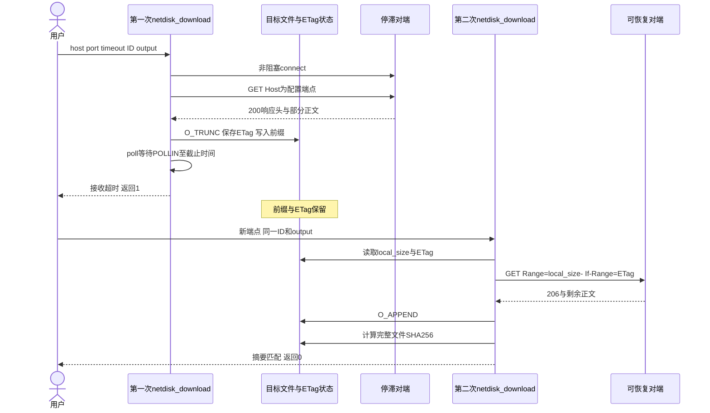

# 第34单元 可配置下载端点与有限网络等待

## 1 今日目标与完成标准

今天把第33单元的断点下载客户端从固定连接 `127.0.0.1:8080` 推进为可连接指定数字IPv4地址和端口 并为连接 请求发送 响应头接收和响应正文接收增加有限的连续无进展等待

完成后可以观察到四个行为

1. 不带新选项时仍连接 `127.0.0.1:8080` 保持第33单元命令兼容
2. 使用 `--host` 和 `--port` 后 TCP连接地址与HTTP Host请求头同时改为指定端点
3. 使用 `--timeout-ms` 后 对端在连接 发送或接收阶段长时间没有任何进展时 客户端返回非零 不再永久等待
4. 正文已经写入一部分后发生接收超时 已写前缀和旁车ETag继续保留 下一次运行发送Range和If-Range并从该前缀恢复

本单元的完成标准不是只解析三个命令行选项 而是网络操作真正经过非阻塞Socket和单调时钟截止时间控制 并且超时失败仍保持第33单元的安全恢复语义

## 2 前因后果

第31与第32单元建立了服务端Range和If-Range语义 第33单元新增 `netdisk_download` 客户端 能严格区分206追加 200覆盖与416已完成 并在最后核对整个文件SHA256

第33单元仍有两个直接影响真实使用的问题 第一是服务器地址写死 只能连接本机8080 第二是阻塞connect send recv没有截止时间 对端只要保持连接却不继续传输 客户端就可能永久停住

本单元依赖前面已有的TCP字节流 Content-Length Range If-Range ETag UniqueFd与断点恢复能力 不改变服务器协议和存储格式 完成后第35单元会继续解决当前直接写最终路径的问题 改为临时产物通过摘要校验后再原子替换

## 3 术语定义

### 3.1 服务端端点

端点是网络通信的一端 本单元由数字IPv4地址与TCP端口共同组成 例如 `192.168.1.20:8080`

它不同于HTTP资源路径 端点决定TCP连接到哪台主机的哪个进程 `/api/files/.../content` 才决定连接建立后访问哪个资源

当前只接受数字IPv4 不做DNS主机名解析 也不支持IPv6 这样连接超时不会被不可控的同步DNS解析时间绕过

### 3.2 阻塞Socket与非阻塞Socket

阻塞Socket在操作暂时无法继续时会让调用线程停在系统调用中

非阻塞Socket使用 `SOCK_NONBLOCK` 创建 暂时不能完成时系统调用立即返回 `EAGAIN` 或 `EWOULDBLOCK` 程序再自行决定等待多久

非阻塞不等于异步 当前客户端仍是单线程顺序流程 只是等待权从内核无限阻塞改为程序用poll控制

### 3.3 poll与POLLIN POLLOUT

`poll`是Linux I/O就绪等待接口 它接收文件描述符 感兴趣的事件和毫秒超时

- `POLLIN` 表示当前适合尝试读取
- `POLLOUT` 表示当前适合尝试写入或检查非阻塞连接结果

就绪只表示再次调用大概率能推进 不代表业务操作必然成功 因此connect等待POLLOUT后还必须用 `getsockopt(SO_ERROR)` 读取最终连接错误

### 3.4 SO_ERROR

`SO_ERROR`是Socket保存的待处理错误 非阻塞connect返回 `EINPROGRESS` 后 POLLOUT既可能表示连接成功 也可能表示连接失败

读取 `SO_ERROR` 得到0才表示连接成功 非零值是实际连接错误 不能只凭poll返回就认为TCP已经建立

### 3.5 单调时钟与截止时间

`std::chrono::steady_clock`是只向前推进的单调时钟 不受系统时间手动调整或NTP回拨影响

截止时间是开始等待时的单调时刻加timeout毫秒 每次poll被信号中断后都用同一个截止时间计算剩余量 避免EINTR使超时被无限重新开始

### 3.6 连续无进展超时

本单元的timeout表示一次网络操作连续多久没有发送或接收任何字节

只要真实传输了一批字节 就为下一次等待建立新的截止时间 因此一个持续有进展的大文件下载可以超过5000毫秒 这与限制整个下载总耗时不同

### 3.7 超时与提前EOF

超时表示连接仍存在但在截止时间前没有继续产生所需事件 提前EOF表示 `recv`返回0 对端已经关闭发送方向

两者都使当前下载返回失败 但诊断不同 二者在已经写入正文时都保留安全前缀与ETag供下次恢复

## 4 完整端到端逻辑

1. main解析可选的host port与timeout-ms 重复选项 未知选项 缺值 越界数值返回2
2. 没有提供选项时构造默认DownloadOptions 地址127.0.0.1 端口8080 超时5000毫秒
3. run_download继续校验文件ID 输出路径和已有旁车状态 并把配置地址与端口组合为HTTP Host值
4. make_download_request保留旧接口并新增authority重载 新接口拒绝空值 控制字符 空白和会改变请求目标边界的斜杠 问号与井号
5. connect_to_server以 `SOCK_NONBLOCK` 创建Socket
6. connect立即成功则继续 返回EINPROGRESS或EALREADY时 用poll等待POLLOUT 其他错误包括EINTR都关闭本次Socket并返回失败
7. poll就绪后读取SO_ERROR 只有0才接管Socket 失败 超时或无效描述符都关闭Socket并返回1
8. send_with_timeout使用`MSG_DONTWAIT`与`MSG_NOSIGNAL`处理请求短写 每次成功发送后重置无进展截止时间
9. receive_response_head和receive_body通过同一个receive_with_timeout读取 recv暂时无数据时等待POLLIN
10. 响应头仍按第33单元严格解析 并决定Replace Append Complete或Reject
11. 200覆盖路径在正文前保存新ETag 每批收到的正文立即写入目标文件
12. 若正文中途超时 当前调用返回1 UniqueFd关闭Socket和输出fd 但不删除已写前缀及ETag
13. 下一次运行重新读取本地长度与ETag 向本次配置的端点发送Range与If-Range
14. 206通过版本 偏移 范围和长度校验后追加剩余正文 完成后重新计算整个文件SHA256

## 5 图的类型

时序图 Sequence Diagram

## 6 为什么选择这种图

本单元关键关系是命令行配置如何进入连接 请求与接收等待 以及第一次超时失败怎样影响第二次恢复 时序图最适合表达两次客户端运行之间保留状态和继续请求的先后顺序

## 7 Mermaid



## 8 图的解释

第一次运行已经验证200响应头后才保存ETag并写正文 接收停滞只结束当前网络会话 不回滚已经确认的前缀

第二次运行不依赖第一次进程仍然存在 它只读取持久文件长度和旁车ETag 重新建立连接并恢复 因此超时边界与第33单元的进程重启恢复语义一致

## 9 设计原因与取舍

### 9.1 为什么当前只支持数字IPv4

同步 `getaddrinfo`的DNS解析本身可能阻塞 而本单元没有引入异步解析器 如果直接接受主机名 就不能准确承诺timeout覆盖连接前的全部等待

数字IPv4通过 `inet_pton`在本地立即校验 能让本单元专注于可控TCP等待 IPv6和带截止时间的名称解析以后作为独立能力增加

### 9.2 为什么使用非阻塞Socket而不是SO_RCVTIMEO

`SO_RCVTIMEO`和 `SO_SNDTIMEO`主要影响读写系统调用 不能用同一套逻辑可靠覆盖connect

非阻塞Socket加poll可以对connect send recv使用统一截止时间 同时能明确区分等待就绪与再次执行实际操作

### 9.3 为什么使用steady_clock

如果使用系统日历时钟 用户改时间或时间同步回拨可能把截止时间推远

`steady_clock`只表示持续时间 正适合超时和期限 不用于显示真实日期

### 9.4 为什么超时按无进展重置

总耗时上限会让正常但较慢的大文件在持续传输时被强行中断

无进展上限针对的是连接停滞 每次发送或接收字节后重置 更符合下载客户端需求 代价是极慢对端只要周期性发送少量字节就可以长期占用当前客户端

### 9.5 为什么超时保留部分目标

本单元的目标是让失败成为可恢复边界 200响应头与强ETag已经通过协议校验后 收到的前缀属于该版本 删除它会浪费已经完成的传输

当前直接写最终路径意味着未完成文件暂时可见 第35单元再用临时产物和原子替换解决可见性问题 不在本单元同时改变文件发布语义

### 9.6 为什么限制timeout最大十分钟

poll的超时参数是int毫秒 设置1至600000既拒绝0这种立即失败或无限值歧义 也避免极端参数失去有限等待的实际意义

十分钟不是协议常量 只是当前命令行客户端的输入保护边界

## 10 架构影响

- 功能归属 client模块
- 不新增生产模块 不新增生产CMake目标
- netdisk_client_lib直接依赖仍为netdisk_api netdisk_io netdisk_crypto netdisk_http
- 客户端传递闭包仍不包含server storage metadata maintenance SQLite或nlohmann_json
- 新增公开DownloadOptions类型 run_download配置重载和make_download_request authority重载 公开头仍位于`src/client/include/netdisk/client`
- HTTP服务端路由 状态码 schema 对象格式和断点协议不变
- 生产目标名netdisk与netdisk_download不变
- 配置期架构守卫无需调整 合法配置时仍应输出architecture guard passed

## 11 测试影响

冻结的22个C++测试文件 20个历史Python脚本和39个CTest名称全部不改

新增稳定工作流套件

- 文件 `tests/integration/download_timeout_integration.py`
- CTest名称 `download_timeout_integration_tests`
- 新总数40
- 不复用day33脚本 因为day33使用真实生产服务验证206 200 416 本单元需要一个能精确发送部分正文后停滞的可控对端 生命周期和超时模型不同
- 脚本使用临时目录和两个临时回环端口 不读写工程data 不要求8080空闲
- 第一次响应发送200头和7000字节后停滞 验证200毫秒内失败 诊断包含timed out 前缀与ETag精确保留
- 第二次在新端口检查Host Range If-Range 返回206剩余正文 验证最终内容与SHA256
- Python实现按项目规则由助手维护 本教程不贴脚本源码

当前自动测试真实覆盖接收停滞 因请求头很小 不会填满内核发送缓冲区 所以不宣称真实写停滞已经触发 连接黑洞也受环境路由影响 本次不以不稳定外网地址制造测试

## 12 源码变化

相对第33A重构后的客户端

- 修改 `src/client/include/netdisk/client/download_protocol.h`
- 修改 `src/client/include/netdisk/client/download_session.h`
- 修改 `src/client/download_protocol.cpp`
- 修改 `src/client/download_session.cpp`
- 修改 `src/client/main.cpp`
- 新增 `tests/integration/download_timeout_integration.py`
- 修改 `tests/integration/CMakeLists.txt`
- 更新README API 测试基线扩展记录 计划 进度与本教程
- `src/client/CMakeLists.txt`内容不变 因为没有新增生产源文件或依赖
- 服务端全部C++ SQLite schema 存储格式和现有测试文件保持不变

## 13 新接口 参数 返回值 所有权与生命周期

### 13.1 DownloadOptions

`server_ipv4`由对象拥有字符串 默认127.0.0.1 只接受 `inet_pton(AF_INET)`可解析的数字IPv4

`server_port`是1至65535的TCP端口 默认8080

`timeout_ms`是1至600000毫秒 默认5000 同时用于连接 发送和每次接收无进展等待

调用方拥有DownloadOptions run_download只在调用期间借用

### 13.2 run_download配置重载

`run_download(id output_path options)`借用id和options 借用output path字符串内容但不保存引用

返回0表示下载完成且SHA256匹配 返回2表示文件ID 输出路径或配置参数非法 返回1表示连接 协议 文件或摘要处理失败

旧的两参数run_download仍存在 它构造默认DownloadOptions后调用新重载 保持兼容

### 13.3 make_download_request authority重载

authority是调用期间借用的 `IPv4:端口` 字符串 成功后output独立拥有完整请求

空值 超过255字节 非可见ASCII 斜杠 问号或井号会被拒绝 防止Host字段越界或混入资源路径

旧重载仍使用固定 `127.0.0.1:8080`并委托给新重载

### 13.4 Socket生命周期

connect_to_server成功后把裸fd交给run_download中的UniqueFd独占

连接失败或超时发生在交接前时 connect_to_server直接close

交接后任意返回路径都由UniqueFd析构关闭Socket 输出文件fd仍由另一个UniqueFd独占 超时不会泄漏描述符

## 14 完整源码

### 14.1 src client include netdisk client download_protocol.h

```cpp
#pragma once

#include <netdisk/http/response.h>

#include <cstdint>
#include <string>
#include <string_view>

namespace download_client
{

enum class ResumeAction
{
    Reject,
    Replace,
    Append,
    Complete
};

struct ResumePlan
{
    ResumeAction action = ResumeAction::Reject;
    std::uint64_t total_size = 0;
};

ResumePlan make_resume_plan(const ResponseHead& response,
                            std::uint64_t local_size,
                            std::string_view saved_etag) noexcept;
bool make_download_request(std::string_view id, bool resume,
                           std::uint64_t local_size,
                           std::string_view saved_etag,
                           std::string& output);

// ===== DAY 34 ADDED BEGIN 请求Host跟随可配置服务端 =====
bool make_download_request(std::string_view id, bool resume,
                           std::uint64_t local_size,
                           std::string_view saved_etag,
                           std::string_view authority,
                           std::string& output);
// ===== DAY 34 ADDED END =====

}
```

### 14.2 src client include netdisk client download_session.h

```cpp
#pragma once

// ===== DAY 34 ADDED BEGIN 为端口配置引入固定宽度整数 =====
#include <cstdint>
// ===== DAY 34 ADDED END =====
#include <string>
#include <string_view>

// ===== DAY 34 ADDED BEGIN 定义可配置服务端与有限网络等待 =====
namespace download_client
{

struct DownloadOptions
{
    std::string server_ipv4 = "127.0.0.1";
    std::uint16_t server_port = 8080;
    int timeout_ms = 5000;
};

}
// ===== DAY 34 ADDED END =====

int run_download(std::string_view id, const std::string& output_path);

// ===== DAY 34 ADDED BEGIN 允许调用方传入下载选项 =====
int run_download(std::string_view id, const std::string& output_path,
                 const download_client::DownloadOptions& options);
// ===== DAY 34 ADDED END =====
```

### 14.3 src client download_protocol.cpp

```cpp
#include <netdisk/client/download_protocol.h>

#include <netdisk/api/file_id.h>

#include <utility>

namespace download_client
{
namespace
{

// ===== DAY 34 ADDED BEGIN 拒绝会改变Host请求头边界的字符 =====
bool is_valid_authority(std::string_view authority) noexcept
{
    if (authority.empty() || authority.size() > 255) return false;
    for (const unsigned char c : authority)
    {
        if (c < 0x21 || c > 0x7e || c == '/' || c == '?' || c == '#')
            return false;
    }
    return true;
}
// ===== DAY 34 ADDED END =====

}

ResumePlan make_resume_plan(const ResponseHead& response,
                            std::uint64_t local_size,
                            std::string_view saved_etag) noexcept
{
    ResumePlan plan;
    if (!response.has_content_length || !is_strong_sha256_etag(response.etag))
        return plan;
    if (response.status == 200)
    {
        if (response.content_range_kind != ContentRangeKind::None) return plan;
        plan.action = ResumeAction::Replace;
        plan.total_size = response.content_length;
        return plan;
    }
    if (!is_strong_sha256_etag(saved_etag) || response.etag != saved_etag)
        return plan;
    if (response.status == 206)
    {
        if (response.content_range_kind != ContentRangeKind::Selected ||
            response.range_start != local_size || response.total_size == 0 ||
            local_size >= response.total_size ||
            response.range_end != response.total_size - 1 ||
            response.content_length != response.total_size - local_size)
            return plan;
        plan.action = ResumeAction::Append;
        plan.total_size = response.total_size;
        return plan;
    }
    if (response.status == 416 &&
        response.content_range_kind == ContentRangeKind::Unsatisfied &&
        local_size == response.total_size)
    {
        plan.action = ResumeAction::Complete;
        plan.total_size = response.total_size;
    }
    return plan;
}

// ===== DAY 34 MODIFIED BEGIN 旧接口保持默认Host兼容行为 =====
bool make_download_request(std::string_view id, bool resume,
                           std::uint64_t local_size,
                           std::string_view saved_etag,
                           std::string& output)
{
    return make_download_request(id, resume, local_size, saved_etag,
                                 "127.0.0.1:8080", output);
}
// ===== DAY 34 MODIFIED END =====

// ===== DAY 34 ADDED BEGIN 使用已校验的可配置Host构造请求 =====
bool make_download_request(std::string_view id, bool resume,
                           std::uint64_t local_size,
                           std::string_view saved_etag,
                           std::string_view authority,
                           std::string& output)
{
    if (!is_valid_file_id(id) || !is_valid_authority(authority)) return false;
    if (resume && (local_size == 0 || !is_strong_sha256_etag(saved_etag)))
        return false;
    std::string request =
        "GET /api/files/" + std::string(id) + "/content HTTP/1.1\r\n"
        "Host: " + std::string(authority) + "\r\n";
    if (resume)
    {
        request += "Range: bytes=" + std::to_string(local_size) + "-\r\n";
        request += "If-Range: " + std::string(saved_etag) + "\r\n";
    }
    request += "Content-Length: 0\r\nConnection: close\r\n\r\n";
    output = std::move(request);
    return true;
}
// ===== DAY 34 ADDED END =====
}
```

### 14.4 src client download_session.cpp

```cpp
#include <netdisk/client/download_session.h>

#include <netdisk/api/file_id.h>
#include <netdisk/client/download_protocol.h>
#include <netdisk/crypto/sha256.h>
#include <netdisk/http/response.h>
#include <netdisk/io/posix_io.h>
#include <netdisk/io/unique_fd.h>

#include <algorithm>
#include <arpa/inet.h>
#include <cerrno>
// ===== DAY 34 ADDED BEGIN 支持单调时钟截止时间与Socket就绪等待 =====
#include <chrono>
#include <poll.h>
// ===== DAY 34 ADDED END =====
#include <cstdint>
#include <fcntl.h>
#include <iostream>
#include <netinet/in.h>
#include <string>
#include <sys/socket.h>
#include <sys/stat.h>
#include <unistd.h>

namespace
{
constexpr std::size_t max_response_head_size = 8192;
// ===== DAY 34 ADDED BEGIN 统一网络等待上限与单调时钟 =====
constexpr int max_timeout_ms = 600000;
using MonotonicClock = std::chrono::steady_clock;
// ===== DAY 34 ADDED END =====

bool inspect_output_file(const std::string& path, bool& exists,
                         std::uint64_t& size)
{
    struct stat info{};
    if (::lstat(path.c_str(), &info) == -1)
    {
        if (errno == ENOENT)
        {
            exists = false;
            size = 0;
            return true;
        }
        print_system_error("lstat output", errno);
        return false;
    }
    if (!S_ISREG(info.st_mode) || info.st_size < 0)
    {
        std::cerr << "output path must be a regular file\n";
        return false;
    }
    exists = true;
    size = static_cast<std::uint64_t>(info.st_size);
    return true;
}

bool read_etag_state(const std::string& path, std::string& etag)
{
    int raw_fd;
    do
    {
        raw_fd = ::open(path.c_str(), O_RDONLY | O_CLOEXEC | O_NOFOLLOW | O_NONBLOCK);
    } while (raw_fd == -1 && errno == EINTR);
    if (raw_fd == -1) return false;
    UniqueFd file(raw_fd);

    struct stat info{};
    if (::fstat(file.get(), &info) == -1 || !S_ISREG(info.st_mode) ||
        info.st_size < 0 || info.st_size > 128)
        return false;
    std::string content(static_cast<std::size_t>(info.st_size), '\0');
    std::size_t received = 0;
    while (received < content.size())
    {
        const ssize_t n = ::read(file.get(), content.data() + received,
                                 content.size() - received);
        if (n == -1)
        {
            if (errno == EINTR) continue;
            return false;
        }
        if (n == 0) return false;
        received += static_cast<std::size_t>(n);
    }
    if (!content.empty() && content.back() == '\n') content.pop_back();
    if (!content.empty() && content.back() == '\r') content.pop_back();
    if (!download_client::is_strong_sha256_etag(content)) return false;
    etag = std::move(content);
    return true;
}

bool write_all_file(int fd, const char* data, std::size_t size)
{
    std::size_t written = 0;
    while (written < size)
    {
        const ssize_t n = ::write(fd, data + written, size - written);
        if (n == -1)
        {
            if (errno == EINTR) continue;
            print_system_error("write download", errno);
            return false;
        }
        if (n == 0)
        {
            std::cerr << "write download made no progress\n";
            return false;
        }
        written += static_cast<std::size_t>(n);
    }
    return true;
}

bool save_etag_state(const std::string& path, std::string_view etag)
{
    int raw_fd;
    do
    {
        raw_fd = ::open(path.c_str(),
            O_WRONLY | O_CREAT | O_TRUNC | O_CLOEXEC | O_NOFOLLOW | O_NONBLOCK,
            0600);
    } while (raw_fd == -1 && errno == EINTR);
    if (raw_fd == -1)
    {
        print_system_error("open ETag state", errno);
        return false;
    }
    UniqueFd file(raw_fd);
    struct stat info{};
    if (::fstat(file.get(), &info) == -1 || !S_ISREG(info.st_mode))
    {
        std::cerr << "ETag state path must be a regular file\n";
        return false;
    }
    const std::string content = std::string(etag) + "\n";
    return write_all_file(file.get(), content.data(), content.size());
}

// ===== DAY 34 MODIFIED BEGIN 将固定阻塞连接改为可配置有限等待网络路径 =====
void report_timeout(const char* operation, int timeout_ms)
{
    std::cerr << operation << " timed out after " << timeout_ms << " ms\n";
}

bool wait_for_socket(int socket_fd, short events,
                     MonotonicClock::time_point deadline,
                     const char* operation, int timeout_ms)
{
    while (true)
    {
        const auto now = MonotonicClock::now();
        if (now >= deadline)
        {
            report_timeout(operation, timeout_ms);
            return false;
        }
        auto remaining = std::chrono::duration_cast<std::chrono::milliseconds>(
            deadline - now).count();
        if (remaining <= 0) remaining = 1;

        pollfd descriptor{};
        descriptor.fd = socket_fd;
        descriptor.events = events;
        const int result = ::poll(&descriptor, 1, static_cast<int>(remaining));
        if (result == -1)
        {
            if (errno == EINTR) continue;
            print_system_error(operation, errno);
            return false;
        }
        if (result == 0)
        {
            report_timeout(operation, timeout_ms);
            return false;
        }
        if ((descriptor.revents & POLLNVAL) != 0)
        {
            std::cerr << operation << " failed because the socket is invalid\n";
            return false;
        }
        if ((descriptor.revents & (events | POLLERR | POLLHUP)) != 0)
            return true;
    }
}

bool connect_to_server(const download_client::DownloadOptions& options,
                       int& socket_fd)
{
    const int raw_fd = ::socket(
        AF_INET, SOCK_STREAM | SOCK_CLOEXEC | SOCK_NONBLOCK, 0);
    if (raw_fd == -1)
    {
        print_system_error("socket", errno);
        return false;
    }
    sockaddr_in address{};
    address.sin_family = AF_INET;
    address.sin_port = htons(options.server_port);
    if (::inet_pton(AF_INET, options.server_ipv4.c_str(),
                    &address.sin_addr) != 1)
    {
        std::cerr << "server host must be a numeric IPv4 address\n";
        ::close(raw_fd);
        return false;
    }

    const int result = ::connect(
        raw_fd, reinterpret_cast<sockaddr*>(&address), sizeof(address));
    if (result == 0)
    {
        socket_fd = raw_fd;
        return true;
    }
    if (errno != EINPROGRESS && errno != EALREADY)
    {
        const int error = errno;
        ::close(raw_fd);
        print_system_error("connect", error);
        return false;
    }

    const auto deadline = MonotonicClock::now() +
        std::chrono::milliseconds(options.timeout_ms);
    while (wait_for_socket(raw_fd, POLLOUT, deadline,
                           "connect", options.timeout_ms))
    {
        int socket_error = 0;
        socklen_t error_size = sizeof(socket_error);
        if (::getsockopt(raw_fd, SOL_SOCKET, SO_ERROR,
                         &socket_error, &error_size) == -1)
        {
            const int error = errno;
            ::close(raw_fd);
            print_system_error("getsockopt SO_ERROR", error);
            return false;
        }
        if (socket_error == 0)
        {
            socket_fd = raw_fd;
            return true;
        }
        if (socket_error == EINPROGRESS || socket_error == EALREADY)
            continue;
        ::close(raw_fd);
        print_system_error("connect", socket_error);
        return false;
    }
    ::close(raw_fd);
    return false;
}

bool send_with_timeout(int socket_fd, const char* data, std::size_t size,
                       int timeout_ms)
{
    std::size_t sent = 0;
    auto deadline = MonotonicClock::now() +
        std::chrono::milliseconds(timeout_ms);
    while (sent < size)
    {
        if (MonotonicClock::now() >= deadline)
        {
            report_timeout("send request", timeout_ms);
            return false;
        }
        const ssize_t count = ::send(
            socket_fd, data + sent, size - sent,
            MSG_NOSIGNAL | MSG_DONTWAIT);
        if (count > 0)
        {
            sent += static_cast<std::size_t>(count);
            deadline = MonotonicClock::now() +
                std::chrono::milliseconds(timeout_ms);
            continue;
        }
        if (count == 0)
        {
            std::cerr << "send request made no progress\n";
            return false;
        }
        if (errno == EINTR) continue;
        if (errno == EAGAIN || errno == EWOULDBLOCK)
        {
            if (!wait_for_socket(socket_fd, POLLOUT, deadline,
                                 "send request", timeout_ms))
                return false;
            continue;
        }
        print_system_error("send request", errno);
        return false;
    }
    return true;
}

ssize_t receive_with_timeout(int socket_fd, char* data, std::size_t size,
                             int timeout_ms, const char* operation)
{
    const auto deadline = MonotonicClock::now() +
        std::chrono::milliseconds(timeout_ms);
    while (true)
    {
        if (MonotonicClock::now() >= deadline)
        {
            report_timeout(operation, timeout_ms);
            return -1;
        }
        const ssize_t count = ::recv(
            socket_fd, data, size, MSG_DONTWAIT);
        if (count >= 0) return count;
        if (errno == EINTR) continue;
        if (errno == EAGAIN || errno == EWOULDBLOCK)
        {
            if (!wait_for_socket(socket_fd, POLLIN, deadline,
                                 operation, timeout_ms))
                return -1;
            continue;
        }
        print_system_error(operation, errno);
        return -1;
    }
}
// ===== DAY 34 MODIFIED END =====

// ===== DAY 34 MODIFIED BEGIN 响应头接收使用可配置无进展超时 =====
bool receive_response_head(int socket_fd, std::string& head,
                           std::string& body_prefix, int timeout_ms)
{
    std::string received;
    char buffer[4096];
    while (true)
    {
        const auto boundary = received.find("\r\n\r\n");
        if (boundary != std::string::npos)
        {
            const auto head_size = boundary + 4;
            if (head_size > max_response_head_size)
            {
                std::cerr << "response head exceeds limit\n";
                return false;
            }
            head.assign(received.data(), head_size);
            body_prefix.assign(received.data() + head_size,
                               received.size() - head_size);
            return true;
        }
        if (received.size() > max_response_head_size)
        {
            std::cerr << "response head exceeds limit\n";
            return false;
        }
        const ssize_t n = receive_with_timeout(
            socket_fd, buffer, sizeof(buffer), timeout_ms,
            "receive response head");
        if (n == -1) return false;
        if (n == 0)
        {
            std::cerr << "server closed before response head completed\n";
            return false;
        }
        received.append(buffer, static_cast<std::size_t>(n));
    }
}
// ===== DAY 34 MODIFIED END =====

bool open_output_for_plan(const std::string& path,
                          download_client::ResumeAction action,
                          std::uint64_t expected_size,
                          int& output_fd)
{
    int flags = O_WRONLY | O_CLOEXEC | O_NOFOLLOW | O_NONBLOCK;
    if (action == download_client::ResumeAction::Replace)
        flags |= O_CREAT | O_TRUNC;
    else flags |= O_APPEND;
    int raw_fd;
    do
    {
        raw_fd = ::open(path.c_str(), flags, 0600);
    } while (raw_fd == -1 && errno == EINTR);
    if (raw_fd == -1)
    {
        print_system_error("open output", errno);
        return false;
    }
    struct stat info{};
    if (::fstat(raw_fd, &info) == -1 || !S_ISREG(info.st_mode) ||
        info.st_size < 0 ||
        (action == download_client::ResumeAction::Append &&
         static_cast<std::uint64_t>(info.st_size) != expected_size))
    {
        std::cerr << "output file changed before response body write\n";
        ::close(raw_fd);
        return false;
    }
    output_fd = raw_fd;
    return true;
}

// ===== DAY 34 MODIFIED BEGIN 正文接收在停滞时保留已写入前缀并失败 =====
bool receive_body(int socket_fd, int output_fd, std::string_view prefix,
                  std::uint64_t content_length, int timeout_ms)
{
    if (prefix.size() > content_length)
    {
        std::cerr << "response body exceeds Content-Length\n";
        return false;
    }
    if (!write_all_file(output_fd, prefix.data(), prefix.size())) return false;
    std::uint64_t remaining = content_length - prefix.size();
    char buffer[16 * 1024];
    while (remaining != 0)
    {
        const auto count = static_cast<std::size_t>(
            std::min<std::uint64_t>(remaining, sizeof(buffer)));
        const ssize_t n = receive_with_timeout(
            socket_fd, buffer, count, timeout_ms,
            "receive response body");
        if (n == -1) return false;
        if (n == 0)
        {
            std::cerr << "server closed before Content-Length bytes arrived\n";
            return false;
        }
        const auto size = static_cast<std::size_t>(n);
        if (!write_all_file(output_fd, buffer, size)) return false;
        remaining -= size;
    }
    return true;
}
// ===== DAY 34 MODIFIED END =====

bool hash_complete_file(const std::string& path, std::uint64_t expected_size,
                        std::string& digest)
{
    int raw_fd;
    do
    {
        raw_fd = ::open(path.c_str(), O_RDONLY | O_CLOEXEC | O_NOFOLLOW | O_NONBLOCK);
    } while (raw_fd == -1 && errno == EINTR);
    if (raw_fd == -1)
    {
        print_system_error("open completed download", errno);
        return false;
    }
    UniqueFd file(raw_fd);
    struct stat info{};
    if (::fstat(file.get(), &info) == -1 || !S_ISREG(info.st_mode) ||
        info.st_size < 0 || static_cast<std::uint64_t>(info.st_size) != expected_size)
    {
        std::cerr << "completed download size differs from response metadata\n";
        return false;
    }
    Sha256Hasher hasher;
    char buffer[16 * 1024];
    while (true)
    {
        const ssize_t n = ::read(file.get(), buffer, sizeof(buffer));
        if (n == -1)
        {
            if (errno == EINTR) continue;
            print_system_error("read completed download", errno);
            return false;
        }
        if (n == 0) break;
        if (!hasher.update(std::string_view(buffer, static_cast<std::size_t>(n))))
        {
            std::cerr << "SHA256 update failed\n";
            return false;
        }
    }
    if (!hasher.finish(digest))
    {
        std::cerr << "SHA256 finish failed\n";
        return false;
    }
    return true;
}

void remove_invalid_state(const std::string& path)
{
    if (::unlink(path.c_str()) == -1 && errno != ENOENT)
        print_system_error("remove invalid ETag state", errno);
}
}

// ===== DAY 34 MODIFIED BEGIN 保留默认端点并将配置传入有限等待网络路径 =====
int run_download(std::string_view id, const std::string& output_path)
{
    return run_download(id, output_path, download_client::DownloadOptions{});
}

int run_download(std::string_view id, const std::string& output_path,
                 const download_client::DownloadOptions& options)
{
    const std::string state_path = output_path + ".netdisk-etag";
    in_addr parsed_address{};
    if (!is_valid_file_id(id) || output_path.empty() ||
        options.server_port == 0 || options.timeout_ms <= 0 ||
        options.timeout_ms > max_timeout_ms ||
        ::inet_pton(AF_INET, options.server_ipv4.c_str(),
                    &parsed_address) != 1)
    {
        std::cerr << "invalid file ID output path or download options\n";
        return 2;
    }
    bool output_exists = false;
    std::uint64_t local_size = 0;
    if (!inspect_output_file(output_path, output_exists, local_size)) return 1;

    std::string saved_etag;
    const bool resume = output_exists && local_size != 0 &&
                        read_etag_state(state_path, saved_etag);
    const std::string authority = options.server_ipv4 + ":" +
                                  std::to_string(options.server_port);
    std::string request;
    if (!download_client::make_download_request(
            id, resume, local_size, saved_etag, authority, request))
    {
        std::cerr << "failed to build download request\n";
        return 1;
    }

    int raw_socket = -1;
    if (!connect_to_server(options, raw_socket)) return 1;
    UniqueFd socket(raw_socket);
    if (!send_with_timeout(socket.get(), request.data(), request.size(),
                           options.timeout_ms))
        return 1;

    std::string response_wire;
    std::string body_prefix;
    if (!receive_response_head(socket.get(), response_wire, body_prefix,
                               options.timeout_ms))
        return 1;
    download_client::ResponseHead response;
    if (!download_client::parse_response_head(response_wire, response))
    {
        std::cerr << "invalid HTTP response head\n";
        return 1;
    }
    const auto plan = download_client::make_resume_plan(response, local_size, saved_etag);
    if (plan.action == download_client::ResumeAction::Reject)
    {
        std::cerr << "server response does not satisfy download contract status="
                  << response.status << '\n';
        return 1;
    }
    if ((plan.action == download_client::ResumeAction::Replace ||
         plan.action == download_client::ResumeAction::Append) &&
        body_prefix.size() > response.content_length)
    {
        std::cerr << "response body exceeds Content-Length\n";
        return 1;
    }

    if (plan.action == download_client::ResumeAction::Replace ||
        plan.action == download_client::ResumeAction::Append)
    {
        int raw_output = -1;
        if (!open_output_for_plan(output_path, plan.action, local_size, raw_output))
            return 1;
        UniqueFd output(raw_output);
        if (plan.action == download_client::ResumeAction::Replace &&
            !save_etag_state(state_path, response.etag)) return 1;
        if (!receive_body(socket.get(), output.get(), body_prefix,
                          response.content_length, options.timeout_ms))
            return 1;
    }

    std::string digest;
    if (!hash_complete_file(output_path, plan.total_size, digest) ||
        response.etag.substr(1, 64) != digest)
    {
        std::cerr << "completed download SHA256 differs from ETag\n";
        remove_invalid_state(state_path);
        return 1;
    }
    const char* result = plan.action == download_client::ResumeAction::Append
        ? "resumed with 206"
        : plan.action == download_client::ResumeAction::Replace
            ? "replaced with 200" : "already complete after 416";
    std::cout << "download complete: " << result
              << " bytes=" << plan.total_size << " sha256=" << digest << '\n';
    return 0;
}
// ===== DAY 34 MODIFIED END =====
```

### 14.5 src client main.cpp

```cpp
#include <netdisk/client/download_session.h>

// ===== DAY 34 ADDED BEGIN 支持严格数值选项解析 =====
#include <charconv>
#include <cstdint>
#include <limits>
#include <string_view>
// ===== DAY 34 ADDED END =====
#include <iostream>
#include <string>

namespace
{

// ===== DAY 34 ADDED BEGIN 解析可配置端点与超时参数 =====
constexpr int max_timeout_ms = 600000;

void print_usage()
{
    std::cerr << "usage: netdisk_download [--host IPV4] [--port PORT] "
                 "[--timeout-ms MILLISECONDS] FILE_ID OUTPUT_PATH\n";
}

bool parse_unsigned(std::string_view text, unsigned int& value)
{
    if (text.empty()) return false;
    unsigned int parsed = 0;
    const auto result = std::from_chars(
        text.data(), text.data() + text.size(), parsed);
    if (result.ec != std::errc{} || result.ptr != text.data() + text.size())
        return false;
    value = parsed;
    return true;
}

bool parse_options(int argc, char* argv[],
                   download_client::DownloadOptions& options,
                   int& positional_index)
{
    bool host_seen = false;
    bool port_seen = false;
    bool timeout_seen = false;
    int index = 1;
    while (index < argc)
    {
        const std::string_view argument(argv[index]);
        if (argument == "--")
        {
            ++index;
            break;
        }
        if (argument.size() < 2 || argument[0] != '-' || argument[1] != '-')
            break;
        if (index + 1 >= argc)
        {
            std::cerr << "missing value for " << argument << '\n';
            return false;
        }
        const std::string_view value(argv[index + 1]);
        if (argument == "--host" && !host_seen)
        {
            if (value.empty())
            {
                std::cerr << "host must not be empty\n";
                return false;
            }
            options.server_ipv4 = std::string(value);
            host_seen = true;
        }
        else if (argument == "--port" && !port_seen)
        {
            unsigned int parsed = 0;
            if (!parse_unsigned(value, parsed) || parsed == 0 ||
                parsed > std::numeric_limits<std::uint16_t>::max())
            {
                std::cerr << "port must be between 1 and 65535\n";
                return false;
            }
            options.server_port = static_cast<std::uint16_t>(parsed);
            port_seen = true;
        }
        else if (argument == "--timeout-ms" && !timeout_seen)
        {
            unsigned int parsed = 0;
            if (!parse_unsigned(value, parsed) || parsed == 0 ||
                parsed > static_cast<unsigned int>(max_timeout_ms))
            {
                std::cerr << "timeout must be between 1 and 600000 ms\n";
                return false;
            }
            options.timeout_ms = static_cast<int>(parsed);
            timeout_seen = true;
        }
        else
        {
            std::cerr << "unknown or duplicate option: " << argument << '\n';
            return false;
        }
        index += 2;
    }
    positional_index = index;
    return true;
}
// ===== DAY 34 ADDED END =====

}

// ===== DAY 34 MODIFIED BEGIN 传递端点与超时配置到下载会话 =====
int main(int argc, char* argv[])
{
    download_client::DownloadOptions options;
    int positional_index = 1;
    if (!parse_options(argc, argv, options, positional_index) ||
        argc - positional_index != 2)
    {
        print_usage();
        return 2;
    }
    return run_download(argv[positional_index],
                        std::string(argv[positional_index + 1]), options);
}
// ===== DAY 34 MODIFIED END =====
```

## 15 实际CMake

生产客户端CMake没有新增源文件或依赖 仍完整如下

### 15.1 src client CMakeLists.txt

```cmake
# ===== DAY 33A MODIFIED BEGIN 客户端依赖闭包排除server storage metadata =====
add_library(netdisk_client_lib STATIC
    download_protocol.cpp
    download_session.cpp
)

target_include_directories(netdisk_client_lib PUBLIC
    "$<BUILD_INTERFACE:${CMAKE_CURRENT_SOURCE_DIR}/include>"
)

target_link_libraries(netdisk_client_lib PUBLIC
    netdisk_api
    netdisk_io
    netdisk_crypto
    netdisk_http
)

add_executable(netdisk_download
    main.cpp
)

target_link_libraries(netdisk_download PRIVATE
    netdisk_client_lib
)
# ===== DAY 33A MODIFIED END =====
```

测试注册文件新增一个稳定工作流CTest 完整如下

### 15.2 tests integration CMakeLists.txt

```cmake
# ===== DAY 33A ADDED BEGIN 集中声明保持原名和属性的Python集成测试 =====
function(add_netdisk_integration_test test_name script)
    add_test(NAME ${test_name}
        COMMAND "${Python3_EXECUTABLE}"
            "${CMAKE_CURRENT_SOURCE_DIR}/${script}"
            ${ARGN}
    )
    set_tests_properties(${test_name} PROPERTIES
        TIMEOUT 30
        RUN_SERIAL TRUE
        SKIP_RETURN_CODE 77
    )
endfunction()

add_netdisk_integration_test(upload_integration_tests
    day14_upload_integration.py "$<TARGET_FILE:netdisk>")
add_netdisk_integration_test(download_integration_tests
    day16_download_integration.py "$<TARGET_FILE:netdisk>")
add_netdisk_integration_test(download_headers_integration_tests
    day17_download_headers.py "$<TARGET_FILE:netdisk>")
add_netdisk_integration_test(file_catalog_integration_tests
    day18_file_catalog.py "$<TARGET_FILE:netdisk>")
add_netdisk_integration_test(file_mutation_integration_tests
    day19_file_mutation.py "$<TARGET_FILE:netdisk>")
add_netdisk_integration_test(failure_recovery_integration_tests
    day20_failure_recovery.py "$<TARGET_FILE:netdisk>")
add_netdisk_integration_test(first_release_integration_tests
    day21_first_release.py "$<TARGET_FILE:netdisk>")
add_netdisk_integration_test(metadata_persistence_integration_tests
    day23_metadata_persistence.py "$<TARGET_FILE:netdisk>")
add_netdisk_integration_test(publish_state_integration_tests
    day25_publish_state.py "$<TARGET_FILE:netdisk>")
add_netdisk_integration_test(publishing_recovery_integration_tests
    day26_publishing_recovery.py "$<TARGET_FILE:netdisk>")
add_netdisk_integration_test(deletion_recovery_integration_tests
    day27_deletion_recovery.py "$<TARGET_FILE:netdisk>")
add_netdisk_integration_test(storage_audit_integration_tests
    day28_storage_audit.py "$<TARGET_FILE:netdisk>")
add_netdisk_integration_test(sha256_integration_tests
    day29_sha256.py "$<TARGET_FILE:netdisk>")
add_netdisk_integration_test(digest_backfill_integration_tests
    day30_digest_backfill.py "$<TARGET_FILE:netdisk>")
add_netdisk_integration_test(range_integration_tests
    day31_range.py "$<TARGET_FILE:netdisk>")
add_netdisk_integration_test(if_range_integration_tests
    day32_if_range.py "$<TARGET_FILE:netdisk>")
add_netdisk_integration_test(resume_download_integration_tests
    day33_resume_download.py
    "$<TARGET_FILE:netdisk>"
    "$<TARGET_FILE:netdisk_download>")
# ===== DAY 33A ADDED END =====

# ===== DAY 34 ADDED BEGIN 注册可配置端点超时与恢复工作流测试 =====
add_netdisk_integration_test(download_timeout_integration_tests
    download_timeout_integration.py
    "$<TARGET_FILE:netdisk_download>")
# ===== DAY 34 ADDED END =====
```

## 16 使用与验证

### 16.1 Linux虚拟机同步范围

把第12节列出的五个C++源码文件 其中两个是公开头 以及新Python脚本和测试CMake同步到Linux项目对应路径

本地Windows参考源码不会自动同步到Linux虚拟机 不要覆盖根目录旧lcopy工程

### 16.2 Linux构建与聚焦自动测试

执行环境 Linux虚拟机

执行目录 `~/projects/netdisk`

```sh
cmake -S . -B build -DCMAKE_BUILD_TYPE=Debug -DBUILD_TESTING=ON
cmake --build build -j2
ctest --test-dir build -N
ctest --test-dir build -R '^download_timeout_integration_tests$' -V
```

如果一直使用build debug目录 则把四条命令中的build统一替换为原目录 不创建第二套构建目录

成功条件

- CMake配置输出 `NetDisk architecture guard passed`
- 构建成功生成 `netdisk_download`
- `ctest -N`显示 `Total Tests: 40`
- 聚焦测试实际运行1项而不是No tests were found
- 结果为1共1 Passed
- 输出包含 `PASS: configurable timeout preserves a prefix and retry resumes it`
- 最后一条业务输出为 `PASS: download timeout integration finished 1 workflow`
- Linux不显示SKIP

必要排错入口

- 编译找不到poll或arpa inet 先确认在Linux工程而不是Windows编译POSIX会话
- CTest仍为39项 检查 `tests/integration/CMakeLists.txt`和新Python文件是否都已同步 然后重新执行cmake配置
- 测试提示客户端参数未知 检查main.cpp是否已同步并确认运行的是当前build中的TARGET FILE
- 测试提示前缀不等于7000字节 查看客户端stderr是否在响应头阶段提前失败 并检查download_session.cpp与download_protocol.cpp是否来自同一版本
- 架构守卫失败 不要删除或降级守卫 根据错误核对生产目标和公开头路径

### 16.3 一次真实功能操作

先启动现有NetDisk服务 再另开Linux终端 使用实际文件ID执行

```sh
./build/src/client/netdisk_download \
  --host 127.0.0.1 \
  --port 8080 \
  --timeout-ms 5000 \
  upload-Abc123 downloaded.bin
```

实际可执行文件路径以本次CMake生成结果为准 如果位于build根目录 使用 `./build/netdisk_download`

成功现象是输出 `download complete` bytes与sha256 返回状态为0 并创建 `downloaded.bin.netdisk-etag`

参数错误示例

```sh
./build/src/client/netdisk_download --port 0 upload-Abc123 downloaded.bin
echo $?
```

预期打印端口范围与usage 返回2

## 17 本地已执行检查与证据边界

已执行

- TDM GCC C++17 Wall Wextra pedantic对download_protocol.cpp和main.cpp严格语法检查 通过
- 新Python集成脚本py compile 通过
- 检查Day34变化标注与CTest注册引用 通过
- 静态核对生产目标 直接依赖和客户端闭包没有变化

未执行

- 本机没有cmake.exe和已安装Linux发行版
- download_session.cpp中的`poll` `arpa/inet.h` `SOCK_NONBLOCK`路径没有在本机编译
- 没有在本机运行真实Socket停滞和206恢复
- 新配置期架构守卫仍待Linux同步执行

因此当前准确状态是本地参考实现与可跨平台检查完成 Linux构建与核心集成测试待用户执行 不能写成第34单元Linux已经通过

## 18 结果边界

本单元已经解决

- 下载端点不再写死
- 默认旧命令保持兼容
- connect send recv都有有限无进展等待路径
- 响应头和正文停滞不会永久等待
- 正文超时保留已写前缀和ETag
- 下一次运行仍能执行安全Range恢复

仍未解决

- DNS主机名和IPv6
- TLS与服务端身份认证
- 当前NetDisk服务端仍固定监听127.0.0.1:8080 自定义客户端端点现阶段主要用于端口转发 反向代理 可控测试对端或以后可配置的服务端
- 本地磁盘读写超时
- 整个下载任务总时长限制
- 并行分块与多任务调度
- 未完成内容暂时出现在最终输出路径
- 文件和旁车状态的跨文件原子提交
- 服务端慢连接超时和并发处理

下一步第35单元只聚焦一个实质问题 使用临时下载产物接收与恢复 完整SHA256校验成功后再原子替换最终目标 使未完成内容不再冒充最终文件
