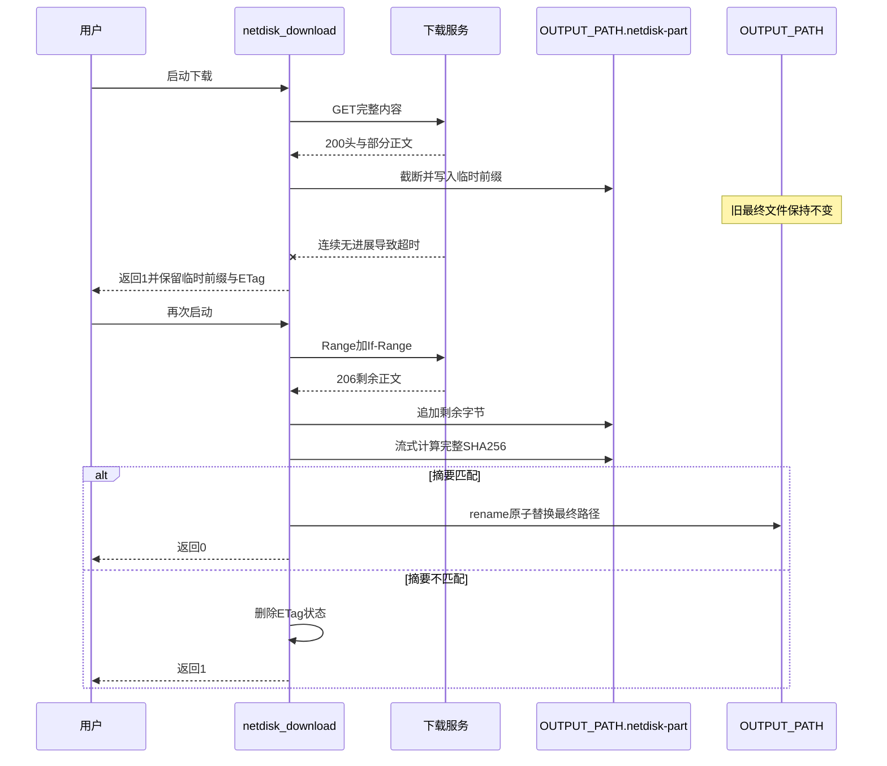

# 第35单元 下载临时产物与完整校验后原子公开

## 今日目标与完成标准

今天把命令行下载客户端从直接写最终路径改为先写同目录临时产物 再在完整性校验通过后一次性公开

完成后可以观察到以下行为

- 下载中的正文只写入 `OUTPUT_PATH.netdisk-part`
- 如果最终路径原来已有旧版本 下载超时或断线后旧版本保持不变
- 重试仍使用保存的强ETag与临时产物长度发送 Range 和 If-Range
- 完整文件的字节数和SHA256都符合服务端元数据后 客户端才用POSIX `rename`替换最终路径
- 成功公开后 `.netdisk-part`名称消失 最终路径一次切换为完整新版本
- 如果完整临时产物已经形成但公开失败 下一次可通过416重新校验并重试公开

本单元的本地参考实现已经完成 Python集成脚本编译检查通过 用户Linux已完成CMake配置 架构守卫与netdisk_download构建 首次聚焦测试因虚拟机仍使用第34单元Python脚本而失败 同步新脚本后的真实Socket集成结果仍待验证

## 前因后果

第33单元建立了严格的断点下载协议 客户端只在206元数据完整一致时追加 收到200时重新下载 收到匹配416时确认本地长度 并最终用SHA256对照强ETag

第34单元增加了可配置数字IPv4端点和连续无进展超时 网络停滞后客户端能够退出并从已保存前缀继续 但前两单元都直接把正文写入最终路径 这会产生两个可见性问题

- 第一次下载未完成时 最终文件名已经指向不完整内容
- 下载新版本收到200时 会先截断已有最终文件 如果随后超时 用户既失去旧版本又没有完整新版本

第35单元解决的是本地发布边界 下载和校验阶段只修改旁车临时产物 完整校验成功后才切换最终名称 这为第五阶段的摘要与下载续传收口 下一单元开始进入上传会话模型

## 术语定义

### 临时产物

`OUTPUT_PATH.netdisk-part`是与最终文件位于同一目录的下载中间结果 它可以是不完整前缀 与服务端强ETag状态共同支持续传 它不同于服务端上传临时对象 只属于本地下载客户端

### 公开

公开是让最终路径开始指向已经完成且校验通过的新文件 在本单元中公开操作是 `rename(partial_path output_path)` 不是HTTP响应发布 也不是数据库事务

### 原子名称切换

POSIX `rename`在源路径和目标路径位于同一文件系统时 对名称空间的切换具有原子可见性 观察最终路径的其他进程会看到旧文件或新文件 不会看到一半替换状态 这不同于多个 `write` 调用 后者会逐步暴露内容

### 名称原子性与断电持久性

名称原子性只说明并发观察时不会看到中间名称状态 断电持久性说明掉电重启后数据和目录项仍然存在 要获得更强的断电保证通常还要对文件和父目录执行 `fsync` 本单元没有增加 `fsync` 因而不承诺断电零丢失

### 恢复来源

`ResumeSource`区分本次Range起点来自哪里

- `Partial`表示来自新的 `.netdisk-part`临时产物
- `Published`表示来自第33至34单元遗留在最终路径中的可续传前缀 或已经发布的完整文件
- `None`表示没有可用的非空前缀和合法ETag 本次必须从头请求

## 完整端到端逻辑

1. `run_download`验证文件ID 输出路径 数字IPv4 端口与超时参数
2. 客户端分别用 `lstat`检查最终路径和 `.netdisk-part` 两者存在时都必须是普通文件
3. 非空临时产物加合法 `.netdisk-etag`优先成为恢复来源 临时产物不存在时才考虑最终路径 这使新版恢复优先使用下载中状态
4. 有恢复来源时请求携带 `Range: bytes=本地长度-`和`If-Range` 否则发送完整GET
5. 非阻塞Socket完成连接 请求发送和响应头接收 然后严格解析200 206或416
6. 收到200时 客户端截断或创建 `.netdisk-part` 保存新的ETag 再写入完整正文 最终路径保持不变
7. 收到206且来源是新版临时产物时 直接以 `O_APPEND`追加 追加前再次核对临时文件大小
8. 收到206且来源是旧版最终前缀时 先把旧前缀复制到 `.netdisk-part` 再追加响应正文 最终路径仍保持旧内容
9. 收到匹配416且来源是临时产物时 对临时产物重新执行完整校验 这也覆盖上次下载完成但 `rename`失败后的公开重试
10. 收到匹配416且来源是已发布最终文件时 直接校验最终文件 不执行多余替换
11. 完整文件大小必须等于响应计划中的总大小 SHA256必须等于响应强ETag中的64位摘要
12. 摘要不匹配时删除ETag状态并返回失败 临时证据保留 下一次没有合法状态会强制走200并截断旧临时产物
13. 摘要匹配且当前完整文件是临时产物时 调用 `rename`原子替换最终路径 成功后打印完成摘要

所有Socket 文件描述符仍由 `UniqueFd`管理 作用域结束自动关闭 `copy_published_prefix`只有在成功时把新打开的临时文件描述符交给调用方 失败路径会显式关闭

## 图的类型

时序图 Sequence Diagram

## 为什么选择这种图

本单元的关键不是静态类关系 而是客户端 服务端 临时路径和最终路径随时间发生的交互 时序图能同时表达首次超时 重试206 完整校验与最后一次名称切换

## Mermaid



## 图的解释

超时发生时没有对最终路径执行写入 因此旧版本仍可被其他程序读取 重试只补齐临时产物 摘要校验成功后 `rename`才把最终路径一次切换到新文件 摘要失败分支不会公开临时产物

## 设计原因与取舍

### 为什么临时文件必须放在同一目录

`rename`跨文件系统可能返回 `EXDEV` 并失去单次原子替换语义 用固定旁车后缀放在最终路径同一目录 能自然满足同一挂载点这一前提 也不需要复制完整文件后再删除源文件

### 为什么仍保留ETag状态文件

文件长度只能表示已经接收了多少字节 不能证明这些字节属于哪个服务端版本 强ETag把临时前缀绑定到具体内容版本 206只有ETag和Content-Range全部一致才能追加

### 为什么临时产物优先于最终路径

一旦新版客户端已经创建临时产物 它才是下载中的权威状态 如果同时继续根据最终路径发Range 请求偏移会与实际追加对象不一致 临时产物存在但为空时本实现安全地从头请求200

### 为什么兼容旧版最终前缀

第33至34单元可能已经留下最终路径前缀和合法ETag 如果直接忽略 用户需要重新下载全部内容 本实现允许从该长度发Range 但收到可信206后先复制旧前缀到临时产物 再继续追加 后续所有新写入都不再改变最终路径

### 为什么摘要通过后才调用rename

Content-Length只证明接收字节数符合声明 不能发现等长内容损坏 SHA256与强ETag的匹配才证明完整内容版本正确 因此公开必须位于长度检查和摘要检查之后

### 当前没有采用的方案

- 直接写最终文件 实现简单但会暴露半成品并破坏旧版本
- 下载到系统临时目录 可能跨文件系统 无法依赖原子rename
- 每次收到块后都重命名 会让不完整内容冒充最终文件
- 本单元增加文件和目录fsync 会扩大主题到断电持久化 当前只解决进程运行期间的原子可见性

## 架构影响

- 功能归属 `client`模块 仍由 `netdisk_client_lib`实现
- 不新增生产模块 不新增生产目标
- `netdisk_client_lib`直接依赖仍为 `netdisk_api` `netdisk_io` `netdisk_crypto` `netdisk_http`
- 客户端传递闭包仍只包含client api io crypto http和OpenSSL Crypto 不到达server storage metadata maintenance SQLite或nlohmann_json
- 不修改公开头 `download_session.h`与 `DownloadOptions`接口保持不变
- HTTP请求和响应契约不变 服务端不需要修改
- SQLite schema 服务端对象存储格式和上传流程不变
- `netdisk`与 `netdisk_download`目标名不变
- `projects/netdisk/cmake/NetdiskArchitecture.cmake`不需要调整

## 测试影响

本单元复用稳定套件 `download_timeout_integration_tests` 修改已有的未来标准脚本 `tests/integration/download_timeout_integration.py` 不新增测试文件 CTest名称或超时属性

扩展后的一个工作流验证

- 测试开始前最终路径包含一个旧版本
- 假服务端返回200头和7000字节后停滞
- 客户端在约定时间内失败 最终路径仍是旧版本
- `.netdisk-part`精确保存7000字节前缀 ETag状态正确
- 第二个临时端口收到带正确Range与If-Range的请求
- 206补齐后最终路径等于完整新内容 SHA256正确
- 成功公开后 `.netdisk-part`不再存在

这些场景使用相同的客户端进程模型 临时目录 假服务端和超时模型 因此应扩展原套件而不是按DAY编号新增目标 当前总数仍为22个C++测试 21个Python脚本和40个CTest

## 相对第34单元的源码变化

修改文件

- `src/client/download_session.cpp` 新增恢复来源枚举 普通路径检查 旧前缀复制 临时产物打开与原子公开 重写下载会话的本地路径选择
- `tests/integration/download_timeout_integration.py` 扩展既有工作流验证旧最终文件保护 临时前缀续传与成功后临时名称消失 Python实现按项目约定不在教程中展示

相关但未修改的生产头文件和CMake保持原样

## 新增内部接口的参数 返回值 所有权与失败条件

### inspect_regular_file

- 参数 `path`是借用的路径字符串 `exists`和 `size`是输出引用
- 返回true表示路径不存在或是可接受的普通文件 返回false表示lstat失败 路径类型错误或大小异常
- 不打开文件 不持有资源

### copy_published_prefix

- `published_path`是旧版前缀所在最终路径 `partial_path`是新临时路径 `expected_size`来自已发送Range的本地长度
- 成功时返回true并通过 `partial_fd`移交一个已经写到末尾的原始文件描述符 调用方立即交给 `UniqueFd`
- 源文件由函数内 `UniqueFd`管理 失败时临时文件描述符由函数显式关闭
- 源文件类型或大小改变 打开读写失败 复制提前结束或临时文件大小不一致都失败

### open_partial_for_plan

- 根据 `ResumeAction`和 `ResumeSource`选择截断临时产物 追加临时产物 或先复制旧最终前缀
- Replace会创建或截断临时产物 Append只接受大小等于请求偏移的普通临时文件
- 成功时把文件描述符所有权交给调用方 失败时不泄漏描述符

### publish_partial_download

- 两个参数都是借用路径 不接管任何C++对象
- 成功返回true 此时临时名称消失 最终路径指向已校验文件
- `rename`失败返回false并保留临时产物 便于下次重试

## 完整C++源码

本单元修改后的 `src/client/download_session.cpp`完整最终版本如下

```cpp
#include <netdisk/client/download_session.h>

#include <netdisk/api/file_id.h>
#include <netdisk/client/download_protocol.h>
#include <netdisk/crypto/sha256.h>
#include <netdisk/http/response.h>
#include <netdisk/io/posix_io.h>
#include <netdisk/io/unique_fd.h>

#include <algorithm>
#include <arpa/inet.h>
#include <cerrno>
#include <chrono>
#include <cstdint>
// ===== DAY 35 ADDED BEGIN 使用rename发布已校验临时文件 =====
#include <cstdio>
// ===== DAY 35 ADDED END =====
#include <poll.h>
#include <fcntl.h>
#include <iostream>
#include <netinet/in.h>
#include <string>
#include <sys/socket.h>
#include <sys/stat.h>
#include <unistd.h>

namespace
{
constexpr std::size_t max_response_head_size = 8192;
constexpr int max_timeout_ms = 600000;
using MonotonicClock = std::chrono::steady_clock;

// ===== DAY 35 ADDED BEGIN 区分续传来源是临时产物还是已发布文件 =====
enum class ResumeSource
{
    None,
    Partial,
    Published
};
// ===== DAY 35 ADDED END =====

// ===== DAY 35 MODIFIED BEGIN 同时检查最终路径与临时产物路径 =====
bool inspect_regular_file(const std::string& path, bool& exists,
                          std::uint64_t& size)
{
    struct stat info{};
    if (::lstat(path.c_str(), &info) == -1)
    {
        if (errno == ENOENT)
        {
            exists = false;
            size = 0;
            return true;
        }
        print_system_error("lstat download path", errno);
        return false;
    }
    if (!S_ISREG(info.st_mode) || info.st_size < 0)
    {
        std::cerr << "download path must be a regular file: "
                  << path << '\n';
        return false;
    }
    exists = true;
    size = static_cast<std::uint64_t>(info.st_size);
    return true;
}
// ===== DAY 35 MODIFIED END =====

bool read_etag_state(const std::string& path, std::string& etag)
{
    int raw_fd;
    do
    {
        raw_fd = ::open(path.c_str(), O_RDONLY | O_CLOEXEC | O_NOFOLLOW | O_NONBLOCK);
    } while (raw_fd == -1 && errno == EINTR);
    if (raw_fd == -1) return false;
    UniqueFd file(raw_fd);

    struct stat info{};
    if (::fstat(file.get(), &info) == -1 || !S_ISREG(info.st_mode) ||
        info.st_size < 0 || info.st_size > 128)
        return false;
    std::string content(static_cast<std::size_t>(info.st_size), '\0');
    std::size_t received = 0;
    while (received < content.size())
    {
        const ssize_t n = ::read(file.get(), content.data() + received,
                                 content.size() - received);
        if (n == -1)
        {
            if (errno == EINTR) continue;
            return false;
        }
        if (n == 0) return false;
        received += static_cast<std::size_t>(n);
    }
    if (!content.empty() && content.back() == '\n') content.pop_back();
    if (!content.empty() && content.back() == '\r') content.pop_back();
    if (!download_client::is_strong_sha256_etag(content)) return false;
    etag = std::move(content);
    return true;
}

bool write_all_file(int fd, const char* data, std::size_t size)
{
    std::size_t written = 0;
    while (written < size)
    {
        const ssize_t n = ::write(fd, data + written, size - written);
        if (n == -1)
        {
            if (errno == EINTR) continue;
            print_system_error("write download", errno);
            return false;
        }
        if (n == 0)
        {
            std::cerr << "write download made no progress\n";
            return false;
        }
        written += static_cast<std::size_t>(n);
    }
    return true;
}

bool save_etag_state(const std::string& path, std::string_view etag)
{
    int raw_fd;
    do
    {
        raw_fd = ::open(path.c_str(),
            O_WRONLY | O_CREAT | O_TRUNC | O_CLOEXEC | O_NOFOLLOW | O_NONBLOCK,
            0600);
    } while (raw_fd == -1 && errno == EINTR);
    if (raw_fd == -1)
    {
        print_system_error("open ETag state", errno);
        return false;
    }
    UniqueFd file(raw_fd);
    struct stat info{};
    if (::fstat(file.get(), &info) == -1 || !S_ISREG(info.st_mode))
    {
        std::cerr << "ETag state path must be a regular file\n";
        return false;
    }
    const std::string content = std::string(etag) + "\n";
    return write_all_file(file.get(), content.data(), content.size());
}

void report_timeout(const char* operation, int timeout_ms)
{
    std::cerr << operation << " timed out after " << timeout_ms << " ms\n";
}

bool wait_for_socket(int socket_fd, short events,
                     MonotonicClock::time_point deadline,
                     const char* operation, int timeout_ms)
{
    while (true)
    {
        const auto now = MonotonicClock::now();
        if (now >= deadline)
        {
            report_timeout(operation, timeout_ms);
            return false;
        }
        auto remaining = std::chrono::duration_cast<std::chrono::milliseconds>(
            deadline - now).count();
        if (remaining <= 0) remaining = 1;

        pollfd descriptor{};
        descriptor.fd = socket_fd;
        descriptor.events = events;
        const int result = ::poll(&descriptor, 1, static_cast<int>(remaining));
        if (result == -1)
        {
            if (errno == EINTR) continue;
            print_system_error(operation, errno);
            return false;
        }
        if (result == 0)
        {
            report_timeout(operation, timeout_ms);
            return false;
        }
        if ((descriptor.revents & POLLNVAL) != 0)
        {
            std::cerr << operation << " failed because the socket is invalid\n";
            return false;
        }
        if ((descriptor.revents & (events | POLLERR | POLLHUP)) != 0)
            return true;
    }
}

bool connect_to_server(const download_client::DownloadOptions& options,
                       int& socket_fd)
{
    const int raw_fd = ::socket(
        AF_INET, SOCK_STREAM | SOCK_CLOEXEC | SOCK_NONBLOCK, 0);
    if (raw_fd == -1)
    {
        print_system_error("socket", errno);
        return false;
    }
    sockaddr_in address{};
    address.sin_family = AF_INET;
    address.sin_port = htons(options.server_port);
    if (::inet_pton(AF_INET, options.server_ipv4.c_str(),
                    &address.sin_addr) != 1)
    {
        std::cerr << "server host must be a numeric IPv4 address\n";
        ::close(raw_fd);
        return false;
    }

    const int result = ::connect(
        raw_fd, reinterpret_cast<sockaddr*>(&address), sizeof(address));
    if (result == 0)
    {
        socket_fd = raw_fd;
        return true;
    }
    if (errno != EINPROGRESS && errno != EALREADY)
    {
        const int error = errno;
        ::close(raw_fd);
        print_system_error("connect", error);
        return false;
    }

    const auto deadline = MonotonicClock::now() +
        std::chrono::milliseconds(options.timeout_ms);
    while (wait_for_socket(raw_fd, POLLOUT, deadline,
                           "connect", options.timeout_ms))
    {
        int socket_error = 0;
        socklen_t error_size = sizeof(socket_error);
        if (::getsockopt(raw_fd, SOL_SOCKET, SO_ERROR,
                         &socket_error, &error_size) == -1)
        {
            const int error = errno;
            ::close(raw_fd);
            print_system_error("getsockopt SO_ERROR", error);
            return false;
        }
        if (socket_error == 0)
        {
            socket_fd = raw_fd;
            return true;
        }
        if (socket_error == EINPROGRESS || socket_error == EALREADY)
            continue;
        ::close(raw_fd);
        print_system_error("connect", socket_error);
        return false;
    }
    ::close(raw_fd);
    return false;
}

bool send_with_timeout(int socket_fd, const char* data, std::size_t size,
                       int timeout_ms)
{
    std::size_t sent = 0;
    auto deadline = MonotonicClock::now() +
        std::chrono::milliseconds(timeout_ms);
    while (sent < size)
    {
        if (MonotonicClock::now() >= deadline)
        {
            report_timeout("send request", timeout_ms);
            return false;
        }
        const ssize_t count = ::send(
            socket_fd, data + sent, size - sent,
            MSG_NOSIGNAL | MSG_DONTWAIT);
        if (count > 0)
        {
            sent += static_cast<std::size_t>(count);
            deadline = MonotonicClock::now() +
                std::chrono::milliseconds(timeout_ms);
            continue;
        }
        if (count == 0)
        {
            std::cerr << "send request made no progress\n";
            return false;
        }
        if (errno == EINTR) continue;
        if (errno == EAGAIN || errno == EWOULDBLOCK)
        {
            if (!wait_for_socket(socket_fd, POLLOUT, deadline,
                                 "send request", timeout_ms))
                return false;
            continue;
        }
        print_system_error("send request", errno);
        return false;
    }
    return true;
}

ssize_t receive_with_timeout(int socket_fd, char* data, std::size_t size,
                             int timeout_ms, const char* operation)
{
    const auto deadline = MonotonicClock::now() +
        std::chrono::milliseconds(timeout_ms);
    while (true)
    {
        if (MonotonicClock::now() >= deadline)
        {
            report_timeout(operation, timeout_ms);
            return -1;
        }
        const ssize_t count = ::recv(
            socket_fd, data, size, MSG_DONTWAIT);
        if (count >= 0) return count;
        if (errno == EINTR) continue;
        if (errno == EAGAIN || errno == EWOULDBLOCK)
        {
            if (!wait_for_socket(socket_fd, POLLIN, deadline,
                                 operation, timeout_ms))
                return -1;
            continue;
        }
        print_system_error(operation, errno);
        return -1;
    }
}
bool receive_response_head(int socket_fd, std::string& head,
                           std::string& body_prefix, int timeout_ms)
{
    std::string received;
    char buffer[4096];
    while (true)
    {
        const auto boundary = received.find("\r\n\r\n");
        if (boundary != std::string::npos)
        {
            const auto head_size = boundary + 4;
            if (head_size > max_response_head_size)
            {
                std::cerr << "response head exceeds limit\n";
                return false;
            }
            head.assign(received.data(), head_size);
            body_prefix.assign(received.data() + head_size,
                               received.size() - head_size);
            return true;
        }
        if (received.size() > max_response_head_size)
        {
            std::cerr << "response head exceeds limit\n";
            return false;
        }
        const ssize_t n = receive_with_timeout(
            socket_fd, buffer, sizeof(buffer), timeout_ms,
            "receive response head");
        if (n == -1) return false;
        if (n == 0)
        {
            std::cerr << "server closed before response head completed\n";
            return false;
        }
        received.append(buffer, static_cast<std::size_t>(n));
    }
}

// ===== DAY 35 ADDED BEGIN 复制旧最终文件前缀到临时产物再继续追加 =====
bool copy_published_prefix(const std::string& published_path,
                           const std::string& partial_path,
                           std::uint64_t expected_size,
                           int& partial_fd)
{
    int raw_source;
    do
    {
        raw_source = ::open(published_path.c_str(),
            O_RDONLY | O_CLOEXEC | O_NOFOLLOW | O_NONBLOCK);
    } while (raw_source == -1 && errno == EINTR);
    if (raw_source == -1)
    {
        print_system_error("open published download prefix", errno);
        return false;
    }
    UniqueFd source(raw_source);

    struct stat source_info{};
    if (::fstat(source.get(), &source_info) == -1 ||
        !S_ISREG(source_info.st_mode) || source_info.st_size < 0 ||
        static_cast<std::uint64_t>(source_info.st_size) != expected_size)
    {
        std::cerr << "published download changed before prefix copy\n";
        return false;
    }

    int raw_partial;
    do
    {
        raw_partial = ::open(partial_path.c_str(),
            O_WRONLY | O_CREAT | O_TRUNC | O_APPEND |
            O_CLOEXEC | O_NOFOLLOW | O_NONBLOCK,
            0600);
    } while (raw_partial == -1 && errno == EINTR);
    if (raw_partial == -1)
    {
        print_system_error("open partial download for prefix copy", errno);
        return false;
    }

    struct stat partial_info{};
    if (::fstat(raw_partial, &partial_info) == -1 ||
        !S_ISREG(partial_info.st_mode))
    {
        std::cerr << "partial download path must be a regular file\n";
        ::close(raw_partial);
        return false;
    }

    std::uint64_t remaining = expected_size;
    char buffer[16 * 1024];
    while (remaining != 0)
    {
        const auto count = static_cast<std::size_t>(
            std::min<std::uint64_t>(remaining, sizeof(buffer)));
        const ssize_t n = ::read(source.get(), buffer, count);
        if (n == -1)
        {
            if (errno == EINTR) continue;
            print_system_error("read published download prefix", errno);
            ::close(raw_partial);
            return false;
        }
        if (n == 0)
        {
            std::cerr << "published download ended during prefix copy\n";
            ::close(raw_partial);
            return false;
        }
        const auto size = static_cast<std::size_t>(n);
        if (!write_all_file(raw_partial, buffer, size))
        {
            ::close(raw_partial);
            return false;
        }
        remaining -= size;
    }

    if (::fstat(raw_partial, &partial_info) == -1 ||
        partial_info.st_size < 0 ||
        static_cast<std::uint64_t>(partial_info.st_size) != expected_size)
    {
        std::cerr << "partial download size differs after prefix copy\n";
        ::close(raw_partial);
        return false;
    }
    partial_fd = raw_partial;
    return true;
}
// ===== DAY 35 ADDED END =====

// ===== DAY 35 DELETED 删除直接写入最终下载路径的输出打开逻辑 =====
// ===== DAY 35 MODIFIED BEGIN 所有新正文只写入同目录临时产物 =====
bool open_partial_for_plan(const std::string& partial_path,
                           const std::string& published_path,
                           download_client::ResumeAction action,
                           ResumeSource source,
                           std::uint64_t expected_size,
                           int& partial_fd)
{
    if (action == download_client::ResumeAction::Append &&
        source == ResumeSource::Published)
    {
        return copy_published_prefix(
            published_path, partial_path, expected_size, partial_fd);
    }

    int flags = O_WRONLY | O_CLOEXEC | O_NOFOLLOW | O_NONBLOCK;
    if (action == download_client::ResumeAction::Replace)
        flags |= O_CREAT | O_TRUNC;
    else
        flags |= O_APPEND;

    int raw_fd;
    do
    {
        raw_fd = ::open(partial_path.c_str(), flags, 0600);
    } while (raw_fd == -1 && errno == EINTR);
    if (raw_fd == -1)
    {
        print_system_error("open partial download", errno);
        return false;
    }

    struct stat info{};
    if (::fstat(raw_fd, &info) == -1 || !S_ISREG(info.st_mode) ||
        info.st_size < 0 ||
        (action == download_client::ResumeAction::Append &&
         (source != ResumeSource::Partial ||
          static_cast<std::uint64_t>(info.st_size) != expected_size)))
    {
        std::cerr << "partial download changed before response body write\n";
        ::close(raw_fd);
        return false;
    }
    partial_fd = raw_fd;
    return true;
}
// ===== DAY 35 MODIFIED END =====

bool receive_body(int socket_fd, int output_fd, std::string_view prefix,
                  std::uint64_t content_length, int timeout_ms)
{
    if (prefix.size() > content_length)
    {
        std::cerr << "response body exceeds Content-Length\n";
        return false;
    }
    if (!write_all_file(output_fd, prefix.data(), prefix.size())) return false;
    std::uint64_t remaining = content_length - prefix.size();
    char buffer[16 * 1024];
    while (remaining != 0)
    {
        const auto count = static_cast<std::size_t>(
            std::min<std::uint64_t>(remaining, sizeof(buffer)));
        const ssize_t n = receive_with_timeout(
            socket_fd, buffer, count, timeout_ms,
            "receive response body");
        if (n == -1) return false;
        if (n == 0)
        {
            std::cerr << "server closed before Content-Length bytes arrived\n";
            return false;
        }
        const auto size = static_cast<std::size_t>(n);
        if (!write_all_file(output_fd, buffer, size)) return false;
        remaining -= size;
    }
    return true;
}

bool hash_complete_file(const std::string& path, std::uint64_t expected_size,
                        std::string& digest)
{
    int raw_fd;
    do
    {
        raw_fd = ::open(path.c_str(), O_RDONLY | O_CLOEXEC | O_NOFOLLOW | O_NONBLOCK);
    } while (raw_fd == -1 && errno == EINTR);
    if (raw_fd == -1)
    {
        print_system_error("open completed download", errno);
        return false;
    }
    UniqueFd file(raw_fd);
    struct stat info{};
    if (::fstat(file.get(), &info) == -1 || !S_ISREG(info.st_mode) ||
        info.st_size < 0 || static_cast<std::uint64_t>(info.st_size) != expected_size)
    {
        std::cerr << "completed download size differs from response metadata\n";
        return false;
    }
    Sha256Hasher hasher;
    char buffer[16 * 1024];
    while (true)
    {
        const ssize_t n = ::read(file.get(), buffer, sizeof(buffer));
        if (n == -1)
        {
            if (errno == EINTR) continue;
            print_system_error("read completed download", errno);
            return false;
        }
        if (n == 0) break;
        if (!hasher.update(std::string_view(buffer, static_cast<std::size_t>(n))))
        {
            std::cerr << "SHA256 update failed\n";
            return false;
        }
    }
    if (!hasher.finish(digest))
    {
        std::cerr << "SHA256 finish failed\n";
        return false;
    }
    return true;
}

// ===== DAY 35 ADDED BEGIN 摘要通过后原子替换最终下载路径 =====
bool publish_partial_download(const std::string& partial_path,
                              const std::string& output_path)
{
    if (std::rename(partial_path.c_str(), output_path.c_str()) == -1)
    {
        print_system_error("rename verified partial download", errno);
        return false;
    }
    return true;
}
// ===== DAY 35 ADDED END =====

void remove_invalid_state(const std::string& path)
{
    if (::unlink(path.c_str()) == -1 && errno != ENOENT)
        print_system_error("remove invalid ETag state", errno);
}
}

int run_download(std::string_view id, const std::string& output_path)
{
    return run_download(id, output_path, download_client::DownloadOptions{});
}

// ===== DAY 35 MODIFIED BEGIN 使用临时产物恢复并在完整校验后原子发布 =====
int run_download(std::string_view id, const std::string& output_path,
                 const download_client::DownloadOptions& options)
{
    const std::string state_path = output_path + ".netdisk-etag";
    const std::string partial_path = output_path + ".netdisk-part";
    in_addr parsed_address{};
    if (!is_valid_file_id(id) || output_path.empty() ||
        options.server_port == 0 || options.timeout_ms <= 0 ||
        options.timeout_ms > max_timeout_ms ||
        ::inet_pton(AF_INET, options.server_ipv4.c_str(),
                    &parsed_address) != 1)
    {
        std::cerr << "invalid file ID output path or download options\n";
        return 2;
    }

    bool output_exists = false;
    std::uint64_t output_size = 0;
    bool partial_exists = false;
    std::uint64_t partial_size = 0;
    if (!inspect_regular_file(output_path, output_exists, output_size) ||
        !inspect_regular_file(partial_path, partial_exists, partial_size))
        return 1;

    ResumeSource source = ResumeSource::None;
    std::uint64_t local_size = 0;
    std::string saved_etag;
    if (partial_exists)
    {
        if (partial_size != 0 &&
            read_etag_state(state_path, saved_etag))
        {
            source = ResumeSource::Partial;
            local_size = partial_size;
        }
    }
    else if (output_exists && output_size != 0 &&
             read_etag_state(state_path, saved_etag))
    {
        source = ResumeSource::Published;
        local_size = output_size;
    }
    const bool resume = source != ResumeSource::None;

    const std::string authority = options.server_ipv4 + ":" +
                                  std::to_string(options.server_port);
    std::string request;
    if (!download_client::make_download_request(
            id, resume, local_size, saved_etag, authority, request))
    {
        std::cerr << "failed to build download request\n";
        return 1;
    }

    int raw_socket = -1;
    if (!connect_to_server(options, raw_socket)) return 1;
    UniqueFd socket(raw_socket);
    if (!send_with_timeout(socket.get(), request.data(), request.size(),
                           options.timeout_ms))
        return 1;

    std::string response_wire;
    std::string body_prefix;
    if (!receive_response_head(socket.get(), response_wire, body_prefix,
                               options.timeout_ms))
        return 1;
    download_client::ResponseHead response;
    if (!download_client::parse_response_head(response_wire, response))
    {
        std::cerr << "invalid HTTP response head\n";
        return 1;
    }
    const auto plan = download_client::make_resume_plan(
        response, local_size, saved_etag);
    if (plan.action == download_client::ResumeAction::Reject)
    {
        std::cerr << "server response does not satisfy download contract status="
                  << response.status << '\n';
        return 1;
    }
    if ((plan.action == download_client::ResumeAction::Replace ||
         plan.action == download_client::ResumeAction::Append) &&
        body_prefix.size() > response.content_length)
    {
        std::cerr << "response body exceeds Content-Length\n";
        return 1;
    }

    if (plan.action == download_client::ResumeAction::Replace ||
        plan.action == download_client::ResumeAction::Append)
    {
        int raw_partial = -1;
        if (!open_partial_for_plan(
                partial_path, output_path, plan.action,
                source, local_size, raw_partial))
            return 1;
        UniqueFd partial(raw_partial);
        if (plan.action == download_client::ResumeAction::Replace &&
            !save_etag_state(state_path, response.etag))
            return 1;
        if (!receive_body(socket.get(), partial.get(), body_prefix,
                          response.content_length, options.timeout_ms))
            return 1;
    }

    const bool already_published =
        plan.action == download_client::ResumeAction::Complete &&
        source == ResumeSource::Published;
    const std::string& completed_path =
        already_published ? output_path : partial_path;

    std::string digest;
    if (!hash_complete_file(completed_path, plan.total_size, digest) ||
        response.etag.substr(1, 64) != digest)
    {
        std::cerr << "completed download SHA256 differs from ETag\n";
        remove_invalid_state(state_path);
        return 1;
    }
    if (!already_published &&
        !publish_partial_download(partial_path, output_path))
        return 1;

    const char* result = plan.action == download_client::ResumeAction::Append
        ? "resumed with 206"
        : plan.action == download_client::ResumeAction::Replace
            ? "replaced with 200" : "already complete after 416";
    std::cout << "download complete: " << result
              << " bytes=" << plan.total_size << " sha256=" << digest << '\n';
    return 0;
}
// ===== DAY 35 MODIFIED END =====
```

## 实际CMake配置

本单元没有修改CMake 但实际生产目标和测试注册必须与工作区一致 以下完整展示相关配置

### src/client/CMakeLists.txt

```cmake
# ===== DAY 33A MODIFIED BEGIN 客户端依赖闭包排除server storage metadata =====
add_library(netdisk_client_lib STATIC
    download_protocol.cpp
    download_session.cpp
)

target_include_directories(netdisk_client_lib PUBLIC
    "$<BUILD_INTERFACE:${CMAKE_CURRENT_SOURCE_DIR}/include>"
)

target_link_libraries(netdisk_client_lib PUBLIC
    netdisk_api
    netdisk_io
    netdisk_crypto
    netdisk_http
)

add_executable(netdisk_download
    main.cpp
)

target_link_libraries(netdisk_download PRIVATE
    netdisk_client_lib
)
# ===== DAY 33A MODIFIED END =====
```

### tests/integration/CMakeLists.txt

```cmake
# ===== DAY 33A ADDED BEGIN 集中声明保持原名和属性的Python集成测试 =====
function(add_netdisk_integration_test test_name script)
    add_test(NAME ${test_name}
        COMMAND "${Python3_EXECUTABLE}"
            "${CMAKE_CURRENT_SOURCE_DIR}/${script}"
            ${ARGN}
    )
    set_tests_properties(${test_name} PROPERTIES
        TIMEOUT 30
        RUN_SERIAL TRUE
        SKIP_RETURN_CODE 77
    )
endfunction()

add_netdisk_integration_test(upload_integration_tests
    day14_upload_integration.py "$<TARGET_FILE:netdisk>")
add_netdisk_integration_test(download_integration_tests
    day16_download_integration.py "$<TARGET_FILE:netdisk>")
add_netdisk_integration_test(download_headers_integration_tests
    day17_download_headers.py "$<TARGET_FILE:netdisk>")
add_netdisk_integration_test(file_catalog_integration_tests
    day18_file_catalog.py "$<TARGET_FILE:netdisk>")
add_netdisk_integration_test(file_mutation_integration_tests
    day19_file_mutation.py "$<TARGET_FILE:netdisk>")
add_netdisk_integration_test(failure_recovery_integration_tests
    day20_failure_recovery.py "$<TARGET_FILE:netdisk>")
add_netdisk_integration_test(first_release_integration_tests
    day21_first_release.py "$<TARGET_FILE:netdisk>")
add_netdisk_integration_test(metadata_persistence_integration_tests
    day23_metadata_persistence.py "$<TARGET_FILE:netdisk>")
add_netdisk_integration_test(publish_state_integration_tests
    day25_publish_state.py "$<TARGET_FILE:netdisk>")
add_netdisk_integration_test(publishing_recovery_integration_tests
    day26_publishing_recovery.py "$<TARGET_FILE:netdisk>")
add_netdisk_integration_test(deletion_recovery_integration_tests
    day27_deletion_recovery.py "$<TARGET_FILE:netdisk>")
add_netdisk_integration_test(storage_audit_integration_tests
    day28_storage_audit.py "$<TARGET_FILE:netdisk>")
add_netdisk_integration_test(sha256_integration_tests
    day29_sha256.py "$<TARGET_FILE:netdisk>")
add_netdisk_integration_test(digest_backfill_integration_tests
    day30_digest_backfill.py "$<TARGET_FILE:netdisk>")
add_netdisk_integration_test(range_integration_tests
    day31_range.py "$<TARGET_FILE:netdisk>")
add_netdisk_integration_test(if_range_integration_tests
    day32_if_range.py "$<TARGET_FILE:netdisk>")
add_netdisk_integration_test(resume_download_integration_tests
    day33_resume_download.py
    "$<TARGET_FILE:netdisk>"
    "$<TARGET_FILE:netdisk_download>")
# ===== DAY 33A ADDED END =====

# ===== DAY 34 ADDED BEGIN 注册可配置端点超时与恢复工作流测试 =====
add_netdisk_integration_test(download_timeout_integration_tests
    download_timeout_integration.py
    "$<TARGET_FILE:netdisk_download>")
# ===== DAY 34 ADDED END =====
```

## 使用方式

命令行接口没有变化

```text
netdisk_download [--host IPV4] [--port PORT] [--timeout-ms MILLISECONDS] FILE_ID OUTPUT_PATH
```

参数含义

- `FILE_ID`必须符合 `upload-`加六位ASCII字母数字
- `OUTPUT_PATH`是最终公开路径 必须为空路径以外的普通文件路径或尚不存在
- `--host`只接受数字IPv4 默认 `127.0.0.1`
- `--port`范围1至65535 默认8080
- `--timeout-ms`范围1至600000 默认5000 表示网络连续无进展上限

运行期间客户端可能创建

- `OUTPUT_PATH.netdisk-part` 下载中临时产物 成功公开后消失
- `OUTPUT_PATH.netdisk-etag` 当前内容版本的强ETag 成功后继续保留

进程返回值

- 0表示完整SHA256通过且最终路径已经公开 或已发布文件通过416确认
- 1表示网络 文件系统 响应契约 摘要或公开失败
- 2表示命令行参数 文件ID 输出路径或下载选项非法

## Linux同步与验证

以下命令由用户在Linux虚拟机工程目录 `~/projects/netdisk`执行 Windows PowerShell不要直接运行

```sh
cd ~/projects/netdisk
cmake -S . -B build -DCMAKE_BUILD_TYPE=Debug -DBUILD_TESTING=ON
cmake --build build -j2
ctest --test-dir build -N
ctest --test-dir build -R '^download_timeout_integration_tests$' -V
```

如果一直使用 `build-debug` 将四条命令里的 `build`统一替换为 `build-debug` 不创建第二套目录

成功条件

- CMake配置输出 `NetDisk architecture guard passed`
- 构建完成 `netdisk_download`且没有编译或链接错误
- `ctest -N`显示 `Total Tests: 40`
- 聚焦测试实际运行1项并显示Passed 不是SKIP
- 测试输出包含 `PASS: timeout keeps published output and retry atomically replaces it`
- 最后输出 `PASS: download publication integration finished 1 workflow`

该测试自行创建临时目录和两个回环端口 不需要8080空闲 不读写工程真实 `data`目录 不需要额外手工curl

## 必要排错入口

- 报 `partial download path must be a regular file` 检查 `.netdisk-part`是否被目录 符号链接或特殊文件占用
- 报 `partial download changed before response body write` 检查是否有另一个客户端同时使用同一输出路径
- 报 `completed download SHA256 differs from ETag` 说明完整内容与服务版本不一致 状态文件会被删除 下次将强制完整200
- 报 `rename verified partial download` 检查目录写权限 目标路径类型和挂载点限制 完整临时产物会保留
- CTest显示SKIP说明没有在Linux执行
- CMake没有显示架构守卫通过时不能把本单元标记为配置通过

## 当前实际检查结果

已在当前Windows参考工作区执行

- `python -m py_compile tests\integration\download_timeout_integration.py` 成功
- 静态核对生产依赖和实际CMake 未新增模块 目标 依赖或公开头
- 尝试用TDM GCC检查 `download_session.cpp` 但在包含 `sys/socket.h`时失败 原因是Windows工具链没有Linux POSIX系统头 这不是C++源码构建通过证据
- 当前环境没有 `cmake.exe` WSL也没有已安装发行版 因而未运行CMake架构守卫 Linux构建和真实Socket rename集成
- 用户Linux重新配置实际输出 `NetDisk architecture guard passed` 并成功链接 `src/client/netdisk_download`
- `ctest -N`实际确认40项 首次聚焦测试在旧脚本读取不存在的最终路径时失败 该现象与第35单元只写 `.netdisk-part`的新语义一致 不能记录为集成通过
- 本地第35单元测试脚本SHA256为 `d76317f9fbcacb4f79407c1668ba1d30308b1761b924d45c2b7a4bf55d310dbb` 虚拟机同步后需要核对并重跑

## 结果边界

- 本单元保证同一文件系统中的最终路径原子可见 不保证掉电后目录项和数据持久
- 临时路径和最终路径由固定同目录后缀保证通常处于同一文件系统 目录本身仍应由本地用户控制
- 摘要完成到rename之间仍存在本地恶意进程替换路径的竞争 当前没有使用目录文件描述符和 `renameat2`构建更强的本地攻击防护
- 只有单客户端应操作同一个输出路径 并发下载到同一路径会被大小检查尽量拒绝 但没有锁协议
- ETag状态成功后保留 便于重复执行416确认
- HTTP TLS DNS IPv6 并行分块和服务端读写超时仍未实现
- 第35单元只改变客户端下载的本地公开语义 HTTP协议 SQLite schema和服务端存储不变

第35单元在本地参考源码和文档中已经实现 Linux配置 架构守卫和客户端构建已经通过 只有同步新测试脚本并取得聚焦CTest通过结果后 才能把集成验证记录为通过 下一单元是第36单元上传会话模型与创建接口
